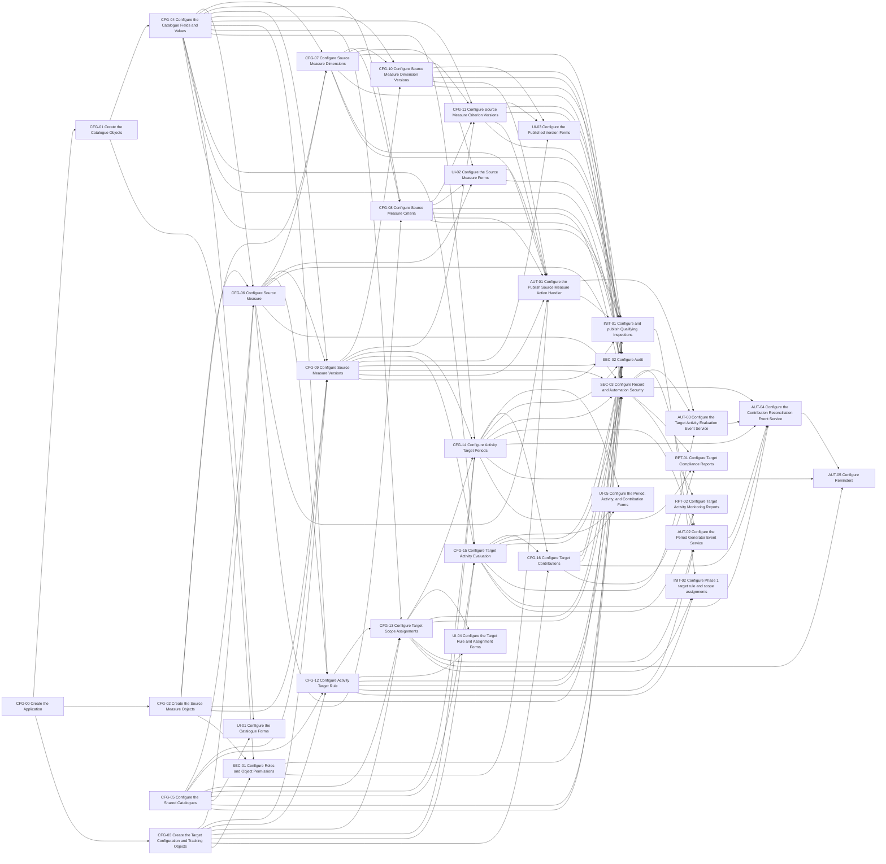

# Technical Implementation Plan: Configurable Operational Activity Targets

## 1. Scope and planning basis

This plan converts the proposed ADR-008 solution specification into assignable Intelex configuration tasks. It covers application and object configuration, fields and relationships, catalogues, forms, security, formulas and business logic, automation and services, and reports. Discovery and tenant verification are supplied by a separate project process and are not represented as tasks in this plan.

Migration and backfill, formal testing, deployment, documentation, training, and project governance are excluded. Implementation-level validation remains inside a task when it is necessary to prove that the configuration itself works.

Tasks are decomposed to fit within an approximately one-day assignment where practical, but no effort estimates are provided. Each dependency below is a strict technical prerequisite: the successor cannot be correctly started or completed without the predecessor's technical output. Approval, staffing, preferred sequencing, and project-management dependencies are not represented as edges.

No custom workflow task is included because the specification explicitly states that no target workflow is required. The workflow-skeleton-before-form rule therefore does not apply to this solution.

Unless the build plan names another approver, the recommended reviewer/approver is the product Build Manager. The role shown below is the recommended proficiency for that authority.

## 2. Task summary

| Task Number | Task Category | Task Name | Objective and Detailed Scope | Recommended Implementer |
|---|---|---|---|---|
| CFG-00 | Application and object configuration | Create the Application | **Objective:** Create the approved application that will contain the Operational Activity Targets configuration.  **Detailed scope:** Create a new application or configure the approved existing application, as directed by the external application-boundary decision. Apply ordinary parameters, localization settings, and administrative ownership. Do not create local duplicates of external or shared authorities. | Associate Consultant. |
| CFG-01 | Application and object configuration | Create the Catalogue Objects | **Objective:** Create the Target Catalogue Value structure selected by the externally supplied inheritance decision.  **Detailed scope:** Create Target Catalogue Value and the ten concrete catalogue objects: Aggregation Method, Dimension Role, Dimension Value Type, Criterion Operator, Null Handling, Scope Basis, Target Direction, Evaluation Status, Compliance Status, and Calculation Health. Apply the approved parent/fallback structure but do not yet create consumer relationships. | Associate Consultant. |
| CFG-02 | Application and object configuration | Create the Source Measure Objects | **Objective:** Create the objects used to configure Source Measures and preserve their published versions.  **Detailed scope:** Create Source Measure, Source Measure Dimension Definition, Source Measure Criterion, Source Measure Version, Source Measure Dimension Version, and Source Measure Criterion Version with approved ordinary object parameters. Do not add cross-object relationship fields until all targets exist. | Associate Consultant. |
| CFG-03 | Application and object configuration | Create the Target Configuration and Tracking Objects | **Objective:** Create the objects used to configure targets and track periods, activities, and contributions.  **Detailed scope:** Create Activity Target Rule, Target Scope Assignment, Activity Target Period, Target Activity, and Target Contribution with approved ordinary object parameters. | Associate Consultant. |
| CFG-04 | Catalogues | Configure the Catalogue Fields and Values | **Objective:** Configure the catalogue fields and approved values used throughout the solution.  **Detailed scope:** Configure Code, Name, Active?, and Sort on the parent or each independent fallback object as decided by the external catalogue inheritance result. Configure localization, display fields, uniqueness, default Active? value, new-selection filtering behaviour, and all initial values in sections 7.1.2 through 7.1.11. | Associate Consultant. |
| CFG-05 | Catalogues | Configure the Shared Catalogues | **Objective:** Provide authoritative Unit of Measure and Recurrence Definition records without duplicating tenant authorities.  **Detailed scope:** Apply the externally supplied shared-catalogue disposition. Configure only approved missing fields, display behaviour, filters, validation, and values. Add Records and Hours where authorized. Add weekly, monthly, quarterly, and annual records from the externally validated recurrence configuration. | Senior Associate Consultant. |
| CFG-06 | Fields and relationships | Configure Source Measure | **Objective:** Configure the editable Source Measure record and its navigation to related records.  **Detailed scope:** Create every field and inverse grid in section 7.3.1, including stable Code, source object/relationship system names, Aggregation Method, Unit of Measure, Active Version, and navigation to definitions, criteria, versions, and rules. Apply display, editability, filters, defaults, and first-publish locking behaviour that can be configured at field level. | Senior Associate Consultant. |
| CFG-07 | Fields and relationships | Configure Source Measure Dimensions | **Objective:** Configure the approved source-field mappings used to build expressions and evaluate Inspection records.  **Detailed scope:** Create the fields and relationships in section 7.3.2, including parent context, role, source field system name, value type, null handling, sort, active state, filters, and ordinary defaults. Configure uniqueness within Source Measure where natively supported. | Senior Associate Consultant. |
| CFG-08 | Fields and relationships | Configure Source Measure Criteria | **Objective:** Configure the editable eligibility criteria and link them to valid criterion dimensions.  **Detailed scope:** Create all fields in section 7.3.3, same-measure and active-criterion-dimension filtering, operator filtering, comparison-value storage, sort/default logic, active state, and ordinary canonical-format guidance. | Senior Associate Consultant. |
| CFG-09 | Fields and relationships | Configure Source Measure Versions | **Objective:** Configure the record that preserves each published Source Measure and its compiled expression.  **Detailed scope:** Create all fields and inverse grids in section 7.4.1, including version identity, copied configuration values, Compiled Expression, Active?, Published On/By, and navigation to related version records and records that use the published configuration. Apply read-only specialist visibility and catalogue relationship behaviour. | Senior Associate Consultant. |
| CFG-10 | Fields and relationships | Configure Source Measure Dimension Versions | **Objective:** Configure the read-only records that preserve the dimension mappings for each published Source Measure.  **Detailed scope:** Create all fields and relationships in section 7.4.2, including the parent version, original dimension definition, copied values, catalogue references, sort order, visibility, and read-only behaviour. | Associate Consultant. |
| CFG-11 | Fields and relationships | Configure Source Measure Criterion Versions | **Objective:** Configure the read-only records that preserve the criteria for each published Source Measure.  **Detailed scope:** Create all fields and relationships in section 7.4.3, including the parent version, original criterion, Dimension Version link, operator, comparison value, sort order, visibility, and read-only behaviour. | Associate Consultant. |
| CFG-12 | Fields and relationships | Configure Activity Target Rule | **Objective:** Configure target rules and connect them to the approved Source Measure, recurrence, scope, and time zone settings.  **Detailed scope:** Create all fields and inverse grids in section 7.5.1, including non-negative Required Value, Active Version eligibility for Source Measure, stable-Code catalogues, Business Time Zone, At-Risk Lead Days, and lifecycle locking after periods exist. | Senior Associate Consultant. |
| CFG-13 | Fields and relationships | Configure Target Scope Assignments | **Objective:** Configure effective-dated target assignments for the enterprise, a Location, or an Operational Resource, including reminder recipients.  **Detailed scope:** Create all fields and inverse grids in section 7.5.2. Configure conditional visibility, clearing, and mandatory logic from Scope Basis and Anchor Required?; filter Operational Resource by Location; validate date ordering and Location ownership; apply lifecycle locking after periods exist. | Senior Associate Consultant. |
| CFG-14 | Fields and relationships | Configure Activity Target Periods | **Objective:** Configure the read-only period record used to track each target, including periods with no activity.  **Detailed scope:** Create all fields and inverse grids in section 7.5.3, including the display calculation, assignment and version identity, inclusive dates, copied scope, target and unit values, At-Risk On, Actual Value, compliance, health, reconciliation timestamp, and contribution navigation. Configure the fields needed to prevent duplicate periods. | Senior Associate Consultant. |
| CFG-15 | Formulas and business logic | Configure Target Activity Evaluation | **Objective:** Configure the Target Activity record that evaluates each Inspection against a published Source Measure.  **Detailed scope:** Create all fields and inverse grids in section 7.6.1. Configure source and version identity, copied expression, extracted date and scope, Unit, status and timestamp, display calculation, the fields needed to prevent duplicate activities, and the verified local `EVAL()` calculated decimal. Preserve a blank result as nonqualifying and zero as qualifying. | Consultant. |
| CFG-16 | Fields and relationships | Configure Target Contributions | **Objective:** Configure the linking object between Activity Target Periods and qualifying Target Activities.  **Detailed scope:** Create the two owning M:1 relationships, inverse grids, Contribution Value, read-only and audit behaviour, and the fields needed to prevent duplicate contributions as defined in section 7.6.2. | Associate Consultant. |
| UI-01 | Forms | Configure the Catalogue Forms | **Objective:** Provide consistent administration forms for local and approved shared catalogue maintenance.  **Detailed scope:** Lay out fields, sections, help text, initial-value grids, and ordinary active/inactive administration behaviour for the local catalogue family and any shared catalogue fields owned by this solution. | Associate Consultant. |
| UI-02 | Forms | Configure the Source Measure Forms | **Objective:** Provide coherent authoring screens for Source Measure, Dimension Definition, and Criterion configuration.  **Detailed scope:** Configure sections, child grids, create contexts, visibility, editability, active filters, field guidance, and layout for the three authoring objects. Make specialist-only system-name fields distinguishable from configuration-administrator fields. | Senior Associate Consultant. |
| UI-03 | Forms | Configure the Published Version Forms | **Objective:** Allow authorized administrators to review published Source Measure settings without changing them.  **Detailed scope:** Configure read-only Source Measure Version, Dimension Version, and Criterion Version forms with specialist visibility for system names and compiled expression, related-record grids, links to the original records, and navigation to records that use the published version. | Associate Consultant. |
| UI-04 | Forms | Configure the Target Rule and Assignment Forms | **Objective:** Provide safe administration of targets, scope, recurrence, effective dates, and reminder recipients.  **Detailed scope:** Configure rule and assignment layouts, scope-dependent show/hide/clear/mandatory actions, recurrence-anchor behaviour, active filters, child period grids, and lock-state presentation after periods exist. | Senior Associate Consultant. |
| UI-05 | Forms | Configure the Period, Activity, and Contribution Forms | **Objective:** Provide secure diagnostic and analytical access to periods, activities, and contributions.  **Detailed scope:** Configure read-only forms and grids for Activity Target Period, Target Activity, and Target Contribution, including compliance plus Calculation Health, source navigation, contribution drill-through, specialist-only expression fields, and failure-monitoring fields. | Senior Associate Consultant. |
| SEC-01 | Security | Configure Roles and Object Permissions | **Objective:** Configure the approved roles and their basic access to each solution object.  **Detailed scope:** Configure Configuration Administrator, Target Administrator, Target Analyst, Target Automation Service, and ordinary-source-user object permissions for every application object. Keep system-managed operational objects read-only to business users; defer record, relationship, field, and service-account nuances to SEC-03. | Associate Consultant. |
| SEC-02 | Security | Configure Audit | **Objective:** Enable the required Intelex audit history after the object and field configuration is complete.  **Detailed scope:** Enable native audit on solution-owned mutable catalogues, authoring, rule, assignment, period, activity, and contribution objects and on their auditable fields and relationships. Enable contribution-deletion audit where supported. Preserve native Action Handler and Event Service logs as execution evidence rather than creating custom evidence objects. | Senior Associate Consultant. |
| SEC-03 | Security | Configure Record and Automation Security | **Objective:** Prevent cross-object data leakage and restrict automation to approved records and fields.  **Detailed scope:** Configure the externally supplied security-control map for record access, field visibility, source navigation, direct URLs, search, export, inverse grids, and minimum access for the automation account. Ensure Target Activity access does not disclose an unauthorized Inspection and Inspection access does not imply target-configuration access. | Senior Consultant. |
| AUT-01 | Automation and services | Configure the Publish Source Measure Action Handler | **Objective:** Publish a complete read-only Source Measure version and validated expression without leaving a partial or duplicate version.  **Detailed scope:** Configure permission and lock checks; validate the Source Measure, dimensions, criteria, allowed combinations, operators, and approved value formats; assign the version number; create the version and its related dimension and criterion records; build and validate the expression using the external `EVAL()` contract; activate the complete version as one controlled change; populate links to the original records and Published On/By; and make the action safe to run again without creating duplicates. Add the action to the Source Measure form and lock the required authoring fields after the first publication. | Senior Consultant. |
| AUT-02 | Automation and services | Configure the Period Generator Event Service | **Objective:** Create Activity Target Periods for active assignments so that every required period can be tracked, including periods with no Inspection activity.  **Detailed scope:** Configure the service to identify eligible assignments; calculate recurrence dates in Business Time Zone; select the Active Version; apply assignment effective dates and the generation horizon; copy the required target, unit, version, and scope values into each period; calculate At-Risk On; create or update one period for each unique assignment and date range; validate Location and Operational Resource ownership; prevent conflicting updates; record execution results; and run again safely without creating duplicates. Use the externally approved recurrence, automation-method, and service-setting decisions. | Senior Consultant. |
| AUT-03 | Automation and services | Configure the Target Activity Evaluation Event Service | **Objective:** Create or update one evaluated Target Activity per Inspection and applicable measure version.  **Detailed scope:** Configure the service to identify new or changed Inspection records using the approved last-run and overlap method; select the applicable published Source Measure version; create or update one Target Activity for each Inspection and version; copy identity and expression values; populate the published dimensions; validate Location ownership; save the record so `EVAL()` recalculates; update status and timestamps; continue processing after an individual error; record execution results; and use only the minimum required source access. | Senior Consultant. |
| AUT-04 | Automation and services | Configure the Contribution Reconciliation Event Service | **Objective:** Attribute qualifying evaluated values to matching periods and maintain reliable totals, statuses, and health.  **Detailed scope:** Configure the service to match Target Activities to periods by Source Measure version, inclusive date, Location, and Operational Resource; create or update contributions; remove contributions that are no longer valid; recalculate each period total while preventing conflicting updates; apply At Least and At Most compliance rules; set Calculation Health when evaluations fail; update timestamps; record execution results; run on the approved schedule; and run again safely without creating duplicates. | Senior Consultant. |
| AUT-05 | Automation and services | Configure Reminders | **Objective:** Notify responsible and escalation workgroups from period state without adding a custom reminder object.  **Detailed scope:** Configure native reminders using At-Risk On, Period End, Compliance Status, Responsible Workgroup, and optional Escalation Workgroup. Resolve current workgroup membership at send time and retain native notification evidence. | Consultant. |
| RPT-01 | Reports | Configure Target Compliance Reports | **Objective:** Provide target compliance reporting that includes periods with no activity and allows authorized users to review contributing activities.  **Detailed scope:** Configure period-level reports and views showing target, Actual Value, Unit, direction, dates, scope, Compliance Status, Calculation Health, and Last Reconciled On. Add contribution-level details and drill-through without bypassing source security. | Consultant. |
| RPT-02 | Reports | Configure Target Activity Monitoring Reports | **Objective:** Provide authorized monitoring of evaluated, nonqualifying, and failed source activities.  **Detailed scope:** Configure Target Activity-level monitoring by measure version, evaluation status and date, scope, unit, and value, with protected source navigation and filters focused on failed evaluations. | Consultant. |
| INIT-01 | Catalogues and initial configuration records | Configure and publish Qualifying Inspections | **Objective:** Create the first governed Count measure using verified Inspection dimensions and criteria.  **Detailed scope:** Create Qualifying Inspections as Inspection / Count / Records; add the activity-date, Location, Operational Resource, type, checklist, workflow-status, and outcome dimensions and criteria from the externally approved Phase 1 Inspection mapping; publish through AUT-01 and confirm that the published version and all related dimension and criterion records are complete. | Consultant. |
| INIT-02 | Catalogues and initial configuration records | Configure Phase 1 target rule and scope assignments | **Objective:** Configure the approved annual target and Location/Operational Resource assignments for Phase 1.  **Detailed scope:** Create the At Least 2 Records annual rule using the active Qualifying Inspections measure and approved Business Time Zone, at-risk settings, responsible/escalation workgroups, effective dates, and one assignment per required Location/Operational Resource combination. | Consultant. |

## 3. External inputs and constraints

The following results must be supplied by the project's separate discovery and tenant-verification process. They are not implementation tasks, are not assigned consulting roles, and do not appear in the dependency diagram. An affected implementation task remains blocked until its required input is available.

| External input | Required outcome | Affected implementation components |
|---|---|---|
| Tenant metadata and external relationship map | Verified stable IDs, object and field system names, ownership, native metadata, Operational Resource-to-Location authority, and approved Inspection navigation | Application boundary, target rules and assignments, periods, activities, security, and Phase 1 configuration |
| Shared catalogue disposition | Approved reuse, extension, or local-creation decision for Unit of Measure and Recurrence Definition | Shared catalogue configuration and all consumers |
| Catalogue inheritance decision | Confirmed abstract-parent support and inherited Code uniqueness, or approved independent-catalogue fallback | Local catalogue object family |
| `EVAL()` expression contract | Approved traversal, literal, escaping, coercion, null/zero, error, recalculation, and length behaviour | Version expression storage, Target Activity evaluation, Publish, and evaluation service |
| Recurrence and period-boundary decisions | Validated recurrence expressions, anchors, inclusive boundaries, week/quarter conventions, daylight-saving behaviour, and time-zone conversion | Shared recurrence catalogue, rules, assignments, periods, and Period Generator |
| Automation method decisions | Approved methods for duplicate prevention, conflicting-run handling, controlled multi-record changes, identifying records changed since the last run, retry, execution logs, relationship and deletion audit, and automation-account access | Security, Publish, and all Event Services |
| Phase 1 Inspection mapping | Approved source fields, value types, null rules, operators, and canonical values for Qualifying Inspections | Initial Qualifying Inspections configuration |
| Service operating parameters | Approved generation horizon, cadences, concurrency, retry, watermark/overlap, recalculable-period boundary, and technical alerts | Period Generator, evaluation, and reconciliation services |
| Security and audit control map | Approved controls for object, field, record, navigation, direct URL, search, export, inverse-grid, service-account, retention, and deletion audit | Forms, object security, nuanced security, and reports |

## 4. Application, object, field, and relationship configuration

### CFG-00 — Create the Application

- **Category:** Application and object configuration
- **Objective:** Create the approved application that will contain the Operational Activity Targets configuration.
- **Detailed scope:** Create a new application or configure the approved existing application, as directed by the external application-boundary decision. Apply ordinary parameters, localization settings, and administrative ownership. Do not create local duplicates of external or shared authorities.
- **Deliverable:** Configured application ready for the solution objects.
- **Strict technical prerequisites:** None.
- **Blocked status:** Blocked until the external tenant metadata confirms the application boundary and approved identity.
- **Recommended implementer role:** Associate Consultant.
- **Recommended reviewer/approver role:** Senior Consultant.
- **Role rationale:** Application creation and ordinary parameters are established Associate-level work; review protects the ownership boundary.
- **Acceptance criteria:** The approved application exists with its verified name/system identity and can host the proposed local objects without claiming ownership of external objects.
- **Specification references:** Sections 4, 5, and 14.
- **Assumptions and open questions:** The final application display and system names are supplied by the external tenant-verification process or the Build Manager.

### CFG-01 — Create the Catalogue Objects

- **Category:** Application and object configuration
- **Objective:** Create the Target Catalogue Value structure selected by the externally supplied inheritance decision.
- **Detailed scope:** Create Target Catalogue Value and the ten concrete catalogue objects: Aggregation Method, Dimension Role, Dimension Value Type, Criterion Operator, Null Handling, Scope Basis, Target Direction, Evaluation Status, Compliance Status, and Calculation Health. Apply the approved parent/fallback structure but do not yet create consumer relationships.
- **Deliverable:** All local catalogue objects with the approved parent structure and object settings.
- **Strict technical prerequisites:** CFG-00.
- **Blocked status:** Blocked pending CFG-00 and the external catalogue inheritance decision.
- **Recommended implementer role:** Associate Consultant.
- **Recommended reviewer/approver role:** Senior Consultant.
- **Role rationale:** Repetitive object creation is Associate-level work once the inheritance pattern is decided.
- **Acceptance criteria:** All eleven objects exist, have the approved parent structure, and expose no unintended direct instances of the abstract parent.
- **Specification references:** Sections 5, 6, and 7.1.
- **Assumptions and open questions:** None after the external catalogue inheritance decision is supplied.

### CFG-02 — Create the Source Measure Objects

- **Category:** Application and object configuration
- **Objective:** Create the objects used to configure Source Measures and preserve their published versions.
- **Detailed scope:** Create Source Measure, Source Measure Dimension Definition, Source Measure Criterion, Source Measure Version, Source Measure Dimension Version, and Source Measure Criterion Version with approved ordinary object parameters. Do not add cross-object relationship fields until all targets exist.
- **Deliverable:** Six Source Measure objects ready for field and relationship configuration.
- **Strict technical prerequisites:** CFG-00.
- **Blocked status:** Blocked pending CFG-00.
- **Recommended implementer role:** Associate Consultant.
- **Recommended reviewer/approver role:** Senior Consultant.
- **Role rationale:** Object creation and ordinary parameters are within the Associate profile; separation from relationships prevents circular build ordering.
- **Acceptance criteria:** All six objects exist with approved names, system identities, localization, and audit eligibility.
- **Specification references:** Sections 5, 7.3, and 7.4.
- **Assumptions and open questions:** Stable object system names remain subject to the approved naming convention.

### CFG-03 — Create the Target Configuration and Tracking Objects

- **Category:** Application and object configuration
- **Objective:** Create the objects used to configure targets and track periods, activities, and contributions.
- **Detailed scope:** Create Activity Target Rule, Target Scope Assignment, Activity Target Period, Target Activity, and Target Contribution with approved ordinary object parameters.
- **Deliverable:** Five target configuration and tracking objects ready for field and relationship configuration.
- **Strict technical prerequisites:** CFG-00.
- **Blocked status:** Blocked pending CFG-00.
- **Recommended implementer role:** Associate Consultant.
- **Recommended reviewer/approver role:** Senior Consultant.
- **Role rationale:** This is bounded object creation; the relationship and automation complexity is deferred to later tasks.
- **Acceptance criteria:** All five objects exist with approved identities and audit eligibility, and none contains an invented generic source-record key.
- **Specification references:** Sections 5, 7.5, and 7.6.
- **Assumptions and open questions:** None.

### CFG-04 — Configure the Catalogue Fields and Values

- **Category:** Catalogues
- **Objective:** Configure the catalogue fields and approved values used throughout the solution.
- **Detailed scope:** Configure Code, Name, Active?, and Sort on the parent or each independent fallback object as decided by the external catalogue inheritance result. Configure localization, display fields, uniqueness, default Active? value, new-selection filtering behaviour, and all initial values in sections 7.1.2 through 7.1.11.
- **Deliverable:** Ten usable local catalogues with governed initial values.
- **Strict technical prerequisites:** CFG-01.
- **Blocked status:** Blocked pending CFG-01.
- **Recommended implementer role:** Associate Consultant.
- **Recommended reviewer/approver role:** Senior Consultant.
- **Role rationale:** Field creation, defaults, display properties, and seed values are Associate-level once the inheritance decision is fixed.
- **Acceptance criteria:** Every specified code exists once, Names are localizable, Code is not localizable, Active? defaults to true, and no catalogue consumer needs to compare localized Name.
- **Specification references:** Sections 7.1 and 10.
- **Assumptions and open questions:** None after the external catalogue inheritance result is supplied.

### CFG-05 — Configure the Shared Catalogues

- **Category:** Catalogues
- **Objective:** Provide authoritative Unit of Measure and Recurrence Definition records without duplicating tenant authorities.
- **Detailed scope:** Apply the externally supplied shared-catalogue disposition. Configure only approved missing fields, display behaviour, filters, validation, and values. Add Records and Hours where authorized. Add weekly, monthly, quarterly, and annual records from the externally validated recurrence configuration.
- **Deliverable:** Reconciled shared catalogues usable by rules, versions, periods, and activities.
- **Strict technical prerequisites:** None.
- **Blocked status:** Blocked until the external shared-catalogue disposition and validated recurrence configuration are supplied.
- **Recommended implementer role:** Senior Associate Consultant.
- **Recommended reviewer/approver role:** Senior Consultant.
- **Role rationale:** Most work is catalogue configuration, but recurrence validation and controlled extension of shared authorities require stronger judgment than routine field creation.
- **Acceptance criteria:** One authoritative object exists for each catalogue; required records validate; Decimal Places and Anchor Required? rules work; no external object is reparented.
- **Specification references:** Sections 7.2, 14, and 16.
- **Assumptions and open questions:** Existing records may satisfy some initial values and must be reused rather than duplicated.

### CFG-06 — Configure Source Measure

- **Category:** Fields and relationships
- **Objective:** Configure the editable Source Measure record and its navigation to related records.
- **Detailed scope:** Create every field and inverse grid in section 7.3.1, including stable Code, source object/relationship system names, Aggregation Method, Unit of Measure, Active Version, and navigation to definitions, criteria, versions, and rules. Apply display, editability, filters, defaults, and first-publish locking behaviour that can be configured at field level.
- **Deliverable:** Complete Source Measure object configuration, excluding Publish automation.
- **Strict technical prerequisites:** CFG-02, CFG-03, CFG-04, and CFG-05.
- **Blocked status:** Blocked pending all predecessors.
- **Recommended implementer role:** Senior Associate Consultant.
- **Recommended reviewer/approver role:** Senior Consultant.
- **Role rationale:** The object combines numerous relationships, conditional defaults, filtering, inverse grids, and lifecycle editability, but not yet the high-complexity publish automation.
- **Acceptance criteria:** Every canonical field and inverse grid exists once; Count defaults to Records through supported logic; catalogue inverses are disabled; Active Version is read-only and nullable before first Publish.
- **Specification references:** Section 7.3.1.
- **Assumptions and open questions:** First-publish locking may be finalized in AUT-01 if it cannot be enforced solely at field level.

### CFG-07 — Configure Source Measure Dimensions

- **Category:** Fields and relationships
- **Objective:** Configure the approved source-field mappings used to build expressions and evaluate Inspection records.
- **Detailed scope:** Create the fields and relationships in section 7.3.2, including parent context, role, source field system name, value type, null handling, sort, active state, filters, and ordinary defaults. Configure uniqueness within Source Measure where natively supported.
- **Deliverable:** Complete authoring dimension object ready for forms and Publish validation.
- **Strict technical prerequisites:** CFG-02, CFG-04, and CFG-06.
- **Blocked status:** Blocked pending all configuration predecessors.
- **Recommended implementer role:** Senior Associate Consultant.
- **Recommended reviewer/approver role:** Senior Consultant.
- **Role rationale:** Relationship filters and mapping logic require more than routine field creation, but the complex cardinality enforcement belongs to Publish automation.
- **Acceptance criteria:** Fields match the contract; parent locks after first save; role/type/null selections use active Code-based catalogues; source field mapping can store every approved source-mapping value.
- **Specification references:** Sections 7.3.2 and 8.
- **Assumptions and open questions:** Exact source mappings are supplied by the separate discovery process and do not block the standard object and field configuration.

### CFG-08 — Configure Source Measure Criteria

- **Category:** Fields and relationships
- **Objective:** Configure the editable eligibility criteria and link them to valid criterion dimensions.
- **Detailed scope:** Create all fields in section 7.3.3, same-measure and active-criterion-dimension filtering, operator filtering, comparison-value storage, sort/default logic, active state, and ordinary canonical-format guidance.
- **Deliverable:** Complete criterion authoring object ready for forms and Publish validation.
- **Strict technical prerequisites:** CFG-02, CFG-04, and CFG-07.
- **Blocked status:** Blocked pending all predecessors.
- **Recommended implementer role:** Senior Associate Consultant.
- **Recommended reviewer/approver role:** Senior Consultant.
- **Role rationale:** Cross-object filtering, canonical-value handling, and operator/type compatibility are medium-complexity business logic.
- **Acceptance criteria:** Only an active criterion dimension from the same Source Measure can be selected; operator choices are type-compatible; all approved canonical values can be stored without localization loss.
- **Specification references:** Sections 7.3.3 and 8.
- **Assumptions and open questions:** `OP_IN` serialization is governed by the externally supplied `EVAL()` expression contract and validated during Publish.

### CFG-09 — Configure Source Measure Versions

- **Category:** Fields and relationships
- **Objective:** Configure the record that preserves each published Source Measure and its compiled expression.
- **Detailed scope:** Create all fields and inverse grids in section 7.4.1, including version identity, copied configuration values, Compiled Expression, Active?, Published On/By, and navigation to related version records and records that use the published configuration. Apply read-only specialist visibility and catalogue relationship behaviour.
- **Deliverable:** Complete read-only Source Measure Version object and field configuration, excluding publication automation.
- **Strict technical prerequisites:** CFG-02, CFG-03, CFG-04, CFG-05, and CFG-06.
- **Blocked status:** Blocked pending all configuration predecessors and the external `EVAL()` expression contract.
- **Recommended implementer role:** Senior Associate Consultant.
- **Recommended reviewer/approver role:** Senior Consultant.
- **Role rationale:** The fields follow established patterns, but the read-only published values, expression storage, and many inverse relationships increase the consequence of errors and the need for review.
- **Acceptance criteria:** Every copied value and navigation field exists; Compiled Expression supports the externally verified limit; fields are read-only to users; AUT-01 can prevent duplicate version numbers using the approved automation method.
- **Specification references:** Section 7.4.1.
- **Assumptions and open questions:** Display label implementation follows the verified platform pattern.

### CFG-10 — Configure Source Measure Dimension Versions

- **Category:** Fields and relationships
- **Objective:** Configure the read-only records that preserve the dimension mappings for each published Source Measure.
- **Detailed scope:** Create all fields and relationships in section 7.4.2, including the parent version, original dimension definition, copied values, catalogue references, sort order, visibility, and read-only behaviour.
- **Deliverable:** Complete Source Measure Dimension Version object and field configuration ready for Publish automation.
- **Strict technical prerequisites:** CFG-04, CFG-07, and CFG-09.
- **Blocked status:** Blocked pending all predecessors.
- **Recommended implementer role:** Associate Consultant.
- **Recommended reviewer/approver role:** Senior Consultant.
- **Role rationale:** This is a bounded read-only object with known field mappings and no independent complex automation.
- **Acceptance criteria:** Each canonical field exists with the specified origin and parent relationships; catalogue inverses are disabled; ordinary users cannot edit records.
- **Specification references:** Section 7.4.2.
- **Assumptions and open questions:** None.

### CFG-11 — Configure Source Measure Criterion Versions

- **Category:** Fields and relationships
- **Objective:** Configure the read-only records that preserve the criteria for each published Source Measure.
- **Detailed scope:** Create all fields and relationships in section 7.4.3, including the parent version, original criterion, Dimension Version link, operator, comparison value, sort order, visibility, and read-only behaviour.
- **Deliverable:** Complete Source Measure Criterion Version object and field configuration ready for Publish automation.
- **Strict technical prerequisites:** CFG-04, CFG-08, CFG-09, and CFG-10.
- **Blocked status:** Blocked pending all predecessors.
- **Recommended implementer role:** Associate Consultant.
- **Recommended reviewer/approver role:** Senior Consultant.
- **Role rationale:** The object is a direct read-only copy of approved criteria once all relationship targets exist.
- **Acceptance criteria:** All canonical fields exist; Dimension Definition Version can be restricted to the same Source Measure Version by Publish validation; ordinary users cannot edit records.
- **Specification references:** Section 7.4.3.
- **Assumptions and open questions:** Cross-parent consistency is enforced in AUT-01.

### CFG-12 — Configure Activity Target Rule

- **Category:** Fields and relationships
- **Objective:** Configure target rules and connect them to the approved Source Measure, recurrence, scope, and time zone settings.
- **Detailed scope:** Create all fields and inverse grids in section 7.5.1, including non-negative Required Value, Active Version eligibility for Source Measure, stable-Code catalogues, Business Time Zone, At-Risk Lead Days, and lifecycle locking after periods exist.
- **Deliverable:** Complete Activity Target Rule configuration.
- **Strict technical prerequisites:** CFG-03, CFG-04, CFG-05, and CFG-06.
- **Blocked status:** Blocked pending tenant and recurrence decisions plus all configuration predecessors.
- **Recommended implementer role:** Senior Associate Consultant.
- **Recommended reviewer/approver role:** Senior Consultant.
- **Role rationale:** The task uses several cross-object filters, validations, and lifecycle rules but no advanced service automation.
- **Acceptance criteria:** All fields match the contract; Required Value cannot be negative; selectable measures have Active Version; identity/scope fields can lock once periods exist.
- **Specification references:** Section 7.5.1.
- **Assumptions and open questions:** Exact locking mechanism may be completed with AUT-02 if period existence cannot be referenced declaratively.

### CFG-13 — Configure Target Scope Assignments

- **Category:** Fields and relationships
- **Objective:** Configure effective-dated target assignments for the enterprise, a Location, or an Operational Resource, including reminder recipients.
- **Detailed scope:** Create all fields and inverse grids in section 7.5.2. Configure conditional visibility, clearing, and mandatory logic from Scope Basis and Anchor Required?; filter Operational Resource by Location; validate date ordering and Location ownership; apply lifecycle locking after periods exist.
- **Deliverable:** Complete Target Scope Assignment configuration.
- **Strict technical prerequisites:** CFG-03, CFG-04, CFG-05, and CFG-12.
- **Blocked status:** Blocked pending verified external relationships, recurrence behaviour, and configuration predecessors.
- **Recommended implementer role:** Senior Associate Consultant.
- **Recommended reviewer/approver role:** Senior Consultant.
- **Role rationale:** Conditional fields, related-record filtering, inherited ownership checks, and lifecycle rules are medium-complexity logic.
- **Acceptance criteria:** Enterprise clears both scope fields; Location requires Location only; Operational Resource requires a resource owned by the selected Location; effective dates and anchor requirements validate; recipient relationships use active Workgroups.
- **Specification references:** Section 7.5.2.
- **Assumptions and open questions:** The authoritative resource-to-Location relationship is supplied by the external tenant-verification process.

### CFG-14 — Configure Activity Target Periods

- **Category:** Fields and relationships
- **Objective:** Configure the read-only period record used to track each target, including periods with no activity.
- **Detailed scope:** Create all fields and inverse grids in section 7.5.3, including the display calculation, assignment and version identity, inclusive dates, copied scope, target and unit values, At-Risk On, Actual Value, compliance, health, reconciliation timestamp, and contribution navigation. Configure the fields needed to prevent duplicate periods.
- **Deliverable:** Complete read-only Activity Target Period object and field configuration.
- **Strict technical prerequisites:** CFG-03, CFG-04, CFG-05, CFG-09, and CFG-13.
- **Blocked status:** Blocked pending all predecessors.
- **Recommended implementer role:** Senior Associate Consultant.
- **Recommended reviewer/approver role:** Senior Consultant.
- **Role rationale:** The object contains several copied values and calculated or display behaviours, while period generation and status automation remain separate.
- **Acceptance criteria:** All canonical fields exist; Actual Value defaults to zero; status and health defaults use stable Codes; period identity supports the externally approved uniqueness enforcement; business users cannot edit generated fields.
- **Specification references:** Section 7.5.3.
- **Assumptions and open questions:** Exact display-field formula syntax is verified during configuration and does not invent unsupported expressions.

### CFG-15 — Configure Target Activity Evaluation

- **Category:** Formulas and business logic
- **Objective:** Configure the Target Activity record that evaluates each Inspection against a published Source Measure.
- **Detailed scope:** Create all fields and inverse grids in section 7.6.1. Configure source and version identity, copied expression, extracted date and scope, Unit, status and timestamp, display calculation, the fields needed to prevent duplicate activities, and the verified local `EVAL()` calculated decimal. Preserve a blank result as nonqualifying and zero as qualifying.
- **Deliverable:** Complete read-only Target Activity object and field configuration, including the calculated evaluation field.
- **Strict technical prerequisites:** CFG-03, CFG-04, CFG-05, and CFG-09.
- **Blocked status:** Blocked pending the externally supplied `EVAL()` expression contract, verified Inspection relationship metadata, and configuration predecessors.
- **Recommended implementer role:** Consultant.
- **Recommended reviewer/approver role:** Senior Consultant.
- **Role rationale:** Although object configuration is bounded, executable expression handling and the high consequence of null/zero or relationship mistakes elevate the minimum role.
- **Acceptance criteria:** The direct Inspection M:1 exists with no generic key; the calculated value uses only the externally approved expression syntax; null and zero remain distinguishable; identity supports the externally approved uniqueness enforcement; users cannot edit service-managed fields.
- **Specification references:** Sections 7.6.1 and 8.
- **Assumptions and open questions:** Future source relationships are out of Phase 1.

### CFG-16 — Configure Target Contributions

- **Category:** Fields and relationships
- **Objective:** Configure the linking object between Activity Target Periods and qualifying Target Activities.
- **Detailed scope:** Create the two owning M:1 relationships, inverse grids, Contribution Value, read-only and audit behaviour, and the fields needed to prevent duplicate contributions as defined in section 7.6.2.
- **Deliverable:** Complete Target Contribution object and field configuration ready for reconciliation automation.
- **Strict technical prerequisites:** CFG-03, CFG-14, and CFG-15.
- **Blocked status:** Blocked pending all predecessors.
- **Recommended implementer role:** Associate Consultant.
- **Recommended reviewer/approver role:** Senior Consultant.
- **Role rationale:** The linking object is straightforward once both relationship targets exist; matching, recalculation, and removal of no-longer-valid contributions remain a separate advanced task.
- **Acceptance criteria:** Both inverse grids reuse their owning M:1 fields; Contribution Value is read-only; identity supports the externally approved uniqueness enforcement; deletion audit can be enabled.
- **Specification references:** Section 7.6.2.
- **Assumptions and open questions:** None.

## 5. Forms and user interface

### UI-01 — Configure the Catalogue Forms

- **Category:** Forms
- **Objective:** Provide consistent administration forms for local and approved shared catalogue maintenance.
- **Detailed scope:** Lay out fields, sections, help text, initial-value grids, and ordinary active/inactive administration behaviour for the local catalogue family and any shared catalogue fields owned by this solution.
- **Deliverable:** Usable catalogue administration forms.
- **Strict technical prerequisites:** CFG-04 and CFG-05.
- **Blocked status:** Blocked pending catalogue configuration.
- **Recommended implementer role:** Associate Consultant.
- **Recommended reviewer/approver role:** Senior Consultant.
- **Role rationale:** Field and section placement plus basic view actions are Associate-level work.
- **Acceptance criteria:** Administrators can maintain permitted fields and values; stable Codes and locked-after-use fields are clearly distinguished; child forms do not redeclare inherited fields.
- **Specification references:** Sections 7.1 and 7.2.
- **Assumptions and open questions:** Existing shared-catalogue forms are modified only when the external shared-catalogue disposition grants ownership.

### UI-02 — Configure the Source Measure Forms

- **Category:** Forms
- **Objective:** Provide coherent authoring screens for Source Measure, Dimension Definition, and Criterion configuration.
- **Detailed scope:** Configure sections, child grids, create contexts, visibility, editability, active filters, field guidance, and layout for the three authoring objects. Make specialist-only system-name fields distinguishable from configuration-administrator fields.
- **Deliverable:** Complete Source Measure forms.
- **Strict technical prerequisites:** CFG-06, CFG-07, and CFG-08.
- **Blocked status:** Blocked pending all three authoring object configurations.
- **Recommended implementer role:** Senior Associate Consultant.
- **Recommended reviewer/approver role:** Senior Consultant.
- **Role rationale:** The forms are larger and contain multiple related grids, conditional guidance, and role-specific fields, requiring stronger layout judgment.
- **Acceptance criteria:** Users can create dimensions and criteria from the parent context; invalid cross-measure selections are unavailable; lifecycle and active-state behaviour is clear.
- **Specification references:** Section 7.3.
- **Assumptions and open questions:** Publish action placement is completed by AUT-01.

### UI-03 — Configure the Published Version Forms

- **Category:** Forms
- **Objective:** Allow authorized administrators to review published Source Measure settings without changing them.
- **Detailed scope:** Configure read-only Source Measure Version, Dimension Version, and Criterion Version forms with specialist visibility for system names and compiled expression, related-record grids, links to the original records, and navigation to records that use the published version.
- **Deliverable:** Complete published-version review forms.
- **Strict technical prerequisites:** CFG-09, CFG-10, and CFG-11.
- **Blocked status:** Blocked pending all published-version object configurations.
- **Recommended implementer role:** Associate Consultant.
- **Recommended reviewer/approver role:** Senior Consultant.
- **Role rationale:** This is standard read-only form and grid layout once visibility requirements are established.
- **Acceptance criteria:** Authorized users can review the published version and all related records and follow links to the original records; ordinary users cannot see specialist-only fields or edit published values.
- **Specification references:** Section 7.4.
- **Assumptions and open questions:** None.

### UI-04 — Configure the Target Rule and Assignment Forms

- **Category:** Forms
- **Objective:** Provide safe administration of targets, scope, recurrence, effective dates, and reminder recipients.
- **Detailed scope:** Configure rule and assignment layouts, scope-dependent show/hide/clear/mandatory actions, recurrence-anchor behaviour, active filters, child period grids, and lock-state presentation after periods exist.
- **Deliverable:** Complete target rule and assignment forms.
- **Strict technical prerequisites:** CFG-12 and CFG-13.
- **Blocked status:** Blocked pending rule and assignment configuration.
- **Recommended implementer role:** Senior Associate Consultant.
- **Recommended reviewer/approver role:** Senior Consultant.
- **Role rationale:** The forms use several related conditional actions and require sound layout judgment, but no custom UI is proposed.
- **Acceptance criteria:** Each Scope Basis presents only valid inputs; hidden inputs clear safely; recurrence anchor and lifecycle locks display correctly; period navigation is available.
- **Specification references:** Sections 7.5.1 and 7.5.2.
- **Assumptions and open questions:** None after the external recurrence and boundary decisions are supplied.

### UI-05 — Configure the Period, Activity, and Contribution Forms

- **Category:** Forms
- **Objective:** Provide secure diagnostic and analytical access to periods, activities, and contributions.
- **Detailed scope:** Configure read-only forms and grids for Activity Target Period, Target Activity, and Target Contribution, including compliance plus Calculation Health, source navigation, contribution drill-through, specialist-only expression fields, and failure-monitoring fields.
- **Deliverable:** Complete read-only period, activity, and contribution forms.
- **Strict technical prerequisites:** CFG-14, CFG-15, and CFG-16.
- **Blocked status:** Blocked pending the external security-control map and the complete object and field configuration for all tracking records.
- **Recommended implementer role:** Senior Associate Consultant.
- **Recommended reviewer/approver role:** Senior Consultant.
- **Role rationale:** Layout is conventional, but security-aware navigation and specialist visibility increase the required judgment.
- **Acceptance criteria:** Compliance never appears without Calculation Health; unauthorized Inspection data is not exposed through labels, links, grids, or expression fields; all operational fields remain read-only.
- **Specification references:** Sections 7.5.3, 7.6, and 10.
- **Assumptions and open questions:** Exact safe source-link presentation follows the external security-control map.

## 6. Security and audit

### SEC-01 — Configure Roles and Object Permissions

- **Category:** Security
- **Objective:** Configure the approved roles and their basic access to each solution object.
- **Detailed scope:** Configure Configuration Administrator, Target Administrator, Target Analyst, Target Automation Service, and ordinary-source-user object permissions for every application object. Keep system-managed operational objects read-only to business users; defer record, relationship, field, and service-account nuances to SEC-03.
- **Deliverable:** Baseline roles and object-level permissions.
- **Strict technical prerequisites:** CFG-01, CFG-02, and CFG-03.
- **Blocked status:** Blocked until the external security-control map is supplied and all solution objects exist.
- **Recommended implementer role:** Associate Consultant.
- **Recommended reviewer/approver role:** Senior Consultant.
- **Role rationale:** Basic object permissions are Associate-level; the external security-control map supplies the nuanced design so this task remains bounded.
- **Acceptance criteria:** Each role has the section 10 object-level access; system-managed objects are read-only to business users; ordinary source access grants no target-configuration write access.
- **Specification references:** Sections 9, 10, and 14.
- **Assumptions and open questions:** Nuanced record, relationship, field, and service controls are deferred to SEC-03.

### SEC-02 — Configure Audit

- **Category:** Security
- **Objective:** Enable the required Intelex audit history after the object and field configuration is complete.
- **Detailed scope:** Enable native audit on solution-owned mutable catalogues, authoring, rule, assignment, period, activity, and contribution objects and on their auditable fields and relationships. Enable contribution-deletion audit where supported. Preserve native Action Handler and Event Service logs as execution evidence rather than creating custom evidence objects.
- **Deliverable:** Complete native object, field, relationship, and contribution-deletion audit configuration.
- **Strict technical prerequisites:** CFG-04, CFG-05, CFG-06, CFG-07, CFG-08, CFG-09, CFG-10, CFG-11, CFG-12, CFG-13, CFG-14, CFG-15, and CFG-16.
- **Blocked status:** Blocked until the external audit-capability decisions are supplied and the complete field and relationship configuration exists.
- **Recommended implementer role:** Senior Associate Consultant.
- **Recommended reviewer/approver role:** Senior Consultant.
- **Role rationale:** Enabling native audit is established configuration, but complete relationship/deletion coverage and evidence-boundary judgment require greater independence than baseline object permissions.
- **Acceptance criteria:** Every specification-required mutable object, supported field and relationship, and contribution deletion is audited; execution evidence remains in native Action Handler/Event Service logs; no custom Audit or Event object is created.
- **Specification references:** Sections 4, 7.6.2, 9, 10, 14, and 16.
- **Assumptions and open questions:** Unsupported audit channels follow the externally approved control map and are not replaced with invented custom objects.

### SEC-03 — Configure Record and Automation Security

- **Category:** Security
- **Objective:** Prevent cross-object data leakage and restrict automation to approved records and fields.
- **Detailed scope:** Configure the externally supplied security-control map for record access, field visibility, source navigation, direct URLs, search, export, inverse grids, and minimum access for the automation account. Ensure Target Activity access does not disclose an unauthorized Inspection and Inspection access does not imply target-configuration access.
- **Deliverable:** Complete tenant-specific security enforcement beyond object permissions.
- **Strict technical prerequisites:** CFG-06, CFG-07, CFG-08, CFG-09, CFG-10, CFG-11, CFG-12, CFG-13, CFG-14, CFG-15, CFG-16, and SEC-01.
- **Blocked status:** Blocked pending the external tenant, automation, and security-control inputs and the complete relationship configuration.
- **Recommended implementer role:** Senior Consultant.
- **Recommended reviewer/approver role:** Principal Consultant.
- **Role rationale:** This is nuanced cross-object and service security with high confidentiality and rework consequences.
- **Acceptance criteria:** Every channel in the external security-control map is controlled; the automation account can read only approved source fields and write only system-managed target fields; no relationship path bypasses source authorization.
- **Specification references:** Sections 9.3, 10, and 14; acceptance test AT-016.
- **Assumptions and open questions:** Any compensating control approved by the separate security-verification process is treated as authoritative.

## 7. Automation and services

### AUT-01 — Configure the Publish Source Measure Action Handler

- **Category:** Automation and services
- **Objective:** Publish a complete read-only Source Measure version and validated expression without leaving a partial or duplicate version.
- **Detailed scope:** Configure permission and lock checks; validate the Source Measure, dimensions, criteria, allowed combinations, operators, and approved value formats; assign the version number; create the version and its related dimension and criterion records; build and validate the expression using the external `EVAL()` contract; activate the complete version as one controlled change; populate links to the original records and Published On/By; and make the action safe to run again without creating duplicates. Add the action to the Source Measure form and lock the required authoring fields after the first publication.
- **Deliverable:** Operational Publish Source Measure action and handler.
- **Strict technical prerequisites:** CFG-06, CFG-07, CFG-08, CFG-09, CFG-10, CFG-11, UI-02, and SEC-01.
- **Blocked status:** Blocked pending the external expression and automation-method decisions plus the complete Source Measure and version configuration.
- **Recommended implementer role:** Senior Consultant.
- **Recommended reviewer/approver role:** Principal Consultant.
- **Role rationale:** The task combines expression building, creation of several related records, validation, locking, duplicate prevention, controlled activation, and safe reruns; failure would cause significant rework across the solution.
- **Acceptance criteria:** A valid Publish creates one complete published version and one Active Version; an invalid Publish leaves no partially active version; repeated or simultaneous runs cannot create duplicate version numbers or two active versions for the same Source Measure; only approved fields and operators are included in the expression.
- **Specification references:** Sections 7.3, 7.4, 8, 9.1, and 16; acceptance tests AT-002–AT-004.
- **Assumptions and open questions:** The externally approved controlled-activation method may use native transaction support or an approved recovery sequence.

### AUT-02 — Configure the Period Generator Event Service

- **Category:** Automation and services
- **Objective:** Create Activity Target Periods for active assignments so that every required period can be tracked, including periods with no Inspection activity.
- **Detailed scope:** Configure the service to identify eligible assignments; calculate recurrence dates in Business Time Zone; select the Active Version; apply assignment effective dates and the generation horizon; copy the required target, unit, version, and scope values into each period; calculate At-Risk On; create or update one period for each unique assignment and date range; validate Location and Operational Resource ownership; prevent conflicting updates; record execution results; and run again safely without creating duplicates. Use the externally approved recurrence, automation-method, and service-setting decisions.
- **Deliverable:** Operational Period Generator Event Service.
- **Strict technical prerequisites:** CFG-12, CFG-13, CFG-14, and SEC-03.
- **Blocked status:** Blocked pending the external recurrence and service-setting decisions plus the complete rule, assignment, and period object configuration.
- **Recommended implementer role:** Senior Consultant.
- **Recommended reviewer/approver role:** Principal Consultant.
- **Role rationale:** Time-zone recurrence, copied period values, conflicting-run handling, duplicate prevention, and safe reruns make this advanced, high-consequence automation.
- **Acceptance criteria:** Eligible assignments produce exactly one period for each approved assignment and date range, with correct inclusive dates and copied values; reruns update the same period; no Inspection is created.
- **Specification references:** Sections 7.5, 9.2, and 14; acceptance tests AT-001, AT-011, and AT-014.
- **Assumptions and open questions:** Backfill execution is excluded; only ongoing generation is implemented.

### AUT-03 — Configure the Target Activity Evaluation Event Service

- **Category:** Automation and services
- **Objective:** Create or update one evaluated Target Activity per Inspection and applicable measure version.
- **Detailed scope:** Configure the service to identify new or changed Inspection records using the approved last-run and overlap method; select the applicable published Source Measure version; create or update one Target Activity for each Inspection and version; copy identity and expression values; populate the published dimensions; validate Location ownership; save the record so `EVAL()` recalculates; update status and timestamps; continue processing after an individual error; record execution results; and use only the minimum required source access.
- **Deliverable:** Operational Target Activity Evaluation Event Service.
- **Strict technical prerequisites:** CFG-15, SEC-03, and AUT-01.
- **Blocked status:** Blocked pending the external expression, automation-method, and service-setting decisions plus the security baseline, Publish action, and Target Activity object configuration.
- **Recommended implementer role:** Senior Consultant.
- **Recommended reviewer/approver role:** Principal Consultant.
- **Role rationale:** This automation processes many protected source records, tracks which records changed, runs approved expressions, and must be safe to run again without creating duplicates.
- **Acceptance criteria:** Each eligible Inspection and version pair has one Target Activity; qualifying Count returns 1; qualifying Sum preserves the number including zero; a nonqualifying Inspection returns a blank value with Successful status; errors retain Failed records and native evidence without stopping other eligible Inspections.
- **Specification references:** Sections 7.6.1, 8, 9.3, and 10; acceptance tests AT-005–AT-010 and AT-015–AT-016.
- **Assumptions and open questions:** Phase 1 selects only Inspection; future sources are excluded.

### AUT-04 — Configure the Contribution Reconciliation Event Service

- **Category:** Automation and services
- **Objective:** Attribute qualifying evaluated values to matching periods and maintain reliable totals, statuses, and health.
- **Detailed scope:** Configure the service to match Target Activities to periods by Source Measure version, inclusive date, Location, and Operational Resource; create or update contributions; remove contributions that are no longer valid; recalculate each period total while preventing conflicting updates; apply At Least and At Most compliance rules; set Calculation Health when evaluations fail; update timestamps; record execution results; run on the approved schedule; and run again safely without creating duplicates.
- **Deliverable:** Operational Contribution Reconciliation Event Service.
- **Strict technical prerequisites:** CFG-14, CFG-15, CFG-16, SEC-03, AUT-02, and AUT-03.
- **Blocked status:** Blocked pending the external automation-method and service-setting decisions plus the complete object configuration and both preceding Event Services.
- **Recommended implementer role:** Senior Consultant.
- **Recommended reviewer/approver role:** Principal Consultant.
- **Role rationale:** Matching across several objects, removing no-longer-valid links, preventing conflicting updates, recalculating status, handling partial failures, and safe reruns are advanced, high-consequence automation.
- **Acceptance criteria:** Matching values create one contribution per unique pair; changed matches update and no-longer-valid matches are removed; Actual Value equals the current contributions; status follows stable-Code rules; evaluation failures affect health without creating contributions; reruns create no duplicates.
- **Specification references:** Sections 7.5.3, 7.6.2, 9.4, and 10; acceptance tests AT-008 and AT-010–AT-015.
- **Assumptions and open questions:** Retention-driven deletion beyond removal of no-longer-valid contributions is excluded.

### AUT-05 — Configure Reminders

- **Category:** Automation and services
- **Objective:** Notify responsible and escalation workgroups from period state without adding a custom reminder object.
- **Detailed scope:** Configure native reminders using At-Risk On, Period End, Compliance Status, Responsible Workgroup, and optional Escalation Workgroup. Resolve current workgroup membership at send time and retain native notification evidence.
- **Deliverable:** Native at-risk and escalation reminder configuration.
- **Strict technical prerequisites:** CFG-13, CFG-14, and AUT-04.
- **Blocked status:** Blocked pending assignments, periods, and reconciled status logic.
- **Recommended implementer role:** Consultant.
- **Recommended reviewer/approver role:** Senior Consultant.
- **Role rationale:** Native reminders are bounded, but their relationship-fed recipients and status conditions require Consultant-level automation judgment.
- **Acceptance criteria:** At-risk reminders use current responsible membership; optional escalation is suppressed when no group is selected; no custom Reminder object is created; native evidence is retained.
- **Specification references:** Sections 9.5, 10, and 14.
- **Assumptions and open questions:** Message content and business ownership are supplied outside this technical plan.

## 8. Reports

### RPT-01 — Configure Target Compliance Reports

- **Category:** Reports
- **Objective:** Provide target compliance reporting that includes periods with no activity and allows authorized users to review contributing activities.
- **Detailed scope:** Configure period-level reports and views showing target, Actual Value, Unit, direction, dates, scope, Compliance Status, Calculation Health, and Last Reconciled On. Add contribution-level details and drill-through without bypassing source security.
- **Deliverable:** Authorized period compliance and contribution attribution reports.
- **Strict technical prerequisites:** CFG-14, CFG-16, and SEC-03.
- **Blocked status:** Blocked pending the reporting object and field configuration and the detailed security configuration.
- **Recommended implementer role:** Consultant.
- **Recommended reviewer/approver role:** Senior Consultant.
- **Role rationale:** Reporting is structurally bounded, but zero-activity representation, health interpretation, drill-through, and security require broader judgment.
- **Acceptance criteria:** Periods with zero activity remain visible; Calculation Health always accompanies compliance; drill-through preserves authorization; no manual totals are treated as calculated evidence.
- **Specification references:** Sections 10 and 14; acceptance tests AT-001, AT-012, and AT-015–AT-016.
- **Assumptions and open questions:** Dashboard styling beyond ordinary reporting is out of scope.

### RPT-02 — Configure Target Activity Monitoring Reports

- **Category:** Reports
- **Objective:** Provide authorized monitoring of evaluated, nonqualifying, and failed source activities.
- **Detailed scope:** Configure Target Activity-level monitoring by measure version, evaluation status and date, scope, unit, and value, with protected source navigation and filters focused on failed evaluations.
- **Deliverable:** Secure evaluation and failure-monitoring reports.
- **Strict technical prerequisites:** CFG-15 and SEC-03.
- **Blocked status:** Blocked pending the Target Activity object and field configuration and the detailed security configuration.
- **Recommended implementer role:** Consultant.
- **Recommended reviewer/approver role:** Senior Consultant.
- **Role rationale:** The report is technically conventional but exposes protected cross-object information and must distinguish null, zero, and failure correctly.
- **Acceptance criteria:** Failed, successful-null, successful-zero, and successful-nonzero states are distinguishable; source links do not reveal unauthorized records or fields.
- **Specification references:** Sections 9.3 and 10; acceptance tests AT-006, AT-008, and AT-015–AT-016.
- **Assumptions and open questions:** Native execution-log linking is included only if the external automation-capability result confirms a supported secure link.

## 9. Initial Phase 1 configuration

### INIT-01 — Configure and publish Qualifying Inspections

- **Category:** Catalogues and initial configuration records
- **Objective:** Create the first governed Count measure using verified Inspection dimensions and criteria.
- **Detailed scope:** Create Qualifying Inspections as Inspection / Count / Records; add the activity-date, Location, Operational Resource, type, checklist, workflow-status, and outcome dimensions and criteria from the externally approved Phase 1 Inspection mapping; publish through AUT-01 and confirm that the published version and all related dimension and criterion records are complete.
- **Deliverable:** One active published Source Measure Version for Qualifying Inspections.
- **Strict technical prerequisites:** CFG-04, CFG-05, CFG-06, CFG-07, CFG-08, CFG-09, CFG-10, CFG-11, UI-02, and AUT-01.
- **Blocked status:** Blocked pending the external tenant, shared-catalogue, `EVAL()`, and Phase 1 Inspection mapping inputs plus all in-plan predecessors.
- **Recommended implementer role:** Consultant.
- **Recommended reviewer/approver role:** Senior Consultant.
- **Role rationale:** Configuration is bounded, but incorrect production criteria or expression publication would cause material rework and inaccurate results.
- **Acceptance criteria:** The Source Measure, dimensions, and criteria match the externally approved Phase 1 Inspection mapping; Publish produces exactly one active, complete version; the compiled expression validates; Count returns 1 only for approved qualifying records.
- **Specification references:** Sections 8, 9.1, and 11.1.
- **Assumptions and open questions:** Final business-approved criteria are supplied by the separate discovery process.

### INIT-02 — Configure Phase 1 target rule and scope assignments

- **Category:** Catalogues and initial configuration records
- **Objective:** Configure the approved annual target and Location/Operational Resource assignments for Phase 1.
- **Detailed scope:** Create the At Least 2 Records annual rule using the active Qualifying Inspections measure and approved Business Time Zone, at-risk settings, responsible/escalation workgroups, effective dates, and one assignment per required Location/Operational Resource combination.
- **Deliverable:** Active Phase 1 Activity Target Rule and validated scope assignments ready for generation.
- **Strict technical prerequisites:** CFG-12, CFG-13, and INIT-01.
- **Blocked status:** Blocked pending approved recurrence/scope inputs and active published measure.
- **Recommended implementer role:** Consultant.
- **Recommended reviewer/approver role:** Senior Consultant.
- **Role rationale:** Record creation is straightforward, but cross-object scope validation and the consequence of mis-scoping compliance targets require Consultant-level judgment.
- **Acceptance criteria:** The rule is At Least 2 Records on the approved annual recurrence; every assignment has valid effective scope and recipients; no Location/Operational Resource mismatch exists.
- **Specification references:** Sections 7.5, 9.2, 9.5, and 11.1.
- **Assumptions and open questions:** Initial scopes, dates, time zone, thresholds, and recipient groups must be supplied by the implementation sponsor.

## 10. Strict technical dependency diagram

The diagram contains only the predecessor relationships stated in the task records. It shows opportunities for parallel work but does not assert a schedule or critical path.

## 11. Assumptions, exclusions, and non-applicable categories

- The specification is a proposed logical design, not an extracted `.ipack`; all tenant identifiers remain untrusted until the separate tenant-verification process supplies the approved metadata.
- Existing shared objects remain governed by their owning applications. This plan adds only the local owning relationships specified in sections 7.2 through 7.7.
- Future Hazard ID and Near Miss sources illustrate extensibility but are not authorized Phase 1 tasks.
- No custom workflow is required, so no simple or full workflow task is present.
- No external integration is specified for Phase 1. Event Services and native reminders are automation tasks, not integration tasks.
- Migration/backfill, formal testing, deployment, documentation, training, and project governance are excluded. Acceptance criteria here are implementation completion checks, not a formal test workstream.
- Optional inverse grids on shared/source objects are implemented only when the separate tenant-verification process confirms owner approval; their absence does not change the owning local M:1 relationship.
- Service schedule configuration is included only to the extent necessary to complete technical Event Service configuration. Operational scheduling governance is outside this plan.

## 12. Specification coverage

| Specification area | Plan coverage |
|---|---|
| Evidence limitations and tenant metadata | External inputs and constraints; no implementation task |
| Target Catalogue Value family | External inheritance input, CFG-01, CFG-04, UI-01, SEC-01, SEC-02 |
| Shared Unit and Recurrence catalogues | External catalogue and recurrence inputs, CFG-05, UI-01, SEC-02 where solution-owned |
| Source Measure authoring | CFG-02, CFG-06 through CFG-08, UI-02, AUT-01 |
| Immutable publication graph | CFG-02, CFG-09 through CFG-11, UI-03, AUT-01 |
| Target Rule and Scope Assignment | CFG-03, CFG-12, CFG-13, UI-04, INIT-02 |
| Activity Target Period | CFG-03, CFG-14, UI-05, AUT-02, AUT-04, RPT-01 |
| Target Activity and local `EVAL()` | External expression input, CFG-03, CFG-15, UI-05, AUT-03, RPT-02 |
| Target Contribution | CFG-03, CFG-16, UI-05, AUT-04, RPT-01 |
| Security, audit, and protected navigation | External automation and security inputs, SEC-01, SEC-02, SEC-03 |
| Native reminders | AUT-05 |
| Phase 1 configuration | External Inspection mapping, INIT-01, INIT-02 |
| Future sources | Explicitly excluded from Phase 1 implementation |
| Workflow | Explicitly not applicable per specification section 10 |
| Migration, formal testing, deployment, documentation, training, governance | Explicitly excluded from this technical plan |

