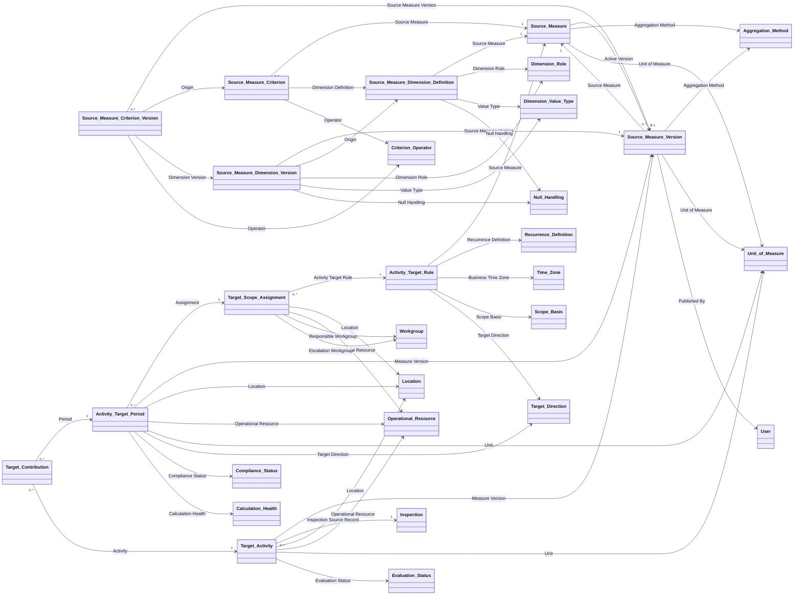
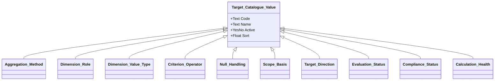

# Solution Specification: Operational Activity Targets

## 1. Outcome

This specification defines a reusable Intelex capability for measuring operational activity against configurable, time-bound targets. Phase 1 measures qualifying Inspections, but the same model can later count Hazard IDs or Near Misses, or sum values such as safety-engagement hours.

The target design is:

1. `Source Measure` owns source mapping and measure behaviour together. It identifies the source object and Target Activity source relationship, maps source fields as dimensions, holds criteria, and selects Count or Sum.
2. Publishing creates an immutable `Source Measure Version` graph and a validated compiled expression.
3. `Target Activity` owns runtime evaluation. It has a direct M:1 relationship to `Inspection`, receives the compiled text, and runs `EVAL()` in the Target Activity record context.
4. A qualifying Count activity returns `1`; a qualifying Sum activity returns its mapped numeric source value; a nonqualifying activity returns `NULL`. Zero remains a valid qualifying number.
5. `Activity Target Period` exists even when no source activity exists. `Target Contribution` attributes an evaluated numeric activity value to a matching period.

The solution does not pre-create future Inspections, use a generic source-record key, or store runtime dimension rows.

## 2. Evidence and limitations

Evidence consists of [ADR-008](ADR-008-track-configurable-site-inspection-frequency.md), related repository ADRs and workshop material, and the design decisions recorded in this conversation.

No Intelex `.ipack` is present. This is therefore a **proposed target logical Intelex object model**, not an extracted or implemented model. Stable identifiers, actual system names, source field paths, and existing shared catalogues remain unresolved. `EVAL()` availability is user-confirmed; its exact argument syntax, relationship traversal, return coercion, and error behaviour require a tenant prototype. No explanatory logic below is deployable formula syntax unless explicitly stated.

## 3. Requirements and supersession

| ID | Requirement |
|---|---|
| OAT-001 | Store targets separately from source records and report periods with zero activity. |
| OAT-002 | Do not create future draft Inspections to represent requirements. |
| OAT-003 | Support At Least and At Most numeric targets at enterprise, Location, or Operational Resource scope. |
| OAT-004 | Support eligibility criteria beyond date and scope, including type, checklist, status, and outcome. |
| OAT-005 | Support future concrete sources without redesigning the target model. |
| OAT-006 | Support record counting and numeric value summing. |
| OAT-007 | Combine source-adapter and activity-measure configuration in Source Measure. |
| OAT-008 | Compile governed dimension definitions and criteria into expression text. |
| OAT-009 | Run `EVAL()` on Target Activity. |
| OAT-010 | Give Target Activity a distinct M:1 field to each supported source; Phase 1 implements only Inspection. |
| OAT-011 | Preserve the exact published configuration and expression used operationally. |
| OAT-012 | Make generation, evaluation, and reconciliation idempotent and auditable. |

| Superseded concept | Current decision |
|---|---|
| Inspection-only frequency tracker | Domain-neutral operational activity targets; Inspection is the first source |
| Separate Activity Measure and Target Source Adapter | Combined Source Measure plus immutable published versions |
| Runtime Target Activity dimensions | Configuration dimensions compile expressions and populate explicit runtime fields |
| Generic Source Record Key | Explicit source-object M:1 fields; exactly one populated |
| Count-only results | Numeric activity and contribution values support Count and Sum |
| Evaluation on adapter/source | Local `EVAL()` on Target Activity |

## 4. Native capability assessment

Native audit, execution logs, calculated fields, Action Handlers, Event Services, security, and reminders are reused. No custom Audit, Event, Reminder, Workflow State, or generic Snapshot object is proposed.

Custom objects remain necessary because Source Measure is reusable governed configuration; published versions preserve historical meaning; Target Rule and Scope Assignment are business requirements; Target Period represents a zero-capable obligation; Target Activity is a normalized evaluated fact; and Target Contribution is a genuine M:N association with a credited-value attribute.

## 5. Object inventory

All system names are proposed and all stable IDs are unresolved. Because no package exists, the source path for proposed objects is this specification rather than configuration metadata. Section 7 is the authoritative inventory of directly declared fields, display fields, outgoing relationships, incoming inverse grids, and unresolved type metadata; section 6 is the structural relationship summary.

| Display name | Proposed system name | Parent | Responsibility / classification |
|---|---|---|---|
| Target Catalogue Value | `TargetCatalogueValue` | — | Abstract, non-instantiable local catalogue parent / Proposed |
| Aggregation Method | `AggregationMethod` | Target Catalogue Value | Count or Sum values; inherits catalogue fields / Proposed |
| Dimension Role | `DimensionRole` | Target Catalogue Value | Compiler role values; inherits catalogue fields / Proposed |
| Dimension Value Type | `DimensionValueType` | Target Catalogue Value | Canonical parsing types; inherits catalogue fields / Proposed |
| Criterion Operator | `CriterionOperator` | Target Catalogue Value | Comparison operators; inherits catalogue fields / Proposed |
| Null Handling | `NullHandling` | Target Catalogue Value | Null-behaviour values; inherits catalogue fields / Proposed |
| Scope Basis | `ScopeBasis` | Target Catalogue Value | Target scope values; inherits catalogue fields / Proposed |
| Target Direction | `TargetDirection` | Target Catalogue Value | Numeric comparison directions; inherits catalogue fields / Proposed |
| Evaluation Status | `EvaluationStatus` | Target Catalogue Value | Evaluation outcomes; inherits catalogue fields / Proposed |
| Compliance Status | `ComplianceStatus` | Target Catalogue Value | Period compliance outcomes; inherits catalogue fields / Proposed |
| Calculation Health | `CalculationHealth` | Target Catalogue Value | Calculation reliability values; inherits catalogue fields / Proposed |
| Unit of Measure | `UnitOfMeasure` | Existing shared parent, if any | Shared catalogue; provisional authority here |
| Recurrence Definition | `RecurrenceDefinition` | Existing shared parent, if any | Shared catalogue; provisional authority here |
| Source Measure | `SourceMeasure` | — | Editable combined adapter/measure / Proposed |
| Source Measure Dimension Definition | `SourceMeasureDimensionDefinition` | — | Editable source-field mapping / Proposed |
| Source Measure Criterion | `SourceMeasureCriterion` | — | Editable eligibility predicate / Proposed |
| Source Measure Version | `SourceMeasureVersion` | — | Immutable published measure / Proposed |
| Source Measure Dimension Version | `SourceMeasureDimensionVersion` | — | Immutable published mapping / Proposed |
| Source Measure Criterion Version | `SourceMeasureCriterionVersion` | — | Immutable published predicate / Proposed |
| Activity Target Rule | `ActivityTargetRule` | — | Required value, cadence, scope type, and measure / Proposed |
| Target Scope Assignment | `TargetScopeAssignment` | — | Effective rule applicability / Proposed |
| Activity Target Period | `ActivityTargetPeriod` | — | Generated reportable obligation / Proposed |
| Target Activity | `TargetActivity` | — | Evaluated source fact / Proposed |
| Target Contribution | `TargetContribution` | — | Period-to-activity attributed junction / Proposed |
| Inspection | Tenant-defined | Tenant-defined | Phase 1 source record / Existing external dependency; package metadata unresolved |
| Location | Tenant-defined | Tenant-defined | Establishment or equivalent scope / Existing shared dependency; package metadata unresolved |
| Operational Resource | Tenant-defined | Tenant-defined | Resource, plant, or site within Location / Existing shared dependency; package metadata unresolved |
| Workgroup | Tenant-defined | Tenant-defined | Reminder recipient / Native or shared dependency; package metadata unresolved |
| Time Zone | Tenant-defined | Tenant-defined | Period boundary authority / Native or shared dependency; package metadata unresolved |
| User | Tenant-defined | Tenant-defined | Publish actor / Native dependency; package metadata unresolved |

## 6. Logical model

The two diagrams together are the complete proposed model. Associations point from the M:1 owner; parent grids are inverse navigation, not duplicate storage.





## 7. Field-level implementation contract

These tables are canonical. Every M:1 to a catalogue has **inverse disabled**. Logic compares stable `Code`, never localized `Name`.

### 7.1 Target Catalogue Value family

#### 7.1.1 Target Catalogue Value

This abstract parent is non-instantiable and localizable. It has no records, ordinary administration form, initial values, or direct relationship consumers. It declares the common catalogue fields once for inheritance by each concrete child.

| Field | Type / relationship | Req | Default / calculation | Editability and visibility | Automation / lifecycle |
|---|---|---:|---|---|---|
| Code | Text, max 100; non-localizable | Y | None; unique | Catalogue Administrator editable; always visible | Stable after first use; inherited by every concrete child |
| Name | Text, max 255; localizable | Y | None | Catalogue Administrator editable; always visible | Display field; inherited by every concrete child |
| Active? | Yes/No | Y | `TRUE` | Catalogue Administrator editable; always visible; consumers filter `Active?=TRUE` for new selections | Deactivation prevents new selection; existing references remain valid |
| Sort | Float | N | None | Catalogue Administrator editable; always visible | Controls presentation order; inherited by every concrete child |

The child Initial Values tables repeat inherited columns as record data; they do not redeclare the inherited fields. Codes are globally distinct pending verification of inherited Code uniqueness in the target tenant.

#### 7.1.2 Aggregation Method

**Parent:** Target Catalogue Value

**Directly declared fields:** None. Code, Name, Active?, and Sort are inherited. Inherited Sort supplies the default category presentation order.

Initial values:

| Code | Name | Active? | Sort |
|---|---|---:|---:|
| `AGG_COUNT` | Count | `TRUE` | 10 |
| `AGG_SUM` | Sum | `TRUE` | 20 |

#### 7.1.3 Dimension Role

**Parent:** Target Catalogue Value

**Directly declared fields:** None. Code, Name, Active?, and Sort are inherited. Inherited Sort supplies the default category presentation order.

Initial values:

| Code | Name | Active? | Sort |
|---|---|---:|---:|
| `DIM_CRITERION` | Criterion | `TRUE` | 10 |
| `DIM_VALUE` | Value | `TRUE` | 20 |
| `DIM_ACTIVITY_DATE` | Activity Date | `TRUE` | 30 |
| `DIM_LOCATION` | Location | `TRUE` | 40 |
| `DIM_OPERATIONAL_RESOURCE` | Operational Resource | `TRUE` | 50 |

#### 7.1.4 Dimension Value Type

**Parent:** Target Catalogue Value

**Directly declared fields:** None. Code, Name, Active?, and Sort are inherited. Inherited Sort supplies the default category presentation order.

Initial values:

| Code | Name | Active? | Sort |
|---|---|---:|---:|
| `TYPE_REFERENCE` | Reference | `TRUE` | 10 |
| `TYPE_CONTROLLED_VALUE` | Controlled Value | `TRUE` | 20 |
| `TYPE_YES_NO` | Yes/No | `TRUE` | 30 |
| `TYPE_DECIMAL` | Decimal | `TRUE` | 40 |
| `TYPE_INTEGER` | Integer | `TRUE` | 50 |
| `TYPE_DATE` | Date | `TRUE` | 60 |
| `TYPE_TEXT` | Text | `TRUE` | 70 |

#### 7.1.5 Criterion Operator

**Parent:** Target Catalogue Value

**Directly declared fields:** None. Code, Name, Active?, and Sort are inherited. Inherited Sort supplies the default category presentation order.

Initial values:

| Code | Name | Active? | Sort |
|---|---|---:|---:|
| `OP_EQUALS` | Equals | `TRUE` | 10 |
| `OP_IN` | In | `TRUE` | 20 |

#### 7.1.6 Null Handling

**Parent:** Target Catalogue Value

**Directly declared fields:** None. Code, Name, Active?, and Sort are inherited. Inherited Sort supplies the default category presentation order.

Initial values:

| Code | Name | Active? | Sort |
|---|---|---:|---:|
| `NULL_NONQUALIFYING` | Not Qualifying | `TRUE` | 10 |
| `NULL_ZERO` | Zero | `TRUE` | 20 |
| `NULL_ERROR` | Evaluation Error | `TRUE` | 30 |

#### 7.1.7 Scope Basis

**Parent:** Target Catalogue Value

**Directly declared fields:** None. Code, Name, Active?, and Sort are inherited. Inherited Sort supplies the default category presentation order.

Initial values:

| Code | Name | Active? | Sort |
|---|---|---:|---:|
| `SCOPE_ENTERPRISE` | Enterprise | `TRUE` | 10 |
| `SCOPE_LOCATION` | Location | `TRUE` | 20 |
| `SCOPE_OPERATIONAL_RESOURCE` | Operational Resource | `TRUE` | 30 |

#### 7.1.8 Target Direction

**Parent:** Target Catalogue Value

**Directly declared fields:** None. Code, Name, Active?, and Sort are inherited. Inherited Sort supplies the default category presentation order.

Initial values:

| Code | Name | Active? | Sort |
|---|---|---:|---:|
| `DIR_AT_LEAST` | At Least | `TRUE` | 10 |
| `DIR_AT_MOST` | At Most | `TRUE` | 20 |

#### 7.1.9 Evaluation Status

**Parent:** Target Catalogue Value

**Directly declared fields:** None. Code, Name, Active?, and Sort are inherited. Inherited Sort supplies the default category presentation order.

Initial values:

| Code | Name | Active? | Sort |
|---|---|---:|---:|
| `EVAL_PENDING` | Pending | `TRUE` | 10 |
| `EVAL_SUCCESSFUL` | Successful | `TRUE` | 20 |
| `EVAL_FAILED` | Failed | `TRUE` | 30 |

#### 7.1.10 Compliance Status

**Parent:** Target Catalogue Value

**Directly declared fields:** None. Code, Name, Active?, and Sort are inherited. Inherited Sort supplies the default category presentation order.

Initial values:

| Code | Name | Active? | Sort |
|---|---|---:|---:|
| `COMP_FUTURE` | Future | `TRUE` | 10 |
| `COMP_ON_TRACK` | On Track | `TRUE` | 20 |
| `COMP_AT_RISK` | At Risk | `TRUE` | 30 |
| `COMP_MET` | Met | `TRUE` | 40 |
| `COMP_MISSED` | Missed | `TRUE` | 50 |

#### 7.1.11 Calculation Health

**Parent:** Target Catalogue Value

**Directly declared fields:** None. Code, Name, Active?, and Sort are inherited. Inherited Sort supplies the default category presentation order.

Initial values:

| Code | Name | Active? | Sort |
|---|---|---:|---:|
| `HEALTH_HEALTHY` | Healthy | `TRUE` | 10 |
| `HEALTH_WARNING` | Warning | `TRUE` | 20 |
| `HEALTH_FAILED` | Failed | `TRUE` | 30 |

### 7.2 Shared catalogues

Both objects are localizable, administrator-maintained shared catalogues. Reconcile them with tenant authorities before build; do not reparent an externally owned catalogue.

#### 7.2.1 Unit of Measure

| Field | Type / relationship | Req | Default / calculation | Editability and visibility | Automation / lifecycle |
|---|---|---:|---|---|---|
| Code | Text, max 100; non-localizable | Y | None; unique | Catalogue Administrator editable; always visible | Stable after first use |
| Name | Text, max 255; localizable | Y | None | Catalogue Administrator editable; always visible | Display field |
| Active? | Yes/No | Y | `TRUE` | Catalogue Administrator editable; always visible | Deactivation prevents new selection; existing references remain valid |
| Sort | Float | N | None | Catalogue Administrator editable; always visible | Controls presentation order |
| Symbol | Text, max 30 | N | `NULL` | Catalogue Administrator editable; always visible | Reporting label; existing snapshots retain their Unit relationship |
| Decimal Places | Float | Y | `0` | Catalogue Administrator editable until first use; always visible | Controls reporting format; stable after first use |

| Code | Name | Active? | Sort | Symbol | Decimal Places |
|---|---|---:|---:|---|---:|
| `RECORDS` | Records | TRUE | 10 | records | 0 |
| `HOURS` | Hours | TRUE | 20 | h | 2 |

#### 7.2.2 Recurrence Definition

| Field | Type / relationship | Req | Default / calculation | Editability and visibility | Automation / lifecycle |
|---|---|---:|---|---|---|
| Code | Text, max 100; non-localizable | Y | None; unique | Specialist Administrator editable; always visible | Stable after first use |
| Name | Text, max 255; localizable | Y | None | Specialist Administrator editable; always visible | Display field |
| Active? | Yes/No | Y | `TRUE` | Specialist Administrator editable; always visible | Activation requires a validated recurrence expression; deactivation prevents new selection only |
| Sort | Float | N | None | Specialist Administrator editable; always visible | Controls presentation order |
| Recurrence Expression | Text, `displayas="recurrence" editas="recurrence"`, | Y | None | Specialist Administrator editable; always visible | Intelex recurrence expression; validation mechanism and syntax require tenant confirmation; stable after first use |
| Anchor Required? | Yes/No | Y | `FALSE` | Specialist Administrator editable; always visible | Controls Target Scope Assignment.Period Anchor Date; stable after first use |

Weekly, monthly, quarterly, and annual records are required by known examples, but their expression strings are unresolved pending a tenant syntax and boundary prototype; fabricated values are deliberately not presented as loadable seed data.

### 7.3 Source Measure authoring

Native audit is enabled. Name is the display field.

#### 7.3.1 Source Measure

| Field | Type / relationship | Req | Default / calculation | Editability and visibility | Automation / lifecycle |
|---|---|---:|---|---|---|
| Code | Text, max 100 | Y | None; unique | Configuration Administrator editable; always visible | Publish copies to Source Measure Version.Code; stable after first Publish |
| Name | Text, max 255 | Y | None | Configuration Administrator editable; always visible | Display field; Publish copies to Source Measure Version.Name |
| Description | Long Text, maximum length unresolved | N | `NULL` | Configuration Administrator editable; always visible | Publish copies to Source Measure Version.Description |
| Source Object System Name | Text, max 255 | Y | Verified Inspection system name for Phase 1 | Specialist Administrator editable; always visible | Publish validates the object and copies to Source Measure Version.Source Object System Name |
| Target Activity Source Relationship System Name | Text, max 255 | Y | Verified system name of Target Activity.Inspection Source Record for Phase 1 | Specialist Administrator editable; always visible | Publish validates the relationship and copies to the same Version field; compiler path root |
| Aggregation Method | M:1 to Aggregation Method; inverse disabled | Y | None | Configuration Administrator editable; always visible; new selections filter `Active?=TRUE` | Publish copies to Source Measure Version.Aggregation Method |
| Unit of Measure | M:1 to Unit of Measure; inverse disabled | Y | Default-value expression selects `RECORDS` when Aggregation Method.Code=`AGG_COUNT`; user may select another active count-compatible unit | Configuration Administrator editable; always visible; new selections filter `Active?=TRUE` | Publish copies to Source Measure Version.Unit of Measure |
| Active Version | M:1 to Source Measure Version; no inverse | N | `NULL` before first Publish | Read only; always visible | Publish Action Handler atomically sets the newly published version; not copied to a version |
| Dimension Definitions | Inverse 1:M grid from Source Measure Dimension Definition.Source Measure | N | None | Read only navigation; visible to Configuration Administrator | Authoring only; no duplicate stored relationship; active children are published |
| Criteria | Inverse 1:M grid from Source Measure Criterion.Source Measure | N | None | Read only navigation; visible to Configuration Administrator | Authoring only; no duplicate stored relationship; active children are published |
| Versions | Inverse 1:M grid from Source Measure Version.Source Measure | N | None | Read only navigation; visible to Configuration Administrator | Publication history; no duplicate stored relationship |
| Activity Target Rules | Inverse 1:M grid from Activity Target Rule.Source Measure | N | None | Read only navigation; visible to Target and Configuration Administrators | Navigation only; no duplicate stored relationship |

#### 7.3.2 Source Measure Dimension Definition

| Field | Type / relationship | Req | Default / calculation | Editability and visibility | Automation / lifecycle |
|---|---|---:|---|---|---|
| Source Measure | M:1 to Source Measure; inverse grid `Dimension Definitions` | Y | Parent Source Measure from create context | Read only after first save; always visible | Authoring parent; Publish maps to Source Measure Dimension Version.Source Measure Version through the parent publication |
| Code | Text, max 100 | Y | None; unique within Source Measure | Configuration Administrator editable; always visible | Publish copies to Dimension Version.Code when Active?=`TRUE` |
| Name | Text, max 255 | Y | None | Configuration Administrator editable; always visible | Publish copies to Dimension Version.Name when active |
| Dimension Role | M:1 to Dimension Role; inverse disabled | Y | None | Configuration Administrator editable; always visible; new selections filter `Active?=TRUE` | Publish copies to Dimension Version.Dimension Role when active |
| Source Field System Name | Text, max 255 | Y | None | Specialist Administrator editable; always visible | Publish resolves against Source Measure.Source Object System Name and copies to Dimension Version.Source Field System Name |
| Value Type | M:1 to Dimension Value Type; inverse disabled | Y | None | Specialist Administrator editable; always visible; new selections filter `Active?=TRUE` | Publish copies to Dimension Version.Value Type when active |
| Null Handling | M:1 to Null Handling; inverse disabled | Y | `NULL_NONQUALIFYING` | Configuration Administrator editable; always visible; new selections filter `Active?=TRUE` | Publish copies to Dimension Version.Null Handling when active |
| Sort | Float | Y | Next available sort value within Source Measure | Configuration Administrator editable; always visible | Publish copies to Dimension Version.Sort; determines compiler order |
| Active? | Yes/No | Y | `TRUE` | Configuration Administrator editable; always visible | `FALSE` omits the row from future Publish; existing versions remain valid |

Publish requires exactly one active Activity Date, at most one Location and Operational Resource, exactly one Value for Sum, and no Value for Count.

#### 7.3.3 Source Measure Criterion

| Field | Type / relationship | Req | Default / calculation | Editability and visibility | Automation / lifecycle |
|---|---|---:|---|---|---|
| Source Measure | M:1 to Source Measure; inverse grid `Criteria` | Y | Parent Source Measure from create context | Read only after first save; always visible | Authoring parent; Publish maps to Criterion Version.Source Measure Version through parent publication |
| Dimension Definition | M:1 to Source Measure Dimension Definition; no inverse | Y | None | Configuration Administrator editable; always visible; filter to same Source Measure, Active?=`TRUE`, and Dimension Role.Code=`DIM_CRITERION` | Publish maps to the corresponding Dimension Definition Version |
| Operator | M:1 to Criterion Operator; inverse disabled | Y | `OP_EQUALS` | Configuration Administrator editable; always visible; new selections filter `Active?=TRUE` and supported Value Type | Publish copies to Criterion Version.Operator |
| Comparison Value | Long Text, maximum length unresolved | Y | None | Configuration Administrator editable; always visible; entered in the canonical format for the selected Value Type | Publish validates and copies to Criterion Version.Comparison Value |
| Sort | Float | Y | Next available sort value within Source Measure | Configuration Administrator editable; always visible | Publish copies to Criterion Version.Sort; active criteria compile in this order |
| Active? | Yes/No | Y | `TRUE` | Configuration Administrator editable; always visible | `FALSE` omits the row from future Publish; existing versions remain valid |

Canonical values are stable IDs for references, `TRUE`/`FALSE` for Boolean, invariant numbers, ISO `YYYY-MM-DD` dates, and literal text. `OP_IN` requires a prototype-approved escaped serialization. All active criteria are ANDed; OR groups are out of scope.

### 7.4 Published Source Measure graph

All version records are system-created, immutable, audited, and hidden from ordinary users.

#### 7.4.1 Source Measure Version

| Field | Type / relationship | Req | Default / calculation | Editability and visibility | Automation / lifecycle |
|---|---|---:|---|---|---|
| Source Measure | M:1 to Source Measure; inverse grid `Versions` | Y | Publish context Source Measure | Read only; visible to Configuration Administrator | Publish Action Handler creates; immutable |
| Version Number | Integer | Y | Maximum sibling Version Number + 1; first is 1 | Read only; visible to Configuration Administrator | Publish allocates under lock; unique with Source Measure; immutable |
| Code | Text, max 100 | Y | Default-value expression from Source Measure.Code | Read only; visible to Configuration Administrator | Publish snapshot; immutable |
| Name | Text, max 255 | Y | Default-value expression from Source Measure.Name | Read only; visible to Configuration Administrator | Display label combines Name and Version Number; immutable |
| Description | Long Text, maximum length unresolved | N | Default-value expression from Source Measure.Description, including `NULL` | Read only; visible to Configuration Administrator | Publish snapshot; immutable |
| Source Object System Name | Text, max 255 | Y | Default-value expression from Source Measure.Source Object System Name | Read only; specialist-visible | Publish snapshot and compiler input; immutable |
| Target Activity Source Relationship System Name | Text, max 255 | Y | Default-value expression from Source Measure.Target Activity Source Relationship System Name | Read only; specialist-visible | Publish snapshot and compiler path root; immutable |
| Aggregation Method | M:1 to Aggregation Method; inverse disabled | Y | Default-value expression from Source Measure.Aggregation Method | Read only; visible to Configuration Administrator; existing inactive reference retained | Publish snapshot; immutable |
| Unit of Measure | M:1 to Unit of Measure; inverse disabled | Y | Default-value expression from Source Measure.Unit of Measure | Read only; visible to Configuration Administrator; existing inactive reference retained | Publish snapshot; immutable |
| Compiled Expression | Long Text, maximum length unresolved; executable Intelex expression text | Y | Generated from published dimensions and criteria; exact syntax unresolved | Read only; specialist-visible | Publish compiler generates and tenant validation mechanism approves before activation; executes only through Target Activity `EVAL()` |
| Active? | Yes/No | Y | `TRUE` for new version | Read only; visible to Configuration Administrator | Publish atomically sets older sibling versions `FALSE`; inactive versions remain valid for historical periods |
| Published On | Date/Time, time zone enabled | Y | Current server time | Read only; visible to Configuration Administrator | Publish Action Handler stamps; immutable |
| Published By | M:1 to native User; no inverse | Y | Authenticated Publish actor | Read only; visible to Configuration Administrator | Publish Action Handler stamps; immutable |
| Dimension Versions | Inverse 1:M grid from Source Measure Dimension Version.Source Measure Version | N | None | Read only; visible to Configuration Administrator | Publication graph navigation; no duplicate stored relationship |
| Criterion Versions | Inverse 1:M grid from Source Measure Criterion Version.Source Measure Version | N | None | Read only; visible to Configuration Administrator | Publication graph navigation; no duplicate stored relationship |
| Activity Target Periods | Inverse 1:M grid from Activity Target Period.Source Measure Version | N | None | Read only; specialist-visible | Historical-use navigation; no duplicate stored relationship |
| Target Activities | Inverse 1:M grid from Target Activity.Source Measure Version | N | None | Read only; specialist-visible | Evaluation navigation; no duplicate stored relationship |

#### 7.4.2 Source Measure Dimension Version

| Field | Type / relationship | Req | Default / calculation | Editability and visibility | Automation / lifecycle |
|---|---|---:|---|---|---|
| Source Measure Version | M:1 to Source Measure Version; inverse grid `Dimension Versions` | Y | Newly created parent version | Read only; Configuration Administrator visible | Publish creates; immutable |
| Origin Dimension Definition | M:1 to Source Measure Dimension Definition; no inverse | Y | Active authoring dimension being published | Read only; Configuration Administrator visible | Publish traceability; immutable |
| Code | Text, max 100 | Y | Origin Dimension Definition.Code | Read only; visible | Default-value expression on Publish; immutable |
| Name | Text, max 255 | Y | Origin Dimension Definition.Name | Read only; visible | Default-value expression on Publish; immutable |
| Dimension Role | M:1 to Dimension Role; inverse disabled | Y | Origin Dimension Definition.Dimension Role | Read only; visible; inactive existing reference retained | Default-value expression on Publish; immutable |
| Source Field System Name | Text, max 255 | Y | Origin Dimension Definition.Source Field System Name | Read only; specialist-visible | Default-value expression on Publish; immutable |
| Value Type | M:1 to Dimension Value Type; inverse disabled | Y | Origin Dimension Definition.Value Type | Read only; visible; inactive existing reference retained | Default-value expression on Publish; immutable |
| Null Handling | M:1 to Null Handling; inverse disabled | Y | Origin Dimension Definition.Null Handling | Read only; visible; inactive existing reference retained | Default-value expression on Publish; immutable |
| Sort | Float | Y | Origin Dimension Definition.Sort | Read only; visible | Default-value expression on Publish; immutable |

#### 7.4.3 Source Measure Criterion Version

| Field | Type / relationship | Req | Default / calculation | Editability and visibility | Automation / lifecycle |
|---|---|---:|---|---|---|
| Source Measure Version | M:1 to Source Measure Version; inverse grid `Criterion Versions` | Y | Newly created parent version | Read only; Configuration Administrator visible | Publish creates; immutable |
| Origin Criterion | M:1 to Source Measure Criterion; no inverse | Y | Active authoring criterion being published | Read only; Configuration Administrator visible | Publish traceability; immutable |
| Dimension Definition Version | M:1 to Source Measure Dimension Version; no inverse | Y | Published counterpart of Origin Criterion.Dimension Definition | Read only; visible | Publish validates same parent Source Measure Version; immutable |
| Operator | M:1 to Criterion Operator; inverse disabled | Y | Origin Criterion.Operator | Read only; visible; inactive existing reference retained | Default-value expression on Publish; immutable |
| Comparison Value | Long Text, maximum length unresolved | Y | Origin Criterion.Comparison Value | Read only; visible | Default-value expression on Publish; immutable |
| Sort | Float | Y | Origin Criterion.Sort | Read only; visible | Default-value expression on Publish; immutable |

### 7.5 Target configuration and period

#### 7.5.1 Activity Target Rule

| Field | Type / relationship | Req | Default / calculation | Editability and visibility | Automation / lifecycle |
|---|---|---:|---|---|---|
| Code | Text, max 100 | Y | None; unique | Target Administrator editable; always visible | Stable after first generated period; not published because Rule is directly governed configuration |
| Name | Text, max 255 | Y | None | Target Administrator editable; always visible | Display field; later edits affect labels, not period snapshots |
| Description | Long Text, maximum length unresolved | N | `NULL` | Target Administrator editable; always visible | Audited; not copied because it does not affect calculation |
| Source Measure | M:1 to Source Measure; inverse grid `Activity Target Rules` | Y | None | Target Administrator editable until first period; always visible; filter to measures with non-null Active Version | Period Generator resolves and stores Source Measure.Active Version |
| Scope Basis | M:1 to Scope Basis; inverse disabled | Y | None | Target Administrator editable until first period; always visible; new selections filter `Active?=TRUE` | Stable Code controls Assignment fields; Period Generator uses it for scope snapshots |
| Required Value | Decimal, precision/scale unresolved | Y | None | Target Administrator editable; always visible; must be non-negative | Period Generator snapshots to Period.Required Value |
| Target Direction | M:1 to Target Direction; inverse disabled | Y | `DIR_AT_LEAST` | Target Administrator editable; always visible; new selections filter `Active?=TRUE` | Period Generator snapshots to Period.Target Direction |
| Recurrence Definition | M:1 to Recurrence Definition; inverse disabled | Y | None | Target Administrator editable until first period; always visible; new selections filter `Active?=TRUE` and validated recurrence | Period Generator reads the expression; existing periods remain unchanged |
| Business Time Zone | M:1 to platform Time Zone catalogue; inverse disabled | Y | Application default Time Zone relationship | Target Administrator editable until first period; always visible; new selections filter to active platform values | Period Generator uses it for date boundaries; existing periods remain unchanged |
| At-Risk Lead Days | Integer, minimum 0 | N | `NULL` | Target Administrator editable; always visible; null disables at-risk date | Period Generator calculates Period.At-Risk On; existing periods remain unchanged |
| Active? | Yes/No | Y | `TRUE` | Target Administrator editable; always visible | `FALSE` prevents new period generation; existing periods and assignments remain valid |
| Scope Assignments | Inverse 1:M grid from Target Scope Assignment.Activity Target Rule | N | None | Read only; visible to Target Administrator | Navigation only; no duplicate stored relationship |

#### 7.5.2 Target Scope Assignment

| Field | Type / relationship | Req | Default / calculation | Editability and visibility | Automation / lifecycle |
|---|---|---:|---|---|---|
| Activity Target Rule | M:1 to Activity Target Rule; inverse grid `Scope Assignments` | Y | Parent Rule from create context | Read only after first period; always visible | Period Generator reads rule configuration |
| Location | M:1 to Location; no inverse | Conditional | `NULL` | Target Administrator editable and required when Rule.Scope Basis.Code is `SCOPE_LOCATION` or `SCOPE_OPERATIONAL_RESOURCE`; hidden and cleared for `SCOPE_ENTERPRISE` | Period Generator snapshots to Period.Location; locks after first period |
| Operational Resource | M:1 to Operational Resource; no inverse | Conditional | `NULL` | Target Administrator editable and required only when Rule.Scope Basis.Code=`SCOPE_OPERATIONAL_RESOURCE`; filter to selected Location; hidden and cleared otherwise | Save validates Location ownership; Period Generator snapshots to Period.Operational Resource; locks after first period |
| Effective From | Date | Y | None | Target Administrator editable; always visible | Inclusive start; locks after first period |
| Effective Through | Date | N | `NULL` | Target Administrator editable; always visible | Inclusive end; null means open-ended; must be on/after Effective From; locks after first period |
| Period Anchor Date | Date | Conditional | `NULL` | Editable, visible, and required when Rule.Recurrence Definition.Anchor Required?=`TRUE`; hidden and cleared when `FALSE` | Period Generator uses for anchored boundaries; locks after first period |
| Responsible Workgroup | M:1 to Workgroup catalogue; inverse disabled | Y | None | Target Administrator editable; always visible; new selections filter to active Workgroups | Native reminder engine resolves current membership at send time |
| Escalation Workgroup | M:1 to Workgroup catalogue; inverse disabled | N | `NULL` | Target Administrator editable; always visible; new selections filter to active Workgroups | Native reminder engine uses when configured; null disables escalation |
| Active? | Yes/No | Y | `TRUE` | Target Administrator editable; always visible | `FALSE` prevents new periods; existing periods remain valid |
| Activity Target Periods | Inverse 1:M grid from Activity Target Period.Target Scope Assignment | N | None | Read only; visible to authorized Target users | Navigation only; no duplicate stored relationship |

`Activity Target Period` is read-only, generated, and audited.

#### 7.5.3 Activity Target Period

| Field | Type / relationship | Req | Default / calculation | Editability and visibility | Automation / lifecycle |
|---|---|---:|---|---|---|
| Display Field | Calculated Text, max length unresolved | Y | Continuing calculation from Target Scope Assignment display, Period Start, separator, and Period End; exact Intelex syntax unresolved | Read only; always visible | Calculated field; null components are rejected because both dates are required |
| Target Scope Assignment | M:1 to Target Scope Assignment; inverse grid `Activity Target Periods` | Y | Period Generator candidate assignment | Read only; always visible | Period Generator sets; immutable |
| Source Measure Version | M:1 to Source Measure Version; inverse grid `Activity Target Periods` | Y | Assignment.Activity Target Rule.Source Measure.Active Version at creation | Read only; always visible | Period Generator snapshot; immutable |
| Period Start | Date | Y | Period Generator recurrence calculation | Read only; always visible | Inclusive boundary in Rule.Business Time Zone; immutable |
| Period End | Date | Y | Period Generator recurrence calculation | Read only; always visible | Inclusive boundary in Rule.Business Time Zone; immutable |
| Location | M:1 to Location; no inverse | Conditional | Stored snapshot of Assignment.Location | Read only; visible and populated for `SCOPE_LOCATION` and `SCOPE_OPERATIONAL_RESOURCE`; hidden and `NULL` for Enterprise | Period Generator sets once; immutable |
| Operational Resource | M:1 to Operational Resource; no inverse | Conditional | Stored snapshot of Assignment.Operational Resource | Read only; visible and populated only for `SCOPE_OPERATIONAL_RESOURCE`; hidden and `NULL` otherwise | Period Generator sets once; immutable |
| Required Value | Decimal, precision/scale unresolved | Y | Stored snapshot of Rule.Required Value | Read only; always visible | Period Generator sets once; immutable |
| Target Direction | M:1 to Target Direction; inverse disabled | Y | Stored snapshot of Rule.Target Direction | Read only; always visible; inactive existing reference retained | Period Generator sets once; immutable |
| Unit of Measure | M:1 to Unit of Measure; inverse disabled | Y | Stored snapshot of Source Measure Version.Unit of Measure | Read only; always visible; inactive existing reference retained | Period Generator sets once; immutable |
| At-Risk On | Date | N | Period End minus Rule.At-Risk Lead Days; `NULL` when lead days is `NULL`; calculation performed by generator | Read only; always visible | Period Generator sets once; immutable |
| Actual Value | Decimal, precision/scale unresolved | Y | `0` at creation | Read only; always visible | Reconciliation Event Service persists sum of current Contribution Values |
| Compliance Status | M:1 to Compliance Status; inverse disabled | Y | `COMP_FUTURE` | Read only; always visible; inactive existing reference retained | Reconciliation Event Service updates by stable-Code rules |
| Calculation Health | M:1 to Calculation Health; inverse disabled | Y | `HEALTH_HEALTHY` | Read only; always visible; inactive existing reference retained | Reconciliation Event Service updates from evaluation/reconciliation outcomes |
| Last Reconciled On | Date/Time, time zone enabled | N | `NULL` | Read only; always visible | Reconciliation Event Service stamps current server time after successful period calculation |
| Target Contributions | Inverse 1:M grid from Target Contribution.Activity Target Period | N | None | Read only; visible to authorized analysts | Attribution navigation only; no duplicate stored relationship |

Period uniqueness is `(Target Scope Assignment, Period Start, Period End)`.

### 7.6 Target Activity and Target Contribution

Target Activity is system-created, audited, and read-only to users.

#### 7.6.1 Target Activity

| Field | Type / relationship | Req | Default / calculation | Editability and visibility | Automation / lifecycle |
|---|---|---:|---|---|---|
| Display Field | Calculated Text, max length unresolved | Y | Continuing calculation from Source Measure Version display, separator, and Inspection Source Record display; exact syntax unresolved | Read only; always visible | Calculated field; both relationships are required in Phase 1 |
| Source Measure Version | M:1 to Source Measure Version; inverse grid `Target Activities` | Y | Evaluation Event Service candidate version | Read only; always visible | Service sets on create; immutable identity component |
| Inspection Source Record | M:1 to Inspection; no inverse | Y | Evaluation Event Service candidate Inspection | Read only; always visible | Service sets on create; immutable identity component; future source fields use conditional exactly-one rule |
| Evaluation Expression | Long Text, maximum length unresolved; executable Intelex expression text | Y | Stored copy of Source Measure Version.Compiled Expression at create | Read only; specialist-visible | Evaluation Event Service snapshots once; local Target Activity `EVAL()` input; immutable |
| Activity Date | Date | Y | Extracted using published `DIM_ACTIVITY_DATE` mapping | Read only; always visible | Evaluation Event Service refreshes on source re-evaluation; native audit preserves prior value |
| Location | M:1 to Location; no inverse | N | Extracted using published `DIM_LOCATION` mapping; `NULL` when no mapping | Read only; visible when populated or relevant to reporting | Evaluation Event Service refreshes on re-evaluation; audit preserves prior value |
| Operational Resource | M:1 to Operational Resource; no inverse | N | Extracted using published `DIM_OPERATIONAL_RESOURCE` mapping; `NULL` when no mapping | Read only; visible when populated or relevant; must belong to Location | Evaluation Event Service refreshes on re-evaluation; audit preserves prior value |
| Evaluated Value | Calculated Decimal, precision/scale unresolved | N | Continuing `EVAL()` of local Evaluation Expression in Target Activity context; exact Intelex invocation unresolved | Read only; always visible | `NULL` means nonqualifying; zero is valid; Evaluation Event Service saves record to trigger recalculation |
| Unit of Measure | M:1 to Unit of Measure; inverse disabled | Y | Stored copy of Source Measure Version.Unit of Measure at create | Read only; always visible; inactive existing reference retained | Evaluation Event Service snapshots once; immutable |
| Evaluation Status | M:1 to Evaluation Status; inverse disabled | Y | `EVAL_PENDING` | Read only; always visible; inactive existing reference retained | Evaluation Event Service sets `EVAL_SUCCESSFUL` or `EVAL_FAILED` after attempted calculation |
| Evaluated On | Date/Time, time zone enabled | N | `NULL` | Read only; always visible | Evaluation Event Service stamps current server time after each attempt |
| Target Contributions | Inverse 1:M grid from Target Contribution.Target Activity | N | None | Read only; visible to authorized analysts | Attribution navigation only; no duplicate stored relationship |

Activity uniqueness is `(Source Measure Version, Inspection Source Record)`. Failed evaluation retains the record and native execution evidence but creates no contribution.

For each later source, add a distinct nullable M:1 field, source-specific uniqueness, selection, permissions, and backfill; require exactly one source relationship populated. Never add a polymorphic key.

#### 7.6.2 Target Contribution

| Field | Type / relationship | Req | Default / calculation | Editability and visibility | Automation / lifecycle |
|---|---|---:|---|---|---|
| Activity Target Period | M:1 to Activity Target Period; inverse grid `Target Contributions` | Y | Matching period selected by Reconciliation Event Service | Read only; always visible | Service sets on create; identity component |
| Target Activity | M:1 to Target Activity; inverse grid `Target Contributions` | Y | Qualifying activity selected by Reconciliation Event Service | Read only; always visible | Service sets on create; identity component |
| Contribution Value | Decimal, precision/scale unresolved | Y | Stored copy of Target Activity.Evaluated Value | Read only; always visible | Reconciliation Event Service creates or updates; native audit preserves changes |

Contribution uniqueness is `(Activity Target Period, Target Activity)`. Stale contributions are deleted after recalculation; deletion audit must be enabled.

### 7.7 External dependency contracts

These objects are included to make the inventory-to-contract mapping complete. They remain governed by their owning applications or shared tenant configuration. This solution adds no fields or inverse grids to them; all relationships in this design are declared on the proposed local objects in sections 7.2 through 7.6.

#### 7.7.1 Inspection

**Authority:** Existing Inspections application object; package metadata and stable ID are unresolved.

**Parent:** Tenant-defined and unresolved.

**Directly declared fields:** None in this solution. The Phase 1 source relationship is declared as Target Activity.Inspection Source Record, with no inverse grid on Inspection.

#### 7.7.2 Location

**Authority:** Existing shared tenant object; package metadata and stable ID are unresolved.

**Parent:** Tenant-defined and unresolved.

**Directly declared fields:** None in this solution. References to Location are outgoing M:1 fields on proposed local objects, with no inverse grids on Location.

#### 7.7.3 Operational Resource

**Authority:** Existing shared tenant object; package metadata and stable ID are unresolved.

**Parent:** Tenant-defined and unresolved.

**Directly declared fields:** None in this solution. References to Operational Resource are outgoing M:1 fields on proposed local objects, with no inverse grids on Operational Resource.

#### 7.7.4 Workgroup

**Authority:** Existing native or shared tenant object; package metadata and stable ID are unresolved.

**Parent:** Tenant-defined and unresolved.

**Directly declared fields:** None in this solution. The reminder-recipient relationship is declared on Target Scope Assignment, with no inverse grid on Workgroup.

#### 7.7.5 Time Zone

**Authority:** Existing native or shared tenant object; package metadata and stable ID are unresolved.

**Parent:** Tenant-defined and unresolved.

**Directly declared fields:** None in this solution. The period-boundary authority relationship is declared on Target Scope Assignment, with no inverse grid on Time Zone.

#### 7.7.6 User

**Authority:** Existing native tenant object; package metadata and stable ID are unresolved.

**Parent:** Tenant-defined and unresolved.

**Directly declared fields:** None in this solution. The publish-actor relationship is declared on Source Measure Version, with no inverse grid on User.

## 8. Expression construction

Dimensions are compiler metadata, not Target Activity children:

- Criterion dimensions identify fields used to decide eligibility.
- Value identifies the numeric source field returned by Sum.
- Activity Date, Location, and Operational Resource identify values copied to Target Activity for period matching.

This is how Target Activity considers criteria beyond Location and date: the compiled expression contains the published criteria and references those source fields through `Inspection Source Record`; date and scope are separately extracted and matched to periods.

The following compiler behaviour is declarative, not executable Intelex syntax:

1. Resolve the published Target Activity source relationship field.
2. Resolve every criterion's published source field, type, operator, and escaped canonical value.
3. Combine active criteria with AND.
4. Return `1` for a qualifying Count measure or the mapped numeric value for a qualifying Sum measure.
5. Apply the configured null rule and return `NULL` when the record does not qualify.

Only field names resolved during Publish and governed operators may enter expression text.

Example authoring configuration:

| Property | Value |
|---|---|
| Name | Safety Engagement Hours |
| Aggregation Method | Sum (`AGG_SUM`) |
| Unit | Hours (`HOURS`) |
| Criterion dimension | `WorkflowStatus` |
| Value dimension | `HoursSpent` |
| Criterion | WorkflowStatus Equals canonical `Completed` value |

Its non-executable shape is:

```text
IF related source WorkflowStatus equals Completed
THEN related source HoursSpent
ELSE NULL
```

Publish stores the validated tenant expression on Source Measure Version. Evaluation copies it to Target Activity.Evaluation Expression, where Target Activity.Evaluated Value runs `EVAL()`. The exact string remains unresolved until relationship traversal, literal syntax, length limits, numeric coercion, and error semantics are prototyped. Count uses the same shape with `1` as the qualifying result. Periods therefore always sum Contribution Value and require no separate count-versus-sum branch.

## 9. Automation contract

### 9.1 Publish Source Measure Action Handler

**Trigger:** explicit `Publish Source Measure` action by Configuration Administrator; this is not a workflow stage transition.

1. Lock the authoring record and recheck permission.
2. Validate source object, Target Activity relationship, every active source field, dimension cardinalities, criterion scoping, canonical values, operator compatibility, and unit.
3. Allocate Version Number as maximum sibling + 1 under `(Source Measure, Version Number)` uniqueness.
4. Copy every field specified in section 7 and create all active dimension and criterion versions with origin links.
5. Compile and validate the expression through the approved tenant prototype mechanism.
6. Atomically activate the new version, deactivate older siblings, set Source Measure.Active Version, and stamp Published On/By.

Failure leaves no partial active graph. Retry cannot create a duplicate version or two active versions.

### 9.2 Period Generator Event Service

**Cadence:** deployment decision required.

Select active assignments whose active rules and effective dates intersect the configured generation horizon, whose Source Measure has an Active Version, and whose recurrence is active and validated. Calculate boundaries in Business Time Zone and upsert by the period uniqueness key. Copy every period snapshot in section 7.5. The service never creates an Inspection. Concurrency relies on the uniqueness constraint; retry returns the existing period. Native Event Service evidence is owned by Platform Administration.

### 9.3 Target Activity Evaluation Event Service

**Cadence:** deployment decision required based on volume and freshness.

Select new or modified Inspections since the last successful watermark, with a safety overlap, and the distinct Inspection Source Measure Versions used by open or recalculable periods. Native modified metadata and watermark storage require tenant verification.

For each candidate/version pair, upsert by activity uniqueness, copy the expression and unit on create, extract date/scope using the published dimensions, save so local `EVAL()` executes, then set Evaluation Status and Evaluated On. A null result without expression error is successful but nonqualifying; zero is successful and qualifying. On failure, retain `EVAL_FAILED`, rely on native execution logs for technical detail, and continue. Service permissions are limited to approved source fields and system-managed target fields.

### 9.4 Contribution Reconciliation Event Service

Run after evaluation and on a separately approved reconciliation cadence. A Target Activity matches a period when status is Successful, value is non-null, Source Measure Version matches, Activity Date is inclusively within the period, and required Location/Operational Resource snapshots match.

Lock each period, upsert the unique contribution, update changed values, remove stale contributions, sum current contributions into Actual Value, derive status/health, and stamp Last Reconciled On. Retry is safe.

Status rules use catalogue Codes:

- Before Period Start: Future.
- During the period, satisfied: Met.
- During the period, unsatisfied before At-Risk On: On Track.
- During the period, unsatisfied on/after At-Risk On: At Risk.
- After Period End: Met when satisfied, otherwise Missed.
- At Least is satisfied by Actual ≥ Required; At Most by Actual ≤ Required.

Failed candidate evaluations produce no contribution and make affected period health Warning while a computable total remains. Health is Failed only when no reliable total can be produced. Retry count and alert owner are deployment decisions.

### 9.5 Native reminders

Use the native reminder engine with At-Risk On, Period End, Compliance Status, Responsible Workgroup, and optional Escalation Workgroup. Resolve current workgroup membership at send time and retain native notification evidence; no custom reminder object is added.

## 10. Lifecycle, security, audit, and reporting

- Authoring objects, rules, and assignments are directly editable by their administrators with native audit.
- Published versions are immutable. Changes require a new Publish.
- Identity/scope fields on rules and assignments lock after periods exist; material scope changes require a new assignment.
- Periods, activities, and contributions are system-managed and read-only to business users.
- No custom workflow is required.

| Role | Access |
|---|---|
| Configuration Administrator | Maintain Source Measures and local catalogues; publish versions |
| Target Administrator | Maintain rules and assignments; read results |
| Target Analyst | Read authorized periods, activities, contributions, and source links |
| Target Automation Service | Read approved source fields; generate and reconcile system records |
| Ordinary source user | No target-configuration write access; native source permissions remain authoritative |

Test forms, direct URLs, search, export, inverse grids, and relationship navigation. Target Activity access must not disclose an unauthorized Inspection or confidential source fields, and source access must not imply target-configuration access.

Enable native audit on mutable configuration and all operational objects, including relationships and contribution deletion where supported. Native Action Handler/Event Service logs own execution evidence. Published versions and Target Activity.Evaluation Expression preserve operational configuration without a generic snapshot object.

Reporting grains are: Period for zero-activity and compliance; Contribution for attribution and drill-through; Target Activity for source evaluation and failure monitoring; and source records for native operational reporting. Always display Calculation Health with compliance.

## 11. Initial and future configurations

### 11.1 Phase 1 qualifying inspections

| Element | Configuration |
|---|---|
| Source Measure | Qualifying Inspections |
| Source / aggregation / unit | Inspection / Count / Records |
| Dimensions | Verified actual date, Location, Operational Resource, type, checklist, workflow status, and outcome as needed |
| Criteria | Approved completion and program criteria using verified system names and canonical values |
| Rule | At least 2 Records per approved annual Recurrence Definition |
| Scope | One assignment per required Location/Operational Resource combination |

### 11.2 Future sources

A weekly Hazard ID target adds `Hazard ID Source Record`; a quarterly Near Miss target adds `Near Miss Source Record`. Each expansion also adds source configuration, event selection, uniqueness, access, and backfill rules. Exactly one source relationship is populated. These examples show extensibility but do not authorize Phase 1 fields or objects.

## 12. Change summary

| ID | Action | Element | Prior | Proposed | Requirements | Confidence |
|---|---|---|---|---|---|---|
| CHG-001 | Generalize | Boundary | Inspection frequency | Cross-application activity targets | OAT-001, OAT-005 | High |
| CHG-002 | Merge | Adapter/measure | Two concepts | Source Measure | OAT-007 | High |
| CHG-003 | Add | Publication graph | Mutable/informal config | Immutable complete versions | OAT-011 | High |
| CHG-004 | Modify | Dimensions | Runtime rows | Compiler metadata and explicit runtime fields | OAT-004, OAT-008 | High |
| CHG-005 | Modify | Source identity | Generic key considered | Direct M:1 Inspection field | OAT-010 | High |
| CHG-006 | Add | Evaluation | Unspecified | Local expression and `EVAL()` | OAT-009 | Medium pending prototype |
| CHG-007 | Add | Numeric values | Count only | Count and Sum contributions | OAT-006 | High |
| CHG-008 | Add | Catalogue family | Inline values | Governed stable-Code relationships | Implementation rules | High pending tenant inheritance check |
| CHG-009 | Reuse | Evidence/reminders | Possible custom records | Native audit, logs, reminders | OAT-012 | High pending retention check |

## 13. Traceability

| Requirement | Design response | Status |
|---|---|---|
| OAT-001 | Persisted zero-capable periods and separate configuration | Satisfied |
| OAT-002 | Generator creates periods only | Satisfied |
| OAT-003 | Scope catalogue, assignments, numeric directions | Satisfied pending tenant object mapping |
| OAT-004 | Criterion dimensions compile into local evaluation expression | Partially satisfied pending field/syntax verification |
| OAT-005 | Explicit source-field extension pattern | Satisfied as design; future sources not built |
| OAT-006 | Count returns 1; Sum returns source number; periods sum contributions | Satisfied |
| OAT-007 | One Source Measure authoring responsibility | Satisfied |
| OAT-008 | Published dimension/criterion graph and compiler | Partially satisfied pending prototype |
| OAT-009 | Target Activity owns expression and `EVAL()` result | Partially satisfied pending prototype |
| OAT-010 | Direct Inspection M:1; no generic key | Satisfied for Phase 1 |
| OAT-011 | Immutable version graph, period version reference, expression evidence | Satisfied |
| OAT-012 | Uniqueness, locks, upserts, audit, native execution evidence | Partially satisfied pending operational settings |

## 14. Impact, deployment, and migration

Inspection receives only an optional inverse `Target Activities` grid if its owner approves it; Target Activity remains the relationship owner. No target workflow or stored target field is added to Inspection. Corrections can re-evaluate activities and periods, with audit retaining prior values.

Operational Resource must have an authoritative relationship to Location. Assignments and evaluation reject mismatches. Optional inverse grids on shared objects require their owner's approval.

Index or optimize the four uniqueness keys and source modified metadata, Activity Date, version, period dates, scope, evaluation status, and health. Load-test volume and retention before fixing cadence.

Deployment order:

1. Inspect the tenant `.ipack` and map stable IDs, actual names, relationships, shared objects, and native metadata.
2. Reconcile Unit of Measure and Recurrence Definition; do not duplicate or reparent external authorities.
3. Build catalogues, authoring/version objects, targets, periods, activities, contributions, audit, and security.
4. Prototype `EVAL()` on Target Activity through direct Inspection relationships, including every literal type, null, zero, error, and length limit.
5. Implement Publish only after compiler output is validated.
6. Configure and publish Qualifying Inspections; create rules and assignments; generate periods without Inspections.
7. Backfill only the approved lookback and reconcile against the manual tracker. Do not import manual totals as calculated evidence.
8. Enable reminders after owners, thresholds, timezone boundaries, cadence, and escalation are approved.

Rollback disables services and reminders while retaining audited evidence. Deletion of generated evidence requires an approved retention decision and migration script.

## 15. Acceptance tests

| ID | Scenario | Expected result |
|---|---|---|
| AT-001 | Annual resource target with no inspections | Period exists at zero; no Inspection is created |
| AT-002 | Publish valid Count measure | Complete immutable graph and exactly one Active Version |
| AT-003 | Publish invalid field/operator | No partial or active version |
| AT-004 | Concurrent Publish retry | Version uniqueness and atomic activation hold |
| AT-005 | Qualifying Count Inspection | Direct relationship, local expression, value 1, correct date/scope |
| AT-006 | Nonqualifying Inspection | Successful null result; no contribution |
| AT-007 | Sum record with 2.5 hours | Activity/contribution 2.5 Hours; period increases 2.5 |
| AT-008 | Sum record with zero | Zero qualifies and is not treated as null |
| AT-009 | Each null-handling code | Not Qualifying, Zero, or Error occurs exactly as configured |
| AT-010 | Correct source criterion | Re-evaluation updates/removes contribution; audit preserves prior values |
| AT-011 | Run every service twice | No duplicate period, activity, or contribution |
| AT-012 | One activity matches two targets | One activity has two independently attributed contributions |
| AT-013 | Publish new version mid-period | Existing period retains old version; new periods resolve new version |
| AT-014 | Resource outside Location | Save/generation rejected before children are created |
| AT-015 | One expression fails | Failed activity retained, no contribution, log evidence, health warning/failure |
| AT-016 | User lacks Inspection access | Target navigation/export discloses no unauthorized source data |
| AT-017 | Unsatisfied target reaches At-Risk On | Status At Risk and native reminder to current responsible members |
| AT-018 | Add future source | Distinct M:1 and uniqueness added; exactly one source populated; Inspection unchanged |

## 16. Validation results and open evidence

| Area | Result |
|---|---|
| Native capability / responsibilities | Passed by design; custom objects have distinct roles and native evidence/reminders are reused |
| Relationships / inverses | Passed by design; grids reuse owning M:1 fields and catalogue inverses are disabled |
| Catalogue normalization/inheritance | Passed structurally; inherited Code uniqueness and tenant inheritance support unresolved |
| Field-contract completeness (VAL-13) | Passed for the complete inventory: every object has its own numbered subsection; every directly declared field and designed inverse grid has one canonical row; zero-field inherited children and unchanged external dependencies explicitly declare that status; inherited catalogue fields are declared only on their parent |
| Version atomicity | Passed by design; full graph and active pointer change atomically |
| Formula vocabulary/dependencies | No invented executable formula; exact `EVAL()` syntax and Inspection paths unresolved |
| Null semantics | Explicit: null nonqualifying by default; zero valid |
| Uniqueness/retry | Defined for versions, periods, activities, contributions; load testing remains |
| Timezone | Types and authority specified; recurrence boundaries/source conversion unresolved |
| Security | Boundaries specified; direct-access and export tests remain |
| Stale concepts | Old names appear only in supersession/change history; generic key, runtime dimension, custom reminder/audit, and pre-created Inspection are absent |

Before build, obtain:

1. Tenant `.ipack` and stable IDs for all external/shared objects.
2. Exact Inspection system fields for date, scope, type, checklist, status, outcome, and Sum values.
3. Approved `EVAL()` invocation, path/literal syntax, return/error behaviour, and expression limits.
4. Import-ready recurrence expressions and week, quarter, daylight-saving, and inclusive-boundary decisions.
5. Service cadence, concurrency, retry, watermark, generation horizon, backfill lookback, and error owners.
6. Initial target criteria, scopes, values, workgroups, thresholds, and recipients.
7. Retention and recalculation policy for corrections after period close.
8. Confirmation of catalogue inheritance support; otherwise use independent catalogues with the same field contracts.
