# Baseline logical object model

Source: supplied package only. Labels map stable internal Mermaid identifiers to exported display names. Dependencies can be incomplete. Inverse-only relationships whose declaring property is not exported are labelled inverse_1_to_M; they preserve known navigation without fabricating the missing declaration. Association multiplicity is omitted where the package does not establish it. Native map nodes are explicit exported map-name labels, not separately exported custom object definitions.

## Action Plans

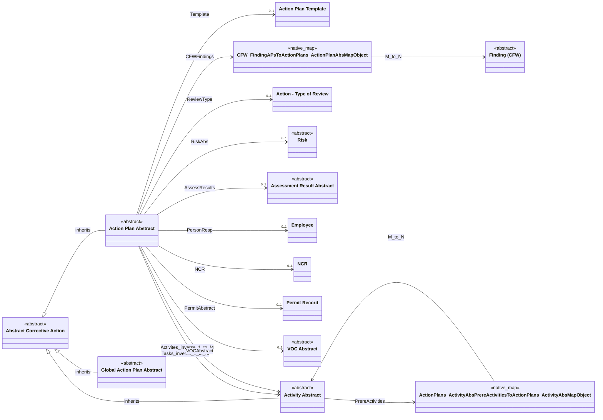

## Corrective Action Reporting

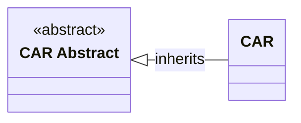

## Cause Analysis

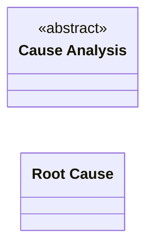

## Checklist Framework (v2)

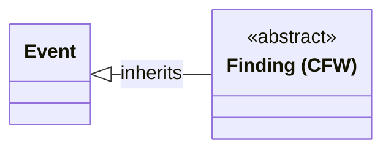

## Checklist Framework

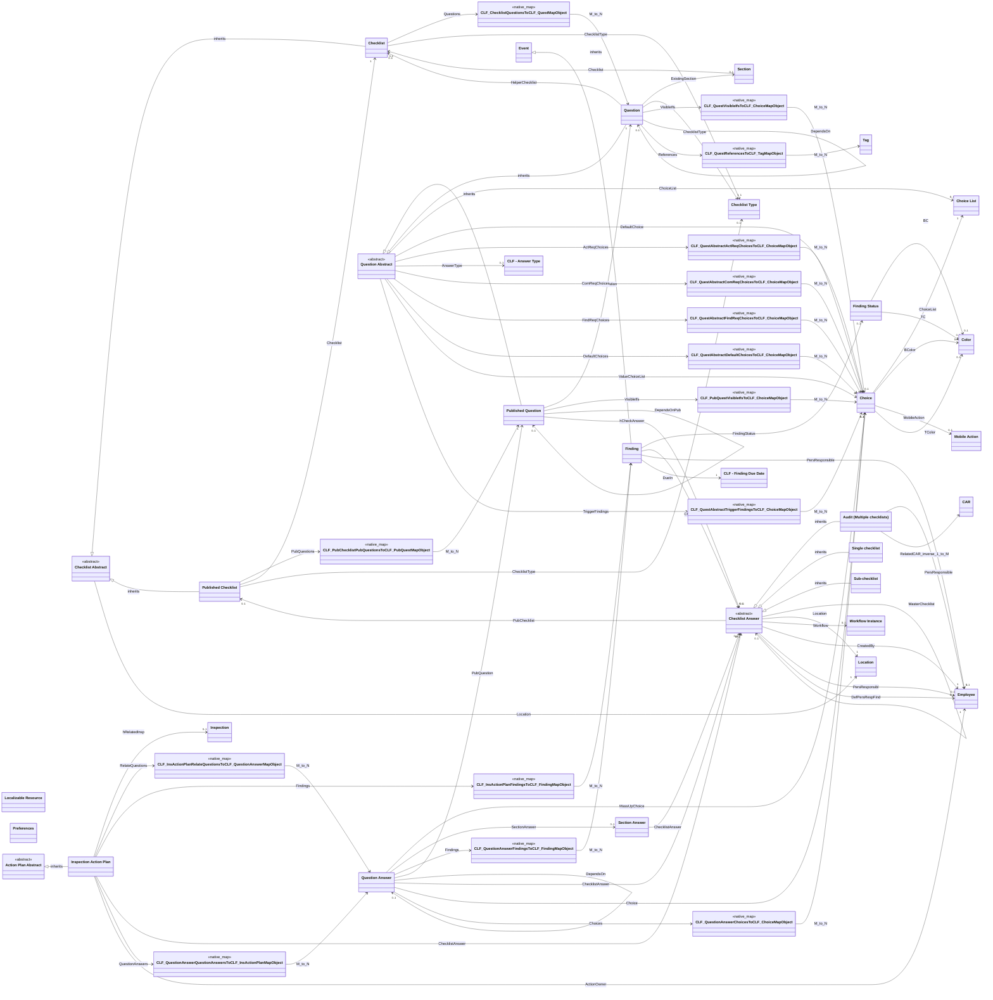

## Quality Comply Framework

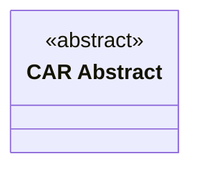

## Configuration Asset App Settings, By Summit EHSQ

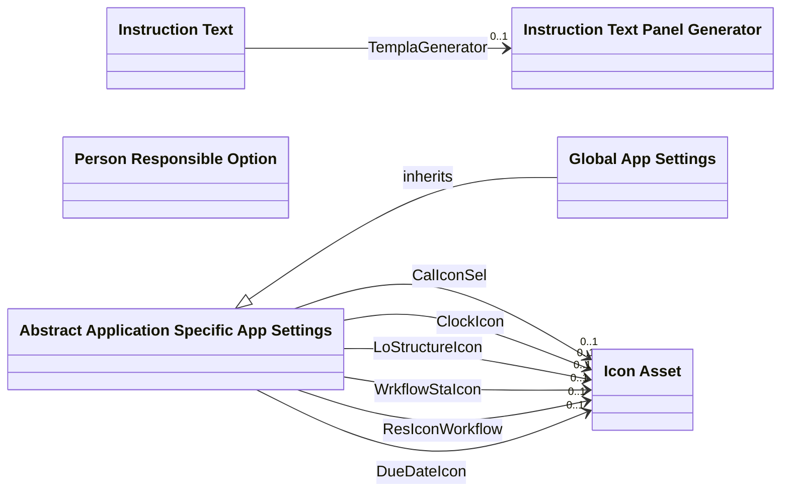

## Event Framework

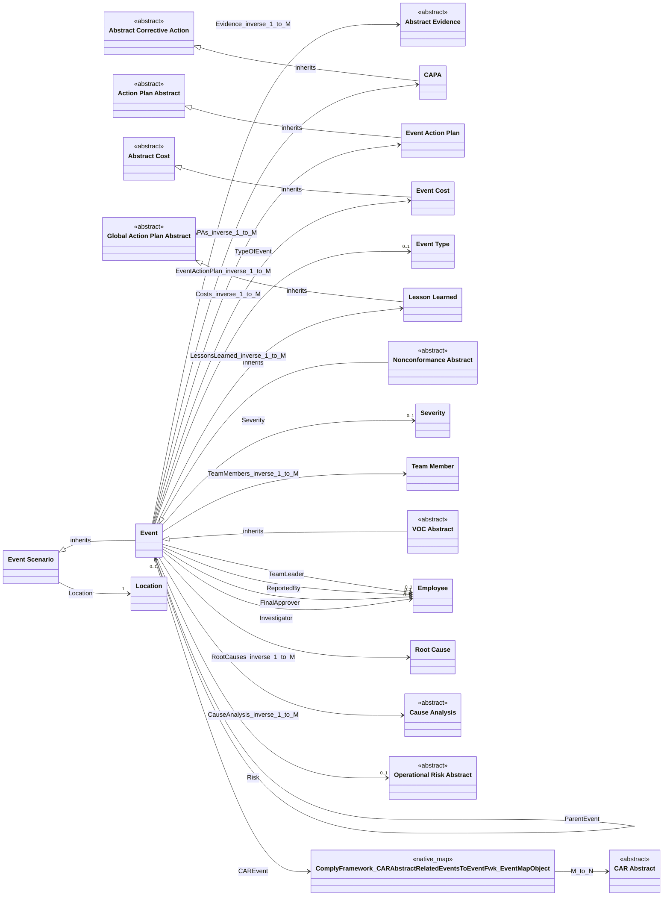

## Fragment Application

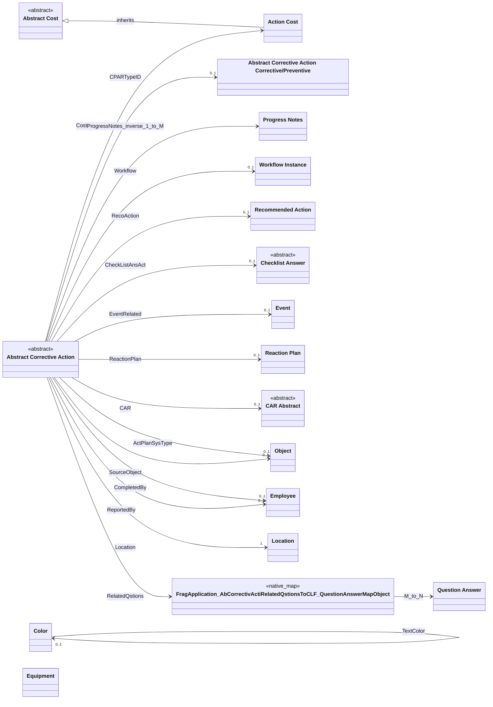

## Inspections

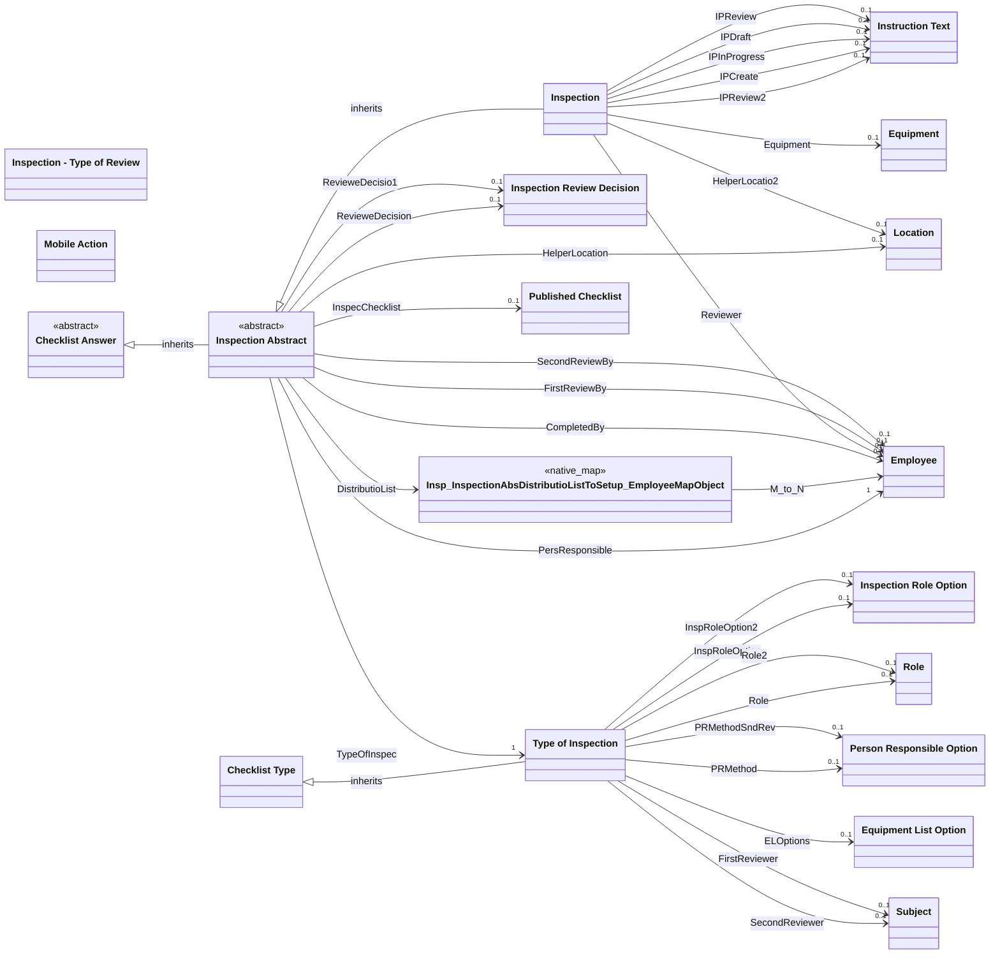

## System Objects

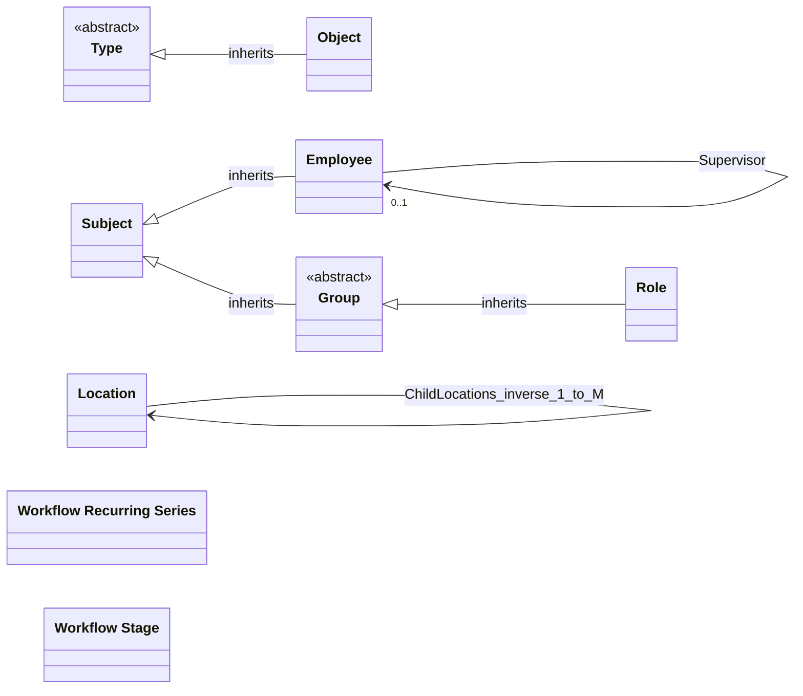

## Nonconformance Reporting

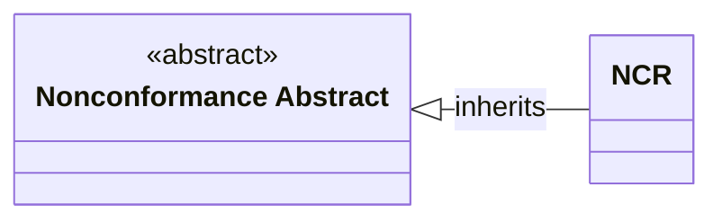

## Permit To Work

## FMEA

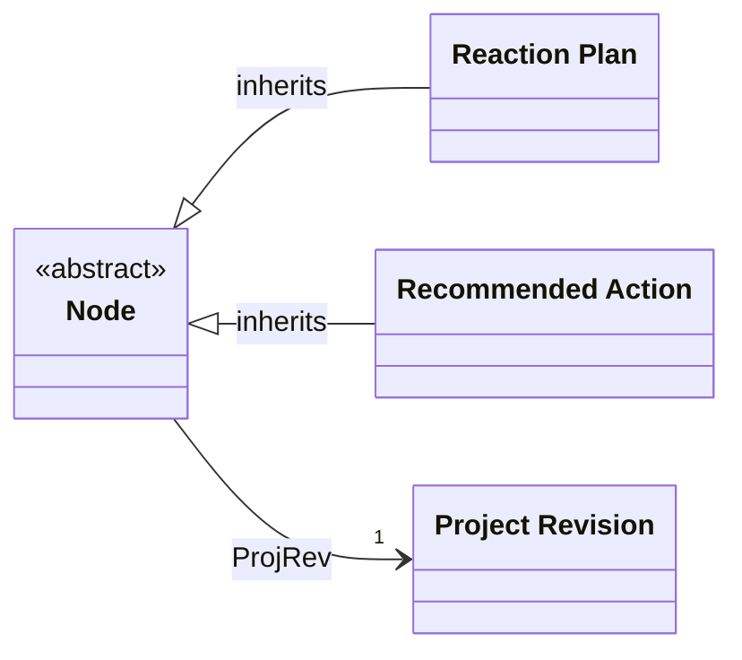

## Risk Framework

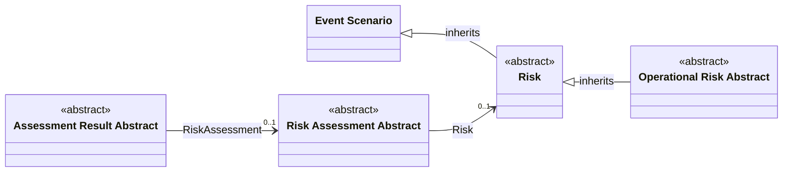

## My Tasks Summary

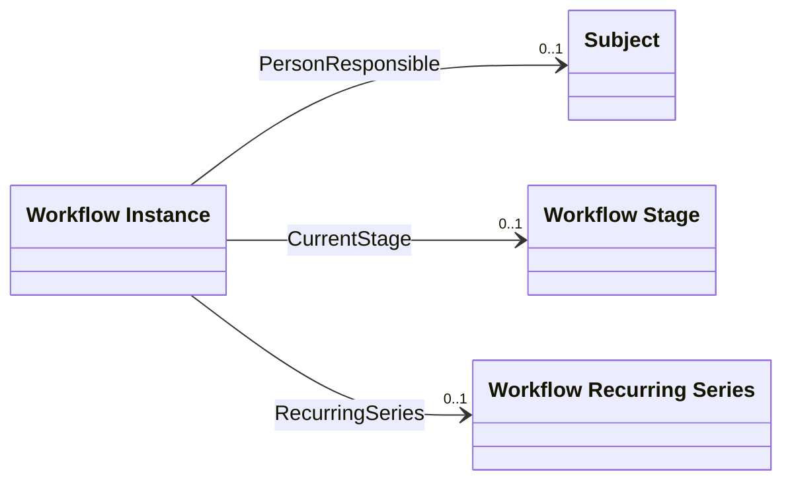
