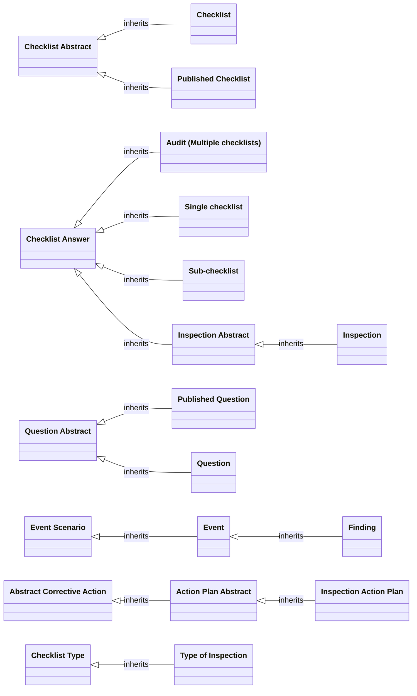

# Inspections and Checklist Framework — As-is Solution Specification

Baseline date: 28 October 2026. Status: package-derived documentation; no target design or application changes.

## 1. Findings and scope

**Extracted:** The export contains editable Checklist and Question definitions, Published Checklist and Published Question objects, checklist/section/question answer objects, Inspection, Finding, and Inspection Action Plan configuration. Inheritance connects Inspection → Inspection Abstract → Checklist Answer, and Inspection Action Plan → Action Plan Abstract → Abstract Corrective Action. Published configuration is structurally separate from operational answers. See sections 4–7 for exact fields and configured behavior.

**Extracted:** The Inspections module is enabled with mobile and offline flags. Checklist Framework is disabled as an application entry; that flag alone does not establish that its shared objects cannot execute through Inspections. The export also includes instruction-panel/app-settings configuration and framework dependencies.

**Extracted:** The Inspection and Inspection Action Plan draft schemas report no pending changes. The audit/sub-checklist schemas report pending changes; one audit schema is inactive. A draft schema is documented as exported and is not independent evidence of the live published runtime graph.

**Inferred:** The model supports authoring, publishing, performing inspections, recording answers/findings and following up actions. This is an architectural reading of the extracted objects and flows, not a verified tenant walkthrough.

The supplied package is the sole authority for this baseline. Proposed-change ADRs and other repository design documents were not used. Text embedded in the package is application content, not task instructions. Existing names, defaults, inverses and legacy/deprecated items are retained exactly rather than normalized to current design guidance.

This describes a **logical Intelex object model**, not a physical database schema. Exported table/column labels are retained as metadata only. No tenant connection, deployment, migration, formula execution, security impersonation, or runtime tests were performed.

## 2. Package inspection and evidence

The file is UTF-8 JSON with a byte-order mark, not an archive. It was parsed directly without modifying the source. Every nested graph was inventoried; JSON.NET-style $id/$ref references were resolved before assigning ownership, targets or inheritance.

| Property | Extracted value |
| --- | --- |
| File | Inspections + Checklist Framework Config Extract(v1.0.0.0).ipack |
| Bytes | 3498186 |
| SHA-256 | e8045aefb2a54503bfa59584b9eb9de137d9c4a7e959ff84acf35f65d07692ef |
| Package ID | 4a5350da-6975-407a-836b-0c5f15c666bc |
| Version / version ID | 1.0.0.0 / 761f0f0c-af0c-46ff-86a7-cc414280799b |
| Source owner | TerraGenSummitDev |
| Build / export (UTC) | 2026-10-28T19:35:13.5991373Z / 2026-10-28T19:35:16.4323327Z |
| Platform | 6.6.29.0 |
| Graphs / records / graph relations | 19 / 972 / 3289 |
| Objects: included / dependency stubs | 43 / 44 |
| Declared fields: scalar / reference | 297 / 175 |
| Distinct relationship definitions | 148 |
| Configurable views / profiles | 121 / 65 |
| Workflow schemas / handlers | 5 / 52 |

Evidence keys E<number> identify the source serialization node; stable configuration identity is RecordId / FieldData.Id, while item Id is a separate package-item identifier. Source JSON paths and original metadata are retained in [evidence.json](evidence.json). Links to evidence open that registry; search the named evidenceId. Dependencies are partial metadata, not a claim that the complete referenced application is included.

The field tables cover all exported directly declared properties, including dependency stubs. Null or omitted metadata is recorded as not exported, never converted into an invented platform default. Field-table Req is the metadata flag (Y/N); form mandatory rules and workflow validation can further restrict entry and are recorded separately. This is a complete inventory of exported field rows, not a complete rebuild contract for the tenant.

### 2.1 Package application prerequisites

| Application / requirement | Name | Version |
| --- | --- | --- |
| My Tasks Summary | MyTasksSummary | 1.0.0 |
| Nonconformance Reporting | NCR | 1.0.0 |
| Corrective Action Reporting | CAR | 1.0.0 |
| System Objects | Setup | 1.0.0 |
| Cause Analysis | CauseAnalysis | 1.0.0 |
| Platform | PlatformVersion | 6.6.29.0 |
| Event Framework | EventFwk | 1.0.3 |
| Action Plans | ActionPlans | 1.2.1 |
| FMEA | QP | 1.0.0 |
| Quality Comply Framework | ComplyFramework | 1.0.0 |
| Permit To Work | PTW | 1.0.0 |
| Fragment Application | FragApplication | 1.0.2 |
| Checklist Framework (v2) | CFW | 1.0.0 |
| Risk Framework | RiskFmk | 1.0.0 |

### 2.2 Recursive package item inventory

| Record kind | Count |
| --- | --- |
| SysConfigurableViewEntity | 121 |
| MetObjectEntity | 81 |
| SysConfigurableViewProfileEntity | 65 |
| MetReferencePropertyEntity | 175 |
| MetObjectActionEntity | 52 |
| SecSystemPermissionMaskEntity | 6 |
| MnuMenuItemEntity | 7 |
| MnuMenuEntity | 2 |
| MetSimplePropertyEntity | 297 |
| MetSimpleTypeEntity | 12 |
| SysModuleEntity | 16 |
| MetGroupEntity | 1 |
| MetTypeValidationEntity | 11 |
| MetLookupObjectEntity | 6 |
| NtfTemplateEntity | 13 |
| NtfEmailMessageEntity | 13 |
| SysSystemSubjectEntity | 2 |
| SysModuleTabConfigurableViewEntity | 6 |
| CLF_FindingDDObject | 5 |
| Insp_MobileActionObject | 3 |
| CLF_AnswerTypeObject | 6 |
| SysSecurityGroupEntity | 6 |
| SecPermissionEntity | 9 |
| SysUserGroupEntity | 1 |
| SysModuleGroupEntity | 2 |
| SysModuleTabAutogeneratedViewEntity | 7 |
| MetFilterEntity | 1 |
| SysEscalationLevelEntity | 1 |
| MetLinkEntity | 1 |
| SysWorkflowDraftSchemaEntity | 5 |
| SysWorkflowDraftStageEntity | 10 |
| SysWorkflowReccurenceSettingEntity | 2 |
| SysWorkflowDraftStatusEntity | 16 |
| SysWorkflowDraftStageActionEntity | 10 |
| MetPropertyValidationEntity | 1 |

### 2.3 Export roots

| Root | Type | Record ID |
| --- | --- | --- |
| Action Plan Abstract | MetObjectEntity | edca9466-cdf8-4317-85c9-d3efb40373a2 |
| Event | MetObjectEntity | 3979d543-6df2-46a1-a26e-293cd7978bdc |
| Abstract Corrective Action | MetObjectEntity | ffaeb11a-e798-47ed-a3fb-1336a82876dd |
| Checklist Framework | SysModuleEntity | cb6277a9-6157-4149-bf7d-e44900119b0e |
| Event Scenario | MetObjectEntity | c0d0d372-c03c-46cd-9f51-cdd28b620177 |
| Inspections | SysModuleEntity | 552ac529-b2e5-4597-a16a-725c46ab992b |
| Color | MetObjectEntity | dc9d451a-c909-4a8d-8296-f0cf88971f06 |
| Configuration Asset App Settings, By Summit EHSQ | SysModuleEntity | 10ce06ca-c566-4fc4-b20b-ae21001df039 |

## 3. Functional architecture

| Area | Extracted configuration and architectural consequence |
| --- | --- |
| Authoring | Checklist Abstract supplies shared checklist structure; Checklist and Published Checklist are separate descendants. Question Abstract similarly supplies Question and Published Question. Section, Choice List, Choice and Tag support organization and answer options. |
| Execution | Checklist Answer has Inspection Abstract, Single checklist, Sub-checklist and Audit (Multiple checklists) descendants. Inspection is a further descendant of Inspection Abstract. Question Answer and Section Answer carry execution detail. |
| Findings and follow-up | Finding inherits Event, which inherits Event Scenario. Inspection Action Plan inherits Action Plan Abstract and Abstract Corrective Action. Reference and native map relationships link answers, findings and actions; they are not inheritance edges. |
| Reusable settings | Type of Inspection inherits Checklist Type. Instruction Text, panel generator, icon assets and global/specific app settings provide reusable presentation/configuration records. |
| External integration surfaces | Employee, Location, workflow system records, risk, cause analysis, corrective action, nonconformance, permit and FMEA metadata appear as dependencies. Their inclusion here documents linkage, not full external-module specifications. |

### 3.1 Configured operational behavior

The following readings are **Inferred from the cited extracted expressions**, with exact source retained in the configuration register.

| Step | As-is behavior | Evidence |
| --- | --- | --- |
| Prepare published content | Published Checklist copies Description, ChecklistRef and Location from Checklist. Its handler description attributes the Name copy to a Custom Action Handler. Published Question copies source Question content, ordering, section, answer type, choice defaults, conditional-display settings, requiredness and scoring settings. | E2348, E265 |
| Initialize inspection answers | The Create answers flow substitutes the newest active published checklist when the selected version is inactive, assigns PubChecklist, then sets PubChecklist.PubQuestions.hCheckAnswerId. Published Question's update flow assigns QuestionAnswers through GETRELATED and clears its temporary hCheckAnswer reference. This documents the configured chain; the complete custom code behind framework behavior is not exported. | E2007, E241 |
| Enter the working stage | Continue first handles CreateMode. With an inspection checklist selected it transitions to In Progress and sets oSectionAnswers. Without a selected checklist it can remain in Create/Draft; the later branch rejects an empty QuestionAnswers collection with “Please add at least one Question to the Checklist.” | E2697 |
| Complete inspection work | Complete Inspection checks Progress when TypeOfInspec.ComplValidation is enabled and rejects open findings when FindingTracking is enabled. It stamps CompletedBy and CompletedOn. If EnabFirstReview is true, it validates reviewer resolution and enters Review; otherwise it sets ReleActionPlans, completes, notifies DistributioList, then clears workflow current-stage and responsible-person references. | E2704 |
| First review | RecipientExpression selects Reviewer, TypeOfInspec.Role, the responsible person's Supervisor or EVAL(TypeOfInspec.Expression), according to PRMethod.Name. Complete Approval Stage requires RevieweDecision; a Rejected value routes back to In Progress after the exact RevieweComments=0 check. Approval repeats completion checks, stamps FirstReviewBy/DaofFirstReview and either enters Second Review or completes and releases actions. | E2691, E2702 |
| Second review | Responsibility comes from TypeOfInspec.SecondReviewer. Rejection routes back to Review after the exact RevieweComment1=0 check; approval repeats completion checks, stamps SecondReviewBy/DofSecondReview, releases actions, completes and notifies the distribution list. Numeric comment comparisons are preserved as written, not silently corrected to null/string checks. | E2695, E2706 |
| Release action plans | Inspection Action Plan workflow starts only when HelperReleaseAP=TRUE. Its assignment-notification handler checks ISCHANGED(HelperReleaseAP), then notifies when the resulting value is true. Field calculations and source relations in section 6 show how each release helper is populated. | E2510, E477 |
| Complete an action plan | Complete calls the completion operation first, sets IsCompleted, fills absent CompletionDate and CompletedBy, then raises an error if CompletionNotes is null. That source ordering is significant: whether a late error rolls back prior steps is unresolved without runtime verification. | E2518 |
| Already corrected action | The Action Already Completed handler sets Workflow.DateNotRequired=TODAY when its exact condition AlBeenCorrected = "TRUE" succeeds. The workflow has DateNotRequired enabled and Completed as its corresponding final status. Quoted Boolean syntax is retained as package evidence, not newly validated. | E3088, E2510 |
| Conditional answer clearing | When IsVisible changes away from true, Clear Answer if not visible clears Checkbox, Choice, Choices, Date, Float, Text and Comments. The answer-update handler clears typed answers when IsNA becomes true, handles mass-update choice compatibility and applies triggered default answers. These are separate clearing paths. | E842, E883 |

### 3.2 Explicit publication mappings

The tables below enumerate each setvalue in the exported publication-copy handlers. They do not claim atomic publication, immutable published records or a complete compiled Publish implementation. The handler description for E2348 identifies an additional Custom Action Handler Name copy whose implementation is not in this package.

**CLF_PubQuestObject: Copy Values from Question during Publish (E265)**

| Destination field | Source expression |
| --- | --- |
| QuestionRef | Question.QuestionRef |
| Order | Question.Order |
| Content | Question.Content |
| Guideline | Question.Guideline |
| SectionName | Question.ExistingSection.SectionName |
| Section | SectionName |
| AnswerType | Question.AnswerType |
| ChoiceList | Question.ChoiceList |
| DefaultChoice | Question.DefaultChoice |
| DefaultChoices | Question.DefaultChoices |
| DefaultBool | Question.DefaultBool |
| AllowNA | Question.AllowNA |
| ComReqIfNA | Question.ComReqIfNA |
| FindReqChoices | Question.FindReqChoices |
| ComReqChoices | Question.ComReqChoices |
| ActReqChoices | Question.ActReqChoices |
| VisDepNoAns | Question.VisDepNoAns |
| VisibleIfs | Question.VisibleIfs |
| AnswerRequired | Question.AnswerRequired |
| Weight | Question.Weight |
| ValueChoiceList | Question.ValueChoiceList |
| AbsoluteOrder | Question.AbsoluteOrder |

**CLF_PubChecklistObject: Copy Values (E2348)**

| Destination field | Source expression |
| --- | --- |
| Description | Checklist.Description |
| ChecklistRef | Checklist.Reference |
| Location | Checklist.Location |

## 4. Object inventory

Inheritance is taken only from SuperType graph edges. None is used only where an explicit null SuperType and no edge establish absence; omitted SuperType with no edge is Unresolved. Dependency inventories and field lists can be partial. Display and identity fields are distinct.

| Internal name / display name | Stable record ID / evidence | Scope / system / abstract | Inheritance parent | Direct fields / identity / display |
| --- | --- | --- | --- | --- |
| ActionPlans_ActionPlanAbsObject / Action Plan Abstract | edca9466-cdf8-4317-85c9-d3efb40373a2; E42 | Included; system=false; abstract=true | FragApplication_AbCorrectivActiObject | 23; PK=Not exported; display=Unresolved |
| ActionPlans_ActioPlanTemObject / Action Plan Template | 589c9aa4-c12c-4247-80f4-eedba36fd75c; E2380 | Dependency stub; system=false; abstract=false | None | 0; PK=Not exported; display=Unresolved |
| ActionPlans_ActivityAbsObject / Activity Abstract | 347a4ed1-ecdb-40b5-b8d8-9a258e9adb99; E609 | Dependency stub; system=false; abstract=true | FragApplication_AbCorrectivActiObject | 3; PK=Not exported; display=Unresolved |
| ActionPlans_ActTypeofReviewObject / Action - Type of Review | 9d47eece-a2dd-4103-b076-9d1ea3e2407a; E2177 | Dependency stub; system=false; abstract=false | None | 0; PK=Not exported; display=Unresolved |
| ActionPlans_GlobActPlanAbsObject / Global Action Plan Abstract | 2746e1f2-7359-4939-8476-0426fb8e5f3e; E1751 | Dependency stub; system=false; abstract=true | FragApplication_AbCorrectivActiObject | 0; PK=Not exported; display=Unresolved |
| CAR_CARObject / CAR | 99e58a14-f67c-4cbc-b8f8-3dbc48177c6f; E2388 | Dependency stub; system=false; abstract=false | ComplyFramework_CARAbstractObject | 0; PK=Not exported; display=Unresolved |
| CauseAnalysis_CauseAnalysisObject / Cause Analysis | a631a825-2e5f-4fb7-ae45-6d084d8582d3; E1473 | Dependency stub; system=false; abstract=true | None | 0; PK=Not exported; display=Unresolved |
| CauseAnalysis_RootCauseObject / Root Cause | cb8d3588-d610-4120-b084-f31276410731; E179 | Dependency stub; system=false; abstract=false | None | 0; PK=Not exported; display=Unresolved |
| CFW_FindingObject / Finding (CFW) | 97529fd9-8002-44d3-a87b-d540f421c578; E2040 | Dependency stub; system=false; abstract=true | EventFwk_EventObject | 0; PK=Not exported; display=Unresolved |
| CLF_AnswerTypeObject / CLF - Answer Type | 4b8c65a0-c069-4f9d-afb1-d4fc97140e41; E795 | Included; system=false; abstract=false | None | 3; PK=Not exported; display=Unresolved |
| CLF_CheckliAbstractObject / Checklist Abstract | c726d108-022c-4b4b-8928-5160ce43a535; E369 | Included; system=false; abstract=true | None | 3; PK=Not exported; display=Unresolved |
| CLF_ChecklistAnswerObject / Checklist Answer | 3557470f-8de9-461c-bdcb-9edf9cc2b6c6; E75 | Included; system=false; abstract=true | None | 32; PK=Id; display=DisplayField |
| CLF_ChecklistObject / Checklist | 6fe45655-67bc-4593-91e3-675ccc304fdc; E514 | Included; system=false; abstract=false | CLF_CheckliAbstractObject | 12; PK=Id; display=Unresolved |
| CLF_ChecklistTypeObject / Checklist Type | 0259a1d3-455a-4ba5-8c4b-dbd3f0be9ea7; E966 | Included; system=false; abstract=false | None | 9; PK=Not exported; display=Name |
| CLF_ChoiceListObject / Choice List | b8491b3d-469a-4bdf-b9e1-ddcecf257422; E95 | Included; system=false; abstract=false | None | 8; PK=Id; display=Name |
| CLF_ChoiceObject / Choice | d36a079a-12db-4b54-9c70-f80d146ff8ca; E210 | Included; system=false; abstract=false | None | 11; PK=Id; display=Name |
| CLF_FindingDDObject / CLF - Finding Due Date | 235842cd-b2bd-4a2e-a8c3-b8e0f0d351f9; E578 | Included; system=false; abstract=false | None | 3; PK=Not exported; display=Unresolved |
| CLF_FindingObject / Finding | 18bb2218-f236-4baf-ad0b-cc187222c8f2; E172 | Included; system=false; abstract=false | EventFwk_EventObject | 13; PK=Not exported; display=Unresolved |
| CLF_FindingStatusObject / Finding Status | 2c6e1a6e-253b-4275-9c0c-d9f4b64a8834; E473 | Included; system=false; abstract=false | None | 5; PK=Not exported; display=Name |
| CLF_InsActionPlanObject / Inspection Action Plan | b714db5b-7015-4f4e-b05f-a9eb0e507d53; E28 | Included; system=false; abstract=false | ActionPlans_ActionPlanAbsObject | 13; PK=Not exported; display=RecordName |
| CLF_LocalizResourceObject / Localizable Resource | 9731e3e6-7280-4553-8d65-3af2c60aaad9; E663 | Included; system=false; abstract=false | None | 3; PK=Not exported; display=Key |
| CLF_MultichecklistsObject / Audit (Multiple checklists) | d1173495-0379-44d4-851a-9cab62d3f144; E703 | Included; system=false; abstract=false | CLF_ChecklistAnswerObject | 5; PK=Not exported; display=Unresolved |
| CLF_PreferencesObject / Preferences | 9f91762c-29b1-49d4-8f9b-580b73a7ff6d; E289 | Included; system=false; abstract=false | None | 2; PK=Not exported; display=Name |
| CLF_PubChecklistObject / Published Checklist | f0ba4595-963b-45fd-8b19-592ce53f7b3c; E475 | Included; system=false; abstract=false | CLF_CheckliAbstractObject | 6; PK=Not exported; display=Unresolved |
| CLF_PubQuestObject / Published Question | 0e5d5f7f-2039-4194-8f37-86771b63e36f; E216 | Included; system=false; abstract=false | CLF_QuestAbstractObject | 17; PK=Id; display=QuestionRef |
| CLF_QuestAbstractObject / Question Abstract | 312a57bc-343e-4337-a251-91609c550820; E93 | Included; system=false; abstract=true | None | 21; PK=Not exported; display=Unresolved |
| CLF_QuestionAnswerObject / Question Answer | 9083e2f5-2e24-4174-92db-75a61a217d0b; E208 | Included; system=false; abstract=false | None | 41; PK=Not exported; display=PubQuestion |
| CLF_QuestObject / Question | 92628acf-dcc3-41c3-b23f-198d83cba0ef; E338 | Included; system=false; abstract=false | CLF_QuestAbstractObject | 17; PK=Not exported; display=Unresolved |
| CLF_SectionAnswerObject / Section Answer | b01defd7-dd92-4793-ab45-64a123159338; E408 | Included; system=false; abstract=false | None | 6; PK=Not exported; display=Section |
| CLF_SectionObject / Section | 6c774cf4-c380-4706-81ef-a656239fe8cf; E336 | Included; system=false; abstract=false | None | 4; PK=Not exported; display=Unresolved |
| CLF_SinglechecklistObject / Single checklist | 3baadf79-b7a0-482b-8165-fa490a96bcae; E433 | Included; system=false; abstract=false | CLF_ChecklistAnswerObject | 0; PK=Not exported; display=Unresolved |
| CLF_SubchecklistObject / Sub-checklist | 3f6970f2-408f-4bee-bdae-80f0db6ca83a; E450 | Included; system=false; abstract=false | CLF_ChecklistAnswerObject | 1; PK=Not exported; display=Unresolved |
| CLF_TagObject / Tag | 820903cc-cbc9-4198-834f-a80d2b78b20e; E1747 | Included; system=false; abstract=false | None | 2; PK=Not exported; display=Name |
| ComplyFramework_CARAbstractObject / CAR Abstract | 9e02f3af-cb69-48f0-8206-dfbe8cb7d06c; E1064 | Dependency stub; system=false; abstract=true | None | 0; PK=Not exported; display=Unresolved |
| ConfgAppSetting_GlobAppSettingsObject / Global App Settings | 73d6b091-b922-45ff-85ee-d92e8267971e; E1060 | Included; system=false; abstract=false | ConfgAppSetting_SpecAppSettingsObject | 0; PK=Not exported; display=Unresolved |
| ConfgAppSetting_IconAssetObject / Icon Asset | 51760767-f9a1-4930-a7d3-0580ea2f87fd; E300 | Included; system=false; abstract=false | None | 3; PK=Not exported; display=Name |
| ConfgAppSetting_InstructionTextObject / Instruction Text | ccdcd5a5-82d8-4822-b2ac-703d41dc5d0d; E35 | Included; system=false; abstract=false | None | 9; PK=Not exported; display=DisplayField |
| ConfgAppSetting_PersRespOptionObject / Person Responsible Option | b566862a-2640-4325-96ff-da5dc0ad6b68; E1280 | Included; system=false; abstract=false | None | 4; PK=Not exported; display=Name |
| ConfgAppSetting_SpecAppSettingsObject / Abstract Application Specific App Settings | 08f1bba7-28ca-461a-96d7-d2f0e2202128; E298 | Included; system=false; abstract=false | None | 12; PK=Not exported; display=Unresolved |
| ConfgAppSetting_TPanelGeneratorObject / Instruction Text Panel Generator | 8884bd44-4951-4dbf-9c7f-d9b574946afd; E126 | Included; system=false; abstract=false | None | 5; PK=Not exported; display=TemplateName |
| EventFwk_AbsEvidenceObject / Abstract Evidence | 92a1b764-06f7-4556-8e6a-1f72be0b1c7c; E1808 | Dependency stub; system=false; abstract=true | None | 0; PK=Not exported; display=Unresolved |
| EventFwk_CAPAObject / CAPA | 11b88061-922a-4690-86df-61f1b766b34a; E138 | Dependency stub; system=false; abstract=false | FragApplication_AbCorrectivActiObject | 0; PK=Not exported; display=Unresolved |
| EventFwk_EventActionPlanObject / Event Action Plan | 684c77dc-7d3c-4387-98ca-d93cf8b6ae16; E2129 | Dependency stub; system=false; abstract=false | ActionPlans_ActionPlanAbsObject | 0; PK=Not exported; display=Unresolved |
| EventFwk_EventCostObject / Event Cost | b2ca1b26-74a4-4a99-aa8c-fac02454835b; E1552 | Dependency stub; system=false; abstract=false | FragApplication_AbstractCostObject | 0; PK=Not exported; display=Unresolved |
| EventFwk_EventObject / Event | 3979d543-6df2-46a1-a26e-293cd7978bdc; E85 | Included; system=false; abstract=false | EventFwk_EventScenarioObject | 40; PK=Not exported; display=Unresolved |
| EventFwk_EventScenarioObject / Event Scenario | c0d0d372-c03c-46cd-9f51-cdd28b620177; E342 | Included; system=false; abstract=false | None | 4; PK=Not exported; display=Name |
| EventFwk_EventTypeObject / Event Type | 33cdd92d-1fc4-4a8a-9cbe-48e6ffb26a13; E553 | Dependency stub; system=false; abstract=false | None | 0; PK=Not exported; display=Unresolved |
| EventFwk_LessonLearnedObject / Lesson Learned | 63e2eb5b-3f7b-4dd3-a295-9f4f9f712cef; E1749 | Dependency stub; system=false; abstract=false | ActionPlans_GlobActPlanAbsObject | 0; PK=Not exported; display=Unresolved |
| EventFwk_NonConfAbstractObject / Nonconformance Abstract | ac4266ea-f1d6-4bb3-aca7-31e1585dd540; E2162 | Dependency stub; system=false; abstract=true | EventFwk_EventObject | 0; PK=Not exported; display=Unresolved |
| EventFwk_SeverityObject / Severity | 412062e5-1181-47a1-83c0-91d0e52a2bd6; E293 | Dependency stub; system=false; abstract=false | None | 0; PK=Not exported; display=Unresolved |
| EventFwk_TeamMemberObject / Team Member | 88f9a145-d866-4be9-961a-a741789ec394; E212 | Dependency stub; system=false; abstract=false | None | 0; PK=Not exported; display=Unresolved |
| EventFwk_VOCAbstractObject / VOC Abstract | eb90c958-cbcf-4f4a-89ba-2e0bedea4770; E1497 | Dependency stub; system=false; abstract=true | EventFwk_EventObject | 0; PK=Not exported; display=Unresolved |
| FragApplication_AbCorrectivActiObject / Abstract Corrective Action | ffaeb11a-e798-47ed-a3fb-1336a82876dd; E185 | Included; system=false; abstract=true | None | 29; PK=Not exported; display=CPARActionReq |
| FragApplication_AbstractCostObject / Abstract Cost | b14ca608-e356-4b60-b9ec-3db8e6e208e0; E728 | Dependency stub; system=false; abstract=true | None | 1; PK=Not exported; display=Unresolved |
| FragApplication_ActionCostObject / Action Cost | 9121f9af-5120-47d8-97e8-a04ea1ee6ce8; E1101 | Dependency stub; system=false; abstract=false | FragApplication_AbstractCostObject | 0; PK=Not exported; display=Unresolved |
| FragApplication_ColorObject / Color | dc9d451a-c909-4a8d-8296-f0cf88971f06; E1010 | Included; system=false; abstract=false | None | 3; PK=Not exported; display=Caption |
| FragApplication_CorrectivePreveObject / Abstract Corrective Action Corrective/Preventive | 4ede3636-6468-4b3c-bbc7-c5a34250e6bd; E1916 | Dependency stub; system=false; abstract=false | None | 0; PK=Not exported; display=Unresolved |
| FragApplication_EquipmentObject / Equipment | d05bf7ff-7ab2-47f3-96d9-97a1a328d9ce; E143 | Dependency stub; system=false; abstract=false | None | 1; PK=Not exported; display=Unresolved |
| FragApplication_PrgressNotesObject / Progress Notes | 7d1fa155-4b0e-4552-9a6a-4e1c2b30e941; E1838 | Dependency stub; system=false; abstract=false | None | 0; PK=Not exported; display=Unresolved |
| Insp_ActTypeofReviewObject / Inspection - Type of Review | 121d71e4-ed81-4f6e-8d36-c76d3aaf9f2d; E1844 | Included; system=false; abstract=false | None | 3; PK=Not exported; display=Unresolved |
| Insp_EquipInspectionObject / Inspection | 4266a8f5-e53c-4b81-921c-540913945dfd; E37 | Included; system=false; abstract=false | Insp_InspectionAbsObject | 21; PK=Id; display=Unresolved |
| Insp_EquipListOptionObject / Equipment List Option | db312533-2245-4dab-9ffa-7c2d5c254d73; E616 | Included; system=false; abstract=false | None | 4; PK=Not exported; display=Name |
| Insp_InspectionAbsObject / Inspection Abstract | 8c33cf5c-67fd-4cca-8703-96ec39efff81; E106 | Included; system=false; abstract=true | CLF_ChecklistAnswerObject | 19; PK=Not exported; display=InsDisplayField |
| Insp_InspRoleOptionObject / Inspection Role Option | 538d6243-3abc-44e4-b059-9ba40076c922; E350 | Included; system=false; abstract=false | None | 4; PK=Not exported; display=Name |
| Insp_IReviewDecisionObject / Inspection Review Decision | e693fba5-fae3-4a4f-a89f-f797af1f16a8; E770 | Included; system=false; abstract=false | None | 3; PK=Not exported; display=Unresolved |
| Insp_MobileActionObject / Mobile Action | b75f1fef-ed47-4d29-8a11-fd7986ca1c9f; E377 | Included; system=false; abstract=false | None | 3; PK=Not exported; display=Unresolved |
| Insp_TypeObject / Type of Inspection | c504f266-819b-47a2-84f2-0154fdcf19de; E165 | Included; system=false; abstract=false | CLF_ChecklistTypeObject | 23; PK=Not exported; display=Unresolved |
| MetObjectEntity / Object | 09300b47-1b32-4ea7-9dfc-be1fb427d12f; E1722 | Dependency stub; system=true; abstract=false | MetTypeEntity | 0; PK=Not exported; display=Unresolved |
| MetTypeEntity / Type | a69a7f61-e713-41c0-96fa-1cf97a084f74; E611 | Dependency stub; system=true; abstract=true | None | 0; PK=Not exported; display=Unresolved |
| NCR_NCRObject / NCR | 27120010-b7c8-4d71-a23a-d0970607efba; E2118 | Dependency stub; system=false; abstract=false | EventFwk_NonConfAbstractObject | 0; PK=Not exported; display=Unresolved |
| PTW_PermitRecordObject / Permit Record | 5cb20c2b-6a4f-4402-a75d-5628ec4dd610; E2309 | Dependency stub; system=false; abstract=false | None | 0; PK=Not exported; display=Unresolved |
| QP_NodeAbstractObject / Node | ed20ee1a-4c61-40eb-969b-91ddd9fe19b7; E454 | Dependency stub; system=false; abstract=true | None | 2; PK=Not exported; display=Unresolved |
| QP_ProjRevObject / Project Revision | 440174ae-c4c9-4d86-ad7d-e72bbab69db4; E2618 | Dependency stub; system=false; abstract=false | None | 0; PK=Not exported; display=Unresolved |
| QP_ReactionPlanObject / Reaction Plan | 8fcd293e-0288-4892-93e3-de6f418b89a7; E2137 | Dependency stub; system=false; abstract=false | QP_NodeAbstractObject | 0; PK=Not exported; display=Unresolved |
| QP_RecoActionObject / Recommended Action | 13d4a5ac-9329-4eff-8221-1db8d857359c; E371 | Dependency stub; system=false; abstract=false | QP_NodeAbstractObject | 1; PK=Not exported; display=Unresolved |
| RiskFmk_AResultAbstractObject / Assessment Result Abstract | 7822ebd3-9ce6-494b-9ff6-88061b2bcd46; E2564 | Dependency stub; system=false; abstract=true | None | 1; PK=Not exported; display=Unresolved |
| RiskFmk_OpRiskObject / Operational Risk Abstract | 3ede7c62-0206-4a39-b6ed-ba8c99b79f4c; E2086 | Dependency stub; system=false; abstract=true | RiskFmk_RiskObject | 0; PK=Not exported; display=Unresolved |
| RiskFmk_RiskAssessmentObject / Risk Assessment Abstract | 5243c661-78da-4e1f-a764-850e3b8e89a1; E1903 | Dependency stub; system=false; abstract=true | None | 1; PK=Not exported; display=Unresolved |
| RiskFmk_RiskObject / Risk | da1604a8-ddbd-463b-83c3-8b5240f9cbbe; E340 | Dependency stub; system=false; abstract=true | EventFwk_EventScenarioObject | 0; PK=Not exported; display=Unresolved |
| SysEmployeeEntity / Employee | 6afb3ac6-96db-4072-9293-4d02699d1264; E104 | Dependency stub; system=false; abstract=false | SysSubjectEntity | 2; PK=Id; display=Unresolved |
| SysGroupEntity / Group | dc95c2f3-4325-40d5-91af-046ef46fdfc4; E1557 | Dependency stub; system=false; abstract=true | SysSubjectEntity | 0; PK=Not exported; display=Unresolved |
| SysLocationEntity / Location | f5d5209b-0a7d-4858-a302-678fcc065dd2; E1150 | Dependency stub; system=false; abstract=false | None | 1; PK=Not exported; display=Unresolved |
| SysRoleEntity / Role | 1b44b982-2248-41c5-971e-dfa68eddb196; E2092 | Dependency stub; system=false; abstract=false | SysGroupEntity | 0; PK=Not exported; display=Unresolved |
| SysSubjectEntity / Subject | 785124a0-20be-4606-8d25-56dd86248bbf; E406 | Dependency stub; system=false; abstract=false | None | 0; PK=Not exported; display=Unresolved |
| SysWorkflowInstanceEntity / Workflow Instance | ff5895e2-f1a0-4f19-83fc-417947fcef53; E404 | Dependency stub; system=true; abstract=false | None | 7; PK=Not exported; display=Unresolved |
| SysWorkflowRecurringSeriesEntity / Workflow Recurring Series | 50d7bbfc-a211-4703-90fa-7d12f7866f84; E118 | Dependency stub; system=true; abstract=false | None | 2; PK=Not exported; display=Unresolved |
| SysWorkflowStageEntity / Workflow Stage | f3ca6a8e-9736-4749-9c16-6c27e180b90e; E705 | Dependency stub; system=true; abstract=false | None | 1; PK=Not exported; display=Unresolved |

## 5. Logical model and inheritance

[Detailed baseline diagrams](baseline-diagrams.md) cover every object, direct inheritance edge, distinct stored relationship and native M:N map name. Stable Mermaid identifiers use exact internal names with punctuation replaced by underscores; labels supply display names. Associations use declaring start-side properties where exported; inverse-only navigation is explicitly labelled when that declaration is absent. Optionality uses IsRequired only for single targets; collection minimums, uniqueness and reverse-side minima are not inferred.

### 5.1 Core inheritance overview

### 5.2 Direct inheritance register

| Object | Inheritance parent | Evidence |
| --- | --- | --- |
| ActionPlans_ActionPlanAbsObject | FragApplication_AbCorrectivActiObject | E3220, E2549 |
| ActionPlans_ActivityAbsObject | FragApplication_AbCorrectivActiObject | E4226 |
| ActionPlans_GlobActPlanAbsObject | FragApplication_AbCorrectivActiObject | E5200 |
| CAR_CARObject | ComplyFramework_CARAbstractObject | E5688 |
| CFW_FindingObject | EventFwk_EventObject | E5451 |
| CLF_ChecklistObject | CLF_CheckliAbstractObject | E4148 |
| CLF_FindingObject | EventFwk_EventObject | E3503 |
| CLF_InsActionPlanObject | ActionPlans_ActionPlanAbsObject | E3099, E2535 |
| CLF_MultichecklistsObject | CLF_ChecklistAnswerObject | E4332, E2217, E3038 |
| CLF_PubChecklistObject | CLF_CheckliAbstractObject | E4119 |
| CLF_PubQuestObject | CLF_QuestAbstractObject | E3678 |
| CLF_QuestObject | CLF_QuestAbstractObject | E3922 |
| CLF_SinglechecklistObject | CLF_ChecklistAnswerObject | E4063 |
| CLF_SubchecklistObject | CLF_ChecklistAnswerObject | E4080, E2462 |
| ConfgAppSetting_GlobAppSettingsObject | ConfgAppSetting_SpecAppSettingsObject | E4715 |
| EventFwk_CAPAObject | FragApplication_AbCorrectivActiObject | E3443 |
| EventFwk_EventActionPlanObject | ActionPlans_ActionPlanAbsObject | E5529 |
| EventFwk_EventCostObject | FragApplication_AbstractCostObject | E5073 |
| EventFwk_EventObject | EventFwk_EventScenarioObject | E3336 |
| EventFwk_LessonLearnedObject | ActionPlans_GlobActPlanAbsObject | E5197 |
| EventFwk_NonConfAbstractObject | EventFwk_EventObject | E5555 |
| EventFwk_VOCAbstractObject | EventFwk_EventObject | E5040 |
| FragApplication_ActionCostObject | FragApplication_AbstractCostObject | E4739 |
| Insp_EquipInspectionObject | Insp_InspectionAbsObject | E3176, E2558, E2729 |
| Insp_InspectionAbsObject | CLF_ChecklistAnswerObject | E3398, E2562, E2791 |
| Insp_TypeObject | CLF_ChecklistTypeObject | E3481, E2853 |
| MetObjectEntity | MetTypeEntity | E5166 |
| NCR_NCRObject | EventFwk_NonConfAbstractObject | E5520 |
| QP_ReactionPlanObject | QP_NodeAbstractObject | E5533 |
| QP_RecoActionObject | QP_NodeAbstractObject | E3999 |
| RiskFmk_OpRiskObject | RiskFmk_RiskObject | E5490 |
| RiskFmk_RiskObject | EventFwk_EventScenarioObject | E3926 |
| SysEmployeeEntity | SysSubjectEntity | E3390, E2247, E2476, E2555, E2848, E3064 |
| SysGroupEntity | SysSubjectEntity | E5077, E2863 |
| SysRoleEntity | SysGroupEntity | E5494, E2855 |

## 6. Field-level baseline

Each subsection defines one object, and each field row is one exported declaration. Inherited fields remain on their declaring object. Metadata names and evidence IDs disambiguate duplicate display labels. For reverse properties, the row documents existing inverse navigation rather than creating duplicate storage. Raw relationship Type=2 is reconstructed as M:1/1:M using IsStartOfRelation and BaseFieldName; Type=3 as M:N, supported by explicit m:n map labels. These cardinality interpretations are **Inferred** from export encoding; numeric enum definitions are not included in the export. Numeric action, deletion, permission and display enums are preserved without inventing labels.

Exact default XML, calculations, filters and automation flows are linked into the [configuration register](configuration-register.md). Missing defaults mean no field override exported; type defaults may still apply. Read-only population is documented where supported; otherwise it remains Unresolved. Form restrictions, stage visibility, clearing/forcing and security may refine metadata flags: consult sections 7–9 and the form occurrence register. Null precision/length/timezone values do not prove unlimited length, floating-point precision or timezone disabled.

### 6.1 Action Plan Abstract

**Internal name:** `ActionPlans_ActionPlanAbsObject`. **Stable ID:** `edca9466-cdf8-4317-85c9-d3efb40373a2`. **Scope:** Included. **Classification:** Extracted metadata.

**Inheritance parent:** `FragApplication_AbCorrectivActiObject`.

**Directly declared fields:** `Activites`, `ActivitiesStart`, `ActivitProgress`, `AssessResults`, `CFWFindings`, `MActivitesOrder`, `MaxTasksOrder`, `NbActivites`, `NbOpenActivit`, `NbOpened`, `NbTasks`, `NCR`, `PermitAbstract`, `PersonResp`, `ProvenEffective`, `ReviewerComment`, `ReviewType`, `RiskAbs`, `StartDate`, `Tasks`, `TasksProgress`, `Template`, `VOCAbstract`.

**Inherited contract:** FragApplication_AbCorrectivActiObject (29 exported declarations). Dependency contracts may be partial.

**Source:** [E42](evidence.json) ($.GraphData.Items[7]). This object is a child of Abstract Corrective Action. This object captures the common elements of an action plan.

| Workflow enabled | Security enabled | Location bound | Audit enabled | Attachments | Soft delete | Localizable |
| --- | --- | --- | --- | --- | --- | --- |
| false | false | false | false | false | false | false |

**Declared Action Handlers:** [E55 Attach Risk if Assessment Results is not blank](configuration-register.md#handler-e55); [E522 Start Date must be on or after today.](configuration-register.md#handler-e522); [E3072 Trigger Activities](configuration-register.md#handler-e3072).

| Field | Type / relationship | Req | Default / calculation | Editability and visibility | Automation / lifecycle |
| --- | --- | --- | --- | --- | --- |
| Activities (Activites) | 1:M to ActionPlans_ActivityAbsObject; inverse Action Plan (ActPlanAbstract), ID 5d8d160e-c228-42b4-958b-c9262bc91257; relation E1212; start=false; delete enums hard=2, soft=1 | N | None exported at field level | metadata read-only=false; protected=false; EditPermission=not exported; ViewPermission=not exported; no field filter expression exported; no filter object linked; form occurrences: search Activites in section 9 register | Referenced by [E3072](configuration-register.md#handler-e3072); Validation rules: none linked; E1210; stable field ID 4409774a-5b8a-4a23-8e87-fd6ffcf01077 |
| Activities Can Start (ActivitiesStart) | Yes/No (bit); length=not exported, precision=not exported, scale=not exported; timezone=not exported | N | Default: [E2271-DefaultValue](configuration-register.md#e2271-defaultvalue); Type default: [E132-DefaultValue](configuration-register.md#e132-defaultvalue) | metadata read-only=false; protected=false; EditPermission=not exported; ViewPermission=not exported; no field filter expression exported; no filter object linked; form occurrences: search ActivitiesStart in section 9 register | Referenced by [E3072](configuration-register.md#handler-e3072); Validation rules: none linked; E2271; stable field ID 4e74e04e-e9b2-40d7-905f-054ddd7b576d |
| Activities Progress (ActivitProgress) | Percent (Percent); length=not exported, precision=18, scale=2; timezone=not exported | N | None exported at field level; Calculation: [E1350-Calculation](configuration-register.md#e1350-calculation) | metadata read-only=true; protected=false; EditPermission=not exported; ViewPermission=not exported; no field filter expression exported; no filter object linked; form occurrences: search ActivitProgress in section 9 register | No handler Fields edge exported; Population: calculation; Validation rules: none linked; E1350; stable field ID 2e2617c2-ca5d-47de-878d-3ba2af1c3007 |
| Assessment Results (AssessResults) | M:1 to RiskFmk_AResultAbstractObject; inverse Recommendations (ActionPlansAbs), ID 42312939-b807-40d2-aa3d-690679cac80b; relation E71; start=true; delete enums hard=1, soft=0 | N | None exported at field level | metadata read-only=false; protected=false; EditPermission=not exported; ViewPermission=not exported; no field filter expression exported; no filter object linked; form occurrences: search AssessResults in section 9 register | Referenced by [E55](configuration-register.md#handler-e55); Validation rules: none linked; E69; stable field ID 3902d2bd-198c-4f75-8ce3-d544c3568a0e |
| CFWFindings (CFWFindings) | M:N to CFW_FindingObject; inverse APs (APs), ID 0d9ae18a-a060-4dba-ba3d-8dc206a563b9; relation E2038; start=false; delete enums hard=0, soft=0 | N | None exported at field level | metadata read-only=false; protected=false; EditPermission=not exported; ViewPermission=not exported; no field filter expression exported; no filter object linked; form occurrences: search CFWFindings in section 9 register | No handler Fields edge exported; Validation rules: none linked; E2036; stable field ID b4847beb-f2ee-41a5-a353-bddb5fd75649 |
| Max Activities Order (MActivitesOrder) | Float (Float); length=not exported, precision=not exported, scale=not exported; timezone=not exported | N | None exported at field level; Calculation: [E1205-Calculation](configuration-register.md#e1205-calculation) | metadata read-only=true; protected=false; EditPermission=not exported; ViewPermission=not exported; no field filter expression exported; no filter object linked; form occurrences: search MActivitesOrder in section 9 register | No handler Fields edge exported; Population: calculation; Validation rules: none linked; E1205; stable field ID 15894350-8742-471a-a65d-d874605ab469 |
| Max Tasks Order (MaxTasksOrder) | Number (bigint); length=not exported, precision=not exported, scale=not exported; timezone=not exported | N | None exported at field level; Calculation: [E2325-Calculation](configuration-register.md#e2325-calculation) | metadata read-only=true; protected=false; EditPermission=not exported; ViewPermission=not exported; no field filter expression exported; no filter object linked; form occurrences: search MaxTasksOrder in section 9 register | No handler Fields edge exported; Population: calculation; Validation rules: none linked; E2325; stable field ID db6dce47-1b4a-4786-80e4-88c696e20a6b |
| # Activities (NbActivites) | Number (bigint); length=not exported, precision=not exported, scale=not exported; timezone=not exported | N | None exported at field level; Calculation: [E1357-Calculation](configuration-register.md#e1357-calculation) | metadata read-only=true; protected=false; EditPermission=not exported; ViewPermission=not exported; no field filter expression exported; no filter object linked; form occurrences: search NbActivites in section 9 register | No handler Fields edge exported; Population: calculation; Validation rules: none linked; E1357; stable field ID fe2c49a2-ee67-4f45-a726-5e270ebea456 |
| # Opened Activities (NbOpenActivit) | Number (bigint); length=not exported, precision=not exported, scale=not exported; timezone=not exported | N | None exported at field level; Calculation: [E1354-Calculation](configuration-register.md#e1354-calculation) | metadata read-only=true; protected=false; EditPermission=not exported; ViewPermission=not exported; no field filter expression exported; no filter object linked; form occurrences: search NbOpenActivit in section 9 register | No handler Fields edge exported; Population: calculation; Validation rules: none linked; E1354; stable field ID 39565eaf-1e08-426f-8f09-9b9d4f77d215 |
| # Opened Tasks (NbOpened) | Number (bigint); length=not exported, precision=not exported, scale=not exported; timezone=not exported | N | None exported at field level; Calculation: [E460-Calculation](configuration-register.md#e460-calculation) | metadata read-only=true; protected=false; EditPermission=not exported; ViewPermission=not exported; no field filter expression exported; no filter object linked; form occurrences: search NbOpened in section 9 register | No handler Fields edge exported; Population: calculation; Validation rules: none linked; E460; stable field ID 97f5a3d7-e817-4d1a-b8c4-838f0e282135 |
| # Tasks (NbTasks) | Number (bigint); length=not exported, precision=not exported, scale=not exported; timezone=not exported | N | None exported at field level; Calculation: [E465-Calculation](configuration-register.md#e465-calculation) | metadata read-only=true; protected=false; EditPermission=not exported; ViewPermission=not exported; no field filter expression exported; no filter object linked; form occurrences: search NbTasks in section 9 register | No handler Fields edge exported; Population: calculation; Validation rules: none linked; E465; stable field ID 6e5bfd0d-cf5d-4e4e-be17-b07829b3b18a |
| NCR (NCR) | M:1 to NCR_NCRObject; inverse Action Plan (ActionPlan), ID a3eed78e-9f44-4624-909e-63ec78bbd83b; relation E2116; start=true; delete enums hard=1, soft=0 | N | None exported at field level | metadata read-only=false; protected=false; EditPermission=not exported; ViewPermission=not exported; no field filter expression exported; no filter object linked; form occurrences: search NCR in section 9 register | No handler Fields edge exported; Validation rules: none linked; E2114; stable field ID f4ad240e-bd7c-4e04-be63-f5f1b1f1752f |
| Permit Abstract (PermitAbstract) | M:1 to PTW_PermitRecordObject; inverse Action Plan (ActionPlan), ID bb1d18b0-cffe-425a-9ca1-6fdd6476ffdc; relation E2307; start=true; delete enums hard=1, soft=0 | N | None exported at field level | metadata read-only=false; protected=false; EditPermission=not exported; ViewPermission=not exported; no field filter expression exported; no filter object linked; form occurrences: search PermitAbstract in section 9 register | No handler Fields edge exported; Validation rules: none linked; E2305; stable field ID f9070597-c50c-4bf3-af7b-65d358ba901b |
| Person Responsible (PersonResp) | M:1 to SysEmployeeEntity; no inverse metadata exported; relation E1541; start=true; delete enums hard=1, soft=0 | N | None exported at field level | metadata read-only=false; protected=false; EditPermission=not exported; ViewPermission=not exported; no field filter expression exported; no filter object linked; form occurrences: search PersonResp in section 9 register | Referenced by [E2980](configuration-register.md#handler-e2980); Validation rules: none linked; E1540; stable field ID 6e7e504f-9b46-45c2-8aec-cae6c88a90b2 |
| Implemented and Proven Effective? (ProvenEffective) | Yes/No (bit); length=not exported, precision=not exported, scale=not exported; timezone=not exported | N | None exported at field level; Type default: [E132-DefaultValue](configuration-register.md#e132-defaultvalue) | metadata read-only=false; protected=false; EditPermission=not exported; ViewPermission=not exported; no field filter expression exported; no filter object linked; form occurrences: search ProvenEffective in section 9 register | No handler Fields edge exported; Validation rules: none linked; E394; stable field ID d3807a14-3eae-40c9-9efe-df2ce175144e |
| Reviewer Comment (ReviewerComment) | Text (nvarchar); length=not exported, precision=not exported, scale=not exported; timezone=not exported | N | None exported at field level | metadata read-only=false; protected=false; EditPermission=not exported; ViewPermission=not exported; no field filter expression exported; no filter object linked; form occurrences: search ReviewerComment in section 9 register | No handler Fields edge exported; Validation rules: none linked; E2303; stable field ID 406daa5a-a4d8-4042-9c00-26f3492bf329 |
| Type of Review (ReviewType) | M:1 to ActionPlans_ActTypeofReviewObject; no inverse metadata exported; relation E2175; start=true; delete enums hard=0, soft=0 | N | Default: [E2174-DefaultValue](configuration-register.md#e2174-defaultvalue) | metadata read-only=false; protected=false; EditPermission=not exported; ViewPermission=not exported; no field filter expression exported; no filter object linked; form occurrences: search ReviewType in section 9 register | No handler Fields edge exported; Validation rules: none linked; E2174; stable field ID fe0e817a-bc7e-4287-93fd-e60a3aa72068 |
| Risk Abstract (RiskAbs) | M:1 to RiskFmk_RiskObject; inverse Recommendations (ActionPlansAbs), ID 6ffde664-9ae3-468a-8ae8-f549e555b78d; relation E59; start=true; delete enums hard=1, soft=0 | N | None exported at field level | metadata read-only=false; protected=false; EditPermission=not exported; ViewPermission=not exported; no field filter expression exported; no filter object linked; form occurrences: search RiskAbs in section 9 register | Referenced by [E55](configuration-register.md#handler-e55); Validation rules: none linked; E57; stable field ID f498c80c-2150-4b9d-8d3c-a7d0007af5c6 |
| Start Date (StartDate) | Date (Date); length=not exported, precision=not exported, scale=not exported; timezone=not exported | N | None exported at field level | metadata read-only=false; protected=false; EditPermission=not exported; ViewPermission=not exported; no field filter expression exported; no filter object linked; form occurrences: search StartDate in section 9 register | Referenced by [E522](configuration-register.md#handler-e522); Validation rules: none linked; E524; stable field ID 81126553-4e20-43f0-8e46-2422b937925a |
| Tasks (Tasks) | 1:M to ActionPlans_ActivityAbsObject; inverse Action Plan (ActionPlan), ID a6821395-10d0-4b8f-b37b-c66a1e048574; relation E607; start=false; delete enums hard=2, soft=1 | N | None exported at field level | metadata read-only=false; protected=false; EditPermission=not exported; ViewPermission=not exported; no field filter expression exported; no filter object linked; form occurrences: search Tasks in section 9 register | No handler Fields edge exported; Validation rules: none linked; E605; stable field ID 09e54a0e-4759-46c5-8bb4-78f6f9f793d5 |
| Tasks Progress (TasksProgress) | Percent (Percent); length=not exported, precision=18, scale=2; timezone=not exported | N | None exported at field level; Calculation: [E456-Calculation](configuration-register.md#e456-calculation) | metadata read-only=true; protected=false; EditPermission=not exported; ViewPermission=not exported; no field filter expression exported; no filter object linked; form occurrences: search TasksProgress in section 9 register | No handler Fields edge exported; Population: calculation; Validation rules: none linked; E456; stable field ID d12ef818-4240-48e2-9b78-f3a37ca23328 |
| Template (Template) | M:1 to ActionPlans_ActioPlanTemObject; no inverse metadata exported; relation E3080; start=true; delete enums hard=1, soft=0 | N | None exported at field level | metadata read-only=false; protected=false; EditPermission=not exported; ViewPermission=not exported; no field filter expression exported; no filter object linked; form occurrences: search Template in section 9 register | No handler Fields edge exported; Validation rules: none linked; E3079; stable field ID 9f63af1e-1ae5-48de-92ea-ad45819b76f1 |
| VOC Abstract (VOCAbstract) | M:1 to EventFwk_VOCAbstractObject; inverse Action Plan (ActionPlans), ID f1c7d0cf-e347-4c2c-890e-8635f9fd2e4b; relation E2624; start=true; delete enums hard=2, soft=0 | N | None exported at field level | metadata read-only=false; protected=false; EditPermission=not exported; ViewPermission=not exported; no field filter expression exported; no filter object linked; form occurrences: search VOCAbstract in section 9 register | No handler Fields edge exported; Validation rules: none linked; E2622; stable field ID 42e988d7-0c71-4708-a9a6-08d5c7df4ebd |

### 6.2 Action Plan Template

**Internal name:** `ActionPlans_ActioPlanTemObject`. **Stable ID:** `589c9aa4-c12c-4247-80f4-eedba36fd75c`. **Scope:** Dependency stub. **Classification:** Extracted metadata.

**Inheritance parent:** None.

**Directly declared fields:** None exported.

**Source:** [E2380](evidence.json) ($.GraphData.Items[801]). This object is used to create a template action plan.

| Workflow enabled | Security enabled | Location bound | Audit enabled | Attachments | Soft delete | Localizable |
| --- | --- | --- | --- | --- | --- | --- |
| false | true | false | false | true | false | false |

**Declared Action Handlers:** None linked in export.

### 6.3 Activity Abstract

**Internal name:** `ActionPlans_ActivityAbsObject`. **Stable ID:** `347a4ed1-ecdb-40b5-b8d8-9a258e9adb99`. **Scope:** Dependency stub. **Classification:** Extracted metadata.

**Inheritance parent:** `FragApplication_AbCorrectivActiObject`.

**Directly declared fields:** `CanStart`, `Order`, `PrereActivities`.

**Inherited contract:** FragApplication_AbCorrectivActiObject (29 exported declarations). Dependency contracts may be partial.

**Source:** [E609](evidence.json) ($.GraphData.Items[218]). 

| Workflow enabled | Security enabled | Location bound | Audit enabled | Attachments | Soft delete | Localizable |
| --- | --- | --- | --- | --- | --- | --- |
| false | false | false | false | false | false | false |

**Declared Action Handlers:** None linked in export.

| Field | Type / relationship | Req | Default / calculation | Editability and visibility | Automation / lifecycle |
| --- | --- | --- | --- | --- | --- |
| Can Start (CanStart) | Yes/No (bit); length=not exported, precision=not exported, scale=not exported; timezone=not exported | N | None exported at field level; Calculation: [E1548-Calculation](configuration-register.md#e1548-calculation); Type default: [E132-DefaultValue](configuration-register.md#e132-defaultvalue) | metadata read-only=true; protected=false; EditPermission=not exported; ViewPermission=not exported; no field filter expression exported; no filter object linked; form occurrences: search CanStart in section 9 register | Referenced by [E3072](configuration-register.md#handler-e3072); Population: calculation; Validation rules: none linked; E1548; stable field ID 049bf706-67a3-47f6-b53e-c69233eb692f |
| Order (Order) | Float (Float); length=not exported, precision=not exported, scale=not exported; timezone=not exported | N | Default: [E1208-DefaultValue](configuration-register.md#e1208-defaultvalue) | metadata read-only=false; protected=false; EditPermission=not exported; ViewPermission=not exported; no field filter expression exported; no filter object linked; form occurrences: search Order in section 9 register | No handler Fields edge exported; Validation rules: none linked; E1208; stable field ID c82d81ba-1100-4cf6-8bee-18ab9e581763 |
| Prerequisite Activities (PrereActivities) | M:N to ActionPlans_ActivityAbsObject; inverse Referenced By (ReferencedBy), ID 24964f20-fb3a-4a4d-abd8-5096831ea09f; relation E1021; start=true; delete enums hard=0, soft=0 | N | None exported at field level | metadata read-only=false; protected=false; EditPermission=not exported; ViewPermission=not exported; selection filter [E1019-FilterExpression](configuration-register.md#e1019-filterexpression); no filter object linked; form occurrences: search PrereActivities in section 9 register | No handler Fields edge exported; Validation rules: none linked; E1019; stable field ID cef7f140-5142-4c46-855d-47a29fca8d69 |

### 6.4 Action - Type of Review

**Internal name:** `ActionPlans_ActTypeofReviewObject`. **Stable ID:** `9d47eece-a2dd-4103-b076-9d1ea3e2407a`. **Scope:** Dependency stub. **Classification:** Extracted metadata.

**Inheritance parent:** None.

**Directly declared fields:** None exported.

**Source:** [E2177](evidence.json) ($.GraphData.Items[750]). 

| Workflow enabled | Security enabled | Location bound | Audit enabled | Attachments | Soft delete | Localizable |
| --- | --- | --- | --- | --- | --- | --- |
| false | false | false | false | false | true | true |

**Declared Action Handlers:** None linked in export.

### 6.5 Global Action Plan Abstract

**Internal name:** `ActionPlans_GlobActPlanAbsObject`. **Stable ID:** `2746e1f2-7359-4939-8476-0426fb8e5f3e`. **Scope:** Dependency stub. **Classification:** Extracted metadata.

**Inheritance parent:** `FragApplication_AbCorrectivActiObject`.

**Directly declared fields:** None exported.

**Inherited contract:** FragApplication_AbCorrectivActiObject (29 exported declarations). Dependency contracts may be partial.

**Source:** [E1751](evidence.json) ($.GraphData.Items[587]). This object is a child of Abstract Correction Action. It captures the common elements of a global action plan.

| Workflow enabled | Security enabled | Location bound | Audit enabled | Attachments | Soft delete | Localizable |
| --- | --- | --- | --- | --- | --- | --- |
| false | false | false | false | false | false | false |

**Declared Action Handlers:** None linked in export.

### 6.6 CAR

**Internal name:** `CAR_CARObject`. **Stable ID:** `99e58a14-f67c-4cbc-b8f8-3dbc48177c6f`. **Scope:** Dependency stub. **Classification:** Extracted metadata.

**Inheritance parent:** `ComplyFramework_CARAbstractObject`.

**Directly declared fields:** None exported.

**Inherited contract:** ComplyFramework_CARAbstractObject (0 exported declarations). Dependency contracts may be partial.

**Source:** [E2388](evidence.json) ($.GraphData.Items[804]). 

| Workflow enabled | Security enabled | Location bound | Audit enabled | Attachments | Soft delete | Localizable |
| --- | --- | --- | --- | --- | --- | --- |
| true | false | false | false | true | false | false |

**Declared Action Handlers:** None linked in export.

### 6.7 Cause Analysis

**Internal name:** `CauseAnalysis_CauseAnalysisObject`. **Stable ID:** `a631a825-2e5f-4fb7-ae45-6d084d8582d3`. **Scope:** Dependency stub. **Classification:** Extracted metadata.

**Inheritance parent:** None.

**Directly declared fields:** None exported.

**Source:** [E1473](evidence.json) ($.GraphData.Items[505]). 

| Workflow enabled | Security enabled | Location bound | Audit enabled | Attachments | Soft delete | Localizable |
| --- | --- | --- | --- | --- | --- | --- |
| false | true | false | false | true | false | false |

**Declared Action Handlers:** None linked in export.

### 6.8 Root Cause

**Internal name:** `CauseAnalysis_RootCauseObject`. **Stable ID:** `cb8d3588-d610-4120-b084-f31276410731`. **Scope:** Dependency stub. **Classification:** Extracted metadata.

**Inheritance parent:** None.

**Directly declared fields:** None exported.

**Source:** [E179](evidence.json) ($.GraphData.Items[62]). 

| Workflow enabled | Security enabled | Location bound | Audit enabled | Attachments | Soft delete | Localizable |
| --- | --- | --- | --- | --- | --- | --- |
| false | true | false | false | true | false | false |

**Declared Action Handlers:** None linked in export.

### 6.9 Finding (CFW)

**Internal name:** `CFW_FindingObject`. **Stable ID:** `97529fd9-8002-44d3-a87b-d540f421c578`. **Scope:** Dependency stub. **Classification:** Extracted metadata.

**Inheritance parent:** `EventFwk_EventObject`.

**Directly declared fields:** None exported.

**Inherited contract:** EventFwk_EventObject (40 exported declarations) → EventFwk_EventScenarioObject (4 exported declarations). Dependency contracts may be partial.

**Source:** [E2040](evidence.json) ($.GraphData.Items[696]). 

| Workflow enabled | Security enabled | Location bound | Audit enabled | Attachments | Soft delete | Localizable |
| --- | --- | --- | --- | --- | --- | --- |
| false | false | false | false | false | false | true |

**Declared Action Handlers:** None linked in export.

### 6.10 CLF - Answer Type

**Internal name:** `CLF_AnswerTypeObject`. **Stable ID:** `4b8c65a0-c069-4f9d-afb1-d4fc97140e41`. **Scope:** Included. **Classification:** Extracted metadata.

**Inheritance parent:** None.

**Directly declared fields:** `Caption`, `Index`, `Value`.

**Source:** [E795](evidence.json) ($.GraphData.Items[290]). Choice/Checkboxes/Float/Text/Date/Choices

| Workflow enabled | Security enabled | Location bound | Audit enabled | Attachments | Soft delete | Localizable |
| --- | --- | --- | --- | --- | --- | --- |
| false | false | false | false | false | true | true |

**Declared Action Handlers:** None linked in export.

| Field | Type / relationship | Req | Default / calculation | Editability and visibility | Automation / lifecycle |
| --- | --- | --- | --- | --- | --- |
| Caption (Caption) | Text (nvarchar); length=not exported, precision=not exported, scale=not exported; timezone=not exported | N | None exported at field level | metadata read-only=false; protected=false; EditPermission=not exported; ViewPermission=not exported; no field filter expression exported; no filter object linked; form occurrences: search Caption in section 9 register | No handler Fields edge exported; Validation rules: none linked; E1006; stable field ID 169171f6-0a17-4c18-b9cb-a402a5cb1b3a |
| Index (Index) | Integer (int); length=not exported, precision=not exported, scale=not exported; timezone=not exported | N | None exported at field level | metadata read-only=true; protected=false; EditPermission=not exported; ViewPermission=not exported; no field filter expression exported; no filter object linked; form occurrences: search Index in section 9 register | No handler Fields edge exported; Population: Unresolved — no direct mechanism established; Validation rules: none linked; E1348; stable field ID af2b2478-5c57-480a-9ddd-fefba5c89b53 |
| Value (Value) | Text (nvarchar); length=not exported, precision=not exported, scale=not exported; timezone=not exported | Y | None exported at field level | metadata read-only=false; protected=false; EditPermission=not exported; ViewPermission=not exported; no field filter expression exported; no filter object linked; form occurrences: search Value in section 9 register | Referenced by [E629](configuration-register.md#handler-e629), [E883](configuration-register.md#handler-e883), [E935](configuration-register.md#handler-e935), [E2606](configuration-register.md#handler-e2606); Validation rules: none linked; E633; stable field ID 08da12dc-5601-430f-ae35-567028f8584d |

Initial values:

These are exported records, not proof of all tenant values. Columns repeat effective field values without redeclaring inherited fields.

| Evidence | Id | Deleted | Value | Index | Caption |
| --- | --- | --- | --- | --- | --- |
| E772 | 93ab1484-09ce-4868-9618-bfa62ea0b01c | false | Choices | 5 | Choices |
| E1918 | 771916e1-5251-4658-add8-3091457e7295 | false | Choice | 0 | Choice |
| E2123 | c52ac043-81af-413a-a393-6490fec6b1aa | false | Text | 3 | Text |
| E2133 | 7580b590-07e8-4142-9059-3020a636d918 | false | Date | 4 | Date |
| E2596 | ed36fa47-3b62-4323-a2ca-a58c8fad2ac1 | false | Float | 2 | Float |
| E2616 | a6e3bb24-6722-4dd2-b7fd-02ae1a16debd | false | Checkbox | 1 | Checkbox |

### 6.11 Checklist Abstract

**Internal name:** `CLF_CheckliAbstractObject`. **Stable ID:** `c726d108-022c-4b4b-8928-5160ce43a535`. **Scope:** Included. **Classification:** Extracted metadata.

**Inheritance parent:** None.

**Directly declared fields:** `Description`, `Location`, `Title`.

**Source:** [E369](evidence.json) ($.GraphData.Items[139]). 

| Workflow enabled | Security enabled | Location bound | Audit enabled | Attachments | Soft delete | Localizable |
| --- | --- | --- | --- | --- | --- | --- |
| false | false | true | false | false | false | true |

**Declared Action Handlers:** None linked in export.

| Field | Type / relationship | Req | Default / calculation | Editability and visibility | Automation / lifecycle |
| --- | --- | --- | --- | --- | --- |
| Description (Description) | Text (nvarchar); length=not exported, precision=not exported, scale=not exported; timezone=not exported | N | None exported at field level | metadata read-only=false; protected=false; EditPermission=not exported; ViewPermission=not exported; no field filter expression exported; no filter object linked; form occurrences: search Description in section 9 register | Referenced by [E2348](configuration-register.md#handler-e2348); Validation rules: none linked; E1221; stable field ID b90945dd-c741-4ab6-b883-e3b777267f63 |
| Location (Location) | M:1 to SysLocationEntity; inverse Checklist Abstract (CLFCheckliAbstractObject), ID a2f37650-4347-44fe-a5ce-351ae1f864a4; relation E2332; start=true; delete enums hard=2, soft=1 | Y | None exported at field level | metadata read-only=false; protected=false; EditPermission=not exported; ViewPermission=not exported; no field filter expression exported; no filter object linked; form occurrences: search Location in section 9 register | Referenced by [E1788](configuration-register.md#handler-e1788), [E2348](configuration-register.md#handler-e2348); Validation rules: none linked; E2330; stable field ID c6d6715e-f1ca-403e-a704-bbacbe362d09 |
| Title (Title) | Text (nvarchar); length=200, precision=not exported, scale=not exported; timezone=not exported | Y | None exported at field level | metadata read-only=false; protected=false; EditPermission=not exported; ViewPermission=not exported; no field filter expression exported; no filter object linked; form occurrences: search Title in section 9 register | Referenced by [E1960](configuration-register.md#handler-e1960); Validation rules: none linked; E1962; stable field ID a32a9d49-8aa6-4b54-ae75-31903e8427c6 |

### 6.12 Checklist Answer

**Internal name:** `CLF_ChecklistAnswerObject`. **Stable ID:** `3557470f-8de9-461c-bdcb-9edf9cc2b6c6`. **Scope:** Included. **Classification:** Extracted metadata.

**Inheritance parent:** None.

**Directly declared fields:** `ActionPlanAbst`, `ActionPlans`, `ApplicQuestions`, `Comments`, `CreatedBy`, `DefPersRespFind`, `Depth`, `DisplayField`, `FilledQuestions`, `Findings`, `Id`, `Location`, `MasterChecklist`, `MaxPoints`, `Name`, `NbActions`, `NbFindings`, `NbSubChecklists`, `oSectionAnswers`, `Path`, `PersResponsibl`, `PointsAwarded`, `PrevChecklistId`, `Progress`, `PubChecklist`, `QuestionAnswers`, `RecordNo`, `Score`, `SectAnswers`, `SubChecklists`, `SysteTypeHelper`, `Workflow`.

**Source:** [E75](evidence.json) ($.GraphData.Items[16]). 

| Workflow enabled | Security enabled | Location bound | Audit enabled | Attachments | Soft delete | Localizable |
| --- | --- | --- | --- | --- | --- | --- |
| false | true | true | false | false | false | false |

**Declared Action Handlers:** None linked in export.

| Field | Type / relationship | Req | Default / calculation | Editability and visibility | Automation / lifecycle |
| --- | --- | --- | --- | --- | --- |
| Action Plans (ActionPlanAbst) | 1:M to FragApplication_AbCorrectivActiObject; inverse Related to (CheckListAnsAct), ID c862069d-0eed-42a7-9f89-a1db6d63aafc; relation E551; start=false; delete enums hard=0, soft=0 | N | None exported at field level | metadata read-only=false; protected=false; EditPermission=not exported; ViewPermission=not exported; no field filter expression exported; no filter object linked; form occurrences: search ActionPlanAbst in section 9 register | No handler Fields edge exported; Validation rules: none linked; E2260; stable field ID 281622cd-b1be-4ba5-b52a-1ad11f4ddd87 |
| Action Plans (ActionPlans) | 1:M to CLF_InsActionPlanObject; inverse [OLD] Related to (ChecklistAnswer), ID 95c636e0-b3de-4c31-a95e-9c5d3f650860; relation E784; start=false; delete enums hard=2, soft=1 | N | None exported at field level | metadata read-only=false; protected=false; EditPermission=not exported; ViewPermission=not exported; no field filter expression exported; no filter object linked; form occurrences: search ActionPlans in section 9 register | No handler Fields edge exported; Validation rules: none linked; E2042; stable field ID 731bc79d-6325-4b83-9986-225eee33103e |
| # Questions (ApplicQuestions) | Number (bigint); length=not exported, precision=not exported, scale=not exported; timezone=not exported | N | None exported at field level; Calculation: [E2104-Calculation](configuration-register.md#e2104-calculation) | metadata read-only=true; protected=false; EditPermission=not exported; ViewPermission=not exported; no field filter expression exported; no filter object linked; form occurrences: search ApplicQuestions in section 9 register | No handler Fields edge exported; Population: calculation; Validation rules: none linked; E2104; stable field ID 071bf3da-d8a0-4b50-b638-81b8c2f5d484 |
| Comments (Comments) | Text (nvarchar); length=not exported, precision=not exported, scale=not exported; timezone=not exported | N | None exported at field level | metadata read-only=false; protected=false; EditPermission=not exported; ViewPermission=not exported; no field filter expression exported; no filter object linked; form occurrences: search Comments in section 9 register | No handler Fields edge exported; Validation rules: none linked; E2436; stable field ID 86f9024d-7642-48e6-8c11-3ea82541b0c7 |
| Created By (CreatedBy) | M:1 to SysEmployeeEntity; no inverse metadata exported; relation E2021; start=true; delete enums hard=0, soft=0 | Y | None exported at field level | metadata read-only=false; protected=false; EditPermission=not exported; ViewPermission=not exported; no field filter expression exported; no filter object linked; form occurrences: search CreatedBy in section 9 register | No handler Fields edge exported; Validation rules: none linked; E2020; stable field ID 8ce1a810-5a8d-4a12-8e29-941d75d056e9 |
| Action Owner (DefPersRespFind) | M:1 to SysEmployeeEntity; no inverse metadata exported; relation E2383; start=true; delete enums hard=0, soft=0 | N | Default: [E2382-DefaultValue](configuration-register.md#e2382-defaultvalue) | metadata read-only=false; protected=false; EditPermission=not exported; ViewPermission=not exported; no field filter expression exported; no filter object linked; form occurrences: search DefPersRespFind in section 9 register | No handler Fields edge exported; Validation rules: none linked; E2382; stable field ID c5d24b84-138c-4c83-b1c2-74da6a8873a4 |
| Depth (Depth) | Number (bigint); length=not exported, precision=not exported, scale=not exported; timezone=not exported | N | None exported at field level; Calculation: [E2363-Calculation](configuration-register.md#e2363-calculation) | metadata read-only=true; protected=false; EditPermission=not exported; ViewPermission=not exported; no field filter expression exported; no filter object linked; form occurrences: search Depth in section 9 register | No handler Fields edge exported; Population: calculation; Validation rules: none linked; E2363; stable field ID 3c17b069-7b8e-4bd7-9a7c-923143d5e919 |
| Display Field (DisplayField) | Text (nvarchar); length=50, precision=not exported, scale=not exported; timezone=false | N | None exported at field level; Calculation: [E2322-Calculation](configuration-register.md#e2322-calculation) | metadata read-only=true; protected=false; EditPermission=not exported; ViewPermission=not exported; no field filter expression exported; no filter object linked; form occurrences: search DisplayField in section 9 register | No handler Fields edge exported; Population: calculation; Validation rules: none linked; E2322; stable field ID 45b27141-411b-47ac-8be4-6a200a7ba35b |
| # Filled Questions (FilledQuestions) | Number (bigint); length=not exported, precision=not exported, scale=not exported; timezone=not exported | N | None exported at field level; Calculation: [E1800-Calculation](configuration-register.md#e1800-calculation) | metadata read-only=true; protected=false; EditPermission=not exported; ViewPermission=not exported; no field filter expression exported; no filter object linked; form occurrences: search FilledQuestions in section 9 register | No handler Fields edge exported; Population: calculation; Validation rules: none linked; E1800; stable field ID 9eb5b820-84e7-459d-a736-062bf1637ac3 |
| Findings (Findings) | 1:M to CLF_FindingObject; inverse Related to (ChecklistAnswer), ID badc7bfc-06b0-4b12-acb6-4398eff3a934; relation E1187; start=false; delete enums hard=2, soft=1 | N | None exported at field level | metadata read-only=false; protected=false; EditPermission=not exported; ViewPermission=not exported; no field filter expression exported; no filter object linked; form occurrences: search Findings in section 9 register | No handler Fields edge exported; Validation rules: none linked; E2963; stable field ID d235c2f2-e2d2-422d-a109-4b4ef4ef11b4 |
| Id (Id) | Guid (uniqueidentifier); length=not exported, precision=not exported, scale=not exported; timezone=not exported | Y | None exported at field level | metadata read-only=false; protected=false; EditPermission=not exported; ViewPermission=not exported; no field filter expression exported; no filter object linked; form occurrences: search Id in section 9 register | Referenced by [E952](configuration-register.md#handler-e952), [E2929](configuration-register.md#handler-e2929); Validation rules: none linked; E760; stable field ID 2ef1e417-8333-4ab0-852a-acc1bfc87a1c |
| Location (Location) | M:1 to SysLocationEntity; inverse Checklist Answer (CLFChecklistAnswerObject), ID 801c02a9-5a00-4a9d-b318-d2bce4d3b88e; relation E1888; start=true; delete enums hard=2, soft=1 | Y | None exported at field level | metadata read-only=false; protected=false; EditPermission=not exported; ViewPermission=not exported; no field filter expression exported; no filter object linked; form occurrences: search Location in section 9 register | Referenced by [E1884](configuration-register.md#handler-e1884), [E2096](configuration-register.md#handler-e2096), [E2628](configuration-register.md#handler-e2628), [E2976](configuration-register.md#handler-e2976); Validation rules: none linked; E1886; stable field ID 8c5aff08-e6b9-41b5-9b03-fba7493c4bb2 |
| Audit (MasterChecklist) | M:1 to CLF_ChecklistAnswerObject; inverse Sub Checklists (SubChecklists), ID 924680d6-eb03-4564-b90e-2bf3e4feb9bc; relation E764; start=true; delete enums hard=2, soft=1 | N | None exported at field level | metadata read-only=false; protected=false; EditPermission=not exported; ViewPermission=not exported; no field filter expression exported; no filter object linked; form occurrences: search MasterChecklist in section 9 register | Referenced by [E1960](configuration-register.md#handler-e1960); Validation rules: none linked; E762; stable field ID d685044a-b32a-4bd6-ae1f-8125836e1514 |
| Max Points (MaxPoints) | Float (Float); length=not exported, precision=not exported, scale=not exported; timezone=not exported | N | None exported at field level; Calculation: [E1193-Calculation](configuration-register.md#e1193-calculation) | metadata read-only=true; protected=false; EditPermission=not exported; ViewPermission=not exported; no field filter expression exported; no filter object linked; form occurrences: search MaxPoints in section 9 register | No handler Fields edge exported; Population: calculation; Validation rules: none linked; E1193; stable field ID 79aef9dd-9a4f-421e-915f-d7c30cef905c |
| Name (Name) | Text (nvarchar); length=255, precision=not exported, scale=not exported; timezone=false | N | Default: [E1964-DefaultValue](configuration-register.md#e1964-defaultvalue) | metadata read-only=false; protected=false; EditPermission=not exported; ViewPermission=not exported; no field filter expression exported; no filter object linked; form occurrences: search Name in section 9 register | Referenced by [E1960](configuration-register.md#handler-e1960), [E2000](configuration-register.md#handler-e2000); Validation rules: none linked; E1964; stable field ID dbab4405-3e42-40be-97c6-b1ac86afcd03 |
| # Actions (NbActions) | Number (bigint); length=not exported, precision=not exported, scale=not exported; timezone=not exported | N | None exported at field level | metadata read-only=true; protected=false; EditPermission=not exported; ViewPermission=not exported; no field filter expression exported; no filter object linked; form occurrences: search NbActions in section 9 register | No handler Fields edge exported; Population: Unresolved — no direct mechanism established; Validation rules: none linked; E2269; stable field ID c8e5a2fc-211d-4fd4-abcd-35f0904f3dbb |
| # Findings (NbFindings) | Number (bigint); length=not exported, precision=not exported, scale=not exported; timezone=not exported | N | None exported at field level; Calculation: [E2972-Calculation](configuration-register.md#e2972-calculation) | metadata read-only=true; protected=false; EditPermission=not exported; ViewPermission=not exported; no field filter expression exported; no filter object linked; form occurrences: search NbFindings in section 9 register | No handler Fields edge exported; Population: calculation; Validation rules: none linked; E2972; stable field ID 4c9646f8-b586-45c0-9107-b66971cc7223 |
| # Sub-Checklists (NbSubChecklists) | Number (bigint); length=not exported, precision=not exported, scale=not exported; timezone=not exported | N | None exported at field level; Calculation: [E2945-Calculation](configuration-register.md#e2945-calculation) | metadata read-only=true; protected=false; EditPermission=not exported; ViewPermission=not exported; no field filter expression exported; no filter object linked; form occurrences: search NbSubChecklists in section 9 register | No handler Fields edge exported; Population: calculation; Validation rules: none linked; E2945; stable field ID 0655be39-410d-435c-a680-51b843ab6c52 |
| [Helper] Trigger Creation of Section Answers and Default Values (oSectionAnswers) | Yes/No (bit); length=not exported, precision=not exported, scale=not exported; timezone=false | N | Default: [E1189-DefaultValue](configuration-register.md#e1189-defaultvalue); Type default: [E132-DefaultValue](configuration-register.md#e132-defaultvalue) | metadata read-only=true; protected=false; EditPermission=not exported; ViewPermission=not exported; no field filter expression exported; no filter object linked; form occurrences: search oSectionAnswers in section 9 register | No handler Fields edge exported; Population: default; later lifecycle see handlers; Validation rules: none linked; E1189; stable field ID cb8d973b-1a5e-4bdf-90ab-3268310fcdd6 |
| Path (Path) | Text (nvarchar); length=not exported, precision=not exported, scale=not exported; timezone=not exported | N | None exported at field level; Calculation: [E2079-Calculation](configuration-register.md#e2079-calculation) | metadata read-only=true; protected=false; EditPermission=not exported; ViewPermission=not exported; no field filter expression exported; no filter object linked; form occurrences: search Path in section 9 register | No handler Fields edge exported; Population: calculation; Validation rules: none linked; E2079; stable field ID 071a14bc-1d47-4277-a5c5-16b1ea4c487c |
| Person Responsible (PersResponsibl) | M:1 to SysEmployeeEntity; no inverse metadata exported; relation E2172; start=true; delete enums hard=0, soft=0 | N | None exported at field level | metadata read-only=false; protected=false; EditPermission=not exported; ViewPermission=not exported; no field filter expression exported; no filter object linked; form occurrences: search PersResponsibl in section 9 register | Referenced by [E2258](configuration-register.md#handler-e2258); Validation rules: none linked; E2171; stable field ID d9646a79-d6a7-45d0-894f-95f4fc67b53a |
| Points Awarded (PointsAwarded) | Float (Float); length=not exported, precision=not exported, scale=not exported; timezone=not exported | N | None exported at field level; Calculation: [E1981-Calculation](configuration-register.md#e1981-calculation) | metadata read-only=true; protected=false; EditPermission=not exported; ViewPermission=not exported; no field filter expression exported; no filter object linked; form occurrences: search PointsAwarded in section 9 register | No handler Fields edge exported; Population: calculation; Validation rules: none linked; E1981; stable field ID 56f4f2db-044f-4833-aad6-0d0f0ee84d85 |
| Previous Checklist Id (PrevChecklistId) | Text (nvarchar); length=not exported, precision=not exported, scale=not exported; timezone=not exported | N | None exported at field level | metadata read-only=true; protected=false; EditPermission=not exported; ViewPermission=not exported; no field filter expression exported; no filter object linked; form occurrences: search PrevChecklistId in section 9 register | No handler Fields edge exported; Population: Unresolved — no direct mechanism established; Validation rules: none linked; E2966; stable field ID be41f39c-b135-4981-9ae0-9b7c16be240d |
| Progress (Progress) | Percent (Percent); length=not exported, precision=18, scale=0; timezone=not exported | N | None exported at field level; Calculation: [E2100-Calculation](configuration-register.md#e2100-calculation) | metadata read-only=true; protected=false; EditPermission=not exported; ViewPermission=not exported; no field filter expression exported; no filter object linked; form occurrences: search Progress in section 9 register | No handler Fields edge exported; Population: calculation; Validation rules: none linked; E2100; stable field ID 7ac79076-0202-4097-bac7-fad6c540e65b |
| Checklist (PubChecklist) | M:1 to CLF_PubChecklistObject; no inverse metadata exported; relation E1365; start=true; delete enums hard=2, soft=1 | N | None exported at field level | metadata read-only=false; protected=false; EditPermission=not exported; ViewPermission=not exported; no field filter expression exported; filter object Last Published Checklist; form occurrences: search PubChecklist in section 9 register | Referenced by [E935](configuration-register.md#handler-e935), [E1960](configuration-register.md#handler-e1960), [E2007](configuration-register.md#handler-e2007); Validation rules: none linked; E1364; stable field ID 5ea74822-514e-4b51-87a9-2c37016a8def |
| Question Answers (QuestionAnswers) | 1:M to CLF_QuestionAnswerObject; inverse Checklist Answer (ChecklistAnswer), ID 8ce10742-2390-4fb2-bdc1-232fec7d5da7; relation E680; start=false; delete enums hard=2, soft=1 | N | None exported at field level | metadata read-only=false; protected=false; EditPermission=not exported; ViewPermission=not exported; no field filter expression exported; no filter object linked; form occurrences: search QuestionAnswers in section 9 register | Referenced by [E241](configuration-register.md#handler-e241); Validation rules: none linked; E1197; stable field ID d7681ce4-f832-41a5-a42c-175f70511e0c |
| Record No. (RecordNo) | Auto Number (AutoNumber); length=not exported, precision=not exported, scale=not exported; timezone=not exported | N | None exported at field level; Type default: [E699-DefaultValue](configuration-register.md#e699-defaultvalue) | metadata read-only=true; protected=false; EditPermission=not exported; ViewPermission=not exported; no field filter expression exported; no filter object linked; form occurrences: search RecordNo in section 9 register | Referenced by [E2000](configuration-register.md#handler-e2000); Population: inspect linked handler flows (Fields edges also include reads); Validation rules: none linked; E1169; stable field ID 9af1b94a-91f8-41b5-a41b-aaa63f8a4d96 |
| Score (Score) | Percent (Percent); length=not exported, precision=18, scale=2; timezone=not exported | N | None exported at field level; Calculation: [E1977-Calculation](configuration-register.md#e1977-calculation) | metadata read-only=true; protected=false; EditPermission=not exported; ViewPermission=not exported; no field filter expression exported; no filter object linked; form occurrences: search Score in section 9 register | No handler Fields edge exported; Population: calculation; Validation rules: none linked; E1977; stable field ID b38a67c1-41b7-4534-b914-d7b6d1cbff55 |
| Section Answers (SectAnswers) | 1:M to CLF_SectionAnswerObject; inverse Checklist Answer (ChecklistAnswer), ID 66cfe4a3-d1a0-4630-9d28-27defe1d8995; relation E418; start=false; delete enums hard=2, soft=1 | N | None exported at field level | metadata read-only=false; protected=false; EditPermission=not exported; ViewPermission=not exported; no field filter expression exported; no filter object linked; form occurrences: search SectAnswers in section 9 register | No handler Fields edge exported; Validation rules: none linked; E2960; stable field ID 8ad3ca22-4d88-4439-9151-34ede68ca91d |
| Sub Checklists (SubChecklists) | 1:M to CLF_ChecklistAnswerObject; inverse Audit (MasterChecklist), ID d685044a-b32a-4bd6-ae1f-8125836e1514; relation E764; start=false; delete enums hard=2, soft=1 | N | None exported at field level | metadata read-only=false; protected=false; EditPermission=not exported; ViewPermission=not exported; no field filter expression exported; no filter object linked; form occurrences: search SubChecklists in section 9 register | No handler Fields edge exported; Validation rules: none linked; E1200; stable field ID 924680d6-eb03-4564-b90e-2bf3e4feb9bc |
| System Type Helper (SysteTypeHelper) | Text (nvarchar); length=not exported, precision=not exported, scale=not exported; timezone=not exported | N | None exported at field level | metadata read-only=true; protected=false; EditPermission=not exported; ViewPermission=not exported; no field filter expression exported; no filter object linked; form occurrences: search SysteTypeHelper in section 9 register | No handler Fields edge exported; Population: Unresolved — no direct mechanism established; Validation rules: none linked; E1023; stable field ID 0be43c32-01b6-4c35-b53a-646906d0d529 |
| Workflow (Workflow) | M:1 to SysWorkflowInstanceEntity; no inverse metadata exported; relation E1933; start=true; delete enums hard=0, soft=0 | N | None exported at field level | metadata read-only=false; protected=false; EditPermission=not exported; ViewPermission=not exported; no field filter expression exported; no filter object linked; form occurrences: search Workflow in section 9 register | Referenced by [E2023](configuration-register.md#handler-e2023), [E2258](configuration-register.md#handler-e2258), [E2361](configuration-register.md#handler-e2361); Validation rules: none linked; E1932; stable field ID c5f417e7-888e-426e-a922-444ecff42806 |

### 6.13 Checklist

**Internal name:** `CLF_ChecklistObject`. **Stable ID:** `6fe45655-67bc-4593-91e3-675ccc304fdc`. **Scope:** Included. **Classification:** Extracted metadata.

**Inheritance parent:** `CLF_CheckliAbstractObject`.

**Directly declared fields:** `Active`, `AutoCode`, `ChecklistType`, `EnableScoring`, `EnableSections`, `HelpeQuestions`, `Id`, `NbQuestions`, `PubChecklists`, `Questions`, `Reference`, `Sections`.

**Inherited contract:** CLF_CheckliAbstractObject (3 exported declarations). Dependency contracts may be partial.

**Source:** [E514](evidence.json) ($.GraphData.Items[186]). 

| Workflow enabled | Security enabled | Location bound | Audit enabled | Attachments | Soft delete | Localizable |
| --- | --- | --- | --- | --- | --- | --- |
| false | false | false | false | true | false | false |

**Declared Action Handlers:** [E1765 Set Auto Checklist Code](configuration-register.md#handler-e1765); [E1788 Sync Location](configuration-register.md#handler-e1788).

| Field | Type / relationship | Req | Default / calculation | Editability and visibility | Automation / lifecycle |
| --- | --- | --- | --- | --- | --- |
| Active (Active) | Yes/No (bit); length=not exported, precision=not exported, scale=not exported; timezone=false | Y | Default: [E691-DefaultValue](configuration-register.md#e691-defaultvalue); Type default: [E132-DefaultValue](configuration-register.md#e132-defaultvalue) | metadata read-only=false; protected=false; EditPermission=not exported; ViewPermission=not exported; no field filter expression exported; no filter object linked; form occurrences: search Active in section 9 register | No handler Fields edge exported; Validation rules: none linked; E691; stable field ID 9775d3c9-71a2-4e3a-9607-659e525261e1 |
| Autogenerate Checklist Code? (AutoCode) | Yes/No (bit); length=not exported, precision=not exported, scale=not exported; timezone=false | N | None exported at field level; Type default: [E132-DefaultValue](configuration-register.md#e132-defaultvalue) | metadata read-only=false; protected=false; EditPermission=not exported; ViewPermission=not exported; no field filter expression exported; no filter object linked; form occurrences: search AutoCode in section 9 register | Referenced by [E1765](configuration-register.md#handler-e1765); Validation rules: none linked; E1786; stable field ID ff0b2bfc-59fa-41a7-ab6f-924350122f32 |
| Checklist Type (ChecklistType) | M:1 to CLF_ChecklistTypeObject; inverse Checklists (Checklists), ID 9e84d870-2193-4eea-9014-1ac51b31a889; relation E970; start=true; delete enums hard=2, soft=1 | Y | None exported at field level | metadata read-only=false; protected=false; EditPermission=not exported; ViewPermission=not exported; no field filter expression exported; no filter object linked; form occurrences: search ChecklistType in section 9 register | Referenced by [E1765](configuration-register.md#handler-e1765); Validation rules: none linked; E1770; stable field ID 77d811b5-7075-4fe4-a722-7acf1bbd1776 |
| Enable Scoring? (EnableScoring) | Yes/No (bit); length=not exported, precision=not exported, scale=not exported; timezone=false | N | Default: [E1784-DefaultValue](configuration-register.md#e1784-defaultvalue); Type default: [E132-DefaultValue](configuration-register.md#e132-defaultvalue) | metadata read-only=false; protected=false; EditPermission=not exported; ViewPermission=not exported; no field filter expression exported; no filter object linked; form occurrences: search EnableScoring in section 9 register | No handler Fields edge exported; Validation rules: none linked; E1784; stable field ID 98108ed5-efd6-4ab9-a120-8f9d86e067b3 |
| Enable Sections? (EnableSections) | Yes/No (bit); length=not exported, precision=not exported, scale=not exported; timezone=false | N | Default: [E1534-DefaultValue](configuration-register.md#e1534-defaultvalue); Type default: [E132-DefaultValue](configuration-register.md#e132-defaultvalue) | metadata read-only=false; protected=false; EditPermission=not exported; ViewPermission=not exported; no field filter expression exported; no filter object linked; form occurrences: search EnableSections in section 9 register | No handler Fields edge exported; Validation rules: none linked; E1534; stable field ID 84da5b41-0827-4f32-b1f3-7e5904542d1a |
| [Helper] Questions (HelpeQuestions) | 1:M to CLF_QuestObject; inverse [Helper] Checklist (HelperChecklist), ID fe982171-1753-4675-80e2-95adf69760ab; relation E1484; start=false; delete enums hard=2, soft=0 | N | None exported at field level | metadata read-only=false; protected=false; EditPermission=not exported; ViewPermission=not exported; no field filter expression exported; no filter object linked; form occurrences: search HelpeQuestions in section 9 register | No handler Fields edge exported; Validation rules: none linked; E1776; stable field ID 0b1c6075-6fbd-46be-87ca-cc9eed6833ca |
| Id (Id) | Guid (uniqueidentifier); length=not exported, precision=not exported, scale=not exported; timezone=not exported | Y | None exported at field level | metadata read-only=false; protected=false; EditPermission=not exported; ViewPermission=not exported; no field filter expression exported; no filter object linked; form occurrences: search Id in section 9 register | Referenced by [E2007](configuration-register.md#handler-e2007), [E2390](configuration-register.md#handler-e2390), [E2415](configuration-register.md#handler-e2415); Validation rules: none linked; E1456; stable field ID 6d5f54b7-5435-4860-ad2b-b8426651d554 |
| # Questions (NbQuestions) | Number (bigint); length=not exported, precision=not exported, scale=not exported; timezone=false | N | None exported at field level; Calculation: [E1760-Calculation](configuration-register.md#e1760-calculation) | metadata read-only=true; protected=false; EditPermission=not exported; ViewPermission=not exported; no field filter expression exported; no filter object linked; form occurrences: search NbQuestions in section 9 register | No handler Fields edge exported; Population: calculation; Validation rules: none linked; E1760; stable field ID c209764b-a12f-4a31-aa65-91933fb938ea |
| Published Checklists (PubChecklists) | 1:M to CLF_PubChecklistObject; inverse Checklist (Checklist), ID d8cdefde-5b27-49e3-9903-e96d87fb9f03; relation E684; start=false; delete enums hard=2, soft=1 | N | None exported at field level | metadata read-only=false; protected=false; EditPermission=not exported; ViewPermission=not exported; no field filter expression exported; no filter object linked; form occurrences: search PubChecklists in section 9 register | Referenced by [E1788](configuration-register.md#handler-e1788); Validation rules: none linked; E1767; stable field ID e509141b-0ebd-405f-b11b-8281456fa0f1 |
| Questions (Questions) | M:N to CLF_QuestObject; inverse Checklists (Checklists), ID fadf3603-b0a8-4375-aa03-c69c58375923; relation E715; start=true; delete enums hard=0, soft=0 | N | None exported at field level | metadata read-only=false; protected=false; EditPermission=not exported; ViewPermission=not exported; selection filter [E713-FilterExpression](configuration-register.md#e713-filterexpression); no filter object linked; form occurrences: search Questions in section 9 register | No handler Fields edge exported; Validation rules: none linked; E713; stable field ID ad0459de-0804-4ff0-b296-da15d39e21a6 |
| Code (Reference) | Text (nvarchar); length=100, precision=not exported, scale=not exported; timezone=false | N | None exported at field level | metadata read-only=false; protected=false; EditPermission=not exported; ViewPermission=not exported; no field filter expression exported; no filter object linked; form occurrences: search Reference in section 9 register | Referenced by [E1765](configuration-register.md#handler-e1765), [E2348](configuration-register.md#handler-e2348); Validation rules: none linked; E661; stable field ID 974e3544-2625-479e-8321-f0722992e415 |
| Sections (Sections) | 1:M to CLF_SectionObject; inverse Checklist (Checklist), ID fee7fb8c-59ca-42d0-9292-679f43693f2e; relation E1491; start=false; delete enums hard=2, soft=0 | N | None exported at field level | metadata read-only=false; protected=false; EditPermission=not exported; ViewPermission=not exported; no field filter expression exported; no filter object linked; form occurrences: search Sections in section 9 register | No handler Fields edge exported; Validation rules: none linked; E1781; stable field ID deb1716b-18d4-465b-a7b3-f0fb6e58fc75 |

### 6.14 Checklist Type

**Internal name:** `CLF_ChecklistTypeObject`. **Stable ID:** `0259a1d3-455a-4ba5-8c4b-dbd3f0be9ea7`. **Scope:** Included. **Classification:** Extracted metadata.

**Inheritance parent:** None.

**Directly declared fields:** `Checklists`, `Description`, `MaxOrder`, `Name`, `NbChecklists`, `NbQuestions`, `QueAnswerObject`, `Questions`, `Reference`.

**Source:** [E966](evidence.json) ($.GraphData.Items[330]). Checklist Type is meant to group all Questions of a same theme together.&lt;br&gt;Checklist are also attached to one Checklist Type.&lt;br&gt;By default, in a Checklist, it is only possible to select Question attached to the same Checklist Type than the Checklist.&lt;br&gt;This filter can be changed without any risks

| Workflow enabled | Security enabled | Location bound | Audit enabled | Attachments | Soft delete | Localizable |
| --- | --- | --- | --- | --- | --- | --- |
| false | true | false | false | false | false | true |

**Declared Action Handlers:** None linked in export.

| Field | Type / relationship | Req | Default / calculation | Editability and visibility | Automation / lifecycle |
| --- | --- | --- | --- | --- | --- |
| Checklists (Checklists) | 1:M to CLF_ChecklistObject; inverse Checklist Type (ChecklistType), ID 77d811b5-7075-4fe4-a722-7acf1bbd1776; relation E970; start=false; delete enums hard=2, soft=1 | N | None exported at field level | metadata read-only=false; protected=false; EditPermission=not exported; ViewPermission=not exported; no field filter expression exported; no filter object linked; form occurrences: search Checklists in section 9 register | No handler Fields edge exported; Validation rules: none linked; E968; stable field ID 9e84d870-2193-4eea-9014-1ac51b31a889 |
| Description (Description) | Text (nvarchar); length=not exported, precision=not exported, scale=not exported; timezone=not exported | N | None exported at field level | metadata read-only=false; protected=false; EditPermission=not exported; ViewPermission=not exported; no field filter expression exported; no filter object linked; form occurrences: search Description in section 9 register | No handler Fields edge exported; Validation rules: none linked; E1733; stable field ID 500ca023-7512-4d73-9186-9d4bd574c1af |
| Max Order (MaxOrder) | Float (Float); length=not exported, precision=not exported, scale=not exported; timezone=not exported | N | None exported at field level; Calculation: [E1735-Calculation](configuration-register.md#e1735-calculation) | metadata read-only=true; protected=false; EditPermission=not exported; ViewPermission=not exported; no field filter expression exported; no filter object linked; form occurrences: search MaxOrder in section 9 register | Referenced by [E3077](configuration-register.md#handler-e3077); Population: calculation; Validation rules: none linked; E1735; stable field ID 645a536e-aa60-4c95-88bb-e43f8bf7812c |
| Name (Name) | Text (nvarchar); length=200, precision=not exported, scale=not exported; timezone=not exported | Y | None exported at field level | metadata read-only=false; protected=false; EditPermission=not exported; ViewPermission=not exported; no field filter expression exported; no filter object linked; form occurrences: search Name in section 9 register | No handler Fields edge exported; Validation rules: none linked; E1561; stable field ID a4dac596-3c7a-4401-aed4-b8700c486108 |
| # Checklists (NbChecklists) | Number (bigint); length=not exported, precision=not exported, scale=not exported; timezone=not exported | N | None exported at field level; Calculation: [E963-Calculation](configuration-register.md#e963-calculation) | metadata read-only=true; protected=false; EditPermission=not exported; ViewPermission=not exported; no field filter expression exported; no filter object linked; form occurrences: search NbChecklists in section 9 register | Referenced by [E1765](configuration-register.md#handler-e1765); Population: calculation; Validation rules: none linked; E963; stable field ID eac1371d-cd62-41a0-9cb4-d9b8df09b5be |
| # Questions (NbQuestions) | Number (bigint); length=not exported, precision=not exported, scale=not exported; timezone=not exported | N | None exported at field level; Calculation: [E1738-Calculation](configuration-register.md#e1738-calculation) | metadata read-only=true; protected=false; EditPermission=not exported; ViewPermission=not exported; no field filter expression exported; no filter object linked; form occurrences: search NbQuestions in section 9 register | No handler Fields edge exported; Population: calculation; Validation rules: none linked; E1738; stable field ID 7ef2fc23-54af-4dd1-aae1-4c945cd5cfc1 |
| Question Answer Object (QueAnswerObject) | Text (nvarchar); length=200, precision=not exported, scale=not exported; timezone=not exported | Y | Default: [E1741-DefaultValue](configuration-register.md#e1741-defaultvalue) | metadata read-only=false; protected=false; EditPermission=not exported; ViewPermission=not exported; no field filter expression exported; no filter object linked; form occurrences: search QueAnswerObject in section 9 register | No handler Fields edge exported; Validation rules: none linked; E1741; stable field ID 70d0d1df-7d5f-45ae-b01f-adf174f1cb94 |
| Questions (Questions) | 1:M to CLF_QuestObject; inverse Checklist Type (ChecklistType), ID 56ef9f9e-5084-4305-b54c-cc8179a3f627; relation E1137; start=false; delete enums hard=2, soft=1 | N | None exported at field level | metadata read-only=false; protected=false; EditPermission=not exported; ViewPermission=not exported; no field filter expression exported; no filter object linked; form occurrences: search Questions in section 9 register | No handler Fields edge exported; Validation rules: none linked; E1135; stable field ID 35be6b82-dbd1-4939-9a7b-8a947e300daf |
| Code (Reference) | Text (nvarchar); length=100, precision=not exported, scale=not exported; timezone=not exported | Y | None exported at field level | metadata read-only=false; protected=false; EditPermission=not exported; ViewPermission=not exported; no field filter expression exported; no filter object linked; form occurrences: search Reference in section 9 register | Referenced by [E1765](configuration-register.md#handler-e1765); Validation rules: none linked; E1728; stable field ID 0763a8e5-52aa-4e3d-9ac6-7d01c73d5bb2 |

### 6.15 Choice List

**Internal name:** `CLF_ChoiceListObject`. **Stable ID:** `b8491b3d-469a-4bdf-b9e1-ddcecf257422`. **Scope:** Included. **Classification:** Extracted metadata.

**Inheritance parent:** None.

**Directly declared fields:** `ChoiceLists`, `Choices`, `Description`, `Id`, `MaxPoints`, `Name`, `NbChoices`, `Reference`.

**Source:** [E95](evidence.json) ($.GraphData.Items[25]). 

| Workflow enabled | Security enabled | Location bound | Audit enabled | Attachments | Soft delete | Localizable |
| --- | --- | --- | --- | --- | --- | --- |
| false | true | false | false | false | false | true |

**Declared Action Handlers:** None linked in export.

| Field | Type / relationship | Req | Default / calculation | Editability and visibility | Automation / lifecycle |
| --- | --- | --- | --- | --- | --- |
| Choice Lists (ChoiceLists) | 1:M to CLF_QuestAbstractObject; inverse Choice List (ChoiceList), ID c5a89cb6-3576-4a9c-b988-d4cb637239ec; relation E91; start=false; delete enums hard=0, soft=0 | N | None exported at field level | metadata read-only=false; protected=false; EditPermission=not exported; ViewPermission=not exported; no field filter expression exported; no filter object linked; form occurrences: search ChoiceLists in section 9 register | No handler Fields edge exported; Validation rules: none linked; E1913; stable field ID 80c61818-c53f-441a-b99c-778baf4d4f04 |
| Choices (Choices) | 1:M to CLF_ChoiceObject; inverse Choice List (ChoiceList), ID fefa6dce-6938-4c14-ac76-8c7a85daada7; relation E304; start=false; delete enums hard=2, soft=1 | N | None exported at field level | metadata read-only=false; protected=false; EditPermission=not exported; ViewPermission=not exported; no field filter expression exported; no filter object linked; form occurrences: search Choices in section 9 register | No handler Fields edge exported; Validation rules: none linked; E725; stable field ID cfbcd61f-c174-4a63-8abe-92f6f435fd57 |
| Description (Description) | Text (nvarchar); length=not exported, precision=not exported, scale=not exported; timezone=not exported | N | None exported at field level | metadata read-only=false; protected=false; EditPermission=not exported; ViewPermission=not exported; no field filter expression exported; no filter object linked; form occurrences: search Description in section 9 register | No handler Fields edge exported; Validation rules: none linked; E3082; stable field ID 123ef5a5-af42-4a5f-bd45-39ffaf5a47d6 |
| Id (Id) | Guid (uniqueidentifier); length=not exported, precision=not exported, scale=not exported; timezone=not exported | Y | None exported at field level | metadata read-only=false; protected=false; EditPermission=not exported; ViewPermission=not exported; no field filter expression exported; no filter object linked; form occurrences: search Id in section 9 register | Referenced by [E629](configuration-register.md#handler-e629); Validation rules: none linked; E631; stable field ID 8fcc84d4-fd68-4139-ab8e-8b8268f0f93e |
| Max Points (MaxPoints) | Float (Float); length=not exported, precision=not exported, scale=not exported; timezone=not exported | N | None exported at field level; Calculation: [E722-Calculation](configuration-register.md#e722-calculation) | metadata read-only=true; protected=false; EditPermission=not exported; ViewPermission=not exported; no field filter expression exported; no filter object linked; form occurrences: search MaxPoints in section 9 register | No handler Fields edge exported; Population: calculation; Validation rules: none linked; E722; stable field ID 91e0613b-66fb-4cce-8158-de81572a4fa6 |
| Name (Name) | Text (nvarchar); length=200, precision=not exported, scale=not exported; timezone=not exported | Y | None exported at field level | metadata read-only=false; protected=false; EditPermission=not exported; ViewPermission=not exported; no field filter expression exported; no filter object linked; form occurrences: search Name in section 9 register | No handler Fields edge exported; Validation rules: none linked; E1911; stable field ID f45a0af0-e631-4e97-a593-2405ea55c866 |
| # Choices (NbChoices) | Number (bigint); length=not exported, precision=not exported, scale=not exported; timezone=not exported | N | None exported at field level; Calculation: [E2566-Calculation](configuration-register.md#e2566-calculation) | metadata read-only=true; protected=false; EditPermission=not exported; ViewPermission=not exported; no field filter expression exported; no filter object linked; form occurrences: search NbChoices in section 9 register | No handler Fields edge exported; Population: calculation; Validation rules: none linked; E2566; stable field ID afabde3b-355b-4536-86f0-797f937da850 |
| Code (Reference) | Text (nvarchar); length=100, precision=not exported, scale=not exported; timezone=not exported | Y | None exported at field level | metadata read-only=false; protected=false; EditPermission=not exported; ViewPermission=not exported; no field filter expression exported; no filter object linked; form occurrences: search Reference in section 9 register | No handler Fields edge exported; Validation rules: none linked; E1937; stable field ID 5152b9c1-e128-4e3c-ae3e-85d9b5da6b2c |

### 6.16 Choice

**Internal name:** `CLF_ChoiceObject`. **Stable ID:** `d36a079a-12db-4b54-9c70-f80d146ff8ca`. **Scope:** Included. **Classification:** Extracted metadata.

**Inheritance parent:** None.

**Directly declared fields:** `BColor`, `ChoiceList`, `Css`, `Id`, `IsNA`, `MobileAction`, `Name`, `Reference`, `SortOrder`, `TColor`, `Value`.

**Source:** [E210](evidence.json) ($.GraphData.Items[75]). 

| Workflow enabled | Security enabled | Location bound | Audit enabled | Attachments | Soft delete | Localizable |
| --- | --- | --- | --- | --- | --- | --- |
| false | true | false | false | false | false | true |

**Declared Action Handlers:** None linked in export.

| Field | Type / relationship | Req | Default / calculation | Editability and visibility | Automation / lifecycle |
| --- | --- | --- | --- | --- | --- |
| Background-color (BColor) | M:1 to FragApplication_ColorObject; no inverse metadata exported; relation E311; start=true; delete enums hard=0, soft=0 | N | None exported at field level | metadata read-only=false; protected=false; EditPermission=not exported; ViewPermission=not exported; no field filter expression exported; no filter object linked; form occurrences: search BColor in section 9 register | No handler Fields edge exported; Validation rules: none linked; E310; stable field ID 88d0293d-c656-4994-beab-53ae02bbb274 |
| Choice List (ChoiceList) | M:1 to CLF_ChoiceListObject; inverse Choices (Choices), ID cfbcd61f-c174-4a63-8abe-92f6f435fd57; relation E304; start=true; delete enums hard=2, soft=1 | Y | None exported at field level | metadata read-only=false; protected=false; EditPermission=not exported; ViewPermission=not exported; no field filter expression exported; no filter object linked; form occurrences: search ChoiceList in section 9 register | Referenced by [E629](configuration-register.md#handler-e629), [E883](configuration-register.md#handler-e883); Validation rules: none linked; E302; stable field ID fefa6dce-6938-4c14-ac76-8c7a85daada7 |
| Css (Css) | Text (nvarchar); length=not exported, precision=not exported, scale=not exported; timezone=false | N | Default: [E327-DefaultValue](configuration-register.md#e327-defaultvalue) | metadata read-only=false; protected=false; EditPermission=not exported; ViewPermission=not exported; no field filter expression exported; no filter object linked; form occurrences: search Css in section 9 register | No handler Fields edge exported; Validation rules: none linked; E327; stable field ID 9ad5d925-c26d-443b-9b47-148e1cc5f035 |
| Id (Id) | Guid (uniqueidentifier); length=not exported, precision=not exported, scale=not exported; timezone=not exported | Y | None exported at field level | metadata read-only=false; protected=false; EditPermission=not exported; ViewPermission=not exported; no field filter expression exported; no filter object linked; form occurrences: search Id in section 9 register | No handler Fields edge exported; Validation rules: none linked; E755; stable field ID dec6d382-8d3d-4191-ba01-c6213ed3bc4f |
| Is NA (IsNA) | Yes/No (bit); length=not exported, precision=not exported, scale=not exported; timezone=false | N | Default: [E325-DefaultValue](configuration-register.md#e325-defaultvalue); Type default: [E132-DefaultValue](configuration-register.md#e132-defaultvalue) | metadata read-only=false; protected=false; EditPermission=not exported; ViewPermission=not exported; no field filter expression exported; no filter object linked; form occurrences: search IsNA in section 9 register | No handler Fields edge exported; Validation rules: none linked; E325; stable field ID f8c8f41f-e13d-4eb7-9927-f69d1350bf9f |
| Mobile Action (MobileAction) | M:1 to Insp_MobileActionObject; no inverse metadata exported; relation E321; start=true; delete enums hard=0, soft=0 | N | None exported at field level | metadata read-only=false; protected=false; EditPermission=not exported; ViewPermission=not exported; no field filter expression exported; no filter object linked; form occurrences: search MobileAction in section 9 register | No handler Fields edge exported; Validation rules: none linked; E320; stable field ID 3f538261-beab-4feb-a7ec-46996936bcd2 |
| Name (Name) | Text (nvarchar); length=200, precision=not exported, scale=not exported; timezone=not exported | Y | None exported at field level | metadata read-only=false; protected=false; EditPermission=not exported; ViewPermission=not exported; no field filter expression exported; no filter object linked; form occurrences: search Name in section 9 register | Referenced by [E883](configuration-register.md#handler-e883); Validation rules: none linked; E306; stable field ID f856ad02-7c5f-4d97-8b98-f778c0581c8b |
| Code (Reference) | Text (nvarchar); length=100, precision=not exported, scale=not exported; timezone=not exported | Y | Default: [E316-DefaultValue](configuration-register.md#e316-defaultvalue) | metadata read-only=false; protected=false; EditPermission=not exported; ViewPermission=not exported; no field filter expression exported; no filter object linked; form occurrences: search Reference in section 9 register | No handler Fields edge exported; Validation rules: none linked; E316; stable field ID 4710a81a-c167-40c9-a6d9-66f4d7479342 |
| Sort Order (SortOrder) | Float (Float); length=not exported, precision=not exported, scale=not exported; timezone=false | N | None exported at field level | metadata read-only=false; protected=false; EditPermission=not exported; ViewPermission=not exported; no field filter expression exported; no filter object linked; form occurrences: search SortOrder in section 9 register | No handler Fields edge exported; Validation rules: none linked; E308; stable field ID f054acbb-4e70-4abb-a6aa-90dc93ad0965 |
| Text-color (TColor) | M:1 to FragApplication_ColorObject; no inverse metadata exported; relation E330; start=true; delete enums hard=0, soft=0 | N | None exported at field level | metadata read-only=false; protected=false; EditPermission=not exported; ViewPermission=not exported; no field filter expression exported; no filter object linked; form occurrences: search TColor in section 9 register | No handler Fields edge exported; Validation rules: none linked; E329; stable field ID 629a2f2a-f962-4737-9bd8-76acf2e54fb8 |
| Value (Value) | Float (Float); length=not exported, precision=not exported, scale=not exported; timezone=not exported | N | None exported at field level | metadata read-only=false; protected=false; EditPermission=not exported; ViewPermission=not exported; no field filter expression exported; no filter object linked; form occurrences: search Value in section 9 register | No handler Fields edge exported; Validation rules: none linked; E323; stable field ID c6afb18b-4a5a-4cb7-adbc-8d099a8adb0a |

### 6.17 CLF - Finding Due Date

**Internal name:** `CLF_FindingDDObject`. **Stable ID:** `235842cd-b2bd-4a2e-a8c3-b8e0f0d351f9`. **Scope:** Included. **Classification:** Extracted metadata.

**Inheritance parent:** None.

**Directly declared fields:** `Caption`, `Index`, `Value`.

**Source:** [E578](evidence.json) ($.GraphData.Items[207]). 

| Workflow enabled | Security enabled | Location bound | Audit enabled | Attachments | Soft delete | Localizable |
| --- | --- | --- | --- | --- | --- | --- |
| false | false | false | false | false | true | true |

**Declared Action Handlers:** None linked in export.

| Field | Type / relationship | Req | Default / calculation | Editability and visibility | Automation / lifecycle |
| --- | --- | --- | --- | --- | --- |
| Caption (Caption) | Text (nvarchar); length=not exported, precision=not exported, scale=not exported; timezone=not exported | N | None exported at field level | metadata read-only=false; protected=false; EditPermission=not exported; ViewPermission=not exported; no field filter expression exported; no filter object linked; form occurrences: search Caption in section 9 register | No handler Fields edge exported; Validation rules: none linked; E576; stable field ID 81f29242-0eb8-4075-a10b-7c09dcc13e20 |
| Index (Index) | Integer (int); length=not exported, precision=not exported, scale=not exported; timezone=not exported | N | None exported at field level | metadata read-only=true; protected=false; EditPermission=not exported; ViewPermission=not exported; no field filter expression exported; no filter object linked; form occurrences: search Index in section 9 register | No handler Fields edge exported; Population: Unresolved — no direct mechanism established; Validation rules: none linked; E1062; stable field ID 93d53fa6-3dfd-42fb-98cd-989ac39c13fa |
| Value (Value) | Number (bigint); length=not exported, precision=not exported, scale=not exported; timezone=not exported | Y | None exported at field level | metadata read-only=false; protected=false; EditPermission=not exported; ViewPermission=not exported; no field filter expression exported; no filter object linked; form occurrences: search Value in section 9 register | Referenced by [E1815](configuration-register.md#handler-e1815); Validation rules: none linked; E1822; stable field ID 3467529b-52cc-4e96-adc6-d9ecde42ad44 |

Initial values:

These are exported records, not proof of all tenant values. Columns repeat effective field values without redeclaring inherited fields.

| Evidence | Id | Deleted | Value | Index | Caption |
| --- | --- | --- | --- | --- | --- |
| E693 | 692618c0-eb32-4580-98d4-3d4984baffb6 | false | 7 | 2 | 1 week |
| E1256 | 6f4b1be9-7436-409d-8af3-ad3f246625c9 | false | 30 | 4 | 1 month |
| E2263 | eb1f2003-c086-4224-aca9-a26c842f6442 | false | 3 | 1 | 3 days |
| E2342 | 062252c9-faae-4eca-a428-8293818c98f3 | false | 14 | 3 | 2 weeks |
| E2940 | 5e108aed-80b1-4b12-82c9-109287c51ffe | false | 1 | 0 | Immediately |

### 6.18 Finding

**Internal name:** `CLF_FindingObject`. **Stable ID:** `18bb2218-f236-4baf-ad0b-cc187222c8f2`. **Scope:** Included. **Classification:** Extracted metadata.

**Inheritance parent:** `EventFwk_EventObject`.

**Directly declared fields:** `ActionPlans`, `ChecklistAnswer`, `DueIn`, `FindingStatus`, `HasActionPlans`, `IsOpen`, `ManCloseCom`, `ManualClose`, `NbAPs`, `NbOpAPs`, `PersResponsible`, `QuestionAnswers`, `ResponseDue`.

**Inherited contract:** EventFwk_EventObject (40 exported declarations) → EventFwk_EventScenarioObject (4 exported declarations). Dependency contracts may be partial.

**Source:** [E172](evidence.json) ($.GraphData.Items[59]). 

| Workflow enabled | Security enabled | Location bound | Audit enabled | Attachments | Soft delete | Localizable |
| --- | --- | --- | --- | --- | --- | --- |
| false | false | false | false | true | false | false |

**Declared Action Handlers:** [E2571 Set Record Name](configuration-register.md#handler-e2571); [E1884 Init Abstract Field Values on Create](configuration-register.md#handler-e1884); [E2601 Update Status](configuration-register.md#handler-e2601); [E1815 Calc Due Date](configuration-register.md#handler-e1815).

| Field | Type / relationship | Req | Default / calculation | Editability and visibility | Automation / lifecycle |
| --- | --- | --- | --- | --- | --- |
| Action Plans (ActionPlans) | M:N to CLF_InsActionPlanObject; inverse Related Findings (Findings), ID 97215722-33de-4fb1-a078-e008c9657e7b; relation E568; start=false; delete enums hard=0, soft=0 | N | None exported at field level | metadata read-only=false; protected=false; EditPermission=not exported; ViewPermission=not exported; selection filter [E566-FilterExpression](configuration-register.md#e566-filterexpression); no filter object linked; form occurrences: search ActionPlans in section 9 register | No handler Fields edge exported; Validation rules: none linked; E566; stable field ID 51155bb6-f0cc-41eb-a602-3b4d70980405 |
| Related to (ChecklistAnswer) | M:1 to CLF_ChecklistAnswerObject; inverse Findings (Findings), ID d235c2f2-e2d2-422d-a109-4b4ef4ef11b4; relation E1187; start=true; delete enums hard=2, soft=1 | N | None exported at field level | metadata read-only=false; protected=false; EditPermission=not exported; ViewPermission=not exported; no field filter expression exported; no filter object linked; form occurrences: search ChecklistAnswer in section 9 register | Referenced by [E1884](configuration-register.md#handler-e1884); Validation rules: none linked; E1185; stable field ID badc7bfc-06b0-4b12-acb6-4398eff3a934 |
| Due in (DueIn) | M:1 to CLF_FindingDDObject; no inverse metadata exported; relation E1818; start=true; delete enums hard=0, soft=0 | Y | Default: [E1817-DefaultValue](configuration-register.md#e1817-defaultvalue) | metadata read-only=false; protected=false; EditPermission=not exported; ViewPermission=not exported; no field filter expression exported; no filter object linked; form occurrences: search DueIn in section 9 register | Referenced by [E1815](configuration-register.md#handler-e1815); Validation rules: none linked; E1817; stable field ID 18423386-cbd4-412e-9e90-710173f24669 |
| Status (FindingStatus) | M:1 to CLF_FindingStatusObject; no inverse metadata exported; relation E175; start=true; delete enums hard=0, soft=0 | N | Default: [E174-DefaultValue](configuration-register.md#e174-defaultvalue) | metadata read-only=true; protected=false; EditPermission=not exported; ViewPermission=not exported; no field filter expression exported; no filter object linked; form occurrences: search FindingStatus in section 9 register | Referenced by [E2601](configuration-register.md#handler-e2601); Population: default; later lifecycle see handlers; Validation rules: none linked; E174; stable field ID de676db5-1ec1-48bf-b482-62bc76e930b1 |
| Has Action Plans (HasActionPlans) | Yes/No (bit); length=not exported, precision=not exported, scale=not exported; timezone=not exported | N | None exported at field level; Calculation: [E1033-Calculation](configuration-register.md#e1033-calculation); Type default: [E132-DefaultValue](configuration-register.md#e132-defaultvalue) | metadata read-only=true; protected=false; EditPermission=not exported; ViewPermission=not exported; no field filter expression exported; no filter object linked; form occurrences: search HasActionPlans in section 9 register | No handler Fields edge exported; Population: calculation; Validation rules: none linked; E1033; stable field ID e4ec6661-51b4-4bcc-9a3d-ff1aff4f2c1d |
| Is Open (IsOpen) | Number (bigint); length=not exported, precision=not exported, scale=not exported; timezone=not exported | N | None exported at field level; Calculation: [E167-Calculation](configuration-register.md#e167-calculation) | metadata read-only=true; protected=false; EditPermission=not exported; ViewPermission=not exported; no field filter expression exported; no filter object linked; form occurrences: search IsOpen in section 9 register | No handler Fields edge exported; Population: calculation; Validation rules: none linked; E167; stable field ID db85d606-b22d-4bfa-a34c-a6dea9e0f9ff |
| Closed Comment (ManCloseCom) | Text (nvarchar); length=not exported, precision=not exported, scale=not exported; timezone=false | N | None exported at field level | metadata read-only=false; protected=false; EditPermission=not exported; ViewPermission=not exported; no field filter expression exported; no filter object linked; form occurrences: search ManCloseCom in section 9 register | No handler Fields edge exported; Validation rules: none linked; E1232; stable field ID ddc530a0-8585-4533-a8ea-2cf61ed41d64 |
| Corrected on the spot (ManualClose) | Yes/No (bit); length=not exported, precision=not exported, scale=not exported; timezone=false | N | Default: [E1234-DefaultValue](configuration-register.md#e1234-defaultvalue); Type default: [E132-DefaultValue](configuration-register.md#e132-defaultvalue) | metadata read-only=false; protected=false; EditPermission=not exported; ViewPermission=not exported; no field filter expression exported; no filter object linked; form occurrences: search ManualClose in section 9 register | Referenced by [E2601](configuration-register.md#handler-e2601); Validation rules: none linked; E1234; stable field ID e8295e71-37e4-4a16-9475-70954d674bab |
| # Action Plans (NbAPs) | Number (bigint); length=not exported, precision=not exported, scale=not exported; timezone=false | N | None exported at field level; Calculation: [E1036-Calculation](configuration-register.md#e1036-calculation) | metadata read-only=true; protected=false; EditPermission=not exported; ViewPermission=not exported; no field filter expression exported; no filter object linked; form occurrences: search NbAPs in section 9 register | Referenced by [E2601](configuration-register.md#handler-e2601); Population: calculation; Validation rules: none linked; E1036; stable field ID 990b34ac-0ccd-4636-a58f-b6b723cce8a8 |
| # Opened Action Plans (NbOpAPs) | Number (bigint); length=not exported, precision=not exported, scale=not exported; timezone=not exported | N | None exported at field level; Calculation: [E2004-Calculation](configuration-register.md#e2004-calculation) | metadata read-only=true; protected=false; EditPermission=not exported; ViewPermission=not exported; no field filter expression exported; no filter object linked; form occurrences: search NbOpAPs in section 9 register | Referenced by [E2601](configuration-register.md#handler-e2601); Population: calculation; Validation rules: none linked; E2004; stable field ID 8cdbcea5-e567-471c-a514-bc6f541a7b16 |
| Person Responsible (PersResponsible) | M:1 to SysEmployeeEntity; no inverse metadata exported; relation E1798; start=true; delete enums hard=0, soft=0 | Y | Default: [E1797-DefaultValue](configuration-register.md#e1797-defaultvalue) | metadata read-only=false; protected=false; EditPermission=not exported; ViewPermission=not exported; no field filter expression exported; no filter object linked; form occurrences: search PersResponsible in section 9 register | No handler Fields edge exported; Validation rules: none linked; E1797; stable field ID f9df3607-ae7c-41f3-b5da-bc9d53598f4e |
| Related Questions (QuestionAnswers) | M:N to CLF_QuestionAnswerObject; inverse Findings (Findings), ID 8fea66f7-a0c8-4ca0-9e94-5ce6bc2cc591; relation E547; start=false; delete enums hard=0, soft=0 | N | None exported at field level | metadata read-only=false; protected=false; EditPermission=not exported; ViewPermission=not exported; selection filter [E1223-FilterExpression](configuration-register.md#e1223-filterexpression); no filter object linked; form occurrences: search QuestionAnswers in section 9 register | No handler Fields edge exported; Validation rules: none linked; E1223; stable field ID a69b116f-60c9-4ce2-80e5-9569d93baa68 |
| Response Due (ResponseDue) | Date (Date); length=not exported, precision=not exported, scale=not exported; timezone=not exported | N | None exported at field level | metadata read-only=false; protected=false; EditPermission=not exported; ViewPermission=not exported; no field filter expression exported; no filter object linked; form occurrences: search ResponseDue in section 9 register | Referenced by [E1815](configuration-register.md#handler-e1815); Validation rules: none linked; E1820; stable field ID 542c9285-afc8-48db-b5a9-9ba34915ad4d |

### 6.19 Finding Status

**Internal name:** `CLF_FindingStatusObject`. **Stable ID:** `2c6e1a6e-253b-4275-9c0c-d9f4b64a8834`. **Scope:** Included. **Classification:** Extracted metadata.

**Inheritance parent:** None.

**Directly declared fields:** `BC`, `Code`, `Icon`, `Name`, `TC`.

**Source:** [E473](evidence.json) ($.GraphData.Items[177]). 

| Workflow enabled | Security enabled | Location bound | Audit enabled | Attachments | Soft delete | Localizable |
| --- | --- | --- | --- | --- | --- | --- |
| false | false | false | false | false | false | false |

**Declared Action Handlers:** None linked in export.

| Field | Type / relationship | Req | Default / calculation | Editability and visibility | Automation / lifecycle |
| --- | --- | --- | --- | --- | --- |
| Background Color (BC) | M:1 to FragApplication_ColorObject; no inverse metadata exported; relation E1118; start=true; delete enums hard=0, soft=0 | N | None exported at field level | metadata read-only=false; protected=false; EditPermission=not exported; ViewPermission=not exported; no field filter expression exported; no filter object linked; form occurrences: search BC in section 9 register | No handler Fields edge exported; Validation rules: none linked; E1117; stable field ID 34b2c376-237c-4feb-b4ad-ee359132fa03 |
| Code (Code) | Text (nvarchar); length=50, precision=not exported, scale=not exported; timezone=not exported | Y | None exported at field level | metadata read-only=false; protected=false; EditPermission=not exported; ViewPermission=not exported; no field filter expression exported; no filter object linked; form occurrences: search Code in section 9 register | No handler Fields edge exported; Validation rules: none linked; E177; stable field ID 5f7af5ed-dc6f-46f3-9370-12cda1502ad3 |
| Icon (Icon) | Text (nvarchar); length=not exported, precision=not exported, scale=not exported; timezone=not exported | N | None exported at field level | metadata read-only=false; protected=false; EditPermission=not exported; ViewPermission=not exported; no field filter expression exported; no filter object linked; form occurrences: search Icon in section 9 register | No handler Fields edge exported; Validation rules: none linked; E1693; stable field ID 1d1ce663-3d82-47b9-ad57-f21c74492d04 |
| Name (Name) | Text (nvarchar); length=250, precision=not exported, scale=not exported; timezone=not exported | N | Default: [E1697-DefaultValue](configuration-register.md#e1697-defaultvalue) | metadata read-only=false; protected=false; EditPermission=not exported; ViewPermission=not exported; no field filter expression exported; no filter object linked; form occurrences: search Name in section 9 register | No handler Fields edge exported; Validation rules: none linked; E1697; stable field ID 0e1e53f2-fc07-4118-a04f-e73435763482 |
| Text Color (TC) | M:1 to FragApplication_ColorObject; no inverse metadata exported; relation E1703; start=true; delete enums hard=0, soft=0 | N | None exported at field level | metadata read-only=false; protected=false; EditPermission=not exported; ViewPermission=not exported; no field filter expression exported; no filter object linked; form occurrences: search TC in section 9 register | No handler Fields edge exported; Validation rules: none linked; E1702; stable field ID 8b8baa98-7ddd-4ca7-9d28-b783f682b60e |

### 6.20 Inspection Action Plan

**Internal name:** `CLF_InsActionPlanObject`. **Stable ID:** `b714db5b-7015-4f4e-b05f-a9eb0e507d53`. **Scope:** Included. **Classification:** Extracted metadata.

**Inheritance parent:** `ActionPlans_ActionPlanAbsObject`.

**Directly declared fields:** `ActionOwner`, `AlBeenCorrected`, `ChecklistAnswer`, `Findings`, `HelperReleaseAP`, `hRelatedInsp`, `hRelatedInspId`, `NotifiDate`, `PlaDisplayField`, `QuestionAnswers`, `QuestionList`, `RecordName`, `RelateQuestions`.

**Inherited contract:** ActionPlans_ActionPlanAbsObject (23 exported declarations) → FragApplication_AbCorrectivActiObject (29 exported declarations). Dependency contracts may be partial.

**Source:** [E28](evidence.json) ($.GraphData.Items[1]). 

| Workflow enabled | Security enabled | Location bound | Audit enabled | Attachments | Soft delete | Localizable |
| --- | --- | --- | --- | --- | --- | --- |
| true | false | false | false | true | false | false |

**Declared Action Handlers:** [E2096 Set Location Field](configuration-register.md#handler-e2096); [E2936 Set Record Name](configuration-register.md#handler-e2936); [E2980 Sync Person Responsible](configuration-register.md#handler-e2980); [E1319 Sync RelatedQstions to RelateQuestions](configuration-register.md#handler-e1319); [E2976 [INACTIVE] Set Field values on Abstract](configuration-register.md#handler-e2976); [E2594 Set Action Owner](configuration-register.md#handler-e2594); [E3088 Action Already Completed](configuration-register.md#handler-e3088); [E477 Send Assignment Notification Upon Completion of Inspection](configuration-register.md#handler-e477); [E2929 Set [Helper] Inspection Relation](configuration-register.md#handler-e2929).

| Field | Type / relationship | Req | Default / calculation | Editability and visibility | Automation / lifecycle |
| --- | --- | --- | --- | --- | --- |
| Action Owner (ActionOwner) | M:1 to SysEmployeeEntity; no inverse metadata exported; relation E1813; start=true; delete enums hard=0, soft=0 | Y | Default: [E1812-DefaultValue](configuration-register.md#e1812-defaultvalue) | metadata read-only=false; protected=false; EditPermission=not exported; ViewPermission=not exported; no field filter expression exported; no filter object linked; form occurrences: search ActionOwner in section 9 register | Referenced by [E2594](configuration-register.md#handler-e2594); Validation rules: none linked; E1812; stable field ID 0ff76b4f-ebf5-422c-8cb4-47e7e50b95dc |
| Has this action already been corrected? (AlBeenCorrected) | Yes/No (bit); length=not exported, precision=not exported, scale=not exported; timezone=false | N | None exported at field level; Type default: [E132-DefaultValue](configuration-register.md#e132-defaultvalue) | metadata read-only=false; protected=false; EditPermission=not exported; ViewPermission=not exported; no field filter expression exported; no filter object linked; form occurrences: search AlBeenCorrected in section 9 register | Referenced by [E2594](configuration-register.md#handler-e2594), [E3088](configuration-register.md#handler-e3088); Validation rules: none linked; E534; stable field ID f3ad5ac1-5a95-4e7e-83e8-71c3e0c3a944 |
| [OLD] Related to (ChecklistAnswer) | M:1 to CLF_ChecklistAnswerObject; inverse Action Plans (ActionPlans), ID 731bc79d-6325-4b83-9986-225eee33103e; relation E784; start=true; delete enums hard=2, soft=1 | N | None exported at field level | metadata read-only=false; protected=false; EditPermission=not exported; ViewPermission=not exported; no field filter expression exported; no filter object linked; form occurrences: search ChecklistAnswer in section 9 register | Referenced by [E2976](configuration-register.md#handler-e2976); Validation rules: none linked; E782; stable field ID 95c636e0-b3de-4c31-a95e-9c5d3f650860 |
| Related Findings (Findings) | M:N to CLF_FindingObject; inverse Action Plans (ActionPlans), ID 51155bb6-f0cc-41eb-a602-3b4d70980405; relation E568; start=true; delete enums hard=0, soft=0 | N | None exported at field level | metadata read-only=false; protected=false; EditPermission=not exported; ViewPermission=not exported; selection filter [E2369-FilterExpression](configuration-register.md#e2369-filterexpression); no filter object linked; form occurrences: search Findings in section 9 register | No handler Fields edge exported; Validation rules: none linked; E2369; stable field ID 97215722-33de-4fb1-a078-e008c9657e7b |
| [Helper] Release AP (HelperReleaseAP) | Yes/No (bit); length=not exported, precision=not exported, scale=not exported; timezone=false | N | None exported at field level; Calculation: [E490-Calculation](configuration-register.md#e490-calculation); Type default: [E132-DefaultValue](configuration-register.md#e132-defaultvalue) | metadata read-only=true; protected=false; EditPermission=not exported; ViewPermission=not exported; no field filter expression exported; no filter object linked; form occurrences: search HelperReleaseAP in section 9 register | Referenced by [E477](configuration-register.md#handler-e477); Population: calculation; Validation rules: none linked; E490; stable field ID 7251cc5d-056c-4cac-a482-e72d6cb06d55 |
| [Helper] Related Inspection (hRelatedInsp) | M:1 to Insp_EquipInspectionObject; no inverse metadata exported; relation E155; start=true; delete enums hard=1, soft=0 | N | None exported at field level | metadata read-only=true; protected=false; EditPermission=not exported; ViewPermission=not exported; no field filter expression exported; no filter object linked; form occurrences: search hRelatedInsp in section 9 register | No handler Fields edge exported; Population: Unresolved — no direct mechanism established; Validation rules: none linked; E154; stable field ID bde42c5f-1bb6-441c-aef0-03e79b9f938d |
| [Helper] Related Inspection Id (hRelatedInspId) | Guid (uniqueidentifier); length=not exported, precision=not exported, scale=not exported; timezone=false | N | None exported at field level | metadata read-only=false; protected=false; EditPermission=not exported; ViewPermission=not exported; no field filter expression exported; no filter object linked; form occurrences: search hRelatedInspId in section 9 register | Referenced by [E2929](configuration-register.md#handler-e2929); Validation rules: none linked; E152; stable field ID 4ad8bfcc-3620-4add-9816-19af2ddfd298 |
| [Helper] Target Date for Notifications (NotifiDate) | Date (Date); length=not exported, precision=not exported, scale=not exported; timezone=false | N | None exported at field level; Calculation: [E2120-Calculation](configuration-register.md#e2120-calculation) | metadata read-only=true; protected=false; EditPermission=not exported; ViewPermission=not exported; no field filter expression exported; no filter object linked; form occurrences: search NotifiDate in section 9 register | No handler Fields edge exported; Population: calculation; Validation rules: none linked; E2120; stable field ID 8b390343-1dc2-4856-b449-917a8c643b29 |
| [Helper] Inspection Action Plan Display Field (PlaDisplayField) | Text (nvarchar); length=255, precision=not exported, scale=not exported; timezone=false | N | None exported at field level; Calculation: [E1897-Calculation](configuration-register.md#e1897-calculation) | metadata read-only=true; protected=false; EditPermission=not exported; ViewPermission=not exported; no field filter expression exported; no filter object linked; form occurrences: search PlaDisplayField in section 9 register | No handler Fields edge exported; Population: calculation; Validation rules: none linked; E1897; stable field ID 0212ed12-7b46-4d0f-9c8f-84a8bf23f6a6 |
| Question Answers (QuestionAnswers) | M:N to CLF_QuestionAnswerObject; no inverse metadata exported; relation E1619; start=false; delete enums hard=0, soft=0 | N | None exported at field level | metadata read-only=false; protected=false; EditPermission=not exported; ViewPermission=not exported; no field filter expression exported; no filter object linked; form occurrences: search QuestionAnswers in section 9 register | No handler Fields edge exported; Validation rules: none linked; E1618; stable field ID e9ae8ae8-c139-4c34-bdea-8bcd3b68db1f |
| Question List (QuestionList) | Text (nvarchar); length=not exported, precision=not exported, scale=not exported; timezone=false | N | None exported at field level; Calculation: [E1615-Calculation](configuration-register.md#e1615-calculation) | metadata read-only=true; protected=false; EditPermission=not exported; ViewPermission=not exported; no field filter expression exported; no filter object linked; form occurrences: search QuestionList in section 9 register | No handler Fields edge exported; Population: calculation; Validation rules: none linked; E1615; stable field ID cd175eda-56f9-4e5e-b2d8-d182f0de74f0 |
| Record Name (RecordName) | Text (nvarchar); length=255, precision=not exported, scale=not exported; timezone=not exported | N | None exported at field level | metadata read-only=false; protected=false; EditPermission=not exported; ViewPermission=not exported; no field filter expression exported; no filter object linked; form occurrences: search RecordName in section 9 register | Referenced by [E2936](configuration-register.md#handler-e2936); Validation rules: none linked; E2938; stable field ID 7f006665-2bb0-41f3-a16a-82d3833c055a |
| [Helper] Related Questions (RelateQuestions) | M:N to CLF_QuestionAnswerObject; inverse Action Plans (InspActionPlans), ID c3bc9f93-e818-4ab9-b205-59090583b694; relation E392; start=true; delete enums hard=0, soft=0 | N | None exported at field level | metadata read-only=false; protected=false; EditPermission=not exported; ViewPermission=not exported; no field filter expression exported; no filter object linked; form occurrences: search RelateQuestions in section 9 register | Referenced by [E1319](configuration-register.md#handler-e1319); Validation rules: none linked; E1321; stable field ID 81885967-0dc3-401d-aba2-e2fd2bbd2256 |

### 6.21 Localizable Resource

**Internal name:** `CLF_LocalizResourceObject`. **Stable ID:** `9731e3e6-7280-4553-8d65-3af2c60aaad9`. **Scope:** Included. **Classification:** Extracted metadata.

**Inheritance parent:** None.

**Directly declared fields:** `Comments`, `Key`, `Value`.

**Source:** [E663](evidence.json) ($.GraphData.Items[241]). 

| Workflow enabled | Security enabled | Location bound | Audit enabled | Attachments | Soft delete | Localizable |
| --- | --- | --- | --- | --- | --- | --- |
| false | false | false | false | false | false | true |

**Declared Action Handlers:** None linked in export.

| Field | Type / relationship | Req | Default / calculation | Editability and visibility | Automation / lifecycle |
| --- | --- | --- | --- | --- | --- |
| Comments (Comments) | Text (nvarchar); length=not exported, precision=not exported, scale=not exported; timezone=false | N | None exported at field level | metadata read-only=false; protected=false; EditPermission=not exported; ViewPermission=not exported; no field filter expression exported; no filter object linked; form occurrences: search Comments in section 9 register | No handler Fields edge exported; Validation rules: none linked; E670; stable field ID 1453fe48-1b86-4556-aed6-9da842f35578 |
| Key (Key) | Text (nvarchar); length=50, precision=not exported, scale=not exported; timezone=false | Y | None exported at field level | metadata read-only=false; protected=false; EditPermission=not exported; ViewPermission=not exported; no field filter expression exported; no filter object linked; form occurrences: search Key in section 9 register | No handler Fields edge exported; Validation rules: none linked; E665; stable field ID 5165fde7-7c70-4931-b1ea-bf3cab72cd2e |
| Value (Value) | Text (nvarchar); length=not exported, precision=not exported, scale=not exported; timezone=false | N | None exported at field level | metadata read-only=false; protected=false; EditPermission=not exported; ViewPermission=not exported; no field filter expression exported; no filter object linked; form occurrences: search Value in section 9 register | No handler Fields edge exported; Validation rules: none linked; E672; stable field ID addb0547-61fd-45ff-a531-8f726cabf23b |

### 6.22 Audit (Multiple checklists)

**Internal name:** `CLF_MultichecklistsObject`. **Stable ID:** `d1173495-0379-44d4-851a-9cab62d3f144`. **Scope:** Included. **Classification:** Extracted metadata.

**Inheritance parent:** `CLF_ChecklistAnswerObject`.

**Directly declared fields:** `Agenda`, `Objective`, `PersResponsible`, `RelatedCAR`, `Scope`.

**Inherited contract:** CLF_ChecklistAnswerObject (32 exported declarations). Dependency contracts may be partial.

**Source:** [E703](evidence.json) ($.GraphData.Items[258]). 

| Workflow enabled | Security enabled | Location bound | Audit enabled | Attachments | Soft delete | Localizable |
| --- | --- | --- | --- | --- | --- | --- |
| true | false | false | false | false | false | false |

**Declared Action Handlers:** None linked in export.

| Field | Type / relationship | Req | Default / calculation | Editability and visibility | Automation / lifecycle |
| --- | --- | --- | --- | --- | --- |
| Agenda (Agenda) | Text (nvarchar); length=not exported, precision=not exported, scale=not exported; timezone=not exported | N | None exported at field level | metadata read-only=false; protected=false; EditPermission=not exported; ViewPermission=not exported; no field filter expression exported; no filter object linked; form occurrences: search Agenda in section 9 register | No handler Fields edge exported; Validation rules: none linked; E2109; stable field ID 14f400b0-1778-453d-bbf8-f3368821eacb |
| Objective (Objective) | Text (nvarchar); length=not exported, precision=not exported, scale=not exported; timezone=not exported | N | None exported at field level | metadata read-only=false; protected=false; EditPermission=not exported; ViewPermission=not exported; no field filter expression exported; no filter object linked; form occurrences: search Objective in section 9 register | No handler Fields edge exported; Validation rules: none linked; E2478; stable field ID 99f79812-2385-400a-912a-2e7c0c3f1228 |
| Person Responsiblea (PersResponsible) | M:1 to SysEmployeeEntity; no inverse metadata exported; relation E2160; start=true; delete enums hard=0, soft=0 | N | None exported at field level | metadata read-only=false; protected=false; EditPermission=not exported; ViewPermission=not exported; no field filter expression exported; no filter object linked; form occurrences: search PersResponsible in section 9 register | No handler Fields edge exported; Validation rules: none linked; E2159; stable field ID 113693a5-a4d6-4879-b15c-070a1f81a75d |
| Related CAR (RelatedCAR) | 1:M to CAR_CARObject; no inverse metadata exported; relation E2386; start=false; delete enums hard=1, soft=0 | N | None exported at field level | metadata read-only=false; protected=false; EditPermission=not exported; ViewPermission=not exported; no field filter expression exported; no filter object linked; form occurrences: search RelatedCAR in section 9 register | No handler Fields edge exported; Validation rules: none linked; E2385; stable field ID 2a754788-0368-4923-a41b-2b0bec65732f |
| Scope (Scope) | Text (nvarchar); length=not exported, precision=not exported, scale=not exported; timezone=not exported | N | None exported at field level | metadata read-only=false; protected=false; EditPermission=not exported; ViewPermission=not exported; no field filter expression exported; no filter object linked; form occurrences: search Scope in section 9 register | No handler Fields edge exported; Validation rules: none linked; E701; stable field ID 0fcd6fc3-bc60-4f10-b5b7-1a140b54d9c9 |

### 6.23 Preferences

**Internal name:** `CLF_PreferencesObject`. **Stable ID:** `9f91762c-29b1-49d4-8f9b-580b73a7ff6d`. **Scope:** Included. **Classification:** Extracted metadata.

**Inheritance parent:** None.

**Directly declared fields:** `GridCustomCode`, `Name`.

**Source:** [E289](evidence.json) ($.GraphData.Items[104]). 

| Workflow enabled | Security enabled | Location bound | Audit enabled | Attachments | Soft delete | Localizable |
| --- | --- | --- | --- | --- | --- | --- |
| false | true | false | true | false | false | false |

**Declared Action Handlers:** None linked in export.

| Field | Type / relationship | Req | Default / calculation | Editability and visibility | Automation / lifecycle |
| --- | --- | --- | --- | --- | --- |
| Grid Custom Code (GridCustomCode) | Text (nvarchar); length=not exported, precision=not exported, scale=not exported; timezone=false | N | None exported at field level | metadata read-only=false; protected=false; EditPermission=not exported; ViewPermission=not exported; no field filter expression exported; no filter object linked; form occurrences: search GridCustomCode in section 9 register | No handler Fields edge exported; Validation rules: none linked; E1907; stable field ID 669d97cd-a7cb-427b-8143-6941afba5486 |
| Name (Name) | Text (nvarchar); length=20, precision=not exported, scale=not exported; timezone=false | Y | None exported at field level; Calculation: [E776-Calculation](configuration-register.md#e776-calculation) | metadata read-only=true; protected=false; EditPermission=not exported; ViewPermission=not exported; no field filter expression exported; no filter object linked; form occurrences: search Name in section 9 register | No handler Fields edge exported; Population: calculation; Validation rules: none linked; E776; stable field ID f871df9a-c3cf-45cc-a6dc-db91d93e6a73 |

### 6.24 Published Checklist

**Internal name:** `CLF_PubChecklistObject`. **Stable ID:** `f0ba4595-963b-45fd-8b19-592ce53f7b3c`. **Scope:** Included. **Classification:** Extracted metadata.

**Inheritance parent:** `CLF_CheckliAbstractObject`.

**Directly declared fields:** `Active`, `Checklist`, `ChecklistRef`, `ChecklistType`, `IsActive`, `PubQuestions`.

**Inherited contract:** CLF_CheckliAbstractObject (3 exported declarations). Dependency contracts may be partial.

**Source:** [E475](evidence.json) ($.GraphData.Items[178]). 

| Workflow enabled | Security enabled | Location bound | Audit enabled | Attachments | Soft delete | Localizable |
| --- | --- | --- | --- | --- | --- | --- |
| false | false | false | false | false | false | false |

**Declared Action Handlers:** [E2348 Copy Values](configuration-register.md#handler-e2348).

| Field | Type / relationship | Req | Default / calculation | Editability and visibility | Automation / lifecycle |
| --- | --- | --- | --- | --- | --- |
| Active (Active) | Yes/No (bit); length=not exported, precision=not exported, scale=not exported; timezone=false | N | None exported at field level; Calculation: [E2253-Calculation](configuration-register.md#e2253-calculation); Type default: [E132-DefaultValue](configuration-register.md#e132-defaultvalue) | metadata read-only=true; protected=false; EditPermission=not exported; ViewPermission=not exported; no field filter expression exported; no filter object linked; form occurrences: search Active in section 9 register | No handler Fields edge exported; Population: calculation; Validation rules: none linked; E2253; stable field ID 2dfd4a99-f09a-4093-ba31-149b21c7bd26 |
| Checklist (Checklist) | M:1 to CLF_ChecklistObject; inverse Published Checklists (PubChecklists), ID e509141b-0ebd-405f-b11b-8281456fa0f1; relation E684; start=true; delete enums hard=2, soft=1 | Y | None exported at field level | metadata read-only=false; protected=false; EditPermission=not exported; ViewPermission=not exported; no field filter expression exported; no filter object linked; form occurrences: search Checklist in section 9 register | Referenced by [E2007](configuration-register.md#handler-e2007), [E2348](configuration-register.md#handler-e2348); Validation rules: none linked; E682; stable field ID d8cdefde-5b27-49e3-9903-e96d87fb9f03 |
| Checklist Code (ChecklistRef) | Text (nvarchar); length=not exported, precision=not exported, scale=not exported; timezone=not exported | N | None exported at field level | metadata read-only=false; protected=false; EditPermission=not exported; ViewPermission=not exported; no field filter expression exported; no filter object linked; form occurrences: search ChecklistRef in section 9 register | Referenced by [E2348](configuration-register.md#handler-e2348); Validation rules: none linked; E1070; stable field ID 8f9f7d5e-6d8e-49a9-afb2-b837c474c3e0 |
| Checklist Type (ChecklistType) | M:1 to CLF_ChecklistTypeObject; no inverse metadata exported; relation E1794; start=true; delete enums hard=0, soft=0 | N | None exported at field level; Calculation: [E1793-Calculation](configuration-register.md#e1793-calculation) | metadata read-only=true; protected=false; EditPermission=not exported; ViewPermission=not exported; no field filter expression exported; no filter object linked; form occurrences: search ChecklistType in section 9 register | No handler Fields edge exported; Population: calculation; Validation rules: none linked; E1793; stable field ID d39de5aa-36bf-4f11-9ffa-6d75f6952239 |
| Is Active (IsActive) | Yes/No (bit); length=not exported, precision=not exported, scale=not exported; timezone=not exported | N | None exported at field level; Type default: [E132-DefaultValue](configuration-register.md#e132-defaultvalue) | metadata read-only=false; protected=false; EditPermission=not exported; ViewPermission=not exported; no field filter expression exported; no filter object linked; form occurrences: search IsActive in section 9 register | Referenced by [E2007](configuration-register.md#handler-e2007); Validation rules: none linked; E2016; stable field ID 0ba9ffa9-1b46-485d-8d04-84c75a6538af |
| Published Questions (PubQuestions) | M:N to CLF_PubQuestObject; inverse Published Checklists (PubChecklists), ID 58db9e04-185a-43b7-8bd6-70f33d147908; relation E260; start=true; delete enums hard=0, soft=0 | N | None exported at field level | metadata read-only=false; protected=false; EditPermission=not exported; ViewPermission=not exported; no field filter expression exported; no filter object linked; form occurrences: search PubQuestions in section 9 register | Referenced by [E935](configuration-register.md#handler-e935), [E2007](configuration-register.md#handler-e2007); Validation rules: none linked; E2011; stable field ID 29e166c6-3c98-4077-92e4-2c11e9216617 |

### 6.25 Published Question

**Internal name:** `CLF_PubQuestObject`. **Stable ID:** `0e5d5f7f-2039-4194-8f37-86771b63e36f`. **Scope:** Included. **Classification:** Extracted metadata.

**Inheritance parent:** `CLF_QuestAbstractObject`.

**Directly declared fields:** `AbsoluteOrder`, `AnswerTypeCode`, `DependsOnPub`, `DependsOnPubId`, `Expression`, `HasCondDisplay`, `hCheckAnswer`, `hCheckAnswerId`, `Id`, `MaxPoints`, `PubChecklists`, `Question`, `QuestionRef`, `SectionName`, `SectionSort`, `VisDepNoAns`, `VisibleIfs`.

**Inherited contract:** CLF_QuestAbstractObject (21 exported declarations). Dependency contracts may be partial.

**Source:** [E216](evidence.json) ($.GraphData.Items[78]). 

| Workflow enabled | Security enabled | Location bound | Audit enabled | Attachments | Soft delete | Localizable |
| --- | --- | --- | --- | --- | --- | --- |
| false | false | false | false | false | false | false |

**Declared Action Handlers:** [E241 Actions on Update](configuration-register.md#handler-e241); [E265 Copy Values from Question during Publish](configuration-register.md#handler-e265).

| Field | Type / relationship | Req | Default / calculation | Editability and visibility | Automation / lifecycle |
| --- | --- | --- | --- | --- | --- |
| Absolute Order (AbsoluteOrder) | Float (Float); length=not exported, precision=not exported, scale=not exported; timezone=false | N | None exported at field level; Calculation: [E269-Calculation](configuration-register.md#e269-calculation) | metadata read-only=true; protected=false; EditPermission=not exported; ViewPermission=not exported; no field filter expression exported; no filter object linked; form occurrences: search AbsoluteOrder in section 9 register | Referenced by [E265](configuration-register.md#handler-e265); Population: calculation; Validation rules: none linked; E269; stable field ID 6b525b22-1d3c-42e4-aec0-c57b8246c1ff |
| Answer Type Code (AnswerTypeCode) | Text (nvarchar); length=not exported, precision=not exported, scale=not exported; timezone=not exported | N | None exported at field level; Calculation: [E238-Calculation](configuration-register.md#e238-calculation) | metadata read-only=true; protected=false; EditPermission=not exported; ViewPermission=not exported; no field filter expression exported; no filter object linked; form occurrences: search AnswerTypeCode in section 9 register | No handler Fields edge exported; Population: calculation; Validation rules: none linked; E238; stable field ID 3f34e5f3-b2a0-46ed-b808-26a7f0817273 |
| Depends On Pub (DependsOnPub) | M:1 to CLF_PubQuestObject; no inverse metadata exported; relation E263; start=true; delete enums hard=0, soft=0 | N | None exported at field level | metadata read-only=false; protected=false; EditPermission=not exported; ViewPermission=not exported; no field filter expression exported; no filter object linked; form occurrences: search DependsOnPub in section 9 register | No handler Fields edge exported; Validation rules: none linked; E262; stable field ID b3b8741e-93f4-4b3c-a892-a92f0a11ab87 |
| Depends On Pub Id (DependsOnPubId) | Guid (uniqueidentifier); length=not exported, precision=not exported, scale=not exported; timezone=false | N | None exported at field level | metadata read-only=false; protected=false; EditPermission=not exported; ViewPermission=not exported; no field filter expression exported; no filter object linked; form occurrences: search DependsOnPubId in section 9 register | Referenced by [E935](configuration-register.md#handler-e935); Validation rules: none linked; E2144; stable field ID b7927bf4-b6df-499c-8f83-d43bb8e50e89 |
| Visibility Expression (Expression) | Text (nvarchar); length=not exported, precision=not exported, scale=not exported; timezone=false | N | None exported at field level; Calculation: [E224-Calculation](configuration-register.md#e224-calculation) | metadata read-only=true; protected=false; EditPermission=not exported; ViewPermission=not exported; no field filter expression exported; no filter object linked; form occurrences: search Expression in section 9 register | No handler Fields edge exported; Population: calculation; Validation rules: none linked; E224; stable field ID 8872faad-ff11-46a6-a20e-be27d5dd3413 |
| Has Conditional Display (HasCondDisplay) | Yes/No (bit); length=not exported, precision=not exported, scale=not exported; timezone=false | N | Default: [E267-DefaultValue](configuration-register.md#e267-defaultvalue); Type default: [E132-DefaultValue](configuration-register.md#e132-defaultvalue) | metadata read-only=true; protected=false; EditPermission=not exported; ViewPermission=not exported; no field filter expression exported; no filter object linked; form occurrences: search HasCondDisplay in section 9 register | Referenced by [E935](configuration-register.md#handler-e935); Population: default; later lifecycle see handlers; Validation rules: none linked; E267; stable field ID 3f2f5628-dd32-4daf-aed3-4ae34db8cb7f |
| [Helper] Checklist Answer (hCheckAnswer) | M:1 to CLF_ChecklistAnswerObject; no inverse metadata exported; relation E276; start=true; delete enums hard=1, soft=0 | N | None exported at field level | metadata read-only=true; protected=false; EditPermission=not exported; ViewPermission=not exported; no field filter expression exported; no filter object linked; form occurrences: search hCheckAnswer in section 9 register | Referenced by [E241](configuration-register.md#handler-e241); Population: inspect linked handler flows (Fields edges also include reads); Validation rules: none linked; E275; stable field ID 6cc7eb9c-260b-4e44-8619-6d259cf5de0d |
| [Helper] Checklist Answer Id (hCheckAnswerId) | Guid (uniqueidentifier); length=not exported, precision=not exported, scale=not exported; timezone=false | N | None exported at field level | metadata read-only=false; protected=false; EditPermission=not exported; ViewPermission=not exported; no field filter expression exported; no filter object linked; form occurrences: search hCheckAnswerId in section 9 register | Referenced by [E241](configuration-register.md#handler-e241), [E2007](configuration-register.md#handler-e2007); Validation rules: none linked; E2018; stable field ID 635f0c8a-7b10-4cc2-8fd3-8a43589668e2 |
| Id (Id) | Guid (uniqueidentifier); length=not exported, precision=not exported, scale=not exported; timezone=not exported | Y | None exported at field level | metadata read-only=false; protected=false; EditPermission=not exported; ViewPermission=not exported; no field filter expression exported; no filter object linked; form occurrences: search Id in section 9 register | Referenced by [E241](configuration-register.md#handler-e241), [E935](configuration-register.md#handler-e935); Validation rules: none linked; E999; stable field ID f9b8caa4-024a-4cd5-be80-a8d0d26e2b1b |
| Max Points (MaxPoints) | Float (Float); length=not exported, precision=not exported, scale=not exported; timezone=not exported | N | None exported at field level; Calculation: [E233-Calculation](configuration-register.md#e233-calculation) | metadata read-only=true; protected=false; EditPermission=not exported; ViewPermission=not exported; no field filter expression exported; no filter object linked; form occurrences: search MaxPoints in section 9 register | Referenced by [E942](configuration-register.md#handler-e942); Population: calculation; Validation rules: none linked; E233; stable field ID 0500b72d-388e-4883-9998-e75386a93c8d |
| Published Checklists (PubChecklists) | M:N to CLF_PubChecklistObject; inverse Published Questions (PubQuestions), ID 29e166c6-3c98-4077-92e4-2c11e9216617; relation E260; start=false; delete enums hard=0, soft=0 | N | None exported at field level | metadata read-only=false; protected=false; EditPermission=not exported; ViewPermission=not exported; no field filter expression exported; no filter object linked; form occurrences: search PubChecklists in section 9 register | No handler Fields edge exported; Validation rules: none linked; E258; stable field ID 58db9e04-185a-43b7-8bd6-70f33d147908 |
| Question (Question) | M:1 to CLF_QuestObject; inverse Published Questions (PubQuestions), ID 03a5d8d6-8ea7-4d34-9262-0b548318c141; relation E245; start=true; delete enums hard=2, soft=1 | Y | None exported at field level | metadata read-only=false; protected=false; EditPermission=not exported; ViewPermission=not exported; no field filter expression exported; no filter object linked; form occurrences: search Question in section 9 register | Referenced by [E265](configuration-register.md#handler-e265); Validation rules: none linked; E243; stable field ID 36704f83-7090-44a3-8b37-72b0b45ebe8c |
| Question Code (QuestionRef) | Text (nvarchar); length=100, precision=not exported, scale=not exported; timezone=not exported | N | None exported at field level | metadata read-only=false; protected=false; EditPermission=not exported; ViewPermission=not exported; no field filter expression exported; no filter object linked; form occurrences: search QuestionRef in section 9 register | Referenced by [E265](configuration-register.md#handler-e265); Validation rules: none linked; E247; stable field ID bb18c2b7-d1f2-4931-bbba-f8f6b50a1964 |
| Section Name (SectionName) | Text (nvarchar); length=not exported, precision=not exported, scale=not exported; timezone=false | N | None exported at field level | metadata read-only=true; protected=false; EditPermission=not exported; ViewPermission=not exported; no field filter expression exported; no filter object linked; form occurrences: search SectionName in section 9 register | Referenced by [E265](configuration-register.md#handler-e265), [E952](configuration-register.md#handler-e952); Population: inspect linked handler flows (Fields edges also include reads); Validation rules: none linked; E256; stable field ID 646fbfb2-e361-45ad-9ec9-80f13597907d |
| Section Sort (SectionSort) | Number (bigint); length=not exported, precision=not exported, scale=not exported; timezone=false | N | Default: [E273-DefaultValue](configuration-register.md#e273-defaultvalue) | metadata read-only=true; protected=false; EditPermission=not exported; ViewPermission=not exported; no field filter expression exported; no filter object linked; form occurrences: search SectionSort in section 9 register | Referenced by [E952](configuration-register.md#handler-e952); Population: default; later lifecycle see handlers; Validation rules: none linked; E273; stable field ID 0f9a1bfe-97a2-4b09-86bc-61c93bd479dc |
| Visible if Depends On is unanswered? (VisDepNoAns) | Yes/No (bit); length=not exported, precision=not exported, scale=not exported; timezone=false | N | Default: [E254-DefaultValue](configuration-register.md#e254-defaultvalue); Type default: [E132-DefaultValue](configuration-register.md#e132-defaultvalue) | metadata read-only=false; protected=false; EditPermission=not exported; ViewPermission=not exported; no field filter expression exported; no filter object linked; form occurrences: search VisDepNoAns in section 9 register | Referenced by [E265](configuration-register.md#handler-e265); Validation rules: none linked; E254; stable field ID 42e625fa-f17c-47e0-92c6-84376195f0af |
| Visible If (VisibleIfs) | M:N to CLF_ChoiceObject; no inverse metadata exported; relation E250; start=true; delete enums hard=0, soft=0 | N | None exported at field level | metadata read-only=false; protected=false; EditPermission=not exported; ViewPermission=not exported; selection filter [E249-FilterExpression](configuration-register.md#e249-filterexpression); no filter object linked; form occurrences: search VisibleIfs in section 9 register | Referenced by [E265](configuration-register.md#handler-e265); Validation rules: none linked; E249; stable field ID eb23a8ce-0446-471e-9833-427d688c52c4 |

### 6.26 Question Abstract

**Internal name:** `CLF_QuestAbstractObject`. **Stable ID:** `312a57bc-343e-4337-a251-91609c550820`. **Scope:** Included. **Classification:** Extracted metadata.

**Inheritance parent:** None.

**Directly declared fields:** `ActReqChoices`, `AllowNA`, `AnswerRequired`, `AnswerType`, `ChoiceList`, `ChoiceListId`, `ComReqChoices`, `ComReqIfNA`, `Content`, `DateCreated`, `DateModifiedHel`, `DefaultBool`, `DefaultChoice`, `DefaultChoices`, `FindReqChoices`, `Guideline`, `Order`, `Section`, `TriggerFindings`, `ValueChoiceList`, `Weight`.

**Source:** [E93](evidence.json) ($.GraphData.Items[24]). 

| Workflow enabled | Security enabled | Location bound | Audit enabled | Attachments | Soft delete | Localizable |
| --- | --- | --- | --- | --- | --- | --- |
| false | true | false | false | false | false | true |

**Declared Action Handlers:** [E629 (0) Actions on Create & Update](configuration-register.md#handler-e629).

| Field | Type / relationship | Req | Default / calculation | Editability and visibility | Automation / lifecycle |
| --- | --- | --- | --- | --- | --- |
| Action Required (ActReqChoices) | M:N to CLF_ChoiceObject; no inverse metadata exported; relation E643; start=true; delete enums hard=0, soft=0 | N | None exported at field level | metadata read-only=false; protected=false; EditPermission=not exported; ViewPermission=not exported; selection filter [E642-FilterExpression](configuration-register.md#e642-filterexpression); no filter object linked; form occurrences: search ActReqChoices in section 9 register | Referenced by [E265](configuration-register.md#handler-e265), [E629](configuration-register.md#handler-e629); Validation rules: none linked; E642; stable field ID a180f5b2-7b6b-4880-97ec-8d561d1aeb98 |
| Allow N/A (AllowNA) | Yes/No (bit); length=not exported, precision=not exported, scale=not exported; timezone=false | Y | Default: [E520-DefaultValue](configuration-register.md#e520-defaultvalue); Type default: [E132-DefaultValue](configuration-register.md#e132-defaultvalue) | metadata read-only=false; protected=false; EditPermission=not exported; ViewPermission=not exported; no field filter expression exported; no filter object linked; form occurrences: search AllowNA in section 9 register | Referenced by [E265](configuration-register.md#handler-e265), [E629](configuration-register.md#handler-e629); Validation rules: none linked; E520; stable field ID c0dbedeb-56d9-4b4d-a014-7704dc2c9230 |
| Required (AnswerRequired) | Yes/No (bit); length=not exported, precision=not exported, scale=not exported; timezone=false | Y | Default: [E130-DefaultValue](configuration-register.md#e130-defaultvalue); Type default: [E132-DefaultValue](configuration-register.md#e132-defaultvalue) | metadata read-only=false; protected=false; EditPermission=not exported; ViewPermission=not exported; no field filter expression exported; no filter object linked; form occurrences: search AnswerRequired in section 9 register | Referenced by [E265](configuration-register.md#handler-e265); Validation rules: none linked; E130; stable field ID 9671657b-a3b9-43f4-91bd-2e4d0bc68dbc |
| Answer Type (AnswerType) | M:1 to CLF_AnswerTypeObject; no inverse metadata exported; relation E646; start=true; delete enums hard=0, soft=0 | N | Default: [E645-DefaultValue](configuration-register.md#e645-defaultvalue) | metadata read-only=false; protected=false; EditPermission=not exported; ViewPermission=not exported; no field filter expression exported; no filter object linked; form occurrences: search AnswerType in section 9 register | Referenced by [E265](configuration-register.md#handler-e265), [E629](configuration-register.md#handler-e629), [E883](configuration-register.md#handler-e883), [E935](configuration-register.md#handler-e935), [E2606](configuration-register.md#handler-e2606); Validation rules: none linked; E645; stable field ID ae6d1a33-3e2a-46dc-8786-84b48cf2c664 |
| Choice List (ChoiceList) | M:1 to CLF_ChoiceListObject; inverse Choice Lists (ChoiceLists), ID 80c61818-c53f-441a-b99c-778baf4d4f04; relation E91; start=true; delete enums hard=0, soft=0 | N | None exported at field level | metadata read-only=false; protected=false; EditPermission=not exported; ViewPermission=not exported; no field filter expression exported; no filter object linked; form occurrences: search ChoiceList in section 9 register | Referenced by [E265](configuration-register.md#handler-e265), [E629](configuration-register.md#handler-e629), [E883](configuration-register.md#handler-e883), [E2606](configuration-register.md#handler-e2606); Validation rules: none linked; E89; stable field ID c5a89cb6-3576-4a9c-b988-d4cb637239ec |
| Choice List Id (ChoiceListId) | Guid (uniqueidentifier); length=not exported, precision=not exported, scale=not exported; timezone=not exported | N | None exported at field level | metadata read-only=false; protected=false; EditPermission=not exported; ViewPermission=not exported; no field filter expression exported; no filter object linked; form occurrences: search ChoiceListId in section 9 register | Referenced by [E883](configuration-register.md#handler-e883); Validation rules: none linked; E1173; stable field ID 5e666a60-0491-46c7-aebb-46b39e531bfe |
| Comments Required (ComReqChoices) | M:N to CLF_ChoiceObject; no inverse metadata exported; relation E649; start=true; delete enums hard=0, soft=0 | N | None exported at field level | metadata read-only=false; protected=false; EditPermission=not exported; ViewPermission=not exported; selection filter [E648-FilterExpression](configuration-register.md#e648-filterexpression); no filter object linked; form occurrences: search ComReqChoices in section 9 register | Referenced by [E265](configuration-register.md#handler-e265), [E629](configuration-register.md#handler-e629); Validation rules: none linked; E648; stable field ID 891b6a1c-58d3-408f-a4b5-b0ca0c51cc15 |
| Comment Required if NA (ComReqIfNA) | Yes/No (bit); length=not exported, precision=not exported, scale=not exported; timezone=false | Y | Default: [E640-DefaultValue](configuration-register.md#e640-defaultvalue); Type default: [E132-DefaultValue](configuration-register.md#e132-defaultvalue) | metadata read-only=false; protected=false; EditPermission=not exported; ViewPermission=not exported; no field filter expression exported; no filter object linked; form occurrences: search ComReqIfNA in section 9 register | Referenced by [E265](configuration-register.md#handler-e265), [E629](configuration-register.md#handler-e629); Validation rules: none linked; E640; stable field ID 19d3b511-56b0-4937-94a7-8f8dcaf368e3 |
| Question (Content) | Text (nvarchar); length=not exported, precision=not exported, scale=not exported; timezone=not exported | N | None exported at field level | metadata read-only=false; protected=false; EditPermission=not exported; ViewPermission=not exported; no field filter expression exported; no filter object linked; form occurrences: search Content in section 9 register | Referenced by [E265](configuration-register.md#handler-e265); Validation rules: none linked; E603; stable field ID 959ddf0c-0824-4f40-bcd3-e3df2ac3440c |
| Date Created (DateCreated) | Date and Time (datetime); length=not exported, precision=not exported, scale=not exported; timezone=not exported | Y | None exported at field level | metadata read-only=false; protected=false; EditPermission=not exported; ViewPermission=not exported; no field filter expression exported; no filter object linked; form occurrences: search DateCreated in section 9 register | No handler Fields edge exported; Validation rules: none linked; E2420; stable field ID 56af9e9d-63bc-46f8-b1b9-5b089a984121 |
| Date Modified Helper (DateModifiedHel) | Date and Time (datetime); length=not exported, precision=not exported, scale=not exported; timezone=not exported | N | None exported at field level | metadata read-only=true; protected=false; EditPermission=not exported; ViewPermission=not exported; no field filter expression exported; no filter object linked; form occurrences: search DateModifiedHel in section 9 register | No handler Fields edge exported; Population: Unresolved — no direct mechanism established; Validation rules: none linked; E1452; stable field ID ef60b652-eb8c-450e-953a-12df640dbf2a |
| Default (DefaultBool) | Yes/No (bit); length=not exported, precision=not exported, scale=not exported; timezone=false | N | None exported at field level; Type default: [E132-DefaultValue](configuration-register.md#e132-defaultvalue) | metadata read-only=false; protected=false; EditPermission=not exported; ViewPermission=not exported; no field filter expression exported; no filter object linked; form occurrences: search DefaultBool in section 9 register | Referenced by [E265](configuration-register.md#handler-e265), [E629](configuration-register.md#handler-e629), [E883](configuration-register.md#handler-e883); Validation rules: none linked; E638; stable field ID 140ac035-3a1c-483d-aa3e-c34ebb7e01d6 |
| Default Choice (DefaultChoice) | M:1 to CLF_ChoiceObject; no inverse metadata exported; relation E636; start=true; delete enums hard=0, soft=0 | N | None exported at field level | metadata read-only=false; protected=false; EditPermission=not exported; ViewPermission=not exported; selection filter [E635-FilterExpression](configuration-register.md#e635-filterexpression); no filter object linked; form occurrences: search DefaultChoice in section 9 register | Referenced by [E265](configuration-register.md#handler-e265), [E629](configuration-register.md#handler-e629), [E883](configuration-register.md#handler-e883); Validation rules: none linked; E635; stable field ID 11e97721-39e8-48e1-af03-fff139c1c76e |
| Default Choices (DefaultChoices) | M:N to CLF_ChoiceObject; no inverse metadata exported; relation E655; start=true; delete enums hard=0, soft=0 | N | None exported at field level | metadata read-only=false; protected=false; EditPermission=not exported; ViewPermission=not exported; selection filter [E654-FilterExpression](configuration-register.md#e654-filterexpression); no filter object linked; form occurrences: search DefaultChoices in section 9 register | Referenced by [E265](configuration-register.md#handler-e265), [E629](configuration-register.md#handler-e629), [E883](configuration-register.md#handler-e883), [E935](configuration-register.md#handler-e935); Validation rules: none linked; E654; stable field ID ed2b0b87-ee47-41d6-a85a-c728fb76939b |
| Finding Required (FindReqChoices) | M:N to CLF_ChoiceObject; no inverse metadata exported; relation E652; start=true; delete enums hard=0, soft=0 | N | None exported at field level | metadata read-only=false; protected=false; EditPermission=not exported; ViewPermission=not exported; selection filter [E651-FilterExpression](configuration-register.md#e651-filterexpression); no filter object linked; form occurrences: search FindReqChoices in section 9 register | Referenced by [E265](configuration-register.md#handler-e265), [E629](configuration-register.md#handler-e629); Validation rules: none linked; E651; stable field ID ae9c66b4-b98f-4325-a102-683a5a00b267 |
| Guideline (Guideline) | Text (nvarchar); length=not exported, precision=not exported, scale=not exported; timezone=not exported | N | None exported at field level | metadata read-only=false; protected=false; EditPermission=not exported; ViewPermission=not exported; no field filter expression exported; no filter object linked; form occurrences: search Guideline in section 9 register | Referenced by [E265](configuration-register.md#handler-e265); Validation rules: none linked; E1337; stable field ID ec2afd43-5eb1-4e93-969f-812dffc7f1c6 |
| Order (Order) | Float (Float); length=not exported, precision=not exported, scale=not exported; timezone=not exported | N | None exported at field level | metadata read-only=false; protected=false; EditPermission=not exported; ViewPermission=not exported; no field filter expression exported; no filter object linked; form occurrences: search Order in section 9 register | Referenced by [E265](configuration-register.md#handler-e265), [E2390](configuration-register.md#handler-e2390), [E3077](configuration-register.md#handler-e3077); Validation rules: none linked; E657; stable field ID dc7ebfa2-f7f5-4ae0-a693-268dda18dc4e |
| Section (Section) | Text (nvarchar); length=not exported, precision=not exported, scale=not exported; timezone=not exported | N | None exported at field level | metadata read-only=false; protected=false; EditPermission=not exported; ViewPermission=not exported; no field filter expression exported; no filter object linked; form occurrences: search Section in section 9 register | Referenced by [E265](configuration-register.md#handler-e265), [E2390](configuration-register.md#handler-e2390); Validation rules: none linked; E1341; stable field ID ce64e09e-51c6-41db-a259-63a723265b69 |
| Choices that Trigger Action Plans (TriggerFindings) | M:N to CLF_ChoiceObject; no inverse metadata exported; relation E1519; start=true; delete enums hard=0, soft=0 | N | None exported at field level | metadata read-only=false; protected=false; EditPermission=not exported; ViewPermission=not exported; selection filter [E1518-FilterExpression](configuration-register.md#e1518-filterexpression); no filter object linked; form occurrences: search TriggerFindings in section 9 register | No handler Fields edge exported; Validation rules: none linked; E1518; stable field ID 3111fab2-61c7-4f49-961d-6bccae387b1a |
| Default Value (Choice List) (ValueChoiceList) | M:1 to CLF_ChoiceObject; no inverse metadata exported; relation E1346; start=true; delete enums hard=1, soft=0 | N | None exported at field level | metadata read-only=false; protected=false; EditPermission=not exported; ViewPermission=not exported; selection filter [E1345-FilterExpression](configuration-register.md#e1345-filterexpression); no filter object linked; form occurrences: search ValueChoiceList in section 9 register | Referenced by [E265](configuration-register.md#handler-e265); Validation rules: none linked; E1345; stable field ID 990c28ca-11c4-41a8-a89f-97614eb6babf |
| Weight (Weight) | Float (Float); length=not exported, precision=not exported, scale=not exported; timezone=false | N | Default: [E1343-DefaultValue](configuration-register.md#e1343-defaultvalue) | metadata read-only=false; protected=false; EditPermission=not exported; ViewPermission=not exported; no field filter expression exported; no filter object linked; form occurrences: search Weight in section 9 register | Referenced by [E265](configuration-register.md#handler-e265); Validation rules: none linked; E1343; stable field ID 217b2fad-470a-4251-b592-7aed2a2aa370 |

### 6.27 Question Answer

**Internal name:** `CLF_QuestionAnswerObject`. **Stable ID:** `9083e2f5-2e24-4174-92db-75a61a217d0b`. **Scope:** Included. **Classification:** Extracted metadata.

**Inheritance parent:** None.

**Directly declared fields:** `AbsoluteOrder`, `ActionPlans`, `AnswerText`, `Checkbox`, `ChecklistAnswer`, `ChecklistAnswerId`, `Choice`, `ChoiceId`, `Choices`, `Comments`, `CrSectionAnswer`, `Date`, `Dependencies`, `DependsOn`, `Findings`, `Float`, `HelpQuestiText`, `InspActionPlans`, `IsActionMiss`, `IsAnswerMiss`, `IsApplicable`, `IsComMiss`, `IsFilled`, `IsFindingMiss`, `IsNA`, `IsSubmitReady`, `IsVisible`, `MassUpChoice`, `MassUpChoiceId`, `MaxPoints`, `NbActions`, `NbFindings`, `NumbofDocuments`, `PointsAwarded`, `PubQuestion`, `PubQuestionId`, `QuesSummaryText`, `QuestionRef`, `SectionAnswer`, `Text`, `TrDefaultAnswer`.

**Source:** [E208](evidence.json) ($.GraphData.Items[74]). 

| Workflow enabled | Security enabled | Location bound | Audit enabled | Attachments | Soft delete | Localizable |
| --- | --- | --- | --- | --- | --- | --- |
| false | true | false | false | true | false | false |

**Declared Action Handlers:** [E842 Clear Answer if not visible](configuration-register.md#handler-e842); [E883 (2) Actions on Update](configuration-register.md#handler-e883); [E935 (1) Actions on Create](configuration-register.md#handler-e935); [E942 [DEPRECATED] Check Consistency on Points](configuration-register.md#handler-e942); [E952 Create Section and Set Default Value](configuration-register.md#handler-e952).

| Field | Type / relationship | Req | Default / calculation | Editability and visibility | Automation / lifecycle |
| --- | --- | --- | --- | --- | --- |
| Absolute Order (AbsoluteOrder) | Float (Float); length=not exported, precision=not exported, scale=not exported; timezone=false | N | None exported at field level; Calculation: [E890-Calculation](configuration-register.md#e890-calculation) | metadata read-only=true; protected=false; EditPermission=not exported; ViewPermission=not exported; no field filter expression exported; no filter object linked; form occurrences: search AbsoluteOrder in section 9 register | No handler Fields edge exported; Population: calculation; Validation rules: none linked; E890; stable field ID 2b40dfe1-1bef-41aa-ac4a-57240278e90c |
| Actions (ActionPlans) | M:N to FragApplication_AbCorrectivActiObject; inverse Related Questions (RelatedQstions), ID 98d737fe-65bf-4980-b43e-efffc3847767; relation E709; start=false; delete enums hard=0, soft=0 | N | None exported at field level | metadata read-only=false; protected=false; EditPermission=not exported; ViewPermission=not exported; selection filter [E707-FilterExpression](configuration-register.md#e707-filterexpression); no filter object linked; form occurrences: search ActionPlans in section 9 register | No handler Fields edge exported; Validation rules: none linked; E707; stable field ID d46b2085-3f6a-4a5c-842f-0ee7ea274070 |
| Answer Text (AnswerText) | Text (nvarchar); length=not exported, precision=not exported, scale=not exported; timezone=not exported | N | None exported at field level; Calculation: [E823-Calculation](configuration-register.md#e823-calculation) | metadata read-only=true; protected=false; EditPermission=not exported; ViewPermission=not exported; no field filter expression exported; no filter object linked; form occurrences: search AnswerText in section 9 register | No handler Fields edge exported; Population: calculation; Validation rules: none linked; E823; stable field ID 6ca75a85-7f52-42de-bba7-618af4e7f28a |
| Answer - Checkbox (Checkbox) | Yes/No (bit); length=not exported, precision=not exported, scale=not exported; timezone=not exported | N | None exported at field level; Type default: [E132-DefaultValue](configuration-register.md#e132-defaultvalue) | metadata read-only=false; protected=false; EditPermission=not exported; ViewPermission=not exported; no field filter expression exported; no filter object linked; form occurrences: search Checkbox in section 9 register | Referenced by [E842](configuration-register.md#handler-e842), [E883](configuration-register.md#handler-e883); Validation rules: none linked; E766; stable field ID 8211a4c7-41ee-4e85-adbf-4c75d44152ff |
| Checklist Answer (ChecklistAnswer) | M:1 to CLF_ChecklistAnswerObject; inverse Question Answers (QuestionAnswers), ID d7681ce4-f832-41a5-a42c-175f70511e0c; relation E680; start=true; delete enums hard=2, soft=1 | Y | None exported at field level | metadata read-only=false; protected=false; EditPermission=not exported; ViewPermission=not exported; no field filter expression exported; no filter object linked; form occurrences: search ChecklistAnswer in section 9 register | Referenced by [E935](configuration-register.md#handler-e935), [E952](configuration-register.md#handler-e952); Validation rules: none linked; E678; stable field ID 8ce10742-2390-4fb2-bdc1-232fec7d5da7 |
| Checklist Answer Id (ChecklistAnswerId) | Guid (uniqueidentifier); length=not exported, precision=not exported, scale=not exported; timezone=not exported | Y | None exported at field level | metadata read-only=false; protected=false; EditPermission=not exported; ViewPermission=not exported; no field filter expression exported; no filter object linked; form occurrences: search ChecklistAnswerId in section 9 register | Referenced by [E935](configuration-register.md#handler-e935); Validation rules: none linked; E2146; stable field ID ed37c8bf-c701-4d52-9570-0e47bf1c5ca2 |
| Answer - Choice (Choice) | M:1 to CLF_ChoiceObject; no inverse metadata exported; relation E744; start=true; delete enums hard=0, soft=0 | N | Default: [E743-DefaultValue](configuration-register.md#e743-defaultvalue) | metadata read-only=false; protected=false; EditPermission=not exported; ViewPermission=not exported; selection filter [E743-FilterExpression](configuration-register.md#e743-filterexpression); no filter object linked; form occurrences: search Choice in section 9 register | Referenced by [E842](configuration-register.md#handler-e842), [E883](configuration-register.md#handler-e883); Validation rules: none linked; E743; stable field ID 00b884fc-b74e-4f87-91cd-f0fcdea9fd59 |
| Answer - Choice Id (ChoiceId) | Guid (uniqueidentifier); length=not exported, precision=not exported, scale=not exported; timezone=not exported | N | None exported at field level | metadata read-only=false; protected=false; EditPermission=not exported; ViewPermission=not exported; no field filter expression exported; no filter object linked; form occurrences: search ChoiceId in section 9 register | No handler Fields edge exported; Validation rules: none linked; E1258; stable field ID 1ec1d9de-4ab8-4041-8858-22f40dc8d915 |
| Answer - Choices (Choices) | M:N to CLF_ChoiceObject; no inverse metadata exported; relation E886; start=true; delete enums hard=0, soft=0 | N | None exported at field level | metadata read-only=false; protected=false; EditPermission=not exported; ViewPermission=not exported; selection filter [E885-FilterExpression](configuration-register.md#e885-filterexpression); no filter object linked; form occurrences: search Choices in section 9 register | Referenced by [E842](configuration-register.md#handler-e842), [E883](configuration-register.md#handler-e883), [E935](configuration-register.md#handler-e935); Validation rules: none linked; E885; stable field ID 028137c1-e158-40b5-8df6-1d00430fe251 |
| Comments (Comments) | Text (nvarchar); length=not exported, precision=not exported, scale=not exported; timezone=not exported | N | None exported at field level | metadata read-only=false; protected=false; EditPermission=not exported; ViewPermission=not exported; no field filter expression exported; no filter object linked; form occurrences: search Comments in section 9 register | Referenced by [E842](configuration-register.md#handler-e842); Validation rules: none linked; E816; stable field ID 404a4db3-2588-4f72-af27-59eef36fb8e2 |
| [Helper] Trigger Section Answer Creation and Default Values (CrSectionAnswer) | Yes/No (bit); length=not exported, precision=not exported, scale=not exported; timezone=false | N | Default: [E880-DefaultValue](configuration-register.md#e880-defaultvalue); Calculation: [E880-Calculation](configuration-register.md#e880-calculation); Type default: [E132-DefaultValue](configuration-register.md#e132-defaultvalue) | metadata read-only=true; protected=false; EditPermission=not exported; ViewPermission=not exported; no field filter expression exported; no filter object linked; form occurrences: search CrSectionAnswer in section 9 register | Referenced by [E952](configuration-register.md#handler-e952); Population: calculation; Validation rules: none linked; E880; stable field ID d994ac94-82c8-457b-aa04-d2a9b4c85f95 |
| Answer - Date (Date) | Date (Date); length=not exported, precision=not exported, scale=not exported; timezone=not exported | N | None exported at field level | metadata read-only=false; protected=false; EditPermission=not exported; ViewPermission=not exported; no field filter expression exported; no filter object linked; form occurrences: search Date in section 9 register | Referenced by [E842](configuration-register.md#handler-e842), [E883](configuration-register.md#handler-e883); Validation rules: none linked; E564; stable field ID 6457b898-ecf8-48cd-9a35-fc4960969a87 |
| Dependent Question Answers (Dependencies) | 1:M to CLF_QuestionAnswerObject; inverse Depends On (DependsOn), ID b6294bb9-2a25-4a1f-916f-7a6692b8337b; relation E598; start=false; delete enums hard=1, soft=0 | N | None exported at field level | metadata read-only=false; protected=false; EditPermission=not exported; ViewPermission=not exported; no field filter expression exported; no filter object linked; form occurrences: search Dependencies in section 9 register | No handler Fields edge exported; Validation rules: none linked; E596; stable field ID b8d69b24-f263-452c-bec1-0cbdf7233eba |
| Depends On (DependsOn) | M:1 to CLF_QuestionAnswerObject; inverse Dependent Question Answers (Dependencies), ID b8d69b24-f263-452c-bec1-0cbdf7233eba; relation E598; start=true; delete enums hard=1, soft=0 | N | None exported at field level | metadata read-only=false; protected=false; EditPermission=not exported; ViewPermission=not exported; no field filter expression exported; no filter object linked; form occurrences: search DependsOn in section 9 register | Referenced by [E935](configuration-register.md#handler-e935); Validation rules: none linked; E757; stable field ID b6294bb9-2a25-4a1f-916f-7a6692b8337b |
| Findings (Findings) | M:N to CLF_FindingObject; inverse Related Questions (QuestionAnswers), ID a69b116f-60c9-4ce2-80e5-9569d93baa68; relation E547; start=true; delete enums hard=0, soft=0 | N | None exported at field level | metadata read-only=false; protected=false; EditPermission=not exported; ViewPermission=not exported; selection filter [E545-FilterExpression](configuration-register.md#e545-filterexpression); no filter object linked; form occurrences: search Findings in section 9 register | No handler Fields edge exported; Validation rules: none linked; E545; stable field ID 8fea66f7-a0c8-4ca0-9e94-5ce6bc2cc591 |
| Answer - Float (Float) | Float (Float); length=not exported, precision=not exported, scale=not exported; timezone=not exported | N | None exported at field level | metadata read-only=false; protected=false; EditPermission=not exported; ViewPermission=not exported; no field filter expression exported; no filter object linked; form occurrences: search Float in section 9 register | Referenced by [E842](configuration-register.md#handler-e842), [E883](configuration-register.md#handler-e883); Validation rules: none linked; E876; stable field ID c89ec8e0-2cc7-4ec6-885d-a23bcd6f32da |
| [Helper] QuestionText (HelpQuestiText) | Text (nvarchar); length=not exported, precision=not exported, scale=not exported; timezone=false | N | None exported at field level; Calculation: [E944-Calculation](configuration-register.md#e944-calculation) | metadata read-only=true; protected=false; EditPermission=not exported; ViewPermission=not exported; no field filter expression exported; no filter object linked; form occurrences: search HelpQuestiText in section 9 register | No handler Fields edge exported; Population: calculation; Validation rules: none linked; E944; stable field ID 0a6ba76a-d7df-4af0-a5f7-d70810ec28ba |
| Action Plans (InspActionPlans) | M:N to CLF_InsActionPlanObject; inverse [Helper] Related Questions (RelateQuestions), ID 81885967-0dc3-401d-aba2-e2fd2bbd2256; relation E392; start=false; delete enums hard=0, soft=0 | N | None exported at field level | metadata read-only=false; protected=false; EditPermission=not exported; ViewPermission=not exported; no field filter expression exported; no filter object linked; form occurrences: search InspActionPlans in section 9 register | No handler Fields edge exported; Validation rules: none linked; E390; stable field ID c3bc9f93-e818-4ab9-b205-59090583b694 |
| Is Action Missing (IsActionMiss) | Yes/No (bit); length=not exported, precision=not exported, scale=not exported; timezone=false | N | None exported at field level; Calculation: [E802-Calculation](configuration-register.md#e802-calculation); Type default: [E132-DefaultValue](configuration-register.md#e132-defaultvalue) | metadata read-only=true; protected=false; EditPermission=not exported; ViewPermission=not exported; no field filter expression exported; no filter object linked; form occurrences: search IsActionMiss in section 9 register | No handler Fields edge exported; Population: calculation; Validation rules: none linked; E802; stable field ID bf3bc339-75d6-4e5f-969a-2f229d0076d6 |
| Is Answer Missing (IsAnswerMiss) | Yes/No (bit); length=not exported, precision=not exported, scale=not exported; timezone=false | N | None exported at field level; Calculation: [E948-Calculation](configuration-register.md#e948-calculation); Type default: [E132-DefaultValue](configuration-register.md#e132-defaultvalue) | metadata read-only=true; protected=false; EditPermission=not exported; ViewPermission=not exported; no field filter expression exported; no filter object linked; form occurrences: search IsAnswerMiss in section 9 register | No handler Fields edge exported; Population: calculation; Validation rules: none linked; E948; stable field ID 0606d14e-29ff-444d-b541-bbcbbf0fb8ea |
| Is Applicable (IsApplicable) | Number (bigint); length=not exported, precision=not exported, scale=not exported; timezone=not exported | N | Default: [E878-DefaultValue](configuration-register.md#e878-defaultvalue) | metadata read-only=true; protected=false; EditPermission=not exported; ViewPermission=not exported; no field filter expression exported; no filter object linked; form occurrences: search IsApplicable in section 9 register | No handler Fields edge exported; Population: default; later lifecycle see handlers; Validation rules: none linked; E878; stable field ID 4431b722-2378-41fe-98d2-3a3b9927540a |
| Is Comment Missing (IsComMiss) | Yes/No (bit); length=not exported, precision=not exported, scale=not exported; timezone=false | N | None exported at field level; Calculation: [E831-Calculation](configuration-register.md#e831-calculation); Type default: [E132-DefaultValue](configuration-register.md#e132-defaultvalue) | metadata read-only=true; protected=false; EditPermission=not exported; ViewPermission=not exported; no field filter expression exported; no filter object linked; form occurrences: search IsComMiss in section 9 register | No handler Fields edge exported; Population: calculation; Validation rules: none linked; E831; stable field ID df17d4ca-6fc5-4101-909e-ae765085b0c4 |
| Is Filled (IsFilled) | Number (bigint); length=not exported, precision=not exported, scale=not exported; timezone=not exported | N | None exported at field level; Calculation: [E746-Calculation](configuration-register.md#e746-calculation) | metadata read-only=true; protected=false; EditPermission=not exported; ViewPermission=not exported; no field filter expression exported; no filter object linked; form occurrences: search IsFilled in section 9 register | Referenced by [E883](configuration-register.md#handler-e883); Population: calculation; Validation rules: none linked; E746; stable field ID 0b2e82a0-a21f-444c-9833-03201f261d45 |
| Is Finding Missing (IsFindingMiss) | Yes/No (bit); length=not exported, precision=not exported, scale=not exported; timezone=false | N | None exported at field level; Calculation: [E896-Calculation](configuration-register.md#e896-calculation); Type default: [E132-DefaultValue](configuration-register.md#e132-defaultvalue) | metadata read-only=true; protected=false; EditPermission=not exported; ViewPermission=not exported; no field filter expression exported; no filter object linked; form occurrences: search IsFindingMiss in section 9 register | No handler Fields edge exported; Population: calculation; Validation rules: none linked; E896; stable field ID fd0cdfb2-97e7-4da0-94a1-3753644e3ec3 |
| Not-Applicable (IsNA) | Yes/No (bit); length=not exported, precision=not exported, scale=not exported; timezone=false | N | Default: [E933-DefaultValue](configuration-register.md#e933-defaultvalue); Type default: [E132-DefaultValue](configuration-register.md#e132-defaultvalue) | metadata read-only=false; protected=false; EditPermission=not exported; ViewPermission=not exported; no field filter expression exported; no filter object linked; form occurrences: search IsNA in section 9 register | Referenced by [E883](configuration-register.md#handler-e883); Validation rules: none linked; E933; stable field ID 1e1f3b5d-d434-4a6f-944b-e0296f71b8cf |
| Is Submit Ready (IsSubmitReady) | Yes/No (bit); length=not exported, precision=not exported, scale=not exported; timezone=false | N | None exported at field level; Calculation: [E847-Calculation](configuration-register.md#e847-calculation); Type default: [E132-DefaultValue](configuration-register.md#e132-defaultvalue) | metadata read-only=true; protected=false; EditPermission=not exported; ViewPermission=not exported; no field filter expression exported; no filter object linked; form occurrences: search IsSubmitReady in section 9 register | No handler Fields edge exported; Population: calculation; Validation rules: none linked; E847; stable field ID 401a9681-188e-4062-9792-bda7b24d7090 |
| Is Visible (IsVisible) | Yes/No (bit); length=not exported, precision=not exported, scale=not exported; timezone=false | N | None exported at field level; Calculation: [E735-Calculation](configuration-register.md#e735-calculation); Type default: [E132-DefaultValue](configuration-register.md#e132-defaultvalue) | metadata read-only=true; protected=false; EditPermission=not exported; ViewPermission=not exported; no field filter expression exported; no filter object linked; form occurrences: search IsVisible in section 9 register | Referenced by [E842](configuration-register.md#handler-e842); Population: calculation; Validation rules: none linked; E735; stable field ID e32ab1a7-2ad6-45d4-bfae-7636a15977db |
| Choice (Mass Update) (MassUpChoice) | M:1 to CLF_ChoiceObject; no inverse metadata exported; relation E206; start=true; delete enums hard=0, soft=0 | N | None exported at field level | metadata read-only=false; protected=false; EditPermission=not exported; ViewPermission=not exported; no field filter expression exported; no filter object linked; form occurrences: search MassUpChoice in section 9 register | Referenced by [E883](configuration-register.md#handler-e883); Validation rules: none linked; E205; stable field ID 4843a3c0-c8ac-4d05-830b-6d1bf0bca72f |
| Choice (Mass Update) Id (MassUpChoiceId) | Guid (uniqueidentifier); length=not exported, precision=not exported, scale=not exported; timezone=not exported | N | None exported at field level | metadata read-only=false; protected=false; EditPermission=not exported; ViewPermission=not exported; no field filter expression exported; no filter object linked; form occurrences: search MassUpChoiceId in section 9 register | Referenced by [E883](configuration-register.md#handler-e883); Validation rules: none linked; E793; stable field ID 47a31e07-7f9c-4967-9425-d334f626e99f |
| Max Points (MaxPoints) | Float (Float); length=not exported, precision=not exported, scale=not exported; timezone=false | N | None exported at field level; Calculation: [E870-Calculation](configuration-register.md#e870-calculation) | metadata read-only=true; protected=false; EditPermission=not exported; ViewPermission=not exported; no field filter expression exported; no filter object linked; form occurrences: search MaxPoints in section 9 register | Referenced by [E942](configuration-register.md#handler-e942); Population: calculation; Validation rules: none linked; E870; stable field ID 7a552bca-cb1a-4bd0-9610-2c6103fb3978 |
| # Actions (NbActions) | Number (bigint); length=not exported, precision=not exported, scale=not exported; timezone=false | N | None exported at field level; Calculation: [E839-Calculation](configuration-register.md#e839-calculation) | metadata read-only=true; protected=false; EditPermission=not exported; ViewPermission=not exported; no field filter expression exported; no filter object linked; form occurrences: search NbActions in section 9 register | No handler Fields edge exported; Population: calculation; Validation rules: none linked; E839; stable field ID 4aaa1dc7-9163-4bc8-9893-cdaf2ea87ba1 |
| # Findings (NbFindings) | Number (bigint); length=not exported, precision=not exported, scale=not exported; timezone=not exported | N | None exported at field level; Calculation: [E542-Calculation](configuration-register.md#e542-calculation) | metadata read-only=true; protected=false; EditPermission=not exported; ViewPermission=not exported; no field filter expression exported; no filter object linked; form occurrences: search NbFindings in section 9 register | No handler Fields edge exported; Population: calculation; Validation rules: none linked; E542; stable field ID 3339c315-5a31-4182-88fb-8ccdc11129b0 |
| # Docs (NumbofDocuments) | Number (bigint); length=not exported, precision=not exported, scale=not exported; timezone=not exported | N | None exported at field level | metadata read-only=false; protected=false; EditPermission=not exported; ViewPermission=not exported; no field filter expression exported; no filter object linked; form occurrences: search NumbofDocuments in section 9 register | No handler Fields edge exported; Validation rules: none linked; E853; stable field ID 83421bd8-0fee-4dc9-b85c-a7776c12b89c |
| Points Awarded (PointsAwarded) | Float (Float); length=not exported, precision=not exported, scale=not exported; timezone=false | N | None exported at field level; Calculation: [E810-Calculation](configuration-register.md#e810-calculation) | metadata read-only=true; protected=false; EditPermission=not exported; ViewPermission=not exported; no field filter expression exported; no filter object linked; form occurrences: search PointsAwarded in section 9 register | Referenced by [E942](configuration-register.md#handler-e942); Population: calculation; Validation rules: none linked; E810; stable field ID 13f33185-7b90-4a4c-a6ae-23231f4d20ba |
| Published Question (PubQuestion) | M:1 to CLF_PubQuestObject; no inverse metadata exported; relation E589; start=true; delete enums hard=2, soft=1 | Y | None exported at field level | metadata read-only=false; protected=false; EditPermission=not exported; ViewPermission=not exported; selection filter [E588-FilterExpression](configuration-register.md#e588-filterexpression); no filter object linked; form occurrences: search PubQuestion in section 9 register | Referenced by [E883](configuration-register.md#handler-e883), [E935](configuration-register.md#handler-e935), [E942](configuration-register.md#handler-e942), [E952](configuration-register.md#handler-e952); Validation rules: none linked; E588; stable field ID cbf01deb-2a66-4943-b517-0d9852655cb0 |
| Published Question Id (PubQuestionId) | Guid (uniqueidentifier); length=not exported, precision=not exported, scale=not exported; timezone=not exported | Y | None exported at field level | metadata read-only=false; protected=false; EditPermission=not exported; ViewPermission=not exported; no field filter expression exported; no filter object linked; form occurrences: search PubQuestionId in section 9 register | Referenced by [E935](configuration-register.md#handler-e935); Validation rules: none linked; E2142; stable field ID 0e86e089-d43e-459e-a6a1-f735de3e1f31 |
| [Helper] Question Summary Text (QuesSummaryText) | Text (nvarchar); length=not exported, precision=not exported, scale=not exported; timezone=false | N | None exported at field level; Calculation: [E818-Calculation](configuration-register.md#e818-calculation) | metadata read-only=true; protected=false; EditPermission=not exported; ViewPermission=not exported; no field filter expression exported; no filter object linked; form occurrences: search QuesSummaryText in section 9 register | No handler Fields edge exported; Population: calculation; Validation rules: none linked; E818; stable field ID ae1c4134-4ff7-43b0-b2e6-0e740b3b3cfc |
| Question Code (QuestionRef) | Text (nvarchar); length=not exported, precision=not exported, scale=not exported; timezone=not exported | N | None exported at field level | metadata read-only=true; protected=false; EditPermission=not exported; ViewPermission=not exported; no field filter expression exported; no filter object linked; form occurrences: search QuestionRef in section 9 register | No handler Fields edge exported; Population: Unresolved — no direct mechanism established; Validation rules: none linked; E940; stable field ID 3e4b579c-7c9f-4dc2-a392-328560e1040c |
| Section Answer (SectionAnswer) | M:1 to CLF_SectionAnswerObject; inverse Question Answers (QuestionAnswers), ID 40b2c59f-b364-4903-a794-152a008c9a26; relation E412; start=true; delete enums hard=2, soft=1 | N | None exported at field level | metadata read-only=true; protected=false; EditPermission=not exported; ViewPermission=not exported; no field filter expression exported; no filter object linked; form occurrences: search SectionAnswer in section 9 register | Referenced by [E952](configuration-register.md#handler-e952); Population: inspect linked handler flows (Fields edges also include reads); Validation rules: none linked; E937; stable field ID 1ab81019-bf4a-4866-8427-b58e2cfd3f7f |
| Answer - Text (Text) | Text (nvarchar); length=not exported, precision=not exported, scale=not exported; timezone=not exported | N | None exported at field level | metadata read-only=false; protected=false; EditPermission=not exported; ViewPermission=not exported; no field filter expression exported; no filter object linked; form occurrences: search Text in section 9 register | Referenced by [E842](configuration-register.md#handler-e842), [E883](configuration-register.md#handler-e883); Validation rules: none linked; E855; stable field ID 287b378e-2e62-478b-a1f9-cc1a831d684f |
| [Helper] Trigger Default Answer (TrDefaultAnswer) | Yes/No (bit); length=not exported, precision=not exported, scale=not exported; timezone=false | N | Default: [E888-DefaultValue](configuration-register.md#e888-defaultvalue); Type default: [E132-DefaultValue](configuration-register.md#e132-defaultvalue) | metadata read-only=false; protected=false; EditPermission=not exported; ViewPermission=not exported; no field filter expression exported; no filter object linked; form occurrences: search TrDefaultAnswer in section 9 register | Referenced by [E883](configuration-register.md#handler-e883); Validation rules: none linked; E888; stable field ID 0725440f-4b32-4e8f-b380-1c36c9ec995c |

### 6.28 Question

**Internal name:** `CLF_QuestObject`. **Stable ID:** `92628acf-dcc3-41c3-b23f-198d83cba0ef`. **Scope:** Included. **Classification:** Extracted metadata.

**Inheritance parent:** `CLF_QuestAbstractObject`.

**Directly declared fields:** `AbsoluteOrder`, `Checklists`, `ChecklistType`, `DependsOn`, `ExistingSection`, `HasDependsOn`, `HelperChecklist`, `LastPublish`, `NbChecklists`, `PubQuestions`, `QuestionRef`, `References`, `TextReferences`, `UseExisting`, `UseReferences`, `VisDepNoAns`, `VisibleIfs`.

**Inherited contract:** CLF_QuestAbstractObject (21 exported declarations). Dependency contracts may be partial.

**Source:** [E338](evidence.json) ($.GraphData.Items[124]). 

| Workflow enabled | Security enabled | Location bound | Audit enabled | Attachments | Soft delete | Localizable |
| --- | --- | --- | --- | --- | --- | --- |
| false | false | false | false | true | false | false |

**Declared Action Handlers:** [E1477 Clear Conditional Display Fields if not dependent](configuration-register.md#handler-e1477); [E3077 [OBSOLETE] Init Values](configuration-register.md#handler-e3077); [E2390 Section and Sort Order Management](configuration-register.md#handler-e2390); [E2415 Related to MM Checklist Grid](configuration-register.md#handler-e2415); [E2606 Clean up Choice List Field](configuration-register.md#handler-e2606); [E2575 Track Modified Changes](configuration-register.md#handler-e2575).

| Field | Type / relationship | Req | Default / calculation | Editability and visibility | Automation / lifecycle |
| --- | --- | --- | --- | --- | --- |
| Absolute Order (AbsoluteOrder) | Float (Float); length=not exported, precision=not exported, scale=not exported; timezone=false | N | None exported at field level; Calculation: [E1333-Calculation](configuration-register.md#e1333-calculation) | metadata read-only=true; protected=false; EditPermission=not exported; ViewPermission=not exported; no field filter expression exported; no filter object linked; form occurrences: search AbsoluteOrder in section 9 register | Referenced by [E265](configuration-register.md#handler-e265); Population: calculation; Validation rules: none linked; E1333; stable field ID 9067bfb7-daf1-463d-b6ed-932f9bc2dd0d |
| Checklists (Checklists) | M:N to CLF_ChecklistObject; inverse Questions (Questions), ID ad0459de-0804-4ff0-b296-da15d39e21a6; relation E715; start=false; delete enums hard=0, soft=0 | N | None exported at field level | metadata read-only=false; protected=false; EditPermission=not exported; ViewPermission=not exported; selection filter [E2417-FilterExpression](configuration-register.md#e2417-filterexpression); no filter object linked; form occurrences: search Checklists in section 9 register | Referenced by [E2415](configuration-register.md#handler-e2415); Validation rules: none linked; E2417; stable field ID fadf3603-b0a8-4375-aa03-c69c58375923 |
| Checklist Type (ChecklistType) | M:1 to CLF_ChecklistTypeObject; inverse Questions (Questions), ID 35be6b82-dbd1-4939-9a7b-8a947e300daf; relation E1137; start=true; delete enums hard=2, soft=1 | Y | Default: [E2603-DefaultValue](configuration-register.md#e2603-defaultvalue) | metadata read-only=false; protected=false; EditPermission=not exported; ViewPermission=not exported; no field filter expression exported; no filter object linked; form occurrences: search ChecklistType in section 9 register | Referenced by [E3077](configuration-register.md#handler-e3077); Validation rules: none linked; E2603; stable field ID 56ef9f9e-5084-4305-b54c-cc8179a3f627 |
| Depends On (DependsOn) | M:1 to CLF_QuestObject; no inverse metadata exported; relation E1480; start=true; delete enums hard=1, soft=0 | N | None exported at field level | metadata read-only=false; protected=false; EditPermission=not exported; ViewPermission=not exported; selection filter [E1479-FilterExpression](configuration-register.md#e1479-filterexpression); no filter object linked; form occurrences: search DependsOn in section 9 register | Referenced by [E1477](configuration-register.md#handler-e1477); Validation rules: none linked; E1479; stable field ID 526de59c-cac2-45c8-90f5-a582393ab747 |
| Existing Section (ExistingSection) | M:1 to CLF_SectionObject; inverse Questions (Questions), ID 18ecafe3-8b4a-4c7c-bee5-8ff69bba56bb; relation E334; start=true; delete enums hard=2, soft=0 | N | None exported at field level | metadata read-only=false; protected=false; EditPermission=not exported; ViewPermission=not exported; selection filter [E332-FilterExpression](configuration-register.md#e332-filterexpression); no filter object linked; form occurrences: search ExistingSection in section 9 register | Referenced by [E265](configuration-register.md#handler-e265), [E2390](configuration-register.md#handler-e2390); Validation rules: none linked; E332; stable field ID de5df9ce-67aa-4328-8050-b5cc426c8f3b |
| Has Depends On (HasDependsOn) | Yes/No (bit); length=not exported, precision=not exported, scale=not exported; timezone=false | N | None exported at field level; Calculation: [E2942-Calculation](configuration-register.md#e2942-calculation); Type default: [E132-DefaultValue](configuration-register.md#e132-defaultvalue) | metadata read-only=true; protected=false; EditPermission=not exported; ViewPermission=not exported; no field filter expression exported; no filter object linked; form occurrences: search HasDependsOn in section 9 register | No handler Fields edge exported; Population: calculation; Validation rules: none linked; E2942; stable field ID 63274745-cd71-4d64-960f-c111cded7855 |
| [Helper] Checklist (HelperChecklist) | M:1 to CLF_ChecklistObject; inverse [Helper] Questions (HelpeQuestions), ID 0b1c6075-6fbd-46be-87ca-cc9eed6833ca; relation E1484; start=true; delete enums hard=2, soft=0 | N | None exported at field level | metadata read-only=false; protected=false; EditPermission=not exported; ViewPermission=not exported; no field filter expression exported; no filter object linked; form occurrences: search HelperChecklist in section 9 register | Referenced by [E2390](configuration-register.md#handler-e2390), [E2415](configuration-register.md#handler-e2415); Validation rules: none linked; E1482; stable field ID fe982171-1753-4675-80e2-95adf69760ab |
| Last Publish (LastPublish) | Date and Time (datetime); length=not exported, precision=not exported, scale=not exported; timezone=not exported | N | None exported at field level; Calculation: [E2657-Calculation](configuration-register.md#e2657-calculation) | metadata read-only=true; protected=false; EditPermission=not exported; ViewPermission=not exported; no field filter expression exported; no filter object linked; form occurrences: search LastPublish in section 9 register | No handler Fields edge exported; Population: calculation; Validation rules: none linked; E2657; stable field ID e3a6ab98-6fc6-431f-af48-9d97a19e32cb |
| # Checklists (NbChecklists) | Number (bigint); length=not exported, precision=not exported, scale=not exported; timezone=not exported | N | None exported at field level; Calculation: [E2931-Calculation](configuration-register.md#e2931-calculation) | metadata read-only=true; protected=false; EditPermission=not exported; ViewPermission=not exported; no field filter expression exported; no filter object linked; form occurrences: search NbChecklists in section 9 register | No handler Fields edge exported; Population: calculation; Validation rules: none linked; E2931; stable field ID 2cfbe2bb-b3ca-432e-8690-f67f6d8d42c3 |
| Published Questions (PubQuestions) | 1:M to CLF_PubQuestObject; inverse Question (Question), ID 36704f83-7090-44a3-8b37-72b0b45ebe8c; relation E245; start=false; delete enums hard=2, soft=1 | N | None exported at field level | metadata read-only=false; protected=false; EditPermission=not exported; ViewPermission=not exported; no field filter expression exported; no filter object linked; form occurrences: search PubQuestions in section 9 register | No handler Fields edge exported; Validation rules: none linked; E1966; stable field ID 03a5d8d6-8ea7-4d34-9262-0b548318c141 |
| Question Code (QuestionRef) | Text (nvarchar); length=200, precision=not exported, scale=not exported; timezone=false | Y | Default: [E1326-DefaultValue](configuration-register.md#e1326-defaultvalue) | metadata read-only=false; protected=false; EditPermission=not exported; ViewPermission=not exported; no field filter expression exported; no filter object linked; form occurrences: search QuestionRef in section 9 register | Referenced by [E265](configuration-register.md#handler-e265); Validation rules: none linked; E1326; stable field ID c5277595-969b-4857-98ae-ff9f1df39590 |
| Tags (References) | M:N to CLF_TagObject; inverse Questions (Questions), ID f06c6cc0-0a24-4579-90f1-ba90ca381d32; relation E1745; start=true; delete enums hard=0, soft=0 | N | None exported at field level | metadata read-only=false; protected=false; EditPermission=not exported; ViewPermission=not exported; no field filter expression exported; no filter object linked; form occurrences: search References in section 9 register | No handler Fields edge exported; Validation rules: none linked; E1743; stable field ID 0a7920cd-f4f4-4542-a136-bf51e567de47 |
| Text References (TextReferences) | Text (nvarchar); length=not exported, precision=not exported, scale=not exported; timezone=not exported | N | None exported at field level | metadata read-only=false; protected=false; EditPermission=not exported; ViewPermission=not exported; no field filter expression exported; no filter object linked; form occurrences: search TextReferences in section 9 register | Referenced by [E2606](configuration-register.md#handler-e2606); Validation rules: none linked; E1177; stable field ID 628a37dc-4c8b-4c5e-876f-d2f98fb29bd6 |
| Use Existing Section? (UseExisting) | Yes/No (bit); length=not exported, precision=not exported, scale=not exported; timezone=false | N | Default: [E1495-DefaultValue](configuration-register.md#e1495-defaultvalue); Type default: [E132-DefaultValue](configuration-register.md#e132-defaultvalue) | metadata read-only=false; protected=false; EditPermission=not exported; ViewPermission=not exported; no field filter expression exported; no filter object linked; form occurrences: search UseExisting in section 9 register | Referenced by [E2390](configuration-register.md#handler-e2390); Validation rules: none linked; E1495; stable field ID 94d6f39e-b993-46c1-84c5-a47aab741d47 |
| Include References (UseReferences) | Yes/No (bit); length=not exported, precision=not exported, scale=not exported; timezone=not exported | N | Default: [E1454-DefaultValue](configuration-register.md#e1454-defaultvalue); Type default: [E132-DefaultValue](configuration-register.md#e132-defaultvalue) | metadata read-only=false; protected=false; EditPermission=not exported; ViewPermission=not exported; no field filter expression exported; no filter object linked; form occurrences: search UseReferences in section 9 register | Referenced by [E2606](configuration-register.md#handler-e2606); Validation rules: none linked; E1454; stable field ID d19523f4-839a-424c-831a-866fdda10855 |
| Visible if no answer (VisDepNoAns) | Yes/No (bit); length=not exported, precision=not exported, scale=not exported; timezone=false | Y | Default: [E1339-DefaultValue](configuration-register.md#e1339-defaultvalue); Type default: [E132-DefaultValue](configuration-register.md#e132-defaultvalue) | metadata read-only=false; protected=false; EditPermission=not exported; ViewPermission=not exported; no field filter expression exported; no filter object linked; form occurrences: search VisDepNoAns in section 9 register | Referenced by [E265](configuration-register.md#handler-e265), [E1477](configuration-register.md#handler-e1477); Validation rules: none linked; E1339; stable field ID e2c0b8c1-7226-4d31-a62a-48fe16acb5ad |
| Visible If (VisibleIfs) | M:N to CLF_ChoiceObject; no inverse metadata exported; relation E1329; start=true; delete enums hard=0, soft=0 | N | None exported at field level | metadata read-only=false; protected=false; EditPermission=not exported; ViewPermission=not exported; selection filter [E1328-FilterExpression](configuration-register.md#e1328-filterexpression); no filter object linked; form occurrences: search VisibleIfs in section 9 register | Referenced by [E265](configuration-register.md#handler-e265), [E1477](configuration-register.md#handler-e1477); Validation rules: none linked; E1328; stable field ID 2b3d3024-6a6f-4cf7-8dd5-374619bb6b6c |

### 6.29 Section Answer

**Internal name:** `CLF_SectionAnswerObject`. **Stable ID:** `b01defd7-dd92-4793-ab45-64a123159338`. **Scope:** Included. **Classification:** Extracted metadata.

**Inheritance parent:** None.

**Directly declared fields:** `CheckAnswerGUID`, `ChecklistAnswer`, `ChecklistAnswerId`, `QuestionAnswers`, `Section`, `Sort`.

**Source:** [E408](evidence.json) ($.GraphData.Items[153]). 

| Workflow enabled | Security enabled | Location bound | Audit enabled | Attachments | Soft delete | Localizable |
| --- | --- | --- | --- | --- | --- | --- |
| false | false | false | false | false | false | false |

**Declared Action Handlers:** [E429 Relate to Checklist Answer](configuration-register.md#handler-e429).

| Field | Type / relationship | Req | Default / calculation | Editability and visibility | Automation / lifecycle |
| --- | --- | --- | --- | --- | --- |
| [Helper] Checklist Answer GUID (CheckAnswerGUID) | GUID (GUID); length=not exported, precision=not exported, scale=not exported; timezone=false | N | None exported at field level | metadata read-only=true; protected=false; EditPermission=not exported; ViewPermission=not exported; no field filter expression exported; no filter object linked; form occurrences: search CheckAnswerGUID in section 9 register | Referenced by [E429](configuration-register.md#handler-e429); Population: inspect linked handler flows (Fields edges also include reads); Validation rules: none linked; E424; stable field ID 627176a1-32db-441f-944f-9bf67cfe0802 |
| Checklist Answer (ChecklistAnswer) | M:1 to CLF_ChecklistAnswerObject; inverse Section Answers (SectAnswers), ID 8ad3ca22-4d88-4439-9151-34ede68ca91d; relation E418; start=true; delete enums hard=2, soft=1 | N | None exported at field level | metadata read-only=true; protected=false; EditPermission=not exported; ViewPermission=not exported; no field filter expression exported; no filter object linked; form occurrences: search ChecklistAnswer in section 9 register | No handler Fields edge exported; Population: Unresolved — no direct mechanism established; Validation rules: none linked; E416; stable field ID 66cfe4a3-d1a0-4630-9d28-27defe1d8995 |
| Checklist Answer Id (ChecklistAnswerId) | Guid (uniqueidentifier); length=not exported, precision=not exported, scale=not exported; timezone=false | N | None exported at field level | metadata read-only=false; protected=false; EditPermission=not exported; ViewPermission=not exported; no field filter expression exported; no filter object linked; form occurrences: search ChecklistAnswerId in section 9 register | Referenced by [E429](configuration-register.md#handler-e429); Validation rules: none linked; E580; stable field ID 05184e27-e0f6-4c76-b598-e4442f00c1c0 |
| Question Answers (QuestionAnswers) | 1:M to CLF_QuestionAnswerObject; inverse Section Answer (SectionAnswer), ID 1ab81019-bf4a-4866-8427-b58e2cfd3f7f; relation E412; start=false; delete enums hard=2, soft=1 | N | None exported at field level | metadata read-only=false; protected=false; EditPermission=not exported; ViewPermission=not exported; no field filter expression exported; no filter object linked; form occurrences: search QuestionAnswers in section 9 register | No handler Fields edge exported; Validation rules: none linked; E410; stable field ID 40b2c59f-b364-4903-a794-152a008c9a26 |
| Section (Section) | Text (nvarchar); length=255, precision=not exported, scale=not exported; timezone=false | N | None exported at field level | metadata read-only=true; protected=false; EditPermission=not exported; ViewPermission=not exported; no field filter expression exported; no filter object linked; form occurrences: search Section in section 9 register | No handler Fields edge exported; Population: Unresolved — no direct mechanism established; Validation rules: none linked; E422; stable field ID 05a1e0c1-a568-4105-a03d-046579d262f7 |
| Sort (Sort) | Float (Float); length=not exported, precision=not exported, scale=not exported; timezone=false | N | None exported at field level | metadata read-only=true; protected=false; EditPermission=not exported; ViewPermission=not exported; no field filter expression exported; no filter object linked; form occurrences: search Sort in section 9 register | Referenced by [E952](configuration-register.md#handler-e952); Population: inspect linked handler flows (Fields edges also include reads); Validation rules: none linked; E420; stable field ID 93f0dbeb-3165-41cd-95f7-3fbf28a52525 |

### 6.30 Section

**Internal name:** `CLF_SectionObject`. **Stable ID:** `6c774cf4-c380-4706-81ef-a656239fe8cf`. **Scope:** Included. **Classification:** Extracted metadata.

**Inheritance parent:** None.

**Directly declared fields:** `Checklist`, `Questions`, `SectionName`, `Sort`.

**Source:** [E336](evidence.json) ($.GraphData.Items[123]). 

| Workflow enabled | Security enabled | Location bound | Audit enabled | Attachments | Soft delete | Localizable |
| --- | --- | --- | --- | --- | --- | --- |
| false | false | false | false | false | false | false |

**Declared Action Handlers:** None linked in export.

| Field | Type / relationship | Req | Default / calculation | Editability and visibility | Automation / lifecycle |
| --- | --- | --- | --- | --- | --- |
| Checklist (Checklist) | M:1 to CLF_ChecklistObject; inverse Sections (Sections), ID deb1716b-18d4-465b-a7b3-f0fb6e58fc75; relation E1491; start=true; delete enums hard=2, soft=0 | N | None exported at field level | metadata read-only=false; protected=false; EditPermission=not exported; ViewPermission=not exported; no field filter expression exported; no filter object linked; form occurrences: search Checklist in section 9 register | Referenced by [E2390](configuration-register.md#handler-e2390); Validation rules: none linked; E1489; stable field ID fee7fb8c-59ca-42d0-9292-679f43693f2e |
| Questions (Questions) | 1:M to CLF_QuestObject; inverse Existing Section (ExistingSection), ID de5df9ce-67aa-4328-8050-b5cc426c8f3b; relation E334; start=false; delete enums hard=2, soft=0 | N | None exported at field level | metadata read-only=false; protected=false; EditPermission=not exported; ViewPermission=not exported; no field filter expression exported; no filter object linked; form occurrences: search Questions in section 9 register | Referenced by [E2390](configuration-register.md#handler-e2390); Validation rules: none linked; E1072; stable field ID 18ecafe3-8b4a-4c7c-bee5-8ff69bba56bb |
| Section Name (SectionName) | Text (nvarchar); length=255, precision=not exported, scale=not exported; timezone=false | N | None exported at field level | metadata read-only=false; protected=false; EditPermission=not exported; ViewPermission=not exported; no field filter expression exported; no filter object linked; form occurrences: search SectionName in section 9 register | Referenced by [E265](configuration-register.md#handler-e265); Validation rules: none linked; E1331; stable field ID e44471c1-937d-4c95-8a8a-bb011b5b2c9e |
| Sort (Sort) | Float (Float); length=not exported, precision=not exported, scale=not exported; timezone=false | N | Default: [E493-DefaultValue](configuration-register.md#e493-defaultvalue) | metadata read-only=true; protected=false; EditPermission=not exported; ViewPermission=not exported; no field filter expression exported; no filter object linked; form occurrences: search Sort in section 9 register | No handler Fields edge exported; Population: default; later lifecycle see handlers; Validation rules: none linked; E493; stable field ID 7f938904-382d-486b-9288-743eaf77c7a7 |

### 6.31 Single checklist

**Internal name:** `CLF_SinglechecklistObject`. **Stable ID:** `3baadf79-b7a0-482b-8165-fa490a96bcae`. **Scope:** Included. **Classification:** Extracted metadata.

**Inheritance parent:** `CLF_ChecklistAnswerObject`.

**Directly declared fields:** None exported.

**Inherited contract:** CLF_ChecklistAnswerObject (32 exported declarations). Dependency contracts may be partial.

**Source:** [E433](evidence.json) ($.GraphData.Items[163]). 

| Workflow enabled | Security enabled | Location bound | Audit enabled | Attachments | Soft delete | Localizable |
| --- | --- | --- | --- | --- | --- | --- |
| false | false | false | false | false | false | false |

**Declared Action Handlers:** [E437 Create Anwer Records](configuration-register.md#handler-e437).

### 6.32 Sub-checklist

**Internal name:** `CLF_SubchecklistObject`. **Stable ID:** `3f6970f2-408f-4bee-bdae-80f0db6ca83a`. **Scope:** Included. **Classification:** Extracted metadata.

**Inheritance parent:** `CLF_ChecklistAnswerObject`.

**Directly declared fields:** `StartCondition`.

**Inherited contract:** CLF_ChecklistAnswerObject (32 exported declarations). Dependency contracts may be partial.

**Source:** [E450](evidence.json) ($.GraphData.Items[168]). 

| Workflow enabled | Security enabled | Location bound | Audit enabled | Attachments | Soft delete | Localizable |
| --- | --- | --- | --- | --- | --- | --- |
| true | false | false | false | false | false | false |

**Declared Action Handlers:** [E1960 On Create](configuration-register.md#handler-e1960); [E2258 Update Workflow Person Responsible](configuration-register.md#handler-e2258).

| Field | Type / relationship | Req | Default / calculation | Editability and visibility | Automation / lifecycle |
| --- | --- | --- | --- | --- | --- |
| Start Condition (StartCondition) | Yes/No (bit); length=not exported, precision=not exported, scale=not exported; timezone=false | N | None exported at field level; Calculation: [E2168-Calculation](configuration-register.md#e2168-calculation); Type default: [E132-DefaultValue](configuration-register.md#e132-defaultvalue) | metadata read-only=true; protected=false; EditPermission=not exported; ViewPermission=not exported; no field filter expression exported; no filter object linked; form occurrences: search StartCondition in section 9 register | No handler Fields edge exported; Population: calculation; Validation rules: none linked; E2168; stable field ID c1b5aaed-443d-42e0-bf21-667598aa5123 |

### 6.33 Tag

**Internal name:** `CLF_TagObject`. **Stable ID:** `820903cc-cbc9-4198-834f-a80d2b78b20e`. **Scope:** Included. **Classification:** Extracted metadata.

**Inheritance parent:** None.

**Directly declared fields:** `Name`, `Questions`.

**Source:** [E1747](evidence.json) ($.GraphData.Items[585]). 

| Workflow enabled | Security enabled | Location bound | Audit enabled | Attachments | Soft delete | Localizable |
| --- | --- | --- | --- | --- | --- | --- |
| false | false | false | false | false | false | true |

**Declared Action Handlers:** None linked in export.

| Field | Type / relationship | Req | Default / calculation | Editability and visibility | Automation / lifecycle |
| --- | --- | --- | --- | --- | --- |
| Name (Name) | Text (nvarchar); length=255, precision=not exported, scale=not exported; timezone=not exported | Y | None exported at field level | metadata read-only=false; protected=false; EditPermission=not exported; ViewPermission=not exported; no field filter expression exported; no filter object linked; form occurrences: search Name in section 9 register | No handler Fields edge exported; Validation rules: none linked; E1901; stable field ID a620a5c4-94ab-4a85-8866-661632e40602 |
| Questions (Questions) | M:N to CLF_QuestObject; inverse Tags (References), ID 0a7920cd-f4f4-4542-a136-bf51e567de47; relation E1745; start=false; delete enums hard=0, soft=0 | N | None exported at field level | metadata read-only=false; protected=false; EditPermission=not exported; ViewPermission=not exported; no field filter expression exported; no filter object linked; form occurrences: search Questions in section 9 register | No handler Fields edge exported; Validation rules: none linked; E2111; stable field ID f06c6cc0-0a24-4579-90f1-ba90ca381d32 |

### 6.34 CAR Abstract

**Internal name:** `ComplyFramework_CARAbstractObject`. **Stable ID:** `9e02f3af-cb69-48f0-8206-dfbe8cb7d06c`. **Scope:** Dependency stub. **Classification:** Extracted metadata.

**Inheritance parent:** None.

**Directly declared fields:** None exported.

**Source:** [E1064](evidence.json) ($.GraphData.Items[366]). 

| Workflow enabled | Security enabled | Location bound | Audit enabled | Attachments | Soft delete | Localizable |
| --- | --- | --- | --- | --- | --- | --- |
| false | true | true | false | false | false | false |

**Declared Action Handlers:** None linked in export.

### 6.35 Global App Settings

**Internal name:** `ConfgAppSetting_GlobAppSettingsObject`. **Stable ID:** `73d6b091-b922-45ff-85ee-d92e8267971e`. **Scope:** Included. **Classification:** Extracted metadata.

**Inheritance parent:** `ConfgAppSetting_SpecAppSettingsObject`.

**Directly declared fields:** None exported.

**Inherited contract:** ConfgAppSetting_SpecAppSettingsObject (12 exported declarations). Dependency contracts may be partial.

**Source:** [E1060](evidence.json) ($.GraphData.Items[364]). 

| Workflow enabled | Security enabled | Location bound | Audit enabled | Attachments | Soft delete | Localizable |
| --- | --- | --- | --- | --- | --- | --- |
| false | false | false | false | false | false | false |

**Declared Action Handlers:** None linked in export.

### 6.36 Icon Asset

**Internal name:** `ConfgAppSetting_IconAssetObject`. **Stable ID:** `51760767-f9a1-4930-a7d3-0580ea2f87fd`. **Scope:** Included. **Classification:** Extracted metadata.

**Inheritance parent:** None.

**Directly declared fields:** `Code`, `Name`, `SVGCode`.

**Source:** [E300](evidence.json) ($.GraphData.Items[109]). 

| Workflow enabled | Security enabled | Location bound | Audit enabled | Attachments | Soft delete | Localizable |
| --- | --- | --- | --- | --- | --- | --- |
| false | false | false | false | false | false | false |

**Declared Action Handlers:** None linked in export.

| Field | Type / relationship | Req | Default / calculation | Editability and visibility | Automation / lifecycle |
| --- | --- | --- | --- | --- | --- |
| Code (Code) | Text (nvarchar); length=100, precision=not exported, scale=not exported; timezone=false | Y | None exported at field level | metadata read-only=false; protected=false; EditPermission=not exported; ViewPermission=not exported; no field filter expression exported; no filter object linked; form occurrences: search Code in section 9 register | No handler Fields edge exported; Validation rules: none linked; E1971; stable field ID 72b699d8-10bd-4cbf-9405-07be9e8bf2ff |
| Name (Name) | Text (nvarchar); length=255, precision=not exported, scale=not exported; timezone=false | Y | None exported at field level | metadata read-only=false; protected=false; EditPermission=not exported; ViewPermission=not exported; no field filter expression exported; no filter object linked; form occurrences: search Name in section 9 register | No handler Fields edge exported; Validation rules: none linked; E1142; stable field ID a22cfea7-8790-4732-bf29-f00b5bb3986b |
| SVG Code (SVGCode) | Text (nvarchar); length=not exported, precision=not exported, scale=not exported; timezone=false | Y | None exported at field level | metadata read-only=false; protected=false; EditPermission=not exported; ViewPermission=not exported; no field filter expression exported; no filter object linked; form occurrences: search SVGCode in section 9 register | No handler Fields edge exported; Validation rules: none linked; E1969; stable field ID 615382b2-79a7-4196-8428-3923f75939d2 |

### 6.37 Instruction Text

**Internal name:** `ConfgAppSetting_InstructionTextObject`. **Stable ID:** `ccdcd5a5-82d8-4822-b2ac-703d41dc5d0d`. **Scope:** Included. **Classification:** Extracted metadata.

**Inheritance parent:** None.

**Directly declared fields:** `Application`, `DisplayField`, `Form`, `InstrTextHeader`, `InstructiText`, `InstruPanelCode`, `RecordNo`, `Stage`, `TemplaGenerator`.

**Source:** [E35](evidence.json) ($.GraphData.Items[4]). 

| Workflow enabled | Security enabled | Location bound | Audit enabled | Attachments | Soft delete | Localizable |
| --- | --- | --- | --- | --- | --- | --- |
| false | false | false | false | false | false | true |

**Declared Action Handlers:** None linked in export.

| Field | Type / relationship | Req | Default / calculation | Editability and visibility | Automation / lifecycle |
| --- | --- | --- | --- | --- | --- |
| Application (Application) | Text (nvarchar); length=not exported, precision=not exported, scale=not exported; timezone=false | N | None exported at field level | metadata read-only=false; protected=false; EditPermission=not exported; ViewPermission=not exported; no field filter expression exported; no filter object linked; form occurrences: search Application in section 9 register | No handler Fields edge exported; Validation rules: none linked; E2077; stable field ID de275789-2c41-4b3c-868d-d3bbe0397c2b |
| Display Field (DisplayField) | Text (nvarchar); length=250, precision=not exported, scale=not exported; timezone=false | N | None exported at field level; Calculation: [E2070-Calculation](configuration-register.md#e2070-calculation) | metadata read-only=true; protected=false; EditPermission=not exported; ViewPermission=not exported; no field filter expression exported; no filter object linked; form occurrences: search DisplayField in section 9 register | No handler Fields edge exported; Population: calculation; Validation rules: none linked; E2070; stable field ID 76d03708-d8ba-44a4-84f0-9775c3c222f1 |
| Form (Form) | Text (nvarchar); length=not exported, precision=not exported, scale=not exported; timezone=false | N | None exported at field level | metadata read-only=false; protected=false; EditPermission=not exported; ViewPermission=not exported; no field filter expression exported; no filter object linked; form occurrences: search Form in section 9 register | No handler Fields edge exported; Validation rules: none linked; E346; stable field ID 50745f86-b9e3-4307-a316-c1dd29a118e0 |
| Instruction Text Header (InstrTextHeader) | Text (nvarchar); length=not exported, precision=not exported, scale=not exported; timezone=false | N | None exported at field level | metadata read-only=false; protected=false; EditPermission=not exported; ViewPermission=not exported; no field filter expression exported; no filter object linked; form occurrences: search InstrTextHeader in section 9 register | No handler Fields edge exported; Validation rules: none linked; E1673; stable field ID 0ff5a8ff-547f-4069-b3cc-8511bdcb3e6b |
| Instruction Text (InstructiText) | Text (nvarchar); length=not exported, precision=not exported, scale=not exported; timezone=false | N | None exported at field level | metadata read-only=false; protected=false; EditPermission=not exported; ViewPermission=not exported; no field filter expression exported; no filter object linked; form occurrences: search InstructiText in section 9 register | No handler Fields edge exported; Validation rules: none linked; E1671; stable field ID 72b91891-bcd5-4392-9306-f232960c7a7e |
| Instruction Panel Code (InstruPanelCode) | Text (nvarchar); length=not exported, precision=not exported, scale=not exported; timezone=false | N | None exported at field level; Calculation: [E1661-Calculation](configuration-register.md#e1661-calculation) | metadata read-only=true; protected=false; EditPermission=not exported; ViewPermission=not exported; no field filter expression exported; no filter object linked; form occurrences: search InstruPanelCode in section 9 register | No handler Fields edge exported; Population: calculation; Validation rules: none linked; E1661; stable field ID 1fecf7db-4021-4b11-9282-6fd67b30cecb |
| Record No. (RecordNo) | Auto Number (AutoNumber); length=not exported, precision=not exported, scale=not exported; timezone=false | N | Default: [E1115-DefaultValue](configuration-register.md#e1115-defaultvalue); Type default: [E699-DefaultValue](configuration-register.md#e699-defaultvalue) | metadata read-only=true; protected=false; EditPermission=not exported; ViewPermission=not exported; no field filter expression exported; no filter object linked; form occurrences: search RecordNo in section 9 register | No handler Fields edge exported; Population: default; later lifecycle see handlers; Validation rules: none linked; E1115; stable field ID 57f45d84-ae76-475b-9a68-51d587a68be4 |
| Stage (Stage) | Text (nvarchar); length=not exported, precision=not exported, scale=not exported; timezone=false | N | None exported at field level | metadata read-only=false; protected=false; EditPermission=not exported; ViewPermission=not exported; no field filter expression exported; no filter object linked; form occurrences: search Stage in section 9 register | No handler Fields edge exported; Validation rules: none linked; E2075; stable field ID 8a0e9104-e9f5-4353-8aec-bc337dc8652e |
| Template Generator (TemplaGenerator) | M:1 to ConfgAppSetting_TPanelGeneratorObject; inverse Instruction Panels (InstructionPane), ID 5a59fe55-f4fc-4f68-a303-10e9ceaed071; relation E1669; start=true; delete enums hard=2, soft=0 | N | None exported at field level | metadata read-only=false; protected=false; EditPermission=not exported; ViewPermission=not exported; no field filter expression exported; no filter object linked; form occurrences: search TemplaGenerator in section 9 register | No handler Fields edge exported; Validation rules: none linked; E1667; stable field ID 81db1f8f-c3dd-4368-a4a0-5ff25460b7a0 |

### 6.38 Person Responsible Option

**Internal name:** `ConfgAppSetting_PersRespOptionObject`. **Stable ID:** `b566862a-2640-4325-96ff-da5dc0ad6b68`. **Scope:** Included. **Classification:** Extracted metadata.

**Inheritance parent:** None.

**Directly declared fields:** `Active`, `Name`, `RecordNo`, `Sort`.

**Source:** [E1280](evidence.json) ($.GraphData.Items[444]). Defines Person Responsible Options

| Workflow enabled | Security enabled | Location bound | Audit enabled | Attachments | Soft delete | Localizable |
| --- | --- | --- | --- | --- | --- | --- |
| false | true | false | false | false | true | false |

**Declared Action Handlers:** None linked in export.

| Field | Type / relationship | Req | Default / calculation | Editability and visibility | Automation / lifecycle |
| --- | --- | --- | --- | --- | --- |
| Active? (Active) | Yes/No (bit); length=not exported, precision=not exported, scale=not exported; timezone=false | N | Default: [E2352-DefaultValue](configuration-register.md#e2352-defaultvalue); Type default: [E132-DefaultValue](configuration-register.md#e132-defaultvalue) | metadata read-only=false; protected=false; EditPermission=not exported; ViewPermission=not exported; no field filter expression exported; no filter object linked; form occurrences: search Active in section 9 register | No handler Fields edge exported; Validation rules: none linked; E2352; stable field ID 8e528cdd-c23c-4a0b-8826-51f887591a35 |
| Name (Name) | Text (nvarchar); length=255, precision=not exported, scale=not exported; timezone=false | Y | None exported at field level | metadata read-only=false; protected=false; EditPermission=not exported; ViewPermission=not exported; no field filter expression exported; no filter object linked; form occurrences: search Name in section 9 register | Referenced by [E1236](configuration-register.md#handler-e1236); Validation rules: none linked; E1245; stable field ID 3d048eb1-a9fc-474a-b13e-d0b62b80643c |
| Record No. (RecordNo) | Auto Number (AutoNumber); length=not exported, precision=not exported, scale=not exported; timezone=false | N | Default: [E2025-DefaultValue](configuration-register.md#e2025-defaultvalue); Type default: [E699-DefaultValue](configuration-register.md#e699-defaultvalue) | metadata read-only=true; protected=false; EditPermission=not exported; ViewPermission=not exported; no field filter expression exported; no filter object linked; form occurrences: search RecordNo in section 9 register | No handler Fields edge exported; Population: default; later lifecycle see handlers; Validation rules: none linked; E2025; stable field ID 561085df-a30f-4acd-a93c-ed20d037a88c |
| Sort (Sort) | Number (bigint); length=not exported, precision=not exported, scale=not exported; timezone=false | N | None exported at field level | metadata read-only=false; protected=false; EditPermission=not exported; ViewPermission=not exported; no field filter expression exported; no filter object linked; form occurrences: search Sort in section 9 register | No handler Fields edge exported; Validation rules: none linked; E2273; stable field ID f1354a4e-7e4d-43cd-ade1-773d4b4f87e7 |

### 6.39 Abstract Application Specific App Settings

**Internal name:** `ConfgAppSetting_SpecAppSettingsObject`. **Stable ID:** `08f1bba7-28ca-461a-96d7-d2f0e2202128`. **Scope:** Included. **Classification:** Extracted metadata.

**Inheritance parent:** None.

**Directly declared fields:** `CalIconSel`, `ClocIconGeneral`, `ClockIcon`, `DueDateIcon`, `DueIconWorkflow`, `LoStructureIcon`, `Name`, `PerIconWorkflow`, `ResIconWorkflow`, `StaIconWorkflow`, `StruIconGeneral`, `WrkflowStaIcon`.

**Source:** [E298](evidence.json) ($.GraphData.Items[108]). 

| Workflow enabled | Security enabled | Location bound | Audit enabled | Attachments | Soft delete | Localizable |
| --- | --- | --- | --- | --- | --- | --- |
| false | false | false | false | false | false | false |

**Declared Action Handlers:** None linked in export.

| Field | Type / relationship | Req | Default / calculation | Editability and visibility | Automation / lifecycle |
| --- | --- | --- | --- | --- | --- |
| Calendar Icon (CalIconSel) | M:1 to ConfgAppSetting_IconAssetObject; no inverse metadata exported; relation E296; start=true; delete enums hard=1, soft=0 | N | Default: [E295-DefaultValue](configuration-register.md#e295-defaultvalue) | metadata read-only=false; protected=false; EditPermission=not exported; ViewPermission=not exported; no field filter expression exported; no filter object linked; form occurrences: search CalIconSel in section 9 register | No handler Fields edge exported; Validation rules: none linked; E295; stable field ID 6478b22e-2086-40a3-9942-ffea8a908cde |
| Clock Icon - General (ClocIconGeneral) | Text (nvarchar); length=not exported, precision=not exported, scale=not exported; timezone=false | N | None exported at field level | metadata read-only=false; protected=false; EditPermission=not exported; ViewPermission=not exported; no field filter expression exported; no filter object linked; form occurrences: search ClocIconGeneral in section 9 register | No handler Fields edge exported; Validation rules: none linked; E2059; stable field ID 05c9c2bc-c8ba-426c-b5a1-5a3e9cf0a1ea |
| Clock Icon (ClockIcon) | M:1 to ConfgAppSetting_IconAssetObject; no inverse metadata exported; relation E798; start=true; delete enums hard=1, soft=0 | N | Default: [E797-DefaultValue](configuration-register.md#e797-defaultvalue) | metadata read-only=false; protected=false; EditPermission=not exported; ViewPermission=not exported; no field filter expression exported; no filter object linked; form occurrences: search ClockIcon in section 9 register | No handler Fields edge exported; Validation rules: none linked; E797; stable field ID da5be0f0-1947-4c58-a451-0378b8e66a25 |
| Due Date Icon (DueDateIcon) | M:1 to ConfgAppSetting_IconAssetObject; no inverse metadata exported; relation E2064; start=true; delete enums hard=1, soft=0 | N | Default: [E2063-DefaultValue](configuration-register.md#e2063-defaultvalue) | metadata read-only=false; protected=false; EditPermission=not exported; ViewPermission=not exported; no field filter expression exported; no filter object linked; form occurrences: search DueDateIcon in section 9 register | No handler Fields edge exported; Validation rules: none linked; E2063; stable field ID ec3bee0d-c460-43a7-8560-517aa8f9c264 |
| Due Date Icon - Workflow (DueIconWorkflow) | Text (nvarchar); length=not exported, precision=not exported, scale=not exported; timezone=false | N | None exported at field level | metadata read-only=false; protected=false; EditPermission=not exported; ViewPermission=not exported; no field filter expression exported; no filter object linked; form occurrences: search DueIconWorkflow in section 9 register | No handler Fields edge exported; Validation rules: none linked; E1689; stable field ID 0ff198e2-04d1-47b1-8986-2a78a8c56b76 |
| Location Structure Icon (LoStructureIcon) | M:1 to ConfgAppSetting_IconAssetObject; no inverse metadata exported; relation E1706; start=true; delete enums hard=1, soft=0 | N | Default: [E1705-DefaultValue](configuration-register.md#e1705-defaultvalue) | metadata read-only=false; protected=false; EditPermission=not exported; ViewPermission=not exported; no field filter expression exported; no filter object linked; form occurrences: search LoStructureIcon in section 9 register | No handler Fields edge exported; Validation rules: none linked; E1705; stable field ID 3cc91d7d-a87e-4105-bc5f-45033e6545fb |
| Name (Name) | Text (nvarchar); length=255, precision=not exported, scale=not exported; timezone=false | Y | None exported at field level | metadata read-only=false; protected=false; EditPermission=not exported; ViewPermission=not exported; no field filter expression exported; no filter object linked; form occurrences: search Name in section 9 register | No handler Fields edge exported; Validation rules: none linked; E2066; stable field ID 3d575d46-5fa3-4d0c-bf62-edad6eda9f9f |
| Person Responsible Icon - Workflow (PerIconWorkflow) | Text (nvarchar); length=not exported, precision=not exported, scale=not exported; timezone=false | N | None exported at field level | metadata read-only=false; protected=false; EditPermission=not exported; ViewPermission=not exported; no field filter expression exported; no filter object linked; form occurrences: search PerIconWorkflow in section 9 register | No handler Fields edge exported; Validation rules: none linked; E2057; stable field ID a1e4de44-c2c1-4a63-81c6-18c3d779168a |
| Person Responsible Icon - Workflow (ResIconWorkflow) | M:1 to ConfgAppSetting_IconAssetObject; no inverse metadata exported; relation E2055; start=true; delete enums hard=0, soft=0 | N | Default: [E2054-DefaultValue](configuration-register.md#e2054-defaultvalue) | metadata read-only=false; protected=false; EditPermission=not exported; ViewPermission=not exported; no field filter expression exported; no filter object linked; form occurrences: search ResIconWorkflow in section 9 register | No handler Fields edge exported; Validation rules: none linked; E2054; stable field ID c4c4371b-c1a3-465c-aca3-b8b62bc596dc |
| Workflow Stage Icon - Workflow (StaIconWorkflow) | Text (nvarchar); length=not exported, precision=not exported, scale=not exported; timezone=false | N | None exported at field level | metadata read-only=false; protected=false; EditPermission=not exported; ViewPermission=not exported; no field filter expression exported; no filter object linked; form occurrences: search StaIconWorkflow in section 9 register | No handler Fields edge exported; Validation rules: none linked; E1175; stable field ID 1b63a673-fe77-4f07-940c-66a23e96ff20 |
| Location Structure Icon - General (StruIconGeneral) | Text (nvarchar); length=not exported, precision=not exported, scale=not exported; timezone=false | N | None exported at field level | metadata read-only=false; protected=false; EditPermission=not exported; ViewPermission=not exported; no field filter expression exported; no filter object linked; form occurrences: search StruIconGeneral in section 9 register | No handler Fields edge exported; Validation rules: none linked; E2061; stable field ID f9321335-c904-4bc5-8a30-67f17f634eed |
| Workflow Stage Icon - Workflow (WrkflowStaIcon) | M:1 to ConfgAppSetting_IconAssetObject; no inverse metadata exported; relation E2052; start=true; delete enums hard=1, soft=0 | N | Default: [E2051-DefaultValue](configuration-register.md#e2051-defaultvalue) | metadata read-only=false; protected=false; EditPermission=not exported; ViewPermission=not exported; no field filter expression exported; no filter object linked; form occurrences: search WrkflowStaIcon in section 9 register | No handler Fields edge exported; Validation rules: none linked; E2051; stable field ID e21153b3-bc43-4c6b-acd2-0b05695a2b85 |

### 6.40 Instruction Text Panel Generator

**Internal name:** `ConfgAppSetting_TPanelGeneratorObject`. **Stable ID:** `8884bd44-4951-4dbf-9c7f-d9b574946afd`. **Scope:** Included. **Classification:** Extracted metadata.

**Inheritance parent:** None.

**Directly declared fields:** `CSSTemplate`, `HTMLTemplate`, `InstructionPane`, `RecordNo`, `TemplateName`.

**Source:** [E126](evidence.json) ($.GraphData.Items[39]). 

| Workflow enabled | Security enabled | Location bound | Audit enabled | Attachments | Soft delete | Localizable |
| --- | --- | --- | --- | --- | --- | --- |
| false | false | false | false | false | false | false |

**Declared Action Handlers:** None linked in export.

| Field | Type / relationship | Req | Default / calculation | Editability and visibility | Automation / lifecycle |
| --- | --- | --- | --- | --- | --- |
| CSS Template (CSSTemplate) | Text (nvarchar); length=not exported, precision=not exported, scale=not exported; timezone=false | N | None exported at field level | metadata read-only=false; protected=false; EditPermission=not exported; ViewPermission=not exported; no field filter expression exported; no filter object linked; form occurrences: search CSSTemplate in section 9 register | No handler Fields edge exported; Validation rules: none linked; E997; stable field ID e59e1df4-5922-49f9-bd45-5acb88d4fc9e |
| HTML Template (HTMLTemplate) | Text (nvarchar); length=not exported, precision=not exported, scale=not exported; timezone=false | N | None exported at field level | metadata read-only=false; protected=false; EditPermission=not exported; ViewPermission=not exported; no field filter expression exported; no filter object linked; form occurrences: search HTMLTemplate in section 9 register | No handler Fields edge exported; Validation rules: none linked; E1291; stable field ID 260cdb55-bc40-496d-a318-29cc024c54f5 |
| Instruction Panels (InstructionPane) | 1:M to ConfgAppSetting_InstructionTextObject; inverse Template Generator (TemplaGenerator), ID 81db1f8f-c3dd-4368-a4a0-5ff25460b7a0; relation E1669; start=false; delete enums hard=2, soft=0 | N | None exported at field level | metadata read-only=false; protected=false; EditPermission=not exported; ViewPermission=not exported; no field filter expression exported; no filter object linked; form occurrences: search InstructionPane in section 9 register | No handler Fields edge exported; Validation rules: none linked; E2375; stable field ID 5a59fe55-f4fc-4f68-a303-10e9ceaed071 |
| Record No. (RecordNo) | Auto Number (AutoNumber); length=not exported, precision=not exported, scale=not exported; timezone=false | N | Default: [E1171-DefaultValue](configuration-register.md#e1171-defaultvalue); Type default: [E699-DefaultValue](configuration-register.md#e699-defaultvalue) | metadata read-only=true; protected=false; EditPermission=not exported; ViewPermission=not exported; no field filter expression exported; no filter object linked; form occurrences: search RecordNo in section 9 register | No handler Fields edge exported; Population: default; later lifecycle see handlers; Validation rules: none linked; E1171; stable field ID b141cbc6-d7a9-4e01-8df0-1a9bc291dbb0 |
| Template Name (TemplateName) | Text (nvarchar); length=250, precision=not exported, scale=not exported; timezone=false | N | None exported at field level | metadata read-only=false; protected=false; EditPermission=not exported; ViewPermission=not exported; no field filter expression exported; no filter object linked; form occurrences: search TemplateName in section 9 register | No handler Fields edge exported; Validation rules: none linked; E2569; stable field ID 48f1894c-a7f7-496d-a298-b13c2c43b872 |

### 6.41 Abstract Evidence

**Internal name:** `EventFwk_AbsEvidenceObject`. **Stable ID:** `92a1b764-06f7-4556-8e6a-1f72be0b1c7c`. **Scope:** Dependency stub. **Classification:** Extracted metadata.

**Inheritance parent:** None.

**Directly declared fields:** None exported.

**Source:** [E1808](evidence.json) ($.GraphData.Items[606]). 

| Workflow enabled | Security enabled | Location bound | Audit enabled | Attachments | Soft delete | Localizable |
| --- | --- | --- | --- | --- | --- | --- |
| false | true | false | false | false | false | false |

**Declared Action Handlers:** None linked in export.

### 6.42 CAPA

**Internal name:** `EventFwk_CAPAObject`. **Stable ID:** `11b88061-922a-4690-86df-61f1b766b34a`. **Scope:** Dependency stub. **Classification:** Extracted metadata.

**Inheritance parent:** `FragApplication_AbCorrectivActiObject`.

**Directly declared fields:** None exported.

**Inherited contract:** FragApplication_AbCorrectivActiObject (29 exported declarations). Dependency contracts may be partial.

**Source:** [E138](evidence.json) ($.GraphData.Items[44]). 

| Workflow enabled | Security enabled | Location bound | Audit enabled | Attachments | Soft delete | Localizable |
| --- | --- | --- | --- | --- | --- | --- |
| true | false | false | false | true | false | false |

**Declared Action Handlers:** None linked in export.

### 6.43 Event Action Plan

**Internal name:** `EventFwk_EventActionPlanObject`. **Stable ID:** `684c77dc-7d3c-4387-98ca-d93cf8b6ae16`. **Scope:** Dependency stub. **Classification:** Extracted metadata.

**Inheritance parent:** `ActionPlans_ActionPlanAbsObject`.

**Directly declared fields:** None exported.

**Inherited contract:** ActionPlans_ActionPlanAbsObject (23 exported declarations) → FragApplication_AbCorrectivActiObject (29 exported declarations). Dependency contracts may be partial.

**Source:** [E2129](evidence.json) ($.GraphData.Items[729]). 

| Workflow enabled | Security enabled | Location bound | Audit enabled | Attachments | Soft delete | Localizable |
| --- | --- | --- | --- | --- | --- | --- |
| true | false | false | false | true | false | false |

**Declared Action Handlers:** None linked in export.

### 6.44 Event Cost

**Internal name:** `EventFwk_EventCostObject`. **Stable ID:** `b2ca1b26-74a4-4a99-aa8c-fac02454835b`. **Scope:** Dependency stub. **Classification:** Extracted metadata.

**Inheritance parent:** `FragApplication_AbstractCostObject`.

**Directly declared fields:** None exported.

**Inherited contract:** FragApplication_AbstractCostObject (1 exported declarations). Dependency contracts may be partial.

**Source:** [E1552](evidence.json) ($.GraphData.Items[532]). 

| Workflow enabled | Security enabled | Location bound | Audit enabled | Attachments | Soft delete | Localizable |
| --- | --- | --- | --- | --- | --- | --- |
| false | false | false | false | true | false | false |

**Declared Action Handlers:** None linked in export.

### 6.45 Event

**Internal name:** `EventFwk_EventObject`. **Stable ID:** `3979d543-6df2-46a1-a26e-293cd7978bdc`. **Scope:** Included. **Classification:** Extracted metadata.

**Inheritance parent:** `EventFwk_EventScenarioObject`.

**Directly declared fields:** `AbsCorActPlan`, `AdditionalCost`, `CAPAs`, `CAREvent`, `CauseAnalysis`, `CorrectiActions`, `Costs`, `Date`, `DateApproved`, `DateOnly`, `DateReported`, `DateUserEntered`, `DatInvestigated`, `EndDate`, `EstimatedCost`, `EventActionPlan`, `EventType`, `Evidence`, `FinalAppNotes`, `FinalApprover`, `ImmediateAction`, `InvestDueDate`, `Investigator`, `InvestResults`, `LessonsLearned`, `NBCAPAs`, `NBOpenedCAPAs`, `ParentEvent`, `ReportedBy`, `ReviewNotes`, `Risk`, `RootCauses`, `Severity`, `Subs`, `Summary`, `SuspectedCause`, `TeamLeader`, `TeamMembers`, `TotalCost`, `TypeOfEvent`.

**Inherited contract:** EventFwk_EventScenarioObject (4 exported declarations). Dependency contracts may be partial.

**Source:** [E85](evidence.json) ($.GraphData.Items[21]). 

| Workflow enabled | Security enabled | Location bound | Audit enabled | Attachments | Soft delete | Localizable |
| --- | --- | --- | --- | --- | --- | --- |
| false | false | false | false | false | false | false |

**Declared Action Handlers:** None linked in export.

| Field | Type / relationship | Req | Default / calculation | Editability and visibility | Automation / lifecycle |
| --- | --- | --- | --- | --- | --- |
| Action Plan (AbsCorActPlan) | 1:M to FragApplication_AbCorrectivActiObject; inverse Related Event (EventRelated), ID 657be247-141d-4bf7-a1a8-a813769f3bf8; relation E584; start=false; delete enums hard=2, soft=0 | N | None exported at field level | metadata read-only=false; protected=false; EditPermission=not exported; ViewPermission=not exported; no field filter expression exported; no filter object linked; form occurrences: search AbsCorActPlan in section 9 register | No handler Fields edge exported; Validation rules: none linked; E732; stable field ID 3ea730da-aceb-4224-8793-27c61f2e1e40 |
| Additional Cost (AdditionalCost) | Float (Float); length=not exported, precision=not exported, scale=not exported; timezone=not exported | N | None exported at field level | metadata read-only=true; protected=false; EditPermission=not exported; ViewPermission=not exported; no field filter expression exported; no filter object linked; form occurrences: search AdditionalCost in section 9 register | No handler Fields edge exported; Population: Unresolved — no direct mechanism established; Validation rules: none linked; E1905; stable field ID a542a8b8-dd90-48bc-a535-7b10a15e0759 |
| CAPAs (CAPAs) | 1:M to EventFwk_CAPAObject; inverse Event (Event), ID ccb75fda-f63b-4bed-8007-6fca549e3172; relation E136; start=false; delete enums hard=2, soft=0 | N | None exported at field level | metadata read-only=false; protected=false; EditPermission=not exported; ViewPermission=not exported; no field filter expression exported; no filter object linked; form occurrences: search CAPAs in section 9 register | No handler Fields edge exported; Validation rules: none linked; E134; stable field ID 52172e03-323f-456d-83f8-a1be8f25a1e2 |
| CAREvent (CAREvent) | M:N to ComplyFramework_CARAbstractObject; inverse Related Events (RelatedEvents), ID 9f2dd0b2-84e0-4c5a-af0a-b3c442769499; relation E2634; start=false; delete enums hard=0, soft=0 | N | None exported at field level | metadata read-only=false; protected=false; EditPermission=not exported; ViewPermission=not exported; no field filter expression exported; no filter object linked; form occurrences: search CAREvent in section 9 register | No handler Fields edge exported; Validation rules: none linked; E2632; stable field ID eb34cf88-1d00-4d8e-9884-911b58f0ff26 |
| Cause Analysis (CauseAnalysis) | 1:M to CauseAnalysis_CauseAnalysisObject; inverse Event (Event), ID 1eef51ac-c4c5-4bee-a4bf-824333377639; relation E2413; start=false; delete enums hard=2, soft=1 | N | None exported at field level | metadata read-only=false; protected=false; EditPermission=not exported; ViewPermission=not exported; no field filter expression exported; no filter object linked; form occurrences: search CauseAnalysis in section 9 register | No handler Fields edge exported; Validation rules: none linked; E2411; stable field ID a1799794-6b40-45d5-bb0d-20f01c47c474 |
| Effectiveness of Corrective Actions (CorrectiActions) | Text (nvarchar); length=1000, precision=not exported, scale=not exported; timezone=not exported | N | None exported at field level | metadata read-only=false; protected=false; EditPermission=not exported; ViewPermission=not exported; no field filter expression exported; no filter object linked; form occurrences: search CorrectiActions in section 9 register | No handler Fields edge exported; Validation rules: none linked; E2354; stable field ID 06b8b703-3ab8-4169-99d8-8b55d06142ec |
| Costs (Costs) | 1:M to EventFwk_EventCostObject; inverse Event (Event), ID a4d2f94c-2b41-4309-b539-48ae5de0580e; relation E1714; start=false; delete enums hard=2, soft=1 | N | None exported at field level | metadata read-only=false; protected=false; EditPermission=not exported; ViewPermission=not exported; no field filter expression exported; no filter object linked; form occurrences: search Costs in section 9 register | No handler Fields edge exported; Validation rules: none linked; E1712; stable field ID c143290b-6bee-4303-bdcf-e8d782544b33 |
| Date (Date) | Date and Time (datetime); length=not exported, precision=not exported, scale=not exported; timezone=true | Y | Default: [E2434-DefaultValue](configuration-register.md#e2434-defaultvalue) | metadata read-only=false; protected=false; EditPermission=not exported; ViewPermission=not exported; no field filter expression exported; no filter object linked; form occurrences: search Date in section 9 register | No handler Fields edge exported; Validation rules: none linked; E2434; stable field ID 0c3dee6c-4c57-468b-93b4-bcefa53838ea |
| Date Approved (DateApproved) | Date and Time (datetime); length=not exported, precision=not exported, scale=not exported; timezone=not exported | N | None exported at field level | metadata read-only=false; protected=false; EditPermission=not exported; ViewPermission=not exported; no field filter expression exported; no filter object linked; form occurrences: search DateApproved in section 9 register | No handler Fields edge exported; Validation rules: none linked; E2653; stable field ID fad9ae94-1ceb-4db8-aebf-750dd4b6fa92 |
| Date (only) (DateOnly) | Date (Date); length=not exported, precision=not exported, scale=not exported; timezone=false | N | None exported at field level; Calculation: [E1508-Calculation](configuration-register.md#e1508-calculation) | metadata read-only=true; protected=false; EditPermission=not exported; ViewPermission=not exported; no field filter expression exported; no filter object linked; form occurrences: search DateOnly in section 9 register | No handler Fields edge exported; Population: calculation; Validation rules: none linked; E1508; stable field ID 5115ab78-7ac4-4656-b8fb-0e965a1894fe |
| Date Reported (DateReported) | Date and Time (datetime); length=not exported, precision=not exported, scale=not exported; timezone=false | N | Default: [E2639-DefaultValue](configuration-register.md#e2639-defaultvalue) | metadata read-only=true; protected=true; EditPermission=not exported; ViewPermission=not exported; no field filter expression exported; no filter object linked; form occurrences: search DateReported in section 9 register | No handler Fields edge exported; Population: default; later lifecycle see handlers; Validation rules: none linked; E2639; stable field ID 760c52c0-2a61-4139-a0aa-a55022e38a3b |
| Date User Entered (DateUserEntered) | Date and Time (datetime); length=not exported, precision=not exported, scale=not exported; timezone=false | N | None exported at field level | metadata read-only=false; protected=false; EditPermission=not exported; ViewPermission=not exported; no field filter expression exported; no filter object linked; form occurrences: search DateUserEntered in section 9 register | No handler Fields edge exported; Validation rules: none linked; E1511; stable field ID e66d6677-14c5-44c5-875b-4fdd6231c3a6 |
| Date Investigated (DatInvestigated) | Date and Time (datetime); length=not exported, precision=not exported, scale=not exported; timezone=false | N | Default: [E280-DefaultValue](configuration-register.md#e280-defaultvalue) | metadata read-only=false; protected=true; EditPermission=not exported; ViewPermission=not exported; no field filter expression exported; no filter object linked; form occurrences: search DatInvestigated in section 9 register | No handler Fields edge exported; Validation rules: none linked; E280; stable field ID 1af36c43-8f16-4196-a359-06183b63327b |
| End Date (EndDate) | Date and Time (datetime); length=not exported, precision=not exported, scale=not exported; timezone=not exported | N | None exported at field level | metadata read-only=false; protected=false; EditPermission=not exported; ViewPermission=not exported; no field filter expression exported; no filter object linked; form occurrences: search EndDate in section 9 register | No handler Fields edge exported; Validation rules: none linked; E83; stable field ID 496a88f9-6f7a-4383-bf59-02dc7e166aa7 |
| Estimated Cost (EstimatedCost) | Float (Float); length=not exported, precision=not exported, scale=not exported; timezone=not exported | N | None exported at field level | metadata read-only=false; protected=false; EditPermission=not exported; ViewPermission=not exported; no field filter expression exported; no filter object linked; form occurrences: search EstimatedCost in section 9 register | No handler Fields edge exported; Validation rules: E2275; E2277; stable field ID 975585b6-ca4b-43e3-9b84-bb89621a037a |
| Event Action Plans (EventActionPlan) | 1:M to EventFwk_EventActionPlanObject; inverse Related Event (RelatedEvent), ID 978275d1-c1d3-40d2-9fdb-377c25110d4f; relation E1718; start=false; delete enums hard=2, soft=0 | N | None exported at field level | metadata read-only=false; protected=false; EditPermission=not exported; ViewPermission=not exported; no field filter expression exported; no filter object linked; form occurrences: search EventActionPlan in section 9 register | No handler Fields edge exported; Validation rules: none linked; E1716; stable field ID 04bfe728-720f-4a4b-aa46-008492ccd75b |
| Event Type (EventType) | Text (nvarchar); length=not exported, precision=not exported, scale=not exported; timezone=not exported | N | None exported at field level | metadata read-only=false; protected=false; EditPermission=not exported; ViewPermission=not exported; no field filter expression exported; no filter object linked; form occurrences: search EventType in section 9 register | Referenced by [E1884](configuration-register.md#handler-e1884); Validation rules: none linked; E122; stable field ID 019fa055-545a-4039-ace5-8d61a1c4e278 |
| Evidence (Evidence) | 1:M to EventFwk_AbsEvidenceObject; inverse Event (Event), ID 130cc1cd-b4d2-499f-b66d-58aeadf0a373; relation E1806; start=false; delete enums hard=1, soft=0 | N | None exported at field level | metadata read-only=false; protected=false; EditPermission=not exported; ViewPermission=not exported; no field filter expression exported; no filter object linked; form occurrences: search Evidence in section 9 register | No handler Fields edge exported; Validation rules: none linked; E1804; stable field ID e3a6f9ec-88bb-460c-851a-e841ebb6e0a3 |
| Final Approver Notes (FinalAppNotes) | Text (nvarchar); length=not exported, precision=not exported, scale=not exported; timezone=not exported | N | None exported at field level | metadata read-only=false; protected=false; EditPermission=not exported; ViewPermission=not exported; no field filter expression exported; no filter object linked; form occurrences: search FinalAppNotes in section 9 register | No handler Fields edge exported; Validation rules: none linked; E2336; stable field ID 3e281908-b2fa-47fd-b91d-1bf2892687d6 |
| Final Approver (FinalApprover) | M:1 to SysEmployeeEntity; no inverse metadata exported; relation E2646; start=true; delete enums hard=0, soft=0 | N | None exported at field level | metadata read-only=false; protected=false; EditPermission=not exported; ViewPermission=not exported; no field filter expression exported; no filter object linked; form occurrences: search FinalApprover in section 9 register | No handler Fields edge exported; Validation rules: none linked; E2645; stable field ID 3117446a-5f8b-492a-92ed-91ab8b125cd4 |
| Immediate Action (ImmediateAction) | Text (nvarchar); length=not exported, precision=not exported, scale=not exported; timezone=not exported | N | None exported at field level | metadata read-only=false; protected=false; EditPermission=not exported; ViewPermission=not exported; no field filter expression exported; no filter object linked; form occurrences: search ImmediateAction in section 9 register | No handler Fields edge exported; Validation rules: none linked; E2651; stable field ID 086ba0b0-9427-47df-9ed9-bfe9533504d3 |
| Investigation Due Date (InvestDueDate) | Date (Date); length=not exported, precision=not exported, scale=not exported; timezone=false | N | None exported at field level | metadata read-only=false; protected=true; EditPermission=not exported; ViewPermission=not exported; no field filter expression exported; no filter object linked; form occurrences: search InvestDueDate in section 9 register | No handler Fields edge exported; Validation rules: none linked; E518; stable field ID 1bc4009a-c02a-49b1-a4af-f1fea9df5fe7 |
| Investigator (Investigator) | M:1 to SysEmployeeEntity; no inverse metadata exported; relation E2649; start=true; delete enums hard=0, soft=0 | N | None exported at field level | metadata read-only=false; protected=false; EditPermission=not exported; ViewPermission=not exported; no field filter expression exported; no filter object linked; form occurrences: search Investigator in section 9 register | No handler Fields edge exported; Validation rules: none linked; E2648; stable field ID a40f99fb-438b-47ab-98db-b7a30317c059 |
| Investigation Results (InvestResults) | Text (nvarchar); length=not exported, precision=not exported, scale=not exported; timezone=not exported | N | None exported at field level | metadata read-only=false; protected=false; EditPermission=not exported; ViewPermission=not exported; no field filter expression exported; no filter object linked; form occurrences: search InvestResults in section 9 register | No handler Fields edge exported; Validation rules: none linked; E348; stable field ID a258080d-cc53-4f23-ad66-ac7c6d29c621 |
| Lessons Learned (LessonsLearned) | 1:M to EventFwk_LessonLearnedObject; inverse Related Event (RelatedEvent), ID fca1fe27-1b69-4645-bdc2-0dd941e8cc72; relation E2398; start=false; delete enums hard=2, soft=0 | N | None exported at field level | metadata read-only=false; protected=false; EditPermission=not exported; ViewPermission=not exported; no field filter expression exported; no filter object linked; form occurrences: search LessonsLearned in section 9 register | No handler Fields edge exported; Validation rules: none linked; E2396; stable field ID 32766e14-5021-4a87-a367-b4c3b3a4d0e2 |
| # CAPAs (NBCAPAs) | Number (bigint); length=not exported, precision=not exported, scale=not exported; timezone=not exported | N | None exported at field level; Calculation: [E202-Calculation](configuration-register.md#e202-calculation) | metadata read-only=true; protected=false; EditPermission=not exported; ViewPermission=not exported; no field filter expression exported; no filter object linked; form occurrences: search NBCAPAs in section 9 register | No handler Fields edge exported; Population: calculation; Validation rules: none linked; E202; stable field ID a559ab46-261b-40a9-b6da-a02d5dc14cda |
| # Opened CAPAs (NBOpenedCAPAs) | Number (bigint); length=not exported, precision=not exported, scale=not exported; timezone=not exported | N | None exported at field level; Calculation: [E1926-Calculation](configuration-register.md#e1926-calculation) | metadata read-only=true; protected=false; EditPermission=not exported; ViewPermission=not exported; no field filter expression exported; no filter object linked; form occurrences: search NBOpenedCAPAs in section 9 register | No handler Fields edge exported; Population: calculation; Validation rules: none linked; E1926; stable field ID 7f67fdc1-cd8e-46f7-9db2-d98c76c4a3b2 |
| Parent Event (ParentEvent) | M:1 to EventFwk_EventObject; inverse Sub Events (Subs), ID bc2c5a2b-6725-4c3d-9d54-89c9e7428108; relation E1532; start=true; delete enums hard=1, soft=0 | N | None exported at field level | metadata read-only=false; protected=false; EditPermission=not exported; ViewPermission=not exported; no field filter expression exported; no filter object linked; form occurrences: search ParentEvent in section 9 register | No handler Fields edge exported; Validation rules: none linked; E1530; stable field ID 713746cf-a42b-4668-898f-a7584a158c4c |
| Reported By (ReportedBy) | M:1 to SysEmployeeEntity; no inverse metadata exported; relation E2637; start=true; delete enums hard=0, soft=0 | N | Default: [E2636-DefaultValue](configuration-register.md#e2636-defaultvalue) | metadata read-only=false; protected=false; EditPermission=not exported; ViewPermission=not exported; no field filter expression exported; no filter object linked; form occurrences: search ReportedBy in section 9 register | No handler Fields edge exported; Validation rules: none linked; E2636; stable field ID 5453ca68-a7da-47d3-97a7-3d4fe3453480 |
| Review Notes (ReviewNotes) | Text (nvarchar); length=not exported, precision=not exported, scale=not exported; timezone=not exported | N | None exported at field level | metadata read-only=false; protected=false; EditPermission=not exported; ViewPermission=not exported; no field filter expression exported; no filter object linked; form occurrences: search ReviewNotes in section 9 register | No handler Fields edge exported; Validation rules: none linked; E2641; stable field ID 56512862-479d-4c9e-8d95-e6a3c981b3e9 |
| Risk (Risk) | M:1 to RiskFmk_OpRiskObject; no inverse metadata exported; relation E2599; start=true; delete enums hard=1, soft=0 | N | None exported at field level | metadata read-only=false; protected=false; EditPermission=not exported; ViewPermission=not exported; no field filter expression exported; no filter object linked; form occurrences: search Risk in section 9 register | No handler Fields edge exported; Validation rules: none linked; E2598; stable field ID dfdc7fde-1138-4e7a-9fc6-f684551f6245 |
| Root Causes (RootCauses) | 1:M to CauseAnalysis_RootCauseObject; inverse Event (Event), ID b7ba646c-6c7d-4e22-8ece-06b500aa5300; relation E2340; start=false; delete enums hard=2, soft=1 | N | None exported at field level | metadata read-only=false; protected=false; EditPermission=not exported; ViewPermission=not exported; no field filter expression exported; no filter object linked; form occurrences: search RootCauses in section 9 register | No handler Fields edge exported; Validation rules: none linked; E2338; stable field ID 72ddf4db-f95a-4ca3-afcb-606a33e3daa9 |
| Severity (Severity) | M:1 to EventFwk_SeverityObject; no inverse metadata exported; relation E1659; start=true; delete enums hard=1, soft=0 | N | None exported at field level | metadata read-only=false; protected=false; EditPermission=not exported; ViewPermission=not exported; selection filter [E1658-FilterExpression](configuration-register.md#e1658-filterexpression); no filter object linked; form occurrences: search Severity in section 9 register | No handler Fields edge exported; Validation rules: none linked; E1658; stable field ID 9ae4fed4-f390-4652-a2a8-81d182f574b5 |
| Sub Events (Subs) | 1:M to EventFwk_EventObject; inverse Parent Event (ParentEvent), ID 713746cf-a42b-4668-898f-a7584a158c4c; relation E1532; start=false; delete enums hard=1, soft=0 | N | None exported at field level | metadata read-only=false; protected=false; EditPermission=not exported; ViewPermission=not exported; no field filter expression exported; no filter object linked; form occurrences: search Subs in section 9 register | No handler Fields edge exported; Validation rules: none linked; E2608; stable field ID bc2c5a2b-6725-4c3d-9d54-89c9e7428108 |
| Summary (Summary) | Text (nvarchar); length=1000, precision=not exported, scale=not exported; timezone=not exported | N | None exported at field level | metadata read-only=false; protected=false; EditPermission=not exported; ViewPermission=not exported; no field filter expression exported; no filter object linked; form occurrences: search Summary in section 9 register | No handler Fields edge exported; Validation rules: none linked; E97; stable field ID ebc4aaca-ae78-4dec-8913-16dd6d0675ee |
| Suspected Cause (SuspectedCause) | Text (nvarchar); length=not exported, precision=not exported, scale=not exported; timezone=not exported | N | None exported at field level | metadata read-only=false; protected=false; EditPermission=not exported; ViewPermission=not exported; no field filter expression exported; no filter object linked; form occurrences: search SuspectedCause in section 9 register | No handler Fields edge exported; Validation rules: none linked; E2655; stable field ID b270e844-5c18-42bf-a3d7-e778ad45b5c1 |
| Team Leader (TeamLeader) | M:1 to SysEmployeeEntity; no inverse metadata exported; relation E1555; start=true; delete enums hard=1, soft=0 | N | None exported at field level | metadata read-only=false; protected=false; EditPermission=not exported; ViewPermission=not exported; no field filter expression exported; no filter object linked; form occurrences: search TeamLeader in section 9 register | No handler Fields edge exported; Validation rules: none linked; E1554; stable field ID 97fe76e0-1e0d-48be-a763-c0f9a17909b2 |
| Team Members (TeamMembers) | 1:M to EventFwk_TeamMemberObject; inverse Event (Event), ID 4bacb8bc-a455-4fc0-98b6-d7abe75c8477; relation E1181; start=false; delete enums hard=2, soft=0 | N | None exported at field level | metadata read-only=false; protected=false; EditPermission=not exported; ViewPermission=not exported; no field filter expression exported; no filter object linked; form occurrences: search TeamMembers in section 9 register | No handler Fields edge exported; Validation rules: none linked; E1179; stable field ID c3fd66c9-f24a-4a45-80bd-2b5a9a1ca679 |
| Total Cost (TotalCost) | Float (Float); length=not exported, precision=not exported, scale=not exported; timezone=not exported | N | None exported at field level; Calculation: [E1708-Calculation](configuration-register.md#e1708-calculation) | metadata read-only=true; protected=false; EditPermission=not exported; ViewPermission=not exported; no field filter expression exported; no filter object linked; form occurrences: search TotalCost in section 9 register | No handler Fields edge exported; Population: calculation; Validation rules: none linked; E1708; stable field ID a24ac374-0c8b-4e97-bae8-172955ca1586 |
| Event Type (TypeOfEvent) | M:1 to EventFwk_EventTypeObject; no inverse metadata exported; relation E1145; start=true; delete enums hard=1, soft=0 | N | None exported at field level | metadata read-only=true; protected=false; EditPermission=not exported; ViewPermission=not exported; no field filter expression exported; no filter object linked; form occurrences: search TypeOfEvent in section 9 register | No handler Fields edge exported; Population: Unresolved — no direct mechanism established; Validation rules: none linked; E1144; stable field ID e7832899-27d1-4335-b3aa-0c5d7e75f5ab |

### 6.46 Event Scenario

**Internal name:** `EventFwk_EventScenarioObject`. **Stable ID:** `c0d0d372-c03c-46cd-9f51-cdd28b620177`. **Scope:** Included. **Classification:** Extracted metadata.

**Inheritance parent:** None.

**Directly declared fields:** `Description`, `Location`, `Name`, `RecordNo`.

**Source:** [E342](evidence.json) ($.GraphData.Items[126]). 

| Workflow enabled | Security enabled | Location bound | Audit enabled | Attachments | Soft delete | Localizable |
| --- | --- | --- | --- | --- | --- | --- |
| false | true | true | false | false | false | false |

**Declared Action Handlers:** None linked in export.

| Field | Type / relationship | Req | Default / calculation | Editability and visibility | Automation / lifecycle |
| --- | --- | --- | --- | --- | --- |
| Description (Description) | Text (nvarchar); length=not exported, precision=not exported, scale=not exported; timezone=not exported | N | None exported at field level | metadata read-only=false; protected=false; EditPermission=not exported; ViewPermission=not exported; no field filter expression exported; no filter object linked; form occurrences: search Description in section 9 register | Referenced by [E2571](configuration-register.md#handler-e2571); Validation rules: none linked; E2486; stable field ID 72f0501c-5196-4fdd-9c48-6d2d1966a064 |
| Location (Location) | M:1 to SysLocationEntity; inverse Event Scenario (EventFwkEventScenarioObject), ID b2531953-2abb-4ff8-8b6a-ef21576d79d0; relation E1892; start=true; delete enums hard=2, soft=0 | Y | None exported at field level | metadata read-only=false; protected=false; EditPermission=not exported; ViewPermission=not exported; no field filter expression exported; no filter object linked; form occurrences: search Location in section 9 register | Referenced by [E1884](configuration-register.md#handler-e1884); Validation rules: none linked; E1890; stable field ID 0c3d1802-174b-40cf-af02-834e8b11a5ca |
| Name (Name) | Text (nvarchar); length=250, precision=not exported, scale=not exported; timezone=not exported | N | None exported at field level | metadata read-only=false; protected=false; EditPermission=not exported; ViewPermission=not exported; no field filter expression exported; no filter object linked; form occurrences: search Name in section 9 register | Referenced by [E2571](configuration-register.md#handler-e2571); Validation rules: none linked; E987; stable field ID 93ec7652-3348-4f98-b794-ac890ef7d602 |
| Record No. (RecordNo) | Auto Number (AutoNumber); length=not exported, precision=not exported, scale=not exported; timezone=false | N | Default: [E697-DefaultValue](configuration-register.md#e697-defaultvalue); Type default: [E699-DefaultValue](configuration-register.md#e699-defaultvalue) | metadata read-only=true; protected=false; EditPermission=not exported; ViewPermission=not exported; no field filter expression exported; no filter object linked; form occurrences: search RecordNo in section 9 register | No handler Fields edge exported; Population: default; later lifecycle see handlers; Validation rules: none linked; E697; stable field ID b0732ad6-0546-4bea-9f04-e99d1f89a1c1 |

### 6.47 Event Type

**Internal name:** `EventFwk_EventTypeObject`. **Stable ID:** `33cdd92d-1fc4-4a8a-9cbe-48e6ffb26a13`. **Scope:** Dependency stub. **Classification:** Extracted metadata.

**Inheritance parent:** None.

**Directly declared fields:** None exported.

**Source:** [E553](evidence.json) ($.GraphData.Items[201]). 

| Workflow enabled | Security enabled | Location bound | Audit enabled | Attachments | Soft delete | Localizable |
| --- | --- | --- | --- | --- | --- | --- |
| false | true | false | false | false | false | false |

**Declared Action Handlers:** None linked in export.

### 6.48 Lesson Learned

**Internal name:** `EventFwk_LessonLearnedObject`. **Stable ID:** `63e2eb5b-3f7b-4dd3-a295-9f4f9f712cef`. **Scope:** Dependency stub. **Classification:** Extracted metadata.

**Inheritance parent:** `ActionPlans_GlobActPlanAbsObject`.

**Directly declared fields:** None exported.

**Inherited contract:** ActionPlans_GlobActPlanAbsObject (0 exported declarations) → FragApplication_AbCorrectivActiObject (29 exported declarations). Dependency contracts may be partial.

**Source:** [E1749](evidence.json) ($.GraphData.Items[586]). 

| Workflow enabled | Security enabled | Location bound | Audit enabled | Attachments | Soft delete | Localizable |
| --- | --- | --- | --- | --- | --- | --- |
| true | false | false | false | true | false | false |

**Declared Action Handlers:** None linked in export.

### 6.49 Nonconformance Abstract

**Internal name:** `EventFwk_NonConfAbstractObject`. **Stable ID:** `ac4266ea-f1d6-4bb3-aca7-31e1585dd540`. **Scope:** Dependency stub. **Classification:** Extracted metadata.

**Inheritance parent:** `EventFwk_EventObject`.

**Directly declared fields:** None exported.

**Inherited contract:** EventFwk_EventObject (40 exported declarations) → EventFwk_EventScenarioObject (4 exported declarations). Dependency contracts may be partial.

**Source:** [E2162](evidence.json) ($.GraphData.Items[744]). 

| Workflow enabled | Security enabled | Location bound | Audit enabled | Attachments | Soft delete | Localizable |
| --- | --- | --- | --- | --- | --- | --- |
| false | false | false | false | false | false | false |

**Declared Action Handlers:** None linked in export.

### 6.50 Severity

**Internal name:** `EventFwk_SeverityObject`. **Stable ID:** `412062e5-1181-47a1-83c0-91d0e52a2bd6`. **Scope:** Dependency stub. **Classification:** Extracted metadata.

**Inheritance parent:** None.

**Directly declared fields:** None exported.

**Source:** [E293](evidence.json) ($.GraphData.Items[106]). 

| Workflow enabled | Security enabled | Location bound | Audit enabled | Attachments | Soft delete | Localizable |
| --- | --- | --- | --- | --- | --- | --- |
| false | true | false | false | true | false | true |

**Declared Action Handlers:** None linked in export.

### 6.51 Team Member

**Internal name:** `EventFwk_TeamMemberObject`. **Stable ID:** `88f9a145-d866-4be9-961a-a741789ec394`. **Scope:** Dependency stub. **Classification:** Extracted metadata.

**Inheritance parent:** None.

**Directly declared fields:** None exported.

**Source:** [E212](evidence.json) ($.GraphData.Items[76]). 

| Workflow enabled | Security enabled | Location bound | Audit enabled | Attachments | Soft delete | Localizable |
| --- | --- | --- | --- | --- | --- | --- |
| false | false | true | false | false | false | false |

**Declared Action Handlers:** None linked in export.

### 6.52 VOC Abstract

**Internal name:** `EventFwk_VOCAbstractObject`. **Stable ID:** `eb90c958-cbcf-4f4a-89ba-2e0bedea4770`. **Scope:** Dependency stub. **Classification:** Extracted metadata.

**Inheritance parent:** `EventFwk_EventObject`.

**Directly declared fields:** None exported.

**Inherited contract:** EventFwk_EventObject (40 exported declarations) → EventFwk_EventScenarioObject (4 exported declarations). Dependency contracts may be partial.

**Source:** [E1497](evidence.json) ($.GraphData.Items[514]). Voice of the Customer Abstract object.

| Workflow enabled | Security enabled | Location bound | Audit enabled | Attachments | Soft delete | Localizable |
| --- | --- | --- | --- | --- | --- | --- |
| false | false | false | false | false | false | false |

**Declared Action Handlers:** None linked in export.

### 6.53 Abstract Corrective Action

**Internal name:** `FragApplication_AbCorrectivActiObject`. **Stable ID:** `ffaeb11a-e798-47ed-a3fb-1336a82876dd`. **Scope:** Included. **Classification:** Extracted metadata.

**Inheritance parent:** None.

**Directly declared fields:** `ActionNo`, `ActionPlanType`, `ActPlanSysType`, `ActualCost`, `CAR`, `CheckListAnsAct`, `CompletedBy`, `CompletionDate`, `CompletionNotes`, `Costs`, `CPARActionReq`, `CPARTypeID`, `DueDate`, `EventRelated`, `HelperQPType`, `HelpIsCompQP`, `IsCompleted`, `Location`, `ProgressNotes`, `ProjRevActionPlansId`, `ReactionPlan`, `RecoAction`, `RelatedQstions`, `ReportedBy`, `ReportedOn`, `SourceObject`, `SourceRecordId`, `ToCostofActions`, `Workflow`.

**Source:** [E185](evidence.json) ($.GraphData.Items[65]). This is the abstract class for corrective action objects

| Workflow enabled | Security enabled | Location bound | Audit enabled | Attachments | Soft delete | Localizable |
| --- | --- | --- | --- | --- | --- | --- |
| false | true | true | false | false | false | false |

**Declared Action Handlers:** [E1391 Completion Date](configuration-register.md#handler-e1391); [E1400 Get Action Source](configuration-register.md#handler-e1400); [E187 FMEA-Update Recommended Action Action Taken](configuration-register.md#handler-e187); [E1075 Clear Person Responsible and Due Date when workflow is Closed](configuration-register.md#handler-e1075); [E1420 Due Date in future on creation](configuration-register.md#handler-e1420); [E1429 FMEA - Sync Project Revision Action Plans](configuration-register.md#handler-e1429).

| Field | Type / relationship | Req | Default / calculation | Editability and visibility | Automation / lifecycle |
| --- | --- | --- | --- | --- | --- |
| Action No. (ActionNo) | Auto Number (AutoNumber); length=not exported, precision=not exported, scale=not exported; timezone=not exported | N | None exported at field level; Type default: [E699-DefaultValue](configuration-register.md#e699-defaultvalue) | metadata read-only=true; protected=false; EditPermission=not exported; ViewPermission=not exported; no field filter expression exported; no filter object linked; form occurrences: search ActionNo in section 9 register | No handler Fields edge exported; Population: Unresolved — no direct mechanism established; Validation rules: none linked; E1077; stable field ID fd93af69-129a-4271-b0d7-1e8ed7acb017 |
| Action Plan Type (ActionPlanType) | Text (nvarchar); length=not exported, precision=not exported, scale=not exported; timezone=false | N | None exported at field level | metadata read-only=false; protected=false; EditPermission=not exported; ViewPermission=not exported; no field filter expression exported; no filter object linked; form occurrences: search ActionPlanType in section 9 register | No handler Fields edge exported; Validation rules: none linked; E1422; stable field ID 0312c14c-9669-4288-87cd-cf0146834282 |
| Action Plan System Type (ActPlanSysType) | M:1 to MetObjectEntity; no inverse metadata exported; relation E1403; start=true; delete enums hard=0, soft=0 | N | None exported at field level | metadata read-only=false; protected=false; EditPermission=not exported; ViewPermission=not exported; no field filter expression exported; no filter object linked; form occurrences: search ActPlanSysType in section 9 register | No handler Fields edge exported; Validation rules: none linked; E1402; stable field ID 66fc74e5-be9d-44a4-a4c8-f47a5a635936 |
| Actual Cost (ActualCost) | Float (Float); length=not exported, precision=not exported, scale=not exported; timezone=not exported | N | None exported at field level; Calculation: [E1384-Calculation](configuration-register.md#e1384-calculation) | metadata read-only=true; protected=false; EditPermission=not exported; ViewPermission=not exported; no field filter expression exported; no filter object linked; form occurrences: search ActualCost in section 9 register | No handler Fields edge exported; Population: calculation; Validation rules: none linked; E1384; stable field ID 30b9dd80-625a-46ad-ba67-8b876ef0b7ef |
| CAR Abstract (CAR) | M:1 to ComplyFramework_CARAbstractObject; inverse Action Plans (ActionPlan), ID 233b7c73-b4a0-44f6-8009-b703f234c5bc; relation E1389; start=true; delete enums hard=1, soft=0 | N | None exported at field level | metadata read-only=false; protected=false; EditPermission=not exported; ViewPermission=not exported; no field filter expression exported; no filter object linked; form occurrences: search CAR in section 9 register | No handler Fields edge exported; Validation rules: none linked; E1387; stable field ID 6941ac8e-7219-4df2-8735-e8477761caa4 |
| Related to (CheckListAnsAct) | M:1 to CLF_ChecklistAnswerObject; inverse Action Plans (ActionPlanAbst), ID 281622cd-b1be-4ba5-b52a-1ad11f4ddd87; relation E551; start=true; delete enums hard=0, soft=0 | N | Default: [E549-DefaultValue](configuration-register.md#e549-defaultvalue) | metadata read-only=false; protected=false; EditPermission=not exported; ViewPermission=not exported; no field filter expression exported; no filter object linked; form occurrences: search CheckListAnsAct in section 9 register | Referenced by [E2096](configuration-register.md#handler-e2096), [E2929](configuration-register.md#handler-e2929); Validation rules: none linked; E549; stable field ID c862069d-0eed-42a7-9f89-a1db6d63aafc |
| Completed By (CompletedBy) | M:1 to SysEmployeeEntity; no inverse metadata exported; relation E1425; start=true; delete enums hard=1, soft=0 | N | None exported at field level | metadata read-only=false; protected=false; EditPermission=not exported; ViewPermission=not exported; no field filter expression exported; no filter object linked; form occurrences: search CompletedBy in section 9 register | Referenced by [E2594](configuration-register.md#handler-e2594); Validation rules: none linked; E1424; stable field ID c49aee33-a42a-4fe2-ba2a-d309e1091942 |
| Completion Date (CompletionDate) | Date (Date); length=not exported, precision=not exported, scale=not exported; timezone=false | N | None exported at field level | metadata read-only=false; protected=true; EditPermission=not exported; ViewPermission=not exported; no field filter expression exported; no filter object linked; form occurrences: search CompletionDate in section 9 register | Referenced by [E1391](configuration-register.md#handler-e1391); Validation rules: none linked; E800; stable field ID 9a09042e-ff57-4a57-b3e6-795e06006fd7 |
| Completion Notes (CompletionNotes) | Text (nvarchar); length=not exported, precision=not exported, scale=not exported; timezone=not exported | N | None exported at field level | metadata read-only=false; protected=false; EditPermission=not exported; ViewPermission=not exported; no field filter expression exported; no filter object linked; form occurrences: search CompletionNotes in section 9 register | No handler Fields edge exported; Validation rules: none linked; E1439; stable field ID 86b9c673-ec53-4c9b-829d-ebac8bb5e503 |
| Costs (Costs) | 1:M to FragApplication_ActionCostObject; inverse Action (Action), ID 775d662a-9426-4311-b6f0-696325625f6f; relation E1099; start=false; delete enums hard=1, soft=0 | N | None exported at field level | metadata read-only=false; protected=false; EditPermission=not exported; ViewPermission=not exported; no field filter expression exported; no filter object linked; form occurrences: search Costs in section 9 register | No handler Fields edge exported; Validation rules: none linked; E1097; stable field ID 365d6dd3-6623-4050-b653-179f5ef59bdc |
| Action Required (CPARActionReq) | Text (nvarchar); length=255, precision=not exported, scale=not exported; timezone=not exported | N | None exported at field level | metadata read-only=false; protected=false; EditPermission=not exported; ViewPermission=not exported; no field filter expression exported; no filter object linked; form occurrences: search CPARActionReq in section 9 register | Referenced by [E187](configuration-register.md#handler-e187), [E2936](configuration-register.md#handler-e2936); Validation rules: none linked; E200; stable field ID aca0bcb5-e539-461c-ac74-12d92a944200 |
| Type (CPARTypeID) | M:1 to FragApplication_CorrectivePreveObject; no inverse metadata exported; relation E1411; start=true; delete enums hard=0, soft=0 | N | Default: [E1410-DefaultValue](configuration-register.md#e1410-defaultvalue) | metadata read-only=false; protected=false; EditPermission=not exported; ViewPermission=not exported; no field filter expression exported; no filter object linked; form occurrences: search CPARTypeID in section 9 register | No handler Fields edge exported; Validation rules: none linked; E1410; stable field ID 19f218b7-770b-480b-8dcd-b6423e365e32 |
| Due Date (DueDate) | Date (Date); length=not exported, precision=not exported, scale=not exported; timezone=false | N | None exported at field level | metadata read-only=false; protected=true; EditPermission=not exported; ViewPermission=not exported; no field filter expression exported; no filter object linked; form occurrences: search DueDate in section 9 register | Referenced by [E1420](configuration-register.md#handler-e1420); Validation rules: none linked; E1427; stable field ID 664fc9c8-4c2c-43d4-9b44-e67467fdbab4 |
| Related Event (EventRelated) | M:1 to EventFwk_EventObject; inverse Action Plan (AbsCorActPlan), ID 3ea730da-aceb-4224-8793-27c61f2e1e40; relation E584; start=true; delete enums hard=2, soft=0 | N | None exported at field level | metadata read-only=false; protected=false; EditPermission=not exported; ViewPermission=not exported; no field filter expression exported; no filter object linked; form occurrences: search EventRelated in section 9 register | No handler Fields edge exported; Validation rules: none linked; E582; stable field ID 657be247-141d-4bf7-a1a8-a813769f3bf8 |
| [Helper] FMEA Type (HelperQPType) | Text (nvarchar); length=not exported, precision=not exported, scale=not exported; timezone=false | N | Default: [E1418-DefaultValue](configuration-register.md#e1418-defaultvalue) | metadata read-only=true; protected=false; EditPermission=not exported; ViewPermission=not exported; no field filter expression exported; no filter object linked; form occurrences: search HelperQPType in section 9 register | No handler Fields edge exported; Population: default; later lifecycle see handlers; Validation rules: none linked; E1418; stable field ID 2f31ed13-8f3a-4c56-a71b-269ab09362a6 |
| (Helper) Is Completed (FMEA) (HelpIsCompQP) | Text (nvarchar); length=not exported, precision=not exported, scale=not exported; timezone=false | N | None exported at field level | metadata read-only=true; protected=false; EditPermission=not exported; ViewPermission=not exported; no field filter expression exported; no filter object linked; form occurrences: search HelpIsCompQP in section 9 register | No handler Fields edge exported; Population: Unresolved — no direct mechanism established; Validation rules: none linked; E183; stable field ID 0b484285-0c7a-4ed6-8489-87b1f3c1c945 |
| Is Completed (IsCompleted) | Yes/No (bit); length=not exported, precision=not exported, scale=not exported; timezone=not exported | N | Default: [E1382-DefaultValue](configuration-register.md#e1382-defaultvalue); Type default: [E132-DefaultValue](configuration-register.md#e132-defaultvalue) | metadata read-only=false; protected=false; EditPermission=not exported; ViewPermission=not exported; no field filter expression exported; no filter object linked; form occurrences: search IsCompleted in section 9 register | No handler Fields edge exported; Validation rules: none linked; E1382; stable field ID 84565854-3e9a-4898-aad8-0fc944032bc4 |
| Location (Location) | M:1 to SysLocationEntity; inverse Abstract Corrective Action (FragApplicationAbCorrectivActiObject), ID 410f6c0d-1be3-4b12-bdb3-ec3d0732ac23; relation E1975; start=true; delete enums hard=2, soft=1 | Y | None exported at field level | metadata read-only=false; protected=false; EditPermission=not exported; ViewPermission=not exported; no field filter expression exported; no filter object linked; form occurrences: search Location in section 9 register | Referenced by [E2096](configuration-register.md#handler-e2096), [E2976](configuration-register.md#handler-e2976); Validation rules: none linked; E1973; stable field ID bcda8491-a0de-46fb-8974-4a9bc60deae5 |
| Progress Notes (ProgressNotes) | 1:M to FragApplication_PrgressNotesObject; inverse Abstract Corrective Action (AbCorrectivActi), ID dcb2258f-a9ec-4df0-805e-2d485933dc70; relation E1398; start=false; delete enums hard=2, soft=1 | N | None exported at field level | metadata read-only=false; protected=false; EditPermission=not exported; ViewPermission=not exported; no field filter expression exported; no filter object linked; form occurrences: search ProgressNotes in section 9 register | No handler Fields edge exported; Validation rules: none linked; E1396; stable field ID 2f480277-9b9e-4110-b91e-c8534df2893a |
| Project Revision Action Plans Id (ProjRevActionPlansId) | Guid (uniqueidentifier); length=not exported, precision=not exported, scale=not exported; timezone=not exported | N | None exported at field level | metadata read-only=false; protected=false; EditPermission=not exported; ViewPermission=not exported; no field filter expression exported; no filter object linked; form occurrences: search ProjRevActionPlansId in section 9 register | Referenced by [E1429](configuration-register.md#handler-e1429); Validation rules: none linked; E1985; stable field ID 73229275-e70b-4f94-87ea-5bff6c3acd49 |
| Reaction Plan (ReactionPlan) | M:1 to QP_ReactionPlanObject; inverse Action Plans (ActionPlan), ID 2c64fd7a-ee7c-41f8-b891-a7e1195da1ea; relation E1374; start=true; delete enums hard=2, soft=0 | N | None exported at field level | metadata read-only=false; protected=false; EditPermission=not exported; ViewPermission=not exported; no field filter expression exported; no filter object linked; form occurrences: search ReactionPlan in section 9 register | Referenced by [E1429](configuration-register.md#handler-e1429); Validation rules: none linked; E1372; stable field ID 8c010e1a-3a17-439a-9a18-75461e2cf2c9 |
| Recommended Action (RecoAction) | M:1 to QP_RecoActionObject; inverse Action Plans (ActionPlan), ID a5972618-8983-4bf8-a959-f464c589cf89; relation E198; start=true; delete enums hard=2, soft=0 | N | None exported at field level | metadata read-only=false; protected=false; EditPermission=not exported; ViewPermission=not exported; no field filter expression exported; no filter object linked; form occurrences: search RecoAction in section 9 register | Referenced by [E187](configuration-register.md#handler-e187), [E1429](configuration-register.md#handler-e1429); Validation rules: none linked; E196; stable field ID 44b674a9-70ff-408d-978f-30f380218ea4 |
| Related Questions (RelatedQstions) | M:N to CLF_QuestionAnswerObject; inverse Actions (ActionPlans), ID d46b2085-3f6a-4a5c-842f-0ee7ea274070; relation E709; start=true; delete enums hard=0, soft=0 | N | None exported at field level | metadata read-only=false; protected=false; EditPermission=not exported; ViewPermission=not exported; no field filter expression exported; no filter object linked; form occurrences: search RelatedQstions in section 9 register | Referenced by [E1319](configuration-register.md#handler-e1319); Validation rules: none linked; E719; stable field ID 98d737fe-65bf-4980-b43e-efffc3847767 |
| Reported By (ReportedBy) | M:1 to SysEmployeeEntity; no inverse metadata exported; relation E1437; start=true; delete enums hard=0, soft=0 | N | Default: [E1436-DefaultValue](configuration-register.md#e1436-defaultvalue) | metadata read-only=false; protected=false; EditPermission=not exported; ViewPermission=not exported; no field filter expression exported; no filter object linked; form occurrences: search ReportedBy in section 9 register | No handler Fields edge exported; Validation rules: none linked; E1436; stable field ID 50a265fc-8379-40f9-8300-1912b9a41e03 |
| Reported On (ReportedOn) | Date (Date); length=not exported, precision=not exported, scale=not exported; timezone=not exported | N | Default: [E1267-DefaultValue](configuration-register.md#e1267-defaultvalue) | metadata read-only=false; protected=false; EditPermission=not exported; ViewPermission=not exported; no field filter expression exported; no filter object linked; form occurrences: search ReportedOn in section 9 register | No handler Fields edge exported; Validation rules: none linked; E1267; stable field ID ddba862e-0f31-43dd-a1f6-38d33e2e1f9e |
| Source Object (SourceObject) | M:1 to MetObjectEntity; no inverse metadata exported; relation E1414; start=true; delete enums hard=0, soft=0 | N | None exported at field level | metadata read-only=false; protected=false; EditPermission=not exported; ViewPermission=not exported; no field filter expression exported; no filter object linked; form occurrences: search SourceObject in section 9 register | No handler Fields edge exported; Validation rules: none linked; E1413; stable field ID 3c28f610-48c4-430f-b065-a2c2d632c46e |
| Source Record Id (SourceRecordId) | GUID (GUID); length=not exported, precision=not exported, scale=not exported; timezone=false | N | None exported at field level | metadata read-only=false; protected=false; EditPermission=not exported; ViewPermission=not exported; no field filter expression exported; no filter object linked; form occurrences: search SourceRecordId in section 9 register | No handler Fields edge exported; Validation rules: none linked; E1416; stable field ID 8364de46-31e9-48be-86a8-f72cc18b9612 |
| Total Actual Cost (ToCostofActions) | Float (Float); length=not exported, precision=not exported, scale=not exported; timezone=not exported | N | None exported at field level; Calculation: [E1369-Calculation](configuration-register.md#e1369-calculation) | metadata read-only=true; protected=false; EditPermission=not exported; ViewPermission=not exported; no field filter expression exported; no filter object linked; form occurrences: search ToCostofActions in section 9 register | No handler Fields edge exported; Population: calculation; Validation rules: none linked; E1369; stable field ID 4722399e-aec9-439c-9811-cc65d737caf5 |
| Workflow (Workflow) | M:1 to SysWorkflowInstanceEntity; no inverse metadata exported; relation E192; start=true; delete enums hard=0, soft=0 | N | None exported at field level | metadata read-only=false; protected=false; EditPermission=not exported; ViewPermission=not exported; no field filter expression exported; no filter object linked; form occurrences: search Workflow in section 9 register | Referenced by [E187](configuration-register.md#handler-e187), [E1075](configuration-register.md#handler-e1075), [E2980](configuration-register.md#handler-e2980), [E3088](configuration-register.md#handler-e3088); Validation rules: none linked; E191; stable field ID 852492da-9429-4bb5-849e-b38e817d7ae5 |

### 6.54 Abstract Cost

**Internal name:** `FragApplication_AbstractCostObject`. **Stable ID:** `b14ca608-e356-4b60-b9ec-3db8e6e208e0`. **Scope:** Dependency stub. **Classification:** Extracted metadata.

**Inheritance parent:** None.

**Directly declared fields:** `ConvertedCost`.

**Source:** [E728](evidence.json) ($.GraphData.Items[267]). This object is the base for Cost.

| Workflow enabled | Security enabled | Location bound | Audit enabled | Attachments | Soft delete | Localizable |
| --- | --- | --- | --- | --- | --- | --- |
| false | true | true | false | true | false | false |

**Declared Action Handlers:** None linked in export.

| Field | Type / relationship | Req | Default / calculation | Editability and visibility | Automation / lifecycle |
| --- | --- | --- | --- | --- | --- |
| Actual Cost (USD) (ConvertedCost) | Float (Float); length=not exported, precision=not exported, scale=not exported; timezone=not exported | N | None exported at field level | metadata read-only=true; protected=false; EditPermission=not exported; ViewPermission=not exported; no field filter expression exported; no filter object linked; form occurrences: search ConvertedCost in section 9 register | No handler Fields edge exported; Population: Unresolved — no direct mechanism established; Validation rules: none linked; E1720; stable field ID 9451172b-8f00-4bd1-b3be-5f0b6ba485fd |

### 6.55 Action Cost

**Internal name:** `FragApplication_ActionCostObject`. **Stable ID:** `9121f9af-5120-47d8-97e8-a04ea1ee6ce8`. **Scope:** Dependency stub. **Classification:** Extracted metadata.

**Inheritance parent:** `FragApplication_AbstractCostObject`.

**Directly declared fields:** None exported.

**Inherited contract:** FragApplication_AbstractCostObject (1 exported declarations). Dependency contracts may be partial.

**Source:** [E1101](evidence.json) ($.GraphData.Items[378]). 

| Workflow enabled | Security enabled | Location bound | Audit enabled | Attachments | Soft delete | Localizable |
| --- | --- | --- | --- | --- | --- | --- |
| false | false | false | false | true | false | false |

**Declared Action Handlers:** None linked in export.

### 6.56 Color

**Internal name:** `FragApplication_ColorObject`. **Stable ID:** `dc9d451a-c909-4a8d-8296-f0cf88971f06`. **Scope:** Included. **Classification:** Extracted metadata.

**Inheritance parent:** None.

**Directly declared fields:** `Caption`, `TextColor`, `Value`.

**Source:** [E1010](evidence.json) ($.GraphData.Items[345]). 

| Workflow enabled | Security enabled | Location bound | Audit enabled | Attachments | Soft delete | Localizable |
| --- | --- | --- | --- | --- | --- | --- |
| false | false | false | false | false | false | false |

**Declared Action Handlers:** None linked in export.

| Field | Type / relationship | Req | Default / calculation | Editability and visibility | Automation / lifecycle |
| --- | --- | --- | --- | --- | --- |
| Caption (Caption) | Text (nvarchar); length=200, precision=not exported, scale=not exported; timezone=not exported | Y | None exported at field level | metadata read-only=false; protected=false; EditPermission=not exported; ViewPermission=not exported; no field filter expression exported; no filter object linked; form occurrences: search Caption in section 9 register | No handler Fields edge exported; Validation rules: none linked; E1123; stable field ID 767028b1-5270-472d-a547-3a1f5d57fd3b |
| Text Color (TextColor) | M:1 to FragApplication_ColorObject; no inverse metadata exported; relation E1128; start=true; delete enums hard=0, soft=0 | N | Default: [E1127-DefaultValue](configuration-register.md#e1127-defaultvalue) | metadata read-only=false; protected=false; EditPermission=not exported; ViewPermission=not exported; no field filter expression exported; no filter object linked; form occurrences: search TextColor in section 9 register | No handler Fields edge exported; Validation rules: none linked; E1127; stable field ID 30bd5f30-cc0b-44c9-95c3-6d17ff93e3af |
| Value (Value) | Text (nvarchar); length=20, precision=not exported, scale=not exported; timezone=not exported | Y | None exported at field level | metadata read-only=false; protected=false; EditPermission=not exported; ViewPermission=not exported; no field filter expression exported; no filter object linked; form occurrences: search Value in section 9 register | No handler Fields edge exported; Validation rules: none linked; E1008; stable field ID 549a5240-57ed-4911-ae7f-eb9bef74e063 |

### 6.57 Abstract Corrective Action Corrective/Preventive

**Internal name:** `FragApplication_CorrectivePreveObject`. **Stable ID:** `4ede3636-6468-4b3c-bbc7-c5a34250e6bd`. **Scope:** Dependency stub. **Classification:** Extracted metadata.

**Inheritance parent:** None.

**Directly declared fields:** None exported.

**Source:** [E1916](evidence.json) ($.GraphData.Items[646]). 

| Workflow enabled | Security enabled | Location bound | Audit enabled | Attachments | Soft delete | Localizable |
| --- | --- | --- | --- | --- | --- | --- |
| false | false | false | false | false | true | true |

**Declared Action Handlers:** None linked in export.

### 6.58 Equipment

**Internal name:** `FragApplication_EquipmentObject`. **Stable ID:** `d05bf7ff-7ab2-47f3-96d9-97a1a328d9ce`. **Scope:** Dependency stub. **Classification:** Extracted metadata.

**Inheritance parent:** None.

**Directly declared fields:** `Name`.

**Source:** [E143](evidence.json) ($.GraphData.Items[46]). 

| Workflow enabled | Security enabled | Location bound | Audit enabled | Attachments | Soft delete | Localizable |
| --- | --- | --- | --- | --- | --- | --- |
| false | true | true | false | true | false | false |

**Declared Action Handlers:** None linked in export.

| Field | Type / relationship | Req | Default / calculation | Editability and visibility | Automation / lifecycle |
| --- | --- | --- | --- | --- | --- |
| Equipment Name (Name) | Text (nvarchar); length=250, precision=not exported, scale=not exported; timezone=not exported | N | None exported at field level | metadata read-only=false; protected=false; EditPermission=not exported; ViewPermission=not exported; no field filter expression exported; no filter object linked; form occurrences: search Name in section 9 register | Referenced by [E2000](configuration-register.md#handler-e2000); Validation rules: none linked; E2002; stable field ID 01737d79-7268-44d2-b483-c46cd0dde654 |

### 6.59 Progress Notes

**Internal name:** `FragApplication_PrgressNotesObject`. **Stable ID:** `7d1fa155-4b0e-4552-9a6a-4e1c2b30e941`. **Scope:** Dependency stub. **Classification:** Extracted metadata.

**Inheritance parent:** None.

**Directly declared fields:** None exported.

**Source:** [E1838](evidence.json) ($.GraphData.Items[620]). Part of Abstract Corrective Action  Application

| Workflow enabled | Security enabled | Location bound | Audit enabled | Attachments | Soft delete | Localizable |
| --- | --- | --- | --- | --- | --- | --- |
| false | true | false | false | true | false | false |

**Declared Action Handlers:** None linked in export.

### 6.60 Inspection - Type of Review

**Internal name:** `Insp_ActTypeofReviewObject`. **Stable ID:** `121d71e4-ed81-4f6e-8d36-c76d3aaf9f2d`. **Scope:** Included. **Classification:** Extracted metadata.

**Inheritance parent:** None.

**Directly declared fields:** `Caption`, `Index`, `Value`.

**Source:** [E1844](evidence.json) ($.GraphData.Items[623]). 

| Workflow enabled | Security enabled | Location bound | Audit enabled | Attachments | Soft delete | Localizable |
| --- | --- | --- | --- | --- | --- | --- |
| false | false | false | false | false | true | true |

**Declared Action Handlers:** None linked in export.

| Field | Type / relationship | Req | Default / calculation | Editability and visibility | Automation / lifecycle |
| --- | --- | --- | --- | --- | --- |
| Caption (Caption) | Text (nvarchar); length=not exported, precision=not exported, scale=not exported; timezone=not exported | N | None exported at field level | metadata read-only=false; protected=false; EditPermission=not exported; ViewPermission=not exported; no field filter expression exported; no filter object linked; form occurrences: search Caption in section 9 register | No handler Fields edge exported; Validation rules: none linked; E2320; stable field ID 75b2ef55-d76b-450d-abee-adc4930b927d |
| Index (Index) | Integer (int); length=not exported, precision=not exported, scale=not exported; timezone=not exported | N | None exported at field level | metadata read-only=true; protected=false; EditPermission=not exported; ViewPermission=not exported; no field filter expression exported; no filter object linked; form occurrences: search Index in section 9 register | No handler Fields edge exported; Population: Unresolved — no direct mechanism established; Validation rules: none linked; E2125; stable field ID 79013a49-30ea-4162-98f5-23655edfedac |
| Value (Value) | Text (nvarchar); length=not exported, precision=not exported, scale=not exported; timezone=not exported | Y | None exported at field level | metadata read-only=false; protected=false; EditPermission=not exported; ViewPermission=not exported; no field filter expression exported; no filter object linked; form occurrences: search Value in section 9 register | No handler Fields edge exported; Validation rules: none linked; E2346; stable field ID a6b3d22e-2127-4451-b07a-1d7125adf393 |

### 6.61 Inspection

**Internal name:** `Insp_EquipInspectionObject`. **Stable ID:** `4266a8f5-e53c-4b81-921c-540913945dfd`. **Scope:** Included. **Classification:** Extracted metadata.

**Inheritance parent:** `Insp_InspectionAbsObject`.

**Directly declared fields:** `CommetoReviewer`, `CommtoReviewer2`, `CreateMode`, `Equipment`, `EquipmentTxt`, `FApprovalFields`, `HelpeIsComplete`, `HelperLocatio2`, `HelpErrorMes`, `Id`, `IPCreate`, `IPDraft`, `IPInProgress`, `IPReview`, `IPReview2`, `LNoticeonCreate`, `NotifiDate`, `ReleActionPlans`, `Reviewer`, `SApprovalFields`, `Scope`.

**Inherited contract:** Insp_InspectionAbsObject (19 exported declarations) → CLF_ChecklistAnswerObject (32 exported declarations). Dependency contracts may be partial.

**Source:** [E37](evidence.json) ($.GraphData.Items[5]). 

| Workflow enabled | Security enabled | Location bound | Audit enabled | Attachments | Soft delete | Localizable |
| --- | --- | --- | --- | --- | --- | --- |
| true | false | false | false | true | false | false |

**Declared Action Handlers:** [E2669 Update CreateMode Flag](configuration-register.md#handler-e2669); [E2628 Throw Error if Saved at Location that Isn't Bottom](configuration-register.md#handler-e2628); [E2000 Set Inspection Name](configuration-register.md#handler-e2000); [E2283 Notify Inspector if Created by Someone Else](configuration-register.md#handler-e2283); [E2023 Sync Inspector to Person Responsible](configuration-register.md#handler-e2023); [E2007 Create answers](configuration-register.md#handler-e2007); [E2924 Clear Completed information on Create](configuration-register.md#handler-e2924).

| Field | Type / relationship | Req | Default / calculation | Editability and visibility | Automation / lifecycle |
| --- | --- | --- | --- | --- | --- |
| Comments to Reviewer (CommetoReviewer) | Text (nvarchar); length=not exported, precision=not exported, scale=not exported; timezone=false | N | None exported at field level | metadata read-only=false; protected=false; EditPermission=not exported; ViewPermission=not exported; no field filter expression exported; no filter object linked; form occurrences: search CommetoReviewer in section 9 register | No handler Fields edge exported; Validation rules: none linked; E2630; stable field ID 4e64cc2c-3857-493a-9a3e-8f2436a37f5c |
| Comments to Reviewer 2 (CommtoReviewer2) | Text (nvarchar); length=not exported, precision=not exported, scale=not exported; timezone=false | N | None exported at field level | metadata read-only=false; protected=false; EditPermission=not exported; ViewPermission=not exported; no field filter expression exported; no filter object linked; form occurrences: search CommtoReviewer2 in section 9 register | No handler Fields edge exported; Validation rules: none linked; E1360; stable field ID 27d0c08a-9c7b-4817-b6ff-27320430edf7 |
| CreateMode (CreateMode) | Yes/No (bit); length=not exported, precision=not exported, scale=not exported; timezone=not exported | N | Default: [E365-DefaultValue](configuration-register.md#e365-defaultvalue); Type default: [E132-DefaultValue](configuration-register.md#e132-defaultvalue) | metadata read-only=false; protected=false; EditPermission=not exported; ViewPermission=not exported; no field filter expression exported; no filter object linked; form occurrences: search CreateMode in section 9 register | Referenced by [E2669](configuration-register.md#handler-e2669); Validation rules: none linked; E365; stable field ID 50725df8-679c-4fd2-9095-62c5122b7ad6 |
| Equipment (Equipment) | M:1 to FragApplication_EquipmentObject; no inverse metadata exported; relation E1544; start=true; delete enums hard=0, soft=0 | N | None exported at field level | metadata read-only=false; protected=false; EditPermission=not exported; ViewPermission=not exported; no field filter expression exported; no filter object linked; form occurrences: search Equipment in section 9 register | Referenced by [E2000](configuration-register.md#handler-e2000); Validation rules: none linked; E1543; stable field ID 24e60fe1-c775-46a5-a233-1e601eba3bc2 |
| Equipment (EquipmentTxt) | Text (nvarchar); length=250, precision=not exported, scale=not exported; timezone=false | N | None exported at field level | metadata read-only=false; protected=false; EditPermission=not exported; ViewPermission=not exported; no field filter expression exported; no filter object linked; form occurrences: search EquipmentTxt in section 9 register | No handler Fields edge exported; Validation rules: none linked; E2913; stable field ID c2d7a108-13f2-4ede-b6c8-f671b92892b3 |
| [Helper] Show RO First Approval Fields (FApprovalFields) | Number (bigint); length=not exported, precision=not exported, scale=not exported; timezone=false | N | Default: [E1302-DefaultValue](configuration-register.md#e1302-defaultvalue) | metadata read-only=false; protected=false; EditPermission=not exported; ViewPermission=not exported; no field filter expression exported; no filter object linked; form occurrences: search FApprovalFields in section 9 register | No handler Fields edge exported; Validation rules: none linked; E1302; stable field ID d70ea2f0-12ed-4d92-a9b4-820ed07c54be |
| [Helper] Is Complete (HelpeIsComplete) | Number (bigint); length=not exported, precision=not exported, scale=not exported; timezone=false | N | None exported at field level; Calculation: [E1039-Calculation](configuration-register.md#e1039-calculation) | metadata read-only=true; protected=false; EditPermission=not exported; ViewPermission=not exported; no field filter expression exported; no filter object linked; form occurrences: search HelpeIsComplete in section 9 register | No handler Fields edge exported; Population: calculation; Validation rules: none linked; E1039; stable field ID 36a299a7-ebec-4c79-97e9-46fa669a1d9a |
| [Helper] Location (HelperLocatio2) | M:1 to SysLocationEntity; no inverse metadata exported; relation E1261; start=true; delete enums hard=0, soft=0 | N | None exported at field level | metadata read-only=false; protected=false; EditPermission=not exported; ViewPermission=not exported; no field filter expression exported; no filter object linked; form occurrences: search HelperLocatio2 in section 9 register | No handler Fields edge exported; Validation rules: none linked; E1260; stable field ID 404fe8cb-44c6-4125-b0f3-af7cfda67e01 |
| [Helper] Error Message (HelpErrorMes) | Text (nvarchar); length=not exported, precision=not exported, scale=not exported; timezone=false | N | None exported at field level | metadata read-only=false; protected=false; EditPermission=not exported; ViewPermission=not exported; no field filter expression exported; no filter object linked; form occurrences: search HelpErrorMes in section 9 register | No handler Fields edge exported; Validation rules: none linked; E1920; stable field ID 2398b922-f6ca-4cba-8359-aab6dce37b3c |
| Id (Id) | Guid (uniqueidentifier); length=not exported, precision=not exported, scale=not exported; timezone=not exported | Y | None exported at field level | metadata read-only=false; protected=false; EditPermission=not exported; ViewPermission=not exported; no field filter expression exported; no filter object linked; form occurrences: search Id in section 9 register | Referenced by [E2007](configuration-register.md#handler-e2007); Validation rules: none linked; E2014; stable field ID 939622a7-efce-486c-a445-763863170d2d |
| Instruction Panel - Create (IPCreate) | M:1 to ConfgAppSetting_InstructionTextObject; no inverse metadata exported; relation E146; start=true; delete enums hard=0, soft=0 | N | Default: [E145-DefaultValue](configuration-register.md#e145-defaultvalue) | metadata read-only=true; protected=false; EditPermission=not exported; ViewPermission=not exported; no field filter expression exported; no filter object linked; form occurrences: search IPCreate in section 9 register | No handler Fields edge exported; Population: default; later lifecycle see handlers; Validation rules: none linked; E145; stable field ID 2643ed12-3064-457d-9543-510de5cdd047 |
| Instruction Panel - Draft (IPDraft) | M:1 to ConfgAppSetting_InstructionTextObject; no inverse metadata exported; relation E2140; start=true; delete enums hard=0, soft=0 | N | Default: [E2139-DefaultValue](configuration-register.md#e2139-defaultvalue) | metadata read-only=true; protected=false; EditPermission=not exported; ViewPermission=not exported; no field filter expression exported; no filter object linked; form occurrences: search IPDraft in section 9 register | No handler Fields edge exported; Population: default; later lifecycle see handlers; Validation rules: none linked; E2139; stable field ID d462ff30-a0b6-4295-99a5-f388518e58cf |
| Instruction Panel - In Progress (IPInProgress) | M:1 to ConfgAppSetting_InstructionTextObject; no inverse metadata exported; relation E1140; start=true; delete enums hard=0, soft=0 | N | Default: [E1139-DefaultValue](configuration-register.md#e1139-defaultvalue) | metadata read-only=true; protected=false; EditPermission=not exported; ViewPermission=not exported; no field filter expression exported; no filter object linked; form occurrences: search IPInProgress in section 9 register | No handler Fields edge exported; Population: default; later lifecycle see handlers; Validation rules: none linked; E1139; stable field ID 9b1cdb7b-02f4-43f5-9b70-8b851573f79e |
| Instruction Panel - Review (IPReview) | M:1 to ConfgAppSetting_InstructionTextObject; no inverse metadata exported; relation E2927; start=true; delete enums hard=0, soft=0 | N | Default: [E2926-DefaultValue](configuration-register.md#e2926-defaultvalue) | metadata read-only=true; protected=false; EditPermission=not exported; ViewPermission=not exported; no field filter expression exported; no filter object linked; form occurrences: search IPReview in section 9 register | No handler Fields edge exported; Population: default; later lifecycle see handlers; Validation rules: none linked; E2926; stable field ID 94ca1dd7-ed7b-4969-92f7-8e09d32bb6a0 |
| Instruction Panel - Second Review (IPReview2) | M:1 to ConfgAppSetting_InstructionTextObject; no inverse metadata exported; relation E33; start=true; delete enums hard=0, soft=0 | N | Default: [E32-DefaultValue](configuration-register.md#e32-defaultvalue) | metadata read-only=true; protected=false; EditPermission=not exported; ViewPermission=not exported; no field filter expression exported; no filter object linked; form occurrences: search IPReview2 in section 9 register | No handler Fields edge exported; Population: default; later lifecycle see handlers; Validation rules: none linked; E32; stable field ID 2f1a33ea-4872-4162-8155-6f8b5f66d962 |
| [Helper] Dist List Notice on Create (LNoticeonCreate) | Text (nvarchar); length=not exported, precision=not exported, scale=not exported; timezone=false | N | Default: [E2911-DefaultValue](configuration-register.md#e2911-defaultvalue) | metadata read-only=true; protected=false; EditPermission=not exported; ViewPermission=not exported; no field filter expression exported; no filter object linked; form occurrences: search LNoticeonCreate in section 9 register | No handler Fields edge exported; Population: default; later lifecycle see handlers; Validation rules: none linked; E2911; stable field ID 93e15099-4472-4c16-a4d3-63dc141822ae |
| [Helper] Target Date for Notifications (NotifiDate) | Date (Date); length=not exported, precision=not exported, scale=not exported; timezone=false | N | None exported at field level; Calculation: [E1929-Calculation](configuration-register.md#e1929-calculation) | metadata read-only=true; protected=false; EditPermission=not exported; ViewPermission=not exported; no field filter expression exported; no filter object linked; form occurrences: search NotifiDate in section 9 register | No handler Fields edge exported; Population: calculation; Validation rules: none linked; E1929; stable field ID d758cbd9-6ee5-4322-9637-d5d65ff3ef73 |
| [Helper] Release Action Plans (ReleActionPlans) | Yes/No (bit); length=not exported, precision=not exported, scale=not exported; timezone=false | N | Default: [E1471-DefaultValue](configuration-register.md#e1471-defaultvalue); Type default: [E132-DefaultValue](configuration-register.md#e132-defaultvalue) | metadata read-only=true; protected=false; EditPermission=not exported; ViewPermission=not exported; no field filter expression exported; no filter object linked; form occurrences: search ReleActionPlans in section 9 register | No handler Fields edge exported; Population: default; later lifecycle see handlers; Validation rules: none linked; E1471; stable field ID 70e6f8b9-7cac-4ed3-9b53-705c7b25a4b3 |
| Reviewer (Reviewer) | M:1 to SysEmployeeEntity; no inverse metadata exported; relation E2301; start=true; delete enums hard=0, soft=0 | N | None exported at field level | metadata read-only=false; protected=false; EditPermission=not exported; ViewPermission=not exported; no field filter expression exported; no filter object linked; form occurrences: search Reviewer in section 9 register | No handler Fields edge exported; Validation rules: none linked; E2300; stable field ID f6ccc7ea-e390-4e05-8cee-4e401c2ea114 |
| [Helper] Show RO Second Approval Fields (SApprovalFields) | Number (bigint); length=not exported, precision=not exported, scale=not exported; timezone=false | N | Default: [E2131-DefaultValue](configuration-register.md#e2131-defaultvalue) | metadata read-only=false; protected=false; EditPermission=not exported; ViewPermission=not exported; no field filter expression exported; no filter object linked; form occurrences: search SApprovalFields in section 9 register | No handler Fields edge exported; Validation rules: none linked; E2131; stable field ID 9b12aa00-de98-41c7-9b59-e31a345653e7 |
| Scope (Scope) | Text (nvarchar); length=not exported, precision=not exported, scale=not exported; timezone=false | N | None exported at field level | metadata read-only=false; protected=false; EditPermission=not exported; ViewPermission=not exported; no field filter expression exported; no filter object linked; form occurrences: search Scope in section 9 register | No handler Fields edge exported; Validation rules: none linked; E780; stable field ID 2d36b3ca-913f-463a-a346-3adaf2cd43fc |

### 6.62 Equipment List Option

**Internal name:** `Insp_EquipListOptionObject`. **Stable ID:** `db312533-2245-4dab-9ffa-7c2d5c254d73`. **Scope:** Included. **Classification:** Extracted metadata.

**Inheritance parent:** None.

**Directly declared fields:** `Active`, `Name`, `RecordNo`, `Sort`.

**Source:** [E616](evidence.json) ($.GraphData.Items[221]). 

| Workflow enabled | Security enabled | Location bound | Audit enabled | Attachments | Soft delete | Localizable |
| --- | --- | --- | --- | --- | --- | --- |
| false | true | false | false | false | true | false |

**Declared Action Handlers:** None linked in export.

| Field | Type / relationship | Req | Default / calculation | Editability and visibility | Automation / lifecycle |
| --- | --- | --- | --- | --- | --- |
| Active? (Active) | Yes/No (bit); length=not exported, precision=not exported, scale=not exported; timezone=false | N | Default: [E1810-DefaultValue](configuration-register.md#e1810-defaultvalue); Type default: [E132-DefaultValue](configuration-register.md#e132-defaultvalue) | metadata read-only=false; protected=false; EditPermission=not exported; ViewPermission=not exported; no field filter expression exported; no filter object linked; form occurrences: search Active in section 9 register | No handler Fields edge exported; Validation rules: none linked; E1810; stable field ID e4421222-cb13-4c57-878b-64e4742b0c25 |
| Name (Name) | Text (nvarchar); length=255, precision=not exported, scale=not exported; timezone=false | Y | None exported at field level | metadata read-only=false; protected=false; EditPermission=not exported; ViewPermission=not exported; no field filter expression exported; no filter object linked; form occurrences: search Name in section 9 register | No handler Fields edge exported; Validation rules: none linked; E2422; stable field ID 6f81610e-f34b-4f5e-ab19-e94823fd4987 |
| Record No. (RecordNo) | Auto Number (AutoNumber); length=not exported, precision=not exported, scale=not exported; timezone=false | N | Default: [E2367-DefaultValue](configuration-register.md#e2367-defaultvalue); Type default: [E699-DefaultValue](configuration-register.md#e699-defaultvalue) | metadata read-only=true; protected=false; EditPermission=not exported; ViewPermission=not exported; no field filter expression exported; no filter object linked; form occurrences: search RecordNo in section 9 register | No handler Fields edge exported; Population: default; later lifecycle see handlers; Validation rules: none linked; E2367; stable field ID dab09e19-2bf8-486e-837d-aa9f86fcde46 |
| Sort (Sort) | Number (bigint); length=not exported, precision=not exported, scale=not exported; timezone=false | N | None exported at field level | metadata read-only=false; protected=false; EditPermission=not exported; ViewPermission=not exported; no field filter expression exported; no filter object linked; form occurrences: search Sort in section 9 register | No handler Fields edge exported; Validation rules: none linked; E2344; stable field ID 1334d5cc-ae35-47e4-95b9-b704fba57e25 |

### 6.63 Inspection Abstract

**Internal name:** `Insp_InspectionAbsObject`. **Stable ID:** `8c33cf5c-67fd-4cca-8703-96ec39efff81`. **Scope:** Included. **Classification:** Extracted metadata.

**Inheritance parent:** `CLF_ChecklistAnswerObject`.

**Directly declared fields:** `CompletedBy`, `CompletedOn`, `DaofFirstReview`, `DistributioList`, `DofSecondReview`, `FirstReviewBy`, `HelperLocation`, `InsDisplayField`, `InspecChecklist`, `InspecChecklistId`, `InspectionDate`, `PersResponsible`, `PersResponsibleId`, `RevieweComment1`, `RevieweComments`, `RevieweDecisio1`, `RevieweDecision`, `SecondReviewBy`, `TypeOfInspec`.

**Inherited contract:** CLF_ChecklistAnswerObject (32 exported declarations). Dependency contracts may be partial.

**Source:** [E106](evidence.json) ($.GraphData.Items[30]). 

| Workflow enabled | Security enabled | Location bound | Audit enabled | Attachments | Soft delete | Localizable |
| --- | --- | --- | --- | --- | --- | --- |
| false | false | false | false | false | false | false |

**Declared Action Handlers:** [E2361 Clear Person Responsible and Due Date when workflow is Closed](configuration-register.md#handler-e2361).

| Field | Type / relationship | Req | Default / calculation | Editability and visibility | Automation / lifecycle |
| --- | --- | --- | --- | --- | --- |
| Completed By (CompletedBy) | M:1 to SysEmployeeEntity; no inverse metadata exported; relation E2149; start=true; delete enums hard=0, soft=0 | N | None exported at field level | metadata read-only=true; protected=false; EditPermission=not exported; ViewPermission=not exported; no field filter expression exported; no filter object linked; form occurrences: search CompletedBy in section 9 register | Referenced by [E2924](configuration-register.md#handler-e2924); Population: inspect linked handler flows (Fields edges also include reads); Validation rules: none linked; E2148; stable field ID 08b0e987-cf02-44a1-9ff8-f7a159f3bfad |
| Completed On (CompletedOn) | Date (Date); length=not exported, precision=not exported, scale=not exported; timezone=false | N | None exported at field level | metadata read-only=true; protected=false; EditPermission=not exported; ViewPermission=not exported; no field filter expression exported; no filter object linked; form occurrences: search CompletedOn in section 9 register | Referenced by [E2924](configuration-register.md#handler-e2924); Population: inspect linked handler flows (Fields edges also include reads); Validation rules: none linked; E1042; stable field ID fa234e8a-00dc-40d6-a799-56438fa43385 |
| Date of Review (DaofFirstReview) | Date and Time (datetime); length=not exported, precision=not exported, scale=not exported; timezone=false | N | None exported at field level | metadata read-only=false; protected=false; EditPermission=not exported; ViewPermission=not exported; no field filter expression exported; no filter object linked; form occurrences: search DaofFirstReview in section 9 register | No handler Fields edge exported; Validation rules: none linked; E2992; stable field ID 8b43eaa4-01bf-40d5-aaab-94570a83de40 |
| Distribution List (DistributioList) | M:N to SysEmployeeEntity; no inverse metadata exported; relation E689; start=true; delete enums hard=0, soft=0 | N | None exported at field level | metadata read-only=false; protected=false; EditPermission=not exported; ViewPermission=not exported; selection filter [E688-FilterExpression](configuration-register.md#e688-filterexpression); no filter object linked; form occurrences: search DistributioList in section 9 register | No handler Fields edge exported; Validation rules: none linked; E688; stable field ID 5a07e7cd-ddc0-400a-9fa8-95e8d229ed9a |
| Date of Second Review (DofSecondReview) | Date and Time (datetime); length=not exported, precision=not exported, scale=not exported; timezone=false | N | None exported at field level | metadata read-only=false; protected=false; EditPermission=not exported; ViewPermission=not exported; no field filter expression exported; no filter object linked; form occurrences: search DofSecondReview in section 9 register | No handler Fields edge exported; Validation rules: none linked; E2990; stable field ID c4d3c353-2043-441f-bc84-bf918ea02666 |
| Review By (FirstReviewBy) | M:1 to SysEmployeeEntity; no inverse metadata exported; relation E2985; start=true; delete enums hard=0, soft=0 | N | None exported at field level | metadata read-only=false; protected=false; EditPermission=not exported; ViewPermission=not exported; no field filter expression exported; no filter object linked; form occurrences: search FirstReviewBy in section 9 register | No handler Fields edge exported; Validation rules: none linked; E2984; stable field ID 7d68ddfc-15ea-4edc-a80c-7bc59d548a86 |
| [Helper] Location (HelperLocation) | M:1 to SysLocationEntity; no inverse metadata exported; relation E1148; start=true; delete enums hard=0, soft=0 | N | None exported at field level | metadata read-only=false; protected=false; EditPermission=not exported; ViewPermission=not exported; no field filter expression exported; no filter object linked; form occurrences: search HelperLocation in section 9 register | No handler Fields edge exported; Validation rules: none linked; E1147; stable field ID 3303d941-a6ce-4f8d-aa18-19d9e6114c47 |
| [Helper] Inspection Description Display Field (InsDisplayField) | Text (nvarchar); length=not exported, precision=not exported, scale=not exported; timezone=false | N | None exported at field level; Calculation: [E2948-Calculation](configuration-register.md#e2948-calculation) | metadata read-only=true; protected=false; EditPermission=not exported; ViewPermission=not exported; no field filter expression exported; no filter object linked; form occurrences: search InsDisplayField in section 9 register | No handler Fields edge exported; Population: calculation; Validation rules: none linked; E2948; stable field ID 5ffb768d-9f3a-4717-b121-1f53166ba04c |
| Inspection Checklist (InspecChecklist) | M:1 to CLF_PubChecklistObject; no inverse metadata exported; relation E1219; start=true; delete enums hard=0, soft=0 | N | None exported at field level | metadata read-only=false; protected=false; EditPermission=not exported; ViewPermission=not exported; selection filter [E1218-FilterExpression](configuration-register.md#e1218-filterexpression); no filter object linked; form occurrences: search InspecChecklist in section 9 register | Referenced by [E2007](configuration-register.md#handler-e2007); Validation rules: none linked; E1218; stable field ID 38cf09f1-884b-4ff6-adbe-376e259934e1 |
| Inspection Checklist Id (InspecChecklistId) | Guid (uniqueidentifier); length=not exported, precision=not exported, scale=not exported; timezone=not exported | N | None exported at field level | metadata read-only=false; protected=false; EditPermission=not exported; ViewPermission=not exported; no field filter expression exported; no filter object linked; form occurrences: search InspecChecklistId in section 9 register | Referenced by [E2007](configuration-register.md#handler-e2007); Validation rules: none linked; E2009; stable field ID 092e6e32-127e-4fb3-b9a3-b7645471f6fa |
| Inspection To Be Completed By (InspectionDate) | Date (Date); length=not exported, precision=not exported, scale=not exported; timezone=false | N | Default: [E1493-DefaultValue](configuration-register.md#e1493-defaultvalue) | metadata read-only=false; protected=false; EditPermission=not exported; ViewPermission=not exported; no field filter expression exported; no filter object linked; form occurrences: search InspectionDate in section 9 register | No handler Fields edge exported; Validation rules: none linked; E1493; stable field ID cd430231-b284-4f17-89a4-ec4bb6c7afae |
| Inspector (PersResponsible) | M:1 to SysEmployeeEntity; no inverse metadata exported; relation E102; start=true; delete enums hard=0, soft=0 | Y | Default: [E101-DefaultValue](configuration-register.md#e101-defaultvalue) | metadata read-only=false; protected=false; EditPermission=not exported; ViewPermission=not exported; no field filter expression exported; no filter object linked; form occurrences: search PersResponsible in section 9 register | Referenced by [E2023](configuration-register.md#handler-e2023), [E2283](configuration-register.md#handler-e2283); Validation rules: none linked; E101; stable field ID 8512c9ba-2b69-4288-a5ac-babe743b902c |
| Inspector Id (PersResponsibleId) | Guid (uniqueidentifier); length=not exported, precision=not exported, scale=not exported; timezone=not exported | Y | None exported at field level | metadata read-only=false; protected=false; EditPermission=not exported; ViewPermission=not exported; no field filter expression exported; no filter object linked; form occurrences: search PersResponsibleId in section 9 register | Referenced by [E2023](configuration-register.md#handler-e2023); Validation rules: none linked; E1726; stable field ID 58afe200-313d-463a-b9bb-11b3d25e5f51 |
| Second Reviewer Comments (RevieweComment1) | Text (nvarchar); length=not exported, precision=not exported, scale=not exported; timezone=false | N | None exported at field level | metadata read-only=false; protected=false; EditPermission=not exported; ViewPermission=not exported; no field filter expression exported; no filter object linked; form occurrences: search RevieweComment1 in section 9 register | No handler Fields edge exported; Validation rules: none linked; E3000; stable field ID 897e41f4-e7a7-4a84-b8cb-372a2dd30971 |
| Reviewer Comments (RevieweComments) | Text (nvarchar); length=not exported, precision=not exported, scale=not exported; timezone=false | N | None exported at field level | metadata read-only=false; protected=false; EditPermission=not exported; ViewPermission=not exported; no field filter expression exported; no filter object linked; form occurrences: search RevieweComments in section 9 register | No handler Fields edge exported; Validation rules: none linked; E1525; stable field ID 68b14160-ee9d-4a19-90f5-a3423a6e9fd7 |
| Second Reviewer Decision (RevieweDecisio1) | M:1 to Insp_IReviewDecisionObject; no inverse metadata exported; relation E2998; start=true; delete enums hard=0, soft=0 | N | None exported at field level | metadata read-only=false; protected=false; EditPermission=not exported; ViewPermission=not exported; no field filter expression exported; no filter object linked; form occurrences: search RevieweDecisio1 in section 9 register | No handler Fields edge exported; Validation rules: none linked; E2997; stable field ID a33599ea-87df-47d6-83a0-a451c2cbb59c |
| Reviewer Decision (RevieweDecision) | M:1 to Insp_IReviewDecisionObject; no inverse metadata exported; relation E2612; start=true; delete enums hard=0, soft=0 | N | None exported at field level | metadata read-only=false; protected=false; EditPermission=not exported; ViewPermission=not exported; no field filter expression exported; no filter object linked; form occurrences: search RevieweDecision in section 9 register | No handler Fields edge exported; Validation rules: none linked; E2611; stable field ID 1f010e07-8f2d-41a5-9b9c-29e20ab40abb |
| Second Review By (SecondReviewBy) | M:1 to SysEmployeeEntity; no inverse metadata exported; relation E2995; start=true; delete enums hard=0, soft=0 | N | None exported at field level | metadata read-only=false; protected=false; EditPermission=not exported; ViewPermission=not exported; no field filter expression exported; no filter object linked; form occurrences: search SecondReviewBy in section 9 register | No handler Fields edge exported; Validation rules: none linked; E2994; stable field ID 46d9b643-8f21-480c-b934-c70a25a04089 |
| Type of Inspection (TypeOfInspec) | M:1 to Insp_TypeObject; no inverse metadata exported; relation E2700; start=true; delete enums hard=0, soft=0 | Y | None exported at field level | metadata read-only=false; protected=false; EditPermission=not exported; ViewPermission=not exported; selection filter [E2699-FilterExpression](configuration-register.md#e2699-filterexpression); no filter object linked; form occurrences: search TypeOfInspec in section 9 register | No handler Fields edge exported; Validation rules: none linked; E2699; stable field ID 41e9639a-c66f-4481-8f99-161e952de440 |

### 6.64 Inspection Role Option

**Internal name:** `Insp_InspRoleOptionObject`. **Stable ID:** `538d6243-3abc-44e4-b059-9ba40076c922`. **Scope:** Included. **Classification:** Extracted metadata.

**Inheritance parent:** None.

**Directly declared fields:** `Active`, `Name`, `RecordNo`, `Sort`.

**Source:** [E350](evidence.json) ($.GraphData.Items[130]). 

| Workflow enabled | Security enabled | Location bound | Audit enabled | Attachments | Soft delete | Localizable |
| --- | --- | --- | --- | --- | --- | --- |
| false | true | false | false | false | true | false |

**Declared Action Handlers:** None linked in export.

| Field | Type / relationship | Req | Default / calculation | Editability and visibility | Automation / lifecycle |
| --- | --- | --- | --- | --- | --- |
| Active? (Active) | Yes/No (bit); length=not exported, precision=not exported, scale=not exported; timezone=false | N | Default: [E360-DefaultValue](configuration-register.md#e360-defaultvalue); Type default: [E132-DefaultValue](configuration-register.md#e132-defaultvalue) | metadata read-only=false; protected=false; EditPermission=not exported; ViewPermission=not exported; no field filter expression exported; no filter object linked; form occurrences: search Active in section 9 register | No handler Fields edge exported; Validation rules: none linked; E360; stable field ID 298ed853-e3e1-4bc7-81c0-8a2b00b8964c |
| Name (Name) | Text (nvarchar); length=255, precision=not exported, scale=not exported; timezone=false | Y | None exported at field level | metadata read-only=false; protected=false; EditPermission=not exported; ViewPermission=not exported; no field filter expression exported; no filter object linked; form occurrences: search Name in section 9 register | Referenced by [E1236](configuration-register.md#handler-e1236); Validation rules: none linked; E358; stable field ID f63bb41c-d53c-4695-8cf0-912152c93de2 |
| Record No. (RecordNo) | Auto Number (AutoNumber); length=not exported, precision=not exported, scale=not exported; timezone=false | N | Default: [E354-DefaultValue](configuration-register.md#e354-defaultvalue); Type default: [E699-DefaultValue](configuration-register.md#e699-defaultvalue) | metadata read-only=false; protected=false; EditPermission=not exported; ViewPermission=not exported; no field filter expression exported; no filter object linked; form occurrences: search RecordNo in section 9 register | No handler Fields edge exported; Validation rules: none linked; E354; stable field ID 765117ea-c224-4b9f-8d8f-032f02174002 |
| Sort (Sort) | Number (bigint); length=not exported, precision=not exported, scale=not exported; timezone=false | N | None exported at field level | metadata read-only=false; protected=false; EditPermission=not exported; ViewPermission=not exported; no field filter expression exported; no filter object linked; form occurrences: search Sort in section 9 register | No handler Fields edge exported; Validation rules: none linked; E352; stable field ID 69cfe2cd-8f63-4bd4-a2b1-99d9a85cc0bb |

### 6.65 Inspection Review Decision

**Internal name:** `Insp_IReviewDecisionObject`. **Stable ID:** `e693fba5-fae3-4a4f-a89f-f797af1f16a8`. **Scope:** Included. **Classification:** Extracted metadata.

**Inheritance parent:** None.

**Directly declared fields:** `Active`, `Name`, `Sort`.

**Source:** [E770](evidence.json) ($.GraphData.Items[279]). 

| Workflow enabled | Security enabled | Location bound | Audit enabled | Attachments | Soft delete | Localizable |
| --- | --- | --- | --- | --- | --- | --- |
| false | false | false | false | false | true | false |

**Declared Action Handlers:** None linked in export.

| Field | Type / relationship | Req | Default / calculation | Editability and visibility | Automation / lifecycle |
| --- | --- | --- | --- | --- | --- |
| Active? (Active) | Yes/No (bit); length=not exported, precision=not exported, scale=not exported; timezone=false | N | None exported at field level; Type default: [E132-DefaultValue](configuration-register.md#e132-defaultvalue) | metadata read-only=false; protected=false; EditPermission=not exported; ViewPermission=not exported; no field filter expression exported; no filter object linked; form occurrences: search Active in section 9 register | No handler Fields edge exported; Validation rules: none linked; E768; stable field ID 85b50ca6-3246-4fd0-be18-5b3eaaf7559f |
| Name (Name) | Text (nvarchar); length=not exported, precision=not exported, scale=not exported; timezone=false | N | None exported at field level | metadata read-only=false; protected=false; EditPermission=not exported; ViewPermission=not exported; no field filter expression exported; no filter object linked; form occurrences: search Name in section 9 register | No handler Fields edge exported; Validation rules: none linked; E2030; stable field ID 12b9e006-f44a-4b66-aaa4-20a8fb7c4ef1 |
| Sort (Sort) | Number (bigint); length=not exported, precision=not exported, scale=not exported; timezone=false | N | None exported at field level | metadata read-only=false; protected=false; EditPermission=not exported; ViewPermission=not exported; no field filter expression exported; no filter object linked; form occurrences: search Sort in section 9 register | No handler Fields edge exported; Validation rules: none linked; E1304; stable field ID 61dcd0ee-9f3b-4419-9265-343c7a6692de |

### 6.66 Mobile Action

**Internal name:** `Insp_MobileActionObject`. **Stable ID:** `b75f1fef-ed47-4d29-8a11-fd7986ca1c9f`. **Scope:** Included. **Classification:** Extracted metadata.

**Inheritance parent:** None.

**Directly declared fields:** `Caption`, `Index`, `Value`.

**Source:** [E377](evidence.json) ($.GraphData.Items[143]). 

| Workflow enabled | Security enabled | Location bound | Audit enabled | Attachments | Soft delete | Localizable |
| --- | --- | --- | --- | --- | --- | --- |
| false | false | false | false | false | true | true |

**Declared Action Handlers:** None linked in export.

| Field | Type / relationship | Req | Default / calculation | Editability and visibility | Automation / lifecycle |
| --- | --- | --- | --- | --- | --- |
| Caption (Caption) | Text (nvarchar); length=not exported, precision=18, scale=2; timezone=false | N | None exported at field level | metadata read-only=false; protected=false; EditPermission=not exported; ViewPermission=not exported; no field filter expression exported; no filter object linked; form occurrences: search Caption in section 9 register | No handler Fields edge exported; Validation rules: none linked; E2157; stable field ID 0fef3994-6c48-451e-a122-bd8c0d695c44 |
| Index (Index) | Integer (int); length=not exported, precision=18, scale=2; timezone=false | N | None exported at field level | metadata read-only=true; protected=false; EditPermission=not exported; ViewPermission=not exported; no field filter expression exported; no filter object linked; form occurrences: search Index in section 9 register | No handler Fields edge exported; Population: Unresolved — no direct mechanism established; Validation rules: none linked; E373; stable field ID 0b2de75f-6181-40d2-9ccf-4fba3d6d39a2 |
| Value (Value) | Text (nvarchar); length=not exported, precision=18, scale=2; timezone=false | Y | None exported at field level | metadata read-only=false; protected=false; EditPermission=not exported; ViewPermission=not exported; no field filter expression exported; no filter object linked; form occurrences: search Value in section 9 register | No handler Fields edge exported; Validation rules: none linked; E717; stable field ID 46137b85-c44f-4475-bd41-f588cc1ab73f |

Initial values:

These are exported records, not proof of all tenant values. Columns repeat effective field values without redeclaring inherited fields.

| Evidence | Id | Deleted | Value | Index | Caption |
| --- | --- | --- | --- | --- | --- |
| E711 | fe5de6e7-9dd6-444b-a94a-850024839d8e | false | No Action | 0 | No Action |
| E2153 | c612f759-e731-4a1a-ae5d-6a83981ad94a | false | Success | 1 | Success |
| E2155 | ab354ce6-dc07-4b17-8ba9-b2455964bd43 | false | Fail | 2 | Fail |

### 6.67 Type of Inspection

**Internal name:** `Insp_TypeObject`. **Stable ID:** `c504f266-819b-47a2-84f2-0154fdcf19de`. **Scope:** Included. **Classification:** Extracted metadata.

**Inheritance parent:** `CLF_ChecklistTypeObject`.

**Directly declared fields:** `Active`, `ComplValidation`, `DforFirstReview`, `ELOptions`, `EnabFirstReview`, `EnaSecondReview`, `EquipmentList`, `EquipmMandatory`, `Expression`, `Expression2`, `FindingTracking`, `FirstReviewer`, `forSecondReview`, `InspRoleOption`, `InspRoleOption2`, `InspRoleOptionId`, `PRMethod`, `PRMethodSndRev`, `Role`, `Role2`, `RoleName`, `RoleName2`, `SecondReviewer`.

**Inherited contract:** CLF_ChecklistTypeObject (9 exported declarations). Dependency contracts may be partial.

**Source:** [E165](evidence.json) ($.GraphData.Items[56]). 

| Workflow enabled | Security enabled | Location bound | Audit enabled | Attachments | Soft delete | Localizable |
| --- | --- | --- | --- | --- | --- | --- |
| false | false | false | false | false | false | false |

**Declared Action Handlers:** [E1236 Create Role](configuration-register.md#handler-e1236).

| Field | Type / relationship | Req | Default / calculation | Editability and visibility | Automation / lifecycle |
| --- | --- | --- | --- | --- | --- |
| Active (Active) | Yes/No (bit); length=not exported, precision=not exported, scale=not exported; timezone=false | Y | Default: [E1610-DefaultValue](configuration-register.md#e1610-defaultvalue); Type default: [E132-DefaultValue](configuration-register.md#e132-defaultvalue) | metadata read-only=false; protected=false; EditPermission=not exported; ViewPermission=not exported; no field filter expression exported; no filter object linked; form occurrences: search Active in section 9 register | No handler Fields edge exported; Validation rules: none linked; E1610; stable field ID 93228969-955c-46f2-8aee-e234232b11e8 |
| Enable Checklist Completion Validation? (ComplValidation) | Yes/No (bit); length=not exported, precision=not exported, scale=not exported; timezone=false | N | Default: [E1563-DefaultValue](configuration-register.md#e1563-defaultvalue); Type default: [E132-DefaultValue](configuration-register.md#e132-defaultvalue) | metadata read-only=false; protected=false; EditPermission=not exported; ViewPermission=not exported; no field filter expression exported; no filter object linked; form occurrences: search ComplValidation in section 9 register | No handler Fields edge exported; Validation rules: none linked; E1563; stable field ID db0ba942-520a-490c-8afe-080faf3d146e |
| No. of Days for Review (DforFirstReview) | Number (bigint); length=not exported, precision=not exported, scale=not exported; timezone=false | N | None exported at field level | metadata read-only=false; protected=false; EditPermission=not exported; ViewPermission=not exported; no field filter expression exported; no filter object linked; form occurrences: search DforFirstReview in section 9 register | No handler Fields edge exported; Validation rules: none linked; E1603; stable field ID 740b67bc-f57a-4dca-8dbc-1f02d9a950b3 |
| Equipment List Options (ELOptions) | M:1 to Insp_EquipListOptionObject; no inverse metadata exported; relation E1601; start=true; delete enums hard=0, soft=0 | N | None exported at field level | metadata read-only=false; protected=false; EditPermission=not exported; ViewPermission=not exported; selection filter [E1600-FilterExpression](configuration-register.md#e1600-filterexpression); no filter object linked; form occurrences: search ELOptions in section 9 register | No handler Fields edge exported; Validation rules: none linked; E1600; stable field ID e63c75ff-4efa-4a39-990b-356be5084374 |
| Enable Review? (EnabFirstReview) | Yes/No (bit); length=not exported, precision=not exported, scale=not exported; timezone=false | N | None exported at field level; Type default: [E132-DefaultValue](configuration-register.md#e132-defaultvalue) | metadata read-only=false; protected=false; EditPermission=not exported; ViewPermission=not exported; no field filter expression exported; no filter object linked; form occurrences: search EnabFirstReview in section 9 register | No handler Fields edge exported; Validation rules: none linked; E1191; stable field ID e8700d38-a1b6-4731-a119-9303411f2740 |
| Enable Second Review? (EnaSecondReview) | Yes/No (bit); length=not exported, precision=not exported, scale=not exported; timezone=false | N | None exported at field level; Type default: [E132-DefaultValue](configuration-register.md#e132-defaultvalue) | metadata read-only=false; protected=false; EditPermission=not exported; ViewPermission=not exported; no field filter expression exported; no filter object linked; form occurrences: search EnaSecondReview in section 9 register | No handler Fields edge exported; Validation rules: none linked; E1608; stable field ID bed6399c-d213-4bae-8a9b-213a929a48c7 |
| Enable Equipment List? (EquipmentList) | Yes/No (bit); length=not exported, precision=not exported, scale=not exported; timezone=false | N | None exported at field level; Type default: [E132-DefaultValue](configuration-register.md#e132-defaultvalue) | metadata read-only=false; protected=false; EditPermission=not exported; ViewPermission=not exported; no field filter expression exported; no filter object linked; form occurrences: search EquipmentList in section 9 register | No handler Fields edge exported; Validation rules: none linked; E1588; stable field ID bc78bfee-bdda-4506-9312-676b8f6ab36e |
| Make Equipment Mandatory? (EquipmMandatory) | Yes/No (bit); length=not exported, precision=not exported, scale=not exported; timezone=false | N | Default: [E163-DefaultValue](configuration-register.md#e163-defaultvalue); Type default: [E132-DefaultValue](configuration-register.md#e132-defaultvalue) | metadata read-only=false; protected=false; EditPermission=not exported; ViewPermission=not exported; no field filter expression exported; no filter object linked; form occurrences: search EquipmMandatory in section 9 register | No handler Fields edge exported; Validation rules: none linked; E163; stable field ID f747b310-6843-4778-8e8f-22e4fb5df5b4 |
| Expression (Expression) | Text (nvarchar); length=not exported, precision=not exported, scale=not exported; timezone=false | N | None exported at field level | metadata read-only=false; protected=false; EditPermission=not exported; ViewPermission=not exported; no field filter expression exported; no filter object linked; form occurrences: search Expression in section 9 register | No handler Fields edge exported; Validation rules: none linked; E1068; stable field ID ad9e3275-dbc9-493e-ae46-dad1a31e20ce |
| Expression:2 (Expression2) | Text (nvarchar); length=not exported, precision=not exported, scale=not exported; timezone=false | N | None exported at field level | metadata read-only=false; protected=false; EditPermission=not exported; ViewPermission=not exported; no field filter expression exported; no filter object linked; form occurrences: search Expression2 in section 9 register | No handler Fields edge exported; Validation rules: none linked; E686; stable field ID b99f8021-0c52-46b7-ae4f-a35385ff2f05 |
| Utilize Finding Tracking (FindingTracking) | Yes/No (bit); length=not exported, precision=not exported, scale=not exported; timezone=false | N | Default: [E1103-DefaultValue](configuration-register.md#e1103-defaultvalue); Type default: [E132-DefaultValue](configuration-register.md#e132-defaultvalue) | metadata read-only=false; protected=false; EditPermission=not exported; ViewPermission=not exported; no field filter expression exported; no filter object linked; form occurrences: search FindingTracking in section 9 register | No handler Fields edge exported; Validation rules: none linked; E1103; stable field ID a1ab899a-9a59-4c86-9fe8-9219eef577db |
| Reviewer (FirstReviewer) | M:1 to SysSubjectEntity; no inverse metadata exported; relation E1613; start=true; delete enums hard=0, soft=0 | N | None exported at field level | metadata read-only=false; protected=false; EditPermission=not exported; ViewPermission=not exported; no field filter expression exported; no filter object linked; form occurrences: search FirstReviewer in section 9 register | No handler Fields edge exported; Validation rules: none linked; E1612; stable field ID 66664bc0-972b-4461-921a-403ecd44b558 |
| No. of Days for Second Review (forSecondReview) | Number (bigint); length=not exported, precision=not exported, scale=not exported; timezone=false | N | None exported at field level | metadata read-only=false; protected=false; EditPermission=not exported; ViewPermission=not exported; no field filter expression exported; no filter object linked; form occurrences: search forSecondReview in section 9 register | No handler Fields edge exported; Validation rules: none linked; E1596; stable field ID 6cc7baf9-ebbb-4465-b94b-96bd10328ddb |
| New/Existing Role (InspRoleOption) | M:1 to Insp_InspRoleOptionObject; no inverse metadata exported; relation E592; start=true; delete enums hard=0, soft=0 | N | None exported at field level | metadata read-only=false; protected=false; EditPermission=not exported; ViewPermission=not exported; selection filter [E591-FilterExpression](configuration-register.md#e591-filterexpression); no filter object linked; form occurrences: search InspRoleOption in section 9 register | Referenced by [E1236](configuration-register.md#handler-e1236); Validation rules: none linked; E591; stable field ID 11f50da5-6ee5-4b16-9055-daf3f41317af |
| New/Existing Role:2 (InspRoleOption2) | M:1 to Insp_InspRoleOptionObject; no inverse metadata exported; relation E990; start=true; delete enums hard=0, soft=0 | N | None exported at field level | metadata read-only=false; protected=false; EditPermission=not exported; ViewPermission=not exported; selection filter [E989-FilterExpression](configuration-register.md#e989-filterexpression); no filter object linked; form occurrences: search InspRoleOption2 in section 9 register | No handler Fields edge exported; Validation rules: none linked; E989; stable field ID c7ef42b3-ee18-457a-bca4-59d89515f989 |
| New/Existing Role Id (InspRoleOptionId) | Guid (uniqueidentifier); length=not exported, precision=not exported, scale=not exported; timezone=false | N | None exported at field level | metadata read-only=false; protected=false; EditPermission=not exported; ViewPermission=not exported; no field filter expression exported; no filter object linked; form occurrences: search InspRoleOptionId in section 9 register | Referenced by [E1236](configuration-register.md#handler-e1236); Validation rules: none linked; E1238; stable field ID bf39be55-1ab1-4a58-9341-f5638d5fb577 |
| Method to Determine Person Responsible (PRMethod) | M:1 to ConfgAppSetting_PersRespOptionObject; no inverse metadata exported; relation E1248; start=true; delete enums hard=0, soft=0 | N | None exported at field level | metadata read-only=false; protected=false; EditPermission=not exported; ViewPermission=not exported; selection filter [E1247-FilterExpression](configuration-register.md#e1247-filterexpression); no filter object linked; form occurrences: search PRMethod in section 9 register | Referenced by [E1236](configuration-register.md#handler-e1236); Validation rules: none linked; E1247; stable field ID 27d42e8f-434d-48f2-8779-e2c7ecb8906e |
| Method To Determine Person Responsible:2 (PRMethodSndRev) | M:1 to ConfgAppSetting_PersRespOptionObject; no inverse metadata exported; relation E1594; start=true; delete enums hard=0, soft=0 | N | None exported at field level | metadata read-only=false; protected=false; EditPermission=not exported; ViewPermission=not exported; selection filter [E1593-FilterExpression](configuration-register.md#e1593-filterexpression); no filter object linked; form occurrences: search PRMethodSndRev in section 9 register | No handler Fields edge exported; Validation rules: none linked; E1593; stable field ID 5f249ea5-ace8-453c-926f-4554312c6d89 |
| Role (Role) | M:1 to SysRoleEntity; no inverse metadata exported; relation E1243; start=true; delete enums hard=0, soft=0 | N | None exported at field level | metadata read-only=false; protected=false; EditPermission=not exported; ViewPermission=not exported; no field filter expression exported; no filter object linked; form occurrences: search Role in section 9 register | Referenced by [E1236](configuration-register.md#handler-e1236); Validation rules: none linked; E1242; stable field ID 11a57cad-1f84-480e-9977-3bb0b73fe10e |
| Role2 (Role2) | M:1 to SysRoleEntity; no inverse metadata exported; relation E1591; start=true; delete enums hard=0, soft=0 | N | None exported at field level | metadata read-only=false; protected=false; EditPermission=not exported; ViewPermission=not exported; no field filter expression exported; no filter object linked; form occurrences: search Role2 in section 9 register | No handler Fields edge exported; Validation rules: none linked; E1590; stable field ID 0d58e929-af3e-49d4-8e5c-e05539e46278 |
| Role Name (RoleName) | Text (nvarchar); length=100, precision=not exported, scale=not exported; timezone=false | N | None exported at field level | metadata read-only=false; protected=false; EditPermission=not exported; ViewPermission=not exported; no field filter expression exported; no filter object linked; form occurrences: search RoleName in section 9 register | Referenced by [E1236](configuration-register.md#handler-e1236); Validation rules: none linked; E1240; stable field ID 10422a3b-8255-46ff-b944-f067a45830e8 |
| Role Name 2 (RoleName2) | Text (nvarchar); length=100, precision=not exported, scale=not exported; timezone=false | N | None exported at field level | metadata read-only=false; protected=false; EditPermission=not exported; ViewPermission=not exported; no field filter expression exported; no filter object linked; form occurrences: search RoleName2 in section 9 register | No handler Fields edge exported; Validation rules: none linked; E1598; stable field ID 8fe38f1f-01f4-4bc8-90bf-484642836985 |
| Second Reviewer (SecondReviewer) | M:1 to SysSubjectEntity; no inverse metadata exported; relation E1606; start=true; delete enums hard=0, soft=0 | N | None exported at field level | metadata read-only=false; protected=false; EditPermission=not exported; ViewPermission=not exported; no field filter expression exported; no filter object linked; form occurrences: search SecondReviewer in section 9 register | No handler Fields edge exported; Validation rules: none linked; E1605; stable field ID 0d1d434e-1649-4f09-8a10-12589cea9681 |

### 6.68 Object

**Internal name:** `MetObjectEntity`. **Stable ID:** `09300b47-1b32-4ea7-9dfc-be1fb427d12f`. **Scope:** Dependency stub. **Classification:** Extracted metadata.

**Inheritance parent:** `MetTypeEntity`.

**Directly declared fields:** None exported.

**Inherited contract:** MetTypeEntity (0 exported declarations). Dependency contracts may be partial.

**Source:** [E1722](evidence.json) ($.GraphData.Items[575]). Object Object

| Workflow enabled | Security enabled | Location bound | Audit enabled | Attachments | Soft delete | Localizable |
| --- | --- | --- | --- | --- | --- | --- |
| false | true | false | false | false | false | false |

**Declared Action Handlers:** None linked in export.

Initial values:

These are exported records, not proof of all tenant values. Columns repeat effective field values without redeclaring inherited fields.

| Evidence | OrderProperty | DescriptionProperty | CustomInventories | Permissions | Links | Filters | Reporting object | ValidationRules | Id | IsLocalizable | ShortName | Style | LocationFilter | MergeType | TableName | IsMessageEnabled | MobileFilter | MobileTabOrder | IsCreationFromMyTaskEnabled | ConcurrencyType | IsDocumentEnabled | IsBusinessHierarchyBound | IsMapEnabled | UseSoftDelete | IsSecurityEnabled | IsAbstract | IsDataImportEnabled | CheckChanges | IsAttachmentEnabled | IsMailMergeEnabled | TimeoutType | IsLocationBound | IsAuditEnabled | Timeout | HasWorkflow | Description | UseSystemViewSettings | IsSystem | InventoryDisplayAs | DetailEmptyText | InventoryEmptyText | Icon | IsStatic | DefaultValue | InventoryEditAs | Caption | DetailEditAs | Name | NetType | DetailDisplayAs | ActionHandlers | SuperType | Workflows | Notification Templates | Group | DisplayProperty |
| --- | --- | --- | --- | --- | --- | --- | --- | --- | --- | --- | --- | --- | --- | --- | --- | --- | --- | --- | --- | --- | --- | --- | --- | --- | --- | --- | --- | --- | --- | --- | --- | --- | --- | --- | --- | --- | --- | --- | --- | --- | --- | --- | --- | --- | --- | --- | --- | --- | --- | --- | --- | --- | --- | --- | --- | --- |
| E28 | null | null | null | null | null | null | null | null | b714db5b-7015-4f4e-b05f-a9eb0e507d53 | false | InsActionPlan | null | 2 | null | cusCLF_InsActionPlan | false | null | null | false | null | false | false | false | false | false | false | false | false | true | false | null | false | false | null | true | null | true | false | null | null | null | Icons/new/48x48/check2.gif | false | null | null | Inspection Action Plan | null | CLF_InsActionPlanObject | null | null | Not exported | Not exported | Not exported | Not exported | Not exported | Not exported |
| E35 | null | null | null | Not exported | null | null | null | null | ccdcd5a5-82d8-4822-b2ac-703d41dc5d0d | true | InstructionText | null | null | null | cusConfgAppSetting_InstructionText | false | null | null | false | null | false | false | false | false | false | false | false | false | false | false | null | false | false | null | false | null | true | false | null | null | null | null | false | null | null | Instruction Text | null | ConfgAppSetting_InstructionTextObject | null | null | null | null | null | null | null | Not exported |
| E37 | null | null | null | null | null | null | null | null | 4266a8f5-e53c-4b81-921c-540913945dfd | false | EquipInspection | null | null | null | cusInsp_EquipInspection | false | null | 1 | false | null | false | false | false | false | false | false | false | false | true | true | null | false | false | null | true | null | true | false | null | null | null | Icons/new/48x48/wrench.gif | false | null | null | Inspection | null | Insp_EquipInspectionObject | null | null | Not exported | Not exported | Not exported | Not exported | null | null |
| E42 | null | null | null | null | null | null | null | null | edca9466-cdf8-4317-85c9-d3efb40373a2 | false | ActionPlanAbs | null | null | null | cusActionPlans_ActionPlanAbs | false | null | null | false | null | false | false | false | false | false | true | false | false | false | false | null | false | false | null | false | This object is a child of Abstract Corrective Action. This object captures the common elements of an action plan. | true | false | null | null | null | null | false | null | null | Action Plan Abstract | null | ActionPlans_ActionPlanAbsObject | null | null | Not exported | Not exported | null | null | null | null |
| E75 | Not exported | null | null | Not exported | null | null | null | null | 3557470f-8de9-461c-bdcb-9edf9cc2b6c6 | false | ChecklistAnswer | null | 2 | null | cusCLF_ChecklistAnswer | false | null | null | false | null | false | false | false | false | true | true | false | false | false | false | null | true | false | null | false |  | true | false | null | null | null | Icons/new/48x48/clipboard.gif | false | null | null | Checklist Answer | null | CLF_ChecklistAnswerObject | null | null | null | null | null | null | Not exported | Not exported |
| E85 | null | null | null | null | null | null | null | null | 3979d543-6df2-46a1-a26e-293cd7978bdc | false | Event | null | null | null | cusEventFwk_Event | false | null | null | false | null | false | false | false | false | false | false | false | false | false | false | null | false | false | null | false | null | true | false | null | null | null | null | false | null | null | Event | null | EventFwk_EventObject | null | null | null | Not exported | null | null | null | null |
| E93 | null | null | null | Not exported | null | null | null | null | 312a57bc-343e-4337-a251-91609c550820 | true | QuestAbstract | null | 2 | null | cusCLF_QuestAbstract | false | null | null | false | null | false | false | false | false | true | true | false | false | false | false | null | false | false | null | false | null | true | false | null | null | null | null | false | null | null | Question Abstract | null | CLF_QuestAbstractObject | null | null | Not exported | null | null | null | Not exported | null |
| E95 | null | null | null | Not exported | null | null | null | Not exported | b8491b3d-469a-4bdf-b9e1-ddcecf257422 | true | ChoiceList | null | null | null | cusCLF_ChoiceList | false | null | null | false | null | false | false | false | false | true | false | false | false | false | false | null | false | false | null | false | null | true | false | null | null | null | null | false | null | null | Choice List | null | CLF_ChoiceListObject | null | null | null | null | null | null | Not exported | Not exported |
| E104 | Not exported | Not exported | Not exported | Not exported | Not exported | Not exported | Not exported | Not exported | 6afb3ac6-96db-4072-9293-4d02699d1264 | true | Employee | null | 2 | null | sysEmployee | false | null | null | false | null | false | false | false | true | true | false | false | false | false | false | null | true | false | null | false | Employee Object | true | false | null | null | null | null | true | null | null | Employee | null | SysEmployeeEntity | Intelex.Entities.EntityClasses.SysEmployeeEntity, Intelex.Entities, Culture=neutral, PublicKeyToken=035b8d2ead3f9bb6 | null | Not exported | Not exported | Not exported | Not exported | Not exported | Not exported |
| E106 | null | null | null | null | null | null | null | null | 8c33cf5c-67fd-4cca-8703-96ec39efff81 | false | InspectionAbs | null | null | null | cusInsp_InspectionAbs | false | null | null | false | null | false | false | false | false | false | true | false | false | false | false | null | false | false | null | false | null | true | false | null | null | null | Icons/new/48x48/wrench.gif | false | null | null | Inspection Abstract | null | Insp_InspectionAbsObject | null | null | Not exported | Not exported | null | null | null | Not exported |
| E118 | Not exported | Not exported | Not exported | Not exported | Not exported | Not exported | Not exported | Not exported | 50d7bbfc-a211-4703-90fa-7d12f7866f84 | false | WorkflowRecurringSeries | null | 2 | 0 | sysWorkflowRecurringSeries | false | null | null | false | 0 | false | false | false | false | false | false | false | false | false | false | 0 | false | false | null | false | Workflow Recurring Series Object | true | true | null | null | null | null | true | null | null | Workflow Recurring Series | null | SysWorkflowRecurringSeriesEntity | Intelex.Entities.EntityClasses.SysWorkflowRecurringSeriesEntity, Intelex.Entities, Culture=neutral, PublicKeyToken=035b8d2ead3f9bb6 | null | Not exported | null | Not exported | Not exported | Not exported | Not exported |
| E126 | null | null | null | Not exported | null | null | null | null | 8884bd44-4951-4dbf-9c7f-d9b574946afd | false | TPanelGenerator | null | null | null | cusConfgAppSetting_TPanelGenerator | false | null | null | false | null | false | false | false | false | false | false | false | false | false | false | null | false | false | null | false | null | true | false | null | null | null | null | false | null | null | Instruction Text Panel Generator | null | ConfgAppSetting_TPanelGeneratorObject | null | null | null | null | null | null | null | Not exported |
| E138 | Not exported | Not exported | Not exported | Not exported | Not exported | Not exported | Not exported | Not exported | 11b88061-922a-4690-86df-61f1b766b34a | false | CAPA | null | null | null | cusEventFwk_CAPA | false | null | null | false | null | false | false | false | false | false | false | false | false | true | false | null | false | false | null | true | null | true | false | null | null | null | null | false | null | null | CAPA | null | EventFwk_CAPAObject | null | null | Not exported | Not exported | Not exported | Not exported | Not exported | Not exported |
| E143 | Not exported | Not exported | Not exported | Not exported | Not exported | Not exported | Not exported | Not exported | d05bf7ff-7ab2-47f3-96d9-97a1a328d9ce | false | Equipment | null | 2 | null | cusFragApplication_Equipment | false | null | null | false | null | false | false | false | false | true | false | false | false | true | false | null | true | false | null | false | null | true | false | null | null | null | null | false | null | null | Equipment | null | FragApplication_EquipmentObject | null | null | Not exported | null | Not exported | Not exported | Not exported | Not exported |
| E165 | null | null | null | null | null | null | null | null | c504f266-819b-47a2-84f2-0154fdcf19de | false | Type | null | 2 | null | cusInsp_Type | false | null | null | false | null | false | false | false | false | false | false | false | false | false | false | null | false | false | null | false | null | true | false | null | null | null | Icons/new/48x48/index.gif | false | null | null | Type of Inspection | null | Insp_TypeObject | null | null | Not exported | Not exported | null | null | null | null |
| E172 | null | null | null | null | null | null | null | Not exported | 18bb2218-f236-4baf-ad0b-cc187222c8f2 | false | Finding | null | null | null | cusCLF_Finding | false | null | null | false | null | false | false | false | false | false | false | false | false | true | false | null | false | false | null | false | null | true | false | null | null | null | null | false | null | null | Finding | null | CLF_FindingObject | null | null | Not exported | Not exported | null | null | Not exported | null |
| E179 | Not exported | Not exported | Not exported | Not exported | Not exported | Not exported | Not exported | Not exported | cb8d3588-d610-4120-b084-f31276410731 | false | RootCause | null | 2 | null | cusCauseAnalysis_RootCause | false | null | null | false | null | false | false | false | false | true | false | false | false | true | false | null | false | false | null | false |  | true | false | null | null | null |  | false | null | null | Root Cause | null | CauseAnalysis_RootCauseObject | null | null | Not exported | null | Not exported | Not exported | Not exported | Not exported |
| E185 | null | null | null | Not exported | null | null | null | null | ffaeb11a-e798-47ed-a3fb-1336a82876dd | false | AbCorrectivActi | null | 2 | null | cusFragApplication_AbCorrectivActi | false | null | null | false | null | false | false | false | false | true | true | false | false | false | false | null | true | false | null | false | This is the abstract class for corrective action objects | true | false | null |  |  |  | false | null | null | Abstract Corrective Action | null | FragApplication_AbCorrectivActiObject |  | null | Not exported | null | null | null | null | Not exported |
| E208 | null | Not exported | null | Not exported | null | null | null | Not exported | 9083e2f5-2e24-4174-92db-75a61a217d0b | false | QuestionAnswer | null | null | null | cusCLF_QuestionAnswer | false | null | null | false | null | false | false | false | false | true | false | false | false | true | false | null | false | false | null | false | null | true | false | null | null | null | Icons/new/48x48/question_and_answer.gif | false | null | null | Question Answer | null | CLF_QuestionAnswerObject | null | null | Not exported | null | null | null | Not exported | Not exported |
| E210 | Not exported | null | null | Not exported | null | null | null | Not exported | d36a079a-12db-4b54-9c70-f80d146ff8ca | true | Choice | null | null | null | cusCLF_Choice | false | null | null | false | null | false | false | false | false | true | false | false | false | false | false | null | false | false | null | false | null | true | false | null | null | null | null | false | null | null | Choice | null | CLF_ChoiceObject | null | null | null | null | null | null | Not exported | Not exported |
| E212 | Not exported | Not exported | Not exported | Not exported | Not exported | Not exported | Not exported | Not exported | 88f9a145-d866-4be9-961a-a741789ec394 | false | TeamMember | null | 2 | null | cusEventFwk_TeamMember | false | null | null | false | null | false | false | false | false | false | false | false | false | false | false | null | true | false | null | false | null | true | false | null | null | null | null | false | null | null | Team Member | null | EventFwk_TeamMemberObject | null | null | Not exported | null | Not exported | Not exported | Not exported | Not exported |
| E216 | null | null | null | null | null | null | null | null | 0e5d5f7f-2039-4194-8f37-86771b63e36f | false | PubQuest | null | 2 | null | cusCLF_PubQuest | false | null | null | false | null | false | false | false | false | false | false | false | false | false | false | null | false | false | null | false | null | true | false | null | null | null | Icons/new/48x48/help.gif | false | null | null | Published Question | null | CLF_PubQuestObject | null | null | Not exported | Not exported | null | null | Not exported | Not exported |
| E289 | null | null | null | Not exported | null | null | null | Not exported | 9f91762c-29b1-49d4-8f9b-580b73a7ff6d | false | Preferences | null | null | null | cusCLF_Preferences | false | null | null | false | null | false | false | false | false | true | false | false | false | false | false | null | false | true | null | false | null | true | false | null | null | null | null | false | null | null | Preferences | null | CLF_PreferencesObject | null | null | null | null | null | null | null | Not exported |
| E293 | Not exported | Not exported | Not exported | Not exported | Not exported | Not exported | Not exported | Not exported | 412062e5-1181-47a1-83c0-91d0e52a2bd6 | true | Severity | null | null | null | cusEventFwk_Severity | false | null | null | false | null | false | false | false | false | true | false | false | false | true | false | null | false | false | null | false | null | true | false | null | null | null | null | false | null | null | Severity | null | EventFwk_SeverityObject | null | null | Not exported | null | Not exported | Not exported | Not exported | Not exported |
| E298 | null | null | null | Not exported | null | null | null | null | 08f1bba7-28ca-461a-96d7-d2f0e2202128 | false | SpecAppSettings | null | null | null | cusConfgAppSetting_SpecAppSettings | false | null | null | false | null | false | false | false | false | false | false | false | false | false | false | null | false | false | null | false | null | true | false | null | null | null | null | false | null | null | Abstract Application Specific App Settings | null | ConfgAppSetting_SpecAppSettingsObject | null | null | null | null | null | null | null | null |
| E300 | Not exported | null | null | Not exported | null | null | null | null | 51760767-f9a1-4930-a7d3-0580ea2f87fd | false | IconAsset | null | null | null | cusConfgAppSetting_IconAsset | false | null | null | false | null | false | false | false | false | false | false | false | false | false | false | null | false | false | null | false | null | true | false | null | null | null | null | false | null | null | Icon Asset | null | ConfgAppSetting_IconAssetObject | null | null | null | null | null | null | null | Not exported |
| E336 | Not exported | null | null | Not exported | null | null | null | null | 6c774cf4-c380-4706-81ef-a656239fe8cf | false | Section | null | null | null | cusCLF_Section | false | null | null | false | null | false | false | false | false | false | false | false | false | false | false | null | false | false | null | false | null | true | false | null | null | null | null | false | null | null | Section | null | CLF_SectionObject | null | null | null | null | null | null | null | null |
| E338 | null | null | null | null | null | null | null | Not exported | 92628acf-dcc3-41c3-b23f-198d83cba0ef | false | Quest | null | 2 | null | cusCLF_Quest | false | null | null | false | null | true | false | false | false | false | false | false | false | true | false | null | false | false | null | false | null | true | false | null | null | null | Icons/new/48x48/help2.gif | false | null | null | Question | null | CLF_QuestObject | null | null | Not exported | Not exported | null | null | Not exported | null |
| E340 | Not exported | Not exported | Not exported | Not exported | Not exported | Not exported | Not exported | Not exported | da1604a8-ddbd-463b-83c3-8b5240f9cbbe | false | Risk | null | null | null | cusRiskFmk_Risk | false | null | null | false | null | false | false | false | false | false | true | false | false | false | false | null | false | false | null | false |  | true | false | null | null | null | null | false | null | null | Risk | null | RiskFmk_RiskObject | null | null | Not exported | Not exported | Not exported | Not exported | Not exported | Not exported |
| E342 | null | Not exported | null | Not exported | null | null | null | null | c0d0d372-c03c-46cd-9f51-cdd28b620177 | false | EventScenario | null | 2 | null | cusEventFwk_EventScenario | false | null | null | false | null | false | false | false | false | true | false | false | false | false | false | null | true | false | null | false | null | true | false | null | null | null | null | false | null | null | Event Scenario | null | EventFwk_EventScenarioObject | null | null | null | null | null | null | null | Not exported |
| E350 | Not exported | null | null | Not exported | null | null | null | null | 538d6243-3abc-44e4-b059-9ba40076c922 | false | InspRoleOption | null | null | null | cusInsp_InspRoleOption | false | null | null | false | null | false | false | false | true | true | false | false | false | false | false | null | false | false | null | false | null | true | false | null | null | null | null | false | null | null | Inspection Role Option | null | Insp_InspRoleOptionObject | null | null | null | null | null | null | null | Not exported |
| E369 | null | null | null | Not exported | null | null | null | null | c726d108-022c-4b4b-8928-5160ce43a535 | true | CheckliAbstract | null | 4 | null | cusCLF_CheckliAbstract | false | null | null | false | null | false | false | false | false | false | true | false | false | false | false | null | true | false | null | false | null | true | false | null | null | null | null | false | null | null | Checklist Abstract | null | CLF_CheckliAbstractObject | null | null | null | null | null | null | Not exported | null |
| E371 | Not exported | Not exported | Not exported | Not exported | Not exported | Not exported | Not exported | Not exported | 13d4a5ac-9329-4eff-8221-1db8d857359c | false | RecoAction | null | null | null | cusQP_RecoAction | false | null | null | false | null | false | false | false | false | false | false | false | false | false | false | null | false | false | null | false |  | true | false | null | null | null | Raven/Icons/BrightBlue_48/acceptance.png | false | null | null | Recommended Action | null | QP_RecoActionObject | null | null | Not exported | Not exported | Not exported | Not exported | Not exported | Not exported |
| E404 | Not exported | Not exported | Not exported | Not exported | Not exported | Not exported | Not exported | Not exported | ff5895e2-f1a0-4f19-83fc-417947fcef53 | false | WorkflowInstance | null | 2 | null | sysWorkflowInstance | false | null | null | false | null | false | false | false | false | false | false | false | false | false | false | null | false | false | null | false | Workflow Instance Object | true | true | null | null | null | null | true | null | null | Workflow Instance | null | SysWorkflowInstanceEntity | Intelex.Entities.EntityClasses.SysWorkflowInstanceEntity, Intelex.Entities, Culture=neutral, PublicKeyToken=035b8d2ead3f9bb6 | null | Not exported | null | Not exported | Not exported | Not exported | Not exported |
| E406 | Not exported | Not exported | Not exported | Not exported | Not exported | Not exported | Not exported | Not exported | 785124a0-20be-4606-8d25-56dd86248bbf | true | Subject | null | 2 | null | sysSubject | false | null | null | false | null | false | false | false | false | true | false | false | false | false | false | null | false | false | null | false | Subject Object | true | false | null | null | null | null | true | null | null | Subject | null | SysSubjectEntity | Intelex.Entities.EntityClasses.SysSubjectEntity, Intelex.Entities, Culture=neutral, PublicKeyToken=035b8d2ead3f9bb6 | null | Not exported | null | Not exported | Not exported | Not exported | Not exported |
| E408 | Not exported | null | null | Not exported | null | null | null | Not exported | b01defd7-dd92-4793-ab45-64a123159338 | false | SectionAnswer | null | null | null | cusCLF_SectionAnswer | false | null | null | false | null | false | false | false | false | false | false | false | false | false | false | null | false | false | null | false | null | true | false | null | null | null | null | false | null | null | Section Answer | null | CLF_SectionAnswerObject | null | null | Not exported | null | null | null | null | Not exported |
| E433 | null | null | null | null | null | null | null | null | 3baadf79-b7a0-482b-8165-fa490a96bcae | false | Singlechecklist | null | 2 | null | cusCLF_Singlechecklist | false | null | null | false | null | false | false | false | false | false | false | false | false | false | true | null | false | false | null | false |  | true | false | null |  |  | Icons/new/48x48/clipboard.gif | false | null | null | Single checklist | null | CLF_SinglechecklistObject |  | null | Not exported | Not exported | null | null | Not exported | null |
| E450 | null | null | null | null | null | null | null | null | 3f6970f2-408f-4bee-bdae-80f0db6ca83a | false | Subchecklist | null | null | null | cusCLF_Subchecklist | false | null | null | false | null | false | false | false | false | false | false | false | false | false | true | null | false | false | null | true |  | true | false | null |  |  |  | false | null | null | Sub-checklist | null | CLF_SubchecklistObject |  | null | Not exported | Not exported | Not exported | null | Not exported | null |
| E454 | Not exported | Not exported | Not exported | Not exported | Not exported | Not exported | Not exported | Not exported | ed20ee1a-4c61-40eb-969b-91ddd9fe19b7 | true | NodeAbstract | null | 2 | null | cusQP_NodeAbstract | false | null | null | false | null | false | false | false | false | true | true | false | false | false | false | null | true | false | null | false |  | true | false | null | null | null | null | false | null | null | Node | null | QP_NodeAbstractObject | null | null | Not exported | null | Not exported | Not exported | Not exported | Not exported |
| E473 | null | null | null | Not exported | null | null | null | Not exported | 2c6e1a6e-253b-4275-9c0c-d9f4b64a8834 | false | FindingStatus | null | 2 | null | cusCLF_FindingStatus | false | null | null | false | null | false | false | false | false | false | false | false | false | false | false | null | false | false | null | false | null | true | false | null | null | null | Icons/new/48x48/flag_red.gif | false | null | null | Finding Status | null | CLF_FindingStatusObject | null | null | null | null | null | null | Not exported | Not exported |
| E475 | null | null | null | null | null | Not exported | null | null | f0ba4595-963b-45fd-8b19-592ce53f7b3c | false | PubChecklist | null | 2 | null | cusCLF_PubChecklist | false | null | null | false | null | false | false | false | false | false | false | false | false | false | false | null | false | false | null | false | null | true | false | null | null | null | Icons/new/48x48/scroll_preferences.gif | false | null | null | Published Checklist | null | CLF_PubChecklistObject | null | null | Not exported | Not exported | null | null | Not exported | null |
| E514 | null | null | null | null | Not exported | null | null | Not exported | 6fe45655-67bc-4593-91e3-675ccc304fdc | false | Checklist | null | 2 | null | cusCLF_Checklist | false | null | 1 | false | null | false | false | false | false | false | false | false | false | true | false | null | false | false | null | false | null | true | false | null | null | null | Icons/new/48x48/scroll_refresh.gif | false | null | null | Checklist | null | CLF_ChecklistObject | null | null | Not exported | Not exported | null | null | Not exported | null |
| E553 | Not exported | Not exported | Not exported | Not exported | Not exported | Not exported | Not exported | Not exported | 33cdd92d-1fc4-4a8a-9cbe-48e6ffb26a13 | false | EventType | null | null | null | cusEventFwk_EventType | false | null | null | false | null | false | false | false | false | true | false | false | false | false | false | null | false | false | null | false |  | true | false | null | null | null | null | false | null | null | Event Type | null | EventFwk_EventTypeObject | null | null | Not exported | null | Not exported | Not exported | Not exported | Not exported |
| E609 | Not exported | Not exported | Not exported | Not exported | Not exported | Not exported | Not exported | Not exported | 347a4ed1-ecdb-40b5-b8d8-9a258e9adb99 | false | ActivityAbs | null | null | null | cusActionPlans_ActivityAbs | false | null | null | false | null | false | false | false | false | false | true | false | false | false | false | null | false | false | null | false | null | true | false | null | null | null | null | false | null | null | Activity Abstract | null | ActionPlans_ActivityAbsObject | null | null | Not exported | Not exported | Not exported | Not exported | Not exported | Not exported |
| E611 | Not exported | Not exported | Not exported | Not exported | Not exported | Not exported | Not exported | Not exported | a69a7f61-e713-41c0-96fa-1cf97a084f74 | true | Type | null | 2 | null | metType | false | null | null | false | null | false | false | false | false | true | true | false | false | false | false | null | false | false | null | false | Type Object | true | true | null | null | null | null | true | null | null | Type | null | MetTypeEntity | Intelex.Entities.EntityClasses.MetTypeEntity, Intelex.Entities, Culture=neutral, PublicKeyToken=035b8d2ead3f9bb6 | null | Not exported | null | Not exported | Not exported | Not exported | Not exported |
| E616 | Not exported | null | null | Not exported | null | null | null | null | db312533-2245-4dab-9ffa-7c2d5c254d73 | false | EquipListOption | null | null | null | cusInsp_EquipListOption | false | null | null | false | null | false | false | false | true | true | false | false | false | false | false | null | false | false | null | false | null | true | false | null | null | null | null | false | null | null | Equipment List Option | null | Insp_EquipListOptionObject | null | null | null | null | null | null | null | Not exported |
| E663 | Not exported | null | null | Not exported | null | null | null | Not exported | 9731e3e6-7280-4553-8d65-3af2c60aaad9 | true | LocalizResource | null | null | null | cusCLF_LocalizResource | false | null | null | false | null | false | false | false | false | false | false | false | false | false | false | null | false | false | null | false | null | true | false | null | null | null | null | false | null | null | Localizable Resource | null | CLF_LocalizResourceObject | null | null | null | null | null | null | null | Not exported |
| E703 | null | null | null | null | null | null | null | null | d1173495-0379-44d4-851a-9cab62d3f144 | false | Multichecklists | null | null | null | cusCLF_Multichecklists | false | null | null | false | null | false | false | false | false | false | false | false | false | false | true | null | false | false | null | true | null | true | false | null |  |  | null | false | null | null | Audit (Multiple checklists) | null | CLF_MultichecklistsObject |  | null | null | Not exported | Not exported | null | Not exported | null |
| E705 | Not exported | Not exported | Not exported | Not exported | Not exported | Not exported | Not exported | Not exported | f3ca6a8e-9736-4749-9c16-6c27e180b90e | true | WorkflowStage | null | 2 | null | SysWorkflowStage | false | null | null | false | null | false | false | false | false | false | false | false | false | false | false | null | false | false | null | false | Workflow Stage Object | true | true | null | null | null | null | true | null | null | Workflow Stage | null | SysWorkflowStageEntity | Intelex.Entities.EntityClasses.SysWorkflowStageEntity, Intelex.Entities, Culture=neutral, PublicKeyToken=035b8d2ead3f9bb6 | null | Not exported | null | Not exported | Not exported | Not exported | Not exported |
| E728 | Not exported | Not exported | Not exported | Not exported | Not exported | Not exported | Not exported | Not exported | b14ca608-e356-4b60-b9ec-3db8e6e208e0 | false | AbstractCost | null | null | null | cusFragApplication_AbstractCost | false | null | null | false | null | false | false | false | false | true | true | false | false | true | false | null | true | false | null | false | This object is the base for Cost. | true | false | null | null | null | null | false | null | null | Abstract Cost | null | FragApplication_AbstractCostObject | null | null | Not exported | null | Not exported | Not exported | Not exported | Not exported |
| E770 | null | null | null | Not exported | null | null | null | null | e693fba5-fae3-4a4f-a89f-f797af1f16a8 | false | IReviewDecision | null | null | null | cusInsp_IReviewDecision | false | null | null | false | null | false | false | false | true | false | false | false | false | false | false | null | false | false | null | false | null | true | false | null | null | null | null | false | null | null | Inspection Review Decision | null | Insp_IReviewDecisionObject | null | null | null | null | null | null | null | null |
| E966 | null | null | null | Not exported | null | null | null | null | 0259a1d3-455a-4ba5-8c4b-dbd3f0be9ea7 | true | ChecklistType | null | 2 | null | cusCLF_ChecklistType | false | null | null | false | null | false | false | false | false | true | false | false | false | false | false | null | false | false | null | false | Checklist Type is meant to group all Questions of a same theme together.&lt;br&gt;Checklist are also attached to one Checklist Type.&lt;br&gt;By default, in a Checklist, it is only possible to select Question attached to the same Checklist Type than the Checklist.&lt;br&gt;This filter can be changed without any risks | true | false | null | null | null | Icons/new/48x48/clipboard_empty.gif | false | null | null | Checklist Type | null | CLF_ChecklistTypeObject | null | null | null | null | null | null | Not exported | Not exported |
| E1010 | null | null | null | Not exported | null | null | null | Not exported | dc9d451a-c909-4a8d-8296-f0cf88971f06 | false | Color | null | null | null | cusFragApplication_Color | false | null | null | false | null | false | false | false | false | false | false | false | false | false | false | null | false | false | null | false | null | true | false | null | null | null | Icons/new/48x48/palette.gif | false | null | null | Color | null | FragApplication_ColorObject | null | null | null | null | null | null | null | Not exported |
| E1060 | null | null | null | null | null | null | null | null | 73d6b091-b922-45ff-85ee-d92e8267971e | false | GlobAppSettings | null | null | null | cusConfgAppSetting_GlobAppSettings | false | null | null | false | null | false | false | false | false | false | false | false | false | false | false | null | false | false | null | false | null | true | false | null | null | null | null | false | null | null | Global App Settings | null | ConfgAppSetting_GlobAppSettingsObject | null | null | null | Not exported | null | null | null | null |
| E1064 | Not exported | Not exported | Not exported | Not exported | Not exported | Not exported | Not exported | Not exported | 9e02f3af-cb69-48f0-8206-dfbe8cb7d06c | false | CARAbstract | null | 5 | null | cusComplyFramework_CARAbstract | false | null | null | false | null | false | false | false | false | true | true | false | false | false | false | null | true | false | null | false |  | true | false | null | null | null | null | false | null | null | CAR Abstract | null | ComplyFramework_CARAbstractObject | null | null | Not exported | null | Not exported | Not exported | Not exported | Not exported |
| E1101 | Not exported | Not exported | Not exported | Not exported | Not exported | Not exported | Not exported | Not exported | 9121f9af-5120-47d8-97e8-a04ea1ee6ce8 | false | ActionCost | null | null | null | cusFragApplication_ActionCost | false | null | null | false | null | false | false | false | false | false | false | false | false | true | false | null | false | false | null | false | null | true | false | null | null | null | null | false | null | null | Action Cost | null | FragApplication_ActionCostObject | null | null | Not exported | Not exported | Not exported | Not exported | Not exported | Not exported |
| E1150 | Not exported | Not exported | Not exported | Not exported | Not exported | Not exported | Not exported | Not exported | f5d5209b-0a7d-4858-a302-678fcc065dd2 | true | Location | null | null | null | sysLocation | false | null | null | false | null | false | false | false | true | true | false | false | false | true | false | null | false | false | null | false | Location Object | true | false | null | null | null | null | true | null | null | Location | null | SysLocationEntity | Intelex.Entities.EntityClasses.SysLocationEntity, Intelex.Entities, Culture=neutral, PublicKeyToken=035b8d2ead3f9bb6 | null | Not exported | null | Not exported | Not exported | Not exported | Not exported |
| E1280 | Not exported | null | null | Not exported | null | null | null | null | b566862a-2640-4325-96ff-da5dc0ad6b68 | false | PersRespOption | null | null | null | cusConfgAppSetting_PersRespOption | false | null | null | false | null | false | false | false | true | true | false | false | false | false | false | null | false | false | null | false | Defines Person Responsible Options | true | false | null | null | null | null | false | null | null | Person Responsible Option | null | ConfgAppSetting_PersRespOptionObject | null | null | null | null | null | null | null | Not exported |
| E1473 | Not exported | Not exported | Not exported | Not exported | Not exported | Not exported | Not exported | Not exported | a631a825-2e5f-4fb7-ae45-6d084d8582d3 | false | CauseAnalysis | null | null | null | cusCauseAnalysis_CauseAnalysis | false | null | null | false | null | false | false | false | false | true | true | false | false | true | false | null | false | false | null | false |  | true | false | null | null | null |  | false | null | null | Cause Analysis | null | CauseAnalysis_CauseAnalysisObject | null | null | Not exported | null | Not exported | Not exported | Not exported | Not exported |
| E1497 | Not exported | Not exported | Not exported | Not exported | Not exported | Not exported | Not exported | Not exported | eb90c958-cbcf-4f4a-89ba-2e0bedea4770 | false | VOCAbstract | null | null | null | cusEventFwk_VOCAbstract | false | null | null | false | null | false | false | false | false | false | true | false | false | false | false | null | false | false | null | false | Voice of the Customer Abstract object. | true | false | null | null | null | null | false | null | null | VOC Abstract | null | EventFwk_VOCAbstractObject | null | null | Not exported | Not exported | Not exported | Not exported | Not exported | Not exported |
| E1552 | Not exported | Not exported | Not exported | Not exported | Not exported | Not exported | Not exported | Not exported | b2ca1b26-74a4-4a99-aa8c-fac02454835b | false | EventCost | null | null | null | cusEventFwk_EventCost | false | null | null | false | null | false | false | false | false | false | false | false | false | true | false | null | false | false | null | false | null | true | false | null | null | null | null | false | null | null | Event Cost | null | EventFwk_EventCostObject | null | null | Not exported | Not exported | Not exported | Not exported | Not exported | Not exported |
| E1557 | Not exported | Not exported | Not exported | Not exported | Not exported | Not exported | Not exported | Not exported | dc95c2f3-4325-40d5-91af-046ef46fdfc4 | true | Group | null | null | null | sysGroup | false | null | null | false | null | false | false | false | false | true | true | false | false | false | false | null | false | false | null | false | Group Object | true | false | null | null | null | null | true | null | null | Group | null | SysGroupEntity | Intelex.Entities.EntityClasses.SysGroupEntity, Intelex.Entities, Culture=neutral, PublicKeyToken=035b8d2ead3f9bb6 | null | Not exported | Not exported | Not exported | Not exported | Not exported | Not exported |
| E1722 | Not exported | Not exported | Not exported | Not exported | Not exported | Not exported | Not exported | Not exported | 09300b47-1b32-4ea7-9dfc-be1fb427d12f | false | Object | null | 2 | null | metObject | false | null | null | false | null | false | false | false | false | true | false | false | false | false | false | null | false | false | null | false | Object Object | true | true | null | null | null | Icons/new/48x48/gears.gif | true | null | null | Object | null | MetObjectEntity | Intelex.Entities.EntityClasses.MetObjectEntity, Intelex.Entities, Culture=neutral, PublicKeyToken=035b8d2ead3f9bb6 | null | Not exported | Not exported | Not exported | Not exported | Not exported | Not exported |
| E1747 | null | null | null | Not exported | null | null | null | null | 820903cc-cbc9-4198-834f-a80d2b78b20e | true | Tag | null | 2 | null | cusCLF_Tag | false | null | null | false | null | false | false | false | false | false | false | false | false | false | false | null | false | false | null | false | null | true | false | null |  |  | Icons/new/48x48/book_green.gif | false | null | null | Tag | null | CLF_TagObject |  | null | null | null | null | null | Not exported | Not exported |
| E1749 | Not exported | Not exported | Not exported | Not exported | Not exported | Not exported | Not exported | Not exported | 63e2eb5b-3f7b-4dd3-a295-9f4f9f712cef | false | LessonLearned | null | null | null | cusEventFwk_LessonLearned | false | null | null | false | null | false | false | false | false | false | false | false | false | true | false | null | false | false | null | true |  | true | false | null | null | null | null | false | null | null | Lesson Learned | null | EventFwk_LessonLearnedObject | null | null | Not exported | Not exported | Not exported | Not exported | Not exported | Not exported |
| E1751 | Not exported | Not exported | Not exported | Not exported | Not exported | Not exported | Not exported | Not exported | 2746e1f2-7359-4939-8476-0426fb8e5f3e | false | GlobActPlanAbs | null | null | null | cusActionPlans_GlobActPlanAbs | false | null | null | false | null | false | false | false | false | false | true | false | false | false | false | null | false | false | null | false | This object is a child of Abstract Correction Action. It captures the common elements of a global action plan. | true | false | null | null | null | null | false | null | null | Global Action Plan Abstract | null | ActionPlans_GlobActPlanAbsObject | null | null | Not exported | Not exported | Not exported | Not exported | Not exported | Not exported |
| E1808 | Not exported | Not exported | Not exported | Not exported | Not exported | Not exported | Not exported | Not exported | 92a1b764-06f7-4556-8e6a-1f72be0b1c7c | false | AbsEvidence | null | 2 | null | cusEventFwk_AbsEvidence | false | null | null | false | null | false | false | false | false | true | true | false | false | false | false | null | false | false | null | false | null | true | false | null | null | null | null | false | null | null | Abstract Evidence | null | EventFwk_AbsEvidenceObject | null | null | Not exported | null | Not exported | Not exported | Not exported | Not exported |
| E1838 | Not exported | Not exported | Not exported | Not exported | Not exported | Not exported | Not exported | Not exported | 7d1fa155-4b0e-4552-9a6a-4e1c2b30e941 | false | PrgressNotes | null | null | null | cusFragApplication_PrgressNotes | false | null | null | false | null | false | false | false | false | true | false | false | false | true | false | null | false | false | null | false | Part of Abstract Corrective Action  Application | true | false | null |  |  | null | false | null | null | Progress Notes | null | FragApplication_PrgressNotesObject |  | null | Not exported | null | Not exported | Not exported | Not exported | Not exported |
| E1903 | Not exported | Not exported | Not exported | Not exported | Not exported | Not exported | Not exported | Not exported | 5243c661-78da-4e1f-a764-850e3b8e89a1 | false | RiskAssessment | null | 2 | null | cusRiskFmk_RiskAssessment | false | null | null | false | null | false | false | false | false | true | true | false | false | false | false | null | true | false | null | false |  | true | false | null | null | null | null | false | null | null | Risk Assessment Abstract | null | RiskFmk_RiskAssessmentObject | null | null | Not exported | null | Not exported | Not exported | Not exported | Not exported |
| E2040 | Not exported | Not exported | Not exported | Not exported | Not exported | Not exported | Not exported | Not exported | 97529fd9-8002-44d3-a87b-d540f421c578 | true | Finding | null | null | null | cusCFW_Finding | false | null | null | false | null | false | false | false | false | false | true | false | false | false | false | null | false | false | null | false |  | true | false | null | null | null | null | false | null | null | Finding (CFW) | null | CFW_FindingObject | null | null | Not exported | Not exported | Not exported | Not exported | Not exported | Not exported |
| E2086 | Not exported | Not exported | Not exported | Not exported | Not exported | Not exported | Not exported | Not exported | 3ede7c62-0206-4a39-b6ed-ba8c99b79f4c | false | OpRisk | null | null | null | cusRiskFmk_OpRisk | false | null | null | false | null | false | false | false | false | false | true | false | false | false | false | null | false | false | null | false | null | true | false | null | null | null | null | false | null | null | Operational Risk Abstract | null | RiskFmk_OpRiskObject | null | null | Not exported | Not exported | Not exported | Not exported | Not exported | Not exported |
| E2092 | Not exported | Not exported | Not exported | Not exported | Not exported | Not exported | Not exported | Not exported | 1b44b982-2248-41c5-971e-dfa68eddb196 | true | Role | null | 2 | null | sysRole | false | null | null | false | null | false | false | false | false | true | false | false | false | false | false | null | false | false | null | false | Role Object | true | false | null | null | null | null | true | null | null | Role | null | SysRoleEntity | Intelex.Entities.EntityClasses.SysRoleEntity, Intelex.Entities, Culture=neutral, PublicKeyToken=035b8d2ead3f9bb6 | null | Not exported | Not exported | Not exported | Not exported | Not exported | Not exported |
| E2118 | Not exported | Not exported | Not exported | Not exported | Not exported | Not exported | Not exported | Not exported | 27120010-b7c8-4d71-a23a-d0970607efba | false | NCR | null | null | null | cusNCR_NCR | false | null | null | false | null | false | false | false | false | false | false | false | false | true | false | null | false | false | null | true | null | true | false | null | null | null | null | false | null | null | NCR | null | NCR_NCRObject | null | null | Not exported | Not exported | Not exported | Not exported | Not exported | Not exported |
| E2129 | Not exported | Not exported | Not exported | Not exported | Not exported | Not exported | Not exported | Not exported | 684c77dc-7d3c-4387-98ca-d93cf8b6ae16 | false | EventActionPlan | null | null | null | cusEventFwk_EventActionPlan | false | null | null | false | null | false | false | false | false | false | false | false | false | true | false | null | false | false | null | true | null | true | false | null | null | null | null | false | null | null | Event Action Plan | null | EventFwk_EventActionPlanObject | null | null | Not exported | Not exported | Not exported | Not exported | Not exported | Not exported |
| E2137 | Not exported | Not exported | Not exported | Not exported | Not exported | Not exported | Not exported | Not exported | 8fcd293e-0288-4892-93e3-de6f418b89a7 | false | ReactionPlan | null | null | null | cusQP_ReactionPlan | false | null | null | false | null | false | false | false | false | false | false | false | false | false | false | null | false | false | null | false |  | true | false | null | null | null | Raven/Icons/BrightBlue_48/acceptance.png | false | null | null | Reaction Plan | null | QP_ReactionPlanObject | null | null | Not exported | Not exported | Not exported | Not exported | Not exported | Not exported |
| E2162 | Not exported | Not exported | Not exported | Not exported | Not exported | Not exported | Not exported | Not exported | ac4266ea-f1d6-4bb3-aca7-31e1585dd540 | false | NonConfAbstract | null | 2 | null | cusEventFwk_NonConfAbstract | false | null | null | false | null | false | false | false | false | false | true | false | false | false | false | null | false | false | null | false | null | true | false | null | null | null | null | false | null | null | Nonconformance Abstract | null | EventFwk_NonConfAbstractObject | null | null | Not exported | Not exported | Not exported | Not exported | Not exported | Not exported |
| E2309 | Not exported | Not exported | Not exported | Not exported | Not exported | Not exported | Not exported | Not exported | 5cb20c2b-6a4f-4402-a75d-5628ec4dd610 | false | PermitRecord | null | 2 | null | cusPTW_PermitRecord | false | null | null | false | null | false | false | false | false | true | false | false | false | true | true | null | true | false | null | true |  | true | false | null | null | null | null | false | null | null | Permit Record | null | PTW_PermitRecordObject | null | null | Not exported | null | Not exported | Not exported | Not exported | Not exported |
| E2380 | Not exported | Not exported | Not exported | Not exported | Not exported | Not exported | Not exported | Not exported | 589c9aa4-c12c-4247-80f4-eedba36fd75c | false | ActioPlanTem | null | null | null | cusActionPlans_ActioPlanTem | false | null | null | false | null | false | false | false | false | true | false | false | false | true | false | null | false | false | null | false | This object is used to create a template action plan. | true | false | null | null | null | null | false | null | null | Action Plan Template | null | ActionPlans_ActioPlanTemObject | null | null | Not exported | null | Not exported | Not exported | Not exported | Not exported |
| E2388 | Not exported | Not exported | Not exported | Not exported | Not exported | Not exported | Not exported | Not exported | 99e58a14-f67c-4cbc-b8f8-3dbc48177c6f | false | CAR | null | null | null | cusCAR_CAR | false | null | null | false | null | false | false | false | false | false | false | false | false | true | false | null | false | false | null | true | null | true | false | null | null | null | null | false | null | null | CAR | null | CAR_CARObject | null | null | Not exported | Not exported | Not exported | Not exported | Not exported | Not exported |
| E2564 | Not exported | Not exported | Not exported | Not exported | Not exported | Not exported | Not exported | Not exported | 7822ebd3-9ce6-494b-9ff6-88061b2bcd46 | false | AResultAbstract | null | null | null | cusRiskFmk_AResultAbstract | false | null | null | false | null | false | false | false | false | true | true | false | false | false | false | null | true | false | null | false |  | true | false | null | null | null | null | false | null | null | Assessment Result Abstract | null | RiskFmk_AResultAbstractObject | null | null | Not exported | null | Not exported | Not exported | Not exported | Not exported |
| E2618 | Not exported | Not exported | Not exported | Not exported | Not exported | Not exported | Not exported | Not exported | 440174ae-c4c9-4d86-ad7d-e72bbab69db4 | true | ProjRev | null | 0 | null | cusQP_ProjRev | false | null | null | false | null | false | false | false | false | true | false | false | false | false | true | null | true | false | null | true |  | true | false | null | null | null | null | false | null | null | Project Revision | null | QP_ProjRevObject | null | null | Not exported | null | Not exported | Not exported | Not exported | Not exported |

### 6.69 Type

**Internal name:** `MetTypeEntity`. **Stable ID:** `a69a7f61-e713-41c0-96fa-1cf97a084f74`. **Scope:** Dependency stub. **Classification:** Extracted metadata.

**Inheritance parent:** None.

**Directly declared fields:** None exported.

**Source:** [E611](evidence.json) ($.GraphData.Items[219]). Type Object

| Workflow enabled | Security enabled | Location bound | Audit enabled | Attachments | Soft delete | Localizable |
| --- | --- | --- | --- | --- | --- | --- |
| false | true | false | false | false | false | true |

**Declared Action Handlers:** None linked in export.

### 6.70 NCR

**Internal name:** `NCR_NCRObject`. **Stable ID:** `27120010-b7c8-4d71-a23a-d0970607efba`. **Scope:** Dependency stub. **Classification:** Extracted metadata.

**Inheritance parent:** `EventFwk_NonConfAbstractObject`.

**Directly declared fields:** None exported.

**Inherited contract:** EventFwk_NonConfAbstractObject (0 exported declarations) → EventFwk_EventObject (40 exported declarations) → EventFwk_EventScenarioObject (4 exported declarations). Dependency contracts may be partial.

**Source:** [E2118](evidence.json) ($.GraphData.Items[724]). 

| Workflow enabled | Security enabled | Location bound | Audit enabled | Attachments | Soft delete | Localizable |
| --- | --- | --- | --- | --- | --- | --- |
| true | false | false | false | true | false | false |

**Declared Action Handlers:** None linked in export.

### 6.71 Permit Record

**Internal name:** `PTW_PermitRecordObject`. **Stable ID:** `5cb20c2b-6a4f-4402-a75d-5628ec4dd610`. **Scope:** Dependency stub. **Classification:** Extracted metadata.

**Inheritance parent:** None.

**Directly declared fields:** None exported.

**Source:** [E2309](evidence.json) ($.GraphData.Items[775]). 

| Workflow enabled | Security enabled | Location bound | Audit enabled | Attachments | Soft delete | Localizable |
| --- | --- | --- | --- | --- | --- | --- |
| true | true | true | false | true | false | false |

**Declared Action Handlers:** None linked in export.

### 6.72 Node

**Internal name:** `QP_NodeAbstractObject`. **Stable ID:** `ed20ee1a-4c61-40eb-969b-91ddd9fe19b7`. **Scope:** Dependency stub. **Classification:** Extracted metadata.

**Inheritance parent:** None.

**Directly declared fields:** `ProjRev`, `ProjRevId`.

**Source:** [E454](evidence.json) ($.GraphData.Items[170]). 

| Workflow enabled | Security enabled | Location bound | Audit enabled | Attachments | Soft delete | Localizable |
| --- | --- | --- | --- | --- | --- | --- |
| false | true | true | false | false | false | true |

**Declared Action Handlers:** None linked in export.

| Field | Type / relationship | Req | Default / calculation | Editability and visibility | Automation / lifecycle |
| --- | --- | --- | --- | --- | --- |
| Project Revision (ProjRev) | M:1 to QP_ProjRevObject; inverse Nodes (Nodes), ID 4c7427d4-1768-463d-af65-dd8cd64fba6c; relation E1113; start=true; delete enums hard=2, soft=0 | Y | Default: [E1111-DefaultValue](configuration-register.md#e1111-defaultvalue) | metadata read-only=false; protected=false; EditPermission=not exported; ViewPermission=not exported; no field filter expression exported; no filter object linked; form occurrences: search ProjRev in section 9 register | No handler Fields edge exported; Validation rules: none linked; E1111; stable field ID 6ac6161a-765e-4a77-af6a-e4d7ea0f631e |
| Project Revision Id (ProjRevId) | Guid (uniqueidentifier); length=not exported, precision=not exported, scale=not exported; timezone=not exported | Y | None exported at field level | metadata read-only=false; protected=false; EditPermission=not exported; ViewPermission=not exported; no field filter expression exported; no filter object linked; form occurrences: search ProjRevId in section 9 register | Referenced by [E1429](configuration-register.md#handler-e1429); Validation rules: none linked; E1109; stable field ID 37ca8138-cca9-4147-95f5-fdf93d35ccac |

### 6.73 Project Revision

**Internal name:** `QP_ProjRevObject`. **Stable ID:** `440174ae-c4c9-4d86-ad7d-e72bbab69db4`. **Scope:** Dependency stub. **Classification:** Extracted metadata.

**Inheritance parent:** None.

**Directly declared fields:** None exported.

**Source:** [E2618](evidence.json) ($.GraphData.Items[855]). 

| Workflow enabled | Security enabled | Location bound | Audit enabled | Attachments | Soft delete | Localizable |
| --- | --- | --- | --- | --- | --- | --- |
| true | true | true | false | false | false | true |

**Declared Action Handlers:** None linked in export.

### 6.74 Reaction Plan

**Internal name:** `QP_ReactionPlanObject`. **Stable ID:** `8fcd293e-0288-4892-93e3-de6f418b89a7`. **Scope:** Dependency stub. **Classification:** Extracted metadata.

**Inheritance parent:** `QP_NodeAbstractObject`.

**Directly declared fields:** None exported.

**Inherited contract:** QP_NodeAbstractObject (2 exported declarations). Dependency contracts may be partial.

**Source:** [E2137](evidence.json) ($.GraphData.Items[733]). 

| Workflow enabled | Security enabled | Location bound | Audit enabled | Attachments | Soft delete | Localizable |
| --- | --- | --- | --- | --- | --- | --- |
| false | false | false | false | false | false | false |

**Declared Action Handlers:** None linked in export.

### 6.75 Recommended Action

**Internal name:** `QP_RecoActionObject`. **Stable ID:** `13d4a5ac-9329-4eff-8221-1db8d857359c`. **Scope:** Dependency stub. **Classification:** Extracted metadata.

**Inheritance parent:** `QP_NodeAbstractObject`.

**Directly declared fields:** `ActionTaken`.

**Inherited contract:** QP_NodeAbstractObject (2 exported declarations). Dependency contracts may be partial.

**Source:** [E371](evidence.json) ($.GraphData.Items[140]). 

| Workflow enabled | Security enabled | Location bound | Audit enabled | Attachments | Soft delete | Localizable |
| --- | --- | --- | --- | --- | --- | --- |
| false | false | false | false | false | false | false |

**Declared Action Handlers:** None linked in export.

| Field | Type / relationship | Req | Default / calculation | Editability and visibility | Automation / lifecycle |
| --- | --- | --- | --- | --- | --- |
| Action Taken (ActionTaken) | Text (nvarchar); length=not exported, precision=not exported, scale=not exported; timezone=false | N | None exported at field level | metadata read-only=false; protected=false; EditPermission=not exported; ViewPermission=not exported; no field filter expression exported; no filter object linked; form occurrences: search ActionTaken in section 9 register | Referenced by [E187](configuration-register.md#handler-e187); Validation rules: none linked; E194; stable field ID 787370ab-9510-4d64-abed-cc7a77174804 |

### 6.76 Assessment Result Abstract

**Internal name:** `RiskFmk_AResultAbstractObject`. **Stable ID:** `7822ebd3-9ce6-494b-9ff6-88061b2bcd46`. **Scope:** Dependency stub. **Classification:** Extracted metadata.

**Inheritance parent:** None.

**Directly declared fields:** `RiskAssessment`.

**Source:** [E2564](evidence.json) ($.GraphData.Items[835]). 

| Workflow enabled | Security enabled | Location bound | Audit enabled | Attachments | Soft delete | Localizable |
| --- | --- | --- | --- | --- | --- | --- |
| false | true | true | false | false | false | false |

**Declared Action Handlers:** None linked in export.

| Field | Type / relationship | Req | Default / calculation | Editability and visibility | Automation / lifecycle |
| --- | --- | --- | --- | --- | --- |
| Risk Assessment (RiskAssessment) | M:1 to RiskFmk_RiskAssessmentObject; inverse Assessment Results (AssessmeResults), ID 1d9aa49d-f055-4d09-9a8a-c1cc78ec7302; relation E63; start=true; delete enums hard=1, soft=0 | N | None exported at field level | metadata read-only=false; protected=false; EditPermission=not exported; ViewPermission=not exported; no field filter expression exported; no filter object linked; form occurrences: search RiskAssessment in section 9 register | Referenced by [E55](configuration-register.md#handler-e55); Validation rules: none linked; E61; stable field ID 6a52fc51-9f3b-40a3-a648-5977297359af |

### 6.77 Operational Risk Abstract

**Internal name:** `RiskFmk_OpRiskObject`. **Stable ID:** `3ede7c62-0206-4a39-b6ed-ba8c99b79f4c`. **Scope:** Dependency stub. **Classification:** Extracted metadata.

**Inheritance parent:** `RiskFmk_RiskObject`.

**Directly declared fields:** None exported.

**Inherited contract:** RiskFmk_RiskObject (0 exported declarations) → EventFwk_EventScenarioObject (4 exported declarations). Dependency contracts may be partial.

**Source:** [E2086](evidence.json) ($.GraphData.Items[712]). 

| Workflow enabled | Security enabled | Location bound | Audit enabled | Attachments | Soft delete | Localizable |
| --- | --- | --- | --- | --- | --- | --- |
| false | false | false | false | false | false | false |

**Declared Action Handlers:** None linked in export.

### 6.78 Risk Assessment Abstract

**Internal name:** `RiskFmk_RiskAssessmentObject`. **Stable ID:** `5243c661-78da-4e1f-a764-850e3b8e89a1`. **Scope:** Dependency stub. **Classification:** Extracted metadata.

**Inheritance parent:** None.

**Directly declared fields:** `Risk`.

**Source:** [E1903](evidence.json) ($.GraphData.Items[640]). 

| Workflow enabled | Security enabled | Location bound | Audit enabled | Attachments | Soft delete | Localizable |
| --- | --- | --- | --- | --- | --- | --- |
| false | true | true | false | false | false | false |

**Declared Action Handlers:** None linked in export.

| Field | Type / relationship | Req | Default / calculation | Editability and visibility | Automation / lifecycle |
| --- | --- | --- | --- | --- | --- |
| Risk (Risk) | M:1 to RiskFmk_RiskObject; inverse Assessments (Assessments), ID 3450a632-32bb-48f9-b9e1-6706be5849b6; relation E67; start=true; delete enums hard=2, soft=1 | N | None exported at field level | metadata read-only=false; protected=false; EditPermission=not exported; ViewPermission=not exported; no field filter expression exported; no filter object linked; form occurrences: search Risk in section 9 register | Referenced by [E55](configuration-register.md#handler-e55); Validation rules: none linked; E65; stable field ID d34405d4-5fff-473f-8ff7-a828c1105d40 |

### 6.79 Risk

**Internal name:** `RiskFmk_RiskObject`. **Stable ID:** `da1604a8-ddbd-463b-83c3-8b5240f9cbbe`. **Scope:** Dependency stub. **Classification:** Extracted metadata.

**Inheritance parent:** `EventFwk_EventScenarioObject`.

**Directly declared fields:** None exported.

**Inherited contract:** EventFwk_EventScenarioObject (4 exported declarations). Dependency contracts may be partial.

**Source:** [E340](evidence.json) ($.GraphData.Items[125]). 

| Workflow enabled | Security enabled | Location bound | Audit enabled | Attachments | Soft delete | Localizable |
| --- | --- | --- | --- | --- | --- | --- |
| false | false | false | false | false | false | false |

**Declared Action Handlers:** None linked in export.

### 6.80 Employee

**Internal name:** `SysEmployeeEntity`. **Stable ID:** `6afb3ac6-96db-4072-9293-4d02699d1264`. **Scope:** Dependency stub. **Classification:** Extracted metadata.

**Inheritance parent:** `SysSubjectEntity`.

**Directly declared fields:** `Id`, `Supervisor`.

**Inherited contract:** SysSubjectEntity (0 exported declarations). Dependency contracts may be partial.

**Source:** [E104](evidence.json) ($.GraphData.Items[29]). Employee Object

| Workflow enabled | Security enabled | Location bound | Audit enabled | Attachments | Soft delete | Localizable |
| --- | --- | --- | --- | --- | --- | --- |
| false | true | true | false | false | true | true |

**Declared Action Handlers:** None linked in export.

| Field | Type / relationship | Req | Default / calculation | Editability and visibility | Automation / lifecycle |
| --- | --- | --- | --- | --- | --- |
| Id (Id) | Guid (uniqueidentifier); length=0, precision=0, scale=0; timezone=false | Y | None exported at field level | metadata read-only=false; protected=false; EditPermission=not exported; ViewPermission=not exported; no field filter expression exported; no filter object linked; form occurrences: search Id in section 9 register | Referenced by [E2258](configuration-register.md#handler-e2258), [E2980](configuration-register.md#handler-e2980); Validation rules: none linked; E536; stable field ID 094005e7-74cd-4688-8f48-13af9120c76e |
| Supervisor (Supervisor) | M:1 to SysEmployeeEntity; inverse Supervisor Of (SupervisorOf), ID 223a9e3e-7daa-4020-94e3-626596b97a4e; relation E540; start=true; delete enums hard=0, soft=0 | N | None exported at field level | metadata read-only=false; protected=false; EditPermission=not exported; ViewPermission=not exported; no field filter expression exported; no filter object linked; form occurrences: search Supervisor in section 9 register | No handler Fields edge exported; Validation rules: none linked; E538; stable field ID de8fb087-8513-44c2-9427-4c6a542f9898 |

### 6.81 Group

**Internal name:** `SysGroupEntity`. **Stable ID:** `dc95c2f3-4325-40d5-91af-046ef46fdfc4`. **Scope:** Dependency stub. **Classification:** Extracted metadata.

**Inheritance parent:** `SysSubjectEntity`.

**Directly declared fields:** None exported.

**Inherited contract:** SysSubjectEntity (0 exported declarations). Dependency contracts may be partial.

**Source:** [E1557](evidence.json) ($.GraphData.Items[534]). Group Object

| Workflow enabled | Security enabled | Location bound | Audit enabled | Attachments | Soft delete | Localizable |
| --- | --- | --- | --- | --- | --- | --- |
| false | true | false | false | false | false | true |

**Declared Action Handlers:** None linked in export.

### 6.82 Location

**Internal name:** `SysLocationEntity`. **Stable ID:** `f5d5209b-0a7d-4858-a302-678fcc065dd2`. **Scope:** Dependency stub. **Classification:** Extracted metadata.

**Inheritance parent:** None.

**Directly declared fields:** `ChildLocations`.

**Source:** [E1150](evidence.json) ($.GraphData.Items[397]). Location Object

| Workflow enabled | Security enabled | Location bound | Audit enabled | Attachments | Soft delete | Localizable |
| --- | --- | --- | --- | --- | --- | --- |
| false | true | false | false | true | true | true |

**Declared Action Handlers:** None linked in export.

| Field | Type / relationship | Req | Default / calculation | Editability and visibility | Automation / lifecycle |
| --- | --- | --- | --- | --- | --- |
| Child Locations (ChildLocations) | 1:M to SysLocationEntity; inverse Parent Location (ParentLocation), ID 7f106794-113e-44c2-8b28-383253f7faf9; relation E1265; start=false; delete enums hard=0, soft=0 | N | None exported at field level | metadata read-only=false; protected=false; EditPermission=not exported; ViewPermission=not exported; no field filter expression exported; no filter object linked; form occurrences: search ChildLocations in section 9 register | Referenced by [E2628](configuration-register.md#handler-e2628); Validation rules: none linked; E1263; stable field ID 7e333b75-6e0b-41c6-b7a9-96b6c62708ff |

### 6.83 Role

**Internal name:** `SysRoleEntity`. **Stable ID:** `1b44b982-2248-41c5-971e-dfa68eddb196`. **Scope:** Dependency stub. **Classification:** Extracted metadata.

**Inheritance parent:** `SysGroupEntity`.

**Directly declared fields:** None exported.

**Inherited contract:** SysGroupEntity (0 exported declarations) → SysSubjectEntity (0 exported declarations). Dependency contracts may be partial.

**Source:** [E2092](evidence.json) ($.GraphData.Items[715]). Role Object

| Workflow enabled | Security enabled | Location bound | Audit enabled | Attachments | Soft delete | Localizable |
| --- | --- | --- | --- | --- | --- | --- |
| false | true | false | false | false | false | true |

**Declared Action Handlers:** None linked in export.

### 6.84 Subject

**Internal name:** `SysSubjectEntity`. **Stable ID:** `785124a0-20be-4606-8d25-56dd86248bbf`. **Scope:** Dependency stub. **Classification:** Extracted metadata.

**Inheritance parent:** None.

**Directly declared fields:** None exported.

**Source:** [E406](evidence.json) ($.GraphData.Items[152]). Subject Object

| Workflow enabled | Security enabled | Location bound | Audit enabled | Attachments | Soft delete | Localizable |
| --- | --- | --- | --- | --- | --- | --- |
| false | true | false | false | false | false | true |

**Declared Action Handlers:** None linked in export.

### 6.85 Workflow Instance

**Internal name:** `SysWorkflowInstanceEntity`. **Stable ID:** `ff5895e2-f1a0-4f19-83fc-417947fcef53`. **Scope:** Dependency stub. **Classification:** Extracted metadata.

**Inheritance parent:** None.

**Directly declared fields:** `CurrentStage`, `DateNotRequired`, `DueDate`, `PersonResponsible`, `PersonResponsibleId`, `RecurringSeries`, `WorkflowStatus`.

**Source:** [E404](evidence.json) ($.GraphData.Items[151]). Workflow Instance Object

| Workflow enabled | Security enabled | Location bound | Audit enabled | Attachments | Soft delete | Localizable |
| --- | --- | --- | --- | --- | --- | --- |
| false | false | false | false | false | false | false |

**Declared Action Handlers:** None linked in export.

| Field | Type / relationship | Req | Default / calculation | Editability and visibility | Automation / lifecycle |
| --- | --- | --- | --- | --- | --- |
| Current Stage (CurrentStage) | M:1 to SysWorkflowStageEntity; no inverse metadata exported; relation E1791; start=true; delete enums hard=0, soft=0 | N | None exported at field level | metadata read-only=false; protected=false; EditPermission=not exported; ViewPermission=not exported; no field filter expression exported; no filter object linked; form occurrences: search CurrentStage in section 9 register | Referenced by [E2023](configuration-register.md#handler-e2023); Validation rules: none linked; E1790; stable field ID 3d6d06e9-f939-4570-8a50-96e2b0cf2e0c |
| Date Not Required (DateNotRequired) | Date (Date); length=0, precision=0, scale=0; timezone=false | N | None exported at field level | metadata read-only=false; protected=false; EditPermission=not exported; ViewPermission=not exported; no field filter expression exported; no filter object linked; form occurrences: search DateNotRequired in section 9 register | Referenced by [E3088](configuration-register.md#handler-e3088); Validation rules: none linked; E2164; stable field ID a1a829e0-1349-499c-a3c9-f7f51798a1f8 |
| Due Date (DueDate) | Date and Time (datetime); length=0, precision=0, scale=0; timezone=false | N | None exported at field level | metadata read-only=false; protected=false; EditPermission=not exported; ViewPermission=not exported; no field filter expression exported; no filter object linked; form occurrences: search DueDate in section 9 register | Referenced by [E1075](configuration-register.md#handler-e1075), [E2361](configuration-register.md#handler-e2361); Validation rules: none linked; E586; stable field ID e4998719-4187-4bb5-946d-268882a2557b |
| Person Responsible (PersonResponsible) | M:1 to SysSubjectEntity; no inverse metadata exported; relation E402; start=true; delete enums hard=0, soft=0 | N | None exported at field level | metadata read-only=false; protected=false; EditPermission=not exported; ViewPermission=not exported; no field filter expression exported; no filter object linked; form occurrences: search PersonResponsible in section 9 register | Referenced by [E1075](configuration-register.md#handler-e1075), [E2361](configuration-register.md#handler-e2361); Validation rules: none linked; E401; stable field ID f50139e1-050f-4af7-9b08-2ea71d9f6d93 |
| Person Responsible Id (PersonResponsibleId) | Guid (uniqueidentifier); length=0, precision=0, scale=0; timezone=false | N | None exported at field level | metadata read-only=false; protected=false; EditPermission=not exported; ViewPermission=not exported; no field filter expression exported; no filter object linked; form occurrences: search PersonResponsibleId in section 9 register | Referenced by [E2023](configuration-register.md#handler-e2023), [E2258](configuration-register.md#handler-e2258), [E2980](configuration-register.md#handler-e2980); Validation rules: none linked; E1250; stable field ID 8dc1c8dc-f39c-4159-8e38-699de87f3e8f |
| Recurring Series (RecurringSeries) | M:1 to SysWorkflowRecurringSeriesEntity; inverse Workflow Instances (WorkflowInstances), ID 856281e8-f7a9-4069-a808-2abae43133ef; relation E2199; start=true; delete enums hard=0, soft=0 | N | None exported at field level | metadata read-only=false; protected=false; EditPermission=not exported; ViewPermission=not exported; no field filter expression exported; no filter object linked; form occurrences: search RecurringSeries in section 9 register | No handler Fields edge exported; Validation rules: none linked; E2197; stable field ID ef624034-a069-4046-8aa3-c3d91337c7da |
| Workflow Status (WorkflowStatus) | Workflow  Status  Type (Workflow Status Type); length=0, precision=10, scale=0; timezone=false | Y | None exported at field level | metadata read-only=false; protected=false; EditPermission=not exported; ViewPermission=not exported; no field filter expression exported; no filter object linked; form occurrences: search WorkflowStatus in section 9 register | Referenced by [E187](configuration-register.md#handler-e187), [E1075](configuration-register.md#handler-e1075), [E2361](configuration-register.md#handler-e2361); Validation rules: none linked; E189; stable field ID e082ebf7-344c-4215-a8e5-ae1f4e77937f |

### 6.86 Workflow Recurring Series

**Internal name:** `SysWorkflowRecurringSeriesEntity`. **Stable ID:** `50d7bbfc-a211-4703-90fa-7d12f7866f84`. **Scope:** Dependency stub. **Classification:** Extracted metadata.

**Inheritance parent:** None.

**Directly declared fields:** `NextScheduledDate`, `StartDate`.

**Source:** [E118](evidence.json) ($.GraphData.Items[35]). Workflow Recurring Series Object

| Workflow enabled | Security enabled | Location bound | Audit enabled | Attachments | Soft delete | Localizable |
| --- | --- | --- | --- | --- | --- | --- |
| false | false | false | false | false | false | false |

**Declared Action Handlers:** None linked in export.

| Field | Type / relationship | Req | Default / calculation | Editability and visibility | Automation / lifecycle |
| --- | --- | --- | --- | --- | --- |
| Next Scheduled Date (NextScheduledDate) | Date and Time (datetime); length=0, precision=0, scale=0; timezone=false | N | None exported at field level | metadata read-only=false; protected=false; EditPermission=not exported; ViewPermission=not exported; no field filter expression exported; no filter object linked; form occurrences: search NextScheduledDate in section 9 register | No handler Fields edge exported; Validation rules: none linked; E116; stable field ID 8bffc5f0-a7fb-488a-bf86-18c1fc86f793 |
| Scheduled Date (StartDate) | Date and Time (datetime); length=0, precision=0, scale=0; timezone=false | Y | None exported at field level | metadata read-only=false; protected=false; EditPermission=not exported; ViewPermission=not exported; no field filter expression exported; no filter object linked; form occurrences: search StartDate in section 9 register | No handler Fields edge exported; Validation rules: none linked; E695; stable field ID 314220c1-3f46-4539-b455-040d2e5d200a |

### 6.87 Workflow Stage

**Internal name:** `SysWorkflowStageEntity`. **Stable ID:** `f3ca6a8e-9736-4749-9c16-6c27e180b90e`. **Scope:** Dependency stub. **Classification:** Extracted metadata.

**Inheritance parent:** None.

**Directly declared fields:** `SystemName`.

**Source:** [E705](evidence.json) ($.GraphData.Items[259]). Workflow Stage Object

| Workflow enabled | Security enabled | Location bound | Audit enabled | Attachments | Soft delete | Localizable |
| --- | --- | --- | --- | --- | --- | --- |
| false | false | false | false | false | false | true |

**Declared Action Handlers:** None linked in export.

| Field | Type / relationship | Req | Default / calculation | Editability and visibility | Automation / lifecycle |
| --- | --- | --- | --- | --- | --- |
| System Name (SystemName) | Text (nvarchar); length=250, precision=0, scale=0; timezone=false | Y | None exported at field level | metadata read-only=false; protected=false; EditPermission=not exported; ViewPermission=not exported; no field filter expression exported; no filter object linked; form occurrences: search SystemName in section 9 register | Referenced by [E2023](configuration-register.md#handler-e2023); Validation rules: none linked; E1856; stable field ID 60d81ee3-cc89-4829-8b47-381956d72c0d |

## 7. Workflows and ordered actions

All five exported schemas use SysWorkflowDraftSchemaEntity. Active, pending-change and publish timestamps are reported independently. Stage and status objects are listed separately; no terminal result is invented as a stage. Ordered action FlowDefinition blocks retain conditionals, validation errors, field updates, transitions, notifications and completion operations in source order. TriggerCondition, hidden and signature flags are preserved. Recipient and permission enums remain raw where the export does not define them.

### 7.1 Audits (Multiple Checklists)

Object: CLF_MultichecklistsObject. Evidence: E2181; f138199a-0c8c-4ad9-afd3-56d3455bcf37. Active=true; pending changes=true; last published (UTC)=2017-07-11T00:13:03.137Z; recurring=true; actions on create=false; actions on edit=true. First stage: Draft. Start condition: `None exported`. Date not required enabled=null; corresponding final status=Unresolved.

| Stage / ID | Responsible recipient | Due date | Status | Permissions / view |
| --- | --- | --- | --- | --- |
| Draft (Draft); E2183 | type=3; property=CreatedBy; expression=none; role=Unresolved | expression=none; property=Unresolved; length=not exported / not exported | Open | standard=true; inherited=true; view=CLF_MulticheckList_Detail |
| Scheduled Audit (ScheduledAudit); E2193 | type=3; property=PersResponsible; expression=none; role=Unresolved | expression=Workflow.RecurringSeries.StartDate; property=Unresolved; length=not exported / not exported | Open | standard=true; inherited=true; view=CLF_MulticheckList_Detail |

Configured status objects (not a list of stages):

| Status | Evidence | Flags |
| --- | --- | --- |
| Draft | E2187 | {"Id":"6aa417c8-b46a-46ee-a9ca-3022bbf94e0a","Name":"Draft","Description":"Draft"} |
| Closed | E2189 | {"Id":"347a2c90-b45e-42be-a7c9-babcc7dcb767","Name":"Closed","Description":"Closed"} |
| Open | E2191 | {"Id":"d3b1b5df-af73-4493-997d-f5b7ca49ab43","Name":"Open","Description":"Open"} |

| Stage | Order / action | Condition / visibility | Signature / user actions required | Ordered behavior |
| --- | --- | --- | --- | --- |
| Draft | 1; Schedule and Assign Audit (E2195) | None exported; hidden=false | false / true | [E2195-FlowDefinition](configuration-register.md#e2195-flowdefinition) |
| Scheduled Audit | 1; Complete Audit (E2201) | None exported; hidden=false | false / true | [E2201-FlowDefinition](configuration-register.md#e2201-flowdefinition) |

Recurrence settings (exported configuration):

| Field | Value |
| --- | --- |
| PublishedSchemas | null |
| Id | bcf1a5a2-b65d-40d7-9927-6786779407b3 |
| ScheduleType | 2 |
| IsAutomaticallyRescheduled | true |
| IsGracePeriodEnabled | false |
| RescheduleStrategyType | 1 |

### 7.2 Sub-Checklist

Object: CLF_SubchecklistObject. Evidence: E2440; fc6a6caa-2ff8-4228-9016-5398f2d8c56a. Active=true; pending changes=true; last published (UTC)=2017-07-11T13:35:18.903Z; recurring=false; actions on create=false; actions on edit=true. First stage: In Progress. Start condition: `StartCondition`. Date not required enabled=null; corresponding final status=Unresolved.

| Stage / ID | Responsible recipient | Due date | Status | Permissions / view |
| --- | --- | --- | --- | --- |
| In Progress (InProgress); E2442 | type=2; property=none linked; expression=IF(PersResponsibl&lt;&gt;NULL, PersResponsibl, CreatedBy); role=Unresolved | expression=none; property=Unresolved; length=not exported / not exported | Open | standard=true; inherited=true; view=Unresolved |

Configured status objects (not a list of stages):

| Status | Evidence | Flags |
| --- | --- | --- |
| Open | E2444 | {"Id":"3d7cca2b-e3a3-4b82-9fa6-64a5f5fcbb0a","Name":"Open","Description":"Open"} |
| Closed | E2446 | {"Id":"08e8915d-5bc4-47ea-8e7b-84b93789b35c","Name":"Closed","Description":"Closed"} |

| Stage | Order / action | Condition / visibility | Signature / user actions required | Ordered behavior |
| --- | --- | --- | --- | --- |
| In Progress | 1; Submit and Close (E2448) | None exported; hidden=false | false / true | [E2448-FlowDefinition](configuration-register.md#e2448-flowdefinition) |

### 7.3 Inspection Action Plan

Object: CLF_InsActionPlanObject. Evidence: E2510; c7f95fd5-34a5-45d5-9231-727910d22265. Active=true; pending changes=false; last published (UTC)=2026-10-28T18:33:06.86Z; recurring=false; actions on create=false; actions on edit=true. First stage: In Progress. Start condition: `HelperReleaseAP=TRUE`. Date not required enabled=true; corresponding final status=Completed.

| Stage / ID | Responsible recipient | Due date | Status | Permissions / view |
| --- | --- | --- | --- | --- |
| In Progress (InProgress); E2514 | type=3; property=ActionOwner; expression=none; role=Unresolved | expression=none; property=DueDate; length=not exported / not exported | In Progress | standard=true; inherited=true; view=Unresolved |

Configured status objects (not a list of stages):

| Status | Evidence | Flags |
| --- | --- | --- |
| Completed | E2512 | {"Id":"d0186f2b-77e1-46d4-a2d0-e1e1866718ea","Name":"Completed","Description":"Completed"} |
| In Progress | E2516 | {"Id":"a3306f8e-36c7-4a19-b534-7385362b93f1","Name":"In Progress","Description":"In Progress"} |

| Stage | Order / action | Condition / visibility | Signature / user actions required | Ordered behavior |
| --- | --- | --- | --- | --- |
| In Progress | 1; Complete (E2518) | None exported; hidden=false | false / true | [E2518-FlowDefinition](configuration-register.md#e2518-flowdefinition) |

### 7.4 Inspection

Object: Insp_EquipInspectionObject. Evidence: E2673; ced8b0af-3920-4fcc-9e75-e5fcca803f56. Active=true; pending changes=false; last published (UTC)=2026-10-28T15:24:17.017Z; recurring=false; actions on create=true; actions on edit=true. First stage: Create/Draft. Start condition: `None exported`. Date not required enabled=false; corresponding final status=Unresolved.

| Stage / ID | Responsible recipient | Due date | Status | Permissions / view |
| --- | --- | --- | --- | --- |
| Create/Draft (Draft); E2675 | type=3; property=CreatedBy; expression=none; role=Unresolved | expression=Workflow.RecurringSeries.StartDate; property=Unresolved; length=not exported / not exported | Draft | standard=true; inherited=true; view=Unresolved |
| Review (ActionsPending); E2691 | type=2; property=none linked; expression=IF(TypeOfInspec.PRMethod.Name='Specific Person', Reviewer, IF(TypeOfInspec.PRMethod.Name='Role', TypeOfInspec.Role, IF(TypeOfInspec.PRMethod.Name='Immediate Supervisor', PersResponsible.Supervisor, IF(TypeOfInspec.PRMethod.Name='Expression', EVAL(TypeOfInspec.Expression),NULL)&lt;br&gt;)&lt;br&gt;)&lt;br&gt;); role=Unresolved | expression=DATEADD("d",TypeOfInspec.DforFirstReview,TODAY); property=Unresolved; length=not exported / not exported | Inspection In Progress | standard=false; inherited=true; view=Unresolved |
| In Progress (InspectioninProgress); E2693 | type=3; property=PersResponsible; expression=none; role=Unresolved | expression=none; property=InspectionDate; length=not exported / not exported | Inspection In Progress | standard=false; inherited=true; view=Unresolved |
| Second Review (SecondReview); E2695 | type=2; property=none linked; expression=TypeOfInspec.SecondReviewer; role=Unresolved | expression=DATEADD("d",TypeOfInspec.forSecondReview,TODAY); property=Unresolved; length=not exported / not exported | Inspection In Progress | standard=true; inherited=true; view=Unresolved |

Configured status objects (not a list of stages):

| Status | Evidence | Flags |
| --- | --- | --- |
| Second Review | E2677 | {"Id":"b477ee2a-dccc-4678-a8ca-7749f8d8d97f","Name":"Second Review","Description":"Second Review"} |
| Inspection In Progress | E2679 | {"Id":"df91f16c-fd08-4cc9-889c-8eeeceac05b1","Name":"Inspection In Progress","Description":"Inspection In Progress"} |
| Draft | E2681 | {"Id":"44c89be7-a3e0-4d83-8870-bc3cdffcdaf2","Name":"Draft","Description":"Draft"} |
| Actions Pending | E2683 | {"Id":"2cb12cfa-2531-4908-84de-e6bfee6f9de0","Name":"Actions Pending","Description":"Actions Pending"} |
| Review | E2685 | {"Id":"3fffb769-563b-4259-a75d-ed894416c2c0","Name":"Review","Description":"Review"} |
| First Review | E2687 | {"Id":"0d8666d1-5618-4aa9-8aef-fa05b08ac0f9","Name":"First Review","Description":"First Review"} |
| Completed | E2689 | {"Id":"af76ff46-8925-49b1-ac08-fa9d856ed9f8","Name":"Completed","Description":"Completed"} |

| Stage | Order / action | Condition / visibility | Signature / user actions required | Ordered behavior |
| --- | --- | --- | --- | --- |
| Create/Draft | 1; Continue (E2697) | None exported; hidden=false | false / true | [E2697-FlowDefinition](configuration-register.md#e2697-flowdefinition) |
| Review | 1; Complete Approval Stage (E2702) | None exported; hidden=false | false / true | [E2702-FlowDefinition](configuration-register.md#e2702-flowdefinition) |
| In Progress | 1; Complete Inspection (E2704) | None exported; hidden=false | false / true | [E2704-FlowDefinition](configuration-register.md#e2704-flowdefinition) |
| Second Review | 1; Complete Approval Stage (E2706) | None exported; hidden=false | false / true | [E2706-FlowDefinition](configuration-register.md#e2706-flowdefinition) |

### 7.5 Audit Workflow (Multiple Checklists)

Object: CLF_MultichecklistsObject. Evidence: E3006; a49804cc-4fb6-4a8c-b30e-761dc27f2d75. Active=false; pending changes=true; last published (UTC)=2017-07-11T13:35:18.637Z; recurring=true; actions on create=false; actions on edit=true. First stage: Draft. Start condition: `None exported`. Date not required enabled=false; corresponding final status=Unresolved.

| Stage / ID | Responsible recipient | Due date | Status | Permissions / view |
| --- | --- | --- | --- | --- |
| Draft (Draft); E3008 | type=3; property=CreatedBy; expression=none; role=Unresolved | expression=Workflow.RecurringSeries.NextScheduledDate; property=Unresolved; length=not exported / not exported | Open | standard=true; inherited=true; view=CLF_MulticheckList_Detail |
| Audit Assigned (AuditAssigned); E3016 | type=3; property=PersResponsibl; expression=none; role=Unresolved | expression=none; property=Unresolved; length=not exported / not exported | Open | standard=true; inherited=true; view=CLF_MulticheckList_Detail |

Configured status objects (not a list of stages):

| Status | Evidence | Flags |
| --- | --- | --- |
| Closed | E3012 | {"Id":"538f3b92-c20d-4676-a67e-5cd2658bb2f7","Name":"Closed","Description":"Closed"} |
| Open | E3014 | {"Id":"87f4c278-aa72-4252-8dd9-aa83aa216050","Name":"Open","Description":"Open"} |

| Stage | Order / action | Condition / visibility | Signature / user actions required | Ordered behavior |
| --- | --- | --- | --- | --- |
| Draft | 1; Assign Audit (E3018) | None exported; hidden=false | false / true | [E3018-FlowDefinition](configuration-register.md#e3018-flowdefinition) |
| Audit Assigned | 1; Close Audit (E3020) | None exported; hidden=false | false / true | [E3020-FlowDefinition](configuration-register.md#e3020-flowdefinition) |

Recurrence settings (exported configuration):

| Field | Value |
| --- | --- |
| PublishedSchemas | null |
| Id | 40056600-28f6-432d-819f-1c9172aff171 |
| ScheduleType | 1 |
| IsAutomaticallyRescheduled | true |
| IsGracePeriodEnabled | false |
| RescheduleStrategyType | 2 |

## 8. Automation, validation and notifications

### 8.1 Action Handler register

Handler names are descriptive content. An [INACTIVE] or [DEPRECATED] name does not override IsEnabled=true. ActionType numeric values are retained; their trigger-event enum meanings are not defined by this export. Field edges show dependencies and may represent reads as well as writes. The exact Flow blocks in the companion register establish operations and conditions; runtime transaction boundaries, retries and recursion protection cannot be proven from names alone.

| Evidence / stable ID | Object | Handler | Enabled / ActionType | Flow |
| --- | --- | --- | --- | --- |
| E55; e81b321c-43f1-42cb-a8b0-59a13810bfcf | ActionPlans_ActionPlanAbsObject | Attach Risk if Assessment Results is not blank | true / 1 | [E55-Flow](configuration-register.md#e55-flow) |
| E187; d5dfcfa3-15ac-46fb-a953-84360e210904 | FragApplication_AbCorrectivActiObject | FMEA-Update Recommended Action Action Taken | true / 2 | [E187-Flow](configuration-register.md#e187-flow) |
| E241; e380ddfc-c2bb-4928-bbaf-620266f232da | CLF_PubQuestObject | Actions on Update | true / 2 | [E241-Flow](configuration-register.md#e241-flow) |
| E265; 2423e735-77e4-4fef-a298-75d196cfa945 | CLF_PubQuestObject | Copy Values from Question during Publish | true / 1 | [E265-Flow](configuration-register.md#e265-flow) |
| E429; 6daa353b-8a44-40fc-9690-38b0dfda12e2 | CLF_SectionAnswerObject | Relate to Checklist Answer | true / 3 | [E429-Flow](configuration-register.md#e429-flow) |
| E437; 3959c807-2419-407d-9c28-c45fcc9b2f2b | CLF_SinglechecklistObject | Create Anwer Records | true / 1 | [E437-Flow](configuration-register.md#e437-flow) |
| E477; 9fec82c9-b4ad-4d10-b7fd-8e2a78f96f39 | CLF_InsActionPlanObject | Send Assignment Notification Upon Completion of Inspection | true / 2 | [E477-Flow](configuration-register.md#e477-flow) |
| E522; ea65d403-a01e-4744-933b-0033b87ad15f | ActionPlans_ActionPlanAbsObject | Start Date must be on or after today. | true / 1 | [E522-Flow](configuration-register.md#e522-flow) |
| E629; e4435908-cc8f-40b4-85f5-b9c25a427938 | CLF_QuestAbstractObject | (0) Actions on Create & Update | true / 2 | [E629-Flow](configuration-register.md#e629-flow) |
| E842; 496c00ea-79ec-40f3-9173-2e465bd78b22 | CLF_QuestionAnswerObject | Clear Answer if not visible | true / 2 | [E842-Flow](configuration-register.md#e842-flow) |
| E883; e5c42452-1ce2-41f7-a61f-7f02479de807 | CLF_QuestionAnswerObject | (2) Actions on Update | true / 2 | [E883-Flow](configuration-register.md#e883-flow) |
| E935; 3f801a01-89d8-4b34-8906-d662536f41d2 | CLF_QuestionAnswerObject | (1) Actions on Create | true / 1 | [E935-Flow](configuration-register.md#e935-flow) |
| E942; ac3dd5a9-93d8-4c23-a1e1-51963cb2f876 | CLF_QuestionAnswerObject | [DEPRECATED] Check Consistency on Points | true / 16 | [E942-Flow](configuration-register.md#e942-flow) |
| E952; 541c3d88-40d5-491a-b4a2-554ce2b86a5b | CLF_QuestionAnswerObject | Create Section and Set Default Value | true / 2 | [E952-Flow](configuration-register.md#e952-flow) |
| E1075; 5ea590ae-ce71-45d6-b91d-3ab017c20edd | FragApplication_AbCorrectivActiObject | Clear Person Responsible and Due Date when workflow is Closed | true / 16 | [E1075-Flow](configuration-register.md#e1075-flow) |
| E1236; b53786b4-3de7-4699-914a-acdcfadd13ce | Insp_TypeObject | Create Role | true / 3 | [E1236-Flow](configuration-register.md#e1236-flow) |
| E1319; 85d13af9-a00d-402e-b142-ff1ec362fa9b | CLF_InsActionPlanObject | Sync RelatedQstions to RelateQuestions | true / 3 | [E1319-Flow](configuration-register.md#e1319-flow) |
| E1391; 88dc9e12-1dbe-488b-ab23-ccb27744aad3 | FragApplication_AbCorrectivActiObject | Completion Date | true / 3 | [E1391-Flow](configuration-register.md#e1391-flow) |
| E1400; a2c77637-70cd-4fbc-8800-b3491818205e | FragApplication_AbCorrectivActiObject | Get Action Source | true / 1 | [E1400-Flow](configuration-register.md#e1400-flow) |
| E1420; 78b3e117-483e-4df9-8e50-b6ea75c956ce | FragApplication_AbCorrectivActiObject | Due Date in future on creation | true / 1 | [E1420-Flow](configuration-register.md#e1420-flow) |
| E1429; 518b5e15-3202-4bc1-9f1b-e9d9d681b17b | FragApplication_AbCorrectivActiObject | FMEA - Sync Project Revision Action Plans | true / 1 | [E1429-Flow](configuration-register.md#e1429-flow) |
| E1477; 0176c285-b988-4cf8-8ec5-aaeb0bd44e5b | CLF_QuestObject | Clear Conditional Display Fields if not dependent | true / 2 | [E1477-Flow](configuration-register.md#e1477-flow) |
| E1765; ae17e460-2fe7-4134-bb1f-bd95c35e7264 | CLF_ChecklistObject | Set Auto Checklist Code | true / 1 | [E1765-Flow](configuration-register.md#e1765-flow) |
| E1788; 77773bc6-86b0-4b75-beea-6e3f8e5e0d66 | CLF_ChecklistObject | Sync Location | true / 2 | [E1788-Flow](configuration-register.md#e1788-flow) |
| E1815; 8b21a817-47f1-4572-bc24-43e143c315a9 | CLF_FindingObject | Calc Due Date | true / 1 | [E1815-Flow](configuration-register.md#e1815-flow) |
| E1884; 5fa8dfc8-7279-4025-bc21-54418178b6e8 | CLF_FindingObject | Init Abstract Field Values on Create | true / 1 | [E1884-Flow](configuration-register.md#e1884-flow) |
| E1960; 69990af1-7f77-4564-ad82-88b993514121 | CLF_SubchecklistObject | On Create | true / 1 | [E1960-Flow](configuration-register.md#e1960-flow) |
| E2000; 773ebcf7-ac22-4d05-828b-2547180fa943 | Insp_EquipInspectionObject | Set Inspection Name | true / 1 | [E2000-Flow](configuration-register.md#e2000-flow) |
| E2007; 02253049-24f7-467d-aa2c-99bad11a1a27 | Insp_EquipInspectionObject | Create answers | true / 1 | [E2007-Flow](configuration-register.md#e2007-flow) |
| E2023; 19c206a5-418f-4bda-89ba-681016183898 | Insp_EquipInspectionObject | Sync Inspector to Person Responsible | true / 2 | [E2023-Flow](configuration-register.md#e2023-flow) |
| E2096; 4878fda4-bfb5-4557-8f03-681f7698c750 | CLF_InsActionPlanObject | Set Location Field | true / 1 | [E2096-Flow](configuration-register.md#e2096-flow) |
| E2258; 5aaefeec-bf05-4ff2-8c99-1e0e78af043c | CLF_SubchecklistObject | Update Workflow Person Responsible | true / 2 | [E2258-Flow](configuration-register.md#e2258-flow) |
| E2283; afe01aa3-f5b1-4bec-a566-1acf31ce8096 | Insp_EquipInspectionObject | Notify Inspector if Created by Someone Else | true / 1 | [E2283-Flow](configuration-register.md#e2283-flow) |
| E2348; 4f0babb6-3f8a-4033-9a9b-eb9aaf19946e | CLF_PubChecklistObject | Copy Values | true / 1 | [E2348-Flow](configuration-register.md#e2348-flow) |
| E2361; 25c1d85d-15b1-4d75-b04b-eef02d64d341 | Insp_InspectionAbsObject | Clear Person Responsible and Due Date when workflow is Closed | true / 2 | [E2361-Flow](configuration-register.md#e2361-flow) |
| E2390; d4d0523d-a816-446a-a534-87c1e00b7704 | CLF_QuestObject | Section and Sort Order Management | true / 3 | [E2390-Flow](configuration-register.md#e2390-flow) |
| E2415; b2efa73b-eb92-4773-8855-87d41732b390 | CLF_QuestObject | Related to MM Checklist Grid | true / 3 | [E2415-Flow](configuration-register.md#e2415-flow) |
| E2571; 5a9bf245-7ccd-4347-ac83-1e817981f6f7 | CLF_FindingObject | Set Record Name | true / 3 | [E2571-Flow](configuration-register.md#e2571-flow) |
| E2575; fdc47b90-4340-4bc0-a5dc-91073878c5fe | CLF_QuestObject | Track Modified Changes | true / 2 | [E2575-Flow](configuration-register.md#e2575-flow) |
| E2594; ace713d5-07b2-435c-99dc-2bc4d958400c | CLF_InsActionPlanObject | Set Action Owner | true / 2 | [E2594-Flow](configuration-register.md#e2594-flow) |
| E2601; 1481a998-d1d2-4406-9242-c71a5b84c837 | CLF_FindingObject | Update Status | true / 3 | [E2601-Flow](configuration-register.md#e2601-flow) |
| E2606; 39a5f868-dfd3-46d0-80b5-5d5d46e629a4 | CLF_QuestObject | Clean up Choice List Field | true / 3 | [E2606-Flow](configuration-register.md#e2606-flow) |
| E2628; b7fb0417-b82b-4bea-a5b2-e73292c1b4e9 | Insp_EquipInspectionObject | Throw Error if Saved at Location that Isn't Bottom | true / 16 | [E2628-Flow](configuration-register.md#e2628-flow) |
| E2669; 87d63d47-8e1d-4952-862b-82f6c981ab95 | Insp_EquipInspectionObject | Update CreateMode Flag | true / 2 | [E2669-Flow](configuration-register.md#e2669-flow) |
| E2924; 9b887b19-0ed4-4d14-9d06-2668e374978e | Insp_EquipInspectionObject | Clear Completed information on Create | true / 1 | [E2924-Flow](configuration-register.md#e2924-flow) |
| E2929; dcd55c61-c709-4edc-8c6f-12fae242eec8 | CLF_InsActionPlanObject | Set [Helper] Inspection Relation | true / 1 | [E2929-Flow](configuration-register.md#e2929-flow) |
| E2936; 9963eeda-5d67-415b-bbce-2add56ec6d0f | CLF_InsActionPlanObject | Set Record Name | true / 3 | [E2936-Flow](configuration-register.md#e2936-flow) |
| E2976; a5a0ee90-129b-494c-a4da-ecd5ca266705 | CLF_InsActionPlanObject | [INACTIVE] Set Field values on Abstract | true / 16 | [E2976-Flow](configuration-register.md#e2976-flow) |
| E2980; 8e7f1166-aa81-4bd7-9b37-d1ee1ddf4b97 | CLF_InsActionPlanObject | Sync Person Responsible | true / 2 | [E2980-Flow](configuration-register.md#e2980-flow) |
| E3072; 71270fe0-21f8-44d9-ae67-74ecce975f12 | ActionPlans_ActionPlanAbsObject | Trigger Activities | true / 2 | [E3072-Flow](configuration-register.md#e3072-flow) |
| E3077; 643d5500-6424-44d9-9efc-e85caddd9045 | CLF_QuestObject | [OBSOLETE] Init Values | false / 16 | [E3077-Flow](configuration-register.md#e3077-flow) |
| E3088; 9e9cf336-77de-42de-aa38-226e14303d68 | CLF_InsActionPlanObject | Action Already Completed | true / 2 | [E3088-Flow](configuration-register.md#e3088-flow) |

### 8.2 Validation rules

| Evidence | Rule | Enabled | Owning links | Definition |
| --- | --- | --- | --- | --- |
| E318 | Set Unique Key (Reference) | true | CLF_ChoiceObject | [E318-ValidationRule](configuration-register.md#e318-validationrule) |
| E431 | UFS | true | CLF_SectionAnswerObject | [E431-ValidationRule](configuration-register.md#e431-validationrule) |
| E659 | Set Unique Key (Reference) | true | CLF_ChecklistObject | [E659-ValidationRule](configuration-register.md#e659-validationrule) |
| E676 | UFS (Key) | true | CLF_LocalizResourceObject | [E676-ValidationRule](configuration-register.md#e676-validationrule) |
| E774 | UFS (Name) | true | CLF_PreferencesObject | [E774-ValidationRule](configuration-register.md#e774-validationrule) |
| E861 | UFS | true | CLF_QuestionAnswerObject | [E861-ValidationRule](configuration-register.md#e861-validationrule) |
| E1125 | Set Unique Key | true | FragApplication_ColorObject | [E1125-ValidationRule](configuration-register.md#e1125-validationrule) |
| E1230 | Make Manual Comment Required | true | CLF_FindingObject | [E1230-ValidationRule](configuration-register.md#e1230-validationrule) |
| E1691 | Set Unique Key | true | CLF_FindingStatusObject | [E1691-ValidationRule](configuration-register.md#e1691-validationrule) |
| E1935 | Set Unique Key (Reference) | true | CLF_ChoiceListObject | [E1935-ValidationRule](configuration-register.md#e1935-validationrule) |
| E2275 | Can not be less than zero | true | EstimatedCost | [E2275-ValidationRule](configuration-register.md#e2275-validationrule) |
| E2934 | Set Unique Key (QuestionRef) | true | CLF_QuestObject | [E2934-ValidationRule](configuration-register.md#e2934-validationrule) |

### 8.3 Notification templates and messages

Template names and descriptions indicate intended use. Actual delivery depends on the invoking workflow/handler, recipients and platform delivery configuration; template presence does not prove dispatch. Exact HTML bodies and configuration are retained in evidence.json.

| Template / evidence | Description | Subjects linked | Messages |
| --- | --- | --- | --- |
| Inspection Action Plan (E481) | Sent when Inspection Action Plan is Assigned | None from template | INTELEX &#124; Inspection Action Plan # {#ActionNo} Has Been Assigned To You; E483 |
| INTELEX &#124; Overdue Task Reminder - Supervisor Notification (E557) | This notification alerts an employee's supervisor from Inspection about overdue tasks, ensuring they stay informed and can take action to prevent missed deadlines. | None from template | INTELEX &#124; Employee Overdue Task &#124; Inspection No. {#InspectionID}; E559 |
| Inspection - Distribution List Notification (E1090) | sent to the distribution list upon closure | None from template | INTELEX &#124; {#TypeOfInspec} Inspection Has Been Completed; E1092 |
| [Inspection] Sent to Action Pending stage (E1284) | Send notification to Action Owner upon transitioning to Action Pending stage. | None from template | [Intelex] Inspection "{#Name}" has action pending; E1286 |
| [Inspection] Completed (E1295) | Send notification to Creator upon completion of the Inspection. | None from template | [Intelex] Inspection "{#Name}" is completed; E1297 |
| [Inspection] Sent to In Progress stage (E1501) | Send notification to Person Responsible upon Continue / transitioning to In Progress stage. | None from template | [Intelex] Inspection "{#Name}" is in progress; E1503 |
| [Summit] Inspection - Assigned (E2287) | Not exported | None from template | INTELEX &#124; Inspection # {#RecordNo} has been assigned to you in the {#Workflow.CurrentStage.Name} Stage; E2289 |
| INTELEX &#124; Upcoming Task Reminder Notification (E2313) | This notification reminds users from Inspection about tasks that are due soon, helping them stay on track and avoid missed deadlines. | None from template | INTELEX &#124; Upcoming Task Due &#124; Inspection No. {#RecordNo}; E2315 |
| [Summit] Inspection - Due in (upcoming) (E2402) | [Summit] Inspection - Due in (upcoming) | None from template | INTELEX &#124; Inspection # {#InspectionID} is due on {#Workflow.DueDate}; E2404 |
| [Summit] Inspection - Rejected (E2662) | Not exported | None from template | INTELEX &#124; Inspection #{#RecordNo} has been Rejected; E2664 |
| [Summit] Inspection - First Reviewer - after Second Review - rejected (E2895) | Not exported | None from template | INTELEX &#124; Inspection # {#RecordNo} has been assigned to you in the {#Workflow.CurrentStage.Name} Stage; E2897 |
| INTELEX &#124; Overdue Task Reminder Notification (E2904) | This notification reminds users from Inspection about tasks that are overdue, helping them stay on track and avoid missed deadlines. | None from template | INTELEX &#124; Overdue Task &#124; Inspection No. {#InspectionID}; E2906 |
| [Summit] Inspection - Second Reviewer - after first Review - approved (E2917) | Not exported | None from template | INTELEX &#124; Inspection # {#RecordNo} has been assigned to you in the {#Workflow.CurrentStage.Name} Stage; E2919 |

### 8.4 Scheduling and reporting boundary

Two native workflow recurrence-setting records are exported. No Event Service or separate scheduled batch record kind occurs in the recursive inventory. No report-definition record kind occurs either. Calculation dependencies and reporting availability flags are retained, but absence of a record kind from this extract does not prove absence in the tenant. No scheduler cadence or report catalogue is inferred.

## 9. Forms, navigation and security

The package contains configurable views and profile variants. Base field IsRequired/IsReadOnly flags are not a substitute for form-stage rules. [Form and configuration register](configuration-register.md) includes one occurrence row for every parsed form field, its stage/grid context and exact node attributes; it also retains view/profile conditional action JSON, including show/hide, mandatory, clear and set operations. Profile precedence and numeric ProfileType meanings remain unresolved unless explicitly encoded.

### 9.1 Application configuration

| Application | Disabled | Mobile / offline | Evidence |
| --- | --- | --- | --- |
| Cause Analysis | false | false / false | E181 |
| Event Framework | true | false / false | E214 |
| Checklist Framework | true | false / true | E236 |
| System Objects | true | false / false | E282 |
| Risk Framework | false | false / false | E344 |
| Inspections | false | true / true | E356 |
| FMEA | true | false / false | E452 |
| Permit To Work | true | true / false | E532 |
| My Tasks Summary | false | false / false | E594 |
| Fragment Application | false | false / false | E730 |
| Corrective Action Reporting | false | true / false | E1044 |
| Action Plans | false | true / false | E1046 |
| Quality Comply Framework | false | false / false | E1066 |
| Configuration Asset App Settings, By Summit EHSQ | false | false / false | E1107 |
| Nonconformance Reporting | true | true / false | E2034 |
| Checklist Framework (v2) | true | false / false | E2281 |

### 9.2 Security configuration

Object security, location scope and audit flags are recorded per object. Security records and graph links below are exported configuration, not an effective-user authorization test. Numeric permission masks are intentionally not translated without enum evidence. Field permission links, inherited stage permissions, group membership and bypass/override flags can affect effective access. User membership outside the export is not established.

| Record / evidence | Kind | Exported settings | Outgoing links |
| --- | --- | --- | --- |
| Full Control / E73 | SecSystemPermissionMaskEntity | {"Id":"45a300e5-5ae7-46ff-9239-2d0610dffcbd","Type":0,"IsSimple":true,"IsSystem":true,"Description":"Allows user to perform any operation on the record","Caption":"Full Control"} | Object → CLF_ChecklistAnswerObject |
| Inspection Application Manager / E778 | SysSecurityGroupEntity | {"ReqGenGroup":null,"Programs":null,"MemberOf":null,"Members":null,"Rights":null,"Id":"f674e732-ed52-40e9-8370-8c31236ab860","DefaultToolbarId":null,"Icon":null,"Description":"Default application security groups","IsSystem":false,"Name":"Inspection Application Manager"} | Application → Inspections |
| Create / E791 | SecPermissionEntity | {"Id":"b9292014-f090-490f-8ce7-374fa761483a","Name":"Create","IsSystem":true,"Description":"Allows user to create a record","Caption":"Create"} | Object → CLF_ChecklistAnswerObject; Object → CLF_ChecklistAnswerObject |
| Configuration Asset App Settings, By Summit EHSQ User / E1105 | SysSecurityGroupEntity | {"Programs":null,"ReqGenGroup":null,"MemberOf":null,"Members":null,"Rights":null,"Id":"bf66b3ac-e1c7-4e1e-8fa5-77e94f7de96a","DefaultToolbarId":null,"Icon":null,"Description":"Default application security groups","IsSystem":false,"Name":"Configuration Asset App Settings, By Summit EHSQ User"} | Application → Configuration Asset App Settings, By Summit EHSQ |
| Full Access / E1152 | SysUserGroupEntity | {"Id":"f201901c-4e0d-48b5-95ef-fecf67b598e0","DefaultToolbarId":null,"Icon":null,"Description":null,"IsSystem":false,"Name":"Full Access"} |  |
| WorkflOpenstage / E1380 | SecPermissionEntity | {"AuditSettings":null,"IncludedInRight":null,"Id":"31155e2a-b0ec-4a39-9933-e0729e553499","Name":"WorkflOpenstage","IsSystem":false,"Description":null,"Caption":"Workflow Open stage"} | Object → FragApplication_AbCorrectivActiObject; Object → FragApplication_AbCorrectivActiObject; IncludedIn → Full Control |
| Full Control / E1546 | SecSystemPermissionMaskEntity | {"Id":"fc7a3d1b-6b40-4172-9426-a4c7dbc9b9cc","Type":0,"IsSimple":true,"IsSystem":true,"Description":"Allows user to perform any operation on the record","Caption":"Full Control"} | Object → EventFwk_EventScenarioObject |
| Inspection - Limited Access / E1842 | SysSecurityGroupEntity | {"MemberOf":null,"ReqGenGroup":null,"Members":null,"Programs":null,"Rights":null,"Id":"7c99e5cf-2729-4d76-afce-848f4a9fa94a","DefaultToolbarId":null,"Icon":null,"Description":"limited access user","IsSystem":false,"Name":"Inspection - Limited Access"} | Application → Inspections |
| Inspection - Full Access / E1852 | SysSecurityGroupEntity | {"Rights":null,"Programs":null,"ReqGenGroup":null,"MemberOf":null,"Id":"b36f090a-0540-47f5-85bd-ce2d70bbd573","DefaultToolbarId":null,"Icon":null,"Description":"full access (Manager)","IsSystem":false,"Name":"Inspection - Full Access"} | Application → Inspections; Members → Full Access |
| WorkflowAccess / E1909 | SecPermissionEntity | {"IncludedInRight":null,"AuditSettings":null,"Id":"ba37b344-4e35-4847-a60e-a5b7e8aa97f7","Name":"WorkflowAccess","IsSystem":false,"Description":null,"Caption":"Workflow Access"} | IncludedIn → Full Control; Object → CLF_ChecklistAnswerObject; Object → CLF_ChecklistAnswerObject; Object → CLF_ChecklistAnswerObject |
| ViewWFAction / E1958 | SecPermissionEntity | {"IncludedInRight":null,"AuditSettings":null,"Id":"33cd515a-bdc2-449c-afb6-3d5588ea02d5","Name":"ViewWFAction","IsSystem":false,"Description":"This permission allows person responsible and risk admin to perform workflow actions.","Caption":"View/Perform Workflow Action"} | Object → EventFwk_EventScenarioObject; Object → EventFwk_EventScenarioObject; IncludedIn → Full Control |
| ViewWillInvestigationbeRequiredfield / E2032 | SecPermissionEntity | {"AuditSettings":null,"IncludedInRight":null,"Id":"7f532086-a5b4-41d8-b040-e7a1dae8f5d7","Name":"ViewWillInvestigationbeRequiredfield","IsSystem":false,"Description":null,"Caption":"View Will Investigation be Required? field"} | IncludedIn → Full Control; Object → EventFwk_EventScenarioObject; Object → EventFwk_EventScenarioObject |
| DetachfromCase / E2068 | SecPermissionEntity | {"AuditSettings":null,"IncludedInRight":null,"Id":"c5d58f10-8307-4677-bfd1-e6ba80415d7b","Name":"DetachfromCase","IsSystem":false,"Description":null,"Caption":"Detach from Case"} | Object → EventFwk_EventScenarioObject; Object → EventFwk_EventScenarioObject; IncludedIn → Full Control |
| Full Control / E2094 | SecSystemPermissionMaskEntity | {"Id":"96676f17-cfb4-4936-b283-f9d6b810bdd6","Type":0,"IsSimple":true,"IsSystem":true,"Description":"Allows user to perform any operation on the record","Caption":"Full Control"} | Object → FragApplication_AbCorrectivActiObject |
| Create / E2151 | SecSystemPermissionMaskEntity | {"Id":"d21ac2ca-4d24-49ec-a71b-d806a30f271a","Type":5,"IsSimple":true,"IsSystem":true,"Description":"Allows user to create the record","Caption":"Create"} | Object → CLF_ChecklistAnswerObject; Object → CLF_ChecklistAnswerObject |
| WorkflowButtons / E2409 | SecPermissionEntity | {"IncludedInRight":null,"AuditSettings":null,"Id":"b3e84b59-e8db-418e-b92b-05c43a497bff","Name":"WorkflowButtons","IsSystem":false,"Description":"Allows you to execute Workflow actions.","Caption":"View Will Investigation be Required? field"} | Object → EventFwk_EventScenarioObject; Object → EventFwk_EventScenarioObject; IncludedIn → Full Control |
| Edit / E2480 | SecSystemPermissionMaskEntity | {"Id":"928acd13-3813-4fb8-a4ea-dfcd3c09814f","Type":2,"IsSimple":true,"IsSystem":true,"Description":"Allows user to view and edit the record","Caption":"Edit"} | Object → CLF_QuestionAnswerObject; Object → CLF_QuestionAnswerObject |
| PerformWFAction / E2484 | SecPermissionEntity | {"AuditSettings":null,"IncludedInRight":null,"Id":"a5db6368-a0f4-4230-ba80-e91e41d91e8e","Name":"PerformWFAction","IsSystem":false,"Description":null,"Caption":"PerformWFAction"} | Object → EventFwk_EventScenarioObject; Object → EventFwk_EventScenarioObject; IncludedIn → Full Control |
| Configuration Asset App Settings, By Summit EHSQ Manager / E2488 | SysSecurityGroupEntity | {"ReqGenGroup":null,"Members":null,"MemberOf":null,"Rights":null,"Programs":null,"Id":"f4a7e079-daa8-408b-9171-ef4e269964da","DefaultToolbarId":null,"Icon":null,"Description":"Default application security groups","IsSystem":false,"Name":"Configuration Asset App Settings, By Summit EHSQ Manager"} | Application → Configuration Asset App Settings, By Summit EHSQ |
| Configuration Asset App Settings, By Summit EHSQ Application Manager / E2490 | SysSecurityGroupEntity | {"Rights":null,"MemberOf":null,"Members":null,"Programs":null,"ReqGenGroup":null,"Id":"4c099197-21fc-43ac-a84a-af90bdf11c4c","DefaultToolbarId":null,"Icon":null,"Description":"Default application security groups","IsSystem":false,"Name":"Configuration Asset App Settings, By Summit EHSQ Application Manager"} | Application → Configuration Asset App Settings, By Summit EHSQ |
| Edit / E2573 | SecSystemPermissionMaskEntity | {"Id":"11260240-6998-4467-b18a-c4ab5c646231","Type":2,"IsSimple":true,"IsSystem":true,"Description":"Allows user to view and edit the record","Caption":"Edit"} | Object → CLF_ChecklistAnswerObject; Object → CLF_ChecklistAnswerObject |
| HardDelete / E2614 | SecPermissionEntity | {"Id":"2ab0b80e-9265-464e-b036-abd3323db63d","Name":"HardDelete","IsSystem":true,"Description":"Allows user to delete an archived record","Caption":"Delete"} | Object → CLF_ChecklistAnswerObject; Object → CLF_ChecklistAnswerObject |

### 9.3 Navigation

| Item / evidence | Kind | Configuration |
| --- | --- | --- |
| Instruction Panels / E77 | MnuMenuItemEntity | {"Id":"f2b6ff07-fe0e-4c42-af1d-1d7deaa607eb","Caption":"Instruction Panels","Order":2,"StaticViewName":null,"Link":null,"Type":1,"Icon":null} |
| Libraries / E81 | MnuMenuEntity | {"ParentMenu":null,"ListMenu":null,"Id":"5b51220a-d962-4037-b332-b38ca6549319","Order":1,"Icon":null,"NameMenu":"Libraries"} |
| Findings / E624 | SysModuleTabConfigurableViewEntity | {"Menus":null,"Id":"fde6fedb-e3ba-4f90-93a8-dd739fcad52f","ViewMode":null,"TileIcon":null,"Index":1,"IsMenuEnabled":false,"IsMobileTab":false,"UrlCaption":"Findings","Caption":"Findings","IsOfflineEnabled":false} |
| Equipment / E1012 | MnuMenuItemEntity | {"Id":"223fea2a-d2c0-4ee6-8cb6-5860c2fbabb6","Caption":"Equipment","Order":3,"StaticViewName":null,"Link":null,"Type":1,"Icon":"Raven/Icons/BrightBlue_48/delivery36.png"} |
| Settings / E1014 | MnuMenuEntity | {"ParentMenu":null,"ListMenu":null,"Id":"36fe0ee0-dd2a-4902-95db-81c3667d1e41","Order":43,"Icon":null,"NameMenu":"Settings"} |
| Libraries / E1252 | SysModuleTabConfigurableViewEntity | {"Id":"a9d97503-18e7-4399-90ae-35dba8c27b2e","ViewMode":null,"TileIcon":null,"Index":1,"IsMenuEnabled":true,"IsMobileTab":false,"UrlCaption":"Libraries","Caption":"Libraries","IsOfflineEnabled":false} |
| Inspections / E1362 | SysModuleTabAutogeneratedViewEntity | {"Menus":null,"Id":"ac3a0e6b-82e8-4db8-b710-134d79828d91","ViewMode":null,"ViewType":1,"TileIcon":null,"Index":0,"IsMenuEnabled":false,"IsMobileTab":false,"UrlCaption":"Inspections","Caption":"Inspections","IsOfflineEnabled":false} |
| Choice Lists / E1682 | SysModuleTabAutogeneratedViewEntity | {"Menus":null,"Id":"bb298421-753b-482e-8390-f81b41e56264","ViewMode":null,"ViewType":1,"TileIcon":null,"Index":3,"IsMenuEnabled":false,"IsMobileTab":false,"UrlCaption":"ChoiceLists","Caption":"Choice Lists","IsOfflineEnabled":false} |
| Icon Assets / E1724 | MnuMenuItemEntity | {"Id":"e837b004-24b3-4587-a105-0e35da01b578","Caption":"Icon Assets","Order":100,"StaticViewName":null,"Link":null,"Type":1,"Icon":"Raven/Icons/BrightBlue_48/photo157.png"} |
| Publish / E1763 | MetLinkEntity | {"Permission":null,"LinkObject":null,"Module":null,"Id":"c3d3fa7e-89ca-494b-b4b6-b77c88c04f49","OpenInNewWindow":false,"Tooltip":null,"FlowDefinition":"[{\"__type\":\"advance\",\"actionName\":\"CLF_ChecklistObject:CLF_ChecklistObject.PublishChecklist\"}]","Description":"This button Publishes a Checklist.\r\nA Published Checklist record is created, modified Questions part of the checklist are Published and Published Questions are attached to the created \r\nPublished Checklist","LinkTo":null,"Name":"Publish","LinkType":3,"ViewName":null,"Caption":"Publish","TabName":null} |
| Checklist Types / E1828 | SysModuleTabAutogeneratedViewEntity | {"Menus":null,"Id":"ed5883fc-0b00-4940-866c-9bed50647395","ViewMode":null,"ViewType":1,"TileIcon":null,"Index":0,"IsMenuEnabled":false,"IsMobileTab":false,"UrlCaption":"ChecklistTypes","Caption":"Checklist Types","IsOfflineEnabled":false} |
| Questions / E1830 | SysModuleTabAutogeneratedViewEntity | {"Menus":null,"Id":"0348cb8e-dd90-4da4-b78f-e9d0efab446e","ViewMode":null,"ViewType":1,"TileIcon":null,"Index":2,"IsMenuEnabled":false,"IsMobileTab":false,"UrlCaption":"Questions","Caption":"Questions","IsOfflineEnabled":false} |
| Checklists / E1832 | SysModuleTabAutogeneratedViewEntity | {"Menus":null,"Id":"517989b3-72f0-4779-9dd5-83130d3838eb","ViewMode":null,"ViewType":1,"TileIcon":null,"Index":1,"IsMenuEnabled":false,"IsMobileTab":false,"UrlCaption":"Checklists","Caption":"Checklists","IsOfflineEnabled":false} |
| Question Tags / E1834 | SysModuleTabAutogeneratedViewEntity | {"Menus":null,"Id":"558a09e7-6552-4927-bb0d-ff4063bcf97a","ViewMode":null,"ViewType":1,"TileIcon":null,"Index":4,"IsMenuEnabled":false,"IsMobileTab":false,"UrlCaption":"Tags","Caption":"Question Tags","IsOfflineEnabled":false} |
| Settings / E1840 | SysModuleTabConfigurableViewEntity | {"Id":"019fea3e-3d85-4774-9f89-a55dca0530f3","ViewMode":null,"TileIcon":null,"Index":3,"IsMenuEnabled":true,"IsMobileTab":false,"UrlCaption":"Settings","Caption":"Settings","IsOfflineEnabled":false} |
| My Inspections / E1846 | SysModuleTabConfigurableViewEntity | {"Menus":null,"Id":"19e05216-fd9a-4f85-9adf-a91e9c7b21a8","ViewMode":null,"TileIcon":"inProgressInspection","Index":0,"IsMenuEnabled":false,"IsMobileTab":true,"UrlCaption":"MyInspections","Caption":"My Inspections","IsOfflineEnabled":false} |
| New Inspection / E1848 | SysModuleTabConfigurableViewEntity | {"Menus":null,"Id":"55d9fe13-d3b7-4ea9-8df2-bc909e2b7b24","ViewMode":null,"TileIcon":"audits","Index":1,"IsMenuEnabled":false,"IsMobileTab":true,"UrlCaption":"NewInspection","Caption":"New Inspection","IsOfflineEnabled":false} |
| Action Plans / E1850 | SysModuleTabConfigurableViewEntity | {"Menus":null,"Id":"90259f34-a053-4804-8512-d73dc3ffabe4","ViewMode":null,"TileIcon":null,"Index":2,"IsMenuEnabled":false,"IsMobileTab":false,"UrlCaption":"AP","Caption":"Action Plans","IsOfflineEnabled":false} |
| Review Decisions / E1858 | MnuMenuItemEntity | {"Id":"5fbeee3a-3304-41b8-b88a-3aab22171459","Caption":"Review Decisions","Order":4,"StaticViewName":null,"Link":null,"Type":1,"Icon":"Raven/Icons/BrightBlue_48/acceptance.png"} |
| App Settings / E1996 | SysModuleTabAutogeneratedViewEntity | {"Menus":null,"Id":"9bb33a92-952e-487f-9e24-9c22044df172","ViewMode":null,"ViewType":1,"TileIcon":null,"Index":0,"IsMenuEnabled":false,"IsMobileTab":false,"UrlCaption":"AppSettings","Caption":"App Settings","IsOfflineEnabled":false} |
| Inspection Types / E2166 | MnuMenuItemEntity | {"Id":"910ae924-6128-4c34-b4cb-e839290702bc","Caption":"Inspection Types","Order":1,"StaticViewName":null,"Link":null,"Type":1,"Icon":"Raven/Icons/BrightBlue_48/contract11.png"} |
| Instruction Panel Templates / E2279 | MnuMenuItemEntity | {"Id":"c18f9e92-f583-469d-92aa-1d94e3001463","Caption":"Instruction Panel Templates","Order":1,"StaticViewName":null,"Link":null,"Type":1,"Icon":null} |
| Choice List / E2626 | MnuMenuItemEntity | {"Id":"9493266f-9b37-499e-9f6d-ce25e550c287","Caption":"Choice List","Order":2,"StaticViewName":null,"Link":null,"Type":1,"Icon":"Raven/Icons/BrightBlue_48/check49.png"} |

## 10. Relationship register

The complete cross-domain register distinguishes actual exported inverse properties, embedded ReverseProperty metadata and native M:N map labels. Reverse-side records sharing the same relation ID are navigation over the same relationship. No custom junction objects are invented for native maps; map names are explicitly identified in the diagrams. Requiredness is the exported flag, not proof of runtime validation.

| Source object | Declaring field | Target object | Cardinality | Required | Inverse / map / evidence | Classification |
| --- | --- | --- | --- | --- | --- | --- |
| Insp_EquipInspectionObject | Instruction Panel - Second Review (IPReview2) | ConfgAppSetting_InstructionTextObject | M:1 | false | No inverse metadata; cusInsp_EquipInspection_fk_IPReview2ID; E32, relation E33 | Extracted metadata; inferred enum cardinality |
| ActionPlans_ActionPlanAbsObject | Risk Abstract (RiskAbs) | RiskFmk_RiskObject | M:1 | false | ActionPlansAbs; cusActionPlans_ActionPlanAbs_fk_RiskActionPlansAbsId; E57, relation E59 | Extracted metadata; inferred enum cardinality |
| RiskFmk_AResultAbstractObject | Risk Assessment (RiskAssessment) | RiskFmk_RiskAssessmentObject | M:1 | false | AssessmeResults; cusRiskFmk_AResultAbstract_fk_RiskAssessmentId; E61, relation E63 | Extracted metadata; inferred enum cardinality |
| RiskFmk_RiskAssessmentObject | Risk (Risk) | RiskFmk_RiskObject | M:1 | false | Assessments; cusRiskFmk_RiskAssessment_fk_RiskId; E65, relation E67 | Extracted metadata; inferred enum cardinality |
| ActionPlans_ActionPlanAbsObject | Assessment Results (AssessResults) | RiskFmk_AResultAbstractObject | M:1 | false | ActionPlansAbs; cusActionPlans_ActionPlanAbs_fk_AssessResultsId; E69, relation E71 | Extracted metadata; inferred enum cardinality |
| CLF_QuestAbstractObject | Choice List (ChoiceList) | CLF_ChoiceListObject | M:1 | false | ChoiceLists; cusCLF_QuestAbstract_fk_ChoiceListID; E89, relation E91 | Extracted metadata; inferred enum cardinality |
| Insp_InspectionAbsObject | Inspector (PersResponsible) | SysEmployeeEntity | M:1 | true | No inverse metadata; cusInsp_InspectionAbs_fk_PersResponsibleID; E101, relation E102 | Extracted metadata; inferred enum cardinality |
| EventFwk_EventObject | CAPAs (CAPAs) | EventFwk_CAPAObject | 1:M | false | Event; cusEventFwk_CAPA_fk_EventID; E134, relation E136 | Extracted metadata; inferred enum cardinality |
| Insp_EquipInspectionObject | Instruction Panel - Create (IPCreate) | ConfgAppSetting_InstructionTextObject | M:1 | false | No inverse metadata; cusInsp_EquipInspection_fk_IPCreateID; E145, relation E146 | Extracted metadata; inferred enum cardinality |
| CLF_InsActionPlanObject | [Helper] Related Inspection (hRelatedInsp) | Insp_EquipInspectionObject | M:1 | false | No inverse metadata; cusCLF_InsActionPlan_fk_hRelatedInspID; E154, relation E155 | Extracted metadata; inferred enum cardinality |
| CLF_FindingObject | Status (FindingStatus) | CLF_FindingStatusObject | M:1 | false | No inverse metadata; cusCLF_Finding_fk_FindingStatusID; E174, relation E175 | Extracted metadata; inferred enum cardinality |
| FragApplication_AbCorrectivActiObject | Workflow (Workflow) | SysWorkflowInstanceEntity | M:1 | false | No inverse metadata; cusFragApplication_AbCorrectivActi_fk_WorkflowID; E191, relation E192 | Extracted metadata; inferred enum cardinality |
| FragApplication_AbCorrectivActiObject | Recommended Action (RecoAction) | QP_RecoActionObject | M:1 | false | ActionPlan; cusFragApplication_AbCorrectivActi_fk_RecoActionId; E196, relation E198 | Extracted metadata; inferred enum cardinality |
| CLF_QuestionAnswerObject | Choice (Mass Update) (MassUpChoice) | CLF_ChoiceObject | M:1 | false | No inverse metadata; cusCLF_QuestionAnswer_fk_MassUpChoiceID; E205, relation E206 | Extracted metadata; inferred enum cardinality |
| CLF_PubQuestObject | Question (Question) | CLF_QuestObject | M:1 | true | PubQuestions; cusCLF_PubQuest_fk_QuestionID; E243, relation E245 | Extracted metadata; inferred enum cardinality |
| CLF_PubQuestObject | Visible If (VisibleIfs) | CLF_ChoiceObject | M:N | false | No inverse metadata; PubQuest - Choice (m:n) (via CLF_PubQuestVisibleIfsToCLF_ChoiceMapObject); E249, relation E250 | Extracted metadata; inferred enum cardinality |
| CLF_PubQuestObject | Published Checklists (PubChecklists) | CLF_PubChecklistObject | M:N | false | PubQuestions; PubChecklist - PubQuest (m:n) (via CLF_PubChecklistPubQuestionsToCLF_PubQuestMapObject); E258, relation E260 | Extracted metadata; inferred enum cardinality |
| CLF_PubQuestObject | Depends On Pub (DependsOnPub) | CLF_PubQuestObject | M:1 | false | No inverse metadata; cusCLF_PubQuest_fk_DependsOnPubID; E262, relation E263 | Extracted metadata; inferred enum cardinality |
| CLF_PubQuestObject | [Helper] Checklist Answer (hCheckAnswer) | CLF_ChecklistAnswerObject | M:1 | false | No inverse metadata; cusCLF_PubQuest_fk_hCheckAnswerID; E275, relation E276 | Extracted metadata; inferred enum cardinality |
| ConfgAppSetting_SpecAppSettingsObject | Calendar Icon (CalIconSel) | ConfgAppSetting_IconAssetObject | M:1 | false | No inverse metadata; cusConfgAppSetting_SpecAppSettings_fk_CalIconSelID; E295, relation E296 | Extracted metadata; inferred enum cardinality |
| CLF_ChoiceObject | Choice List (ChoiceList) | CLF_ChoiceListObject | M:1 | true | Choices; cusCLF_Choice_fk_ChoiceListID; E302, relation E304 | Extracted metadata; inferred enum cardinality |
| CLF_ChoiceObject | Background-color (BColor) | FragApplication_ColorObject | M:1 | false | No inverse metadata; cusCLF_Choice_fk_BColorID; E310, relation E311 | Extracted metadata; inferred enum cardinality |
| CLF_ChoiceObject | Mobile Action (MobileAction) | Insp_MobileActionObject | M:1 | false | No inverse metadata; cusCLF_Choice_fk_MobileActionId; E320, relation E321 | Extracted metadata; inferred enum cardinality |
| CLF_ChoiceObject | Text-color (TColor) | FragApplication_ColorObject | M:1 | false | No inverse metadata; cusCLF_Choice_fk_TColorID; E329, relation E330 | Extracted metadata; inferred enum cardinality |
| CLF_QuestObject | Existing Section (ExistingSection) | CLF_SectionObject | M:1 | false | Questions; cusCLF_Quest_fk_ExistingSectionID; E332, relation E334 | Extracted metadata; inferred enum cardinality |
| CLF_QuestionAnswerObject | Action Plans (InspActionPlans) | CLF_InsActionPlanObject | M:N | false | RelateQuestions; InsActionPlan - QuestionAnswer (m:n) (via CLF_InsActionPlanRelateQuestionsToCLF_QuestionAnswerMapObject); E390, relation E392 | Extracted metadata; inferred enum cardinality |
| SysWorkflowInstanceEntity | Person Responsible (PersonResponsible) | SysSubjectEntity | M:1 | false | No inverse metadata; sysWorkflowInstance_fk_PersonResponsibleID; E401, relation E402 | Extracted metadata; inferred enum cardinality |
| CLF_SectionAnswerObject | Question Answers (QuestionAnswers) | CLF_QuestionAnswerObject | 1:M | false | SectionAnswer; cusCLF_QuestionAnswer_fk_SectionAnswerID; E410, relation E412 | Extracted metadata; inferred enum cardinality |
| CLF_SectionAnswerObject | Checklist Answer (ChecklistAnswer) | CLF_ChecklistAnswerObject | M:1 | false | SectAnswers; cusCLF_SectionAnswer_fk_ChecklistAnswerID; E416, relation E418 | Extracted metadata; inferred enum cardinality |
| SysEmployeeEntity | Supervisor (Supervisor) | SysEmployeeEntity | M:1 | false | SupervisorOf; sysEmployee_fk_SupervisorID; E538, relation E540 | Extracted metadata; inferred enum cardinality |
| CLF_QuestionAnswerObject | Findings (Findings) | CLF_FindingObject | M:N | false | QuestionAnswers; QuestionAnswer - Finding (m:n) (via CLF_QuestionAnswerFindingsToCLF_FindingMapObject); E545, relation E547 | Extracted metadata; inferred enum cardinality |
| FragApplication_AbCorrectivActiObject | Related to (CheckListAnsAct) | CLF_ChecklistAnswerObject | M:1 | false | ActionPlanAbst; cusFragApplication_AbCorrectivActi_fk_CheckListAnsActID; E549, relation E551 | Extracted metadata; inferred enum cardinality |
| CLF_FindingObject | Action Plans (ActionPlans) | CLF_InsActionPlanObject | M:N | false | Findings; InsActionPlan - Finding (m:n) (via CLF_InsActionPlanFindingsToCLF_FindingMapObject); E566, relation E568 | Extracted metadata; inferred enum cardinality |
| FragApplication_AbCorrectivActiObject | Related Event (EventRelated) | EventFwk_EventObject | M:1 | false | AbsCorActPlan; cusFragApplication_AbCorrectivActi_fk_RelatedEventsID; E582, relation E584 | Extracted metadata; inferred enum cardinality |
| CLF_QuestionAnswerObject | Published Question (PubQuestion) | CLF_PubQuestObject | M:1 | true | No inverse metadata; cusCLF_QuestionAnswer_fk_PubQuestionID; E588, relation E589 | Extracted metadata; inferred enum cardinality |
| Insp_TypeObject | New/Existing Role (InspRoleOption) | Insp_InspRoleOptionObject | M:1 | false | No inverse metadata; cusInsp_Type_fk_InspRoleOptionID; E591, relation E592 | Extracted metadata; inferred enum cardinality |
| CLF_QuestionAnswerObject | Dependent Question Answers (Dependencies) | CLF_QuestionAnswerObject | 1:M | false | DependsOn; cusCLF_QuestionAnswer_fk_DependsOnID; E596, relation E598 | Extracted metadata; inferred enum cardinality |
| ActionPlans_ActionPlanAbsObject | Tasks (Tasks) | ActionPlans_ActivityAbsObject | 1:M | false | ActionPlan; cusActionPlans_ActivityAbs_fk_ActionPlanID; E605, relation E607 | Extracted metadata; inferred enum cardinality |
| CLF_QuestAbstractObject | Default Choice (DefaultChoice) | CLF_ChoiceObject | M:1 | false | No inverse metadata; cusCLF_QuestAbstract_fk_DefaultChoiceID; E635, relation E636 | Extracted metadata; inferred enum cardinality |
| CLF_QuestAbstractObject | Action Required (ActReqChoices) | CLF_ChoiceObject | M:N | false | No inverse metadata; QuestAbstract - Choice (m:n) (via CLF_QuestAbstractActReqChoicesToCLF_ChoiceMapObject); E642, relation E643 | Extracted metadata; inferred enum cardinality |
| CLF_QuestAbstractObject | Answer Type (AnswerType) | CLF_AnswerTypeObject | M:1 | false | No inverse metadata; cusCLF_QuestAbstract_fk_AnswerTypeID; E645, relation E646 | Extracted metadata; inferred enum cardinality |
| CLF_QuestAbstractObject | Comments Required (ComReqChoices) | CLF_ChoiceObject | M:N | false | No inverse metadata; QuestAbstract - Choice (m:n) (via CLF_QuestAbstractComReqChoicesToCLF_ChoiceMapObject); E648, relation E649 | Extracted metadata; inferred enum cardinality |
| CLF_QuestAbstractObject | Finding Required (FindReqChoices) | CLF_ChoiceObject | M:N | false | No inverse metadata; QuestAbstract - Choice (m:n) (via CLF_QuestAbstractFindReqChoicesToCLF_ChoiceMapObject); E651, relation E652 | Extracted metadata; inferred enum cardinality |
| CLF_QuestAbstractObject | Default Choices (DefaultChoices) | CLF_ChoiceObject | M:N | false | No inverse metadata; QuestAbstract - Choice (m:n) (via CLF_QuestAbstractDefaultChoicesToCLF_ChoiceMapObject); E654, relation E655 | Extracted metadata; inferred enum cardinality |
| CLF_QuestionAnswerObject | Checklist Answer (ChecklistAnswer) | CLF_ChecklistAnswerObject | M:1 | true | QuestionAnswers; cusCLF_QuestionAnswer_fk_ChecklistAnswerID; E678, relation E680 | Extracted metadata; inferred enum cardinality |
| CLF_PubChecklistObject | Checklist (Checklist) | CLF_ChecklistObject | M:1 | true | PubChecklists; cusCLF_PubChecklist_fk_ChecklistID; E682, relation E684 | Extracted metadata; inferred enum cardinality |
| Insp_InspectionAbsObject | Distribution List (DistributioList) | SysEmployeeEntity | M:N | false | No inverse metadata; InspectionAbs - Employee (m:n) (via Insp_InspectionAbsDistributioListToSetup_EmployeeMapObject); E688, relation E689 | Extracted metadata; inferred enum cardinality |
| CLF_QuestionAnswerObject | Actions (ActionPlans) | FragApplication_AbCorrectivActiObject | M:N | false | RelatedQstions; AbCorrectivActi - QuestionAnswer (m:n) (via FragApplication_AbCorrectivActiRelatedQstionsToCLF_QuestionAnswerMapObject); E707, relation E709 | Extracted metadata; inferred enum cardinality |
| CLF_ChecklistObject | Questions (Questions) | CLF_QuestObject | M:N | false | Checklists; Checklist - Quest (m:n) (via CLF_ChecklistQuestionsToCLF_QuestMapObject); E713, relation E715 | Extracted metadata; inferred enum cardinality |
| FragApplication_AbCorrectivActiObject | Related Questions (RelatedQstions) | CLF_QuestionAnswerObject | M:N | false | ActionPlans; AbCorrectivActi - QuestionAnswer (m:n) (via FragApplication_AbCorrectivActiRelatedQstionsToCLF_QuestionAnswerMapObject); E719, relation E709 | Extracted metadata; inferred enum cardinality |
| CLF_ChoiceListObject | Choices (Choices) | CLF_ChoiceObject | 1:M | false | ChoiceList; cusCLF_Choice_fk_ChoiceListID; E725, relation E304 | Extracted metadata; inferred enum cardinality |
| EventFwk_EventObject | Action Plan (AbsCorActPlan) | FragApplication_AbCorrectivActiObject | 1:M | false | EventRelated; cusFragApplication_AbCorrectivActi_fk_RelatedEventsID; E732, relation E584 | Extracted metadata; inferred enum cardinality |
| CLF_QuestionAnswerObject | Answer - Choice (Choice) | CLF_ChoiceObject | M:1 | false | No inverse metadata; cusCLF_QuestionAnswer_fk_ChoiceID; E743, relation E744 | Extracted metadata; inferred enum cardinality |
| CLF_QuestionAnswerObject | Depends On (DependsOn) | CLF_QuestionAnswerObject | M:1 | false | Dependencies; cusCLF_QuestionAnswer_fk_DependsOnID; E757, relation E598 | Extracted metadata; inferred enum cardinality |
| CLF_ChecklistAnswerObject | Audit (MasterChecklist) | CLF_ChecklistAnswerObject | M:1 | false | SubChecklists; cusCLF_ChecklistAnswer_fk_MasterChecklistID; E762, relation E764 | Extracted metadata; inferred enum cardinality |
| CLF_InsActionPlanObject | [OLD] Related to (ChecklistAnswer) | CLF_ChecklistAnswerObject | M:1 | false | ActionPlans; cusCLF_InsActionPlan_fk_ChecklistAnswerID; E782, relation E784 | Extracted metadata; inferred enum cardinality |
| ConfgAppSetting_SpecAppSettingsObject | Clock Icon (ClockIcon) | ConfgAppSetting_IconAssetObject | M:1 | false | No inverse metadata; cusConfgAppSetting_SpecAppSettings_fk_ClockIconID; E797, relation E798 | Extracted metadata; inferred enum cardinality |
| CLF_QuestionAnswerObject | Answer - Choices (Choices) | CLF_ChoiceObject | M:N | false | No inverse metadata; QuestionAnswer - Choice (m:n) (via CLF_QuestionAnswerChoicesToCLF_ChoiceMapObject); E885, relation E886 | Extracted metadata; inferred enum cardinality |
| CLF_QuestionAnswerObject | Section Answer (SectionAnswer) | CLF_SectionAnswerObject | M:1 | false | QuestionAnswers; cusCLF_QuestionAnswer_fk_SectionAnswerID; E937, relation E412 | Extracted metadata; inferred enum cardinality |
| CLF_ChecklistTypeObject | Checklists (Checklists) | CLF_ChecklistObject | 1:M | false | ChecklistType; cusCLF_Checklist_fk_ChecklistTypeID; E968, relation E970 | Extracted metadata; inferred enum cardinality |
| Insp_TypeObject | New/Existing Role:2 (InspRoleOption2) | Insp_InspRoleOptionObject | M:1 | false | No inverse metadata; cusInsp_Type_fk_InspRoleOption2ID; E989, relation E990 | Extracted metadata; inferred enum cardinality |
| ActionPlans_ActivityAbsObject | Prerequisite Activities (PrereActivities) | ActionPlans_ActivityAbsObject | M:N | false | ReferencedBy; ActivityAbs - ActivityAbs (m:n) (via ActionPlans_ActivityAbsPrereActivitiesToActionPlans_ActivityAbsMapObject); E1019, relation E1021 | Extracted metadata; inferred enum cardinality |
| CLF_SectionObject | Questions (Questions) | CLF_QuestObject | 1:M | false | ExistingSection; cusCLF_Quest_fk_ExistingSectionID; E1072, relation E334 | Extracted metadata; inferred enum cardinality |
| FragApplication_AbCorrectivActiObject | Costs (Costs) | FragApplication_ActionCostObject | 1:M | false | Action; cusFragApplication_ActionCost_fk_ActionID; E1097, relation E1099 | Extracted metadata; inferred enum cardinality |
| QP_NodeAbstractObject | Project Revision (ProjRev) | QP_ProjRevObject | M:1 | true | Nodes; cusQP_NodeAbstract_fk_ProjRevId; E1111, relation E1113 | Extracted metadata; inferred enum cardinality |
| CLF_FindingStatusObject | Background Color (BC) | FragApplication_ColorObject | M:1 | false | No inverse metadata; cusCLF_FindingStatus_fk_BCID; E1117, relation E1118 | Extracted metadata; inferred enum cardinality |
| FragApplication_ColorObject | Text Color (TextColor) | FragApplication_ColorObject | M:1 | false | No inverse metadata; cusFragApplication_Color_fk_TextColorId; E1127, relation E1128 | Extracted metadata; inferred enum cardinality |
| CLF_ChecklistTypeObject | Questions (Questions) | CLF_QuestObject | 1:M | false | ChecklistType; cusCLF_Quest_fk_ChecklistTypeID; E1135, relation E1137 | Extracted metadata; inferred enum cardinality |
| Insp_EquipInspectionObject | Instruction Panel - In Progress (IPInProgress) | ConfgAppSetting_InstructionTextObject | M:1 | false | No inverse metadata; cusInsp_EquipInspection_fk_IPInProgressID; E1139, relation E1140 | Extracted metadata; inferred enum cardinality |
| EventFwk_EventObject | Event Type (TypeOfEvent) | EventFwk_EventTypeObject | M:1 | false | No inverse metadata; cusEventFwk_Event_fk_TypeOfEventID; E1144, relation E1145 | Extracted metadata; inferred enum cardinality |
| Insp_InspectionAbsObject | [Helper] Location (HelperLocation) | SysLocationEntity | M:1 | false | No inverse metadata; cusInsp_InspectionAbs_fk_HelperLocationID; E1147, relation E1148 | Extracted metadata; inferred enum cardinality |
| EventFwk_EventObject | Team Members (TeamMembers) | EventFwk_TeamMemberObject | 1:M | false | Event; cusEventFwk_TeamMember_fk_EventID; E1179, relation E1181 | Extracted metadata; inferred enum cardinality |
| CLF_FindingObject | Related to (ChecklistAnswer) | CLF_ChecklistAnswerObject | M:1 | false | Findings; cusCLF_Finding_fk_ChecklistAnswerID; E1185, relation E1187 | Extracted metadata; inferred enum cardinality |
| CLF_ChecklistAnswerObject | Question Answers (QuestionAnswers) | CLF_QuestionAnswerObject | 1:M | false | ChecklistAnswer; cusCLF_QuestionAnswer_fk_ChecklistAnswerID; E1197, relation E680 | Extracted metadata; inferred enum cardinality |
| CLF_ChecklistAnswerObject | Sub Checklists (SubChecklists) | CLF_ChecklistAnswerObject | 1:M | false | MasterChecklist; cusCLF_ChecklistAnswer_fk_MasterChecklistID; E1200, relation E764 | Extracted metadata; inferred enum cardinality |
| ActionPlans_ActionPlanAbsObject | Activities (Activites) | ActionPlans_ActivityAbsObject | 1:M | false | ActPlanAbstract; cusActionPlans_ActivityAbs_fk_ActPlanAbstractId; E1210, relation E1212 | Extracted metadata; inferred enum cardinality |
| Insp_InspectionAbsObject | Inspection Checklist (InspecChecklist) | CLF_PubChecklistObject | M:1 | false | No inverse metadata; cusInsp_InspectionAbs_fk_InspecChecklistID; E1218, relation E1219 | Extracted metadata; inferred enum cardinality |
| CLF_FindingObject | Related Questions (QuestionAnswers) | CLF_QuestionAnswerObject | M:N | false | Findings; QuestionAnswer - Finding (m:n) (via CLF_QuestionAnswerFindingsToCLF_FindingMapObject); E1223, relation E547 | Extracted metadata; inferred enum cardinality |
| Insp_TypeObject | Role (Role) | SysRoleEntity | M:1 | false | No inverse metadata; cusInsp_Type_fk_RoleID; E1242, relation E1243 | Extracted metadata; inferred enum cardinality |
| Insp_TypeObject | Method to Determine Person Responsible (PRMethod) | ConfgAppSetting_PersRespOptionObject | M:1 | false | No inverse metadata; cusInsp_Type_fk_PRMethodID; E1247, relation E1248 | Extracted metadata; inferred enum cardinality |
| Insp_EquipInspectionObject | [Helper] Location (HelperLocatio2) | SysLocationEntity | M:1 | false | No inverse metadata; cusInsp_EquipInspection_fk_HelperLocatio2ID; E1260, relation E1261 | Extracted metadata; inferred enum cardinality |
| SysLocationEntity | Child Locations (ChildLocations) | SysLocationEntity | 1:M | false | ParentLocation; sysLocation_fk_ParentID; E1263, relation E1265 | Extracted metadata; inferred enum cardinality |
| CLF_InsActionPlanObject | [Helper] Related Questions (RelateQuestions) | CLF_QuestionAnswerObject | M:N | false | InspActionPlans; InsActionPlan - QuestionAnswer (m:n) (via CLF_InsActionPlanRelateQuestionsToCLF_QuestionAnswerMapObject); E1321, relation E392 | Extracted metadata; inferred enum cardinality |
| CLF_QuestObject | Visible If (VisibleIfs) | CLF_ChoiceObject | M:N | false | No inverse metadata; Quest - Choice (m:n) (via CLF_QuestVisibleIfsToCLF_ChoiceMapObject); E1328, relation E1329 | Extracted metadata; inferred enum cardinality |
| CLF_QuestAbstractObject | Default Value (Choice List) (ValueChoiceList) | CLF_ChoiceObject | M:1 | false | No inverse metadata; cusCLF_QuestAbstract_fk_ValueChoiceListID; E1345, relation E1346 | Extracted metadata; inferred enum cardinality |
| CLF_ChecklistAnswerObject | Checklist (PubChecklist) | CLF_PubChecklistObject | M:1 | false | No inverse metadata; cusCLF_ChecklistAnswer_fk_PubChecklistID; E1364, relation E1365 | Extracted metadata; inferred enum cardinality |
| FragApplication_AbCorrectivActiObject | Reaction Plan (ReactionPlan) | QP_ReactionPlanObject | M:1 | false | ActionPlan; cusFragApplication_AbCorrectivActi_fk_ReactionPlanId; E1372, relation E1374 | Extracted metadata; inferred enum cardinality |
| FragApplication_AbCorrectivActiObject | CAR Abstract (CAR) | ComplyFramework_CARAbstractObject | M:1 | false | ActionPlan; cusFragApplication_AbCorrectivActi_fk_CARAbstractId; E1387, relation E1389 | Extracted metadata; inferred enum cardinality |
| FragApplication_AbCorrectivActiObject | Progress Notes (ProgressNotes) | FragApplication_PrgressNotesObject | 1:M | false | AbCorrectivActi; cusFragApplication_PrgressNotes_fk_AbCorrectivActiID; E1396, relation E1398 | Extracted metadata; inferred enum cardinality |
| FragApplication_AbCorrectivActiObject | Action Plan System Type (ActPlanSysType) | MetObjectEntity | M:1 | false | No inverse metadata; cusFragApplication_AbCorrectivActi_fk_ActPlanSysTypeID; E1402, relation E1403 | Extracted metadata; inferred enum cardinality |
| FragApplication_AbCorrectivActiObject | Type (CPARTypeID) | FragApplication_CorrectivePreveObject | M:1 | false | No inverse metadata; cusFragApplication_AbCorrectivActi_fk_CPARTypeIDID; E1410, relation E1411 | Extracted metadata; inferred enum cardinality |
| FragApplication_AbCorrectivActiObject | Source Object (SourceObject) | MetObjectEntity | M:1 | false | No inverse metadata; cusFragApplication_AbCorrectivActi_fk_SourceObjectID; E1413, relation E1414 | Extracted metadata; inferred enum cardinality |
| FragApplication_AbCorrectivActiObject | Completed By (CompletedBy) | SysEmployeeEntity | M:1 | false | No inverse metadata; cusFragApplication_AbCorrectivActi_fk_CompletedByID; E1424, relation E1425 | Extracted metadata; inferred enum cardinality |
| FragApplication_AbCorrectivActiObject | Reported By (ReportedBy) | SysEmployeeEntity | M:1 | false | No inverse metadata; cusFragApplication_AbCorrectivActi_fk_ReportedByID; E1436, relation E1437 | Extracted metadata; inferred enum cardinality |
| CLF_QuestObject | Depends On (DependsOn) | CLF_QuestObject | M:1 | false | No inverse metadata; cusCLF_Quest_fk_DependsOnID; E1479, relation E1480 | Extracted metadata; inferred enum cardinality |
| CLF_QuestObject | [Helper] Checklist (HelperChecklist) | CLF_ChecklistObject | M:1 | false | HelpeQuestions; cusCLF_Quest_fk_HelperChecklistID; E1482, relation E1484 | Extracted metadata; inferred enum cardinality |
| CLF_SectionObject | Checklist (Checklist) | CLF_ChecklistObject | M:1 | false | Sections; cusCLF_Section_fk_ChecklistID; E1489, relation E1491 | Extracted metadata; inferred enum cardinality |
| CLF_QuestAbstractObject | Choices that Trigger Action Plans (TriggerFindings) | CLF_ChoiceObject | M:N | false | No inverse metadata; QuestAbstract - Choice (m:n) (via CLF_QuestAbstractTriggerFindingsToCLF_ChoiceMapObject); E1518, relation E1519 | Extracted metadata; inferred enum cardinality |
| EventFwk_EventObject | Parent Event (ParentEvent) | EventFwk_EventObject | M:1 | false | Subs; cusEventFwk_Event_fk_ParentEventID; E1530, relation E1532 | Extracted metadata; inferred enum cardinality |
| ActionPlans_ActionPlanAbsObject | Person Responsible (PersonResp) | SysEmployeeEntity | M:1 | false | No inverse metadata; cusActionPlans_ActionPlanAbs_fk_PersonRespId; E1540, relation E1541 | Extracted metadata; inferred enum cardinality |
| Insp_EquipInspectionObject | Equipment (Equipment) | FragApplication_EquipmentObject | M:1 | false | No inverse metadata; cusInsp_EquipInspection_fk_EquipmentID; E1543, relation E1544 | Extracted metadata; inferred enum cardinality |
| EventFwk_EventObject | Team Leader (TeamLeader) | SysEmployeeEntity | M:1 | false | No inverse metadata; cusEventFwk_Event_fk_TeamLeaderID; E1554, relation E1555 | Extracted metadata; inferred enum cardinality |
| Insp_TypeObject | Role2 (Role2) | SysRoleEntity | M:1 | false | No inverse metadata; cusInsp_Type_fk_Role2ID; E1590, relation E1591 | Extracted metadata; inferred enum cardinality |
| Insp_TypeObject | Method To Determine Person Responsible:2 (PRMethodSndRev) | ConfgAppSetting_PersRespOptionObject | M:1 | false | No inverse metadata; cusInsp_Type_fk_PRMethodSndRevID; E1593, relation E1594 | Extracted metadata; inferred enum cardinality |
| Insp_TypeObject | Equipment List Options (ELOptions) | Insp_EquipListOptionObject | M:1 | false | No inverse metadata; cusInsp_Type_fk_ELOptionsID; E1600, relation E1601 | Extracted metadata; inferred enum cardinality |
| Insp_TypeObject | Second Reviewer (SecondReviewer) | SysSubjectEntity | M:1 | false | No inverse metadata; cusInsp_Type_fk_SecondReviewerID; E1605, relation E1606 | Extracted metadata; inferred enum cardinality |
| Insp_TypeObject | Reviewer (FirstReviewer) | SysSubjectEntity | M:1 | false | No inverse metadata; cusInsp_Type_fk_FirstReviewerID; E1612, relation E1613 | Extracted metadata; inferred enum cardinality |
| CLF_InsActionPlanObject | Question Answers (QuestionAnswers) | CLF_QuestionAnswerObject | M:N | false | No inverse metadata; QuestionAnswer - InsActionPlan (m:n) (via CLF_QuestionAnswerQuestionAnswersToCLF_InsActionPlanMapObject); E1618, relation E1619 | Extracted metadata; inferred enum cardinality |
| EventFwk_EventObject | Severity (Severity) | EventFwk_SeverityObject | M:1 | false | No inverse metadata; cusEventFwk_Event_fk_SeverityID; E1658, relation E1659 | Extracted metadata; inferred enum cardinality |
| ConfgAppSetting_InstructionTextObject | Template Generator (TemplaGenerator) | ConfgAppSetting_TPanelGeneratorObject | M:1 | false | InstructionPane; cusConfgAppSetting_InstructionText_fk_TemplaGeneratorID; E1667, relation E1669 | Extracted metadata; inferred enum cardinality |
| CLF_FindingStatusObject | Text Color (TC) | FragApplication_ColorObject | M:1 | false | No inverse metadata; cusCLF_FindingStatus_fk_TCID; E1702, relation E1703 | Extracted metadata; inferred enum cardinality |
| ConfgAppSetting_SpecAppSettingsObject | Location Structure Icon (LoStructureIcon) | ConfgAppSetting_IconAssetObject | M:1 | false | No inverse metadata; cusConfgAppSetting_SpecAppSettings_fk_LoStructureIconID; E1705, relation E1706 | Extracted metadata; inferred enum cardinality |
| EventFwk_EventObject | Costs (Costs) | EventFwk_EventCostObject | 1:M | false | Event; cusEventFwk_EventCost_fk_EventID; E1712, relation E1714 | Extracted metadata; inferred enum cardinality |
| EventFwk_EventObject | Event Action Plans (EventActionPlan) | EventFwk_EventActionPlanObject | 1:M | false | RelatedEvent; cusEventFwk_EventActionPlan_fk_RelatedEventID; E1716, relation E1718 | Extracted metadata; inferred enum cardinality |
| CLF_QuestObject | Tags (References) | CLF_TagObject | M:N | false | Questions; Quest - Tag (m:n) (via CLF_QuestReferencesToCLF_TagMapObject); E1743, relation E1745 | Extracted metadata; inferred enum cardinality |
| CLF_ChecklistObject | Published Checklists (PubChecklists) | CLF_PubChecklistObject | 1:M | false | Checklist; cusCLF_PubChecklist_fk_ChecklistID; E1767, relation E684 | Extracted metadata; inferred enum cardinality |
| CLF_ChecklistObject | Checklist Type (ChecklistType) | CLF_ChecklistTypeObject | M:1 | true | Checklists; cusCLF_Checklist_fk_ChecklistTypeID; E1770, relation E970 | Extracted metadata; inferred enum cardinality |
| CLF_ChecklistObject | [Helper] Questions (HelpeQuestions) | CLF_QuestObject | 1:M | false | HelperChecklist; cusCLF_Quest_fk_HelperChecklistID; E1776, relation E1484 | Extracted metadata; inferred enum cardinality |
| CLF_ChecklistObject | Sections (Sections) | CLF_SectionObject | 1:M | false | Checklist; cusCLF_Section_fk_ChecklistID; E1781, relation E1491 | Extracted metadata; inferred enum cardinality |
| SysWorkflowInstanceEntity | Current Stage (CurrentStage) | SysWorkflowStageEntity | M:1 | false | No inverse metadata; sysWorkflowInstance_fk_CurrentStageID; E1790, relation E1791 | Extracted metadata; inferred enum cardinality |
| CLF_PubChecklistObject | Checklist Type (ChecklistType) | CLF_ChecklistTypeObject | M:1 | false | No inverse metadata; cusCLF_PubChecklist_fk_ChecklistTypeID; E1793, relation E1794 | Extracted metadata; inferred enum cardinality |
| CLF_FindingObject | Person Responsible (PersResponsible) | SysEmployeeEntity | M:1 | true | No inverse metadata; cusCLF_Finding_fk_PersResponsibleID; E1797, relation E1798 | Extracted metadata; inferred enum cardinality |
| EventFwk_EventObject | Evidence (Evidence) | EventFwk_AbsEvidenceObject | 1:M | false | Event; cusEventFwk_AbsEvidence_fk_EventID; E1804, relation E1806 | Extracted metadata; inferred enum cardinality |
| CLF_InsActionPlanObject | Action Owner (ActionOwner) | SysEmployeeEntity | M:1 | true | No inverse metadata; cusCLF_InsActionPlan_fk_ActionOwnerID; E1812, relation E1813 | Extracted metadata; inferred enum cardinality |
| CLF_FindingObject | Due in (DueIn) | CLF_FindingDDObject | M:1 | true | No inverse metadata; cusCLF_Finding_fk_DueInID; E1817, relation E1818 | Extracted metadata; inferred enum cardinality |
| CLF_ChecklistAnswerObject | Location (Location) | SysLocationEntity | M:1 | true | CLFChecklistAnswerObject; cusCLF_ChecklistAnswer_fk_LocationID; E1886, relation E1888 | Extracted metadata; inferred enum cardinality |
| EventFwk_EventScenarioObject | Location (Location) | SysLocationEntity | M:1 | true | EventFwkEventScenarioObject; cusEventFwk_EventScenario_fk_LocationID; E1890, relation E1892 | Extracted metadata; inferred enum cardinality |
| CLF_ChoiceListObject | Choice Lists (ChoiceLists) | CLF_QuestAbstractObject | 1:M | false | ChoiceList; cusCLF_QuestAbstract_fk_ChoiceListID; E1913, relation E91 | Extracted metadata; inferred enum cardinality |
| CLF_ChecklistAnswerObject | Workflow (Workflow) | SysWorkflowInstanceEntity | M:1 | false | No inverse metadata; cusCLF_ChecklistAnswer_fk_WorkflowID; E1932, relation E1933 | Extracted metadata; inferred enum cardinality |
| CLF_QuestObject | Published Questions (PubQuestions) | CLF_PubQuestObject | 1:M | false | Question; cusCLF_PubQuest_fk_QuestionID; E1966, relation E245 | Extracted metadata; inferred enum cardinality |
| FragApplication_AbCorrectivActiObject | Location (Location) | SysLocationEntity | M:1 | true | FragApplicationAbCorrectivActiObject; cusFragApplication_AbCorrectivActi_fk_LocationID; E1973, relation E1975 | Extracted metadata; inferred enum cardinality |
| CLF_PubChecklistObject | Published Questions (PubQuestions) | CLF_PubQuestObject | M:N | false | PubChecklists; PubChecklist - PubQuest (m:n) (via CLF_PubChecklistPubQuestionsToCLF_PubQuestMapObject); E2011, relation E260 | Extracted metadata; inferred enum cardinality |
| CLF_ChecklistAnswerObject | Created By (CreatedBy) | SysEmployeeEntity | M:1 | true | No inverse metadata; cusCLF_ChecklistAnswer_fk_CreatedByID; E2020, relation E2021 | Extracted metadata; inferred enum cardinality |
| ActionPlans_ActionPlanAbsObject | CFWFindings (CFWFindings) | CFW_FindingObject | M:N | false | APs; Finding - ActionPlanAbs (m:n) (via CFW_FindingAPsToActionPlans_ActionPlanAbsMapObject); E2036, relation E2038 | Extracted metadata; inferred enum cardinality |
| CLF_ChecklistAnswerObject | Action Plans (ActionPlans) | CLF_InsActionPlanObject | 1:M | false | ChecklistAnswer; cusCLF_InsActionPlan_fk_ChecklistAnswerID; E2042, relation E784 | Extracted metadata; inferred enum cardinality |
| ConfgAppSetting_SpecAppSettingsObject | Workflow Stage Icon - Workflow (WrkflowStaIcon) | ConfgAppSetting_IconAssetObject | M:1 | false | No inverse metadata; cusConfgAppSetting_SpecAppSettings_fk_WrkflowStaIconID; E2051, relation E2052 | Extracted metadata; inferred enum cardinality |
| ConfgAppSetting_SpecAppSettingsObject | Person Responsible Icon - Workflow (ResIconWorkflow) | ConfgAppSetting_IconAssetObject | M:1 | false | No inverse metadata; cusConfgAppSetting_SpecAppSettings_fk_ResIconWorkflowID; E2054, relation E2055 | Extracted metadata; inferred enum cardinality |
| ConfgAppSetting_SpecAppSettingsObject | Due Date Icon (DueDateIcon) | ConfgAppSetting_IconAssetObject | M:1 | false | No inverse metadata; cusConfgAppSetting_SpecAppSettings_fk_DueDateIconID; E2063, relation E2064 | Extracted metadata; inferred enum cardinality |
| CLF_TagObject | Questions (Questions) | CLF_QuestObject | M:N | false | References; Quest - Tag (m:n) (via CLF_QuestReferencesToCLF_TagMapObject); E2111, relation E1745 | Extracted metadata; inferred enum cardinality |
| ActionPlans_ActionPlanAbsObject | NCR (NCR) | NCR_NCRObject | M:1 | false | ActionPlan; cusActionPlans_ActionPlanAbs_fk_NCRActionPlanId; E2114, relation E2116 | Extracted metadata; inferred enum cardinality |
| Insp_EquipInspectionObject | Instruction Panel - Draft (IPDraft) | ConfgAppSetting_InstructionTextObject | M:1 | false | No inverse metadata; cusInsp_EquipInspection_fk_IPDraftID; E2139, relation E2140 | Extracted metadata; inferred enum cardinality |
| Insp_InspectionAbsObject | Completed By (CompletedBy) | SysEmployeeEntity | M:1 | false | No inverse metadata; cusInsp_InspectionAbs_fk_CompletedByID; E2148, relation E2149 | Extracted metadata; inferred enum cardinality |
| CLF_MultichecklistsObject | Person Responsiblea (PersResponsible) | SysEmployeeEntity | M:1 | false | No inverse metadata; cusCLF_Multichecklists_fk_PersResponsibleId; E2159, relation E2160 | Extracted metadata; inferred enum cardinality |
| CLF_ChecklistAnswerObject | Person Responsible (PersResponsibl) | SysEmployeeEntity | M:1 | false | No inverse metadata; cusCLF_ChecklistAnswer_fk_PersResponsiblId; E2171, relation E2172 | Extracted metadata; inferred enum cardinality |
| ActionPlans_ActionPlanAbsObject | Type of Review (ReviewType) | ActionPlans_ActTypeofReviewObject | M:1 | false | No inverse metadata; cusActionPlans_ActionPlanAbs_fk_ReviewTypeID; E2174, relation E2175 | Extracted metadata; inferred enum cardinality |
| SysWorkflowInstanceEntity | Recurring Series (RecurringSeries) | SysWorkflowRecurringSeriesEntity | M:1 | false | WorkflowInstances; sysWorkflowInstance_fk_RecurringSeriesID; E2197, relation E2199 | Extracted metadata; inferred enum cardinality |
| CLF_ChecklistAnswerObject | Action Plans (ActionPlanAbst) | FragApplication_AbCorrectivActiObject | 1:M | false | CheckListAnsAct; cusFragApplication_AbCorrectivActi_fk_CheckListAnsActID; E2260, relation E551 | Extracted metadata; inferred enum cardinality |
| Insp_EquipInspectionObject | Reviewer (Reviewer) | SysEmployeeEntity | M:1 | false | No inverse metadata; cusInsp_EquipInspection_fk_ReviewerID; E2300, relation E2301 | Extracted metadata; inferred enum cardinality |
| ActionPlans_ActionPlanAbsObject | Permit Abstract (PermitAbstract) | PTW_PermitRecordObject | M:1 | false | ActionPlan; cusActionPlans_ActionPlanAbs_fk_PermitAbstractId; E2305, relation E2307 | Extracted metadata; inferred enum cardinality |
| CLF_CheckliAbstractObject | Location (Location) | SysLocationEntity | M:1 | true | CLFCheckliAbstractObject; cusCLF_CheckliAbstract_fk_LocationID; E2330, relation E2332 | Extracted metadata; inferred enum cardinality |
| EventFwk_EventObject | Root Causes (RootCauses) | CauseAnalysis_RootCauseObject | 1:M | false | Event; cusCauseAnalysis_RootCause_fk_EventID; E2338, relation E2340 | Extracted metadata; inferred enum cardinality |
| CLF_InsActionPlanObject | Related Findings (Findings) | CLF_FindingObject | M:N | false | ActionPlans; InsActionPlan - Finding (m:n) (via CLF_InsActionPlanFindingsToCLF_FindingMapObject); E2369, relation E568 | Extracted metadata; inferred enum cardinality |
| ConfgAppSetting_TPanelGeneratorObject | Instruction Panels (InstructionPane) | ConfgAppSetting_InstructionTextObject | 1:M | false | TemplaGenerator; cusConfgAppSetting_InstructionText_fk_TemplaGeneratorID; E2375, relation E1669 | Extracted metadata; inferred enum cardinality |
| CLF_ChecklistAnswerObject | Action Owner (DefPersRespFind) | SysEmployeeEntity | M:1 | false | No inverse metadata; cusCLF_ChecklistAnswer_fk_DefPersRespFindID; E2382, relation E2383 | Extracted metadata; inferred enum cardinality |
| CLF_MultichecklistsObject | Related CAR (RelatedCAR) | CAR_CARObject | 1:M | false | No inverse metadata; cusCAR_CAR_fk_MultichecklistsRelatedCARId; E2385, relation E2386 | Extracted metadata; inferred enum cardinality |
| EventFwk_EventObject | Lessons Learned (LessonsLearned) | EventFwk_LessonLearnedObject | 1:M | false | RelatedEvent; cusEventFwk_LessonLearned_fk_RelatedEventID; E2396, relation E2398 | Extracted metadata; inferred enum cardinality |
| EventFwk_EventObject | Cause Analysis (CauseAnalysis) | CauseAnalysis_CauseAnalysisObject | 1:M | false | Event; cusCauseAnalysis_CauseAnalysis_fk_EventID; E2411, relation E2413 | Extracted metadata; inferred enum cardinality |
| CLF_QuestObject | Checklists (Checklists) | CLF_ChecklistObject | M:N | false | Questions; Checklist - Quest (m:n) (via CLF_ChecklistQuestionsToCLF_QuestMapObject); E2417, relation E715 | Extracted metadata; inferred enum cardinality |
| EventFwk_EventObject | Risk (Risk) | RiskFmk_OpRiskObject | M:1 | false | No inverse metadata; cusEventFwk_Event_fk_RiskID; E2598, relation E2599 | Extracted metadata; inferred enum cardinality |
| CLF_QuestObject | Checklist Type (ChecklistType) | CLF_ChecklistTypeObject | M:1 | true | Questions; cusCLF_Quest_fk_ChecklistTypeID; E2603, relation E1137 | Extracted metadata; inferred enum cardinality |
| EventFwk_EventObject | Sub Events (Subs) | EventFwk_EventObject | 1:M | false | ParentEvent; cusEventFwk_Event_fk_ParentEventID; E2608, relation E1532 | Extracted metadata; inferred enum cardinality |
| Insp_InspectionAbsObject | Reviewer Decision (RevieweDecision) | Insp_IReviewDecisionObject | M:1 | false | No inverse metadata; cusInsp_InspectionAbs_fk_RevieweDecisionID; E2611, relation E2612 | Extracted metadata; inferred enum cardinality |
| ActionPlans_ActionPlanAbsObject | VOC Abstract (VOCAbstract) | EventFwk_VOCAbstractObject | M:1 | false | ActionPlans; cusActionPlans_ActionPlanAbs_fk_VOCAbstractActionPlansId; E2622, relation E2624 | Extracted metadata; inferred enum cardinality |
| EventFwk_EventObject | CAREvent (CAREvent) | ComplyFramework_CARAbstractObject | M:N | false | RelatedEvents; CARAbstract - Event (m:n) (via ComplyFramework_CARAbstractRelatedEventsToEventFwk_EventMapObject); E2632, relation E2634 | Extracted metadata; inferred enum cardinality |
| EventFwk_EventObject | Reported By (ReportedBy) | SysEmployeeEntity | M:1 | false | No inverse metadata; cusEventFwk_Event_fk_ReportedByID; E2636, relation E2637 | Extracted metadata; inferred enum cardinality |
| EventFwk_EventObject | Final Approver (FinalApprover) | SysEmployeeEntity | M:1 | false | No inverse metadata; cusEventFwk_Event_fk_FinalApproverID; E2645, relation E2646 | Extracted metadata; inferred enum cardinality |
| EventFwk_EventObject | Investigator (Investigator) | SysEmployeeEntity | M:1 | false | No inverse metadata; cusEventFwk_Event_fk_InvestigatorID; E2648, relation E2649 | Extracted metadata; inferred enum cardinality |
| Insp_InspectionAbsObject | Type of Inspection (TypeOfInspec) | Insp_TypeObject | M:1 | true | No inverse metadata; cusInsp_InspectionAbs_fk_TypeOfInspecID; E2699, relation E2700 | Extracted metadata; inferred enum cardinality |
| Insp_EquipInspectionObject | Instruction Panel - Review (IPReview) | ConfgAppSetting_InstructionTextObject | M:1 | false | No inverse metadata; cusInsp_EquipInspection_fk_IPReviewID; E2926, relation E2927 | Extracted metadata; inferred enum cardinality |
| CLF_ChecklistAnswerObject | Section Answers (SectAnswers) | CLF_SectionAnswerObject | 1:M | false | ChecklistAnswer; cusCLF_SectionAnswer_fk_ChecklistAnswerID; E2960, relation E418 | Extracted metadata; inferred enum cardinality |
| CLF_ChecklistAnswerObject | Findings (Findings) | CLF_FindingObject | 1:M | false | ChecklistAnswer; cusCLF_Finding_fk_ChecklistAnswerID; E2963, relation E1187 | Extracted metadata; inferred enum cardinality |
| Insp_InspectionAbsObject | Review By (FirstReviewBy) | SysEmployeeEntity | M:1 | false | No inverse metadata; cusInsp_InspectionAbs_fk_FirstReviewByID; E2984, relation E2985 | Extracted metadata; inferred enum cardinality |
| Insp_InspectionAbsObject | Second Review By (SecondReviewBy) | SysEmployeeEntity | M:1 | false | No inverse metadata; cusInsp_InspectionAbs_fk_SecondReviewByID; E2994, relation E2995 | Extracted metadata; inferred enum cardinality |
| Insp_InspectionAbsObject | Second Reviewer Decision (RevieweDecisio1) | Insp_IReviewDecisionObject | M:1 | false | No inverse metadata; cusInsp_InspectionAbs_fk_RevieweDecisio1ID; E2997, relation E2998 | Extracted metadata; inferred enum cardinality |
| ActionPlans_ActionPlanAbsObject | Template (Template) | ActionPlans_ActioPlanTemObject | M:1 | false | No inverse metadata; cusActionPlans_ActionPlanAbs_fk_TemplateID; E3079, relation E3080 | Extracted metadata; inferred enum cardinality |

## 11. Ambiguities and validation findings

The automated audit checks the export structure and document coverage. All 25 explicit stage/status/template GUID references in exported handler/workflow flows resolve to exported records (0 failures). Base view Content is XML-like markup, sometimes containing fragments or unescaped attribute expressions: a strict XML reader rejected 54 of 121 base definitions. Consequently form fields were extracted by quoted-attribute tokenization (565 occurrences) and profile ParsedView JSON traversal (288 occurrences), with full original markup retained. An independent tag-count comparison matched all 121 base views. This establishes occurrence-count coverage, not full semantic interpretation or executable-form validation. It does not certify production behavior or redesign existing configuration. Detailed machine-readable results are in [validation.json](validation.json).

| Check | Result / limitation |
| --- | --- |
| Serialization references | 0 unresolved; 0 duplicate $id definitions |
| Record identity | 0 repeated record-kind/RecordId keys |
| Property ownership / type | 0 missing owners; 0 missing type targets |
| Inheritance | 0 conflicting bases; 0 cycles; 1 same-name declarations across inheritance |
| Relationship pairing | 34 findings; see detail below |
| Embedded JSON | 0 parsing failures in inspected forms/definitions |
| Field and object coverage | 472 field rows for 472 exported properties; 87 object subsections for 87 objects |
| External references | 44 object stubs; metadata may be incomplete. Explicit entity-default GUIDs can refer to records not exported. |
| Published workflow fidelity | 3 schemas have pending changes; 1 is inactive. Exported drafts are not asserted to equal live published workflows. |
| Cardinality and enum labels | M:1/1:M/M:N reconstructed from numeric metadata, direction and naming. No reverse minimum, collection maximum or uniqueness inferred. |
| Default/form/security resolution | Absent metadata, profile precedence, runtime role membership and full effective permissions remain unresolved. |
| Formula validation | Expressions preserved verbatim. Graph dependencies inventoried; no parser/type-checker or tenant evaluation was run. |
| Generation/publishing | Handlers expose copy and generation operations. Atomicity, complete graph publication, concurrent issuance, idempotence and retry outcomes are unverified. |
| Audit and retention | Individual exported flags are recorded. Effective inherited audit/retention and native history availability are not verified. |
| ADRs and changes | ADRs excluded by request; no additions, removals, reparenting, recommendations or migration design applied. |

| Relation | Field | Finding | Count |
| --- | --- | --- | --- |
| E136 |  | Start-side property count | 0 |
| E136 | CAPAs | Inverse has no matching exported start-side property |  |
| E607 |  | Start-side property count | 0 |
| E607 | Tasks | Inverse has no matching exported start-side property |  |
| E1099 |  | Start-side property count | 0 |
| E1099 | Costs | Inverse has no matching exported start-side property |  |
| E1181 |  | Start-side property count | 0 |
| E1181 | TeamMembers | Inverse has no matching exported start-side property |  |
| E1212 |  | Start-side property count | 0 |
| E1212 | Activites | Inverse has no matching exported start-side property |  |
| E1265 |  | Start-side property count | 0 |
| E1265 | ChildLocations | Inverse has no matching exported start-side property |  |
| E1398 |  | Start-side property count | 0 |
| E1398 | ProgressNotes | Inverse has no matching exported start-side property |  |
| E1619 |  | Start-side property count | 0 |
| E1619 | QuestionAnswers | Inverse has no matching exported start-side property |  |
| E1714 |  | Start-side property count | 0 |
| E1714 | Costs | Inverse has no matching exported start-side property |  |
| E1718 |  | Start-side property count | 0 |
| E1718 | EventActionPlan | Inverse has no matching exported start-side property |  |
| E1806 |  | Start-side property count | 0 |
| E1806 | Evidence | Inverse has no matching exported start-side property |  |
| E2038 |  | Start-side property count | 0 |
| E2038 | CFWFindings | Inverse has no matching exported start-side property |  |
| E2340 |  | Start-side property count | 0 |
| E2340 | RootCauses | Inverse has no matching exported start-side property |  |
| E2386 |  | Start-side property count | 0 |
| E2386 | RelatedCAR | Inverse has no matching exported start-side property |  |
| E2398 |  | Start-side property count | 0 |
| E2398 | LessonsLearned | Inverse has no matching exported start-side property |  |
| E2413 |  | Start-side property count | 0 |
| E2413 | CauseAnalysis | Inverse has no matching exported start-side property |  |
| E2634 |  | Start-side property count | 0 |
| E2634 | CAREvent | Inverse has no matching exported start-side property |  |

| Object | Field | Inheritance base with same name |
| --- | --- | --- |
| Insp_EquipInspectionObject | Id | CLF_ChecklistAnswerObject |

**Unresolved:** Read-only fields lacking a default/calculation or proven write mechanism are explicitly identified in their field rows; handler dependency edges alone do not prove population. Missing field requiredness remains Not exported rather than being forced into Y/N/Conditional. The canonical schema is used for readability, with this explicit baseline exception to avoid fabricating a target implementation contract.

**Unresolved external execution dependencies:** E935 calls GETREPORTVALUE("CLF_GET_DEPENDS_ON", …); the corresponding report definition is not exported. E437 invokes the custom action CLF_ChecklistAnswerObject:CLF_SinglechecklistObject.CreateAnswers. E935 explicitly states that its create handler is not triggered when Question Answer records are created by the Custom Action. These references do not expose the underlying custom implementation.

**Baseline disposition:** No structural change. This specification records the supplied export only. It does not adopt possible application changes described elsewhere in the repository.
