# Inspections Application — Draft Technical Implementation Plan

28 October 2026 · Configuration build only · Draft for assignment after the stated technical inputs are supplied.

## 1. Scope and planning basis

This plan implements changes defined by the [target Solution Specification](solution-specification.md), [field contract](field-contract.md), [target model](target-model.json) and [automation reconciliation](automation-reconciliation.md). The [as-is baseline](../as-is/solution-specification.md) remains the source for existing configuration. The package verifies exported configuration, not the destination tenant or a deployed target. No source specification or ADR status is changed by this plan.

The plan covers configuration changes rather than recreating the retained application or its shared dependencies. The target inventories 92 logical objects: 87 existing objects, four new local catalogues and one external shared interface. Its 532 field rows contain 124 modified and 60 added definitions, including five externally supplied interface fields. The remaining 348 field rows are deliberate reuse. No fields or objects are physically removed or reparented.

The component dependency model separates fields/relationships, workflow stages, forms, rules, native automation, security and outputs. Existing application/base objects are assumed available under the exported identities; a destination mismatch is an external constraint, not an instruction to recreate them. New catalogue objects precede references to them. Stored field creation does not install its future population handler; both appear as separate assignments. Simple native workflow stages precede all stage-aware form and full-workflow tasks.

Each assignment is bounded to ordinary consultant configuration work. Coordinated advanced operations that cannot usefully be split explain that exception in their detailed record; routine field/layout/copy work has been separated. No duration or staffing estimate is provided. The reviewer/approver for this plan is the **Senior Consultant product build manager**, acting as a separate qualified reviewer from the implementer. That reviewer assignment adds no dependency edges.

Task IDs identify implementation work only. External-input IDs identify missing supplied results and are never tasks or graph nodes. All work is planned, not complete; Blocked status distinguishes direct missing inputs, uncompleted technical predecessors and inherited blockers. For initial checklist content, X12 must delimit a bounded assignment; the draft does not invent the number or volume of additional checklists.

## 2. Task summary

| Task Number | Task Category | Task Name | Objective and Detailed Scope | Recommended Implementer |
| --- | --- | --- | --- | --- |
| IMP-01 | Objects and fields | Create the Outcome and Source Catalogues | **Objective:** Provide governed values for inspection source, response outcome, overall outcome and action follow-up classification.  **Detailed scope:** Create Insp_InspectionSourceObject, Insp_ResponseOutcomeObject, Insp_OutcomeObject and Insp_ClassificationObject with Code, Name, Active and Sort. Configure localizable names and stable unique codes; keep the four objects independent, with no workflow or new inheritance base. Initial records are configured separately. | Associate Consultant |
| IMP-02 | Objects and fields | Update the Existing Selection Catalogues | **Objective:** Give existing routing, decision and equipment options stable codes.  **Detailed scope:** Add Code and update Name/Sort attributes on ConfgAppSetting_PersRespOptionObject, Insp_IReviewDecisionObject and Insp_EquipListOptionObject. Preserve existing object/record identities and inheritance. Configure the supplied field attributes only; operational backfill and catalogue record mapping are not part of this field assignment. | Associate Consultant |
| IMP-03 | Objects and fields | Update Checklist and Choice Fields | **Objective:** Prepare sectioned checklists and governed answer options for the target application.  **Detailed scope:** Add Active to CLF_ChoiceListObject and CLF_ChoiceObject; configure ordinary field properties on names, codes, membership and IsNA without deleting existing relationships. Set the specified checklist EnableSections/EnableScoring field settings and Section.SectionName requiredness. Keep complex publication locks, scoped enforcement and form hiding in their separate assignments. | Associate Consultant |
| IMP-04 | Objects and fields | Configure Question Semantics Fields | **Objective:** Allow checklist authors to define which answers indicate a negative condition.  **Detailed scope:** Add the four fields on CLF_QuestAbstractObject: ContributesToOutcome, NegativeChoices, NegativeBoolean and ActionRequiredIfNegative. Use the existing Choice object for the native M:N selection. Retain the inheritance of Question and Published Question; configure their shared declarations once. Leave conditional validation and published copying to later assignments. | Associate Consultant |
| IMP-05 | Objects and fields | Configure Inspection Program Fields | **Objective:** Keep inspection behavior on Type of Inspection.  **Detailed scope:** Add SourceMode and OverallOutcomeRequired on Insp_TypeObject and configure the specified ordinary settings for review flags, review periods, methods, roles, subjects, equipment options and compatibility switches. Reuse Checklist Type inheritance and its Code/Name/checklist relationships. Do not add a Preferences object, create roles automatically or place server validation in this assignment. | Associate Consultant |
| IMP-06 | Objects and fields | Create Applied Program Value Fields | **Objective:** Provide stored fields for the program settings used by an inspection.  **Detailed scope:** Create the seven scalar applied settings on Insp_EquipInspectionObject: ReviewRequiredAtCreation, SecondReviewRequiredAtCreation, FirstReviewDaysAtCreation, SecondReviewDaysAtCreation, FirstReviewExpressionAtCreation, SecondReviewExpressionAtCreation and OutcomeRequiredAtCreation. Set read-only presentation and specified types; the separate initializer will populate them. | Associate Consultant |
| IMP-07 | Objects and fields | Create Applied Program Relationships | **Objective:** Retain the exact source, routing identities and equipment mode applied to each inspection.  **Detailed scope:** Create SourceModeAtCreation, FirstReviewMethodAtCreation, SecondReviewMethodAtCreation, FirstReviewRoleAtCreation, SecondReviewRoleAtCreation, FirstReviewSubjectAtCreation, SecondReviewSubjectAtCreation and EquipmentModeAtCreation on Inspection. Use the specified M:1 targets and disabled inverses. Make them read only; population is a separate assignment. | Associate Consultant |
| IMP-08 | Objects and fields | Configure Inspection Details and Dates | **Objective:** Separate actual inspection performance, submission and final acceptance.  **Detailed scope:** Create ExternalParty, PerformedOn, SubmittedAt, AcceptedAt, ResourceNameAtCreation and ResourceTechnologyAtCreation on Inspection. Configure Equipment/EquipmentTxt and the existing CompletedBy, CompletedOn and review actor/time field properties as specified. Keep new timestamps timezone enabled; implement no historic date conversion or backfill. External resource fields remain stored values until their separate source binding is supplied. | Associate Consultant |
| IMP-09 | Objects and fields | Create Answer and Inspection Result Fields | **Objective:** Provide the fields needed for categorical results and branch confirmation.  **Detailed scope:** Create Inspection.OverallOutcome, Inspection.ActionClassification, Question Answer.ResponseOutcome and Question Answer.BranchConfirmed. Set specified catalogue references, disabled inverses and ordinary field properties. Do not add an application-owned workflow-state field or assign result calculations in this task. | Associate Consultant |
| IMP-10 | Objects and fields | Configure Inspection Action Fields | **Objective:** Support both outstanding work and corrections already completed in the field.  **Detailed scope:** Configure the supplied ordinary field parameters for Inspection Action Plan.ActionOwner and AlBeenCorrected and the retained inherited action description/type/dates/completion fields. Preserve shared-base metadata for other action subtypes. Prepare the fields for the separately assigned subtype form/server rules and read-only PersonResp/release helpers; do not configure conditional handlers, record security or finalization here. | Associate Consultant |
| IMP-11 | Relationships | Configure Canonical Action Relationships | **Objective:** Give every Inspection Action Plan one consistent inspection source and response context.  **Detailed scope:** Reuse inherited CheckListAnsAct as the canonical Inspection reference and RelatedQstions as the native M:N response linkage. Configure the canonical ActionPlanAbst/answer action navigation, same-inspection selector restrictions and hidden read-only legacy ChecklistAnswer/QuestionAnswers/RelateQuestions aliases. Preserve all native map IDs and old history; do not create a linking object or migrate conflicting records. | Consultant |
| IMP-12 | Objects and fields | Configure Stored Published Question Values | **Objective:** Prevent later authoring changes from rewriting issued question content.  **Detailed scope:** Configure all 17 direct CLF_PubQuestObject declarations according to the publication reconciliation. Replace authoring-dependent business calculations with stored publication values; retain native Id, native map identities and the documented transient hCheckAnswer/hCheckAnswerId generation exception. Keep scoring metadata hidden and preserve inheritance from Question Abstract. | Consultant |
| IMP-13 | Objects and fields | Configure Stored Published Checklist Values | **Objective:** Keep the issued checklist context fixed and current-version selection unambiguous.  **Detailed scope:** Configure the six CLF_PubChecklistObject declarations as stored/system-owned values. Keep IsActive as the current-version selector and Active as the publication-eligibility value. Preserve Checklist, ChecklistRef, stored ChecklistType and native PubQuestions membership, with no new inheritance or business-data copying logic in this task. | Senior Associate Consultant |
| IMP-14 | Configure workflow — simple | Configure the Inspection Workflow Stages | **Objective:** Provide stable native stages for form staging and later review logic.  **Detailed scope:** Reuse the Inspection workflow identity and its Create/Draft, In Progress, Review and Second Review stages with existing system names Draft, InspectioninProgress, ActionsPending and SecondReview. Retain Completed as a terminal result. Configure only straightforward initial responsibility and the four basic existing action identities; complex routing, validation, generation and notification are separate. | Associate Consultant |
| IMP-15 | Configure workflow — simple | Configure the Action Workflow Stages | **Objective:** Provide the native action stage and completion result for action forms and later logic.  **Detailed scope:** Reuse the Inspection Action Plan workflow identity, its InProgress stage and Completed termination result. Retain the configured native DateNotRequired completion-result association as structure only. Keep initial completion handling, release-gate changes and all validation in their separate tasks. | Associate Consultant |
| IMP-16 | Forms and native attachments | Configure Inspection Evidence Controls | **Objective:** Let inspections and responses retain the required native files and reports.  **Detailed scope:** Enable/configure the native Inspection and Question Answer attachment collections and their form controls using supplied owner bindings. Apply the supplied external-report designation and uploaded-file checks, with photographs distinct from the required report. Use the retained inspection stages for editable/read-only placement; configure native queue/status presentation without a custom file object. | Consultant |
| IMP-17 | Forms | Configure the Program Form | **Objective:** Show administrators only the program choices used by this design.  **Detailed scope:** Update Type of Inspection forms/profiles for Source Mode, review method/role/days, equipment mode and Overall Outcome Required. Hide enforced completion/sections/scoring/Finding controls, technical route exceptions and automatic-role creation controls. Configure ordinary show/hide/mandatory behavior using existing fields and catalogue Code values; keep authoritative validation separate. | Senior Associate Consultant |
| IMP-18 | Forms | Configure Checklist Authoring Forms | **Objective:** Let authors maintain sectioned questions and negative-response rules clearly.  **Detailed scope:** Update Checklist, Question, Choice List, Choice and Section forms/profiles for the new Active and semantic fields. Show only type-appropriate Negative Choices/Negative Boolean controls; require complete sections and hide numeric scoring/formal Finding authoring controls for Inspections. Keep published content read only and preserve unrelated shared views. | Senior Associate Consultant |
| IMP-19 | Forms | Configure Inspection Entry Forms | **Objective:** Provide a clear internal or external inspection entry path.  **Detailed scope:** Update the Create/Draft and In Progress Inspection stage containers using applied source/equipment settings. Place ExternalParty, PerformedOn, context, inspector, immutable applied values and categorical results appropriately. INTERNAL requires its checklist path; EXTERNAL omits that path. Hide scores, Findings and editable release controls. Resource picker and native attachment controls are completed in their own assignments. | Senior Associate Consultant |
| IMP-20 | Forms | Configure Section and Response Forms | **Objective:** Make long checklists and conditional responses usable without losing earlier evidence.  **Detailed scope:** Configure Section Answer and Question Answer layouts/profiles for published section order, typed answers, explicit N/A, comments, response outcome, actions and native evidence. Use inspection-stage editability and the agreed branch-confirmation presentation; show retained hidden-branch evidence read only. Do not add a new workflow button for ordinary Save or confirmation. | Senior Associate Consultant |
| IMP-21 | Forms | Configure the Review Forms | **Objective:** Give each reviewer the correct decision and comment controls.  **Detailed scope:** Configure the existing Review and Second Review stage containers with read-only inspector content and editable corresponding decision/comments. Show review actor/time fields read only and final accepted content read only. Use the retained approval helper controls only as display aids; calculated responsibility and server authorization belong to separate tasks. | Associate Consultant |
| IMP-22 | Forms | Configure Action Entry and Completion Forms | **Objective:** Distinguish immediate corrections from outstanding assigned work.  **Detailed scope:** Update the action InProgress/initial-entry form for AlBeenCorrected, required activity, outstanding ActionOwner/DueDate and immediate CompletedBy/CompletionDate/CompletionNotes. Show canonical inspection/response context and hide independent aliases, type selector and release gate. Keep completion notes mandatory and photographs optional; server completion logic is separate. | Senior Associate Consultant |
| IMP-23 | Initial configuration | Configure the Catalogue Values | **Objective:** Supply the stable values referenced by new rules and defaults.  **Detailed scope:** Create the specified records in the four new source/outcome catalogues. Configure the supplied Code-to-existing-record mappings for routing, review decision and equipment mode catalogues, preserving their record identities; create approved missing configuration values only. Use each object’s individual initial-values table. This is configuration setup, not historical operational-data migration. | Associate Consultant |
| IMP-24 | Validation and business rules | Configure Checklist Authoring Rules | **Objective:** Prevent incomplete or contradictory inspection checklists from being published.  **Detailed scope:** Configure scoped rules for complete sectioned checklists, unique section labels, allowed answer types, same-checklist dependencies, one follow-up tier and no cycles. Validate Negative Choices, action/comment/visibility choices and default choices against the question’s Choice List; disallow mixed N/A semantics. Enforce choice vocabulary locks after first use and preserve valid ComReqIfNA when AllowNA is true. | Senior Associate Consultant |
| IMP-25 | Validation and business rules | Configure Program Behavior Rules | **Objective:** Enforce the agreed program settings on every entry route.  **Detailed scope:** Configure server-side type rules for ComplValidation TRUE, FindingTracking FALSE, compatible review flags/periods/methods and equipment switches. Keep second review off by default; normalize duplicate equipment controls from ELOptions.Code. Restrict technical routing exceptions and remove routine automatic role creation. Scope the rules to these programs so other applications keep their behavior. | Senior Associate Consultant |
| IMP-26 | Automation | Configure Publication Field Copies | **Objective:** Copy the complete authored content into the stored published fields.  **Detailed scope:** Configure E265/E2348 and the supplied native copy hooks to populate every target publication mapping, including inherited ContributesToOutcome, NegativeChoices, NegativeBoolean and ActionRequiredIfNegative, published section/order/type context and native question membership. Preserve the temporary generation helpers as the documented exception. This assignment supplies field copies; concurrency and controlled activation are separate. | Consultant |
| IMP-27 | Automation | Configure Controlled Checklist Publishing | **Objective:** Publish a complete version safely when another publish or retry occurs.  **Detailed scope:** Configure the supplied native publication mechanism to create the checklist, published questions and memberships as one controlled change, then update IsActive consistently. Serialize competing publication attempts, keep prior issued content fixed and ensure failure leaves no partial current version. Preserve the semantic-copy configuration from the preceding task. Keep these coordinated operations together because partial assignment would break their shared completion/rollback boundary. | Senior Consultant |
| IMP-28 | Automation | Configure Answer and Section Creation | **Objective:** Create each inspection’s response and section records once from its chosen published checklist.  **Detailed scope:** Configure the supplied native creation hooks behind E2007/E241/E429/E935/E952 for INTERNAL only. Pin the issued version; create one answer per inspection and Published Question, and one section record per inspection and unique published section label/order. Initialize new answer fields even where compiled creation bypasses ordinary create handlers. Serialize temporary helpers and make repeated invocation safe without duplicates; EXTERNAL creates no answers. | Senior Consultant |
| IMP-29 | Automation | Configure Applied Program Initialization | **Objective:** Preserve the program settings actually applied when an inspection is created.  **Detailed scope:** Configure AH-01 to apply the configured program validation, set SysteTypeHelper to Insp_EquipInspectionObject before shared evaluation, copy all 15 applied program values once and guard later TypeOfInspec changes. Allow a coordinated draft replacement only before generated answers, actions or submitted evidence exist. Preserve applied values on Return/resubmission and exclude applied-value-only writes from recursion. Resource-specific copying is separate. | Consultant |
| IMP-30 | Validation and business rules | Configure Inspection Context Rules | **Objective:** Enforce the permitted establishment and OFF/TEXT equipment paths.  **Detailed scope:** Replace E2628’s leaf-location/RMD restriction with the supplied approved-establishment rule. Configure OFF and TEXT exclusivity/requiredness from EquipmentModeAtCreation and guard Location changes after execution evidence exists. Keep LOOKUP unavailable until the separately supplied resource/equipment binding is configured. Do not create an inspection-only site list. | Senior Associate Consultant |
| IMP-31 | Relationships and forms | Configure Resource and Equipment Lookups | **Objective:** Bind optional resource/equipment selection to the governed enterprise records.  **Detailed scope:** Configure Inspection.OperationalResource against the supplied shared object and establishment relationship, without creating Shared_OperationalResource locally. Configure its active/same-establishment form and save restrictions, and the approved equipment LOOKUP selector/filter. Preserve historical inactive references. Use the supplied physical fields rather than assuming the logical interface names already exist in the tenant. | Consultant |
| IMP-32 | Automation | Configure Resource Context Copies | **Objective:** Preserve the original resource label and technology used for reporting.  **Detailed scope:** Extend AH-01 for initial/permitted pre-execution OperationalResource selection to copy Name and TechnologyCode into ResourceNameAtCreation and ResourceTechnologyAtCreation. Keep absent technology NULL. Reject later context replacement and leave snapshots unchanged after master-data renaming; do not backfill historic records in this assignment. | Consultant |
| IMP-33 | Automation | Configure Branch Evidence Handling | **Objective:** Keep earlier response evidence when a question becomes hidden or is reactivated.  **Detailed scope:** Replace E842 behavior only for the Inspection discriminator; retain hidden typed values, comments, attachments and actions. Reset BranchConfirmed on hide and require the agreed save/confirmation behavior when visible again, without setting it true on unrelated updates. Configure explicit N/A clearing/audit rules and reject mixed N/A selections. Apply the supplied mobile/server event ordering and prevent handler recursion; preserve other framework consumers. | Senior Consultant |
| IMP-34 | Automation and calculations | Configure Response Outcome Rules | **Objective:** Assign categorical meanings using the published question rules.  **Detailed scope:** Configure the supplied scoped AH-04 expressions/handler assignments for NOT_APPLICABLE, UNANSWERED, INFORMATIONAL, NEGATIVE and POSITIVE in the specified order. Use published negative-choice membership/NegativeBoolean, typed answer presence including false/zero, IsNA, visibility and BranchConfirmed. Assign the governed ResponseOutcome relationship; do not compare translated answer labels or calculate a numeric score. | Consultant |
| IMP-35 | Validation and calculations | Configure Inspection Submission Checks | **Objective:** Require complete applicable responses and evidence before submission.  **Detailed scope:** Configure scoped IsAnswerMiss, IsComMiss, IsActionMiss, IsFindingMiss, IsSubmitReady and distinct action counts. Require negative comments, configured direct-action existence, permitted N/A comments and completed external-report evidence; ignore hidden branches and formal-Finding closure. Count canonical valid actions once, including completed corrections. Preserve baseline rules for other checklist consumers. | Senior Associate Consultant |
| IMP-36 | Automation and calculations | Configure Overall Inspection Outcomes | **Objective:** Summarize applicable answer semantics without a percentage score.  **Detailed scope:** Configure the supplied rules assigning OverallOutcome from applied source/outcome settings, response outcomes and readiness. Keep external/not-required/not-ready records NOT_ASSESSED; apply NONCONFORMING/PASS/NOT_APPLICABLE precedence and avoid passing an informational-only checklist. Refresh unaccepted records and freeze the result after AcceptedAt/final native completion. | Consultant |
| IMP-37 | Automation | Configure Action Entry Rules | **Objective:** Validate the source and completion mode before issuing an inspection action.  **Detailed scope:** Configure AH-05 on CLF_InsActionPlanObject to validate canonical saved inspection/response context, apply the supplied actual Corrective record and distinguish outstanding from already-completed input. Require activity plus owner/due date for outstanding actions or actual performer/date/notes for immediate corrections. Validate completion date before any native completion and preserve shared action defaults for other subtypes. | Consultant |
| IMP-38 | Automation | Configure Action Compatibility Updates | **Objective:** Keep old action links consistent without competing updates or repeated assignments.  **Detailed scope:** Configure guarded canonical-to-alias updates for hRelatedInsp, old ChecklistAnswer, QuestionAnswers, RelateQuestions and PersonResp. Replace or scope E1319/E2096/E2594/E2929/E2976/E2980 as listed in automation reconciliation. Fix the canonical source after issue, reject contradictory direct edits, stop obsolete release-change assignment and ensure sync-only updates do not repeat task or notification creation. | Senior Consultant |
| IMP-39 | Automation | Configure Already-Completed Action Creation | **Objective:** Record an immediate correction as completed in a single save.  **Detailed scope:** Configure the externally supplied supported native DateNotRequired/create-and-complete route on the existing action workflow. Run all required completion validations first, populate IsCompleted/actual completion evidence consistently and suppress outstanding task entry/assignment notifications. Replace E3088 behavior and remove the inspection-approval release dependency for this branch. Keep the coordinated creation/completion/suppression operation together. | Senior Consultant |
| IMP-40 | Automation and workflow rules | Configure Review Responsibility and Due Dates | **Objective:** Route reviews to the correct current site/functional responsibility.  **Detailed scope:** Configure the supplied native location-scoped role/supervisor/submitter resolution from applied routing values, controlled named/expression exceptions and calendar-day due dates on stage entry. Reject unresolved routes and prohibited inspector self-approval; evaluate current eligible members on action. Preserve native acting-user history and reset due dates on new review cycles without locking overdue work. | Consultant |
| IMP-41 | Notifications | Configure Inspection and Action Notifications | **Objective:** Send useful stage and task messages from one defined event each.  **Detailed scope:** Update/reuse native notification templates for inspector assignment, review assignment, return reason, inspection acceptance and outstanding action assignment/completion. Include authorized links, context and due dates. Configure the supplied native after-save dispatch/delivery identity pattern; remove E477 release-change duplicates and suppress immediate-correction assignments. Do not configure external-recipient distribution. | Senior Associate Consultant |
| IMP-42 | Configure workflow — full | Configure the Complete Action Workflow | **Objective:** Keep outstanding corrective work independent from inspection acceptance.  **Detailed scope:** Finish the existing action workflow using the supplied native entry/closure hooks: issue outstanding work on valid save, use owner/due date, call the configured immediate-completion route when applicable and require notes/date/person before Complete. Configure native termination cleanup and event calls; retire HelperReleaseAP/ReleActionPlans as inspection-approval start gates for this subtype. | Senior Associate Consultant |
| IMP-43 | Configure workflow — full | Configure the Complete Inspection Workflow | **Objective:** Support submission, correction and optional reviews on the same inspection.  **Detailed scope:** Finish exactly the four user actions in §6.2. Wire Continue to the configured answer generation; wire Complete Inspection and both Complete Approval Stage actions to context/readiness/result/routing checks before changes. Preserve Return/resubmission history, stamp field-work and AcceptedAt evidence, use native completion instead of direct stage-pointer writes and dispatch notices after successful save. Remove open-Finding/action-closure blockers. | Consultant |
| IMP-44 | Automation | Configure Inspection Follow-up Classification | **Objective:** Show whether an accepted inspection still has open corrective actions.  **Detailed scope:** Configure AH-07 from canonical distinct action states and native inspection completion: IN_PROGRESS, COMPLETE_OPEN_ACTIONS or COMPLETE_RESOLVED, including zero-action resolution. Use the supplied related-update hooks for action creation/completion/permitted reopening. Recalculate from current committed actions or serialize concurrent changes; allow only ActionClassification to change on accepted inspections and never reopen them or rewrite OverallOutcome. | Senior Consultant |
| IMP-45 | Reminders | Configure Native Task Reminders | **Objective:** Keep overdue review and action work visible without locking records.  **Detailed scope:** Configure the supported native reminder engine for the target review/action tasks: first notice on the day after due date, then every seven days while still overdue. Use configured recipients/templates and native completion state to stop reminders. Configure no custom reminder object, guessed escalation chain or separate Event Service cadence. | Senior Associate Consultant |
| IMP-46 | Security — basic | Configure Catalogue Access | **Objective:** Limit routine configuration editing to program administrators.  **Detailed scope:** Apply the supplied basic read/edit/create permissions to the four new catalogue objects and ordinary program-administrator access. Keep system-controlled outcome values available for automation and ordinary users read only. Do not configure inherited record/attachment/workflow access in this assignment. | Associate Consultant |
| IMP-47 | Security — record and workflow | Configure Inspection and Action Security | **Objective:** Preserve establishment scope and accepted evidence across every access route.  **Detailed scope:** Configure the supplied native record, relationship and stage permission rules for inspectors, eligible reviewers, action owners and system automation. Protect accepted inspection/answer fields, report/attachment access, direct URLs/search/export/mobile access and narrow classification-only updates. Do not let action links grant broader inspection access. Preserve shared-base behavior and native acting-user accountability; resource-specific controls are separate. | Senior Consultant |
| IMP-48 | Security — record and relationships | Configure Shared Context Access | **Objective:** Keep optional resource/equipment navigation within existing authority and establishment permissions.  **Detailed scope:** Apply the supplied native permission/selection bindings for the Operational Resource and equipment lookup relationships. Preserve the enterprise authority’s read access and establishment filtering without introducing a new resource-based security boundary. Keep historical inactive references visible only within authorized inspection access. | Senior Consultant |
| IMP-49 | Audit configuration | Configure Native Audit Coverage | **Objective:** Record changes to mutable inspection configuration and evidence using native history.  **Detailed scope:** Enable the supplied object/field/relationship audit settings for Type, checklist/question/choice configuration, Inspection, Question Answer and Inspection Action Plan as specified. Use the provided inheritance-aware settings for shared bases; preserve native workflow actor/time history. Configure only audit settings, with no custom audit/history object, retention policy invention or historical backfill. | Associate Consultant |
| IMP-50 | Mobile configuration | Configure Mobile Inspection Access | **Objective:** Expose the target inspection and action forms through the supported mobile/offline configuration.  **Detailed scope:** Apply the supplied mobile/offline settings and profiles to the same Inspection, response, action and attachment identities. Configure authorized downloads, native queue/conflict presentation and the supplied online submission boundary. Use the updated source/equipment/branch forms and preserve the authenticated-user session model; do not add unsupported local handlers or custom synchronization-status fields. | Consultant |
| IMP-51 | Reports | Configure Inspection Inventory Reports | **Objective:** Show one accurate record per inspection, including external reports.  **Detailed scope:** Configure inspection inventory and external-inspection views using program/source, establishment, stored optional resource/technology context, inspector, PerformedOn/SubmittedAt/AcceptedAt, workflow state, OverallOutcome and ActionClassification. Show external party/report context without inventing question data; avoid multiplying inspection totals through action/answer joins. | Senior Associate Consultant |
| IMP-52 | Reports | Configure the Deficiency Report | **Objective:** Show negative responses with their evidence and direct actions.  **Detailed scope:** Configure the response-level deficiency report from the governed ResponseOutcome code, stable published question/code/section, answer, comment, evidence and canonical source inspection/actions. Retain the original negative response after action closure and prevent duplicate response rows from multiple action links. Hide numeric scores and formal Finding entry. | Senior Associate Consultant |
| IMP-53 | Reports | Configure Corrective Follow-up Reports | **Objective:** Show outstanding and already-completed inspection actions consistently.  **Detailed scope:** Configure one-row-per-canonical-action reporting with inspection/answer context, owner, due date, completion person/date/notes, AlBeenCorrected and native task/completion state. Use canonical links rather than counting compatibility maps independently; keep source context subject to inspection access. | Senior Associate Consultant |
| IMP-54 | Reports | Configure Review Timeliness Reports | **Objective:** Report review cycles separately from final inspection acceptance.  **Detailed scope:** Use the supplied native history/reporting bindings for stage entry, due date, Return/resubmission and acting-user approval. Configure cycle-level views and separate inspection-level SubmittedAt/AcceptedAt totals; do not add a custom review-history object or infer earlier cycles from the latest stored decision alone. | Consultant |
| IMP-55 | Reports | Configure Repeat-response Trend Reports | **Objective:** Compare repeated negative responses using stable question and context identities.  **Detailed scope:** Configure the approved trend grouping by stable authoring Question, program, period and recorded site/resource context, while retaining the published wording/version for interpretation. Use stored technology context when available; do not replace unknown historic dimensions with current mutable taxonomy values. Keep negative response counts distinct from numeric inspection scoring. | Consultant |
| IMP-56 | Merge Templates | Configure the Inspection Merge Template Layout | **Objective:** Provide the approved branded inspection record layout.  **Detailed scope:** Configure the supplied native Merge Template layout for branding, inspection/program/context, source mode, dates, categorical result and clear DRAFT/final identification. Use the supplied supported fields and template binding. Keep child response/evidence/action sections and native output storage in their separate assignments. | Senior Associate Consultant |
| IMP-57 | Merge Templates | Configure Merge Template Evidence Sections | **Objective:** Include readable response, review, action and photograph context in portable records.  **Detailed scope:** Configure the supplied native child/history bindings for published sections/questions, answers, explicit N/A/hidden-branch presentation, comments, photographs/evidence references, review history and action states. Handle external reports without fabricated question answers. Keep conditional layout and evidence iteration together where the supplied template mechanism shares them; do not add an unapproved combined regulatory output. | Senior Consultant |
| IMP-58 | Automation and native storage | Configure Portable Record Generation | **Objective:** Retain final generated inspection files without overwriting earlier accepted output.  **Detailed scope:** Configure the supplied native generation/storage bindings to allow final output only from an accepted inspection and retain source identity/generation timestamp in native metadata. Keep draft identification and distinct dated supplementary/current-action-state output. Preserve the original final PDF and inherited file access; configure no automatic external email distribution or new shadow inspection object. | Consultant |
| IMP-59 | Initial security configuration | Configure Approved Reviewer Assignments | **Objective:** Populate the supplied site/functional reviewer assignments used by native routing.  **Detailed scope:** Configure the supplied native role/location membership records for the agreed first-review responsibility and any explicitly enabled second review. Reuse supplied maintained roles and subject identities; do not create roles from free text or invent names/members. This assignment applies a supplied roster, not reviewer discovery or authorization design. | Senior Associate Consultant |
| IMP-60 | Initial configuration | Configure the Initial Program Records | **Objective:** Create the three specified initial internal programs without activating incomplete routing.  **Detailed scope:** Configure HSE_PROJECT, ENV_PROJECT and OFFICE_EHS with their specified names/source, review and universal settings, equipment OFF and second review off. Populate the supplied actual review roles/periods and approved outcome settings. Keep Active FALSE as the target seed tables require until separately authorized activation; do not perform cutover or business-data backfill. | Associate Consultant |
| IMP-61 | Initial configuration | Configure the Project Health and Safety Checklist | **Objective:** Provide the supplied initial sectioned checklist for HSE_PROJECT.  **Detailed scope:** Configure the externally supplied bounded checklist package for HSE_PROJECT: title/code, sections, stable question/choice identities, typed responses, one-tier branching, N/A/comment/action rules and negative semantics. Use dedicated frozen option records where shared lists must remain editable. Publish the agreed initial version through the configured mechanism and retain its exact identity. Do not convert historical inspections or create guessed questions. | Senior Associate Consultant |
| IMP-62 | Initial configuration | Configure the Project Environmental Compliance Checklist | **Objective:** Provide the supplied initial sectioned checklist for ENV_PROJECT.  **Detailed scope:** Configure the externally supplied bounded checklist package for ENV_PROJECT: title/code, sections, stable question/choice identities, typed responses, one-tier branching, N/A/comment/action rules and negative semantics. Use dedicated frozen option records where shared lists must remain editable. Publish the agreed initial version through the configured mechanism and retain its exact identity. Do not convert historical inspections or create guessed questions. | Senior Associate Consultant |
| IMP-63 | Initial configuration | Configure the Office EH&S Checklist | **Objective:** Provide the supplied initial sectioned checklist for OFFICE_EHS.  **Detailed scope:** Configure the externally supplied bounded checklist package for OFFICE_EHS: title/code, sections, stable question/choice identities, typed responses, one-tier branching, N/A/comment/action rules and negative semantics. Use dedicated frozen option records where shared lists must remain editable. Publish the agreed initial version through the configured mechanism and retain its exact identity. Do not convert historical inspections or create guessed questions. | Senior Associate Consultant |

## 3. External inputs and constraints

The following results are supplied by a separate project process. They have no task number, category, implementer, reviewer, acceptance criteria or dependency edge. Affected assignments are blocked where their required result is missing; existing design assumptions are not presented as verified platform capability. The P references point to source specification §12.2.

| External input | Required supplied result | Directly affected implementation tasks |
| --- | --- | --- |
| X01 | Partial metadata and shared configuration bindings (P-10): supplied missing field/native reminder/audit attributes, catalogue Code-to-record ID mappings, approved establishment criteria and shared-change constraints. The package is configuration evidence, not a verified destination-tenant inventory. | IMP-02, IMP-08, IMP-10, IMP-11, IMP-12, IMP-13, IMP-23, IMP-30, IMP-45, IMP-49 |
| X02 | Reviewer/access inputs (P-02): actual maintained roles, location memberships/principal identities, review periods, permitted routing/self-review decisions and role/access policy. | IMP-40, IMP-41, IMP-45, IMP-46, IMP-47, IMP-48, IMP-59, IMP-60 |
| X03 | Publication/generation result (P-03): supported compiled Publish/CreateAnswers hooks, stable identities and supplied successful concurrency/rollback/helper-isolation behavior. | IMP-12, IMP-13, IMP-24, IMP-26, IMP-27, IMP-28 |
| X04 | Approved expressions and event contracts (P-04): executable Intelex syntax, result-relationship assignment method, discriminator initialization, callback ordering and supported validation/guard behavior for the specified declarative rules. | IMP-11, IMP-24, IMP-25, IMP-28, IMP-29, IMP-30, IMP-32, IMP-33, IMP-34, IMP-35, IMP-36, IMP-37, IMP-38, IMP-39, IMP-40, IMP-42, IMP-43, IMP-44 |
| X05 | Shared resource/equipment authority (P-05): actual external object/field identities, establishment/active/technology mappings, approved lookup scope and permissions. The five Shared_OperationalResource interface fields are supplied externally, not created locally. | IMP-31, IMP-32, IMP-48 |
| X06 | Immediate-completion result and Corrective identity (P-06): supported initial save-and-complete route with no transient assignment, and the actual Corrective catalogue record identity. | IMP-37, IMP-39, IMP-42 |
| X07 | Native evidence binding (P-07 and attachment portion of P-09): Inspection/Question Answer attachment ownership, report identification, upload-completion metadata and supported attachment callbacks. | IMP-16, IMP-33, IMP-35 |
| X08 | Portable-record inputs (P-08): approved ADR-007 scope, branding, supported Merge Template child/history/photo bindings, output storage/versioning, signature/retention disposition and generation metadata binding. | IMP-56, IMP-57, IMP-58 |
| X09 | Related updates and system authority (P-09): supported post-save dispatch/delivery identity, action-to-inspection update hooks, recursion safeguards and least-privilege permissions for updates on accepted records. | IMP-38, IMP-41, IMP-43, IMP-44, IMP-47, IMP-58 |
| X10 | Mobile/offline capability result (P-01): supplied client limits, download/queue/conflict controls, branch-confirmation behavior, supported local/server event timing and enforceable online submission boundary. | IMP-16, IMP-20, IMP-33, IMP-50 |
| X11 | Reporting inputs (applicable P-11): approved outcome/action report scope and layouts, supported native history/reporting access and cycle/context definitions. Proposed reporting decisions remain proposed until supplied disposition permits configuration. | IMP-51, IMP-52, IMP-53, IMP-54, IMP-55 |
| X12 | Initial configuration content (P-11): approved program values and exact bounded checklist manifests for the three initial programs, including actual question/option/section mappings. The number/size of additional checklists is not defined in the specification. | IMP-60, IMP-61, IMP-62, IMP-63 |

The reporting and portable-output tasks preserve their proposed source decision status. Shared resource authority and any additional/oversized checklist manifest remain supplied boundaries; they do not become discovery, taxonomy-build or content-conversion tasks. Initial record setup is included; migration, backfill and cutover are excluded. No approval request or tenant-verification assignment is inserted into this implementation plan.

## 4. Implementation tasks

### IMP-01 — Create the Outcome and Source Catalogues

**Task ID:** IMP-01

**Title:** Create the Outcome and Source Catalogues

**Category:** Objects and fields

**Objective:** Provide governed values for inspection source, response outcome, overall outcome and action follow-up classification.

**Detailed scope:** Create Insp_InspectionSourceObject, Insp_ResponseOutcomeObject, Insp_OutcomeObject and Insp_ClassificationObject with Code, Name, Active and Sort. Configure localizable names and stable unique codes; keep the four objects independent, with no workflow or new inheritance base. Initial records are configured separately.

**Deliverable:** the Outcome and Source Catalogues configuration with the specified fields, rules or records saved under their intended native identities.

**Strict technical prerequisites:** None

**Blocked status:** No missing external input or in-plan predecessor identified for this bounded task; configuration is planned, not started.

**Recommended implementer role:** Associate Consultant

**Recommended reviewer/approver role:** Senior Consultant (product build manager; a separate qualified reviewer)

**Role rationale:** This is bounded configuration of defined fields, ordinary forms, simple native stages or basic permissions; complex validation and automation are assigned separately. Review uses the plan-defined Senior Consultant build approver.

**Acceptance criteria:**

- The four objects and their four declared fields exist with the specified lengths, localization and code uniqueness.
- No custom workflow, consumer inverse grid or invented object GUID is configured.

**Specification references:** [Target specification](solution-specification.md): §3.2; Field contract: four new catalogues. Exact changed declarations and existing handler/view ownership are in the [coverage inventory](implementation-coverage.md).

**Assumptions and open questions:** None

### IMP-02 — Update the Existing Selection Catalogues

**Task ID:** IMP-02

**Title:** Update the Existing Selection Catalogues

**Category:** Objects and fields

**Objective:** Give existing routing, decision and equipment options stable codes.

**Detailed scope:** Add Code and update Name/Sort attributes on ConfgAppSetting_PersRespOptionObject, Insp_IReviewDecisionObject and Insp_EquipListOptionObject. Preserve existing object/record identities and inheritance. Configure the supplied field attributes only; operational backfill and catalogue record mapping are not part of this field assignment.

**Deliverable:** the Existing Selection Catalogues configuration with the specified fields, rules or records saved under their intended native identities.

**Strict technical prerequisites:** None

**Blocked status:** Blocked by external input: X01 — Partial metadata and shared configuration bindings (P-10): supplied missing field/native reminder/audit attributes, catalogue Code-to-record ID mappings, approved establishment criteria and shared-change constraints. The package is configuration evidence, not a verified destination-tenant inventory.

**Recommended implementer role:** Associate Consultant

**Recommended reviewer/approver role:** Senior Consultant (product build manager; a separate qualified reviewer)

**Role rationale:** This is bounded configuration of defined fields, ordinary forms, simple native stages or basic permissions; complex validation and automation are assigned separately. Review uses the plan-defined Senior Consultant build approver.

**Acceptance criteria:**

- Code is a non-localizable unique Text field of maximum 100 on each specified object.
- Name and Sort match the target contract without reparenting or recreating existing records.

**Specification references:** [Target specification](solution-specification.md): §4.1; Field contract: shared selection catalogues. Exact changed declarations and existing handler/view ownership are in the [coverage inventory](implementation-coverage.md).

**Assumptions and open questions:** None

### IMP-03 — Update Checklist and Choice Fields

**Task ID:** IMP-03

**Title:** Update Checklist and Choice Fields

**Category:** Objects and fields

**Objective:** Prepare sectioned checklists and governed answer options for the target application.

**Detailed scope:** Add Active to CLF_ChoiceListObject and CLF_ChoiceObject; configure ordinary field properties on names, codes, membership and IsNA without deleting existing relationships. Set the specified checklist EnableSections/EnableScoring field settings and Section.SectionName requiredness. Keep complex publication locks, scoped enforcement and form hiding in their separate assignments.

**Deliverable:** Checklist and Choice Fields configuration with the specified fields, rules or records saved under their intended native identities.

**Strict technical prerequisites:** None

**Blocked status:** No missing external input or in-plan predecessor identified for this bounded task; configuration is planned, not started.

**Recommended implementer role:** Associate Consultant

**Recommended reviewer/approver role:** Senior Consultant (product build manager; a separate qualified reviewer)

**Role rationale:** This is bounded configuration of defined fields, ordinary forms, simple native stages or basic permissions; complex validation and automation are assigned separately. Review uses the plan-defined Senior Consultant build approver.

**Acceptance criteria:**

- Active fields and specified checklist/section properties exist.
- Existing ChoiceList, Choice and Section identities and relationships remain available; no global record deletion occurs.

**Specification references:** [Target specification](solution-specification.md): §4.1; §5.1. Exact changed declarations and existing handler/view ownership are in the [coverage inventory](implementation-coverage.md).

**Assumptions and open questions:** None

### IMP-04 — Configure Question Semantics Fields

**Task ID:** IMP-04

**Title:** Configure Question Semantics Fields

**Category:** Objects and fields

**Objective:** Allow checklist authors to define which answers indicate a negative condition.

**Detailed scope:** Add the four fields on CLF_QuestAbstractObject: ContributesToOutcome, NegativeChoices, NegativeBoolean and ActionRequiredIfNegative. Use the existing Choice object for the native M:N selection. Retain the inheritance of Question and Published Question; configure their shared declarations once. Leave conditional validation and published copying to later assignments.

**Deliverable:** Question Semantics Fields configuration with the specified fields, rules or records saved under their intended native identities.

**Strict technical prerequisites:** None

**Blocked status:** No missing external input or in-plan predecessor identified for this bounded task; configuration is planned, not started.

**Recommended implementer role:** Associate Consultant

**Recommended reviewer/approver role:** Senior Consultant (product build manager; a separate qualified reviewer)

**Role rationale:** This is bounded configuration of defined fields, ordinary forms, simple native stages or basic permissions; complex validation and automation are assigned separately. Review uses the plan-defined Senior Consultant build approver.

**Acceptance criteria:**

- Both concrete Question and Published Question inherit the new fields without duplicate declarations.
- NegativeChoices uses the existing target object and native relationship configuration.

**Specification references:** [Target specification](solution-specification.md): §5.1–5.3; Field contract: Question Abstract. Exact changed declarations and existing handler/view ownership are in the [coverage inventory](implementation-coverage.md).

**Assumptions and open questions:** None

### IMP-05 — Configure Inspection Program Fields

**Task ID:** IMP-05

**Title:** Configure Inspection Program Fields

**Category:** Objects and fields

**Objective:** Keep inspection behavior on Type of Inspection.

**Detailed scope:** Add SourceMode and OverallOutcomeRequired on Insp_TypeObject and configure the specified ordinary settings for review flags, review periods, methods, roles, subjects, equipment options and compatibility switches. Reuse Checklist Type inheritance and its Code/Name/checklist relationships. Do not add a Preferences object, create roles automatically or place server validation in this assignment.

**Deliverable:** Inspection Program Fields configuration with the specified fields, rules or records saved under their intended native identities.

**Strict technical prerequisites:** IMP-23

**Blocked status:** Waiting for in-plan technical outputs: IMP-23. These outputs are not claimed complete. Upstream external blockers also remain: X01.

**Recommended implementer role:** Associate Consultant

**Recommended reviewer/approver role:** Senior Consultant (product build manager; a separate qualified reviewer)

**Role rationale:** This is bounded configuration of defined fields, ordinary forms, simple native stages or basic permissions; complex validation and automation are assigned separately. Review uses the plan-defined Senior Consultant build approver.

**Acceptance criteria:**

- The program fields reference existing role/subject objects and the created source catalogue.
- Review/equipment fields and declared defaults are present; second review is initially off.

**Specification references:** [Target specification](solution-specification.md): §4.1; Field contract: Type of Inspection. Exact changed declarations and existing handler/view ownership are in the [coverage inventory](implementation-coverage.md).

**Assumptions and open questions:** None

### IMP-06 — Create Applied Program Value Fields

**Task ID:** IMP-06

**Title:** Create Applied Program Value Fields

**Category:** Objects and fields

**Objective:** Provide stored fields for the program settings used by an inspection.

**Detailed scope:** Create the seven scalar applied settings on Insp_EquipInspectionObject: ReviewRequiredAtCreation, SecondReviewRequiredAtCreation, FirstReviewDaysAtCreation, SecondReviewDaysAtCreation, FirstReviewExpressionAtCreation, SecondReviewExpressionAtCreation and OutcomeRequiredAtCreation. Set read-only presentation and specified types; the separate initializer will populate them.

**Deliverable:** Applied Program Value Fields configuration with the specified fields, rules or records saved under their intended native identities.

**Strict technical prerequisites:** None

**Blocked status:** No missing external input or in-plan predecessor identified for this bounded task; configuration is planned, not started.

**Recommended implementer role:** Associate Consultant

**Recommended reviewer/approver role:** Senior Consultant (product build manager; a separate qualified reviewer)

**Role rationale:** This is bounded configuration of defined fields, ordinary forms, simple native stages or basic permissions; complex validation and automation are assigned separately. Review uses the plan-defined Senior Consultant build approver.

**Acceptance criteria:**

- All seven scalar fields exist once on Inspection and have the target Boolean/integer/text properties.
- No continuing calculation to a live inspection type is used for these stored values.

**Specification references:** [Target specification](solution-specification.md): §4.2; Field contract: Inspection. Exact changed declarations and existing handler/view ownership are in the [coverage inventory](implementation-coverage.md).

**Assumptions and open questions:** None

### IMP-07 — Create Applied Program Relationships

**Task ID:** IMP-07

**Title:** Create Applied Program Relationships

**Category:** Objects and fields

**Objective:** Retain the exact source, routing identities and equipment mode applied to each inspection.

**Detailed scope:** Create SourceModeAtCreation, FirstReviewMethodAtCreation, SecondReviewMethodAtCreation, FirstReviewRoleAtCreation, SecondReviewRoleAtCreation, FirstReviewSubjectAtCreation, SecondReviewSubjectAtCreation and EquipmentModeAtCreation on Inspection. Use the specified M:1 targets and disabled inverses. Make them read only; population is a separate assignment.

**Deliverable:** Applied Program Relationships configuration with the specified fields, rules or records saved under their intended native identities.

**Strict technical prerequisites:** IMP-01, IMP-02

**Blocked status:** Waiting for in-plan technical outputs: IMP-01, IMP-02. These outputs are not claimed complete. Upstream external blockers also remain: X01.

**Recommended implementer role:** Associate Consultant

**Recommended reviewer/approver role:** Senior Consultant (product build manager; a separate qualified reviewer)

**Role rationale:** This is bounded configuration of defined fields, ordinary forms, simple native stages or basic permissions; complex validation and automation are assigned separately. Review uses the plan-defined Senior Consultant build approver.

**Acceptance criteria:**

- The eight relationships resolve to the specified source, routing, role/subject and equipment objects.
- No editable consumer inverse or duplicate applied value is created.

**Specification references:** [Target specification](solution-specification.md): §4.2; Field contract: Inspection. Exact changed declarations and existing handler/view ownership are in the [coverage inventory](implementation-coverage.md).

**Assumptions and open questions:** None

### IMP-08 — Configure Inspection Details and Dates

**Task ID:** IMP-08

**Title:** Configure Inspection Details and Dates

**Category:** Objects and fields

**Objective:** Separate actual inspection performance, submission and final acceptance.

**Detailed scope:** Create ExternalParty, PerformedOn, SubmittedAt, AcceptedAt, ResourceNameAtCreation and ResourceTechnologyAtCreation on Inspection. Configure Equipment/EquipmentTxt and the existing CompletedBy, CompletedOn and review actor/time field properties as specified. Keep new timestamps timezone enabled; implement no historic date conversion or backfill. External resource fields remain stored values until their separate source binding is supplied.

**Deliverable:** Inspection Details and Dates configuration with the specified fields, rules or records saved under their intended native identities.

**Strict technical prerequisites:** None

**Blocked status:** Blocked by external input: X01 — Partial metadata and shared configuration bindings (P-10): supplied missing field/native reminder/audit attributes, catalogue Code-to-record ID mappings, approved establishment criteria and shared-change constraints. The package is configuration evidence, not a verified destination-tenant inventory.

**Recommended implementer role:** Associate Consultant

**Recommended reviewer/approver role:** Senior Consultant (product build manager; a separate qualified reviewer)

**Role rationale:** This is bounded configuration of defined fields, ordinary forms, simple native stages or basic permissions; complex validation and automation are assigned separately. Review uses the plan-defined Senior Consultant build approver.

**Acceptance criteria:**

- The specified date, timestamp, text and existing completion/review field properties match the target contract.
- PerformedOn and field-work completion dates remain distinct from SubmittedAt/AcceptedAt.

**Specification references:** [Target specification](solution-specification.md): §4.3–4.4; §6.2; Field contract: Inspection / Inspection Abstract. Exact changed declarations and existing handler/view ownership are in the [coverage inventory](implementation-coverage.md).

**Assumptions and open questions:** None

### IMP-09 — Create Answer and Inspection Result Fields

**Task ID:** IMP-09

**Title:** Create Answer and Inspection Result Fields

**Category:** Objects and fields

**Objective:** Provide the fields needed for categorical results and branch confirmation.

**Detailed scope:** Create Inspection.OverallOutcome, Inspection.ActionClassification, Question Answer.ResponseOutcome and Question Answer.BranchConfirmed. Set specified catalogue references, disabled inverses and ordinary field properties. Do not add an application-owned workflow-state field or assign result calculations in this task.

**Deliverable:** Answer and Inspection Result Fields configuration with the specified fields, rules or records saved under their intended native identities.

**Strict technical prerequisites:** IMP-23

**Blocked status:** Waiting for in-plan technical outputs: IMP-23. These outputs are not claimed complete. Upstream external blockers also remain: X01.

**Recommended implementer role:** Associate Consultant

**Recommended reviewer/approver role:** Senior Consultant (product build manager; a separate qualified reviewer)

**Role rationale:** This is bounded configuration of defined fields, ordinary forms, simple native stages or basic permissions; complex validation and automation are assigned separately. Review uses the plan-defined Senior Consultant build approver.

**Acceptance criteria:**

- The three categorical references and BranchConfirmed exist on their specified declaring objects.
- Results are read only; their population mechanisms remain the separately assigned handlers.

**Specification references:** [Target specification](solution-specification.md): §5.2–5.3; §7.2. Exact changed declarations and existing handler/view ownership are in the [coverage inventory](implementation-coverage.md).

**Assumptions and open questions:** None

### IMP-10 — Configure Inspection Action Fields

**Task ID:** IMP-10

**Title:** Configure Inspection Action Fields

**Category:** Objects and fields

**Objective:** Support both outstanding work and corrections already completed in the field.

**Detailed scope:** Configure the supplied ordinary field parameters for Inspection Action Plan.ActionOwner and AlBeenCorrected and the retained inherited action description/type/dates/completion fields. Preserve shared-base metadata for other action subtypes. Prepare the fields for the separately assigned subtype form/server rules and read-only PersonResp/release helpers; do not configure conditional handlers, record security or finalization here.

**Deliverable:** Inspection Action Fields configuration with the specified fields, rules or records saved under their intended native identities.

**Strict technical prerequisites:** None

**Blocked status:** Blocked by external input: X01 — Partial metadata and shared configuration bindings (P-10): supplied missing field/native reminder/audit attributes, catalogue Code-to-record ID mappings, approved establishment criteria and shared-change constraints. The package is configuration evidence, not a verified destination-tenant inventory.

**Recommended implementer role:** Associate Consultant

**Recommended reviewer/approver role:** Senior Consultant (product build manager; a separate qualified reviewer)

**Role rationale:** This is bounded configuration of defined fields, ordinary forms, simple native stages or basic permissions; complex validation and automation are assigned separately. Review uses the plan-defined Senior Consultant build approver.

**Acceptance criteria:**

- Required field definitions and allowed subtype overrides are available without globally requiring shared fields for other applications.
- Actual performer, outstanding owner and recorder remain distinct concepts.

**Specification references:** [Target specification](solution-specification.md): §7.1–7.2; Field contract: action objects. Exact changed declarations and existing handler/view ownership are in the [coverage inventory](implementation-coverage.md).

**Assumptions and open questions:** None

### IMP-11 — Configure Canonical Action Relationships

**Task ID:** IMP-11

**Title:** Configure Canonical Action Relationships

**Category:** Relationships

**Objective:** Give every Inspection Action Plan one consistent inspection source and response context.

**Detailed scope:** Reuse inherited CheckListAnsAct as the canonical Inspection reference and RelatedQstions as the native M:N response linkage. Configure the canonical ActionPlanAbst/answer action navigation, same-inspection selector restrictions and hidden read-only legacy ChecklistAnswer/QuestionAnswers/RelateQuestions aliases. Preserve all native map IDs and old history; do not create a linking object or migrate conflicting records.

**Deliverable:** Canonical Action Relationships configuration with the specified fields, rules or records saved under their intended native identities.

**Strict technical prerequisites:** None

**Blocked status:** Blocked by external input: X01 — Partial metadata and shared configuration bindings (P-10): supplied missing field/native reminder/audit attributes, catalogue Code-to-record ID mappings, approved establishment criteria and shared-change constraints. The package is configuration evidence, not a verified destination-tenant inventory. X04 — Approved expressions and event contracts (P-04): executable Intelex syntax, result-relationship assignment method, discriminator initialization, callback ordering and supported validation/guard behavior for the specified declarative rules.

**Recommended implementer role:** Consultant

**Recommended reviewer/approver role:** Senior Consultant (product build manager; a separate qualified reviewer)

**Role rationale:** The assignment crosses related objects or native components and requires broader technical judgment; an incorrect configuration would cause material rework. Review uses the plan-defined Senior Consultant build approver.

**Acceptance criteria:**

- The canonical inspection and response relationships are configured with the specified navigation.
- Alias fields cannot be independently edited, and a response from another inspection is rejected by the configured selector/server rule.

**Specification references:** [Target specification](solution-specification.md): §7.1; Field contract: action and answer relationships. Exact changed declarations and existing handler/view ownership are in the [coverage inventory](implementation-coverage.md).

**Assumptions and open questions:** None

### IMP-12 — Configure Stored Published Question Values

**Task ID:** IMP-12

**Title:** Configure Stored Published Question Values

**Category:** Objects and fields

**Objective:** Prevent later authoring changes from rewriting issued question content.

**Detailed scope:** Configure all 17 direct CLF_PubQuestObject declarations according to the publication reconciliation. Replace authoring-dependent business calculations with stored publication values; retain native Id, native map identities and the documented transient hCheckAnswer/hCheckAnswerId generation exception. Keep scoring metadata hidden and preserve inheritance from Question Abstract.

**Deliverable:** Stored Published Question Values configuration with the specified fields, rules or records saved under their intended native identities.

**Strict technical prerequisites:** None

**Blocked status:** Blocked by external input: X01 — Partial metadata and shared configuration bindings (P-10): supplied missing field/native reminder/audit attributes, catalogue Code-to-record ID mappings, approved establishment criteria and shared-change constraints. The package is configuration evidence, not a verified destination-tenant inventory. X03 — Publication/generation result (P-03): supported compiled Publish/CreateAnswers hooks, stable identities and supplied successful concurrency/rollback/helper-isolation behavior.

**Recommended implementer role:** Consultant

**Recommended reviewer/approver role:** Senior Consultant (product build manager; a separate qualified reviewer)

**Role rationale:** The assignment crosses related objects or native components and requires broader technical judgment; an incorrect configuration would cause material rework. Review uses the plan-defined Senior Consultant build approver.

**Acceptance criteria:**

- Published business fields support stored values using the supplied native mechanism.
- Temporary generation helpers remain isolated from immutable wording, semantics, section and ordering values.

**Specification references:** [Target specification](solution-specification.md): §5.1; Field contract §3. Exact changed declarations and existing handler/view ownership are in the [coverage inventory](implementation-coverage.md).

**Assumptions and open questions:** None

### IMP-13 — Configure Stored Published Checklist Values

**Task ID:** IMP-13

**Title:** Configure Stored Published Checklist Values

**Category:** Objects and fields

**Objective:** Keep the issued checklist context fixed and current-version selection unambiguous.

**Detailed scope:** Configure the six CLF_PubChecklistObject declarations as stored/system-owned values. Keep IsActive as the current-version selector and Active as the publication-eligibility value. Preserve Checklist, ChecklistRef, stored ChecklistType and native PubQuestions membership, with no new inheritance or business-data copying logic in this task.

**Deliverable:** Stored Published Checklist Values configuration with the specified fields, rules or records saved under their intended native identities.

**Strict technical prerequisites:** None

**Blocked status:** Blocked by external input: X01 — Partial metadata and shared configuration bindings (P-10): supplied missing field/native reminder/audit attributes, catalogue Code-to-record ID mappings, approved establishment criteria and shared-change constraints. The package is configuration evidence, not a verified destination-tenant inventory. X03 — Publication/generation result (P-03): supported compiled Publish/CreateAnswers hooks, stable identities and supplied successful concurrency/rollback/helper-isolation behavior.

**Recommended implementer role:** Senior Associate Consultant

**Recommended reviewer/approver role:** Senior Consultant (product build manager; a separate qualified reviewer)

**Role rationale:** The task requires independent judgment on larger forms, supplied expressions, medium workflow rules or bounded inherited/native configuration; advanced automation is separate. Review uses the plan-defined Senior Consultant build approver.

**Acceptance criteria:**

- Published checklist fields and system-only current-version metadata match the supplied configuration method.
- ChecklistType is not a continuing calculation that follows later authoring changes.

**Specification references:** [Target specification](solution-specification.md): §5.1; Field contract §3. Exact changed declarations and existing handler/view ownership are in the [coverage inventory](implementation-coverage.md).

**Assumptions and open questions:** None

### IMP-14 — Configure the Inspection Workflow Stages

**Task ID:** IMP-14

**Title:** Configure the Inspection Workflow Stages

**Category:** Configure workflow — simple

**Objective:** Provide stable native stages for form staging and later review logic.

**Detailed scope:** Reuse the Inspection workflow identity and its Create/Draft, In Progress, Review and Second Review stages with existing system names Draft, InspectioninProgress, ActionsPending and SecondReview. Retain Completed as a terminal result. Configure only straightforward initial responsibility and the four basic existing action identities; complex routing, validation, generation and notification are separate.

**Deliverable:** the Inspection Workflow Stages configuration with the specified fields, rules or records saved under their intended native identities.

**Strict technical prerequisites:** None

**Blocked status:** No missing external input or in-plan predecessor identified for this bounded task; configuration is planned, not started.

**Recommended implementer role:** Associate Consultant

**Recommended reviewer/approver role:** Senior Consultant (product build manager; a separate qualified reviewer)

**Role rationale:** This is bounded configuration of defined fields, ordinary forms, simple native stages or basic permissions; complex validation and automation are assigned separately. Review uses the plan-defined Senior Consultant build approver.

**Acceptance criteria:**

- All four source stage system names and existing action identities remain stable.
- No new Actions Pending task stage is created and Completed is a terminal result.

**Specification references:** [Target specification](solution-specification.md): §6.1–6.2; Automation reconciliation: workflow schemas. Exact changed declarations and existing handler/view ownership are in the [coverage inventory](implementation-coverage.md).

**Assumptions and open questions:** None

### IMP-15 — Configure the Action Workflow Stages

**Task ID:** IMP-15

**Title:** Configure the Action Workflow Stages

**Category:** Configure workflow — simple

**Objective:** Provide the native action stage and completion result for action forms and later logic.

**Detailed scope:** Reuse the Inspection Action Plan workflow identity, its InProgress stage and Completed termination result. Retain the configured native DateNotRequired completion-result association as structure only. Keep initial completion handling, release-gate changes and all validation in their separate tasks.

**Deliverable:** the Action Workflow Stages configuration with the specified fields, rules or records saved under their intended native identities.

**Strict technical prerequisites:** None

**Blocked status:** No missing external input or in-plan predecessor identified for this bounded task; configuration is planned, not started.

**Recommended implementer role:** Associate Consultant

**Recommended reviewer/approver role:** Senior Consultant (product build manager; a separate qualified reviewer)

**Role rationale:** This is bounded configuration of defined fields, ordinary forms, simple native stages or basic permissions; complex validation and automation are assigned separately. Review uses the plan-defined Senior Consultant build approver.

**Acceptance criteria:**

- The existing action workflow stage and completion-result identities are preserved.
- The basic Complete action is available as structure without introducing a separate immediate-correction workflow.

**Specification references:** [Target specification](solution-specification.md): §7.2; Automation reconciliation: action workflow. Exact changed declarations and existing handler/view ownership are in the [coverage inventory](implementation-coverage.md).

**Assumptions and open questions:** None

### IMP-16 — Configure Inspection Evidence Controls

**Task ID:** IMP-16

**Title:** Configure Inspection Evidence Controls

**Category:** Forms and native attachments

**Objective:** Let inspections and responses retain the required native files and reports.

**Detailed scope:** Enable/configure the native Inspection and Question Answer attachment collections and their form controls using supplied owner bindings. Apply the supplied external-report designation and uploaded-file checks, with photographs distinct from the required report. Use the retained inspection stages for editable/read-only placement; configure native queue/status presentation without a custom file object.

**Deliverable:** Inspection Evidence Controls configuration with the specified fields, rules or records saved under their intended native identities.

**Strict technical prerequisites:** IMP-14, IMP-08, IMP-07

**Blocked status:** Blocked by external input: X07 — Native evidence binding (P-07 and attachment portion of P-09): Inspection/Question Answer attachment ownership, report identification, upload-completion metadata and supported attachment callbacks. X10 — Mobile/offline capability result (P-01): supplied client limits, download/queue/conflict controls, branch-confirmation behavior, supported local/server event timing and enforceable online submission boundary. Waiting for in-plan technical outputs: IMP-14, IMP-08, IMP-07. These outputs are not claimed complete. Upstream external blockers also remain: X01.

**Recommended implementer role:** Consultant

**Recommended reviewer/approver role:** Senior Consultant (product build manager; a separate qualified reviewer)

**Role rationale:** The assignment crosses related objects or native components and requires broader technical judgment; an incorrect configuration would cause material rework. Review uses the plan-defined Senior Consultant build approver.

**Acceptance criteria:**

- Internal/question photographs and external reports use the correct native record ownership.
- The form shows report/pending upload information and accepted evidence is presented read only.

**Specification references:** [Target specification](solution-specification.md): §4.3; §5.2; §8. Exact changed declarations and existing handler/view ownership are in the [coverage inventory](implementation-coverage.md).

**Assumptions and open questions:** None

### IMP-17 — Configure the Program Form

**Task ID:** IMP-17

**Title:** Configure the Program Form

**Category:** Forms

**Objective:** Show administrators only the program choices used by this design.

**Detailed scope:** Update Type of Inspection forms/profiles for Source Mode, review method/role/days, equipment mode and Overall Outcome Required. Hide enforced completion/sections/scoring/Finding controls, technical route exceptions and automatic-role creation controls. Configure ordinary show/hide/mandatory behavior using existing fields and catalogue Code values; keep authoritative validation separate.

**Deliverable:** the Program Form configuration with the specified fields, rules or records saved under their intended native identities.

**Strict technical prerequisites:** IMP-05, IMP-02

**Blocked status:** Waiting for in-plan technical outputs: IMP-05, IMP-02. These outputs are not claimed complete. Upstream external blockers also remain: X01.

**Recommended implementer role:** Senior Associate Consultant

**Recommended reviewer/approver role:** Senior Consultant (product build manager; a separate qualified reviewer)

**Role rationale:** The task requires independent judgment on larger forms, supplied expressions, medium workflow rules or bounded inherited/native configuration; advanced automation is separate. Review uses the plan-defined Senior Consultant build approver.

**Acceptance criteria:**

- Normal administrators see the relevant review/equipment/source settings without universal capability switches.
- New/Existing Role and ad hoc role creation are not routine configuration routes.

**Specification references:** [Target specification](solution-specification.md): §4.1; Automation reconciliation: forms. Exact changed declarations and existing handler/view ownership are in the [coverage inventory](implementation-coverage.md).

**Assumptions and open questions:** None

### IMP-18 — Configure Checklist Authoring Forms

**Task ID:** IMP-18

**Title:** Configure Checklist Authoring Forms

**Category:** Forms

**Objective:** Let authors maintain sectioned questions and negative-response rules clearly.

**Detailed scope:** Update Checklist, Question, Choice List, Choice and Section forms/profiles for the new Active and semantic fields. Show only type-appropriate Negative Choices/Negative Boolean controls; require complete sections and hide numeric scoring/formal Finding authoring controls for Inspections. Keep published content read only and preserve unrelated shared views.

**Deliverable:** Checklist Authoring Forms configuration with the specified fields, rules or records saved under their intended native identities.

**Strict technical prerequisites:** IMP-03, IMP-04

**Blocked status:** Waiting for in-plan technical outputs: IMP-03, IMP-04. These outputs are not claimed complete.

**Recommended implementer role:** Senior Associate Consultant

**Recommended reviewer/approver role:** Senior Consultant (product build manager; a separate qualified reviewer)

**Role rationale:** The task requires independent judgment on larger forms, supplied expressions, medium workflow rules or bounded inherited/native configuration; advanced automation is separate. Review uses the plan-defined Senior Consultant build approver.

**Acceptance criteria:**

- Authoring screens expose the new semantics and hide inapplicable score/Finding controls in this pathway.
- Inherited fields are displayed without new duplicate declarations.

**Specification references:** [Target specification](solution-specification.md): §4.1; §5.1–5.3. Exact changed declarations and existing handler/view ownership are in the [coverage inventory](implementation-coverage.md).

**Assumptions and open questions:** None

### IMP-19 — Configure Inspection Entry Forms

**Task ID:** IMP-19

**Title:** Configure Inspection Entry Forms

**Category:** Forms

**Objective:** Provide a clear internal or external inspection entry path.

**Detailed scope:** Update the Create/Draft and In Progress Inspection stage containers using applied source/equipment settings. Place ExternalParty, PerformedOn, context, inspector, immutable applied values and categorical results appropriately. INTERNAL requires its checklist path; EXTERNAL omits that path. Hide scores, Findings and editable release controls. Resource picker and native attachment controls are completed in their own assignments.

**Deliverable:** Inspection Entry Forms configuration with the specified fields, rules or records saved under their intended native identities.

**Strict technical prerequisites:** IMP-14, IMP-05, IMP-06, IMP-07, IMP-08, IMP-09

**Blocked status:** Waiting for in-plan technical outputs: IMP-14, IMP-05, IMP-06, IMP-07, IMP-08, IMP-09. These outputs are not claimed complete. Upstream external blockers also remain: X01.

**Recommended implementer role:** Senior Associate Consultant

**Recommended reviewer/approver role:** Senior Consultant (product build manager; a separate qualified reviewer)

**Role rationale:** The task requires independent judgment on larger forms, supplied expressions, medium workflow rules or bounded inherited/native configuration; advanced automation is separate. Review uses the plan-defined Senior Consultant build approver.

**Acceptance criteria:**

- Stage containers use the existing workflow system names.
- Internal/external and OFF/TEXT form visibility match applied values rather than continuing type settings.

**Specification references:** [Target specification](solution-specification.md): §4.2–4.4; §6.1; §8. Exact changed declarations and existing handler/view ownership are in the [coverage inventory](implementation-coverage.md).

**Assumptions and open questions:** None

### IMP-20 — Configure Section and Response Forms

**Task ID:** IMP-20

**Title:** Configure Section and Response Forms

**Category:** Forms

**Objective:** Make long checklists and conditional responses usable without losing earlier evidence.

**Detailed scope:** Configure Section Answer and Question Answer layouts/profiles for published section order, typed answers, explicit N/A, comments, response outcome, actions and native evidence. Use inspection-stage editability and the agreed branch-confirmation presentation; show retained hidden-branch evidence read only. Do not add a new workflow button for ordinary Save or confirmation.

**Deliverable:** Section and Response Forms configuration with the specified fields, rules or records saved under their intended native identities.

**Strict technical prerequisites:** IMP-14, IMP-04, IMP-09, IMP-16, IMP-11

**Blocked status:** Blocked by external input: X10 — Mobile/offline capability result (P-01): supplied client limits, download/queue/conflict controls, branch-confirmation behavior, supported local/server event timing and enforceable online submission boundary. Waiting for in-plan technical outputs: IMP-14, IMP-04, IMP-09, IMP-16, IMP-11. These outputs are not claimed complete. Upstream external blockers also remain: X01, X07, X04.

**Recommended implementer role:** Senior Associate Consultant

**Recommended reviewer/approver role:** Senior Consultant (product build manager; a separate qualified reviewer)

**Role rationale:** The task requires independent judgment on larger forms, supplied expressions, medium workflow rules or bounded inherited/native configuration; advanced automation is separate. Review uses the plan-defined Senior Consultant build approver.

**Acceptance criteria:**

- The applicable response type and comment/action context display together under the correct section.
- Hidden/reactivated branch presentation distinguishes retained history from a confirmed current answer.

**Specification references:** [Target specification](solution-specification.md): §5.2; §6.2; §8. Exact changed declarations and existing handler/view ownership are in the [coverage inventory](implementation-coverage.md).

**Assumptions and open questions:** None

### IMP-21 — Configure the Review Forms

**Task ID:** IMP-21

**Title:** Configure the Review Forms

**Category:** Forms

**Objective:** Give each reviewer the correct decision and comment controls.

**Detailed scope:** Configure the existing Review and Second Review stage containers with read-only inspector content and editable corresponding decision/comments. Show review actor/time fields read only and final accepted content read only. Use the retained approval helper controls only as display aids; calculated responsibility and server authorization belong to separate tasks.

**Deliverable:** the Review Forms configuration with the specified fields, rules or records saved under their intended native identities.

**Strict technical prerequisites:** IMP-14, IMP-08, IMP-02

**Blocked status:** Waiting for in-plan technical outputs: IMP-14, IMP-08, IMP-02. These outputs are not claimed complete. Upstream external blockers also remain: X01.

**Recommended implementer role:** Associate Consultant

**Recommended reviewer/approver role:** Senior Consultant (product build manager; a separate qualified reviewer)

**Role rationale:** This is bounded configuration of defined fields, ordinary forms, simple native stages or basic permissions; complex validation and automation are assigned separately. Review uses the plan-defined Senior Consultant build approver.

**Acceptance criteria:**

- Each review stage shows only its editable decision/comment controls.
- Inspector response fields and stamped reviewer evidence are read only during review.

**Specification references:** [Target specification](solution-specification.md): §6.1–6.2. Exact changed declarations and existing handler/view ownership are in the [coverage inventory](implementation-coverage.md).

**Assumptions and open questions:** None

### IMP-22 — Configure Action Entry and Completion Forms

**Task ID:** IMP-22

**Title:** Configure Action Entry and Completion Forms

**Category:** Forms

**Objective:** Distinguish immediate corrections from outstanding assigned work.

**Detailed scope:** Update the action InProgress/initial-entry form for AlBeenCorrected, required activity, outstanding ActionOwner/DueDate and immediate CompletedBy/CompletionDate/CompletionNotes. Show canonical inspection/response context and hide independent aliases, type selector and release gate. Keep completion notes mandatory and photographs optional; server completion logic is separate.

**Deliverable:** Action Entry and Completion Forms configuration with the specified fields, rules or records saved under their intended native identities.

**Strict technical prerequisites:** IMP-15, IMP-10, IMP-11

**Blocked status:** Waiting for in-plan technical outputs: IMP-15, IMP-10, IMP-11. These outputs are not claimed complete. Upstream external blockers also remain: X01, X04.

**Recommended implementer role:** Senior Associate Consultant

**Recommended reviewer/approver role:** Senior Consultant (product build manager; a separate qualified reviewer)

**Role rationale:** The task requires independent judgment on larger forms, supplied expressions, medium workflow rules or bounded inherited/native configuration; advanced automation is separate. Review uses the plan-defined Senior Consultant build approver.

**Acceptance criteria:**

- Already-complete entry does not require an outstanding owner or future due date.
- Both branches retain the activity description and correct source context; the type selector is hidden.

**Specification references:** [Target specification](solution-specification.md): §7.1–7.2. Exact changed declarations and existing handler/view ownership are in the [coverage inventory](implementation-coverage.md).

**Assumptions and open questions:** None

### IMP-23 — Configure the Catalogue Values

**Task ID:** IMP-23

**Title:** Configure the Catalogue Values

**Category:** Initial configuration

**Objective:** Supply the stable values referenced by new rules and defaults.

**Detailed scope:** Create the specified records in the four new source/outcome catalogues. Configure the supplied Code-to-existing-record mappings for routing, review decision and equipment mode catalogues, preserving their record identities; create approved missing configuration values only. Use each object’s individual initial-values table. This is configuration setup, not historical operational-data migration.

**Deliverable:** the Catalogue Values configuration with the specified fields, rules or records saved under their intended native identities.

**Strict technical prerequisites:** IMP-01, IMP-02

**Blocked status:** Blocked by external input: X01 — Partial metadata and shared configuration bindings (P-10): supplied missing field/native reminder/audit attributes, catalogue Code-to-record ID mappings, approved establishment criteria and shared-change constraints. The package is configuration evidence, not a verified destination-tenant inventory. Waiting for in-plan technical outputs: IMP-01, IMP-02. These outputs are not claimed complete.

**Recommended implementer role:** Associate Consultant

**Recommended reviewer/approver role:** Senior Consultant (product build manager; a separate qualified reviewer)

**Role rationale:** This is bounded configuration of defined fields, ordinary forms, simple native stages or basic permissions; complex validation and automation are assigned separately. Review uses the plan-defined Senior Consultant build approver.

**Acceptance criteria:**

- All specified catalogue codes resolve uniquely to the intended active records.
- Existing mapped catalogue record IDs are retained and system outcome values remain available.

**Specification references:** [Target specification](solution-specification.md): §4.1; §5.3; Field contract: Initial values. Exact changed declarations and existing handler/view ownership are in the [coverage inventory](implementation-coverage.md).

**Assumptions and open questions:** None

### IMP-24 — Configure Checklist Authoring Rules

**Task ID:** IMP-24

**Title:** Configure Checklist Authoring Rules

**Category:** Validation and business rules

**Objective:** Prevent incomplete or contradictory inspection checklists from being published.

**Detailed scope:** Configure scoped rules for complete sectioned checklists, unique section labels, allowed answer types, same-checklist dependencies, one follow-up tier and no cycles. Validate Negative Choices, action/comment/visibility choices and default choices against the question’s Choice List; disallow mixed N/A semantics. Enforce choice vocabulary locks after first use and preserve valid ComReqIfNA when AllowNA is true.

**Deliverable:** Checklist Authoring Rules configuration with the specified fields, rules or records saved under their intended native identities.

**Strict technical prerequisites:** IMP-03, IMP-04, IMP-02

**Blocked status:** Blocked by external input: X03 — Publication/generation result (P-03): supported compiled Publish/CreateAnswers hooks, stable identities and supplied successful concurrency/rollback/helper-isolation behavior. X04 — Approved expressions and event contracts (P-04): executable Intelex syntax, result-relationship assignment method, discriminator initialization, callback ordering and supported validation/guard behavior for the specified declarative rules. Waiting for in-plan technical outputs: IMP-03, IMP-04, IMP-02. These outputs are not claimed complete. Upstream external blockers also remain: X01.

**Recommended implementer role:** Senior Associate Consultant

**Recommended reviewer/approver role:** Senior Consultant (product build manager; a separate qualified reviewer)

**Role rationale:** The task requires independent judgment on larger forms, supplied expressions, medium workflow rules or bounded inherited/native configuration; advanced automation is separate. Review uses the plan-defined Senior Consultant build approver.

**Acceptance criteria:**

- Invalid dependency/section/choice combinations are rejected before publication with useful messages.
- Referenced option labels/codes/IsNA/membership cannot change after use; a new governed list can be used for later amendments.

**Specification references:** [Target specification](solution-specification.md): §5.1–5.3; Automation reconciliation: E629/E1477/E2390/E2606. Exact changed declarations and existing handler/view ownership are in the [coverage inventory](implementation-coverage.md).

**Assumptions and open questions:** None

### IMP-25 — Configure Program Behavior Rules

**Task ID:** IMP-25

**Title:** Configure Program Behavior Rules

**Category:** Validation and business rules

**Objective:** Enforce the agreed program settings on every entry route.

**Detailed scope:** Configure server-side type rules for ComplValidation TRUE, FindingTracking FALSE, compatible review flags/periods/methods and equipment switches. Keep second review off by default; normalize duplicate equipment controls from ELOptions.Code. Restrict technical routing exceptions and remove routine automatic role creation. Scope the rules to these programs so other applications keep their behavior.

**Deliverable:** Program Behavior Rules configuration with the specified fields, rules or records saved under their intended native identities.

**Strict technical prerequisites:** IMP-05, IMP-23

**Blocked status:** Blocked by external input: X04 — Approved expressions and event contracts (P-04): executable Intelex syntax, result-relationship assignment method, discriminator initialization, callback ordering and supported validation/guard behavior for the specified declarative rules. Waiting for in-plan technical outputs: IMP-05, IMP-23. These outputs are not claimed complete. Upstream external blockers also remain: X01.

**Recommended implementer role:** Senior Associate Consultant

**Recommended reviewer/approver role:** Senior Consultant (product build manager; a separate qualified reviewer)

**Role rationale:** The task requires independent judgment on larger forms, supplied expressions, medium workflow rules or bounded inherited/native configuration; advanced automation is separate. Review uses the plan-defined Senior Consultant build approver.

**Acceptance criteria:**

- Contradictory enabled-review settings and unsupported source/equipment choices are rejected.
- Universal flags cannot be changed through ordinary save/import; shared non-Inspection behavior remains scoped separately.

**Specification references:** [Target specification](solution-specification.md): §4.1; §6.1; Automation reconciliation: E1236. Exact changed declarations and existing handler/view ownership are in the [coverage inventory](implementation-coverage.md).

**Assumptions and open questions:** None

### IMP-26 — Configure Publication Field Copies

**Task ID:** IMP-26

**Title:** Configure Publication Field Copies

**Category:** Automation

**Objective:** Copy the complete authored content into the stored published fields.

**Detailed scope:** Configure E265/E2348 and the supplied native copy hooks to populate every target publication mapping, including inherited ContributesToOutcome, NegativeChoices, NegativeBoolean and ActionRequiredIfNegative, published section/order/type context and native question membership. Preserve the temporary generation helpers as the documented exception. This assignment supplies field copies; concurrency and controlled activation are separate.

**Deliverable:** Publication Field Copies configuration with the specified fields, rules or records saved under their intended native identities.

**Strict technical prerequisites:** IMP-12, IMP-13, IMP-04

**Blocked status:** Blocked by external input: X03 — Publication/generation result (P-03): supported compiled Publish/CreateAnswers hooks, stable identities and supplied successful concurrency/rollback/helper-isolation behavior. Waiting for in-plan technical outputs: IMP-12, IMP-13, IMP-04. These outputs are not claimed complete. Upstream external blockers also remain: X01.

**Recommended implementer role:** Consultant

**Recommended reviewer/approver role:** Senior Consultant (product build manager; a separate qualified reviewer)

**Role rationale:** The assignment crosses related objects or native components and requires broader technical judgment; an incorrect configuration would cause material rework. Review uses the plan-defined Senior Consultant build approver.

**Acceptance criteria:**

- Every authoring/published field disposition in field-contract §3 is configured or explicitly generated by the supplied native hook.
- Published content no longer follows later editable question/checklist/section values.

**Specification references:** [Target specification](solution-specification.md): §5.1; §10 AH-02; Field contract §3. Exact changed declarations and existing handler/view ownership are in the [coverage inventory](implementation-coverage.md).

**Assumptions and open questions:** None

### IMP-27 — Configure Controlled Checklist Publishing

**Task ID:** IMP-27

**Title:** Configure Controlled Checklist Publishing

**Category:** Automation

**Objective:** Publish a complete version safely when another publish or retry occurs.

**Detailed scope:** Configure the supplied native publication mechanism to create the checklist, published questions and memberships as one controlled change, then update IsActive consistently. Serialize competing publication attempts, keep prior issued content fixed and ensure failure leaves no partial current version. Preserve the semantic-copy configuration from the preceding task. Keep these coordinated operations together because partial assignment would break their shared completion/rollback boundary.

**Deliverable:** Controlled Checklist Publishing configuration with the specified fields, rules or records saved under their intended native identities.

**Strict technical prerequisites:** IMP-26, IMP-25, IMP-24

**Blocked status:** Blocked by external input: X03 — Publication/generation result (P-03): supported compiled Publish/CreateAnswers hooks, stable identities and supplied successful concurrency/rollback/helper-isolation behavior. Waiting for in-plan technical outputs: IMP-26, IMP-25, IMP-24. These outputs are not claimed complete. Upstream external blockers also remain: X01, X04.

**Recommended implementer role:** Senior Consultant

**Recommended reviewer/approver role:** Senior Consultant (product build manager; a separate qualified reviewer)

**Role rationale:** The assignment involves coordinated native operations, duplicate prevention, recursion/concurrency, complex evidence handling or nuanced cross-record security. Review uses the plan-defined Senior Consultant build approver.

**Acceptance criteria:**

- The complete related publication is made current together, with no partial active version after failure.
- Repeated/concurrent invocation preserves version identity and existing issued inspection references.

**Specification references:** [Target specification](solution-specification.md): §5.1; §10 AH-02; P-03. Exact changed declarations and existing handler/view ownership are in the [coverage inventory](implementation-coverage.md).

**Assumptions and open questions:** This coordinated native publication operation remains one specialist assignment; separate copy work has already been carved out.

### IMP-28 — Configure Answer and Section Creation

**Task ID:** IMP-28

**Title:** Configure Answer and Section Creation

**Category:** Automation

**Objective:** Create each inspection’s response and section records once from its chosen published checklist.

**Detailed scope:** Configure the supplied native creation hooks behind E2007/E241/E429/E935/E952 for INTERNAL only. Pin the issued version; create one answer per inspection and Published Question, and one section record per inspection and unique published section label/order. Initialize new answer fields even where compiled creation bypasses ordinary create handlers. Serialize temporary helpers and make repeated invocation safe without duplicates; EXTERNAL creates no answers.

**Deliverable:** Answer and Section Creation configuration with the specified fields, rules or records saved under their intended native identities.

**Strict technical prerequisites:** IMP-04, IMP-12, IMP-13, IMP-09, IMP-07

**Blocked status:** Blocked by external input: X03 — Publication/generation result (P-03): supported compiled Publish/CreateAnswers hooks, stable identities and supplied successful concurrency/rollback/helper-isolation behavior. X04 — Approved expressions and event contracts (P-04): executable Intelex syntax, result-relationship assignment method, discriminator initialization, callback ordering and supported validation/guard behavior for the specified declarative rules. Waiting for in-plan technical outputs: IMP-04, IMP-12, IMP-13, IMP-09, IMP-07. These outputs are not claimed complete. Upstream external blockers also remain: X01.

**Recommended implementer role:** Senior Consultant

**Recommended reviewer/approver role:** Senior Consultant (product build manager; a separate qualified reviewer)

**Role rationale:** The assignment involves coordinated native operations, duplicate prevention, recursion/concurrency, complex evidence handling or nuanced cross-record security. Review uses the plan-defined Senior Consultant build approver.

**Acceptance criteria:**

- The generated records reference the selected published question identities and correct section/order.
- Repeated invocation creates no second answer/section set; existing inspections never substitute a later inactive/current version silently.

**Specification references:** [Target specification](solution-specification.md): §5.1; §10 AH-03; Automation reconciliation: E2007/E241/E935/E952. Exact changed declarations and existing handler/view ownership are in the [coverage inventory](implementation-coverage.md).

**Assumptions and open questions:** Creation, temporary helper isolation and duplicate prevention remain together because they operate on the same generated records.

### IMP-29 — Configure Applied Program Initialization

**Task ID:** IMP-29

**Title:** Configure Applied Program Initialization

**Category:** Automation

**Objective:** Preserve the program settings actually applied when an inspection is created.

**Detailed scope:** Configure AH-01 to apply the configured program validation, set SysteTypeHelper to Insp_EquipInspectionObject before shared evaluation, copy all 15 applied program values once and guard later TypeOfInspec changes. Allow a coordinated draft replacement only before generated answers, actions or submitted evidence exist. Preserve applied values on Return/resubmission and exclude applied-value-only writes from recursion. Resource-specific copying is separate.

**Deliverable:** Applied Program Initialization configuration with the specified fields, rules or records saved under their intended native identities.

**Strict technical prerequisites:** IMP-05, IMP-06, IMP-07, IMP-08, IMP-25, IMP-23

**Blocked status:** Blocked by external input: X04 — Approved expressions and event contracts (P-04): executable Intelex syntax, result-relationship assignment method, discriminator initialization, callback ordering and supported validation/guard behavior for the specified declarative rules. Waiting for in-plan technical outputs: IMP-05, IMP-06, IMP-07, IMP-08, IMP-25, IMP-23. These outputs are not claimed complete. Upstream external blockers also remain: X01.

**Recommended implementer role:** Consultant

**Recommended reviewer/approver role:** Senior Consultant (product build manager; a separate qualified reviewer)

**Role rationale:** The assignment crosses related objects or native components and requires broader technical judgment; an incorrect configuration would cause material rework. Review uses the plan-defined Senior Consultant build approver.

**Acceptance criteria:**

- Initial creation stores the complete applied source/review/equipment/outcome settings.
- Later type edits do not change them; disallowed record type changes are rejected and Return does not refresh them.

**Specification references:** [Target specification](solution-specification.md): §4.2; §10 AH-01. Exact changed declarations and existing handler/view ownership are in the [coverage inventory](implementation-coverage.md).

**Assumptions and open questions:** None

### IMP-30 — Configure Inspection Context Rules

**Task ID:** IMP-30

**Title:** Configure Inspection Context Rules

**Category:** Validation and business rules

**Objective:** Enforce the permitted establishment and OFF/TEXT equipment paths.

**Detailed scope:** Replace E2628’s leaf-location/RMD restriction with the supplied approved-establishment rule. Configure OFF and TEXT exclusivity/requiredness from EquipmentModeAtCreation and guard Location changes after execution evidence exists. Keep LOOKUP unavailable until the separately supplied resource/equipment binding is configured. Do not create an inspection-only site list.

**Deliverable:** Inspection Context Rules configuration with the specified fields, rules or records saved under their intended native identities.

**Strict technical prerequisites:** IMP-07, IMP-08, IMP-23

**Blocked status:** Blocked by external input: X01 — Partial metadata and shared configuration bindings (P-10): supplied missing field/native reminder/audit attributes, catalogue Code-to-record ID mappings, approved establishment criteria and shared-change constraints. The package is configuration evidence, not a verified destination-tenant inventory. X04 — Approved expressions and event contracts (P-04): executable Intelex syntax, result-relationship assignment method, discriminator initialization, callback ordering and supported validation/guard behavior for the specified declarative rules. Waiting for in-plan technical outputs: IMP-07, IMP-08, IMP-23. These outputs are not claimed complete.

**Recommended implementer role:** Senior Associate Consultant

**Recommended reviewer/approver role:** Senior Consultant (product build manager; a separate qualified reviewer)

**Role rationale:** The task requires independent judgment on larger forms, supplied expressions, medium workflow rules or bounded inherited/native configuration; advanced automation is separate. Review uses the plan-defined Senior Consultant build approver.

**Acceptance criteria:**

- An approved establishment can be selected even if it has child resources.
- OFF/TEXT require exactly the intended input, and later evidence-bearing context changes are rejected.

**Specification references:** [Target specification](solution-specification.md): §4.4; Automation reconciliation: E2628. Exact changed declarations and existing handler/view ownership are in the [coverage inventory](implementation-coverage.md).

**Assumptions and open questions:** None

### IMP-31 — Configure Resource and Equipment Lookups

**Task ID:** IMP-31

**Title:** Configure Resource and Equipment Lookups

**Category:** Relationships and forms

**Objective:** Bind optional resource/equipment selection to the governed enterprise records.

**Detailed scope:** Configure Inspection.OperationalResource against the supplied shared object and establishment relationship, without creating Shared_OperationalResource locally. Configure its active/same-establishment form and save restrictions, and the approved equipment LOOKUP selector/filter. Preserve historical inactive references. Use the supplied physical fields rather than assuming the logical interface names already exist in the tenant.

**Deliverable:** Resource and Equipment Lookups configuration with the specified fields, rules or records saved under their intended native identities.

**Strict technical prerequisites:** IMP-19, IMP-30

**Blocked status:** Blocked by external input: X05 — Shared resource/equipment authority (P-05): actual external object/field identities, establishment/active/technology mappings, approved lookup scope and permissions. The five Shared_OperationalResource interface fields are supplied externally, not created locally. Waiting for in-plan technical outputs: IMP-19, IMP-30. These outputs are not claimed complete. Upstream external blockers also remain: X01, X04.

**Recommended implementer role:** Consultant

**Recommended reviewer/approver role:** Senior Consultant (product build manager; a separate qualified reviewer)

**Role rationale:** The assignment crosses related objects or native components and requires broader technical judgment; an incorrect configuration would cause material rework. Review uses the plan-defined Senior Consultant build approver.

**Acceptance criteria:**

- The resource selector uses the shared authority and rejects cross-establishment selection.
- LOOKUP requires only the approved equipment reference; no local duplicate resource object or new security boundary is created.

**Specification references:** [Target specification](solution-specification.md): §4.4; Field contract: Shared Operational Resource. Exact changed declarations and existing handler/view ownership are in the [coverage inventory](implementation-coverage.md).

**Assumptions and open questions:** Optional extension; the Location/OFF/TEXT configuration does not wait for this binding.

### IMP-32 — Configure Resource Context Copies

**Task ID:** IMP-32

**Title:** Configure Resource Context Copies

**Category:** Automation

**Objective:** Preserve the original resource label and technology used for reporting.

**Detailed scope:** Extend AH-01 for initial/permitted pre-execution OperationalResource selection to copy Name and TechnologyCode into ResourceNameAtCreation and ResourceTechnologyAtCreation. Keep absent technology NULL. Reject later context replacement and leave snapshots unchanged after master-data renaming; do not backfill historic records in this assignment.

**Deliverable:** Resource Context Copies configuration with the specified fields, rules or records saved under their intended native identities.

**Strict technical prerequisites:** IMP-31, IMP-08, IMP-29

**Blocked status:** Blocked by external input: X05 — Shared resource/equipment authority (P-05): actual external object/field identities, establishment/active/technology mappings, approved lookup scope and permissions. The five Shared_OperationalResource interface fields are supplied externally, not created locally. X04 — Approved expressions and event contracts (P-04): executable Intelex syntax, result-relationship assignment method, discriminator initialization, callback ordering and supported validation/guard behavior for the specified declarative rules. Waiting for in-plan technical outputs: IMP-31, IMP-08, IMP-29. These outputs are not claimed complete. Upstream external blockers also remain: X01.

**Recommended implementer role:** Consultant

**Recommended reviewer/approver role:** Senior Consultant (product build manager; a separate qualified reviewer)

**Role rationale:** The assignment crosses related objects or native components and requires broader technical judgment; an incorrect configuration would cause material rework. Review uses the plan-defined Senior Consultant build approver.

**Acceptance criteria:**

- Initial resource selection stores the supplied label/technology and legitimate early replacement refreshes both.
- A later resource master-data edit does not change the stored inspection values.

**Specification references:** [Target specification](solution-specification.md): §4.4; §10 AH-01. Exact changed declarations and existing handler/view ownership are in the [coverage inventory](implementation-coverage.md).

**Assumptions and open questions:** None

### IMP-33 — Configure Branch Evidence Handling

**Task ID:** IMP-33

**Title:** Configure Branch Evidence Handling

**Category:** Automation

**Objective:** Keep earlier response evidence when a question becomes hidden or is reactivated.

**Detailed scope:** Replace E842 behavior only for the Inspection discriminator; retain hidden typed values, comments, attachments and actions. Reset BranchConfirmed on hide and require the agreed save/confirmation behavior when visible again, without setting it true on unrelated updates. Configure explicit N/A clearing/audit rules and reject mixed N/A selections. Apply the supplied mobile/server event ordering and prevent handler recursion; preserve other framework consumers.

**Deliverable:** Branch Evidence Handling configuration with the specified fields, rules or records saved under their intended native identities.

**Strict technical prerequisites:** IMP-09, IMP-04, IMP-16, IMP-29

**Blocked status:** Blocked by external input: X04 — Approved expressions and event contracts (P-04): executable Intelex syntax, result-relationship assignment method, discriminator initialization, callback ordering and supported validation/guard behavior for the specified declarative rules. X07 — Native evidence binding (P-07 and attachment portion of P-09): Inspection/Question Answer attachment ownership, report identification, upload-completion metadata and supported attachment callbacks. X10 — Mobile/offline capability result (P-01): supplied client limits, download/queue/conflict controls, branch-confirmation behavior, supported local/server event timing and enforceable online submission boundary. Waiting for in-plan technical outputs: IMP-09, IMP-04, IMP-16, IMP-29. These outputs are not claimed complete. Upstream external blockers also remain: X01.

**Recommended implementer role:** Senior Consultant

**Recommended reviewer/approver role:** Senior Consultant (product build manager; a separate qualified reviewer)

**Role rationale:** The assignment involves coordinated native operations, duplicate prevention, recursion/concurrency, complex evidence handling or nuanced cross-record security. Review uses the plan-defined Senior Consultant build approver.

**Acceptance criteria:**

- Hiding a branch preserves its earlier evidence but makes it ineligible for current completion.
- Reactivation requires confirmation, and explicit N/A does not delete comments/files/actions or allow contradictory answers.

**Specification references:** [Target specification](solution-specification.md): §5.2; §10 AH-04; Automation reconciliation: E842/E883. Exact changed declarations and existing handler/view ownership are in the [coverage inventory](implementation-coverage.md).

**Assumptions and open questions:** None

### IMP-34 — Configure Response Outcome Rules

**Task ID:** IMP-34

**Title:** Configure Response Outcome Rules

**Category:** Automation and calculations

**Objective:** Assign categorical meanings using the published question rules.

**Detailed scope:** Configure the supplied scoped AH-04 expressions/handler assignments for NOT_APPLICABLE, UNANSWERED, INFORMATIONAL, NEGATIVE and POSITIVE in the specified order. Use published negative-choice membership/NegativeBoolean, typed answer presence including false/zero, IsNA, visibility and BranchConfirmed. Assign the governed ResponseOutcome relationship; do not compare translated answer labels or calculate a numeric score.

**Deliverable:** Response Outcome Rules configuration with the specified fields, rules or records saved under their intended native identities.

**Strict technical prerequisites:** IMP-33, IMP-12, IMP-23

**Blocked status:** Blocked by external input: X04 — Approved expressions and event contracts (P-04): executable Intelex syntax, result-relationship assignment method, discriminator initialization, callback ordering and supported validation/guard behavior for the specified declarative rules. Waiting for in-plan technical outputs: IMP-33, IMP-12, IMP-23. These outputs are not claimed complete. Upstream external blockers also remain: X07, X10, X01, X03.

**Recommended implementer role:** Consultant

**Recommended reviewer/approver role:** Senior Consultant (product build manager; a separate qualified reviewer)

**Role rationale:** The assignment crosses related objects or native components and requires broader technical judgment; an incorrect configuration would cause material rework. Review uses the plan-defined Senior Consultant build approver.

**Acceptance criteria:**

- Each specified response condition assigns exactly the intended catalogue code.
- Question-specific negative semantics remain fixed to the selected published version.

**Specification references:** [Target specification](solution-specification.md): §5.3; §10 AH-04. Exact changed declarations and existing handler/view ownership are in the [coverage inventory](implementation-coverage.md).

**Assumptions and open questions:** None

### IMP-35 — Configure Inspection Submission Checks

**Task ID:** IMP-35

**Title:** Configure Inspection Submission Checks

**Category:** Validation and calculations

**Objective:** Require complete applicable responses and evidence before submission.

**Detailed scope:** Configure scoped IsAnswerMiss, IsComMiss, IsActionMiss, IsFindingMiss, IsSubmitReady and distinct action counts. Require negative comments, configured direct-action existence, permitted N/A comments and completed external-report evidence; ignore hidden branches and formal-Finding closure. Count canonical valid actions once, including completed corrections. Preserve baseline rules for other checklist consumers.

**Deliverable:** Inspection Submission Checks configuration with the specified fields, rules or records saved under their intended native identities.

**Strict technical prerequisites:** IMP-34, IMP-11, IMP-16, IMP-07

**Blocked status:** Blocked by external input: X04 — Approved expressions and event contracts (P-04): executable Intelex syntax, result-relationship assignment method, discriminator initialization, callback ordering and supported validation/guard behavior for the specified declarative rules. X07 — Native evidence binding (P-07 and attachment portion of P-09): Inspection/Question Answer attachment ownership, report identification, upload-completion metadata and supported attachment callbacks. Waiting for in-plan technical outputs: IMP-34, IMP-11, IMP-16, IMP-07. These outputs are not claimed complete. Upstream external blockers also remain: X10, X01, X03.

**Recommended implementer role:** Senior Associate Consultant

**Recommended reviewer/approver role:** Senior Consultant (product build manager; a separate qualified reviewer)

**Role rationale:** The task requires independent judgment on larger forms, supplied expressions, medium workflow rules or bounded inherited/native configuration; advanced automation is separate. Review uses the plan-defined Senior Consultant build approver.

**Acceptance criteria:**

- Missing required answer/comment/action/report blocks submission with the applicable question/context.
- A valid open or already-completed action satisfies existence; hidden answers and absent formal Findings do not falsely block completion.

**Specification references:** [Target specification](solution-specification.md): §4.3; §5.2–5.3; §7.1; §10 AH-04. Exact changed declarations and existing handler/view ownership are in the [coverage inventory](implementation-coverage.md).

**Assumptions and open questions:** None

### IMP-36 — Configure Overall Inspection Outcomes

**Task ID:** IMP-36

**Title:** Configure Overall Inspection Outcomes

**Category:** Automation and calculations

**Objective:** Summarize applicable answer semantics without a percentage score.

**Detailed scope:** Configure the supplied rules assigning OverallOutcome from applied source/outcome settings, response outcomes and readiness. Keep external/not-required/not-ready records NOT_ASSESSED; apply NONCONFORMING/PASS/NOT_APPLICABLE precedence and avoid passing an informational-only checklist. Refresh unaccepted records and freeze the result after AcceptedAt/final native completion.

**Deliverable:** Overall Inspection Outcomes configuration with the specified fields, rules or records saved under their intended native identities.

**Strict technical prerequisites:** IMP-35, IMP-09, IMP-07, IMP-08, IMP-23, IMP-14

**Blocked status:** Blocked by external input: X04 — Approved expressions and event contracts (P-04): executable Intelex syntax, result-relationship assignment method, discriminator initialization, callback ordering and supported validation/guard behavior for the specified declarative rules. Waiting for in-plan technical outputs: IMP-35, IMP-09, IMP-07, IMP-08, IMP-23, IMP-14. These outputs are not claimed complete. Upstream external blockers also remain: X07, X10, X01, X03.

**Recommended implementer role:** Consultant

**Recommended reviewer/approver role:** Senior Consultant (product build manager; a separate qualified reviewer)

**Role rationale:** The assignment crosses related objects or native components and requires broader technical judgment; an incorrect configuration would cause material rework. Review uses the plan-defined Senior Consultant build approver.

**Acceptance criteria:**

- A single applicable negative makes a ready required-outcome inspection nonconforming.
- External/informational-only cases and accepted-result immutability match the specification.

**Specification references:** [Target specification](solution-specification.md): §5.3; §10 AH-04/WF-01. Exact changed declarations and existing handler/view ownership are in the [coverage inventory](implementation-coverage.md).

**Assumptions and open questions:** None

### IMP-37 — Configure Action Entry Rules

**Task ID:** IMP-37

**Title:** Configure Action Entry Rules

**Category:** Automation

**Objective:** Validate the source and completion mode before issuing an inspection action.

**Detailed scope:** Configure AH-05 on CLF_InsActionPlanObject to validate canonical saved inspection/response context, apply the supplied actual Corrective record and distinguish outstanding from already-completed input. Require activity plus owner/due date for outstanding actions or actual performer/date/notes for immediate corrections. Validate completion date before any native completion and preserve shared action defaults for other subtypes.

**Deliverable:** Action Entry Rules configuration with the specified fields, rules or records saved under their intended native identities.

**Strict technical prerequisites:** IMP-10, IMP-11, IMP-07

**Blocked status:** Blocked by external input: X04 — Approved expressions and event contracts (P-04): executable Intelex syntax, result-relationship assignment method, discriminator initialization, callback ordering and supported validation/guard behavior for the specified declarative rules. X06 — Immediate-completion result and Corrective identity (P-06): supported initial save-and-complete route with no transient assignment, and the actual Corrective catalogue record identity. Waiting for in-plan technical outputs: IMP-10, IMP-11, IMP-07. These outputs are not claimed complete. Upstream external blockers also remain: X01.

**Recommended implementer role:** Consultant

**Recommended reviewer/approver role:** Senior Consultant (product build manager; a separate qualified reviewer)

**Role rationale:** The assignment crosses related objects or native components and requires broader technical judgment; an incorrect configuration would cause material rework. Review uses the plan-defined Senior Consultant build approver.

**Acceptance criteria:**

- An action cannot be issued with contradictory/missing source context.
- Each entry mode enforces its own evidence and the hidden Corrective value resolves to the actual supplied catalogue record.

**Specification references:** [Target specification](solution-specification.md): §7.1–7.2; §10 AH-05. Exact changed declarations and existing handler/view ownership are in the [coverage inventory](implementation-coverage.md).

**Assumptions and open questions:** None

### IMP-38 — Configure Action Compatibility Updates

**Task ID:** IMP-38

**Title:** Configure Action Compatibility Updates

**Category:** Automation

**Objective:** Keep old action links consistent without competing updates or repeated assignments.

**Detailed scope:** Configure guarded canonical-to-alias updates for hRelatedInsp, old ChecklistAnswer, QuestionAnswers, RelateQuestions and PersonResp. Replace or scope E1319/E2096/E2594/E2929/E2976/E2980 as listed in automation reconciliation. Fix the canonical source after issue, reject contradictory direct edits, stop obsolete release-change assignment and ensure sync-only updates do not repeat task or notification creation.

**Deliverable:** Action Compatibility Updates configuration with the specified fields, rules or records saved under their intended native identities.

**Strict technical prerequisites:** IMP-37, IMP-11

**Blocked status:** Blocked by external input: X04 — Approved expressions and event contracts (P-04): executable Intelex syntax, result-relationship assignment method, discriminator initialization, callback ordering and supported validation/guard behavior for the specified declarative rules. X09 — Related updates and system authority (P-09): supported post-save dispatch/delivery identity, action-to-inspection update hooks, recursion safeguards and least-privilege permissions for updates on accepted records. Waiting for in-plan technical outputs: IMP-37, IMP-11. These outputs are not claimed complete. Upstream external blockers also remain: X06, X01.

**Recommended implementer role:** Senior Consultant

**Recommended reviewer/approver role:** Senior Consultant (product build manager; a separate qualified reviewer)

**Role rationale:** The assignment involves coordinated native operations, duplicate prevention, recursion/concurrency, complex evidence handling or nuanced cross-record security. Review uses the plan-defined Senior Consultant build approver.

**Acceptance criteria:**

- Canonical context supplies each compatibility alias without reverse competing ownership.
- Repeated alias updates do not recurse or create duplicate tasks/notices; the performer is not forced into an outstanding-owner requirement.

**Specification references:** [Target specification](solution-specification.md): §7.1–7.2; §10 AH-05/AH-06. Exact changed declarations and existing handler/view ownership are in the [coverage inventory](implementation-coverage.md).

**Assumptions and open questions:** None

### IMP-39 — Configure Already-Completed Action Creation

**Task ID:** IMP-39

**Title:** Configure Already-Completed Action Creation

**Category:** Automation

**Objective:** Record an immediate correction as completed in a single save.

**Detailed scope:** Configure the externally supplied supported native DateNotRequired/create-and-complete route on the existing action workflow. Run all required completion validations first, populate IsCompleted/actual completion evidence consistently and suppress outstanding task entry/assignment notifications. Replace E3088 behavior and remove the inspection-approval release dependency for this branch. Keep the coordinated creation/completion/suppression operation together.

**Deliverable:** Already-Completed Action Creation configuration with the specified fields, rules or records saved under their intended native identities.

**Strict technical prerequisites:** IMP-15, IMP-37, IMP-38

**Blocked status:** Blocked by external input: X06 — Immediate-completion result and Corrective identity (P-06): supported initial save-and-complete route with no transient assignment, and the actual Corrective catalogue record identity. X04 — Approved expressions and event contracts (P-04): executable Intelex syntax, result-relationship assignment method, discriminator initialization, callback ordering and supported validation/guard behavior for the specified declarative rules. Waiting for in-plan technical outputs: IMP-15, IMP-37, IMP-38. These outputs are not claimed complete. Upstream external blockers also remain: X01, X09.

**Recommended implementer role:** Senior Consultant

**Recommended reviewer/approver role:** Senior Consultant (product build manager; a separate qualified reviewer)

**Role rationale:** The assignment involves coordinated native operations, duplicate prevention, recursion/concurrency, complex evidence handling or nuanced cross-record security. Review uses the plan-defined Senior Consultant build approver.

**Acceptance criteria:**

- Valid immediate entry is saved in Completed with the supplied actual performer/date/notes.
- No separate assignment-and-closure step, outstanding task or assignment notice is created.

**Specification references:** [Target specification](solution-specification.md): §7.2; §10 AH-06; Automation reconciliation: E3088. Exact changed declarations and existing handler/view ownership are in the [coverage inventory](implementation-coverage.md).

**Assumptions and open questions:** This single native create-and-complete operation remains combined because splitting its save/notification boundary would change the required behavior.

### IMP-40 — Configure Review Responsibility and Due Dates

**Task ID:** IMP-40

**Title:** Configure Review Responsibility and Due Dates

**Category:** Automation and workflow rules

**Objective:** Route reviews to the correct current site/functional responsibility.

**Detailed scope:** Configure the supplied native location-scoped role/supervisor/submitter resolution from applied routing values, controlled named/expression exceptions and calendar-day due dates on stage entry. Reject unresolved routes and prohibited inspector self-approval; evaluate current eligible members on action. Preserve native acting-user history and reset due dates on new review cycles without locking overdue work.

**Deliverable:** Review Responsibility and Due Dates configuration with the specified fields, rules or records saved under their intended native identities.

**Strict technical prerequisites:** IMP-14, IMP-06, IMP-07, IMP-08, IMP-23

**Blocked status:** Blocked by external input: X02 — Reviewer/access inputs (P-02): actual maintained roles, location memberships/principal identities, review periods, permitted routing/self-review decisions and role/access policy. X04 — Approved expressions and event contracts (P-04): executable Intelex syntax, result-relationship assignment method, discriminator initialization, callback ordering and supported validation/guard behavior for the specified declarative rules. Waiting for in-plan technical outputs: IMP-14, IMP-06, IMP-07, IMP-08, IMP-23. These outputs are not claimed complete. Upstream external blockers also remain: X01.

**Recommended implementer role:** Consultant

**Recommended reviewer/approver role:** Senior Consultant (product build manager; a separate qualified reviewer)

**Role rationale:** The assignment crosses related objects or native components and requires broader technical judgment; an incorrect configuration would cause material rework. Review uses the plan-defined Senior Consultant build approver.

**Acceptance criteria:**

- Each enabled review stage resolves a permitted current actor and its applied due period.
- Empty/self-only routes produce useful errors; membership is rechecked and overdue review remains actionable.

**Specification references:** [Target specification](solution-specification.md): §6.1–6.3; §10 WF-01. Exact changed declarations and existing handler/view ownership are in the [coverage inventory](implementation-coverage.md).

**Assumptions and open questions:** None

### IMP-41 — Configure Inspection and Action Notifications

**Task ID:** IMP-41

**Title:** Configure Inspection and Action Notifications

**Category:** Notifications

**Objective:** Send useful stage and task messages from one defined event each.

**Detailed scope:** Update/reuse native notification templates for inspector assignment, review assignment, return reason, inspection acceptance and outstanding action assignment/completion. Include authorized links, context and due dates. Configure the supplied native after-save dispatch/delivery identity pattern; remove E477 release-change duplicates and suppress immediate-correction assignments. Do not configure external-recipient distribution.

**Deliverable:** Inspection and Action Notifications configuration with the specified fields, rules or records saved under their intended native identities.

**Strict technical prerequisites:** IMP-14, IMP-15, IMP-08, IMP-11

**Blocked status:** Blocked by external input: X02 — Reviewer/access inputs (P-02): actual maintained roles, location memberships/principal identities, review periods, permitted routing/self-review decisions and role/access policy. X09 — Related updates and system authority (P-09): supported post-save dispatch/delivery identity, action-to-inspection update hooks, recursion safeguards and least-privilege permissions for updates on accepted records. Waiting for in-plan technical outputs: IMP-14, IMP-15, IMP-08, IMP-11. These outputs are not claimed complete. Upstream external blockers also remain: X01, X04.

**Recommended implementer role:** Senior Associate Consultant

**Recommended reviewer/approver role:** Senior Consultant (product build manager; a separate qualified reviewer)

**Role rationale:** The task requires independent judgment on larger forms, supplied expressions, medium workflow rules or bounded inherited/native configuration; advanced automation is separate. Review uses the plan-defined Senior Consultant build approver.

**Acceptance criteria:**

- Templates identify inspection acceptance separately from action closure and include required return comments.
- Each specified event has one dispatch path; duplicate release-change assignment and external mass distribution are absent.

**Specification references:** [Target specification](solution-specification.md): §6.2–6.3; §7.2; §10 AH-06/WF-01. Exact changed declarations and existing handler/view ownership are in the [coverage inventory](implementation-coverage.md).

**Assumptions and open questions:** None

### IMP-42 — Configure the Complete Action Workflow

**Task ID:** IMP-42

**Title:** Configure the Complete Action Workflow

**Category:** Configure workflow — full

**Objective:** Keep outstanding corrective work independent from inspection acceptance.

**Detailed scope:** Finish the existing action workflow using the supplied native entry/closure hooks: issue outstanding work on valid save, use owner/due date, call the configured immediate-completion route when applicable and require notes/date/person before Complete. Configure native termination cleanup and event calls; retire HelperReleaseAP/ReleActionPlans as inspection-approval start gates for this subtype.

**Deliverable:** the Complete Action Workflow configuration with the specified fields, rules or records saved under their intended native identities.

**Strict technical prerequisites:** IMP-15, IMP-37, IMP-38, IMP-39, IMP-41

**Blocked status:** Blocked by external input: X04 — Approved expressions and event contracts (P-04): executable Intelex syntax, result-relationship assignment method, discriminator initialization, callback ordering and supported validation/guard behavior for the specified declarative rules. X06 — Immediate-completion result and Corrective identity (P-06): supported initial save-and-complete route with no transient assignment, and the actual Corrective catalogue record identity. Waiting for in-plan technical outputs: IMP-15, IMP-37, IMP-38, IMP-39, IMP-41. These outputs are not claimed complete. Upstream external blockers also remain: X01, X09, X02.

**Recommended implementer role:** Senior Associate Consultant

**Recommended reviewer/approver role:** Senior Consultant (product build manager; a separate qualified reviewer)

**Role rationale:** The task requires independent judgment on larger forms, supplied expressions, medium workflow rules or bounded inherited/native configuration; advanced automation is separate. Review uses the plan-defined Senior Consultant build approver.

**Acceptance criteria:**

- Outstanding actions start independently of inspection approval.
- Blank completion notes reject before termination, and successful completion clears the native task without deleting business evidence.

**Specification references:** [Target specification](solution-specification.md): §7.2; §10 AH-06; Automation reconciliation: E2518/E477. Exact changed declarations and existing handler/view ownership are in the [coverage inventory](implementation-coverage.md).

**Assumptions and open questions:** None

### IMP-43 — Configure the Complete Inspection Workflow

**Task ID:** IMP-43

**Title:** Configure the Complete Inspection Workflow

**Category:** Configure workflow — full

**Objective:** Support submission, correction and optional reviews on the same inspection.

**Detailed scope:** Finish exactly the four user actions in §6.2. Wire Continue to the configured answer generation; wire Complete Inspection and both Complete Approval Stage actions to context/readiness/result/routing checks before changes. Preserve Return/resubmission history, stamp field-work and AcceptedAt evidence, use native completion instead of direct stage-pointer writes and dispatch notices after successful save. Remove open-Finding/action-closure blockers.

**Deliverable:** the Complete Inspection Workflow configuration with the specified fields, rules or records saved under their intended native identities.

**Strict technical prerequisites:** IMP-14, IMP-28, IMP-29, IMP-30, IMP-35, IMP-36, IMP-40, IMP-41

**Blocked status:** Blocked by external input: X04 — Approved expressions and event contracts (P-04): executable Intelex syntax, result-relationship assignment method, discriminator initialization, callback ordering and supported validation/guard behavior for the specified declarative rules. X09 — Related updates and system authority (P-09): supported post-save dispatch/delivery identity, action-to-inspection update hooks, recursion safeguards and least-privilege permissions for updates on accepted records. Waiting for in-plan technical outputs: IMP-14, IMP-28, IMP-29, IMP-30, IMP-35, IMP-36, IMP-40, IMP-41. These outputs are not claimed complete. Upstream external blockers also remain: X03, X01, X07, X10, X02.

**Recommended implementer role:** Consultant

**Recommended reviewer/approver role:** Senior Consultant (product build manager; a separate qualified reviewer)

**Role rationale:** The assignment crosses related objects or native components and requires broader technical judgment; an incorrect configuration would cause material rework. Review uses the plan-defined Senior Consultant build approver.

**Acceptance criteria:**

- The specified no-review/first-review/second-review/Return paths use the same inspection and answer records.
- Final acceptance succeeds with valid open actions, and validation errors leave the record in the prior working stage.

**Specification references:** [Target specification](solution-specification.md): §6.1–6.3; §10 WF-01. Exact changed declarations and existing handler/view ownership are in the [coverage inventory](implementation-coverage.md).

**Assumptions and open questions:** Complex record creation is configured in its own task; this task connects the defined rules and transitions.

### IMP-44 — Configure Inspection Follow-up Classification

**Task ID:** IMP-44

**Title:** Configure Inspection Follow-up Classification

**Category:** Automation

**Objective:** Show whether an accepted inspection still has open corrective actions.

**Detailed scope:** Configure AH-07 from canonical distinct action states and native inspection completion: IN_PROGRESS, COMPLETE_OPEN_ACTIONS or COMPLETE_RESOLVED, including zero-action resolution. Use the supplied related-update hooks for action creation/completion/permitted reopening. Recalculate from current committed actions or serialize concurrent changes; allow only ActionClassification to change on accepted inspections and never reopen them or rewrite OverallOutcome.

**Deliverable:** Inspection Follow-up Classification configuration with the specified fields, rules or records saved under their intended native identities.

**Strict technical prerequisites:** IMP-11, IMP-10, IMP-09, IMP-08, IMP-14, IMP-15, IMP-23

**Blocked status:** Blocked by external input: X04 — Approved expressions and event contracts (P-04): executable Intelex syntax, result-relationship assignment method, discriminator initialization, callback ordering and supported validation/guard behavior for the specified declarative rules. X09 — Related updates and system authority (P-09): supported post-save dispatch/delivery identity, action-to-inspection update hooks, recursion safeguards and least-privilege permissions for updates on accepted records. Waiting for in-plan technical outputs: IMP-11, IMP-10, IMP-09, IMP-08, IMP-14, IMP-15, IMP-23. These outputs are not claimed complete. Upstream external blockers also remain: X01.

**Recommended implementer role:** Senior Consultant

**Recommended reviewer/approver role:** Senior Consultant (product build manager; a separate qualified reviewer)

**Role rationale:** The assignment involves coordinated native operations, duplicate prevention, recursion/concurrency, complex evidence handling or nuanced cross-record security. Review uses the plan-defined Senior Consultant build approver.

**Acceptance criteria:**

- Open/completed/zero-action sets assign the correct classification once per inspection.
- A later action change updates only the allowed derived classification and cannot alter approved response/result evidence.

**Specification references:** [Target specification](solution-specification.md): §7.2; §10 AH-07. Exact changed declarations and existing handler/view ownership are in the [coverage inventory](implementation-coverage.md).

**Assumptions and open questions:** None

### IMP-45 — Configure Native Task Reminders

**Task ID:** IMP-45

**Title:** Configure Native Task Reminders

**Category:** Reminders

**Objective:** Keep overdue review and action work visible without locking records.

**Detailed scope:** Configure the supported native reminder engine for the target review/action tasks: first notice on the day after due date, then every seven days while still overdue. Use configured recipients/templates and native completion state to stop reminders. Configure no custom reminder object, guessed escalation chain or separate Event Service cadence.

**Deliverable:** Native Task Reminders configuration with the specified fields, rules or records saved under their intended native identities.

**Strict technical prerequisites:** IMP-14, IMP-15, IMP-40, IMP-41

**Blocked status:** Blocked by external input: X01 — Partial metadata and shared configuration bindings (P-10): supplied missing field/native reminder/audit attributes, catalogue Code-to-record ID mappings, approved establishment criteria and shared-change constraints. The package is configuration evidence, not a verified destination-tenant inventory. X02 — Reviewer/access inputs (P-02): actual maintained roles, location memberships/principal identities, review periods, permitted routing/self-review decisions and role/access policy. Waiting for in-plan technical outputs: IMP-14, IMP-15, IMP-40, IMP-41. These outputs are not claimed complete. Upstream external blockers also remain: X04, X09.

**Recommended implementer role:** Senior Associate Consultant

**Recommended reviewer/approver role:** Senior Consultant (product build manager; a separate qualified reviewer)

**Role rationale:** The task requires independent judgment on larger forms, supplied expressions, medium workflow rules or bounded inherited/native configuration; advanced automation is separate. Review uses the plan-defined Senior Consultant build approver.

**Acceptance criteria:**

- Only eligible overdue review/action tasks receive the specified native reminder pattern.
- Completed work stops reminders and no overdue condition makes a record uneditable.

**Specification references:** [Target specification](solution-specification.md): §6.3; §10 REM-01. Exact changed declarations and existing handler/view ownership are in the [coverage inventory](implementation-coverage.md).

**Assumptions and open questions:** None

### IMP-46 — Configure Catalogue Access

**Task ID:** IMP-46

**Title:** Configure Catalogue Access

**Category:** Security — basic

**Objective:** Limit routine configuration editing to program administrators.

**Detailed scope:** Apply the supplied basic read/edit/create permissions to the four new catalogue objects and ordinary program-administrator access. Keep system-controlled outcome values available for automation and ordinary users read only. Do not configure inherited record/attachment/workflow access in this assignment.

**Deliverable:** Catalogue Access configuration with the specified fields, rules or records saved under their intended native identities.

**Strict technical prerequisites:** IMP-01

**Blocked status:** Blocked by external input: X02 — Reviewer/access inputs (P-02): actual maintained roles, location memberships/principal identities, review periods, permitted routing/self-review decisions and role/access policy. Waiting for in-plan technical outputs: IMP-01. These outputs are not claimed complete.

**Recommended implementer role:** Associate Consultant

**Recommended reviewer/approver role:** Senior Consultant (product build manager; a separate qualified reviewer)

**Role rationale:** This is bounded configuration of defined fields, ordinary forms, simple native stages or basic permissions; complex validation and automation are assigned separately. Review uses the plan-defined Senior Consultant build approver.

**Acceptance criteria:**

- Ordinary users can read the needed catalogue values without changing them.
- The program-administrator and system permissions use the supplied principal identities.

**Specification references:** [Target specification](solution-specification.md): §8; Field contract: new catalogues. Exact changed declarations and existing handler/view ownership are in the [coverage inventory](implementation-coverage.md).

**Assumptions and open questions:** None

### IMP-47 — Configure Inspection and Action Security

**Task ID:** IMP-47

**Title:** Configure Inspection and Action Security

**Category:** Security — record and workflow

**Objective:** Preserve establishment scope and accepted evidence across every access route.

**Detailed scope:** Configure the supplied native record, relationship and stage permission rules for inspectors, eligible reviewers, action owners and system automation. Protect accepted inspection/answer fields, report/attachment access, direct URLs/search/export/mobile access and narrow classification-only updates. Do not let action links grant broader inspection access. Preserve shared-base behavior and native acting-user accountability; resource-specific controls are separate.

**Deliverable:** Inspection and Action Security configuration with the specified fields, rules or records saved under their intended native identities.

**Strict technical prerequisites:** IMP-14, IMP-15, IMP-08, IMP-09, IMP-11, IMP-16

**Blocked status:** Blocked by external input: X02 — Reviewer/access inputs (P-02): actual maintained roles, location memberships/principal identities, review periods, permitted routing/self-review decisions and role/access policy. X09 — Related updates and system authority (P-09): supported post-save dispatch/delivery identity, action-to-inspection update hooks, recursion safeguards and least-privilege permissions for updates on accepted records. Waiting for in-plan technical outputs: IMP-14, IMP-15, IMP-08, IMP-09, IMP-11, IMP-16. These outputs are not claimed complete. Upstream external blockers also remain: X01, X04, X07, X10.

**Recommended implementer role:** Senior Consultant

**Recommended reviewer/approver role:** Senior Consultant (product build manager; a separate qualified reviewer)

**Role rationale:** The assignment involves coordinated native operations, duplicate prevention, recursion/concurrency, complex evidence handling or nuanced cross-record security. Review uses the plan-defined Senior Consultant build approver.

**Acceptance criteria:**

- The specified principals have their stage/record permissions through forms and direct access.
- Accepted evidence stays protected while the system can update only authorized derived classification fields.

**Specification references:** [Target specification](solution-specification.md): §3.2; §8; §10 AH-07. Exact changed declarations and existing handler/view ownership are in the [coverage inventory](implementation-coverage.md).

**Assumptions and open questions:** None

### IMP-48 — Configure Shared Context Access

**Task ID:** IMP-48

**Title:** Configure Shared Context Access

**Category:** Security — record and relationships

**Objective:** Keep optional resource/equipment navigation within existing authority and establishment permissions.

**Detailed scope:** Apply the supplied native permission/selection bindings for the Operational Resource and equipment lookup relationships. Preserve the enterprise authority’s read access and establishment filtering without introducing a new resource-based security boundary. Keep historical inactive references visible only within authorized inspection access.

**Deliverable:** Shared Context Access configuration with the specified fields, rules or records saved under their intended native identities.

**Strict technical prerequisites:** IMP-31, IMP-47

**Blocked status:** Blocked by external input: X05 — Shared resource/equipment authority (P-05): actual external object/field identities, establishment/active/technology mappings, approved lookup scope and permissions. The five Shared_OperationalResource interface fields are supplied externally, not created locally. X02 — Reviewer/access inputs (P-02): actual maintained roles, location memberships/principal identities, review periods, permitted routing/self-review decisions and role/access policy. Waiting for in-plan technical outputs: IMP-31, IMP-47. These outputs are not claimed complete. Upstream external blockers also remain: X01, X04, X09, X07, X10.

**Recommended implementer role:** Senior Consultant

**Recommended reviewer/approver role:** Senior Consultant (product build manager; a separate qualified reviewer)

**Role rationale:** The assignment involves coordinated native operations, duplicate prevention, recursion/concurrency, complex evidence handling or nuanced cross-record security. Review uses the plan-defined Senior Consultant build approver.

**Acceptance criteria:**

- Relationship navigation cannot broaden resource/equipment or inspection access.
- No new inspection-owned taxonomy permissions or invented grouping-based security boundary is introduced.

**Specification references:** [Target specification](solution-specification.md): §4.4; §8. Exact changed declarations and existing handler/view ownership are in the [coverage inventory](implementation-coverage.md).

**Assumptions and open questions:** None

### IMP-49 — Configure Native Audit Coverage

**Task ID:** IMP-49

**Title:** Configure Native Audit Coverage

**Category:** Audit configuration

**Objective:** Record changes to mutable inspection configuration and evidence using native history.

**Detailed scope:** Enable the supplied object/field/relationship audit settings for Type, checklist/question/choice configuration, Inspection, Question Answer and Inspection Action Plan as specified. Use the provided inheritance-aware settings for shared bases; preserve native workflow actor/time history. Configure only audit settings, with no custom audit/history object, retention policy invention or historical backfill.

**Deliverable:** Native Audit Coverage configuration with the specified fields, rules or records saved under their intended native identities.

**Strict technical prerequisites:** IMP-05, IMP-03, IMP-04, IMP-06, IMP-07, IMP-08, IMP-09, IMP-10, IMP-11

**Blocked status:** Blocked by external input: X01 — Partial metadata and shared configuration bindings (P-10): supplied missing field/native reminder/audit attributes, catalogue Code-to-record ID mappings, approved establishment criteria and shared-change constraints. The package is configuration evidence, not a verified destination-tenant inventory. Waiting for in-plan technical outputs: IMP-05, IMP-03, IMP-04, IMP-06, IMP-07, IMP-08, IMP-09, IMP-10, IMP-11. These outputs are not claimed complete. Upstream external blockers also remain: X04.

**Recommended implementer role:** Associate Consultant

**Recommended reviewer/approver role:** Senior Consultant (product build manager; a separate qualified reviewer)

**Role rationale:** This is bounded configuration of defined fields, ordinary forms, simple native stages or basic permissions; complex validation and automation are assigned separately. Review uses the plan-defined Senior Consultant build approver.

**Acceptance criteria:**

- The supplied relevant object/field/relationship settings record ordinary mutable changes.
- Native workflow history is retained and no duplicate custom evidence store is added.

**Specification references:** [Target specification](solution-specification.md): §8; §10. Exact changed declarations and existing handler/view ownership are in the [coverage inventory](implementation-coverage.md).

**Assumptions and open questions:** None

### IMP-50 — Configure Mobile Inspection Access

**Task ID:** IMP-50

**Title:** Configure Mobile Inspection Access

**Category:** Mobile configuration

**Objective:** Expose the target inspection and action forms through the supported mobile/offline configuration.

**Detailed scope:** Apply the supplied mobile/offline settings and profiles to the same Inspection, response, action and attachment identities. Configure authorized downloads, native queue/conflict presentation and the supplied online submission boundary. Use the updated source/equipment/branch forms and preserve the authenticated-user session model; do not add unsupported local handlers or custom synchronization-status fields.

**Deliverable:** Mobile Inspection Access configuration with the specified fields, rules or records saved under their intended native identities.

**Strict technical prerequisites:** IMP-19, IMP-20, IMP-21, IMP-22, IMP-47, IMP-33

**Blocked status:** Blocked by external input: X10 — Mobile/offline capability result (P-01): supplied client limits, download/queue/conflict controls, branch-confirmation behavior, supported local/server event timing and enforceable online submission boundary. Waiting for in-plan technical outputs: IMP-19, IMP-20, IMP-21, IMP-22, IMP-47, IMP-33. These outputs are not claimed complete. Upstream external blockers also remain: X01, X07, X04, X02, X09.

**Recommended implementer role:** Consultant

**Recommended reviewer/approver role:** Senior Consultant (product build manager; a separate qualified reviewer)

**Role rationale:** The assignment crosses related objects or native components and requires broader technical judgment; an incorrect configuration would cause material rework. Review uses the plan-defined Senior Consultant build approver.

**Acceptance criteria:**

- Mobile points to the same records and target forms as desktop under the supplied offline capability contract.
- Native pending/conflict information and required online submission controls are configured without a second record model.

**Specification references:** [Target specification](solution-specification.md): §8; INS-001. Exact changed declarations and existing handler/view ownership are in the [coverage inventory](implementation-coverage.md).

**Assumptions and open questions:** None

### IMP-51 — Configure Inspection Inventory Reports

**Task ID:** IMP-51

**Title:** Configure Inspection Inventory Reports

**Category:** Reports

**Objective:** Show one accurate record per inspection, including external reports.

**Detailed scope:** Configure inspection inventory and external-inspection views using program/source, establishment, stored optional resource/technology context, inspector, PerformedOn/SubmittedAt/AcceptedAt, workflow state, OverallOutcome and ActionClassification. Show external party/report context without inventing question data; avoid multiplying inspection totals through action/answer joins.

**Deliverable:** Inspection Inventory Reports configuration with the specified fields, rules or records saved under their intended native identities.

**Strict technical prerequisites:** IMP-08, IMP-07, IMP-09, IMP-14, IMP-16

**Blocked status:** Blocked by external input: X11 — Reporting inputs (applicable P-11): approved outcome/action report scope and layouts, supported native history/reporting access and cycle/context definitions. Proposed reporting decisions remain proposed until supplied disposition permits configuration. Waiting for in-plan technical outputs: IMP-08, IMP-07, IMP-09, IMP-14, IMP-16. These outputs are not claimed complete. Upstream external blockers also remain: X01, X07, X10.

**Recommended implementer role:** Senior Associate Consultant

**Recommended reviewer/approver role:** Senior Consultant (product build manager; a separate qualified reviewer)

**Role rationale:** The task requires independent judgment on larger forms, supplied expressions, medium workflow rules or bounded inherited/native configuration; advanced automation is separate. Review uses the plan-defined Senior Consultant build approver.

**Acceptance criteria:**

- Each inspection appears once with distinct performance, submission and acceptance dates.
- External and not-assessed records remain distinguishable from structured passing inspections.

**Specification references:** [Target specification](solution-specification.md): §9.1: inventory/external views. Exact changed declarations and existing handler/view ownership are in the [coverage inventory](implementation-coverage.md).

**Assumptions and open questions:** None

### IMP-52 — Configure the Deficiency Report

**Task ID:** IMP-52

**Title:** Configure the Deficiency Report

**Category:** Reports

**Objective:** Show negative responses with their evidence and direct actions.

**Detailed scope:** Configure the response-level deficiency report from the governed ResponseOutcome code, stable published question/code/section, answer, comment, evidence and canonical source inspection/actions. Retain the original negative response after action closure and prevent duplicate response rows from multiple action links. Hide numeric scores and formal Finding entry.

**Deliverable:** the Deficiency Report configuration with the specified fields, rules or records saved under their intended native identities.

**Strict technical prerequisites:** IMP-09, IMP-12, IMP-11, IMP-16

**Blocked status:** Blocked by external input: X11 — Reporting inputs (applicable P-11): approved outcome/action report scope and layouts, supported native history/reporting access and cycle/context definitions. Proposed reporting decisions remain proposed until supplied disposition permits configuration. Waiting for in-plan technical outputs: IMP-09, IMP-12, IMP-11, IMP-16. These outputs are not claimed complete. Upstream external blockers also remain: X01, X03, X04, X07, X10.

**Recommended implementer role:** Senior Associate Consultant

**Recommended reviewer/approver role:** Senior Consultant (product build manager; a separate qualified reviewer)

**Role rationale:** The task requires independent judgment on larger forms, supplied expressions, medium workflow rules or bounded inherited/native configuration; advanced automation is separate. Review uses the plan-defined Senior Consultant build approver.

**Acceptance criteria:**

- Each selected negative response is identifiable once with its source version and follow-up context.
- Closing an action does not remove the original deficiency from the report.

**Specification references:** [Target specification](solution-specification.md): §9.1: Deficiencies; INS-005/009. Exact changed declarations and existing handler/view ownership are in the [coverage inventory](implementation-coverage.md).

**Assumptions and open questions:** None

### IMP-53 — Configure Corrective Follow-up Reports

**Task ID:** IMP-53

**Title:** Configure Corrective Follow-up Reports

**Category:** Reports

**Objective:** Show outstanding and already-completed inspection actions consistently.

**Detailed scope:** Configure one-row-per-canonical-action reporting with inspection/answer context, owner, due date, completion person/date/notes, AlBeenCorrected and native task/completion state. Use canonical links rather than counting compatibility maps independently; keep source context subject to inspection access.

**Deliverable:** Corrective Follow-up Reports configuration with the specified fields, rules or records saved under their intended native identities.

**Strict technical prerequisites:** IMP-11, IMP-10, IMP-15

**Blocked status:** Blocked by external input: X11 — Reporting inputs (applicable P-11): approved outcome/action report scope and layouts, supported native history/reporting access and cycle/context definitions. Proposed reporting decisions remain proposed until supplied disposition permits configuration. Waiting for in-plan technical outputs: IMP-11, IMP-10, IMP-15. These outputs are not claimed complete. Upstream external blockers also remain: X01, X04.

**Recommended implementer role:** Senior Associate Consultant

**Recommended reviewer/approver role:** Senior Consultant (product build manager; a separate qualified reviewer)

**Role rationale:** The task requires independent judgment on larger forms, supplied expressions, medium workflow rules or bounded inherited/native configuration; advanced automation is separate. Review uses the plan-defined Senior Consultant build approver.

**Acceptance criteria:**

- One action with several linked answers is not counted as several actions.
- Outstanding and immediate-correction evidence can be filtered separately without exposing unauthorized source records.

**Specification references:** [Target specification](solution-specification.md): §9.1: Corrective follow-up. Exact changed declarations and existing handler/view ownership are in the [coverage inventory](implementation-coverage.md).

**Assumptions and open questions:** None

### IMP-54 — Configure Review Timeliness Reports

**Task ID:** IMP-54

**Title:** Configure Review Timeliness Reports

**Category:** Reports

**Objective:** Report review cycles separately from final inspection acceptance.

**Detailed scope:** Use the supplied native history/reporting bindings for stage entry, due date, Return/resubmission and acting-user approval. Configure cycle-level views and separate inspection-level SubmittedAt/AcceptedAt totals; do not add a custom review-history object or infer earlier cycles from the latest stored decision alone.

**Deliverable:** Review Timeliness Reports configuration with the specified fields, rules or records saved under their intended native identities.

**Strict technical prerequisites:** IMP-14, IMP-08

**Blocked status:** Blocked by external input: X11 — Reporting inputs (applicable P-11): approved outcome/action report scope and layouts, supported native history/reporting access and cycle/context definitions. Proposed reporting decisions remain proposed until supplied disposition permits configuration. Waiting for in-plan technical outputs: IMP-14, IMP-08. These outputs are not claimed complete. Upstream external blockers also remain: X01.

**Recommended implementer role:** Consultant

**Recommended reviewer/approver role:** Senior Consultant (product build manager; a separate qualified reviewer)

**Role rationale:** The assignment crosses related objects or native components and requires broader technical judgment; an incorrect configuration would cause material rework. Review uses the plan-defined Senior Consultant build approver.

**Acceptance criteria:**

- Individual review cycles retain their own stage entry/due/return/approval information.
- Inspection-level totals are not multiplied by cycle rows.

**Specification references:** [Target specification](solution-specification.md): §9.1: Review timeliness. Exact changed declarations and existing handler/view ownership are in the [coverage inventory](implementation-coverage.md).

**Assumptions and open questions:** None

### IMP-55 — Configure Repeat-response Trend Reports

**Task ID:** IMP-55

**Title:** Configure Repeat-response Trend Reports

**Category:** Reports

**Objective:** Compare repeated negative responses using stable question and context identities.

**Detailed scope:** Configure the approved trend grouping by stable authoring Question, program, period and recorded site/resource context, while retaining the published wording/version for interpretation. Use stored technology context when available; do not replace unknown historic dimensions with current mutable taxonomy values. Keep negative response counts distinct from numeric inspection scoring.

**Deliverable:** Repeat-response Trend Reports configuration with the specified fields, rules or records saved under their intended native identities.

**Strict technical prerequisites:** IMP-12, IMP-13, IMP-09, IMP-08, IMP-07

**Blocked status:** Blocked by external input: X11 — Reporting inputs (applicable P-11): approved outcome/action report scope and layouts, supported native history/reporting access and cycle/context definitions. Proposed reporting decisions remain proposed until supplied disposition permits configuration. Waiting for in-plan technical outputs: IMP-12, IMP-13, IMP-09, IMP-08, IMP-07. These outputs are not claimed complete. Upstream external blockers also remain: X01, X03.

**Recommended implementer role:** Consultant

**Recommended reviewer/approver role:** Senior Consultant (product build manager; a separate qualified reviewer)

**Role rationale:** The assignment crosses related objects or native components and requires broader technical judgment; an incorrect configuration would cause material rework. Review uses the plan-defined Senior Consultant build approver.

**Acceptance criteria:**

- Repeated responses group by stable source question while the original published version remains available.
- Missing historical technology/context remains unknown rather than silently taking today’s master-data value.

**Specification references:** [Target specification](solution-specification.md): §9.1: Repeat-response trends. Exact changed declarations and existing handler/view ownership are in the [coverage inventory](implementation-coverage.md).

**Assumptions and open questions:** None

### IMP-56 — Configure the Inspection Merge Template Layout

**Task ID:** IMP-56

**Title:** Configure the Inspection Merge Template Layout

**Category:** Merge Templates

**Objective:** Provide the approved branded inspection record layout.

**Detailed scope:** Configure the supplied native Merge Template layout for branding, inspection/program/context, source mode, dates, categorical result and clear DRAFT/final identification. Use the supplied supported fields and template binding. Keep child response/evidence/action sections and native output storage in their separate assignments.

**Deliverable:** the Inspection Merge Template Layout configuration with the specified fields, rules or records saved under their intended native identities.

**Strict technical prerequisites:** IMP-08, IMP-07, IMP-09, IMP-14

**Blocked status:** Blocked by external input: X08 — Portable-record inputs (P-08): approved ADR-007 scope, branding, supported Merge Template child/history/photo bindings, output storage/versioning, signature/retention disposition and generation metadata binding. Waiting for in-plan technical outputs: IMP-08, IMP-07, IMP-09, IMP-14. These outputs are not claimed complete. Upstream external blockers also remain: X01.

**Recommended implementer role:** Senior Associate Consultant

**Recommended reviewer/approver role:** Senior Consultant (product build manager; a separate qualified reviewer)

**Role rationale:** The task requires independent judgment on larger forms, supplied expressions, medium workflow rules or bounded inherited/native configuration; advanced automation is separate. Review uses the plan-defined Senior Consultant build approver.

**Acceptance criteria:**

- The layout displays supplied branding and distinguishes draft from accepted output.
- Header fields use the correct actual/submitted/accepted dates and source mode.

**Specification references:** [Target specification](solution-specification.md): §9.2; PDF-01. Exact changed declarations and existing handler/view ownership are in the [coverage inventory](implementation-coverage.md).

**Assumptions and open questions:** None

### IMP-57 — Configure Merge Template Evidence Sections

**Task ID:** IMP-57

**Title:** Configure Merge Template Evidence Sections

**Category:** Merge Templates

**Objective:** Include readable response, review, action and photograph context in portable records.

**Detailed scope:** Configure the supplied native child/history bindings for published sections/questions, answers, explicit N/A/hidden-branch presentation, comments, photographs/evidence references, review history and action states. Handle external reports without fabricated question answers. Keep conditional layout and evidence iteration together where the supplied template mechanism shares them; do not add an unapproved combined regulatory output.

**Deliverable:** Merge Template Evidence Sections configuration with the specified fields, rules or records saved under their intended native identities.

**Strict technical prerequisites:** IMP-56, IMP-12, IMP-13, IMP-11, IMP-16

**Blocked status:** Blocked by external input: X08 — Portable-record inputs (P-08): approved ADR-007 scope, branding, supported Merge Template child/history/photo bindings, output storage/versioning, signature/retention disposition and generation metadata binding. Waiting for in-plan technical outputs: IMP-56, IMP-12, IMP-13, IMP-11, IMP-16. These outputs are not claimed complete. Upstream external blockers also remain: X01, X03, X04, X07, X10.

**Recommended implementer role:** Senior Consultant

**Recommended reviewer/approver role:** Senior Consultant (product build manager; a separate qualified reviewer)

**Role rationale:** The assignment involves coordinated native operations, duplicate prevention, recursion/concurrency, complex evidence handling or nuanced cross-record security. Review uses the plan-defined Senior Consultant build approver.

**Acceptance criteria:**

- The template includes the specified child/evidence/history content through supported bindings.
- External and retained hidden-branch content are identified correctly and photographs remain readable.

**Specification references:** [Target specification](solution-specification.md): §9.2. Exact changed declarations and existing handler/view ownership are in the [coverage inventory](implementation-coverage.md).

**Assumptions and open questions:** The native child/attachment iteration and its conditional layout remain one specialist template assignment; parent layout and storage are separate.

### IMP-58 — Configure Portable Record Generation

**Task ID:** IMP-58

**Title:** Configure Portable Record Generation

**Category:** Automation and native storage

**Objective:** Retain final generated inspection files without overwriting earlier accepted output.

**Detailed scope:** Configure the supplied native generation/storage bindings to allow final output only from an accepted inspection and retain source identity/generation timestamp in native metadata. Keep draft identification and distinct dated supplementary/current-action-state output. Preserve the original final PDF and inherited file access; configure no automatic external email distribution or new shadow inspection object.

**Deliverable:** Portable Record Generation configuration with the specified fields, rules or records saved under their intended native identities.

**Strict technical prerequisites:** IMP-57, IMP-16, IMP-08, IMP-47

**Blocked status:** Blocked by external input: X08 — Portable-record inputs (P-08): approved ADR-007 scope, branding, supported Merge Template child/history/photo bindings, output storage/versioning, signature/retention disposition and generation metadata binding. X09 — Related updates and system authority (P-09): supported post-save dispatch/delivery identity, action-to-inspection update hooks, recursion safeguards and least-privilege permissions for updates on accepted records. Waiting for in-plan technical outputs: IMP-57, IMP-16, IMP-08, IMP-47. These outputs are not claimed complete. Upstream external blockers also remain: X01, X03, X04, X07, X10, X02.

**Recommended implementer role:** Consultant

**Recommended reviewer/approver role:** Senior Consultant (product build manager; a separate qualified reviewer)

**Role rationale:** The assignment crosses related objects or native components and requires broader technical judgment; an incorrect configuration would cause material rework. Review uses the plan-defined Senior Consultant build approver.

**Acceptance criteria:**

- Final generation uses accepted content and the supplied native storage/versioning behavior.
- A later action-status output is distinguishable and cannot overwrite the original final record.

**Specification references:** [Target specification](solution-specification.md): §9.2; §10 PDF-01. Exact changed declarations and existing handler/view ownership are in the [coverage inventory](implementation-coverage.md).

**Assumptions and open questions:** None

### IMP-59 — Configure Approved Reviewer Assignments

**Task ID:** IMP-59

**Title:** Configure Approved Reviewer Assignments

**Category:** Initial security configuration

**Objective:** Populate the supplied site/functional reviewer assignments used by native routing.

**Detailed scope:** Configure the supplied native role/location membership records for the agreed first-review responsibility and any explicitly enabled second review. Reuse supplied maintained roles and subject identities; do not create roles from free text or invent names/members. This assignment applies a supplied roster, not reviewer discovery or authorization design.

**Deliverable:** Approved Reviewer Assignments configuration with the specified fields, rules or records saved under their intended native identities.

**Strict technical prerequisites:** None

**Blocked status:** Blocked by external input: X02 — Reviewer/access inputs (P-02): actual maintained roles, location memberships/principal identities, review periods, permitted routing/self-review decisions and role/access policy.

**Recommended implementer role:** Senior Associate Consultant

**Recommended reviewer/approver role:** Senior Consultant (product build manager; a separate qualified reviewer)

**Role rationale:** The task requires independent judgment on larger forms, supplied expressions, medium workflow rules or bounded inherited/native configuration; advanced automation is separate. Review uses the plan-defined Senior Consultant build approver.

**Acceptance criteria:**

- The supplied eligible members are assigned to the correct maintained site/functional roles.
- No unapproved named-person fallback or automatic ad hoc role is configured.

**Specification references:** [Target specification](solution-specification.md): §6.1; P-02. Exact changed declarations and existing handler/view ownership are in the [coverage inventory](implementation-coverage.md).

**Assumptions and open questions:** None

### IMP-60 — Configure the Initial Program Records

**Task ID:** IMP-60

**Title:** Configure the Initial Program Records

**Category:** Initial configuration

**Objective:** Create the three specified initial internal programs without activating incomplete routing.

**Detailed scope:** Configure HSE_PROJECT, ENV_PROJECT and OFFICE_EHS with their specified names/source, review and universal settings, equipment OFF and second review off. Populate the supplied actual review roles/periods and approved outcome settings. Keep Active FALSE as the target seed tables require until separately authorized activation; do not perform cutover or business-data backfill.

**Deliverable:** the Initial Program Records configuration with the specified fields, rules or records saved under their intended native identities.

**Strict technical prerequisites:** IMP-05, IMP-23

**Blocked status:** Blocked by external input: X02 — Reviewer/access inputs (P-02): actual maintained roles, location memberships/principal identities, review periods, permitted routing/self-review decisions and role/access policy. X12 — Initial configuration content (P-11): approved program values and exact bounded checklist manifests for the three initial programs, including actual question/option/section mappings. The number/size of additional checklists is not defined in the specification. Waiting for in-plan technical outputs: IMP-05, IMP-23. These outputs are not claimed complete. Upstream external blockers also remain: X01.

**Recommended implementer role:** Associate Consultant

**Recommended reviewer/approver role:** Senior Consultant (product build manager; a separate qualified reviewer)

**Role rationale:** This is bounded configuration of defined fields, ordinary forms, simple native stages or basic permissions; complex validation and automation are assigned separately. Review uses the plan-defined Senior Consultant build approver.

**Acceptance criteria:**

- The three type records match their individual seed rows and supplied review settings.
- They remain inactive rather than routing work through placeholders.

**Specification references:** [Target specification](solution-specification.md): §4.1; Field contract: Type of Inspection initial values. Exact changed declarations and existing handler/view ownership are in the [coverage inventory](implementation-coverage.md).

**Assumptions and open questions:** None

### IMP-61 — Configure the Project Health and Safety Checklist

**Task ID:** IMP-61

**Title:** Configure the Project Health and Safety Checklist

**Category:** Initial configuration

**Objective:** Provide the supplied initial sectioned checklist for HSE_PROJECT.

**Detailed scope:** Configure the externally supplied bounded checklist package for HSE_PROJECT: title/code, sections, stable question/choice identities, typed responses, one-tier branching, N/A/comment/action rules and negative semantics. Use dedicated frozen option records where shared lists must remain editable. Publish the agreed initial version through the configured mechanism and retain its exact identity. Do not convert historical inspections or create guessed questions.

**Deliverable:** the Project Health and Safety Checklist configuration with the specified fields, rules or records saved under their intended native identities.

**Strict technical prerequisites:** IMP-60, IMP-03, IMP-04, IMP-24, IMP-27

**Blocked status:** Blocked by external input: X12 — Initial configuration content (P-11): approved program values and exact bounded checklist manifests for the three initial programs, including actual question/option/section mappings. The number/size of additional checklists is not defined in the specification. Waiting for in-plan technical outputs: IMP-60, IMP-03, IMP-04, IMP-24, IMP-27. These outputs are not claimed complete. Upstream external blockers also remain: X02, X01, X03, X04.

**Recommended implementer role:** Senior Associate Consultant

**Recommended reviewer/approver role:** Senior Consultant (product build manager; a separate qualified reviewer)

**Role rationale:** The task requires independent judgment on larger forms, supplied expressions, medium workflow rules or bounded inherited/native configuration; advanced automation is separate. Review uses the plan-defined Senior Consultant build approver.

**Acceptance criteria:**

- The supplied bounded checklist content is related to the correct type with complete sections and approved response semantics.
- Its initial published version is complete and retains the supplied stable source question identities.

**Specification references:** [Target specification](solution-specification.md): §4.1; §5.1–5.3; INS-002/003/004/011. Exact changed declarations and existing handler/view ownership are in the [coverage inventory](implementation-coverage.md).

**Assumptions and open questions:** Draft content assignment covers one supplied bounded initial checklist package. X12 must delimit the actual content before assignment; additional or oversized packages require additional separately numbered content assignments, not an unlimited expansion of this task.

### IMP-62 — Configure the Project Environmental Compliance Checklist

**Task ID:** IMP-62

**Title:** Configure the Project Environmental Compliance Checklist

**Category:** Initial configuration

**Objective:** Provide the supplied initial sectioned checklist for ENV_PROJECT.

**Detailed scope:** Configure the externally supplied bounded checklist package for ENV_PROJECT: title/code, sections, stable question/choice identities, typed responses, one-tier branching, N/A/comment/action rules and negative semantics. Use dedicated frozen option records where shared lists must remain editable. Publish the agreed initial version through the configured mechanism and retain its exact identity. Do not convert historical inspections or create guessed questions.

**Deliverable:** the Project Environmental Compliance Checklist configuration with the specified fields, rules or records saved under their intended native identities.

**Strict technical prerequisites:** IMP-60, IMP-03, IMP-04, IMP-24, IMP-27

**Blocked status:** Blocked by external input: X12 — Initial configuration content (P-11): approved program values and exact bounded checklist manifests for the three initial programs, including actual question/option/section mappings. The number/size of additional checklists is not defined in the specification. Waiting for in-plan technical outputs: IMP-60, IMP-03, IMP-04, IMP-24, IMP-27. These outputs are not claimed complete. Upstream external blockers also remain: X02, X01, X03, X04.

**Recommended implementer role:** Senior Associate Consultant

**Recommended reviewer/approver role:** Senior Consultant (product build manager; a separate qualified reviewer)

**Role rationale:** The task requires independent judgment on larger forms, supplied expressions, medium workflow rules or bounded inherited/native configuration; advanced automation is separate. Review uses the plan-defined Senior Consultant build approver.

**Acceptance criteria:**

- The supplied bounded checklist content is related to the correct type with complete sections and approved response semantics.
- Its initial published version is complete and retains the supplied stable source question identities.

**Specification references:** [Target specification](solution-specification.md): §4.1; §5.1–5.3; INS-002/003/004/011. Exact changed declarations and existing handler/view ownership are in the [coverage inventory](implementation-coverage.md).

**Assumptions and open questions:** Draft content assignment covers one supplied bounded initial checklist package. X12 must delimit the actual content before assignment; additional or oversized packages require additional separately numbered content assignments, not an unlimited expansion of this task.

### IMP-63 — Configure the Office EH&S Checklist

**Task ID:** IMP-63

**Title:** Configure the Office EH&S Checklist

**Category:** Initial configuration

**Objective:** Provide the supplied initial sectioned checklist for OFFICE_EHS.

**Detailed scope:** Configure the externally supplied bounded checklist package for OFFICE_EHS: title/code, sections, stable question/choice identities, typed responses, one-tier branching, N/A/comment/action rules and negative semantics. Use dedicated frozen option records where shared lists must remain editable. Publish the agreed initial version through the configured mechanism and retain its exact identity. Do not convert historical inspections or create guessed questions.

**Deliverable:** the Office EH&S Checklist configuration with the specified fields, rules or records saved under their intended native identities.

**Strict technical prerequisites:** IMP-60, IMP-03, IMP-04, IMP-24, IMP-27

**Blocked status:** Blocked by external input: X12 — Initial configuration content (P-11): approved program values and exact bounded checklist manifests for the three initial programs, including actual question/option/section mappings. The number/size of additional checklists is not defined in the specification. Waiting for in-plan technical outputs: IMP-60, IMP-03, IMP-04, IMP-24, IMP-27. These outputs are not claimed complete. Upstream external blockers also remain: X02, X01, X03, X04.

**Recommended implementer role:** Senior Associate Consultant

**Recommended reviewer/approver role:** Senior Consultant (product build manager; a separate qualified reviewer)

**Role rationale:** The task requires independent judgment on larger forms, supplied expressions, medium workflow rules or bounded inherited/native configuration; advanced automation is separate. Review uses the plan-defined Senior Consultant build approver.

**Acceptance criteria:**

- The supplied bounded checklist content is related to the correct type with complete sections and approved response semantics.
- Its initial published version is complete and retains the supplied stable source question identities.

**Specification references:** [Target specification](solution-specification.md): §4.1; §5.1–5.3; INS-002/003/004/011. Exact changed declarations and existing handler/view ownership are in the [coverage inventory](implementation-coverage.md).

**Assumptions and open questions:** Draft content assignment covers one supplied bounded initial checklist package. X12 must delimit the actual content before assignment; additional or oversized packages require additional separately numbered content assignments, not an unlimited expansion of this task.

## 5. Strict technical dependency diagram

An edge means the successor needs the predecessor’s configured output. Only these in-plan prerequisites are shown; external missing inputs stay in §3 and Blocked status. There are no approval, reviewer, staffing or deployment edges and no claimed critical path. Each node identifies its detailed task.

```mermaid
flowchart TD
  IMP_01["IMP-01: Create the Outcome and Source Catalogues"]
  IMP_02["IMP-02: Update the Existing Selection Catalogues"]
  IMP_03["IMP-03: Update Checklist and Choice Fields"]
  IMP_04["IMP-04: Configure Question Semantics Fields"]
  IMP_05["IMP-05: Configure Inspection Program Fields"]
  IMP_06["IMP-06: Create Applied Program Value Fields"]
  IMP_07["IMP-07: Create Applied Program Relationships"]
  IMP_08["IMP-08: Configure Inspection Details and Dates"]
  IMP_09["IMP-09: Create Answer and Inspection Result Fields"]
  IMP_10["IMP-10: Configure Inspection Action Fields"]
  IMP_11["IMP-11: Configure Canonical Action Relationships"]
  IMP_12["IMP-12: Configure Stored Published Question Values"]
  IMP_13["IMP-13: Configure Stored Published Checklist Values"]
  IMP_14["IMP-14: Configure the Inspection Workflow Stages"]
  IMP_15["IMP-15: Configure the Action Workflow Stages"]
  IMP_16["IMP-16: Configure Inspection Evidence Controls"]
  IMP_17["IMP-17: Configure the Program Form"]
  IMP_18["IMP-18: Configure Checklist Authoring Forms"]
  IMP_19["IMP-19: Configure Inspection Entry Forms"]
  IMP_20["IMP-20: Configure Section and Response Forms"]
  IMP_21["IMP-21: Configure the Review Forms"]
  IMP_22["IMP-22: Configure Action Entry and Completion Forms"]
  IMP_23["IMP-23: Configure the Catalogue Values"]
  IMP_24["IMP-24: Configure Checklist Authoring Rules"]
  IMP_25["IMP-25: Configure Program Behavior Rules"]
  IMP_26["IMP-26: Configure Publication Field Copies"]
  IMP_27["IMP-27: Configure Controlled Checklist Publishing"]
  IMP_28["IMP-28: Configure Answer and Section Creation"]
  IMP_29["IMP-29: Configure Applied Program Initialization"]
  IMP_30["IMP-30: Configure Inspection Context Rules"]
  IMP_31["IMP-31: Configure Resource and Equipment Lookups"]
  IMP_32["IMP-32: Configure Resource Context Copies"]
  IMP_33["IMP-33: Configure Branch Evidence Handling"]
  IMP_34["IMP-34: Configure Response Outcome Rules"]
  IMP_35["IMP-35: Configure Inspection Submission Checks"]
  IMP_36["IMP-36: Configure Overall Inspection Outcomes"]
  IMP_37["IMP-37: Configure Action Entry Rules"]
  IMP_38["IMP-38: Configure Action Compatibility Updates"]
  IMP_39["IMP-39: Configure Already-Completed Action Creation"]
  IMP_40["IMP-40: Configure Review Responsibility and Due Dates"]
  IMP_41["IMP-41: Configure Inspection and Action Notifications"]
  IMP_42["IMP-42: Configure the Complete Action Workflow"]
  IMP_43["IMP-43: Configure the Complete Inspection Workflow"]
  IMP_44["IMP-44: Configure Inspection Follow-up Classification"]
  IMP_45["IMP-45: Configure Native Task Reminders"]
  IMP_46["IMP-46: Configure Catalogue Access"]
  IMP_47["IMP-47: Configure Inspection and Action Security"]
  IMP_48["IMP-48: Configure Shared Context Access"]
  IMP_49["IMP-49: Configure Native Audit Coverage"]
  IMP_50["IMP-50: Configure Mobile Inspection Access"]
  IMP_51["IMP-51: Configure Inspection Inventory Reports"]
  IMP_52["IMP-52: Configure the Deficiency Report"]
  IMP_53["IMP-53: Configure Corrective Follow-up Reports"]
  IMP_54["IMP-54: Configure Review Timeliness Reports"]
  IMP_55["IMP-55: Configure Repeat-response Trend Reports"]
  IMP_56["IMP-56: Configure the Inspection Merge Template Layout"]
  IMP_57["IMP-57: Configure Merge Template Evidence Sections"]
  IMP_58["IMP-58: Configure Portable Record Generation"]
  IMP_59["IMP-59: Configure Approved Reviewer Assignments"]
  IMP_60["IMP-60: Configure the Initial Program Records"]
  IMP_61["IMP-61: Configure the Project Health and Safety Checklist"]
  IMP_62["IMP-62: Configure the Project Environmental Compliance Checklist"]
  IMP_63["IMP-63: Configure the Office EH&S Checklist"]
  IMP_23 --> IMP_05
  IMP_01 --> IMP_07
  IMP_02 --> IMP_07
  IMP_23 --> IMP_09
  IMP_14 --> IMP_16
  IMP_08 --> IMP_16
  IMP_07 --> IMP_16
  IMP_05 --> IMP_17
  IMP_02 --> IMP_17
  IMP_03 --> IMP_18
  IMP_04 --> IMP_18
  IMP_14 --> IMP_19
  IMP_05 --> IMP_19
  IMP_06 --> IMP_19
  IMP_07 --> IMP_19
  IMP_08 --> IMP_19
  IMP_09 --> IMP_19
  IMP_14 --> IMP_20
  IMP_04 --> IMP_20
  IMP_09 --> IMP_20
  IMP_16 --> IMP_20
  IMP_11 --> IMP_20
  IMP_14 --> IMP_21
  IMP_08 --> IMP_21
  IMP_02 --> IMP_21
  IMP_15 --> IMP_22
  IMP_10 --> IMP_22
  IMP_11 --> IMP_22
  IMP_01 --> IMP_23
  IMP_02 --> IMP_23
  IMP_03 --> IMP_24
  IMP_04 --> IMP_24
  IMP_02 --> IMP_24
  IMP_05 --> IMP_25
  IMP_23 --> IMP_25
  IMP_12 --> IMP_26
  IMP_13 --> IMP_26
  IMP_04 --> IMP_26
  IMP_26 --> IMP_27
  IMP_25 --> IMP_27
  IMP_24 --> IMP_27
  IMP_04 --> IMP_28
  IMP_12 --> IMP_28
  IMP_13 --> IMP_28
  IMP_09 --> IMP_28
  IMP_07 --> IMP_28
  IMP_05 --> IMP_29
  IMP_06 --> IMP_29
  IMP_07 --> IMP_29
  IMP_08 --> IMP_29
  IMP_25 --> IMP_29
  IMP_23 --> IMP_29
  IMP_07 --> IMP_30
  IMP_08 --> IMP_30
  IMP_23 --> IMP_30
  IMP_19 --> IMP_31
  IMP_30 --> IMP_31
  IMP_31 --> IMP_32
  IMP_08 --> IMP_32
  IMP_29 --> IMP_32
  IMP_09 --> IMP_33
  IMP_04 --> IMP_33
  IMP_16 --> IMP_33
  IMP_29 --> IMP_33
  IMP_33 --> IMP_34
  IMP_12 --> IMP_34
  IMP_23 --> IMP_34
  IMP_34 --> IMP_35
  IMP_11 --> IMP_35
  IMP_16 --> IMP_35
  IMP_07 --> IMP_35
  IMP_35 --> IMP_36
  IMP_09 --> IMP_36
  IMP_07 --> IMP_36
  IMP_08 --> IMP_36
  IMP_23 --> IMP_36
  IMP_14 --> IMP_36
  IMP_10 --> IMP_37
  IMP_11 --> IMP_37
  IMP_07 --> IMP_37
  IMP_37 --> IMP_38
  IMP_11 --> IMP_38
  IMP_15 --> IMP_39
  IMP_37 --> IMP_39
  IMP_38 --> IMP_39
  IMP_14 --> IMP_40
  IMP_06 --> IMP_40
  IMP_07 --> IMP_40
  IMP_08 --> IMP_40
  IMP_23 --> IMP_40
  IMP_14 --> IMP_41
  IMP_15 --> IMP_41
  IMP_08 --> IMP_41
  IMP_11 --> IMP_41
  IMP_15 --> IMP_42
  IMP_37 --> IMP_42
  IMP_38 --> IMP_42
  IMP_39 --> IMP_42
  IMP_41 --> IMP_42
  IMP_14 --> IMP_43
  IMP_28 --> IMP_43
  IMP_29 --> IMP_43
  IMP_30 --> IMP_43
  IMP_35 --> IMP_43
  IMP_36 --> IMP_43
  IMP_40 --> IMP_43
  IMP_41 --> IMP_43
  IMP_11 --> IMP_44
  IMP_10 --> IMP_44
  IMP_09 --> IMP_44
  IMP_08 --> IMP_44
  IMP_14 --> IMP_44
  IMP_15 --> IMP_44
  IMP_23 --> IMP_44
  IMP_14 --> IMP_45
  IMP_15 --> IMP_45
  IMP_40 --> IMP_45
  IMP_41 --> IMP_45
  IMP_01 --> IMP_46
  IMP_14 --> IMP_47
  IMP_15 --> IMP_47
  IMP_08 --> IMP_47
  IMP_09 --> IMP_47
  IMP_11 --> IMP_47
  IMP_16 --> IMP_47
  IMP_31 --> IMP_48
  IMP_47 --> IMP_48
  IMP_05 --> IMP_49
  IMP_03 --> IMP_49
  IMP_04 --> IMP_49
  IMP_06 --> IMP_49
  IMP_07 --> IMP_49
  IMP_08 --> IMP_49
  IMP_09 --> IMP_49
  IMP_10 --> IMP_49
  IMP_11 --> IMP_49
  IMP_19 --> IMP_50
  IMP_20 --> IMP_50
  IMP_21 --> IMP_50
  IMP_22 --> IMP_50
  IMP_47 --> IMP_50
  IMP_33 --> IMP_50
  IMP_08 --> IMP_51
  IMP_07 --> IMP_51
  IMP_09 --> IMP_51
  IMP_14 --> IMP_51
  IMP_16 --> IMP_51
  IMP_09 --> IMP_52
  IMP_12 --> IMP_52
  IMP_11 --> IMP_52
  IMP_16 --> IMP_52
  IMP_11 --> IMP_53
  IMP_10 --> IMP_53
  IMP_15 --> IMP_53
  IMP_14 --> IMP_54
  IMP_08 --> IMP_54
  IMP_12 --> IMP_55
  IMP_13 --> IMP_55
  IMP_09 --> IMP_55
  IMP_08 --> IMP_55
  IMP_07 --> IMP_55
  IMP_08 --> IMP_56
  IMP_07 --> IMP_56
  IMP_09 --> IMP_56
  IMP_14 --> IMP_56
  IMP_56 --> IMP_57
  IMP_12 --> IMP_57
  IMP_13 --> IMP_57
  IMP_11 --> IMP_57
  IMP_16 --> IMP_57
  IMP_57 --> IMP_58
  IMP_16 --> IMP_58
  IMP_08 --> IMP_58
  IMP_47 --> IMP_58
  IMP_05 --> IMP_60
  IMP_23 --> IMP_60
  IMP_60 --> IMP_61
  IMP_03 --> IMP_61
  IMP_04 --> IMP_61
  IMP_24 --> IMP_61
  IMP_27 --> IMP_61
  IMP_60 --> IMP_62
  IMP_03 --> IMP_62
  IMP_04 --> IMP_62
  IMP_24 --> IMP_62
  IMP_27 --> IMP_62
  IMP_60 --> IMP_63
  IMP_03 --> IMP_63
  IMP_04 --> IMP_63
  IMP_24 --> IMP_63
  IMP_27 --> IMP_63
```

### 5.1 Technical output model

| Component | Implemented output or deliberate reuse | Assignments |
| --- | --- | --- |
| Application/inheritance | Existing Inspections application and all 87 source object identities/inheritance are reused; no create-application, import-package, reparenting or extra workflow-store task. | IMP-50 |
| New governed domains | Four catalogue objects, sixteen fields and their individual seed records. | IMP-01, IMP-23, IMP-46 |
| Existing selection domains | Shared routing/decision/equipment Code/Name/Sort changes; no ownership/inheritance replacement. | IMP-02, IMP-23 |
| Program behavior | Source/outcome and review/equipment settings, enforced flags and type form. | IMP-05, IMP-25, IMP-17 |
| Authoring and vocabulary | Complete sections, choice vocabulary preservation and question-specific semantics. | IMP-03, IMP-04, IMP-18, IMP-24 |
| Published configuration | All existing publication mappings plus new semantic copies; fixed content and controlled current version. | IMP-12, IMP-13, IMP-26, IMP-27 |
| Inspection details/applied settings | Stored dates/context and all fifteen program settings; no continuing authoring-dependent values. | IMP-06, IMP-07, IMP-08, IMP-29 |
| Resources/equipment | External shared interface supplied, consumer binding and historical copies; no local taxonomy build. | IMP-30, IMP-31, IMP-32, IMP-48 |
| Native evidence | Inspection and question attachments/external report; no custom file store. | IMP-16 |
| Answer generation/branching | Unique response/section creation, retained branch evidence, N/A and confirmation. | IMP-28, IMP-33, IMP-20 |
| Outcomes/readiness | Question outcomes, categorical inspection result, direct-action existence and no score/Finding blocker. | IMP-09, IMP-34, IMP-35, IMP-36 |
| Inspection workflow | Simple stages first; then review routing, forms, four complete user actions and acceptance evidence. | IMP-14, IMP-40, IMP-19, IMP-21, IMP-43 |
| Action workflow/context | Simple native stage, canonical source/aliases, immediate correction and independent completion. | IMP-15, IMP-10, IMP-11, IMP-37, IMP-38, IMP-39, IMP-22, IMP-42 |
| Follow-up classification | Later actions update only the derived accepted-inspection classification. | IMP-44 |
| Notifications/reminders | One native dispatch path and due-date reminders; no invented scheduled service. | IMP-41, IMP-45 |
| Security/audit/mobile | Basic catalogue access, nuanced stage/record/attachment rules, native audit and supported offline profiles. | IMP-46, IMP-47, IMP-49, IMP-50 |
| Reporting | Inventory/external, deficiency, canonical actions, native review cycles and stable-question trends. | IMP-51, IMP-52, IMP-53, IMP-54, IMP-55 |
| Portable output | Proposed branded Merge Template, evidence content and native retained output. | IMP-56, IMP-57, IMP-58 |
| Initial configuration | Supplied reviewer roster, three inactive type records and bounded approved initial checklist packages. | IMP-59, IMP-60, IMP-61, IMP-62, IMP-63 |

## 6. Assumptions and exclusions

- Existing application, direct inheritance and participating relationship objects are reused from the package; no fresh application installation or global framework rebuild is planned. Confirmed destination differences must be supplied before affected assignments proceed.
- The exported stage system names and stable native action identities are retained. New field/object names are logical proposals from the target specification; no missing GUID, expression, native callback or integration endpoint is invented.
- Read-only fields are not considered operational merely because their field definition is complete; their named population assignments must also be configured.
- The optional resource/equipment authority binding does not delay the core establishment/OFF/TEXT configuration. Additional live resource outputs depend on its supplied binding.
- Basic permissions/layout work stays with lower capable roles; nuanced record security, repeated/concurrent native operations and complicated evidence handling are separate specialist assignments.
- Initial catalogue/type/checklist configuration is included. Historical data migration/backfill, checklist conversion from unspecified external formats, cutover, deployment, formal testing, discovery/prototypes, tenant verification, training, documentation and project governance are excluded. Task acceptance checks are limited to confirming the configured item works as assigned.
- Incident Management retains its existing application boundary; the specification selects manual incident creation/navigation and requires no new incident object, automated cross-link or integration task here.
- No custom history/audit/reminder/file/workflow object, new Event Service schedule or plan-level regulatory consolidation is specified. Installed Finding and audit/sub-checklist capabilities remain compatibility-only, rather than being removed or expanded.
- Initial business checklist content is blocked on supplied bounded manifests. The final assignment list must be extended if those manifests contain additional or oversized packages; no unlimited content workload is hidden in a single task.

## 7. Specification coverage and consistency

The [implementation coverage inventory](implementation-coverage.md) assigns all 184 changed field declarations to implementation tasks or the supplied five-field external interface, records reuse of all unchanged fields/objects, and accounts individually for 52 existing handlers and 186 view/profile definitions. It also maps component work to the source behavior, initial configuration and outputs. This inventory is a scope check, not a claim that every retained external dependency is part of the build.

The summary and detailed records are generated from the same task records, with identical task number/category/title/objective/scope/implementer and order. Every task has both minimum implementer and plan-defined reviewer roles, deliverable, technical predecessors, blocked status and observable configuration acceptance criteria. The diagram is generated from those same predecessor lists. It is checked for missing IDs and cycles; no external-input node is emitted. No estimates are included.

Detailed configuration checks are not a substitute for the separate project’s formal acceptance, shared-capability verification or release process. The draft remains blocked where the target specification itself lacks a technical binding or approved input.
