# Inspections Application — Target Solution Specification

Version 1.0 · 28 October 2026 · Proposed implementation design against the verified package baseline.

## 1. Solution and architectural consequences

The application will support internally executed, sectioned checklists and externally supplied inspection reports in one inspection inventory. Program configuration remains on **Type of Inspection**. Inspectors will record responses, comments, photographs and direct corrective actions. Inspection acceptance and corrective-action completion will have independent lifecycles. Numeric scores and the formal Finding pathway will be hidden from this application.

**Extracted:** The source package already separates Checklist/Question authoring from Published Checklist/Published Question, and operational Checklist Answer/Question Answer records. Inspection inherits Inspection Abstract, which inherits Checklist Answer. Inspection Action Plan inherits Action Plan Abstract, which inherits Abstract Corrective Action. These inheritance relationships and existing stable IDs are retained.

**Proposed:** Extend and configure that structure rather than replace the application. Add a small set of explicit source/outcome classifications, capture the program settings that govern each inspection, and strengthen workflow validation and evidence preservation. Do not introduce custom workflow-history, review-submission, audit, reminder, or incident objects.

**Unresolved:** Several requirements depend on tenant capabilities or shared master data absent from the export. The logical design and field coverage are documented; this is not a claim that every formula, native integration, or shared-object boundary is ready to configure without validation. Section 12 identifies the remaining implementation gates.

### 1.1 Document set

| Artifact | Authority |
| --- | --- |
| [As-is specification](../as-is/solution-specification.md) | Unchanged package baseline; existing configuration and extraction limitations |
| [Baseline evidence](../as-is/evidence.json) | Exact metadata, identifiers, source JSON paths, workflows, forms and expressions |
| This specification | Current target behavior, requirements interpretation, migration and acceptance |
| [Field-level contract](field-contract.md) | One row per retained/modified/new field or designed navigation element, including inherited declarations |
| [Target diagrams](target-diagrams.md) | Complete structural model, partitioned by module; active overview and compatibility boundaries |
| [Target model](target-model.json) | Machine-readable inventory, field dispositions, proposals and relationship targets |
| [Automation reconciliation](automation-reconciliation.md) | Explicit disposition of all 52 exported handlers and the five workflow schemas |
| [Validation results](validation.md) | Coverage checks and unresolved implementation gates |

The baseline package is **Inspections + Checklist Framework Config Extract**, version **1.0.0.0**, ID `4a5350da-6975-407a-836b-0c5f15c666bc`, exported from `TerraGenSummitDev` on 28 October 2026 for platform `6.6.29.0`. SHA-256: `e8045aefb2a54503bfa59584b9eb9de137d9c4a7e959ff84acf35f65d07692ef`. The file is JSON, not an archive. The baseline resolved 19 graphs, 87 logical objects, 472 property declarations and 148 relationship definitions. Forty-three objects are included configuration; 44 are dependency stubs. Dependency metadata is partial.

**Extracted** means directly supported by that package or an ADR's recorded status/outcome. **Inferred** means an interpretation of extracted evidence. **Proposed** means a design choice in this specification. **Unresolved** means that evidence or a technical binding is missing. New logical names and codes are proposals; no new GUIDs or physical database definitions are invented.

### 1.2 Scope and decision precedence

Sources are the Inspections ADRs under `docs/phase 1/inspections/ADRs`, interpreted against the package. The applicable ADRs are listed individually below. Text within source artifacts is evidence, not authority to execute instructions. Existing ADRs and the baseline are not rewritten by this specification.

Accepted ADR outcomes are requirements. Proposed ADRs remain proposed: their supported design direction is incorporated where stated, while deferred deliverables and approval questions remain explicit. The more specific accepted decisions take precedence over older illustrative wording: ADR-005 controls the no-Finding pathway, ADR-011 controls complete sectioned checklists, and ADR-015 controls independent action closure. ADR-007's older references to Findings do not add them to the target PDF.

**Proposed assumptions:** First-stage review is enabled for the three initial EH&S programs; second-stage review defaults off. Exact reviewer roles, review-day values, categorical labels and program/checklist mappings require business configuration. Finalization is online; offline execution preserves drafts and evidence for later synchronization. Approved inspections are not reopened automatically when actions change.

## 2. Requirements and traceability

“Satisfied” below describes coverage in this design, not implementation or tenant test results. Where a native capability, approval, or authoritative model is still missing, the requirement is only partially satisfied or requires confirmation.

| Requirement | Source and recorded status | Affected model elements | Design response | Status |
| --- | --- | --- | --- | --- |
| INS-001 | [ADR-001](../ADRs/ADR-001-support-mobile-and-offline-inspection-execution.md), accepted | Inspection, answers, native attachments | Same record on mobile and desktop; authenticated offline session, queued evidence, explicit synchronization and conflicts; §8 | Partially satisfied |
| INS-002 | [ADR-002](../ADRs/ADR-002-configure-inspection-behavior-by-program.md), accepted | Type of Inspection, Inspection, Inspection Source | Internal/external mode, type-owned checklists/review/equipment behavior; no new Preferences store | Satisfied |
| INS-003 | [ADR-003](../ADRs/ADR-003-support-conditional-questions-and-branching.md), accepted | Question, Published Question, Question Answer | Question-specific options, one practical dependency tier, typed responses and required evidence; §5 | Satisfied |
| INS-004 | [ADR-004](../ADRs/ADR-004-disable-numeric-scoring.md), accepted | Question Abstract, categorical outcome catalogues, Inspection | Hide numeric scores; interpret per-question negative semantics; never infer outcome from a percentage | Satisfied |
| INS-005 | [ADR-005](../ADRs/ADR-005-use-responses-and-direct-actions-without-formal-findings.md), accepted | Question Answer, Inspection Action Plan | Response-based issue reporting; direct actions from responses or external inspections; no new Finding creation | Satisfied |
| INS-006 | [ADR-006](../ADRs/ADR-006-add-configurable-review-and-approval-workflow.md), accepted | Type of Inspection, snapshots, native workflow/roles | Configurable first/second review, site/functional routing, Return and resubmission, due dates and reminders; §6 | Partially satisfied |
| INS-007 | [ADR-007](../ADRs/ADR-007-generate-branded-portable-inspection-records.md), proposed | Native Merge Templates and attachments | Branded final PDF design; storage, photo layout and retention validation pending; §9 | Requires confirmation |
| INS-009 | [ADR-009](../ADRs/ADR-009-report-inspection-outcomes-and-trends.md), proposed, applicable outcome/action analysis | Inspection, answer outcomes, action relationships | Deficiency, categorical result, action status, review duration and repeat-response trends; §9 | Partially satisfied |
| INS-010 | [ADR-010](../ADRs/ADR-010-replace-safetyculture-incrementally.md), proposed | Three program records and published checklists | Three-program seed proposal; controlled validation and cutover, no assumed historic import | Requires confirmation |
| INS-011 | [ADR-011](../ADRs/ADR-011-enforce-complete-sectioned-checklists.md), accepted | Type completion flag, checklist sections, response validation | Force sections/completion controls on and hide them; explicit N/A only where valid | Satisfied |
| INS-012 | [ADR-012](../ADRs/ADR-012-configure-equipment-references-by-program.md), accepted | Equipment options, Inspection Equipment/EquipmentTxt | Off/Text/Lookup modes; one required applicable equipment reference; no assumed asset feed | Partially satisfied |
| INS-013 | [ADR-013](../ADRs/ADR-013-record-immediate-corrections-as-completed-actions.md), accepted | AlBeenCorrected, completion fields, action workflow | Already-complete entry with evidence; outstanding action owner/due date; corrective default hidden | Partially satisfied |
| INS-014 | [ADR-014](../ADRs/ADR-014-route-near-misses-to-incident-management.md), accepted | Process boundary to Incident Management | Manual incident creation where criteria apply; no automatic event generation or new incident fields | Satisfied |
| INS-015 | [ADR-015](../ADRs/ADR-015-separate-inspection-and-action-lifecycles.md), accepted | Inspection Classification, action workflow | Finalize while actions remain open; derived classification, independent task/reminder lifecycle | Satisfied |
| INS-016 | [ADR-016](../ADRs/ADR-016-record-atomic-inspections-and-consolidate-regulatory-reporting.md), proposed | Inspection Location and optional resource boundary | One atomic context per inspection. Combined regulatory output remains deferred pending plans and combination rules | Requires confirmation |
| INS-017 | [ADR-017](../ADRs/ADR-017-use-governed-site-and-asset-taxonomy.md), proposed | Shared Operational Resource interface, Location | Stable resource identity, establishment filter and shared authority; physical binding deferred | Requires confirmation |

## 3. Target architecture and object scope

### 3.1 Active architecture overview

```mermaid
classDiagram
direction LR
class CLF_ChecklistTypeObject["Checklist Type"]
class Insp_TypeObject["Type of Inspection"]
class CLF_ChecklistObject["Checklist"]
class CLF_PubChecklistObject["Published Checklist"]
class CLF_QuestAbstractObject["Question Abstract"]
class CLF_QuestObject["Question"]
class CLF_PubQuestObject["Published Question"]
class CLF_ChecklistAnswerObject["Checklist Answer"]
class Insp_InspectionAbsObject["Inspection Abstract"]
class Insp_EquipInspectionObject["Inspection"]
class CLF_QuestionAnswerObject["Question Answer"]
class CLF_SectionAnswerObject["Section Answer"]
class FragApplication_AbCorrectivActiObject["Abstract Corrective Action"]
class ActionPlans_ActionPlanAbsObject["Action Plan Abstract"]
class CLF_InsActionPlanObject["Inspection Action Plan"]
class Insp_InspectionSourceObject["Inspection Source"]
class Insp_OutcomeObject["Inspection Outcome"]
class Insp_ResponseOutcomeObject["Response Outcome"]
class Insp_ClassificationObject["Inspection Classification"]
class Shared_OperationalResource["Operational Resource — external interface"]
CLF_ChecklistTypeObject <|-- Insp_TypeObject : inherits
CLF_QuestAbstractObject <|-- CLF_QuestObject : inherits
CLF_QuestAbstractObject <|-- CLF_PubQuestObject : inherits
CLF_ChecklistAnswerObject <|-- Insp_InspectionAbsObject : inherits
Insp_InspectionAbsObject <|-- Insp_EquipInspectionObject : inherits
FragApplication_AbCorrectivActiObject <|-- ActionPlans_ActionPlanAbsObject : inherits
ActionPlans_ActionPlanAbsObject <|-- CLF_InsActionPlanObject : inherits
Insp_EquipInspectionObject --> Insp_TypeObject : inherited_TypeOfInspec
Insp_TypeObject --> Insp_InspectionSourceObject : SourceMode
CLF_PubChecklistObject --> CLF_ChecklistObject : Checklist
CLF_PubQuestObject --> CLF_QuestObject : Question
Insp_EquipInspectionObject --> CLF_PubChecklistObject : inherited_InspecChecklist
CLF_QuestionAnswerObject --> CLF_ChecklistAnswerObject : ChecklistAnswer
CLF_QuestionAnswerObject --> CLF_PubQuestObject : PubQuestion
CLF_SectionAnswerObject --> CLF_ChecklistAnswerObject : ChecklistAnswer
CLF_InsActionPlanObject --> CLF_ChecklistAnswerObject : inherited_CheckListAnsAct
CLF_InsActionPlanObject --> CLF_QuestionAnswerObject : inherited_RelatedQstions_native_map
Insp_EquipInspectionObject --> Insp_OutcomeObject : OverallOutcome
Insp_EquipInspectionObject --> Insp_ClassificationObject : ActionClassification
CLF_QuestionAnswerObject --> Insp_ResponseOutcomeObject : ResponseOutcome
Insp_EquipInspectionObject --> Shared_OperationalResource : OperationalResource
```

This overview shows relevant inherited associations at the concrete consumer for readability; declarations remain only on the owning inheritance base in the field contract. Complete diagrams retain all direct inheritance edges and native map relationships. External-interface names have no package GUID; their physical bindings remain unresolved.

### 3.2 Inventory, compatibility and shared authority

The [field contract inventory](field-contract.md#1-object-inventory) identifies every modelled object, its stable ID, inheritance parent and field count. It includes the 87 existing package objects so that inherited fields and external dependencies remain traceable, plus explicitly proposed additions. Dependency-object sections document exported interface metadata, not ownership of those external applications.

**Proposed compatibility decision:** Do not delete or reparent framework objects as part of this design. The shared Finding, event, audit/multiple-checklist and legacy preference objects remain installed for compatibility, but are not enabled as new user pathways in Inspections. Their retained field contracts are marked accordingly. New Inspections use Type of Inspection for program behavior and direct actions for follow-up. Historic Finding-linked records remain readable to authorized users; they do not create new requirements on newly issued inspections.

Shared checklist/answer behavior is scoped through the existing `SysteTypeHelper` discriminator, populated as `Insp_EquipInspectionObject` for Inspection. Action initialization, forms and workflow rules are registered specifically on Inspection Action Plan; shared action-base defaults remain intact and the subtype handler applies its overrides before validation/issue. Conditional field rows describe effective subtype rules enforced by form and server validation, rather than globally making a shared field mandatory. No runtime type-inspection function is proposed. Non-Inspection records preserve their baseline behavior. New shared question semantics default to informational so existing consumers do not suddenly become nonconforming. Cross-application regression is mandatory before enabling changes on shared metadata.

**Native capabilities first:** Keep workflow identity and stages in native workflow; use native history/audit, attachments, roles, reminders, mobile synchronization and Merge Templates. A custom object is proposed only for a reusable categorical domain. The external resource interface is a contract to the enterprise authority, not authorization to create a second local site list.

## 4. Program configuration and creation

### 4.1 Program behavior

`Insp_TypeObject` remains the program record, inheriting Code, Name and checklist membership from Checklist Type. Add Source Mode and Overall Outcome Required. Retain review activation/routing/due-period and equipment settings. Normalize the existing review-routing, review-decision and equipment-option catalogues by adding stable codes; retain existing record IDs and labels. New selections use active values and inverses are disabled on catalogue selectors.

For Inspections authoring, `ComplValidation=TRUE`, `EnableSections=TRUE`, `EnableScoring=FALSE`, `FindingTracking=FALSE` and `AnswerRequired=TRUE` are controlled defaults enforced on save/publish. They are hidden from normal program administrators. Existing shared capability fields are retained rather than removed. No form action may silently override these values after validation.

The proposed initial program records and their individual values appear under Type of Inspection in the field contract. The three named internal programs use Source Mode `INTERNAL`. Review is enabled, second review disabled, equipment mode `OFF` and overall outcome enabled as proposed defaults. Actual reviewer assignment and positive review periods must be supplied before activation. No unapproved placeholder role is used to route live work. External programs reuse this structure but require a separately configured type with Source Mode `EXTERNAL`; no external program name is invented as an agreed business seed.

### 4.2 Immutable operational settings

At initial creation, the Create Action Handler copies the exact source mode, first/second review flags, methods, subject/role references, review-day values, equipment mode and overall-outcome requirement from the selected type into corresponding Inspection snapshot fields. These are stored, read only and not continuing calculations. This preserves the rules governing that record when administrators later change a type. Copying does not create a new custom version object.

An inspector may change type only before generated answers, actions, or submitted evidence exist. The change must clear the former checklist reference, reselect a compatible published checklist and replace all snapshots in one transaction. Once execution evidence exists, reject type/source-mode change; do not silently reinterpret an internal record as external. Reopening the same inspection for corrections does not refresh snapshots or publish a new checklist version.

### 4.3 Internal and external records

| Behavior | Internal (`INTERNAL`) | External (`EXTERNAL`) |
| --- | --- | --- |
| Checklist | Select one active published checklist belonging to the selected type; required before execution | Hidden and null; reject structured-answer generation |
| Record context | One establishment Location and, when configured, one atomic Operational Resource | Same context model |
| Actual inspection date | Performed On required at submission, separate from due-date field | Performed On required at submission; records the third party's inspection date |
| Inspector | Internal responsible employee | Internal accountable employee retaining the report; does not pretend to be the external inspector |
| External party | Hidden/null | External Party required at submission |
| Evidence | Native record and question attachments; photographs supported | Supplied report in native attachments required before submission; no fabricated checklist answers |
| Actions | From a response or the inspection; one or more when a response rule requires them | From saved inspection; no question link required |
| Overall result | Derived from governed response semantics | Not Assessed; no passing result inferred from report presence |
| Review | Snapshotted type rules | Same configurable review rules |

Creation may save an incomplete draft. Requiredness in the field contract distinguishes creation from submission. The external report requirement uses native attachment evidence; validation must identify a report attachment rather than merely count unrelated photographs. The native metadata binding is an implementation gate, not a new custom file object.

### 4.4 Location, resource and equipment

Location remains the existing establishment/security context. The proposed shared Operational Resource reference identifies one atomic site/resource within that establishment. Resource selection filters by the selected Location; a mismatch is rejected on direct save/import as well as the form. Changes to Location clear Resource and equipment only before execution begins, after explicit user confirmation; otherwise reject the change. Resource identity is distinct from an administrative grouping and does not itself grant access.

The exported E2628 handler rejects locations with child locations and uses an RMD-specific message, although its description says “DISABLE FOR NOW” while IsEnabled is true. Replace that restriction for this pathway with approved-establishment validation; an establishment may have subordinate resources. Do not carry a leaf-location assumption into the shared taxonomy design.

ADR-017 does not finalize a physical taxonomy. The field contract defines the minimal shared interface needed for selection and reporting, with no assumed authoritative table, hierarchy feed or asset integration. Where that shared authority is not ready, the current Location-based path remains usable; do not create an independent inspection-only resource register. Resource selection must not be made mandatory for production until its authority and mapping are approved.

On the initial permitted resource selection, store Resource Name Applied and Resource Technology Applied from the shared authority for historical output/reporting. These are fixed evidence values, not continuing calculations. A legitimate resource replacement before execution refreshes those two snapshots; a later master-data rename does not. When the authority does not supply technology, leave it unknown.

Equipment mode `OFF` hides and clears both equipment inputs before execution. `TEXT` requires EquipmentTxt and forbids an Equipment lookup value. `LOOKUP` requires Equipment from the governed equipment authority and forbids EquipmentTxt. Only one mode is effective, snapshotted at creation. An existing selected inactive equipment record is retained historically but cannot be newly selected. The initial programs use `OFF`; future lookup use is gated by the availability of a suitable inventory.

## 5. Checklist publication, answers and outcomes

### 5.1 Authoring and publication

Retain Checklist/Published Checklist and Question/Published Question. Published properties and their relationships are immutable for the life of an issued inspection. Configuration changes require another publish and must not rewrite answers or the content of an existing published version. Inspectors keep the exact selected published checklist; publishing a newer version does not update an existing inspection's version reference.

Publication copies every configured business field, including the new question-specific negative semantics, to the published graph. The field contract gives a publication disposition for every authoring field, including fields used only during authoring, and a source/generation rule for every published field. Inherited business fields are defined once on Question Abstract or Checklist Abstract and appear as values on the relevant concrete instances. Existing package copying is evidence, not proof of transaction atomicity.

Choice List and Choice remain the existing objects; no new option-version object is introduced. To preserve issued labels and meanings, lock their semantic names/codes, IsNA flags and membership after first Inspections publication, including translations. If a shared list must remain mutable for another application, configure a dedicated copy using the same existing object types before publishing the inspection checklist. Future amendments use a new governed list/choice set and a new question publication. Added Active flags prevent new authoring/publication selection but do not remove options from an already issued inspection.

Before publish, validate sections, required question content, answer type, branch references, semantic mappings and choice-list consistency. All selected negative/action/comment/visibility choices must belong to that question's Choice List. A dependency must refer to a question in the same issued checklist; reject self-reference, cycles, missing triggers and more than one follow-up tier for these programs. Each question has one meaningful section, including a single high-level section where sufficient.

Require unique section labels within a checklist before publication: the existing Section Answer generation uses the inspection identity and section label, so distinct sections with duplicate labels must not silently merge. Published labels/order remain fixed. Keep `Published Checklist.IsActive` as the current-version selector; `Published Checklist.Active` records publication eligibility and is not a second independent current-version flag. New selection also checks that the originating authoring checklist and inspection type are currently active; existing issued references remain valid when either is later deactivated.

Remove continuing authoring-dependent calculations from published business content. In particular, materialize published AbsoluteOrder, section/type identity and related business metadata at publication. Otherwise later section-sort or checklist-type edits could change an issued inspection's interpretation despite retaining the same published record ID. Current-version metadata and the native temporary answer-generation helpers are explicit exceptions; immutable question wording and response semantics are not.

Publish creates the complete immutable checklist/question graph and its M:N memberships, updates active-version selection, and commits or rolls back as a unit. Concurrent publishes must not expose two active current versions. Do not claim the compiled custom Publish implementation already supplies these guarantees; gate P-03 verifies it. Preserve existing stable authoring references and IDs.

### 5.2 Response requirements and branching

Every visible applicable question requires an explicit typed response; Boolean false and numeric zero are valid entered values. N/A is valid only where the published question permits it and is distinct from unanswered. A hidden dependent question does not block submission. Explicit N/A requires a comment where ComReqIfNA is set. Every negative response requires a comment; the published action rule determines whether at least one direct action is also required. Completion does not require that action to be closed.

Native attachments hold question evidence. Photographs are supported, but no universal mandatory-photo rule is introduced. Typed answer columns remain distinct. Switching the response type is an authoring/publish operation, not an inspector's way to change the meaning of an issued question.

Normalize a permitted N/A choice using the existing Choice.IsNA meaning and the operational IsNA flag; it must satisfy the same AllowNA/comment rules as explicit N/A. Reject mixed N/A and substantive multi-selections, and reject N/A choices in a question's Negative Choices set. This avoids treating the display label “N/A” as a normal positive answer.

The existing clear-on-hide handler E842 clears typed answers **and Comments** when visibility becomes false. **Proposed change:** For the Inspection discriminator only, retain formerly entered answers, comments, attachments and action relationships in audit/evidence when a branch becomes hidden. Exclude hidden answers from readiness and outcome evaluation; display them read only in authorized history/export views labelled not currently applicable. On redisplay, require inspector confirmation or correction before submission; retained values alone must not silently certify the branch. Use a new answer Boolean `BranchConfirmed` to represent that confirmation; it resets when visibility becomes false, defaults true for a never-hidden applicable question and becomes true only after the inspector saves the reactivated answer. The default must not turn it true on every save. Non-Inspection framework consumers retain their established clearing behavior until separately governed.

When changing an answer to explicit N/A, audit and clear conflicting typed answer values; retain comments, attachments and linked corrective actions. Already-issued actions remain evidence even when their triggering question later becomes hidden or N/A. Do not delete or cancel them automatically.

### 5.3 Categorical semantics

Add question-level **Contributes to Outcome?**, **Negative Choices**, **Negative Boolean**, and **Action Required if Negative?**. These are authored on Question and copied through the inherited Question Abstract contract to Published Question. Choice semantics are question-specific: a label such as “No” is not globally treated as a failure. Reuse governed choice IDs and stable codes; do not compare translated labels at execution time.

Outcome-contributing types are Choice, Choices and Checkbox. Text, Date and Float remain informational unless a later approved design supplies explicit typed semantic rules. A negatively interpreted Boolean false remains an answered negative response; it is not an unanswered question. Choice-based pass/fail and yes/no sets are preferable where the response semantics require multiple states.

The following is **declarative, non-executable logic**. Tenant expressions and calculated-relationship support remain unverified. Implement via validated calculation expressions or narrowly scoped Action Handlers; the selected target mechanism is Action Handlers assigning catalogue relationships, not an invented function.

| Response Outcome code | Rule, in precedence order |
| --- | --- |
| `NOT_APPLICABLE` | Question is hidden, or permitted explicit N/A is selected |
| `UNANSWERED` | Visible/applicable question lacks its typed answer, or BranchConfirmed is false |
| `INFORMATIONAL` | Answer exists and Contributes to Outcome? is false |
| `NEGATIVE` | A selected choice belongs to Negative Choices, or the Checkbox equals Negative Boolean |
| `POSITIVE` | Remaining answered, applicable, contributing response |

Inspection Overall Outcome: `NOT_ASSESSED` for an external inspection or a record whose snapshotted outcome requirement is false. For an internal inspection requiring an outcome, return `NOT_ASSESSED` while any applicable response/evidence validation fails; otherwise `NONCONFORMING` if any response outcome is `NEGATIVE`, `PASS` if at least one is `POSITIVE`, or `NOT_APPLICABLE` when no contributing applicable answers remain. A checklist containing only informational questions must not produce an accidental passing outcome. Correcting a deficiency and completing its action does not change the original negative response into a positive answer.

After final approval, the recorded inspection result remains fixed with the approved responses. Action changes update only the separate Inspection Classification. Reopening for correction requires a separately authorized business procedure and a new final acceptance in native history; it is not automatic.

## 6. Inspection workflow and review

### 6.1 Stages, roles and termination

Retain the existing four real stages: Create/Draft, In Progress, Review and Second Review. Completed is a termination state. Do not introduce an Actions Pending task stage. Display names may be clarified without changing stable stage IDs; do not confuse the baseline Review stage's internal system name `ActionsPending` with a requirement to wait for corrective actions.

| Stage | Responsible actor | Form and due-date behavior |
| --- | --- | --- |
| Create/Draft | Creator / assigned inspector under native permissions | Select type, context, inspector, compatible published checklist or external details; save incomplete draft |
| In Progress | Inspector | Enter/correct responses or external-report context; attachments and direct actions available; due date uses existing Inspection To Be Completed By |
| Review | Snapshotted routing method evaluated against the inspection's site/functional context | Inspector content read only to reviewer; decision and return comment editable; due date = stage-entry local calendar date plus snapshotted first-review days |
| Second Review | Snapshotted second routing method, only when enabled | Same review contract; second-review due period; disabled by default |
| Completed — termination | No inspection task owner | Approved inspection, answers and submitted evidence read only; independent corrective actions remain actionable |

Normal reviewer routing uses a designated native functional/site role. Resolve current eligible membership at transition/action time, scoped to Location. Supervisor and submitter routes are supported by stable routing codes. Named person and expression routes are retained for compatibility but hidden from routine administrators; use requires a reviewed exception. An unresolvable or empty route blocks submission with an actionable configuration error. Do not silently route to the creator or a global administrator.

Role selection and routing snapshots preserve the selected responsibility rule, not a frozen membership list. Native history preserves the individual actor who approved or returned. **Proposed initial rule:** an inspector cannot approve their own inspection; recheck the acting reviewer against PersResponsible before approval. A route whose only eligible approver is that inspector blocks submission until responsibility is corrected. A submitter route can be used where creator and inspector differ; exceptions allowing self-approval require explicit governance and remain P-02. No new custom roster is introduced until native location-scoped roles have been assessed.

### 6.2 Exact proposed action set and order

| Action | From / actor | Ordered contract | Result |
| --- | --- | --- | --- |
| Continue | Create/Draft / inspector | Recheck permission and current row version; validate program/context; create/synchronize answer and section graph once for INTERNAL, none for EXTERNAL; reject empty/incompatible internal checklist; preserve snapshots; commit | In Progress |
| Complete Inspection | In Progress / inspector | Verify synchronization and concurrency; validate source-specific evidence, all applicable answers, comments and action existence; calculate result; validate next reviewer; stamp Submitted At and existing CompletedBy/CompletedOn as field-work completion evidence; notify next actor after commit | Review, or final completion when review disabled |
| Complete Approval Stage | Review / eligible reviewer | Recheck current role membership and row version; require stable Approved/Rejected decision; on rejection require nonblank return comments before any update, stamp actor/time and return to In Progress; on approval revalidate content, stamp first-review actor/time and resolve second route if enabled | In Progress, Second Review, or Completed |
| Complete Approval Stage | Second Review / eligible reviewer | Same authorization/concurrency/evidence checks; rejection requires second-review comments and returns to Review; approval stamps second-review actor/time and finalizes | Review or Completed |

There are exactly four configured user actions in this target inspection workflow. Resubmission reuses Complete Inspection on the same record and same answer graph. Ordinary Save is native persistence, not another workflow action. A returned first review clears the decision for the next attempt but preserves prior actor/time/comment values in native history/audit; it does not erase the last decision's evidence. Second-review rejection returns to Review without pretending that inspection field work never occurred.

Finalization is one ordered transaction: validate first, persist final result and Accepted At, terminate with Completed, clear native task responsibility using supported workflow operations, then send one completion notification. Do not directly write native current-stage pointers as a substitute for termination. Open corrective actions are not a finalization blocker. Replace the baseline checks that inspect open Findings in E2704/E2702/E2706 for the current application.

### 6.3 Reminders and return behavior

Use the native reminder engine for review and action tasks. **Proposed initial policy:** first reminder on the day after due date, then every seven days while overdue; notify the responsible user/eligible role and include site, inspection/action identity, due date and a permitted direct link. No escalation to an invented manager or group is configured; escalation recipients and timing require confirmation. Due dates never lock the record. Return/resubmission resets stage due date from the new stage entry; native history retains prior timing. Completion stops future task reminders.

Return notifications include the reviewer comments. Notification dispatch follows successful persistence and is deduplicated by native transition/execution identity. Failure leaves diagnostic execution evidence for retry; repeating notification delivery must not create a second inspection, answer or action. If native facilities cannot meet these guarantees, document that gap before adding custom delivery evidence.

## 7. Direct actions and immediate corrections

### 7.1 Canonical relationships

The existing inherited `Abstract Corrective Action.CheckListAnsAct` is the canonical owning reference from an action to the inspection's Checklist Answer identity. For the Inspection Action Plan subtype it is required and restricted to Inspection. The existing `RelatedQstions` M:N relationship is the canonical response linkage. An action may link multiple answers only when all belong to that same inspection; one response may have multiple actions. Native maps implement those associations without a new custom junction object.

`hRelatedInsp` is a read-only navigation/helper populated from the canonical inspection reference. The old ChecklistAnswer field and parallel QuestionAnswers/RelateQuestions fields remain hidden compatibility aliases, not independent editable sources of truth. A sync handler must populate each alias deterministically from canonical values and reject contradictory direct imports. Legacy source defaults that derive the inspection from a Finding are not used for new Inspection Action Plans. The source Inspection and its question context are fixed once the action is issued.

### 7.2 Action entry and workflow

Type defaults to the existing governed **Corrective** value and is hidden on this subtype only. The package's default GUID is not proof of that value's business meaning; map its record identity to the actual Corrective record before activation. Do not change the shared abstract action default for other applications.

| Entry mode | Required evidence | Assignment and lifecycle |
| --- | --- | --- |
| Outstanding | Action Required, Action Owner, Due Date, inspection linkage; response linkage when created from a response | Start independent In Progress task at valid save; notify owner once; native reminders track this action |
| Already complete | Completed activity, Completed By, Completion Date, Completion Notes, inspection linkage; response linkage when applicable | Record as Completed without separate assignment-and-close steps; preserve performer as entered and recorder in native audit |

**Proposed detail:** Action Required stores the completed activity even for immediate corrections; it is not hidden into irrelevance. The already-complete form does not require a future due date or outstanding assignee. Completion Date defaults to the current local calendar date and Completed By to current user, both overridable before initial save to reflect who actually performed the work. Reject future completion dates. Completion Notes is mandatory on every closure; photographs remain optional.

Reuse the native DateNotRequired mechanism already enabled on the action workflow, whose configured final status is Completed, for the already-complete branch. Validate all completion evidence before invoking it. Prove that this path can complete on initial save without issuing an outstanding task or assignment notification; gate P-06 blocks activation if tenant behavior cannot do this. The fallback is an explicitly designed atomic create-and-complete native workflow operation, not an undocumented second user step.

Outstanding actions start on initial valid save, not on inspection approval. Retire the Inspection release flag as a task-start gate on this subtype and suppress E477's old release-change assignment path to avoid duplicate notices. Preserve the old fields for historic compatibility. Action completion validates notes and dates **before** completion, replacing E2518's late validation order. Authorize completion to the action owner or a defined action administrator; do not let inspection review permissions confer action-completion rights implicitly.

Inspection Classification is derived from native inspection termination and canonical linked action states: `IN_PROGRESS` until accepted, `COMPLETE_OPEN_ACTIONS` if accepted with any noncompleted action, otherwise `COMPLETE_RESOLVED`. Zero actions means resolved. A canceled/withdrawn action must not silently satisfy a response's action requirement; such state semantics require a later approved action policy. Recompute classification after action creation, completion or permitted reopening, without reopening the accepted inspection or mutating its approved responses/result.

### 7.3 Incident boundary

Where an observation meets near-miss or incident criteria, create a record in Incident Management through its governed process. Retain the inspection response, comment, attachments and direct corrective actions. The present design specifies manual user guidance/navigation only; automatic record creation and typed cross-linking are not assumed. No incident-specific classification or investigation fields are added to Inspections.

## 8. Mobile, security and evidence

Mobile and desktop operate on the same inspection identity. Users establish the session online, download authorized records/configuration and synchronize regularly. A shared tablet does not switch users while disconnected. Preserve record and attachment queues across connection loss. Surface native pending/conflict/failure status; do not invent an application field that falsely asserts synchronization success.

**Proposed conflict rule:** Do not silently overwrite a newer server record or merge contradictory scalar answers. Require reconciliation of the same record when native version checks detect a conflict; retain both submitted evidence attempts in native diagnostics/audit where supported. Stable client/native record IDs and the inspection/published-question uniqueness rule prevent duplicates on retry. Server submission/final approval requires all mandatory evidence to be uploaded and visible to the reviewer. If the native mobile client cannot enforce a proposed rule offline, local drafts may remain usable but online submission is blocked until the server validates it.

Use native create/update Action Handlers and workflow validations for authoritative controls. Client show/hide rules are usability aids, not security boundaries. Immutable issued versions and downloaded reference data must remain usable while offline; stale configuration cannot reinterpret existing answers. Native attachment limits, allowed formats, offline calculated fields and custom handler support must be tested before release.

| Principal | Authorized activity |
| --- | --- |
| Inspector | Create and edit authorized draft/in-progress inspections; enter answers/evidence; create actions; submit and correct returned work |
| Reviewer | Read authorized inspection/evidence; enter decision/comments in assigned review stage; return or approve; no ordinary editing of inspector answers |
| Action owner | Read necessary authorized source context; update/complete assigned action; no automatic edit rights to accepted inspection |
| Program administrator | Maintain approved type/checklist/question/catalogue settings and publish; cannot rewrite immutable published content or accepted inspections through ordinary editing |
| System automation | Narrow rights for initialization, outcome/classification refresh, routing and native notification; only allowlisted derived fields may change on a closed inspection |

Enable audit for inspection records, answers, governed configuration and mutable action fields, including shared-base impact review. Preserve native workflow actor/time/decision history. Do not infer effective audit solely from a child flag. Enforce establishment scope on direct URLs, search, reports, exports, attachments, relation pickers and mobile downloads. An action link does not automatically broaden inspection confidentiality. A resource grouping does not become a new security boundary without a separate authorized policy.

## 9. Reports and portable records

### 9.1 Reporting contract

Reports use accepted inspection records and their stable published-question identities. Distinguish field-work Submitted At from final Accepted At, due dates and actual Performed On. Report review duration using those timestamps; report action due-date compliance separately. Preserve original negative responses after remediation and deduplicate inspection counts when joining to multiple answers/actions.

| View | Grain and content |
| --- | --- |
| Inspection inventory | One inspection: program/source, establishment/resource, inspector, performed/submitted/accepted dates, native workflow state, Overall Outcome, Inspection Classification |
| Deficiencies | One negative Question Answer: published question/code/section, response, comment, attachments, inspection context and related action count/status |
| External inspections | One external inspection/report with external party, actual date and direct actions; absence of question data is explicit |
| Corrective follow-up | One canonical Inspection Action Plan, owner, due date, already-complete flag, completion evidence and source inspection/answer links |
| Repeat-response trends | Negative responses grouped by stable authoring Question plus program/context and period, with published wording/version available for interpretation |
| Review timeliness | Stage-entry/due/return/approval native history; separate cycle observations from final inspection-level totals |

A negative-response count is not a numeric inspection score. All-informational, N/A, unanswered and external records remain distinct. Technology/resource dimensions are only available through a validated shared authority. Do not manufacture missing historical context by joining today's mutable taxonomy as though it were the original inspection context.

### 9.2 Branded portable output

ADR-007 remains proposed. Use Intelex Merge Templates as the intended native mechanism, subject to approval and validation. Final output contains branding, inspection/program/context, source mode, dates, relevant published questions and responses, explicit N/A/hidden-question presentation, comments, photographs/evidence references, review history and related action states at generation time. External inspections include their supplied report context rather than invented question responses.

Draft output is clearly labelled DRAFT. Final output is generated only from an accepted record. Use native attachments/document versioning for retention if supported; exact repository binding, retention period and signature policy remain open. A later action-status refresh must not overwrite the original final PDF: generate a distinguishable dated supplementary/current-state output with the generation timestamp and source inspection identity. No automatic email distribution to external recipients is authorized by this specification.

Consolidated regulatory output in ADR-016 remains deferred. The atomic record model is preserved, but no plan-level object, selection workflow or least-favorable aggregation formula is implemented here without validated regulatory rules.

## 10. Automation and publication ownership

All new expression logic described here is declarative design, not deployable Intelex syntax. Preserve extracted expressions only where their target behavior remains valid. Validate platform syntax and dependency context in the target tenant before configuration promotion.

| ID / native mechanism | Trigger / watched fields | Responsibility and retry contract |
| --- | --- | --- |
| AH-01 Create/Update Action Handler | Inspection creation; permitted draft change to TypeOfInspec, Location or OperationalResource | Initialize discriminator and exact snapshots; resource selection copies its historical label/technology; validate source/context; reject later type/context replacement; no recursion on snapshot-only updates |
| AH-02 native publication + copy handlers | Publish Checklist/Question | Validate and copy every mapped field and relationship; create complete version graph once; active-version update atomic; preserve existing inspections |
| AH-03 answer/section generation | Continue or original native creation invocation, serialized per inspection | One Question Answer per inspection + Published Question; one Section Answer per inspection + published section identity; use stored section/order values where no separate published section exists; transaction/retry-safe, no duplicate graphs |
| AH-04 Create/Update answer handler | Choice, Choices, Checkbox, Date, Float, Text, IsNA, IsVisible, Comments, BranchConfirmed; relevant native attachment changes | Validate type/choice scope; classify Response Outcome; refresh inspector readiness and unaccepted inspection outcome; retain hidden-branch evidence per §5.2; never clear actions implicitly |
| AH-05 scoped action initializer | Inspection Action Plan creation; canonical CheckListAnsAct/RelatedQstions initial input | Require source consistency; populate compatibility aliases and location; corrective default; validate immediate or outstanding branch before native workflow initialization |
| AH-06 action workflow | Initial task entry / Complete | Outstanding-only assignment once; required notes before completion; native already-complete route; native history and reminders; no deferred inspection-release dependency |
| AH-07 Action Handler / supported native related recalculation | Action creation, workflow completion or permitted reopening; canonical source link fixed after issue | Recompute only inspection ActionClassification through canonical link; serialize concurrent updates or recalculate from current committed set; never change approved responses or OverallOutcome |
| WF-01 workflow actions | The four actions in §6.2 | Authorization, current row version, validation, persisted metadata, transition/termination, postcommit notification; no repeated child generation |
| REM-01 native reminder engine | Eligible overdue review/action tasks | Policy in §6.3; stop after completion; no new reminder object or duplicate scheduled batch |
| PDF-01 Merge Template | Authorized generation from selected accepted record | Produce portable record; no custom shadow inspection object; retain source identity and generation timestamp |

Offline handlers may execute at synchronization rather than locally; client behavior must not be asserted from server configuration. Attachment callbacks and related-record recalculation are explicit tenant validation gates. If unavailable, use authoritative submission validation and a supported related-update hook before introducing a scheduled repair process. There is no assumed Event Service cadence.

## 11. Change summary, compatibility and migration

| Change ID | Action | Element | Baseline | Proposed | Requirement | Rationale | Confidence |
| --- | --- | --- | --- | --- | --- | --- | --- |
| CH-01 | Modify | Type/checklist controls | Exposed configurable flags | Hidden enforced completion/sections on, scoring/Findings off | INS-002/004/005/011 | Consistent known programs | High |
| CH-02 | Add | Source/outcome catalogues and fields | No explicit external source/outcome contract | Explicit internal/external paths and categorical results | INS-002/004/009 | Distinguish evidence and semantics | High design; syntax pending |
| CH-03 | Modify | Question semantics and publish | Choices/scoring/branching metadata | Versioned question-specific negative semantics and mandatory applicable answers | INS-003/004/011 | Avoid label-based or percentage-based judgment | High |
| CH-04 | Modify | Inspection workflow | Draft/In Progress/Review/Second Review and legacy field updates | Return/resubmit, correct routing, validation before transition, Accepted At and no open-action blocker | INS-006/015 | Preserve meaningful tasks | High |
| CH-05 | Modify | Action workflow/aliases | Deferred release gate and validation after completion | Canonical source links, initial task issue, validated immediate completion, notes before termination | INS-005/013/015 | Independent accountable actions | Medium; native create-complete gate |
| CH-06 | Add | Stored program snapshots | Continuing type references | Freeze the settings actually applied to each issued inspection | INS-002/006/012 | Preserve operational meaning | High |
| CH-07 | Deprecate in this pathway | Finding UI/creation and scoring UI | Optional user capabilities | Hide/reject new Inspections pathway use; preserve shared metadata/history | INS-004/005 | No destructive shared-object deletion | High |
| CH-08 | Modify | Clear-on-hide handling | E842 clears answer/comment fields | Scoped evidence retention and explicit branch reconfirmation | INS-001/003/005 | Retain corrections and evidence | Medium; mobile validation |
| CH-09 | Add / external binding | Operational Resource interface | Equipment/Location references only | Shared atomic context contract, physical binding pending | INS-016/017 | Avoid unrelated local taxonomies | Low until authority agreed |
| CH-10 | Modify | Reports, mobile, security/audit | Partial export metadata | Explicit outputs, permissions, synchronization and release tests | INS-001/007/009/010 | Testable operational behavior | Medium |

No field or object is physically removed or reparented. Existing stable identifiers and authoring/published relationships remain. New catalogue codes and logical field names are proposals to bind at build time; do not assign made-up GUIDs. Existing catalogue labels are mapped to stable codes by record ID after duplicate/meaning validation, not by repeatedly comparing names at runtime.

The automation reconciliation is the current disposition register for every exported handler. In particular, restrict automatic role creation, preserve required N/A comments instead of E629's incompatible clearing behavior, replace live-version substitution on existing inspections, and suppress competing location/assignment/alias handlers. Descriptive labels such as INACTIVE or DEPRECATED never substitute for an effective configuration change.

Migration must classify current inspections before changing workflow definitions: draft/in-progress, awaiting review and accepted. Preserve existing issued checklist versions. Do not regenerate answers from the newest version. Populate snapshots from reliably reconstructable native history/export evidence; where historical applied settings are unknown, mark migration evidence unresolved rather than silently using today's type settings. Apply new mandatory fields prospectively unless a documented backfill is available.

Historic Finding links and old action aliases remain read only. Reconcile action sources across old ChecklistAnswer, inherited CheckListAnsAct, hRelatedInsp and response links; contradictory or multi-inspection links require resolution before enabling canonical validation. Do not silently attach an orphan action to a convenient inspection. Validate existing already-completed actions without creating assignments or duplicate notifications.

A new program source mode must not rewrite the meaning of historic records. New program snapshots and source/outcome catalogue references require controlled backfill; retain baseline as the reconstruction authority. Test downstream FMEA, nonconformance, risk, action, event and other checklist consumers because their shared bases are included. Changes to shared catalogue fields or inverse settings require an impact search across consuming specifications and configuration; this specification owns only the Inspections use and its explicit shared extensions.

SafetyCulture cutover remains a proposed rollout direction under ADR-010. Inventory checklist mappings, open inspections, open actions, report/evidence retention and historical access before retiring each migrated program. No migration volume, date or responsibility assignment is invented.

## 12. Validation and implementation gates

### 12.1 Structural checks

The generation audit reconciles every modelled object to a numbered field-contract subsection, every field to one row, stable identifiers, direct inheritance, resolved relationship target names, inverse declarations and individual initial-value rows. New and modified elements are separated from extracted metadata in the machine-readable target model. No program of work is certified deployed by passing documentation checks.

The baseline has no unresolved serialization reference, missing property owner/type, conflicting inheritance parent or inheritance cycle. It does contain inverse-only relationships whose declaring side is not exported, incomplete external metadata and a same-name Inspection Id declaration relative to inherited Id. Those remain limitations, not evidence that arbitrary shared schema changes are safe. The baseline's pending audit/sub-checklist draft schemas are not promoted as new Inspection workflow requirements.

### 12.2 Open gates

| Gate | Evidence needed / resolution | Affected requirement |
| --- | --- | --- |
| P-01 | Confirm native offline form/attachment queues, limits, version conflict behavior and server submission boundary, including BranchConfirmed support | INS-001/003 |
| P-02 | Configure actual first-review roles, site membership, due periods and self-review policy; prove native location-scoped routing and current-member authorization | INS-006 |
| P-03 | Inspect/test compiled Publish and answer-generation handlers: complete copy mapping, active-version atomicity, source uniqueness, locking and retry safety | INS-003/004/011 |
| P-04 | Validate scoped formulas/Action Handlers and every dependency, including stable-code assignment, shared discriminator initialization, N/A handling and all-informational outcome | INS-004/005/011 |
| P-05 | Select authoritative resource taxonomy and bind shared interface; identify equipment inventory before enabling lookup mode | INS-012/016/017 |
| P-06 | Verify native initial already-complete route, no transient assignment notification, mandatory notes before termination, corrective catalogue record meaning | INS-013/015 |
| P-07 | Bind external report identification and upload validation to native attachment metadata; prove optional checklist path and direct external action creation | INS-002 |
| P-08 | Approve ADR-007 details; validate Merge Template children/photos/history, generated-file storage, retention and final-output regeneration | INS-007 |
| P-09 | Validate action-to-inspection recalculation, attachment callbacks, audit coverage and least-privilege updates to derived classification on accepted inspections | INS-005/015 |
| P-10 | Resolve partial dependency field lengths/defaults/population mechanisms and shared-consumer compatibility before claiming a full tenant rebuild contract | Cross-cutting |
| P-11 | Approve initial program setup/cutover and proposed reporting/atomic-context directions; do not imply the proposed ADRs have been accepted | INS-009/010/016/017 |

Until these gates are closed, the deliverable is a traceable target design with complete documented row coverage, **not a fully validated implementation contract**. Native syntax, physical bindings and unavailable metadata remain labelled unresolved in the field tables.

### 12.3 Acceptance scenarios

| Test | Expected result |
| --- | --- |
| AC-01 Remote mobile draft with photographs | Loss/recovery of connectivity preserves one inspection and all queued evidence; server conflict is visible; no offline user switch |
| AC-02 Internal/external modes | Internal requires compatible published checklist; external omits checklist, requires party/date/report and permits direct actions after save |
| AC-03 Required sectioned answers | Visible unanswered question blocks submission; hidden branch does not; valid N/A with required comment passes; Boolean false is answered |
| AC-04 Negative response semantics | Same label can mean different outcomes by published question; one applicable negative produces Nonconforming; informational-only is not Pass |
| AC-05 Hidden then reactivated branch | Prior evidence remains auditable; hidden values are excluded; redisplayed branch requires confirmation before submission |
| AC-06 Direct action validation | Required negative response accepts an already-completed action or an outstanding valid action; it does not require action closure |
| AC-07 Already-completed entry | Actual performer/date/notes persist, no future due date/assignee required, no outstanding task or assignment notice issued |
| AC-08 Outstanding action closure | Owner and due date required; blank completion notes reject before transition; completion stops reminders |
| AC-09 Review return/resubmit | Correct current site role can Return with mandatory comment; same inspection/answers resubmitted; history retained; overdue review remains editable |
| AC-10 Independent completion | Inspection terminates while an action remains open; classification becomes Complete with open actions, then resolved after action closure without reopening inspection |
| AC-11 Publish and retries | New publication leaves issued records unchanged; duplicate generation attempts create no duplicate answer/section/action/notification graph |
| AC-12 Context and equipment | Cross-establishment resource rejected; OFF/TEXT/LOOKUP show and require exactly the intended field; no assumed feed |
| AC-13 Security boundaries | Direct URL, attachment, export, mobile and relationship access preserve location/confidentiality scope; accepted evidence cannot be edited by an action owner |
| AC-14 Final PDF/report joins | Final output identifies source version and generation time; action joins do not multiply inspection totals; external records never invent question results |
| AC-15 Shared-library regression | Other checklist/event/action consumers retain established behavior; no physical deletions, inheritance changes or unintended forced flags |
| AC-16 Incident boundary | User retains inspection evidence and creates qualifying event in Incident Management without generating a second inspection incident model |
