# Inspections — Draft Configuration Implementation Plan

Revision 2 · Full self-contained task redraft · 10 November 2026. Based on the current [technical specification](solution-specification.md).

## 1. Scope and planning basis

This plan describes the configuration needed for the agreed Inspections design. Each task assigns additions, modifications or removals against verified existing behavior: name the actual object, field, view action, Action Handler or workflow action, state the current behavior and prescribe the required difference. A requirement alone is not an implementation task. Use existing native enforcement where it already meets the requirement, and assign new checks to a named operation before its consequential action. Unchanged settings are not assigned as work; supporting source context is recorded separately in the coverage inventory. Exact Intelex names and formulas are included where the consultant needs them to identify the configuration.

The plan contains 34 active tasks using their existing identifiers. Gaps in the numbering reflect earlier tasks that were removed or combined; section 6 records their disposition. The current design includes 111 added or modified field declarations, four new reference lists, and the optional shared resource information supplied through G05. The [revision decisions](revision-decisions.md) explain the earlier design changes.

Use existing Intelex objects, publication, response generation and workflows wherever the specification retains them. IMP-14 updates the workflow stages before work that depends on their statuses. Create referenced lists and entries before assigning their defaults. The optional resource configuration does not prevent core establishment, text-equipment or equipment-disabled behavior from being configured.

Tasks that change existing settings identify the element, the current package setting and the required modification. Current settings come from the supplied configuration package; they do not establish the state of a live tenant. The supporting [coverage inventory](implementation-coverage.md) retains the source references.

Each task names its minimum recommended implementer and a separate **Senior Consultant product build manager** as reviewer. Each technical prerequisite names the output consumed. The plan keeps the existing task responsibilities and configuration scope. It records no completed tasks or estimates.

Required client decisions and native configuration details appear as G01–G08 inputs in section 3. Affected tasks identify what they are waiting for. Discovery, migration, formal testing, deployment, training and project administration are outside this configuration plan.

## 2. Task summary

| Task Number | Task Category | Task Name | Objective and Detailed Scope | Recommended Implementer |
| --- | --- | --- | --- | --- |
| IMP-01 | Reference lists and permissions | Configure Inspection Reference Lists | **Objective:** Provide the approved inspection source, result and follow-up values with controlled maintenance access.  **Detailed scope:** Create Inspection Source, Response Outcome, Inspection Outcome and Inspection Classification in the Inspections module. Add Code, Name, Active? and Sort to each object; populate the fourteen entries listed in this task. Configure ordinary users to read the lists, authorized program administrators to maintain them. The object names, settings, fields, entries and access rules are included below. | Associate Consultant |
| IMP-03 | Authoring fields and forms | Configure Checklist and Question Authoring | **Objective:** Give authors the required section, question and negative-choice controls while hiding fixed and unused Inspection settings.  **Detailed scope:** Configure Inspection checklist, section, question and Choice maintenance screens. Hide BOTH controls EnableSections and EnableScoring while fixing their values to Yes and No. Add the contribution and negative-choice controls, make section names mandatory, expose action/comment requirements for single-choice and multiple-choice questions, and hide numeric scoring and formal Finding setup. | Senior Associate Consultant |
| IMP-04 | Fields and publication | Configure Question Outcome Settings and Publication | **Objective:** Define contributing questions and negative choices, and carry the question setting into the published version.  **Detailed scope:** Add the two Yes/No settings used to classify responses: Contributes to Outcome? on Question Abstract and Is Negative? on Choice. Extend the existing Published Question copy handler by one assignment so publication carries the contribution setting. | Senior Associate Consultant |
| IMP-05 | Program fields, forms and rules | Configure Inspection Program Settings | **Objective:** Configure inspection sources, results, review routes and equipment settings through one consistent program setup.  **Detailed scope:** Add source and overall-result settings to Type of Inspection. Update its setup form and replace its ad hoc role-creation handler with program validation, so source, review routing and equipment settings can be maintained consistently. | Senior Associate Consultant |
| IMP-08 | Objects and fields | Separate Inspection Performance, Submission, and Acceptance Details | **Objective:** Add separate performance, submission and acceptance details and protect reviewer stamp fields.  **Detailed scope:** Add separate external-party, performance-date, submission-time and acceptance-time fields on Inspection. Make the four existing reviewer actor/date fields read-only at their declaring Inspection Abstract object. | Associate Consultant |
| IMP-09 | Objects and fields | Add Inspection and Response Result Fields | **Objective:** Provide stored response results, overall inspection outcomes and follow-up classifications.  **Detailed scope:** Add read-only categorical result relationships to Question Answer and Inspection, with optional native requiredness and explicit defaults for new current-process records. | Associate Consultant |
| IMP-10 | Fields and forms | Configure Action Entry Requirements | **Objective:** Update the existing action entry fields and form rules so completed corrections retain their activity description without requiring an outstanding owner.  **Detailed scope:** Modify ActionOwner requiredness and the completed-entry branch of Action Already Complete Show/Hide on CLF_InsActionPlan_Detail (E18). Make the action description mandatory for completed entry, hide its outstanding owner, default an empty performer/date, and configure the Inspection subtype Corrective type. | Consultant |
| IMP-14 | Configure workflow — simple | Update Inspection Workflow Stages and Statuses | **Objective:** Give both review stages the consistent Review status and remove the recurring Draft deadline.  **Detailed scope:** Modify the existing Inspection workflow ced8b0af-3920-4fcc-9e75-e5fcca803f56: clear the recurring Draft due-date expression and bind both review stages to the same existing Review status. | Associate Consultant |
| IMP-16 | Inspection fields and entry forms | Configure Inspection Entry and External Report Upload | **Objective:** Configure the complete Internal/External inspection entry screen and single report upload.  **Detailed scope:** Add the single-file External Inspection Report field and configure Insp_EquipInspection_Detail (E1623) to display either Internal checklist execution or the External report section. Add result/date controls and working/review evidence editability; the submission/review actions in IMP-43 own the server-side report gate. | Consultant |
| IMP-20 | Forms | Update Checklist Response Screens | **Objective:** Show response outcomes and restrict response/evidence editing to the correct working stages.  **Detailed scope:** On CLF_QuestionAnswer_Detail (E904), add a read-only Response Outcome control, hide formal Finding/scoring display, and configure response/evidence controls as editable only during working or returned inspection stages. | Senior Associate Consultant |
| IMP-24 | Validation and business rules | Update Checklist Save and Publication Checks | **Objective:** Prevent incomplete or inconsistent inspection checklists from being saved or published.  **Detailed scope:** Correct the existing Question Abstract cleanup handler and add scoped Inspection checklist/question authoring guards. Enforce fixed authoring settings, named sections, valid one-level dependencies and same-list choice requirements before save/publication can accept invalid content. | Consultant |
| IMP-28 | Automation | Update Inspection Creation for Internal and External Sources | **Objective:** Create checklist responses only for inspections performed through the internal checklist process.  **Detailed scope:** Modify existing Create answers handler Create answers (E2007) so Internal inspections use native checklist/response generation and External inspections bypass it. Set the existing system discriminator before any Inspection-specific response rules and initialize new Inspection results. | Consultant |
| IMP-30 | Validation and business rules | Update Establishment and Equipment Rules | **Objective:** Require the appropriate equipment identification within an approved establishment.  **Detailed scope:** Replace the existing leaf-Location restriction with the approved establishment rule and configure Inspection equipment entry for disabled, Text or Lookup modes. Add a scoped save guard for matching inputs and protection of the context after evidence exists. | Senior Associate Consultant |
| IMP-31 | Conditional relationships and forms | Connect Optional Resource and Equipment Selections | **Objective:** Let inspectors select approved resources and equipment belonging to their establishment.  **Detailed scope:** Connect the optional shared Operational Resource selector and existing equipment lookup to the supplied enterprise records and establishment filters. Add matching save checks without creating a local resource taxonomy. | Consultant |
| IMP-34 | Automation and calculations | Configure Response Outcome Calculations | **Objective:** Describe each response consistently as unanswered, not applicable, informational, negative or positive.  **Detailed scope:** Create the proposed Classify Inspection Response handler on Question Answer. Assign one stored response result using the five ordered conditions below, after native visibility/default processing and only while the source inspection is unaccepted. | Consultant |
| IMP-35 | Validation and calculations | Update Inspection Submission Checks | **Objective:** Require complete applicable answers and evidence without waiting for corrective actions to close.  **Detailed scope:** Modify the five existing Question Answer readiness calculations for Inspection records. Add visibility/N/A exclusions, negative and selected-choice comment checks, multiple-choice action requirements, and remove formal Finding completion from Inspection readiness. | Senior Associate Consultant |
| IMP-36 | Automation and calculations | Configure Overall Inspection Results | **Objective:** Summarize an inspection as not assessed, nonconforming, passing or not applicable.  **Detailed scope:** Create the proposed Evaluate Inspection Overall Outcome operation and connect it to response updates. Before acceptance assign the inspection result using source, required-outcome flag, response readiness and the ordered categorical results below. | Consultant |
| IMP-39 | Automation | Configure Entry of Already-Completed Corrections | **Objective:** Save a completed correction without creating outstanding work or an assignment notification.  **Detailed scope:** Add completed-entry evidence checks to the existing Action Already Completed handler Action Already Completed (E3088), before its Workflow.DateNotRequired assignment. Configure the native initial-completed path to consume entered performer/date/notes without issuing an outstanding task. | Senior Consultant |
| IMP-40 | Workflow rules | Update Review Assignments | **Objective:** Assign each enabled review to the correct current reviewer.  **Detailed scope:** Modify the two existing review-stage RecipientExpression settings to follow each stage’s current Type of Inspection routing method and Location. Add an error for an unresolved route; due dates use the existing stage-entry calendar-day expressions. | Consultant |
| IMP-41 | Notifications | Update Inspection and Action Notifications | **Objective:** Exclude completed-entry corrections from assignment notices and apply approved review/Return/acceptance message changes.  **Detailed scope:** Modify the action assignment-notice condition to exclude already-completed entry. Apply only approved content differences to existing Return, review-assignment and inspection-completion templates once their actual message bodies are supplied. | Senior Associate Consultant |
| IMP-42 | Configure workflow — full | Update the Action Completion Workflow | **Objective:** Complete corrective actions with validated evidence, independently from inspection acceptance.  **Detailed scope:** Change the Inspection Action Plan workflow start condition to permit validated already-completed entry. Reorder the existing Complete action so defaults and evidence checks succeed before native completion, then refresh the source inspection’s follow-up classification. | Senior Associate Consultant |
| IMP-43 | Configure workflow — full | Update Inspection Submission, Review, and Acceptance | **Objective:** Support submission, Return, optional reviews and final acceptance on the same inspection record.  **Detailed scope:** Modify the existing Continue, Complete Inspection and two approval actions. Add source-specific submission/report checks, categorical-result refresh, rejection reason validation and new submission/acceptance timestamps. Remove formal Finding closure blocking and use the existing native completion operation. | Consultant |
| IMP-44 | Automation | Configure Inspection Follow-up Classification | **Objective:** Identify accepted inspections that still have outstanding corrective work.  **Detailed scope:** Create the proposed Refresh Inspection Action Classification operation. Recalculate the source Inspection’s follow-up category from native completion and distinct linked actions, including after action creation, completion or permitted reopening. | Senior Consultant |
| IMP-45 | Reminders | Configure Review and Action Reminders | **Objective:** Keep outstanding and overdue work visible according to the supplied client reminder policy.  **Detailed scope:** Create native reminder configurations for first review, second review and outstanding corrective-action work, using supplied cadence/recipients and the existing native due/completion state. | Senior Associate Consultant |
| IMP-47 | Security — workflow and related records | Update Inspection, Review, and Action Access | **Objective:** Protect accepted inspection evidence and give reviewers and action owners only the access their work requires.  **Detailed scope:** Enable the two verified Inspection audit flags and configure the required differences to current record/field/file permissions. Protect accepted evidence while preserving working inspector, stage-specific reviewer and independent action-owner access. | Senior Consultant |
| IMP-50 | Mobile configuration | Update Mobile Inspection and Action Screens | **Objective:** Provide the same inspection, evidence and action-entry rules on desktop and mobile.  **Detailed scope:** Apply the defined Inspection/response/action conditions to the supplied native mobile profiles. Configure the external single-file presentation and native upload/queue/conflict controls without introducing separate mobile record identities. | Consultant |
| IMP-51 | Reports | Configure the Inspection Register Report | **Objective:** Show each inspection once with clear source, completion, result and follow-up information.  **Detailed scope:** Configure the proposed Inspection Register report with one row per Inspection and the explicit columns below. Include External report context and categorical outcomes while applying the source Inspection’s authorized Location/file access. | Senior Associate Consultant |
| IMP-52 | Reports | Configure the Deficiency Report | **Objective:** Show negative responses and the corrective actions associated with them.  **Detailed scope:** Configure the proposed Deficiency Report, selecting stored negative Inspection responses and displaying each response’s question context, evidence and distinct direct actions. | Senior Associate Consultant |
| IMP-53 | Reports | Configure Action Follow-up Reports | **Objective:** Show outstanding actions and completed corrections with their appropriate assignment and completion details.  **Detailed scope:** Configure proposed Action Follow-up reports with one row per Inspection Action Plan. Distinguish outstanding assignment fields from completed-correction evidence and retain authorized links to source inspections/responses. | Senior Associate Consultant |
| IMP-54 | Reports | Configure Review Timeliness Reports | **Objective:** Show the timing and responsibility of review cycles alongside final inspection acceptance.  **Detailed scope:** Configure proposed Review Timeliness reports using native workflow history for individual review cycles and separate Inspection-level submission/acceptance totals. | Consultant |
| IMP-55 | Reports | Configure Response Trend Reports | **Objective:** Compare repeated negative responses by question, program, establishment and period.  **Detailed scope:** Configure proposed Response Trend reports to compare repeated stored negative responses by stable question identity, published wording, inspection program, establishment and approved reporting period. | Consultant |
| IMP-56 | Merge Templates | Configure the Branded Inspection Record Template | **Objective:** Provide the approved branded layout for a portable inspection record.  **Detailed scope:** Create the proposed branded Inspection Record main Merge Template after its scope/branding is approved. Bind the specified parent fields and make working versus accepted output visibly distinguishable. | Senior Associate Consultant |
| IMP-57 | Merge Templates | Configure Inspection Record Evidence Sections | **Objective:** Include the approved responses, review evidence, actions and photographs in the portable record.  **Detailed scope:** Add conditional response, review, corrective-action and photograph sections to the Inspection Record template. Internal output shows checklist evidence; External output identifies the single externally provided report. | Senior Consultant |
| IMP-58 | Automation and native storage | Configure Portable Inspection Record Generation | **Objective:** Generate and store the approved portable record from an accepted inspection.  **Detailed scope:** Configure native generation and storage for an accepted Inspection Record, using the completed branded template and supplied official-file retention/versioning policy. | Consultant |

## 3. External inputs and constraints

The following information must be supplied before the affected configuration can be completed. These are inputs to the plan, not additional implementation tasks. The table lists directly affected tasks; individual tasks also show inputs needed by their predecessors.

| Input | Required supplied value/result | Directly blocked assignments |
| --- | --- | --- |
| G01 | Initial program and checklist content, including Choice negativity and question action selections, is owned by the separate Data Migration section of the project plan. No initial data-population task is assigned here. |  |
| G02 | Supported Intelex expressions and save, creation, attachment and related-record processing settings, including the conditions limiting shared rules to Inspection records. | IMP-03, IMP-05, IMP-24, IMP-28, IMP-30, IMP-34, IMP-35, IMP-36, IMP-40, IMP-42, IMP-43, IMP-44 |
| G03 | Actual existing reference entries for review routes, Approved/Rejected decisions, Text/Lookup equipment options and Corrective action type. Create a missing functional option only when approved. | IMP-05, IMP-10, IMP-30, IMP-40, IMP-43 |
| G04 | Approved establishments, review periods, permissions, establishment-aware review assignments and reminder frequency/recipients. The client’s system administrators supply and maintain reviewer memberships; that administration is outside this plan. Supply actual localized notification bodies and approved content, the native reminder configuration binding, and current effective permission rule definitions/technical-administrator principals. Template names and incomplete exported permission metadata do not establish a required content/security change. | IMP-01, IMP-05, IMP-30, IMP-40, IMP-41, IMP-45, IMP-47 |
| G05 | Existing shared resource/equipment object, fields, permitted selections and access settings. Needed only for the optional resource/lookup configuration. | IMP-30, IMP-31 |
| G06 | Supported order for saving and completing an already-completed correction without creating an outstanding task or assignment notice. | IMP-39, IMP-42 |
| G07 | Native single-value File field/control identity for ExternalInspectionReport, upload completion and server accessibility, ownership/replacement/access, and mobile queue/conflict settings. | IMP-03, IMP-16, IMP-20, IMP-43, IMP-47, IMP-50 |
| G08 | Approved report definitions, native history connections, branding, template content/photos, file storage, retention/versioning and any approved signature requirements. | IMP-51, IMP-52, IMP-53, IMP-54, IMP-55, IMP-56, IMP-57, IMP-58 |

## 4. Implementation assignments

### IMP-01 — Configure Inspection Reference Lists

**Task ID:** IMP-01

**Title:** Configure Inspection Reference Lists

**Category:** Reference lists and permissions

**Objective:** Provide the approved inspection source, result and follow-up values with controlled maintenance access.

**Detailed scope:** Create Inspection Source, Response Outcome, Inspection Outcome and Inspection Classification in the Inspections module. Add Code, Name, Active? and Sort to each object; populate the fourteen entries listed in this task. Configure ordinary users to read the lists, authorized program administrators to maintain them. The object names, settings, fields, entries and access rules are included below.

**Required configuration:**

| Element / condition | Required configuration |
| --- | --- |
| Inspection Source | Create independent object Insp_InspectionSourceObject, display name Inspection Source, in Inspections; no inheritance. |
| Response Outcome | Create independent object Insp_ResponseOutcomeObject, display name Response Outcome, in Inspections; no inheritance. |
| Inspection Outcome | Create independent object Insp_OutcomeObject, display name Inspection Outcome, in Inspections; no inheritance. |
| Inspection Classification | Create independent object Insp_ClassificationObject, display name Inspection Classification, in Inspections; no inheritance. |
| Settings on all four objects | Set IsLocalizable=TRUE, IsAbstract=FALSE, HasWorkflow=FALSE, IsLocationBound=FALSE, IsSecurityEnabled=TRUE, IsAuditEnabled=FALSE and IsAttachmentEnabled=FALSE. Set DisplayProperty=Name and OrderProperty=Sort, ascending. Use native generated detail and inventory views. |
| Code — add to each object | Internal name Code; mandatory Text, maximum 100 characters, non-localizable, no default, unique within its object. Codes are stable once used by application rules; translated display names do not change codes. |
| Name — add to each object | Internal name Name; mandatory Text, maximum 255 characters, localizable, no default. Use as the displayed description. |
| Active? — add to each object | Internal name Active; mandatory Yes/No, default TRUE. FALSE makes a value unavailable for new user selections while existing references remain valid. Values required by automation remain active while that automation uses them. |
| Sort — add to each object | Internal name Sort; optional Float, no default. Use for ascending presentation order. |
| Inspection Source entry: INTERNAL | Create Code=INTERNAL; Name=Internal; Active=TRUE; Sort=10. |
| Inspection Source entry: EXTERNAL | Create Code=EXTERNAL; Name=External; Active=TRUE; Sort=20. |
| Response Outcome entry: UNANSWERED | Create Code=UNANSWERED; Name=Unanswered; Active=TRUE; Sort=10. |
| Response Outcome entry: NOT_APPLICABLE | Create Code=NOT_APPLICABLE; Name=Not applicable; Active=TRUE; Sort=20. |
| Response Outcome entry: INFORMATIONAL | Create Code=INFORMATIONAL; Name=Informational; Active=TRUE; Sort=30. |
| Response Outcome entry: NEGATIVE | Create Code=NEGATIVE; Name=Negative; Active=TRUE; Sort=40. |
| Response Outcome entry: POSITIVE | Create Code=POSITIVE; Name=Positive; Active=TRUE; Sort=50. |
| Inspection Outcome entry: NOT_ASSESSED | Create Code=NOT_ASSESSED; Name=Not assessed; Active=TRUE; Sort=10. |
| Inspection Outcome entry: PASS | Create Code=PASS; Name=Pass; Active=TRUE; Sort=20. |
| Inspection Outcome entry: NONCONFORMING | Create Code=NONCONFORMING; Name=Nonconforming; Active=TRUE; Sort=30. |
| Inspection Outcome entry: NOT_APPLICABLE | Create Code=NOT_APPLICABLE; Name=Not applicable; Active=TRUE; Sort=40. |
| Inspection Classification entry: IN_PROGRESS | Create Code=IN_PROGRESS; Name=In progress; Active=TRUE; Sort=10. |
| Inspection Classification entry: COMPLETE_OPEN_ACTIONS | Create Code=COMPLETE_OPEN_ACTIONS; Name=Complete with open actions; Active=TRUE; Sort=20. |
| Inspection Classification entry: COMPLETE_RESOLVED | Create Code=COMPLETE_RESOLVED; Name=Complete with all actions closed; Active=TRUE; Sort=30. |
| Ordinary application users — all four lists | Grant read access to entries required by the application. Grant no ordinary permission to create, change or delete reference-list records. |
| Authorized program administrators — all four lists | Grant maintenance access to Code, Name, Active? and Sort, subject to code stability and the active-value restrictions above. Bind this access to the supplied administrator groups. |

**Deliverable:** Four usable reference lists with their approved entries and permissions.

**Strict technical prerequisites:** None

**Blocked status:** Waiting for supplied inputs: G04 — Supply the actual authorized program-administrator groups for maintenance access to the four new reference lists. Only administrator permission bindings wait for these identities; object, field and entry creation can proceed.

**Recommended implementer role:** Associate Consultant

**Recommended reviewer/approver role:** Senior Consultant — product build manager (separate qualified reviewer)

**Role rationale:** One configuration owner completes the related field, control and ordinary rule changes. Associate Consultant is the minimum role for the complete assignment; a separate Senior Consultant product build manager reviews it.

**Acceptance criteria:**

- Four independent objects exist in Inspections with the exact internal/display names, common object settings and four fields listed in this task.
- Each of the fourteen listed entries exists once within its own list with the stated Code, Name, Active=TRUE and Sort value.
- Code is mandatory, non-localizable and unique within each list; Name is mandatory/localizable; Active defaults TRUE; Sort is optional Float with no default.
- The native list views display Name and order entries by Sort ascending.
- Ordinary application users can read entries and cannot create, change or delete them.
- The supplied authorized administrator groups can maintain the lists within the stated code and active-value restrictions.

**Specification references:** [Technical specification](solution-specification.md): solution-specification.md — Inspection Source, Response Outcome, Inspection Outcome and Inspection Classification object tables and new reference-list access rules.. Use the [field and source coverage inventory](implementation-coverage.md) to locate the corresponding package definitions.

**Assumptions and open questions:** Missing administrator-group identities affect maintenance permission bindings only. Initial inspection program and checklist records are owned by Data Migration.

### IMP-03 — Configure Checklist and Question Authoring

**Task ID:** IMP-03

**Title:** Configure Checklist and Question Authoring

**Category:** Authoring fields and forms

**Objective:** Give authors the required section, question and negative-choice controls while hiding fixed and unused Inspection settings.

**Detailed scope:** Configure Inspection checklist, section, question and Choice maintenance screens. Hide BOTH controls EnableSections and EnableScoring while fixing their values to Yes and No. Add the contribution and negative-choice controls, make section names mandatory, expose action/comment requirements for single-choice and multiple-choice questions, and hide numeric scoring and formal Finding setup.

**Required configuration:**

| Element / condition | Required configuration |
| --- | --- |
| Checklist editors | On CLF_Checklist_Detail (E497) and CLF_Checklist_MassUpdate (E1773), add the proposed Inspection Checklist Settings view action. For Inspection-owned content set EnableSections=TRUE and EnableScoring=FALSE; HIDE both controls. The existing scoring default is TRUE. Apply the Inspection-only view values rather than changing a shared global default. |
| Section Name | On CLF_SectionObjectDetailView (E2503), add the proposed Inspection Section Name view action: make SectionName mandatory when its Checklist belongs to Inspections. Reject an empty/whitespace-only name through the authoring guard built in IMP-24. |
| Question contribution and required answer | On CLF_Quest_Detail (E972), add ContributesToOutcome. Show it for AnswerType.Value equal to Choice or Choices; set FALSE and hide it for all other types. Set AnswerRequired=TRUE and hide its Required control for Inspection questions. |
| Multiple-choice action/comment selections | In existing Show/Hide Choice List on CLF_Quest_Detail (E972), change the Inspection Choices branch that hides Choice_Requirement_Grid_NoFindings. Show this existing grid for both Choice and Choices so ActReqChoices and ComReqChoices can be selected from the question ChoiceList; hide it for other types. Published selections are read-only. |
| Negative-choice maintenance | Add IsNegative, caption Is Negative?, to CLF_Choice_Detail (E112) and the actual Inspection Choice bulk editors supplied for this application. Default new values No. Add help text: This setting applies everywhere this Choice is used; use separate Choice records when meanings differ. |
| Published contribution | Add a read-only ContributesToOutcome control on CLF_PubQuest_Detail (E220). The field and its publication copy are supplied by IMP-04. |
| Scoring and formal Finding controls | Hide FindReqChoices, TriggerFindings, Weight and ValueChoiceList in Inspection question editors; leave FindReqChoices empty for new Inspection questions. Hide existing Choice.Value and Choice List.MaxPoints controls on Inspection-facing maintenance screens. Hide a Published Question.MaxPoints control only on a supplied profile where it exists; CLF_PubQuest_Detail (E220) has no such control. |

**Changes to existing configuration:**

| Existing element | Current package setting | Required modification | Source reference |
| --- | --- | --- | --- |
| Checklist.Enable Scoring? (CLF_ChecklistObject.EnableScoring) | Optional at the underlying object level; field is not globally read-only; default Yes. EnableScoring (E1784) | On the Inspection-only checklist view actions, set EnableScoring=FALSE and HIDE both EnableScoring and EnableSections controls on the two named Inspection editors; the authoring guard enforces the fixed settings. The shared global field default is not changed. | EnableScoring (E1784) |
| Checklist.Enable Sections? (CLF_ChecklistObject.EnableSections) | Optional at the underlying object level; field is not globally read-only; default Yes. EnableSections (E1534) | Set EnableSections=TRUE and hide its control on CLF_Checklist_Detail and CLF_Checklist_MassUpdate only. The authoring guard in IMP-24 enforces the fixed setting on save/publication. | EnableSections (E1534) |
| Section.Section Name (CLF_SectionObject.SectionName) | Optional at the underlying object level; field is not globally read-only; no default shown in the package. SectionName (E1331) | Make a meaningful section name mandatory for Inspection authoring; retain existing section and published name/order mappings. | SectionName (E1331) |
| Checklist field controls (CLF_Checklist_Detail) | Source declares EnableSections and EnableScoring field controls | In the Inspection-scoped view action on Checklist field controls (CLF_Checklist_Detail), HIDE both EnableSections and EnableScoring controls and set their effective values TRUE and FALSE respectively. | CLF_Checklist_Detail (E497) |
| Checklist field controls (CLF_Checklist_MassUpdate) | Source declares EnableSections and EnableScoring field controls | In the Inspection-scoped view action on Checklist field controls (CLF_Checklist_MassUpdate), HIDE both EnableSections and EnableScoring controls and set their effective values TRUE and FALSE respectively. | CLF_Checklist_MassUpdate (E1773) |
| Choice List.Max Points (CLF_ChoiceListObject.MaxPoints) | Optional at the underlying object level; read-only; no default shown in the package; existing calculation is included in the package. MaxPoints (E722) | Hide existing MaxPoints controls on supplied Inspection-facing CLF_ChoiceListObject views; CLF_PubQuest_Detail (E220) contains no such published control. The current numeric calculation is source context, not assigned work. | MaxPoints (E722) |
| Choice.Value (CLF_ChoiceObject.Value) | Optional at the underlying object level; field is not globally read-only; no default shown in the package. Value (E323) | Hide the numeric value on Inspection-facing screens. Preserve the field type, current data and existing scoring calculations for other uses. | Value (E323) |
| Published Question.Max Points (CLF_PubQuestObject.MaxPoints) | Optional at the underlying object level; read-only; no default shown in the package; existing calculation is included in the package. MaxPoints (E233) | Hide existing MaxPoints controls on supplied Inspection-facing CLF_PubQuestObject views; CLF_PubQuest_Detail (E220) contains no such published control. The current numeric calculation is source context, not assigned work. | MaxPoints (E233) |
| Question Abstract.Action Required (CLF_QuestAbstractObject.ActReqChoices) | Optional at the underlying object level; field is not globally read-only; no default shown in the package. ActReqChoices (E642) | In CLF_Quest_Detail (E972) show the existing ActReqChoices editor in Choice_Requirement_Grid_NoFindings for both Choice and Choices, limited to the question ChoiceList; published selections remain read-only. | ActReqChoices (E642) |
| Question Abstract.Required (CLF_QuestAbstractObject.AnswerRequired) | Mandatory at the underlying object level; field is not globally read-only; default Yes. AnswerRequired (E130) | Hide Required and force Yes for Inspection authoring. Save/publication checks enforce it; hidden dependent questions remain excluded from submission requirements. | AnswerRequired (E130) |
| Question Abstract.Finding Required (CLF_QuestAbstractObject.FindReqChoices) | Optional at the underlying object level; field is not globally read-only; no default shown in the package. FindReqChoices (E651) | Hide and leave empty for new Inspection questions. Retain existing shared/historical references; formal Finding requirements do not block the current Inspection process. | FindReqChoices (E651) |
| Question Abstract.Choices that Trigger Action Plans (CLF_QuestAbstractObject.TriggerFindings) | Optional at the underlying object level; field is not globally read-only; no default shown in the package. TriggerFindings (E1518) | Hide TriggerFindings in Inspection authoring screens; direct linked actions and categorical results replace its display role in this process. | TriggerFindings (E1518) |
| Question Abstract.Default Value (Choice List) (CLF_QuestAbstractObject.ValueChoiceList) | Optional at the underlying object level; field is not globally read-only; no default shown in the package. ValueChoiceList (E1345) | Hide ValueChoiceList in Inspection authoring screens; direct linked actions and categorical results replace its display role in this process. | ValueChoiceList (E1345) |
| Question Abstract.Weight (CLF_QuestAbstractObject.Weight) | Optional at the underlying object level; field is not globally read-only; default 1. Weight (E1343) | Hide Weight in Inspection authoring screens; direct linked actions and categorical results replace its display role in this process. | Weight (E1343) |
| CLF_Quest_Detail / Show/Hide Choice List / Choices branch | The Choices branch hides Choice_Requirement_Grid_NoFindings, whose columns include ComReqChoices and ActReqChoices. | For the Inspection scope show this existing requirement grid for Choice and Choices; hide it for non-choice answers. | CLF_Quest_Detail (E972) |

**Deliverable:** Configured Inspection authoring forms with fixed hidden settings and usable outcome/requirement controls.

**Strict technical prerequisites:** IMP-04 — ContributesToOutcome, IsNegative and the published contribution copy

**Blocked status:** Waiting for supplied inputs: G02 — Supply the supported condition that identifies Inspection-owned checklists/questions on shared authoring screens and handlers. Only scoped rule bindings wait for this condition; the named fields and controls can be configured first. G07 — Supply the actual compiled/profile control identifiers and supported read-only/visibility properties omitted from the export. Only those unexported control changes wait for these bindings. Requires IMP-04 — ContributesToOutcome, IsNegative and the published contribution copy.

**Recommended implementer role:** Senior Associate Consultant

**Recommended reviewer/approver role:** Senior Consultant — product build manager (separate qualified reviewer)

**Role rationale:** One configuration owner completes the related field, control and ordinary rule changes. Senior Associate Consultant is the minimum role for the complete assignment; a separate Senior Consultant product build manager reviews it.

**Acceptance criteria:**

- Enable Sections? is hidden and effectively Yes; Enable Scoring? is hidden and effectively No in both named Inspection checklist editors.
- Inspection SectionName is mandatory, and the question Required control is hidden with AnswerRequired=TRUE.
- Choice and Choices questions expose ActReqChoices/ComReqChoices; non-choice questions hide that grid and cannot contribute to the outcome.
- Choice maintenance exposes IsNegative and its shared-use help text; published contribution and requirement selections are read-only.
- The listed existing scoring/Finding controls are hidden on the named/supplied Inspection screens.

**Specification references:** [Technical specification](solution-specification.md): §3 Checklist/Section; R02; F01/R02/D01; §3 question objects. Use the [field and source coverage inventory](implementation-coverage.md) to locate the corresponding package definitions.

**Assumptions and open questions:** None

### IMP-04 — Configure Question Outcome Settings and Publication

**Task ID:** IMP-04

**Title:** Configure Question Outcome Settings and Publication

**Category:** Fields and publication

**Objective:** Define contributing questions and negative choices, and carry the question setting into the published version.

**Detailed scope:** Add the two Yes/No settings used to classify responses: Contributes to Outcome? on Question Abstract and Is Negative? on Choice. Extend the existing Published Question copy handler by one assignment so publication carries the contribution setting.

**Required configuration:**

| Element / condition | Required configuration |
| --- | --- |
| Contributes to Outcome? | Add ContributesToOutcome to CLF_QuestAbstractObject as optional Yes/No, default FALSE. Working Question and Published Question inherit this single declaration. Treat legacy NULL as FALSE. Allow TRUE only for Choice/Choices; the authoring form and guard tasks configure that restriction. |
| Is Negative? | Add IsNegative to CLF_ChoiceObject as optional Yes/No, default FALSE; legacy NULL means FALSE. This flag belongs to the shared Choice and is read wherever that record is selected. |
| Publication copy | In Copy Values from Question during Publish (E265), add ContributesToOutcome=Question.ContributesToOutcome to the existing set-value steps. This is the only additional copy; existing ActReqChoices already copies the question-specific action selections. |

**Changes to existing configuration:**

| Existing element | Current package setting | Required modification | Source reference |
| --- | --- | --- | --- |
| Publish field-copy steps (Copy Values from Question during Publish) | Handler copies its exported existing question properties | Add only ContributesToOutcome=Question.ContributesToOutcome. Keep existing ActReqChoices and other copies, handler identity and native publication behavior. | Copy Values from Question during Publish (E265) |

**Deliverable:** Two optional outcome-setting fields and one additional publication copy.

**Strict technical prerequisites:** None

**Blocked status:** No missing supplied input or prerequisite is identified for this assignment. Task completion is not recorded by this plan.

**Recommended implementer role:** Senior Associate Consultant

**Recommended reviewer/approver role:** Senior Consultant — product build manager (separate qualified reviewer)

**Role rationale:** One configuration owner completes the related field, control and ordinary rule changes. Senior Associate Consultant is the minimum role for the complete assignment; a separate Senior Consultant product build manager reviews it.

**Acceptance criteria:**

- Question and Published Question inherit one optional ContributesToOutcome field; Choice has one optional IsNegative field; both default FALSE.
- Copy Values from Question during Publish (E265) contains the new ContributesToOutcome assignment and a newly published question receives its authoring value.
- The existing ActReqChoices assignment remains alongside the additional copy; no Choice polarity copy is introduced.

**Specification references:** [Technical specification](solution-specification.md): §3 Question Abstract / Choice; R02/D01; H08; §7.2 publication copies. Use the [field and source coverage inventory](implementation-coverage.md) to locate the corresponding package definitions.

**Assumptions and open questions:** Choice flags are live shared values. The response calculation and submission/approval tasks read them before acceptance; accepted result protection is configured separately. Initial content and classifications are populated by Data Migration.

### IMP-05 — Configure Inspection Program Settings

**Task ID:** IMP-05

**Title:** Configure Inspection Program Settings

**Category:** Program fields, forms and rules

**Objective:** Configure inspection sources, results, review routes and equipment settings through one consistent program setup.

**Detailed scope:** Add source and overall-result settings to Type of Inspection. Update its setup form and replace its ad hoc role-creation handler with program validation, so source, review routing and equipment settings can be maintained consistently.

**Required configuration:**

| Element / condition | Required configuration |
| --- | --- |
| Source Mode | Add SourceMode to Insp_TypeObject: optional M:1 to Insp_InspectionSourceObject, inverse disabled, default the INTERNAL record. On Insp_Type_Detail (E1565) show an active-entry selector and require it for new/revised current programs. A legacy blank means Internal; prohibit changing source on a type already used by inspections. |
| Overall Outcome Required? | Add OverallOutcomeRequired as optional Yes/No. The new initial Internal program records use TRUE through Data Migration; existing NULL means not required. Show/edit it for Internal. For External hide it and force FALSE. |
| Fixed program settings | On Insp_Type_Detail (E1565) hide ComplValidation and set TRUE; hide FindingTracking and set FALSE. Hide EquipmMandatory and derive TRUE when EquipmentList=TRUE, FALSE otherwise. |
| First-review controls | Modify enabled hide/show First Reviewer: EnabFirstReview=TRUE requires positive DforFirstReview and PRMethod. Role method shows/requires Role; Specific Person shows/requires FirstReviewer; Expression shows/requires Expression. Supervisor and Submitter require no role/person/expression field. Hide and make other route fields nonmandatory while retaining their values. |
| Second-review controls | Modify the enabled method-based hide/show Second Reviewer action: EnaSecondReview=TRUE requires EnabFirstReview=TRUE, positive forSecondReview and PRMethodSndRev. Role shows/requires Role2; Specific Person shows/requires SecondReviewer; Expression shows/requires Expression2. Hide/nonrequire other route fields and retain their values. The separate disabled legacy action is not the target. |
| Hidden-value retention | In the two enabled review actions remove ClearValueAction entries for disabled review days/methods and inactive route fields. In show/hide equipment remove ELOptions from the disabled branch ClearValueAction; hide/nonrequire it when EquipmentList=FALSE, show/require it when TRUE. |
| Maintained roles and exceptions | Change Role branches to select Role/Role2 directly. Disable ordinary New/Existing routing branches and hide InspRoleOption, InspRoleOption2, InspRoleOptionId, RoleName and RoleName2. Restrict FirstReviewer, SecondReviewer, Expression and Expression2 to the supplied technical-administrator access; ordinary methods are maintained Role, Immediate Supervisor and Submitter. |
| Program validation handler | Repurpose existing Create Role (E1236) as Validate Inspection Program Settings. Remove GETRELATED role creation and role-name clearing. Under the supported current-Inspection-program save binding enforce the source rule, ComplValidation=TRUE, FindingTracking=FALSE, derived EquipmMandatory, positive enabled review periods, required matching routing fields, first review before second, and an ELOptions selection when equipment is enabled. |

**Changes to existing configuration:**

| Existing element | Current package setting | Required modification | Source reference |
| --- | --- | --- | --- |
| Type of Inspection.Enable Checklist Completion Validation? (Insp_TypeObject.ComplValidation) | Optional at the underlying object level; field is not globally read-only; default Yes. ComplValidation (E1563) | Hide Enable Checklist Completion Validation? and require Yes for current Inspection programs; enforce on save while preserving other applications. | ComplValidation (E1563) |
| Type of Inspection.No. of Days for Review (Insp_TypeObject.DforFirstReview) | Optional at the underlying object level; field is not globally read-only; no default shown in the package. DforFirstReview (E1603) | Require a positive supplied review-day value when first review is enabled. When disabled hide/retain the value without making it mandatory. Use the existing stage-entry due-date calculation. | DforFirstReview (E1603) |
| Type of Inspection.Equipment List Options (Insp_TypeObject.ELOptions) | Optional at the underlying object level; field is not globally read-only; no default shown in the package. ELOptions (E1600) | Show/require an active existing Text/Lookup entry only when EquipmentList is Yes. When disabled hide and retain its value; use the actual supplied reference-record record identities. | ELOptions (E1600) |
| Type of Inspection.Make Equipment Mandatory? (Insp_TypeObject.EquipmMandatory) | Optional at the underlying object level; field is not globally read-only; default No. EquipmMandatory (E163) | Hide the independent control. Set Yes when EquipmentList is Yes and No otherwise; save checks prevent contradictions. | EquipmMandatory (E163) |
| Type of Inspection.Expression (Insp_TypeObject.Expression) | Optional at the underlying object level; field is not globally read-only; no default shown in the package. Expression (E1068) | Require the expression only for enabled first review using the Expression route. Technical administrators maintain the supplied native expression-supported stage-recipient expression; hide/retain for other methods. | Expression (E1068) |
| Type of Inspection.Expression:2 (Insp_TypeObject.Expression2) | Optional at the underlying object level; field is not globally read-only; no default shown in the package. Expression2 (E686) | Require the expression only for enabled second review using the Expression route. Technical administrators maintain the supplied native expression-supported stage-recipient expression; hide/retain for other methods. | Expression2 (E686) |
| Type of Inspection.Utilize Finding Tracking (Insp_TypeObject.FindingTracking) | Optional at the underlying object level; field is not globally read-only; default No. FindingTracking (E1103) | Hide Utilize Finding Tracking and require No for current Inspection programs; enforce on save while retaining existing shared capability. | FindingTracking (E1103) |
| Type of Inspection.Reviewer (Insp_TypeObject.FirstReviewer) | Optional at the underlying object level; field is not globally read-only; no default shown in the package. FirstReviewer (E1612) | Require the named reviewer only for enabled first review using the supplied Specific Person route. Restrict this technical exception; hide/retain for other methods. | FirstReviewer (E1612) |
| Type of Inspection.No. of Days for Second Review (Insp_TypeObject.forSecondReview) | Optional at the underlying object level; field is not globally read-only; no default shown in the package. forSecondReview (E1596) | Require a positive supplied review-day value when second review is enabled. When disabled hide/retain the value without making it mandatory. Use the existing stage-entry due-date calculation. | forSecondReview (E1596) |
| Type of Inspection.New/Existing Role (Insp_TypeObject.InspRoleOption) | Optional at the underlying object level; field is not globally read-only; no default shown in the package. InspRoleOption (E591) | Hide from routine program administration. Use maintained roles; disable automatic role creation through this Inspection pathway and preserve existing shared metadata/history. | InspRoleOption (E591) |
| Type of Inspection.New/Existing Role:2 (Insp_TypeObject.InspRoleOption2) | Optional at the underlying object level; field is not globally read-only; no default shown in the package. InspRoleOption2 (E989) | Hide from routine program administration. Use maintained roles; disable automatic role creation through this Inspection pathway and preserve existing shared metadata/history. | InspRoleOption2 (E989) |
| Type of Inspection.New/Existing Role Id (Insp_TypeObject.InspRoleOptionId) | Optional at the underlying object level; field is not globally read-only; no default shown in the package. InspRoleOptionId (E1238) | Hide from routine program administration. Use maintained roles; disable automatic role creation through this Inspection pathway and preserve existing shared metadata/history. | InspRoleOptionId (E1238) |
| Type of Inspection.Method to Determine Person Responsible (Insp_TypeObject.PRMethod) | Optional at the underlying object level; field is not globally read-only; no default shown in the package. PRMethod (E1247) | Require the approved routing method when first review is enabled. Ordinary routes are maintained Role, Immediate Supervisor or Submitter; use actual supplied reference-record identities and supplied establishment-aware settings. | PRMethod (E1247) |
| Type of Inspection.Method To Determine Person Responsible:2 (Insp_TypeObject.PRMethodSndRev) | Optional at the underlying object level; field is not globally read-only; no default shown in the package. PRMethodSndRev (E1593) | Require the approved routing method when second review is enabled. Ordinary routes are maintained Role, Immediate Supervisor or Submitter; use actual supplied reference-record identities and supplied establishment-aware settings. | PRMethodSndRev (E1593) |
| Type of Inspection.Role (Insp_TypeObject.Role) | Optional at the underlying object level; field is not globally read-only; no default shown in the package. Role (E1242) | Show and require Role only for the corresponding enabled review using the Role method; hide/nonrequire and retain it for other methods. The stage-recipient task consumes this selected maintained role. | Role (E1242) |
| Type of Inspection.Role2 (Insp_TypeObject.Role2) | Optional at the underlying object level; field is not globally read-only; no default shown in the package. Role2 (E1590) | Show and require Role2 only for the corresponding enabled review using the Role method; hide/nonrequire and retain it for other methods. The stage-recipient task consumes this selected maintained role. | Role2 (E1590) |
| Type of Inspection.Role Name (Insp_TypeObject.RoleName) | Optional at the underlying object level; field is not globally read-only; no default shown in the package. RoleName (E1240) | Hide from routine program administration. Use maintained roles; disable automatic role creation through this Inspection pathway and preserve existing shared metadata/history. | RoleName (E1240) |
| Type of Inspection.Role Name 2 (Insp_TypeObject.RoleName2) | Optional at the underlying object level; field is not globally read-only; no default shown in the package. RoleName2 (E1598) | Hide from routine program administration. Use maintained roles; disable automatic role creation through this Inspection pathway and preserve existing shared metadata/history. | RoleName2 (E1598) |
| Type of Inspection.Second Reviewer (Insp_TypeObject.SecondReviewer) | Optional at the underlying object level; field is not globally read-only; no default shown in the package. SecondReviewer (E1605) | Require the named reviewer only for enabled second review using the supplied Specific Person route. Restrict this technical exception; hide/retain for other methods. | SecondReviewer (E1605) |
| Routine Create Role branch (Create Role) | Handler creates/selects Role when PRMethod.Name=Role and InspRoleOption.Name=New | Replace the role-creation branch with Validate Inspection Program Settings: remove GETRELATED role creation/role-name clearing and add the fixed-setting, enabled-review, source and equipment checks listed in this task. | Create Role (E1236) |
| Insp_Type_Detail / reviewer and equipment view actions | Enabled reviewer actions route Role through New/Existing; disabled branches clear review/equipment option values. | Configure maintained-role routing and the precise hide/retain changes listed in the Required configuration table; remove ordinary ad hoc-role controls. | Insp_Type_Detail (E1565) |

**Deliverable:** Configured Inspection program fields, setup actions and program validation handler.

**Strict technical prerequisites:** IMP-01 — the four reference objects and the exact source/result/classification records

**Blocked status:** Waiting for supplied inputs: G02 — Supply the supported current-Inspection-program create/update scope, used-type check and validation binding for Create Role (E1236). These bind the listed guard conditions; field/control creation can proceed first. G03 — Supply the actual existing routing-method and Text/Lookup equipment-option record IDs. These IDs are needed for method-specific form/guard branches; do not substitute comparisons to translated labels. G04 — Supply the technical-administrator principals authorized for Specific Person/Expression routes. Ordinary role memberships and initial program values remain supplied by client administration/Data Migration. Requires IMP-01 — the four reference objects and the exact source/result/classification records.

**Recommended implementer role:** Senior Associate Consultant

**Recommended reviewer/approver role:** Senior Consultant — product build manager (separate qualified reviewer)

**Role rationale:** One configuration owner completes the related field, control and ordinary rule changes. Senior Associate Consultant is the minimum role for the complete assignment; a separate Senior Consultant product build manager reviews it.

**Acceptance criteria:**

- SourceMode is an optional relationship defaulting INTERNAL; OverallOutcomeRequired is optional and External setup forces it FALSE.
- ComplValidation, FindingTracking and EquipmMandatory are hidden with the stated effective values.
- Enabled review controls require positive periods and only their matching route inputs; disabled/inactive inputs are hidden and retained.
- Routine program administration selects maintained roles and cannot create a role through Create Role (E1236).
- A save/import through the supported guard binding rejects incomplete or contradictory current program settings.

**Specification references:** [Technical specification](solution-specification.md): §3 Type of Inspection; R01/R03/R04/R05; F01/R01/R04/R05; R01/R04/R05/H01. Use the [field and source coverage inventory](implementation-coverage.md) to locate the corresponding package definitions.

**Assumptions and open questions:** None

### IMP-08 — Separate Inspection Performance, Submission, and Acceptance Details

**Task ID:** IMP-08

**Title:** Separate Inspection Performance, Submission, and Acceptance Details

**Category:** Objects and fields

**Objective:** Add separate performance, submission and acceptance details and protect reviewer stamp fields.

**Detailed scope:** Add separate external-party, performance-date, submission-time and acceptance-time fields on Inspection. Make the four existing reviewer actor/date fields read-only at their declaring Inspection Abstract object.

**Required configuration:**

| Element / condition | Required configuration |
| --- | --- |
| External Party | On Insp_EquipInspectionObject add ExternalParty, Text maximum 255, optional underlying field, default NULL. Working-stage inspector/record owner edits it; show for External and require nonblank at submission, hide/blank for Internal. |
| Performed On | Add PerformedOn, optional Date, default NULL, calendar date with no timezone conversion. Require at submission for both sources; External uses the actual third-party performance date. This is separate from InspectionDate, the existing due date. |
| Submitted At | Add SubmittedAt, optional Date/Time with timezone enabled, default NULL, read-only to users. The submission action in IMP-43 sets server NOW after its checks succeed. |
| Accepted At | Add AcceptedAt, optional Date/Time with timezone enabled, default NULL, read-only to users. The final-completion branches in IMP-43 set server NOW immediately before successful native completion. |
| Existing reviewer stamps | On Insp_InspectionAbsObject change native IsReadOnly from FALSE to TRUE on FirstReviewBy, SecondReviewBy, DaofFirstReview and DofSecondReview. These existing fields have no actor/date controls on Insp_EquipInspection_Detail (E1623); this changes their native field properties. |

**Changes to existing configuration:**

| Existing element | Current package setting | Required modification | Source reference |
| --- | --- | --- | --- |
| Inspection Abstract.Date of Review (Insp_InspectionAbsObject.DaofFirstReview) | Optional at the underlying object level; field is not globally read-only; no default shown in the package. DaofFirstReview (E2992) | Change native IsReadOnly from FALSE to TRUE on the existing declaring field. Its existing workflow population is supporting product behavior, not new stamping work. | DaofFirstReview (E2992) |
| Inspection Abstract.Date of Second Review (Insp_InspectionAbsObject.DofSecondReview) | Optional at the underlying object level; field is not globally read-only; no default shown in the package. DofSecondReview (E2990) | Change native IsReadOnly from FALSE to TRUE on the existing declaring field. Its existing workflow population is supporting product behavior, not new stamping work. | DofSecondReview (E2990) |
| Inspection Abstract.Review By (Insp_InspectionAbsObject.FirstReviewBy) | Optional at the underlying object level; field is not globally read-only; no default shown in the package. FirstReviewBy (E2984) | Change native IsReadOnly from FALSE to TRUE on the existing declaring field. Its existing workflow population is supporting product behavior, not new stamping work. | FirstReviewBy (E2984) |
| Inspection Abstract.Second Review By (Insp_InspectionAbsObject.SecondReviewBy) | Optional at the underlying object level; field is not globally read-only; no default shown in the package. SecondReviewBy (E2994) | Change native IsReadOnly from FALSE to TRUE on the existing declaring field. Its existing workflow population is supporting product behavior, not new stamping work. | SecondReviewBy (E2994) |

**Deliverable:** Four new Inspection detail/date fields and four read-only native reviewer stamp fields.

**Strict technical prerequisites:** None

**Blocked status:** No missing supplied input or prerequisite is identified for this assignment. Task completion is not recorded by this plan.

**Recommended implementer role:** Associate Consultant

**Recommended reviewer/approver role:** Senior Consultant — product build manager (separate qualified reviewer)

**Role rationale:** The fields, controls or basic access settings are defined and use established Intelex configuration. The more complex save and workflow rules are assigned separately. A separate Senior Consultant product build manager reviews the result.

**Acceptance criteria:**

- ExternalParty is optional Text(255); PerformedOn is optional calendar Date; SubmittedAt/AcceptedAt are optional timezone-enabled Date/Time. All four initially contain NULL.
- SubmittedAt/AcceptedAt and the four existing reviewer stamp fields are read-only to users.
- Performance, submission and acceptance use distinct fields; no mandatory backfill is imposed on existing inspections.

**Specification references:** [Technical specification](solution-specification.md): §3 Inspection / Inspection Abstract; I02–I04. Use the [field and source coverage inventory](implementation-coverage.md) to locate the corresponding package definitions.

**Assumptions and open questions:** None

### IMP-09 — Add Inspection and Response Result Fields

**Task ID:** IMP-09

**Title:** Add Inspection and Response Result Fields

**Category:** Objects and fields

**Objective:** Provide stored response results, overall inspection outcomes and follow-up classifications.

**Detailed scope:** Add read-only categorical result relationships to Question Answer and Inspection, with optional native requiredness and explicit defaults for new current-process records.

**Required configuration:**

| Element / condition | Required configuration |
| --- | --- |
| Response Outcome | Add CLF_QuestionAnswerObject.ResponseOutcome, optional M:1 to Insp_ResponseOutcomeObject, inverse disabled, read-only, default NULL. New Inspection response generation/classification assigns UNANSWERED before evaluation; other shared uses remain blank. |
| Overall Outcome | Add Insp_EquipInspectionObject.OverallOutcome, optional M:1 to Insp_OutcomeObject, inverse disabled, read-only. Default new current-process inspections to the NOT_ASSESSED record; existing blanks remain blank until the current process evaluates them. |
| Action Classification | Add Insp_EquipInspectionObject.ActionClassification, optional M:1 to Insp_ClassificationObject, inverse disabled, read-only. Default new current-process inspections to IN_PROGRESS. The follow-up operation in IMP-44 maintains subsequent values. |

**Deliverable:** Three read-only result relationships with the stated new-record defaults.

**Strict technical prerequisites:** IMP-01 — the four reference objects and the exact source/result/classification records

**Blocked status:** Requires IMP-01 — the four reference objects and the exact source/result/classification records.

**Recommended implementer role:** Associate Consultant

**Recommended reviewer/approver role:** Senior Consultant — product build manager (separate qualified reviewer)

**Role rationale:** The fields, controls or basic access settings are defined and use established Intelex configuration. The more complex save and workflow rules are assigned separately. A separate Senior Consultant product build manager reviews the result.

**Acceptance criteria:**

- All three selectors reference the stated objects, disable their inverse and are optional/read-only at the native field level.
- New inspection defaults resolve to NOT_ASSESSED and IN_PROGRESS; ResponseOutcome has no global field default.
- Defaults and later assignments use actual reference records, allowing displayed names to be translated.

**Specification references:** [Technical specification](solution-specification.md): §3 Question Answer / Inspection; D01/D02. Use the [field and source coverage inventory](implementation-coverage.md) to locate the corresponding package definitions.

**Assumptions and open questions:** None

### IMP-10 — Configure Action Entry Requirements

**Task ID:** IMP-10

**Title:** Configure Action Entry Requirements

**Category:** Fields and forms

**Objective:** Update the existing action entry fields and form rules so completed corrections retain their activity description without requiring an outstanding owner.

**Detailed scope:** Modify ActionOwner requiredness and the completed-entry branch of Action Already Complete Show/Hide on CLF_InsActionPlan_Detail (E18). Make the action description mandatory for completed entry, hide its outstanding owner, default an empty performer/date, and configure the Inspection subtype Corrective type.

**Required configuration:**

| Element / condition | Required configuration |
| --- | --- |
| ActionOwner field | Change the underlying IsRequired setting from TRUE to FALSE. |
| AlBeenCorrected field | Set the new-record default to FALSE (No). |
| ActionOwner create control | In StageContainer_Draft on CLF_InsActionPlan_Detail, change the ActionOwner control IsMandatory setting from TRUE to FALSE. The existing outstanding branch applies the conditional mandatory setting. |
| Existing view action: completed branch | Edit Action Already Complete Show/Hide, condition AlBeenCorrected=TRUE. Remove CPARActionReq from HideAction, SetNonMandatoryAction and ClearValueAction. Add CPARActionReq to ShowAction and SetMandatoryAction. |
| Existing view action: completed owner | In the same TRUE branch, remove ActionOwner from ShowAction and add it to HideAction and SetNonMandatoryAction. |
| Completed-entry defaults | In the same TRUE branch, add conditional defaults: set an empty CompletedBy to CURRENTUSER and an empty CompletionDate to TODAY. Keep an entered actual performer/date as entered. |
| Corrective type | For this subtype, change the CPARTypeID default to the actual supplied Corrective entry only if it differs. Hide the CPARTypeID controls in StageContainer_InProgress and StageContainer_Completed; the create control is already hidden. |

**Changes to existing configuration:**

| Existing element | Current package setting | Required modification | Source reference |
| --- | --- | --- | --- |
| Inspection Action Plan.Action Owner (CLF_InsActionPlanObject.ActionOwner) | Mandatory at the underlying object level; field is not globally read-only; expression default retained in source. ActionOwner (E1812) | Change the underlying IsRequired setting from TRUE to FALSE. On CLF_InsActionPlan_Detail (E18), change the create control IsMandatory from TRUE to FALSE and make the existing TRUE view-action branch hide/make nonmandatory ActionOwner. | ActionOwner (E1812) |
| Inspection Action Plan.Has this action already been corrected? (CLF_InsActionPlanObject.AlBeenCorrected) | Optional at the underlying object level; field is not globally read-only; no default shown in the package. AlBeenCorrected (E534) | Set the new-record default to FALSE so the existing outstanding-entry branch is selected initially. | AlBeenCorrected (E534) |
| Abstract Corrective Action.Completed By (FragApplication_AbCorrectivActiObject.CompletedBy) | Optional at the underlying object level; field is not globally read-only; no default shown in the package. CompletedBy (E1424) | Add a conditional default in the existing TRUE view-action branch: when CompletedBy is empty, populate CURRENTUSER; keep an entered actual performer. | CompletedBy (E1424) |
| Abstract Corrective Action.Completion Date (FragApplication_AbCorrectivActiObject.CompletionDate) | Optional at the underlying object level; field is not globally read-only; no default shown in the package. CompletionDate (E800) | Add a conditional default in the existing TRUE view-action branch: when CompletionDate is empty, populate TODAY; keep an entered actual date. Date validation is assigned to the named completion operations in IMP-39/IMP-42. | CompletionDate (E800) |
| Abstract Corrective Action.Action Required (FragApplication_AbCorrectivActiObject.CPARActionReq) | Optional at the underlying object level; field is not globally read-only; no default shown in the package. CPARActionReq (E200) | In CLF_InsActionPlan_Detail (E18) Action Already Complete Show/Hide, TRUE branch, remove CPARActionReq from HideAction, SetNonMandatoryAction and ClearValueAction; add it to ShowAction and SetMandatoryAction. | CPARActionReq (E200) |
| Abstract Corrective Action.Type (FragApplication_AbCorrectivActiObject.CPARTypeID) | Optional at the underlying object level; field is not globally read-only; fixed default record d0de0e2b-dde6-4f41-914c-da08371636a0. CPARTypeID (E1410) | Change the Inspection subtype default only if it differs from the supplied Corrective record; hide its controls in CLF_InsActionPlan_Detail (E18) StageContainer_InProgress and StageContainer_Completed. | CPARTypeID (E1410) |
| CLF_InsActionPlan_Detail / Action Already Complete Show/Hide | CLF_InsActionPlan_Detail (E18) Action Already Complete Show/Hide TRUE branch hides, makes nonmandatory and clears CPARActionReq, while showing ActionOwner. The create ActionOwner control has IsMandatory TRUE. | Change the named TRUE branch and create control exactly as listed in this task: show/require the activity without clearing it, hide/make nonmandatory the owner, and add defaults only for empty performer/date values. | CLF_InsActionPlan_Detail (E18) |

**Deliverable:** Action entry fields and completed-entry form actions configured for the two entry paths.

**Strict technical prerequisites:** IMP-01 — the four reference objects and the exact source/result/classification records

**Blocked status:** Waiting for supplied inputs: G03 — Supply the actual existing Corrective action-type record ID for the Inspection Action Plan subtype default. Only a default that differs needs updating; the named field/form changes can proceed independently. Requires IMP-01 — the four reference objects and the exact source/result/classification records.

**Recommended implementer role:** Consultant

**Recommended reviewer/approver role:** Senior Consultant — product build manager (separate qualified reviewer)

**Role rationale:** A Consultant owns the coordinated field and conditional form changes, including the existing view action and completion defaults. A separate Senior Consultant product build manager reviews the result.

**Acceptance criteria:**

- ActionOwner native IsRequired and its Draft control IsMandatory are FALSE; outstanding-entry conditional mandatory behavior still applies.
- With AlBeenCorrected=TRUE, CPARActionReq is visible/mandatory and is no longer hidden, made nonmandatory or cleared by the existing view action.
- The completed-entry branch hides/nonrequires ActionOwner and fills only empty CompletedBy/CompletionDate with CURRENTUSER/TODAY.
- New actions default AlBeenCorrected=FALSE; Inspection CPARTypeID uses the supplied Corrective record and its execution/completed controls are hidden.

**Specification references:** [Technical specification](solution-specification.md): §3 Inspection Action Plan / Abstract Corrective Action; R06; H06/R06; F05; F05/R06/S05. Use the [field and source coverage inventory](implementation-coverage.md) to locate the corresponding package definitions.

**Assumptions and open questions:** None

### IMP-14 — Update Inspection Workflow Stages and Statuses

**Task ID:** IMP-14

**Title:** Update Inspection Workflow Stages and Statuses

**Category:** Configure workflow — simple

**Objective:** Give both review stages the consistent Review status and remove the recurring Draft deadline.

**Detailed scope:** Modify the existing Inspection workflow ced8b0af-3920-4fcc-9e75-e5fcca803f56: clear the recurring Draft due-date expression and bind both review stages to the same existing Review status.

**Required configuration:**

| Element / condition | Required configuration |
| --- | --- |
| Draft (Draft; Create/Draft (E2675)) | Clear DueDateExpression, currently Workflow.RecurringSeries.StartDate. |
| First review (ActionsPending; Review (E2691)) | Set Status to Review record 3fffb769-563b-4259-a75d-ed894416c2c0. |
| Second review (SecondReview; Second Review (E2695)) | Set Status to the same Review record 3fffb769-563b-4259-a75d-ed894416c2c0. Keep ActionsPending and SecondReview as distinct stage SystemNames. |

**Changes to existing configuration:**

| Existing element | Current package setting | Required modification | Source reference |
| --- | --- | --- | --- |
| Draft DueDateExpression (Create/Draft) | Workflow.RecurringSeries.StartDate | Clear the recurring-series Draft due-date expression and retain the existing nonrecurring stage. | Create/Draft (E2675) |
| Review Status binding (Review) | Existing Status binding is Inspection In Progress | Apply the first-review status/responsibility change specified in the Required configuration table for this task; retain ActionsPending and the existing due-date expression. | Review (E2691) |
| Second Review Status binding (Second Review) | Existing Status binding is Inspection In Progress | Apply the second-review status/responsibility change specified in the Required configuration table for this task; retain SecondReview and the existing due-date expression. | Second Review (E2695) |

**Deliverable:** Updated Draft due-date and shared Review status stage bindings.

**Strict technical prerequisites:** None

**Blocked status:** No missing supplied input or prerequisite is identified for this assignment. Task completion is not recorded by this plan.

**Recommended implementer role:** Associate Consultant

**Recommended reviewer/approver role:** Senior Consultant — product build manager (separate qualified reviewer)

**Role rationale:** The fields, controls or basic access settings are defined and use established Intelex configuration. The more complex save and workflow rules are assigned separately. A separate Senior Consultant product build manager reviews the result.

**Acceptance criteria:**

- Draft has no recurring DueDateExpression.
- ActionsPending and SecondReview both display Review through the same status record and retain separate stage identities.

**Specification references:** [Technical specification](solution-specification.md): §4.1–4.2 W01/S01–S04. Use the [field and source coverage inventory](implementation-coverage.md) to locate the corresponding package definitions.

**Assumptions and open questions:** None

### IMP-16 — Configure Inspection Entry and External Report Upload

**Task ID:** IMP-16

**Title:** Configure Inspection Entry and External Report Upload

**Category:** Inspection fields and entry forms

**Objective:** Configure the complete Internal/External inspection entry screen and single report upload.

**Detailed scope:** Add the single-file External Inspection Report field and configure Insp_EquipInspection_Detail (E1623) to display either Internal checklist execution or the External report section. Add result/date controls and working/review evidence editability; the submission/review actions in IMP-43 own the server-side report gate.

**Required configuration:**

| Element / condition | Required configuration |
| --- | --- |
| Single File field | Add Insp_EquipInspectionObject.ExternalInspectionReport, caption External Inspection Report, native File type, zero or one file, optional underlying field, default NULL. |
| Source-mode view action | Add the proposed Inspection Entry Source Mode action to Insp_EquipInspection_Detail (E1623), evaluated on load and TypeOfInspec change. Internal or legacy blank source shows/requires InspecChecklist and displays section/Question Answer execution. External hides/nonrequires/clears InspecChecklist and PubChecklist and hides section/answer presentations, including QuestionAnswersGridSection_Config. |
| External report section | For TypeOfInspec.SourceMode.Code=EXTERNAL show section External Inspection Report containing only ExternalInspectionReport, replacing the Question Answer grid. Show ExternalParty and PerformedOn. Internal hides the report section without clearing an already stored report. The File control remains nonmandatory for ordinary Save. |
| Existing checklist selector action | Modify Hide Checklist if Checklist Type is empty on Insp_EquipInspection_Detail (E1623): TypeOfInspec being nonblank is no longer sufficient to show InspecChecklist. Also require Internal or legacy blank source so the action cannot re-show the selector for External. |
| Stage editability | Allow inspector/record-owner upload/replacement in Draft or InspectioninProgress, including returned work. Make the report and existing optional inspection evidence read-only in ActionsPending, SecondReview and Completed. The existing stage containers supply the stage identity; native file/control access bindings remain supplied inputs. |
| Result and date display | Add read-only OverallOutcome, ActionClassification, SubmittedAt and AcceptedAt controls; add the working-stage ExternalParty/PerformedOn controls. Field definitions come from the result/date tasks. |
| Finding/scoring display | Hide existing inspection Findings, NbFindings, Score, MaxPoints and PointsAwarded controls/grids in the supplied Inspection detail/list profiles. Only exported or supplied control bindings are assigned for modification. Equipment controls are configured by the equipment task. |

**Changes to existing configuration:**

| Existing element | Current package setting | Required modification | Source reference |
| --- | --- | --- | --- |
| Checklist Answer.Findings (CLF_ChecklistAnswerObject.Findings) | Optional at the underlying object level; field is not globally read-only; no default shown in the package. Findings (E2963) | Hide existing Findings controls/grids in Insp_EquipInspection_Detail (E1623) and supplied Inspection desktop detail/list profiles. Native fields/calculations are not modified; mobile/profile and output changes have their own task owners. | Findings (E2963) |
| Checklist Answer.Max Points (CLF_ChecklistAnswerObject.MaxPoints) | Optional at the underlying object level; read-only; no default shown in the package; existing calculation is included in the package. MaxPoints (E1193) | Hide existing MaxPoints controls/grids in Insp_EquipInspection_Detail (E1623) and supplied Inspection desktop detail/list profiles. Native fields/calculations are not modified; mobile/profile and output changes have their own task owners. | MaxPoints (E1193) |
| Checklist Answer.# Findings (CLF_ChecklistAnswerObject.NbFindings) | Optional at the underlying object level; read-only; no default shown in the package; existing calculation is included in the package. NbFindings (E2972) | Hide existing NbFindings controls/grids in Insp_EquipInspection_Detail (E1623) and supplied Inspection desktop detail/list profiles. Native fields/calculations are not modified; mobile/profile and output changes have their own task owners. | NbFindings (E2972) |
| Checklist Answer.Points Awarded (CLF_ChecklistAnswerObject.PointsAwarded) | Optional at the underlying object level; read-only; no default shown in the package; existing calculation is included in the package. PointsAwarded (E1981) | Hide existing PointsAwarded controls/grids in Insp_EquipInspection_Detail (E1623) and supplied Inspection desktop detail/list profiles. Native fields/calculations are not modified; mobile/profile and output changes have their own task owners. | PointsAwarded (E1981) |
| Checklist Answer.Score (CLF_ChecklistAnswerObject.Score) | Optional at the underlying object level; read-only; no default shown in the package; existing calculation is included in the package. Score (E1977) | Hide existing Score controls/grids in Insp_EquipInspection_Detail (E1623) and supplied Inspection desktop detail/list profiles. Native fields/calculations are not modified; mobile/profile and output changes have their own task owners. | Score (E1977) |
| Inspection Abstract.Inspection Checklist (Insp_InspectionAbsObject.InspecChecklist) | Optional at the underlying object level; field is not globally read-only; no default shown in the package. InspecChecklist (E1218) | Require before Internal execution and use the selected inspection type’s compatible active published checklist. Hide/clear for External. Retain native generation and publication selection. | InspecChecklist (E1218) |
| Insp_EquipInspection_Detail / Hide Checklist if Checklist Type is empty | The current view action shows InspecChecklist whenever TypeOfInspec is nonblank; it has no Internal/External condition. | Add the source condition so External never re-shows the checklist selector. Add the named External-only single-file section and source-mode view action. | Insp_EquipInspection_Detail (E1623) |

**Deliverable:** Single report File field and source-dependent Inspection entry layout.

**Strict technical prerequisites:** IMP-05 — TypeOfInspec source, outcome, review-route and equipment setup fields/rules; IMP-08 — ExternalParty, PerformedOn, SubmittedAt, AcceptedAt and read-only reviewer stamp fields; IMP-14 — the separate ActionsPending/SecondReview stages bound to the shared Review status; IMP-09 — ResponseOutcome, OverallOutcome and ActionClassification relationships

**Blocked status:** Waiting for supplied inputs: G07 — Supply the native single-value File type/control identity, ownership and completed/server-accessible upload checks, supported working-stage replacement and review/completed read-only settings. These details block the file control/access binding; ordinary Save must allow an empty report. Supply the actual compiled/profile control identifiers and supported read-only/visibility properties omitted from the export. Only those unexported control changes wait for these bindings. Requires IMP-05 — TypeOfInspec source, outcome, review-route and equipment setup fields/rules; IMP-08 — ExternalParty, PerformedOn, SubmittedAt, AcceptedAt and read-only reviewer stamp fields; IMP-14 — the separate ActionsPending/SecondReview stages bound to the shared Review status; IMP-09 — ResponseOutcome, OverallOutcome and ActionClassification relationships.

**Recommended implementer role:** Consultant

**Recommended reviewer/approver role:** Senior Consultant — product build manager (separate qualified reviewer)

**Role rationale:** One configuration owner completes the related field, control and ordinary rule changes. Consultant is the minimum role for the complete assignment; a separate Senior Consultant product build manager reviews it.

**Acceptance criteria:**

- External shows the named section with one File upload in place of the Question Answer grid; Internal shows checklist execution and hides the report section.
- A nonblank TypeOfInspec cannot re-show the checklist selector for External.
- Ordinary Draft/InProgress Save permits a blank File field; the single uploaded file is available to the workflow gate in IMP-43.
- Working users can replace the report; review/completed display is read-only.
- Result/timestamp controls are read-only and the named existing scoring/Finding controls are hidden.

**Specification references:** [Technical specification](solution-specification.md): §3 Inspection.ExternalInspectionReport and native Attachments; F02/F03/R01/I02/MOB-01; F02/R01/R05. Use the [field and source coverage inventory](implementation-coverage.md) to locate the corresponding package definitions.

**Assumptions and open questions:** None

### IMP-20 — Update Checklist Response Screens

**Task ID:** IMP-20

**Title:** Update Checklist Response Screens

**Category:** Forms

**Objective:** Show response outcomes and restrict response/evidence editing to the correct working stages.

**Detailed scope:** On CLF_QuestionAnswer_Detail (E904), add a read-only Response Outcome control, hide formal Finding/scoring display, and configure response/evidence controls as editable only during working or returned inspection stages.

**Required configuration:**

| Element / condition | Required configuration |
| --- | --- |
| Response result | Add ResponseOutcome to Answer Details with Readonly=TRUE. |
| Finding/scoring controls | Hide FindingsGridSection and existing Findings, NbFindings, MaxPoints and PointsAwarded controls on Inspection Question Answer and Section Answer profiles where present. |
| Response state view rule | Add the proposed Inspection Response State rule on CLF_QuestionAnswer_Detail (E904). For ChecklistAnswer.SysteTypeHelper=Insp_EquipInspectionObject, use the supplied parent-stage binding: typed answers, Comments and existing Upload images controls are editable during Draft/InspectioninProgress and read-only during ActionsPending/SecondReview/Completed. The native Show/hide Answer Fields action already selects the matching answer control. |

**Changes to existing configuration:**

| Existing element | Current package setting | Required modification | Source reference |
| --- | --- | --- | --- |
| Question Answer.Findings (CLF_QuestionAnswerObject.Findings) | Optional at the underlying object level; field is not globally read-only; no default shown in the package. Findings (E545) | Hide existing Findings controls on CLF_QuestionAnswer_Detail (E904) and supplied Inspection response/section desktop profiles; the Finding grid is FindingsGridSection. Native calculation/storage remains source context. | Findings (E545) |
| Question Answer.Max Points (CLF_QuestionAnswerObject.MaxPoints) | Optional at the underlying object level; read-only; no default shown in the package; existing calculation is included in the package. MaxPoints (E870) | Hide existing MaxPoints controls on CLF_QuestionAnswer_Detail (E904) and supplied Inspection response/section desktop profiles; the Finding grid is FindingsGridSection. Native calculation/storage remains source context. | MaxPoints (E870) |
| Question Answer.# Findings (CLF_QuestionAnswerObject.NbFindings) | Optional at the underlying object level; read-only; no default shown in the package; existing calculation is included in the package. NbFindings (E542) | Hide existing NbFindings controls on CLF_QuestionAnswer_Detail (E904) and supplied Inspection response/section desktop profiles; the Finding grid is FindingsGridSection. Native calculation/storage remains source context. | NbFindings (E542) |
| Question Answer.Points Awarded (CLF_QuestionAnswerObject.PointsAwarded) | Optional at the underlying object level; read-only; no default shown in the package; existing calculation is included in the package. PointsAwarded (E810) | Hide existing PointsAwarded controls on CLF_QuestionAnswer_Detail (E904) and supplied Inspection response/section desktop profiles; the Finding grid is FindingsGridSection. Native calculation/storage remains source context. | PointsAwarded (E810) |

**Deliverable:** Read-only response-result control and stage-aware response/evidence layout.

**Strict technical prerequisites:** IMP-04 — ContributesToOutcome, IsNegative and the published contribution copy; IMP-09 — ResponseOutcome, OverallOutcome and ActionClassification relationships; IMP-14 — the separate ActionsPending/SecondReview stages bound to the shared Review status; IMP-16 — ExternalInspectionReport and the source-dependent Inspection entry controls

**Blocked status:** Waiting for supplied inputs: G07 — Supply the actual ChecklistAnswer-to-Inspection parent-stage path and supported native control editability properties for CLF_QuestionAnswer_Detail (E904) and response/section profiles. These bindings block the proposed response-state rule; the exported Finding-grid and new result-control edits can proceed. Requires IMP-04 — ContributesToOutcome, IsNegative and the published contribution copy; IMP-09 — ResponseOutcome, OverallOutcome and ActionClassification relationships; IMP-14 — the separate ActionsPending/SecondReview stages bound to the shared Review status; IMP-16 — ExternalInspectionReport and the source-dependent Inspection entry controls.

**Recommended implementer role:** Senior Associate Consultant

**Recommended reviewer/approver role:** Senior Consultant — product build manager (separate qualified reviewer)

**Role rationale:** This assignment needs independent configuration judgment for conditional screens, calculations or standard workflow rules. A separate Senior Consultant product build manager reviews the result.

**Acceptance criteria:**

- Inspection responses display ResponseOutcome read-only and hide Finding/scoring controls.
- Matching typed answers, Comments and Upload images are editable in working/returned stages and read-only in both review stages and Completed.

**Specification references:** [Technical specification](solution-specification.md): F03/R02/D01. Use the [field and source coverage inventory](implementation-coverage.md) to locate the corresponding package definitions.

**Assumptions and open questions:** None

### IMP-24 — Update Checklist Save and Publication Checks

**Task ID:** IMP-24

**Title:** Update Checklist Save and Publication Checks

**Category:** Validation and business rules

**Objective:** Prevent incomplete or inconsistent inspection checklists from being saved or published.

**Detailed scope:** Correct the existing Question Abstract cleanup handler and add scoped Inspection checklist/question authoring guards. Enforce fixed authoring settings, named sections, valid one-level dependencies and same-list choice requirements before save/publication can accept invalid content.

**Required configuration:**

| Element / condition | Required configuration |
| --- | --- |
| N/A comment cleanup: (0) Actions on Create & Update (E629) | In (0) Actions on Create & Update, replace AND(IFNULL(AllowNA,FALSE),IFNULL(ComReqIfNA,FALSE)) with AND(NOT(IFNULL(AllowNA,FALSE)),IFNULL(ComReqIfNA,FALSE)) in the first clearing condition. Set ComReqIfNA=FALSE only when N/A is disabled. Show/edit ComReqIfNA when AllowNA=TRUE; hide/clear it when FALSE; published values are read-only. |
| (0) Actions on Create & Update (E629) multiple-choice cleanup | For Inspection questions, replace AnswerType.Value <> "Choice" in each ActReqChoices/ComReqChoices invalid-type test with AND(AnswerType.Value <> "Choice",AnswerType.Value <> "Choices"). Retain each existing out-of-list test. Valid Choices questions retain their action/comment selections; unsupported types clear them. |
| Checklist guard | Add proposed Validate Inspection Checklist on CLF_ChecklistObject using the supplied Inspection create/update/pre-publish bindings. Enforce EnableSections=TRUE, EnableScoring=FALSE, at least one meaningful named section and a nonblank name for every section. |
| Question guard | Add proposed Validate Inspection Question on CLF_QuestObject through the supplied scoped save/pre-publish bindings. Enforce AnswerRequired=TRUE; reject ContributesToOutcome=TRUE except for Choice/Choices, including rejection for Checkbox. Require ActReqChoices, ComReqChoices and visibility/default selections to belong to the question ChoiceList. |
| Dependencies and validation order | In the question guard reject self/cyclic dependencies, dependencies outside the same checklist and chains deeper than one dependency level. Check memberships/dependencies before cleanup silently removes invalid selections; run again before publication. |

**Changes to existing configuration:**

| Existing element | Current package setting | Required modification | Source reference |
| --- | --- | --- | --- |
| Question Abstract.Comment Required if NA (CLF_QuestAbstractObject.ComReqIfNA) | Mandatory at the underlying object level; field is not globally read-only; default No. ComReqIfNA (E640) | Allow authors to edit when AllowNA is Yes. When No, hide and clear to No. Correct (0) Actions on Create & Update (E629) so a valid required N/A comment is retained; published value is read-only. | ComReqIfNA (E640) |
| First N/A-comment clearing condition ((0) Actions on Create & Update) | AND(IFNULL(AllowNA,FALSE),IFNULL(ComReqIfNA,FALSE)) sets ComReqIfNA FALSE | Replace the first N/A-comment clearing condition with the exact expression in this task’s table. Clear the requirement only when N/A is disabled; keep other steps and shared behavior. | (0) Actions on Create & Update (E629) |

**Deliverable:** Corrected cleanup conditions and two scoped authoring guards.

**Strict technical prerequisites:** IMP-03 — the Inspection checklist/question/section view controls and required-field behavior; IMP-04 — ContributesToOutcome, IsNegative and the published contribution copy

**Blocked status:** Waiting for supplied inputs: G02 — Supply the supported condition that identifies Inspection-owned checklists/questions on shared authoring screens and handlers. Only scoped rule bindings wait for this condition; the named fields and controls can be configured first. Supply the actual create/update/pre-publication entry points and expression syntax for the two proposed guards. (0) Actions on Create & Update (E629) exports raw ActionType=2; its name alone does not establish event coverage. Requires IMP-03 — the Inspection checklist/question/section view controls and required-field behavior; IMP-04 — ContributesToOutcome, IsNegative and the published contribution copy.

**Recommended implementer role:** Consultant

**Recommended reviewer/approver role:** Senior Consultant — product build manager (separate qualified reviewer)

**Role rationale:** This assignment combines two small existing-condition fixes with cross-record dependency/membership guards and supported pre-publication entry points. A Consultant owns this distinct authoring validation outcome; a separate Senior Consultant reviews it.

**Acceptance criteria:**

- AllowNA=TRUE retains a valid required N/A comment; FALSE clears the inapplicable setting.
- Saving a valid Choices question retains ActReqChoices and ComReqChoices; unsupported types clear them.
- Save/publication rejects unnamed sections, invalid dependencies, out-of-list selections and contributing non-choice questions.
- Inspection authoring cannot leave EnableSections=FALSE, EnableScoring=TRUE or AnswerRequired=FALSE through the supported save/import/publication paths.

**Specification references:** [Technical specification](solution-specification.md): R02/H01; configuration-expressions.md: E629. Use the [field and source coverage inventory](implementation-coverage.md) to locate the corresponding package definitions.

**Assumptions and open questions:** None

### IMP-28 — Update Inspection Creation for Internal and External Sources

**Task ID:** IMP-28

**Title:** Update Inspection Creation for Internal and External Sources

**Category:** Automation

**Objective:** Create checklist responses only for inspections performed through the internal checklist process.

**Detailed scope:** Modify existing Create answers handler Create answers (E2007) so Internal inspections use native checklist/response generation and External inspections bypass it. Set the existing system discriminator before any Inspection-specific response rules and initialize new Inspection results.

**Required configuration:**

| Element / condition | Required configuration |
| --- | --- |
| Inspection discriminator | Before related response processing, set the owning CLF_ChecklistAnswerObject.SysteTypeHelper to exact value Insp_EquipInspectionObject. |
| Internal generation branch | Wrap the current InspecChecklist selection, PubChecklist assignment, PubQuestions.hCheckAnswerId writes and native response/section generation in the condition source is Internal or legacy NULL. |
| External branch | For source code EXTERNAL bypass checklist selection and all related checklist-answer/section/question creation writes. External evidence is captured on the Inspection itself. |
| Result initialization | Where native generation bypasses ordinary Question Answer create processing, use the supplied creation callback to assign ResponseOutcome to the UNANSWERED record for each new Inspection answer. IMP-34 subsequently adds response classification after native initialization; this task supplies the initialization hook. |

**Changes to existing configuration:**

| Existing element | Current package setting | Required modification | Source reference |
| --- | --- | --- | --- |
| Checklist Answer.System Type Helper (CLF_ChecklistAnswerObject.SysteTypeHelper) | Optional at the underlying object level; read-only; no default shown in the package. SysteTypeHelper (E1023) | Set to the exact value Insp_EquipInspectionObject before Inspection-specific response processing. | SysteTypeHelper (E1023) |
| Create answers flow (Create answers) | Existing flow selects/assigns PubChecklist and sets PubQuestions.hCheckAnswerId without a source-mode guard | Set SysteTypeHelper before processing. Run the existing response/section creation writes only for Internal or blank source; skip them for External. | Create answers (E2007) |

**Deliverable:** Source-gated native response creation with Inspection result initialization.

**Strict technical prerequisites:** IMP-04 — ContributesToOutcome, IsNegative and the published contribution copy; IMP-05 — TypeOfInspec source, outcome, review-route and equipment setup fields/rules; IMP-09 — ResponseOutcome, OverallOutcome and ActionClassification relationships

**Blocked status:** Waiting for supplied inputs: G02 — Supply the supported native generation callback and event order for result initialization, including whether it invokes ordinary response create processing. Only this callback integration waits for that input; Create answers (E2007) source/discriminator edits are specified. Requires IMP-04 — ContributesToOutcome, IsNegative and the published contribution copy; IMP-05 — TypeOfInspec source, outcome, review-route and equipment setup fields/rules; IMP-09 — ResponseOutcome, OverallOutcome and ActionClassification relationships.

**Recommended implementer role:** Consultant

**Recommended reviewer/approver role:** Senior Consultant — product build manager (separate qualified reviewer)

**Role rationale:** The configuration connects related records or native functions; it requires care to preserve the intended source, result and workflow behavior. A separate Senior Consultant product build manager reviews the result.

**Acceptance criteria:**

- SysteTypeHelper is populated before scoped response processing.
- Internal/legacy Internal follows the existing version-selection/generation path; External creates no checklist responses or sections.
- New Inspection answers initialize ResponseOutcome without changing result defaults for other shared applications.

**Specification references:** [Technical specification](solution-specification.md): H02/R01; I01. Use the [field and source coverage inventory](implementation-coverage.md) to locate the corresponding package definitions.

**Assumptions and open questions:** None

### IMP-30 — Update Establishment and Equipment Rules

**Task ID:** IMP-30

**Title:** Update Establishment and Equipment Rules

**Category:** Validation and business rules

**Objective:** Require the appropriate equipment identification within an approved establishment.

**Detailed scope:** Replace the existing leaf-Location restriction with the approved establishment rule and configure Inspection equipment entry for disabled, Text or Lookup modes. Add a scoped save guard for matching inputs and protection of the context after evidence exists.

**Required configuration:**

| Element / condition | Required configuration |
| --- | --- |
| Location validation: Throw Error if Saved at Location that Isn't Bottom (E2628) | In Throw Error if Saved at Location that Isn't Bottom, replace COUNT(Location.ChildLocations)>0 and the RMD-only error with the supplied permitted-establishment predicate/message. An approved establishment must not be rejected solely because it has child Locations. |
| Equipment view action | Add proposed Inspection Equipment Entry on Insp_EquipInspection_Detail (E1623). EquipmentList=FALSE: hide/clear Equipment and EquipmentTxt. Enabled Text option: show/require EquipmentTxt and hide/clear Equipment. Enabled Lookup option: show/require Equipment and hide/clear EquipmentTxt. Compare actual supplied Text/Lookup records. |
| Equipment/context guard | Add proposed Validate Inspection Equipment on Insp_EquipInspectionObject at the supplied save hook. Reject missing required enabled equipment or the wrong alternate input. Reject changes to TypeOfInspec/source, Location or equipment context after execution or action evidence exists, using the supplied prior-value/evidence binding. Apply view-action clearing only to unused working drafts; evidence-bearing/review/completed context is not editable. |

**Changes to existing configuration:**

| Existing element | Current package setting | Required modification | Source reference |
| --- | --- | --- | --- |
| Inspection.Equipment (Insp_EquipInspectionObject.Equipment) | Optional at the underlying object level; field is not globally read-only; no default shown in the package. Equipment (E1543) | Show and require the existing lookup only when EquipmentList is Yes and the supplied reference-record Lookup option is selected. Use permitted active G05 inventory; hide/clear in disabled or Text mode. | Equipment (E1543) |
| Inspection.Equipment (Insp_EquipInspectionObject.EquipmentTxt) | Optional at the underlying object level; field is not globally read-only; no default shown in the package. EquipmentTxt (E2913) | Show and require text identification only when EquipmentList is Yes and the supplied reference-record Text option is selected. Hide/clear in disabled or Lookup mode; keep its existing length. | EquipmentTxt (E2913) |
| Location validation condition and message (Throw Error if Saved at Location that Isn't Bottom) | COUNT(Location.ChildLocations)>0 raises the RMD-only message | Replace the child-Location rejection condition and RMD-only message with the supplied approved-establishment rule/message. | Throw Error if Saved at Location that Isn't Bottom (E2628) |

**Deliverable:** Approved establishment validation and equipment view/save conditions.

**Strict technical prerequisites:** IMP-05 — TypeOfInspec source, outcome, review-route and equipment setup fields/rules; IMP-01 — the four reference objects and the exact source/result/classification records

**Blocked status:** Waiting for supplied inputs: G02 — Supply the native save event, prior-value comparison and execution/action-evidence bindings for Validate Inspection Equipment; these block guard activation. G03 — Supply existing Text and Lookup equipment-option record IDs for the two branches. G04 — Supply the approved establishment Location identities or predicate and user-facing rejection message for Throw Error if Saved at Location that Isn't Bottom (E2628). Only that Location-rule replacement waits for this policy. G05 — For Lookup mode only, supply the authoritative active equipment object, establishment filter and permitted inventory. Text and disabled modes can proceed without this optional binding. Requires IMP-05 — TypeOfInspec source, outcome, review-route and equipment setup fields/rules; IMP-01 — the four reference objects and the exact source/result/classification records.

**Recommended implementer role:** Senior Associate Consultant

**Recommended reviewer/approver role:** Senior Consultant — product build manager (separate qualified reviewer)

**Role rationale:** This assignment needs independent configuration judgment for conditional screens, calculations or standard workflow rules. A separate Senior Consultant product build manager reviews the result.

**Acceptance criteria:**

- The supplied permitted-establishment rule accepts approved parent Locations and rejects disallowed establishments.
- Disabled, Text and Lookup modes expose and require only the stated inputs; unused alternate fields are cleared.
- The supported save guard prevents missing/mismatched equipment and context replacement after evidence exists.

**Specification references:** [Technical specification](solution-specification.md): R05/H05; F02. Use the [field and source coverage inventory](implementation-coverage.md) to locate the corresponding package definitions.

**Assumptions and open questions:** None

### IMP-31 — Connect Optional Resource and Equipment Selections

**Task ID:** IMP-31

**Title:** Connect Optional Resource and Equipment Selections

**Category:** Conditional relationships and forms

**Objective:** Let inspectors select approved resources and equipment belonging to their establishment.

**Detailed scope:** Connect the optional shared Operational Resource selector and existing equipment lookup to the supplied enterprise records and establishment filters. Add matching save checks without creating a local resource taxonomy.

**Required configuration:**

| Element / condition | Required configuration |
| --- | --- |
| Optional resource relationship | Add Insp_EquipInspectionObject.OperationalResource as optional M:1 to the supplied authoritative resource object, inverse disabled, default NULL. The required external interface is stable Id, displayed Name (maximum 255), Active, Establishment and TechnologyCode; their physical bindings must be supplied. |
| Resource and equipment selectors | On the supplied Inspection controls, filter active resources/equipment to the selected inspection Location and permitted resource context. Show OperationalResource only when its binding is available; permit changes only before execution/action evidence exists. |
| Cross-establishment checks | Extend the proposed Validate Inspection Equipment guard from IMP-30 to reject resource/equipment selections outside the supplied establishment scope through direct save as well as the selector. |

**Deliverable:** Optional enterprise resource/equipment selectors and cross-establishment validation.

**Strict technical prerequisites:** IMP-16 — ExternalInspectionReport and the source-dependent Inspection entry controls; IMP-30 — the equipment-entry view action and Validate Inspection Equipment guard

**Blocked status:** Waiting for supplied inputs: G05 — Supply physical resource/equipment object and field identities, authoritative Location linkage, active/establishment filters and existing access rules. This blocks only the optional relationship, lookup filters and associated guard branch. Requires IMP-16 — ExternalInspectionReport and the source-dependent Inspection entry controls; IMP-30 — the equipment-entry view action and Validate Inspection Equipment guard.

**Recommended implementer role:** Consultant

**Recommended reviewer/approver role:** Senior Consultant — product build manager (separate qualified reviewer)

**Role rationale:** The configuration connects related records or native functions; it requires care to preserve the intended source, result and workflow behavior. A separate Senior Consultant product build manager reviews the result.

**Acceptance criteria:**

- The optional selector references the authoritative shared object and filters active entries by the inspection establishment.
- A direct save cannot bind an out-of-scope resource/equipment record.
- Until the enterprise binding is supplied the optional resource controls remain unavailable; Text/disabled equipment paths remain usable.

**Specification references:** [Technical specification](solution-specification.md): F06/R05; §3 conditional external interface. Use the [field and source coverage inventory](implementation-coverage.md) to locate the corresponding package definitions.

**Assumptions and open questions:** None

### IMP-34 — Configure Response Outcome Calculations

**Task ID:** IMP-34

**Title:** Configure Response Outcome Calculations

**Category:** Automation and calculations

**Objective:** Describe each response consistently as unanswered, not applicable, informational, negative or positive.

**Detailed scope:** Create the proposed Classify Inspection Response handler on Question Answer. Assign one stored response result using the five ordered conditions below, after native visibility/default processing and only while the source inspection is unaccepted.

**Required configuration:**

| Element / condition | Required configuration |
| --- | --- |
| Scope and trigger | On CLF_QuestionAnswerObject run only where ChecklistAnswer.SysteTypeHelper=Insp_EquipInspectionObject. Use the supported create/update order after Clear Answer if not visible (E842)/(2) Actions on Update (E883). Reevaluate on Choice, Choices, Checkbox, Date, Float, Text, IsNA or IsVisible changes; result-only writes must not retrigger it. Add the supported native-generation classification callback after the initialization configured in IMP-28. |
| 1. Not applicable | Set ResponseOutcome to NOT_APPLICABLE when IsVisible is not TRUE or when IsNA=TRUE and the published question permits N/A. Evaluate this before missing-answer/negative conditions. |
| 2. Unanswered | For a visible applicable question with no matching typed value, set UNANSWERED. Use the native typed-answer meaning: Checkbox FALSE and numeric zero are entered answers. |
| 3. Informational | For an answered question set INFORMATIONAL if PubQuestion.ContributesToOutcome is not TRUE (including NULL), or its AnswerType is not Choice/Choices. Checkbox is informational. |
| 4. Negative | For an answered contributing Choice set NEGATIVE when selected Choice.IsNegative=TRUE. For Choices set NEGATIVE when any selected member has IsNegative=TRUE. NULL flags mean FALSE; unselected negative choices have no effect. |
| 5. Positive | Set POSITIVE for the remaining answered, applicable, contributing Choice/Choices response. Each branch assigns the actual entry in Insp_ResponseOutcomeObject with that exact Code. |
| Acceptance boundary | Reject result updates when the owning Inspection is natively Completed. Submission and approval reevaluate current shared choice flags before acceptance through the workflow integration task. |

**Deliverable:** Stored response classification with ordered conditions and accepted-record protection.

**Strict technical prerequisites:** IMP-04 — ContributesToOutcome, IsNegative and the published contribution copy; IMP-09 — ResponseOutcome, OverallOutcome and ActionClassification relationships; IMP-01 — the four reference objects and the exact source/result/classification records; IMP-28 — the source-gated answer generator and response initialization hook

**Blocked status:** Waiting for supplied inputs: G02 — Supply supported Question Answer event ordering, related parent-completion binding, native generation callback and executable membership/reference expressions. These block classification activation; the complete branch values and precedence are included in this task. Requires IMP-04 — ContributesToOutcome, IsNegative and the published contribution copy; IMP-09 — ResponseOutcome, OverallOutcome and ActionClassification relationships; IMP-01 — the four reference objects and the exact source/result/classification records; IMP-28 — the source-gated answer generator and response initialization hook.

**Recommended implementer role:** Consultant

**Recommended reviewer/approver role:** Senior Consultant — product build manager (separate qualified reviewer)

**Role rationale:** The configuration connects related records or native functions; it requires care to preserve the intended source, result and workflow behavior. A separate Senior Consultant product build manager reviews the result.

**Acceptance criteria:**

- Hidden/permitted N/A, missing, informational, negative and positive responses select the stated records in that precedence.
- FALSE and zero do not produce Unanswered. A selected negative Choices member is sufficient; an unselected member has no effect.
- A result-only write does not loop, and accepted ResponseOutcome is not rewritten by later shared Choice edits.

**Specification references:** [Technical specification](solution-specification.md): D01/H03/R02. Use the [field and source coverage inventory](implementation-coverage.md) to locate the corresponding package definitions.

**Assumptions and open questions:** None

### IMP-35 — Update Inspection Submission Checks

**Task ID:** IMP-35

**Title:** Update Inspection Submission Checks

**Category:** Validation and calculations

**Objective:** Require complete applicable answers and evidence without waiting for corrective actions to close.

**Detailed scope:** Modify the five existing Question Answer readiness calculations for Inspection records. Add visibility/N/A exclusions, negative and selected-choice comment checks, multiple-choice action requirements, and remove formal Finding completion from Inspection readiness.

**Required configuration:**

| Element / condition | Required configuration |
| --- | --- |
| Inspection-only calculation branches | Wrap changed calculations in ChecklistAnswer.SysteTypeHelper=Insp_EquipInspectionObject. For other consumers use each unchanged original expression from the exported field definition. These are existing calculation edits, not a new generic Save handler. |
| Is Answer Missing (IsAnswerMiss) | The source calculation tests AnswerRequired and IsFilled only. In the Inspection branch return FALSE for hidden questions or valid explicit N/A; otherwise TRUE when a visible required question lacks its matching typed answer. Checkbox FALSE and Float 0 count as entered. |
| Is Comment Missing (IsComMiss) | The source is single-choice-only. In the Inspection branch hidden questions return FALSE. Permitted IsNA requires a nonblank comment only when PubQuestion.ComReqIfNA=TRUE. Otherwise require nonblank Comments when ResponseOutcome is NEGATIVE or the selected Choice/any Choices member belongs to PubQuestion.ComReqChoices. |
| Is Action Missing (IsActionMiss) | Extend the source single-choice test to Choice and Choices. For visible/applicable non-N/A responses return TRUE only when a selected choice belongs to PubQuestion.ActReqChoices and no direct linked ActionPlans record exists. Open or completed actions satisfy existence. Empty/nonmatching requirements, Checkbox and hidden/valid N/A return FALSE; negativity does not control action requirements. |
| Is Finding Missing (IsFindingMiss) | Return FALSE in the Inspection branch. Existing Finding-required behavior for other applications remains the fallback. |
| Is Submit Ready (IsSubmitReady) | For Inspection return NOT(OR(IsAnswerMiss,IsComMiss,IsActionMiss)); exclude IsFindingMiss. IMP-43 consumes this readiness value in existing Inspection workflow actions and separately validates ExternalInspectionReport. |

**Changes to existing configuration:**

| Existing element | Current package setting | Required modification | Source reference |
| --- | --- | --- | --- |
| Question Answer.Is Action Missing (CLF_QuestionAnswerObject.IsActionMiss) | Optional at the underlying object level; read-only; no default shown in the package; existing calculation is included in the package. IsActionMiss (E802) | Extend the current single-choice check to multiple-choice selections. If any selected choice belongs to published ActReqChoices, require a distinct linked action, whether open or completed. Empty/nonmatching selections require none; negativity is independent. | IsActionMiss (E802) |
| Question Answer.Is Answer Missing (CLF_QuestionAnswerObject.IsAnswerMiss) | Optional at the underlying object level; read-only; no default shown in the package; existing calculation is included in the package. IsAnswerMiss (E948) | Check visible/applicable questions for the matching typed answer or permitted explicit N/A. Exclude hidden questions. | IsAnswerMiss (E948) |
| Question Answer.Is Comment Missing (CLF_QuestionAnswerObject.IsComMiss) | Optional at the underlying object level; read-only; no default shown in the package; existing calculation is included in the package. IsComMiss (E831) | Require comments for negative responses and retain the configured choice/N/A comment conditions. | IsComMiss (E831) |
| Question Answer.Is Finding Missing (CLF_QuestionAnswerObject.IsFindingMiss) | Optional at the underlying object level; read-only; no default shown in the package; existing calculation is included in the package. IsFindingMiss (E896) | Return No for Inspection records and remove formal Finding status as a submission blocker. | IsFindingMiss (E896) |
| Question Answer.Is Submit Ready (CLF_QuestionAnswerObject.IsSubmitReady) | Optional at the underlying object level; read-only; no default shown in the package; existing calculation is included in the package. IsSubmitReady (E847) | Change the Inspection calculation to aggregate its scoped answer/comment/action checks and exclude IsFindingMiss. External report checks are owned by IMP-43 on Inspection, not Question Answer. | IsSubmitReady (E847) |

**Deliverable:** Inspection readiness calculations for answers, comments and direct actions.

**Strict technical prerequisites:** IMP-34 — Classify Inspection Response and its stored categorical result

**Blocked status:** Waiting for supplied inputs: G02 — Supply the executable scoped formulas for existing IsAnswerMiss, IsComMiss, IsActionMiss, IsFindingMiss and IsSubmitReady, including selected-choice membership syntax. The complete conditions are stated here; the formula binding remains blocked until supplied. Requires IMP-34 — Classify Inspection Response and its stored categorical result.

**Recommended implementer role:** Senior Associate Consultant

**Recommended reviewer/approver role:** Senior Consultant — product build manager (separate qualified reviewer)

**Role rationale:** This assignment needs independent configuration judgment for conditional screens, calculations or standard workflow rules. A separate Senior Consultant product build manager reviews the result.

**Acceptance criteria:**

- Hidden and valid N/A answers do not fail answer/action readiness; configured N/A comments remain required.
- Negative and selected comment-triggering choices require nonblank Comments for Choice and Choices.
- Any selected ActReqChoices member requires a direct action regardless of polarity; an open or completed action satisfies it.
- Formal Findings no longer block Inspection readiness; non-Inspection formula branches retain their source behavior.

**Specification references:** [Technical specification](solution-specification.md): R01/R02/H03; I02–I04. Use the [field and source coverage inventory](implementation-coverage.md) to locate the corresponding package definitions.

**Assumptions and open questions:** None

### IMP-36 — Configure Overall Inspection Results

**Task ID:** IMP-36

**Title:** Configure Overall Inspection Results

**Category:** Automation and calculations

**Objective:** Summarize an inspection as not assessed, nonconforming, passing or not applicable.

**Detailed scope:** Create the proposed Evaluate Inspection Overall Outcome operation and connect it to response updates. Before acceptance assign the inspection result using source, required-outcome flag, response readiness and the ordered categorical results below.

**Required configuration:**

| Element / condition | Required configuration |
| --- | --- |
| Scope and invocation | Create the operation on Insp_EquipInspectionObject. After Classify Inspection Response exists from IMP-34, add its supported related-parent invocation here. Also invoke it when pre-acceptance response readiness changes through Comments, permitted N/A, attachments or direct-action events using the supplied native hooks. The workflow integration in IMP-43 invokes this same operation before submission/approval. Do not write OverallOutcome once the source inspection is natively Completed. |
| Not assessed and readiness | Assign Insp_OutcomeObject entry NOT_ASSESSED when source is EXTERNAL, OverallOutcomeRequired is not TRUE, or required submission conditions are incomplete. Ready Internal means PerformedOn and InspecChecklist are present, generated responses are nonempty, and every applicable response passes its Inspection IsSubmitReady answer/comment/action calculation. A legacy blank source means Internal; a blank required-outcome flag means not required. |
| Nonconforming | For a ready Internal inspection requiring an outcome, assign NONCONFORMING when at least one applicable response result is NEGATIVE. |
| Pass | For a ready required-outcome Internal inspection with no NEGATIVE and at least one POSITIVE result, assign PASS. |
| Not applicable | For the remaining ready required-outcome Internal inspection with no contributing applicable response, assign NOT_APPLICABLE. Informational-only content cannot receive PASS. |

**Deliverable:** Stored overall-result operation and response-parent integration.

**Strict technical prerequisites:** IMP-08 — ExternalParty, PerformedOn, SubmittedAt, AcceptedAt and read-only reviewer stamp fields; IMP-09 — ResponseOutcome, OverallOutcome and ActionClassification relationships; IMP-14 — the separate ActionsPending/SecondReview stages bound to the shared Review status; IMP-01 — the four reference objects and the exact source/result/classification records; IMP-35 — the Inspection IsSubmitReady answer/comment/action calculations

**Blocked status:** Waiting for supplied inputs: G02 — Supply the supported related-parent invocation/write mechanism and readiness aggregation syntax for Evaluate Inspection Overall Outcome. These block operation integration; source conditions and exact result codes are fully stated. Requires IMP-08 — ExternalParty, PerformedOn, SubmittedAt, AcceptedAt and read-only reviewer stamp fields; IMP-09 — ResponseOutcome, OverallOutcome and ActionClassification relationships; IMP-14 — the separate ActionsPending/SecondReview stages bound to the shared Review status; IMP-01 — the four reference objects and the exact source/result/classification records; IMP-35 — the Inspection IsSubmitReady answer/comment/action calculations.

**Recommended implementer role:** Consultant

**Recommended reviewer/approver role:** Senior Consultant — product build manager (separate qualified reviewer)

**Role rationale:** The configuration connects related records or native functions; it requires care to preserve the intended source, result and workflow behavior. A separate Senior Consultant product build manager reviews the result.

**Acceptance criteria:**

- External, not-required and incomplete inspections evaluate to NOT_ASSESSED.
- A ready negative inspection evaluates NONCONFORMING; no negative plus a positive evaluates PASS; all-informational/inapplicable content evaluates NOT_APPLICABLE.
- The operation updates only unaccepted inspections and uses actual outcome records rather than translated names.

**Specification references:** [Technical specification](solution-specification.md): D01/H03; I02–I04. Use the [field and source coverage inventory](implementation-coverage.md) to locate the corresponding package definitions.

**Assumptions and open questions:** None

### IMP-39 — Configure Entry of Already-Completed Corrections

**Task ID:** IMP-39

**Title:** Configure Entry of Already-Completed Corrections

**Category:** Automation

**Objective:** Save a completed correction without creating outstanding work or an assignment notification.

**Detailed scope:** Add completed-entry evidence checks to the existing Action Already Completed handler Action Already Completed (E3088), before its Workflow.DateNotRequired assignment. Configure the native initial-completed path to consume entered performer/date/notes without issuing an outstanding task.

**Required configuration:**

| Element / condition | Required configuration |
| --- | --- |
| Existing branch and checks | Inside Action Already Completed (E3088) AlBeenCorrected=TRUE, before Workflow.DateNotRequired, reject blank/whitespace CPARActionReq, missing CompletedBy, missing CompletionDate, blank/whitespace CompletionNotes or CompletionDate later than TODAY. Error: Please enter the completed activity, performer, completion date and completion notes. |
| Native initial completion | After those checks succeed, set Workflow.DateNotRequired through the supplied native create/completion order. Use the actual CompletedBy/CompletionDate values, including permitted earlier dates. The form task supplies only empty-value defaults. |

**Changes to existing configuration:**

| Existing element | Current package setting | Required modification | Source reference |
| --- | --- | --- | --- |
| Initial already-completed flow (Action Already Completed) | AlBeenCorrected TRUE causes Workflow.DateNotRequired to be set without the full entry-evidence check | In Action Already Completed (E3088) add missing/blank activity, missing performer/date, blank notes and CompletionDate later than TODAY error checks before setting Workflow.DateNotRequired. Use the supplied supplied initial-completion event order. | Action Already Completed (E3088) |

**Deliverable:** Completed-entry evidence checks before native initial completion.

**Strict technical prerequisites:** IMP-10 — outstanding/completed action field and form requirements/defaults

**Blocked status:** Waiting for supplied inputs: G06 — Supply the supported create/save/DateNotRequired event order that completes an initially corrected action without a transient outstanding task. Activation of that path waits for this input; the named evidence checks remain fully specified. Requires IMP-10 — outstanding/completed action field and form requirements/defaults.

**Recommended implementer role:** Senior Consultant

**Recommended reviewer/approver role:** Senior Consultant — product build manager (separate qualified reviewer)

**Role rationale:** The assignment coordinates completion, accepted evidence or related-record security and needs specialist judgment. A separate Senior Consultant product build manager reviews the result. Initial save, completion and assignment suppression remain together because they produce one completed-correction result.

**Acceptance criteria:**

- Missing activity, performer, date or notes and future completion dates fail before Workflow.DateNotRequired is set.
- Valid already-completed entry uses its actual performer/date/notes and reaches native Completed without a transient outstanding task or assignment notice.

**Specification references:** [Technical specification](solution-specification.md): W02/H06/R06; §5.3. Use the [field and source coverage inventory](implementation-coverage.md) to locate the corresponding package definitions.

**Assumptions and open questions:** None

### IMP-40 — Update Review Assignments

**Task ID:** IMP-40

**Title:** Update Review Assignments

**Category:** Workflow rules

**Objective:** Assign each enabled review to the correct current reviewer.

**Detailed scope:** Modify the two existing review-stage RecipientExpression settings to follow each stage’s current Type of Inspection routing method and Location. Add an error for an unresolved route; due dates use the existing stage-entry calendar-day expressions.

**Required configuration:**

| Element / condition | Required configuration |
| --- | --- |
| First review assignment | On Review stage Review (E2691) (SystemName ActionsPending) replace the recipient branch with the selected TypeOfInspec.PRMethod: Role resolves permitted members of TypeOfInspec.Role for this Inspection.Location; Immediate Supervisor uses the supplied accountable-inspector supervisor binding; Submitter uses the supplied native submitting-user binding; approved Specific Person uses FirstReviewer; Expression evaluates Expression through its supported native context. |
| Second review assignment | On Second Review (E2695) (SystemName SecondReview) replace direct TypeOfInspec.SecondReviewer with the corresponding PRMethodSndRev route. Role uses Role2; Specific Person uses SecondReviewer; Expression uses Expression2; Supervisor/Submitter use the supplied stage recipient bindings. Resolve by stage SystemName because both stages display status Review. |
| Invalid route | Before assigning either review task, reject an enabled route with no eligible recipient or missing required route input. Error: The review route is not configured for this inspection. Do not assign an implicit fallback reviewer. |

**Changes to existing configuration:**

| Existing element | Current package setting | Required modification | Source reference |
| --- | --- | --- | --- |
| RecipientExpression (Review) | Existing expression branches on PRMethod and references Reviewer/Role/supervisor/expression | Replace the first-review RecipientExpression with PRMethod-based Role, Supervisor, Submitter or authorized Specific Person/Expression routing for the Inspection Location, with the stated unresolved-route error. | Review (E2691) |
| RecipientExpression (Second Review) | TypeOfInspec.SecondReviewer | Replace direct TypeOfInspec.SecondReviewer with PRMethodSndRev-based routing using Role2, SecondReviewer or Expression2 and the same supported Supervisor/Submitter routes and unresolved-route error. | Second Review (E2695) |

**Deliverable:** Configured stage-specific review recipient expressions and route errors.

**Strict technical prerequisites:** IMP-05 — TypeOfInspec source, outcome, review-route and equipment setup fields/rules; IMP-14 — the separate ActionsPending/SecondReview stages bound to the shared Review status; IMP-01 — the four reference objects and the exact source/result/classification records

**Blocked status:** Waiting for supplied inputs: G02 — Supply executable recipient expressions and the native submitting-user/supervisor context bindings for these two existing stages. G03 — Supply actual existing Role, Immediate Supervisor, Submitter, Specific Person and Expression method record identities; only the corresponding branches need those IDs. G04 — Supply the maintained establishment-aware role membership/recipient binding and the allowed technical exception principals. Client administrators maintain memberships; this task configures the stage expressions to consume them. Requires IMP-05 — TypeOfInspec source, outcome, review-route and equipment setup fields/rules; IMP-14 — the separate ActionsPending/SecondReview stages bound to the shared Review status; IMP-01 — the four reference objects and the exact source/result/classification records.

**Recommended implementer role:** Consultant

**Recommended reviewer/approver role:** Senior Consultant — product build manager (separate qualified reviewer)

**Role rationale:** The configuration connects related records or native functions; it requires care to preserve the intended source, result and workflow behavior. A separate Senior Consultant product build manager reviews the result.

**Acceptance criteria:**

- Each review stage assigns the selected maintained-role, supervisor, submitter or authorized exception recipient for the correct inspection Location.
- Second review follows PRMethodSndRev rather than always using SecondReviewer.
- Missing/unresolvable enabled routes fail with the stated error before a review task is assigned.

**Specification references:** [Technical specification](solution-specification.md): S03/S04/R04/H04. Use the [field and source coverage inventory](implementation-coverage.md) to locate the corresponding package definitions.

**Assumptions and open questions:** Existing due dates remain DATEADD("d",TypeOfInspec.DforFirstReview,TODAY) and DATEADD("d",TypeOfInspec.forSecondReview,TODAY). Positive periods are enforced in program setup. The existing self-review policy is retained.

### IMP-41 — Update Inspection and Action Notifications

**Task ID:** IMP-41

**Title:** Update Inspection and Action Notifications

**Category:** Notifications

**Objective:** Exclude completed-entry corrections from assignment notices and apply approved review/Return/acceptance message changes.

**Detailed scope:** Modify the action assignment-notice condition to exclude already-completed entry. Apply only approved content differences to existing Return, review-assignment and inspection-completion templates once their actual message bodies are supplied.

**Required configuration:**

| Element / condition | Required configuration |
| --- | --- |
| Outstanding-action assignment condition | In Send Assignment Notification Upon Completion of Inspection (E477), inside ISCHANGED(HelperReleaseAP) and HelperReleaseAP=TRUE add AlBeenCorrected=FALSE before the existing notification step. |
| Return message content | For existing template [Summit] Inspection - Rejected (E2662), used by Complete Approval Stage (E2702)/Complete Approval Stage (E2706), apply the approved content difference so the inspector’s Return message contains the corresponding nonblank RevieweComments or RevieweComment1 and source inspection link. The exported identity does not include its localized body; no absence of reason text is assumed. |
| Review/completion message content | For INTELEX &#124; Upcoming Task Reminder Notification (E2313) used by Complete Inspection (E2704)/Complete Approval Stage (E2702) and Inspection - Distribution List Notification (E1090) used at completion, apply approved body/link differences: review assignments identify the responsible stage/task; final acceptance identifies the accepted Inspection and its distribution recipients, without saying all actions are closed. Existing dispatch steps already follow their transitions. |

**Changes to existing configuration:**

| Existing element | Current package setting | Required modification | Source reference |
| --- | --- | --- | --- |
| Assignment notification condition (Send Assignment Notification Upon Completion of Inspection) | ISCHANGED(HelperReleaseAP) followed by HelperReleaseAP=TRUE | Add AlBeenCorrected=FALSE to the assignment notice condition. Keep the existing inspection-acceptance/release timing and template. | Send Assignment Notification Upon Completion of Inspection (E477) |

**Deliverable:** Corrected outstanding-action notice condition and approved existing-template content edits.

**Strict technical prerequisites:** IMP-08 — ExternalParty, PerformedOn, SubmittedAt, AcceptedAt and read-only reviewer stamp fields; IMP-14 — the separate ActionsPending/SecondReview stages bound to the shared Review status

**Blocked status:** Waiting for supplied inputs: G04 — Supply the actual localized bodies, merge-field bindings and approved content differences for [Summit] Inspection - Rejected (E2662), INTELEX | Upcoming Task Reminder Notification (E2313) and Inspection - Distribution List Notification (E1090). Only those content edits wait for this input; the verified Send Assignment Notification Upon Completion of Inspection (E477) condition change can proceed. Existing templates that already meet the stated content need no edit. Requires IMP-08 — ExternalParty, PerformedOn, SubmittedAt, AcceptedAt and read-only reviewer stamp fields; IMP-14 — the separate ActionsPending/SecondReview stages bound to the shared Review status.

**Recommended implementer role:** Senior Associate Consultant

**Recommended reviewer/approver role:** Senior Consultant — product build manager (separate qualified reviewer)

**Role rationale:** This assignment needs independent configuration judgment for conditional screens, calculations or standard workflow rules. A separate Senior Consultant product build manager reviews the result.

**Acceptance criteria:**

- Send Assignment Notification Upon Completion of Inspection (E477) sends no assignment notice when AlBeenCorrected=TRUE and retains the native release-change notice for outstanding actions.
- After the supplied body differences are configured, Return messages contain the appropriate reason/link and final acceptance messages distinguish inspection completion from action closure.

**Specification references:** [Technical specification](solution-specification.md): NTF-01; I02–I05/H06. Use the [field and source coverage inventory](implementation-coverage.md) to locate the corresponding package definitions.

**Assumptions and open questions:** None

### IMP-42 — Update the Action Completion Workflow

**Task ID:** IMP-42

**Title:** Update the Action Completion Workflow

**Category:** Configure workflow — full

**Objective:** Complete corrective actions with validated evidence, independently from inspection acceptance.

**Detailed scope:** Change the Inspection Action Plan workflow start condition to permit validated already-completed entry. Reorder the existing Complete action so defaults and evidence checks succeed before native completion, then refresh the source inspection’s follow-up classification.

**Required configuration:**

| Element / condition | Required configuration |
| --- | --- |
| Workflow start condition | On Inspection Action Plan (E2510), schema c7f95fd5-34a5-45d5-9231-727910d22265, replace HelperReleaseAP=TRUE with proposed OR(HelperReleaseAP=TRUE,AlBeenCorrected=TRUE), activated only with the supplied initial-completion event order. |
| Complete action defaults | In Complete (E2518) (b736836e-f77d-4a45-967a-712179a2cf74), move existing empty CompletionDate=TODAY and empty CompletedBy=CURRENTUSER defaults from after native completion to before it. Preserve actual entered values. |
| Checks before completion | Move the existing CompletionNotes check before completion and require a nonblank value. Add resolved CompletedBy/CompletionDate presence and CompletionDate<=TODAY checks. Error for blank notes: In order to proceed, please fill out Completion Notes. Missing performer/date or a future date must also fail before completion. |
| Successful completion integration | Only after all checks succeed invoke the existing native Completed operation and maintain IsCompleted. Then invoke Refresh Inspection Action Classification from IMP-44 so current linked-action completion updates the source classification. Native task completion stops its reminders. |

**Changes to existing configuration:**

| Existing element | Current package setting | Required modification | Source reference |
| --- | --- | --- | --- |
| Workflow StartCondition (Inspection Action Plan) | HelperReleaseAP=TRUE; native DateNotRequired is enabled | Apply the supplied initial-completion-validated start condition OR(HelperReleaseAP=TRUE,AlBeenCorrected=TRUE); retain native DateNotRequired completion settings and existing stage identities. | Inspection Action Plan (E2510) |
| Complete action step order (Complete) | Native complete operation occurs before the CompletionNotes=NULL error | Move the existing empty CompletedBy/CompletionDate defaults and CompletionNotes check before native completion. Add resolved performer/date and future-date checks, then complete, maintain IsCompleted and invoke Refresh Inspection Action Classification. | Complete (E2518) |

**Deliverable:** Validated action completion before native state changes, with follow-up refresh.

**Strict technical prerequisites:** IMP-10 — outstanding/completed action field and form requirements/defaults; IMP-39 — the initial already-completed evidence check and native completion exception; IMP-41 — the corrected E477 notice condition and approved template content differences; IMP-44 — Refresh Inspection Action Classification and its accepted-record update binding

**Blocked status:** Waiting for supplied inputs: G06 — Supply the supported initial DateNotRequired/create-and-complete order before enabling the OR start condition; it must not create a temporary outstanding task. G02 — Supply the supported invocation of the Refresh Inspection Action Classification operation after Complete (E2518) succeeds. Only that cross-record invocation waits for this binding. Requires IMP-10 — outstanding/completed action field and form requirements/defaults; IMP-39 — the initial already-completed evidence check and native completion exception; IMP-41 — the corrected E477 notice condition and approved template content differences; IMP-44 — Refresh Inspection Action Classification and its accepted-record update binding.

**Recommended implementer role:** Senior Associate Consultant

**Recommended reviewer/approver role:** Senior Consultant — product build manager (separate qualified reviewer)

**Role rationale:** This assignment needs independent configuration judgment for conditional screens, calculations or standard workflow rules. A separate Senior Consultant product build manager reviews the result.

**Acceptance criteria:**

- Outstanding actions continue waiting for release; validated initially completed actions use the explicit start exception.
- Defaults and missing/nonblank/future-date checks run before the native Complete operation; failed checks leave the action uncompleted.
- Successful completion updates IsCompleted and invokes the follow-up classification without changing accepted response/outcome evidence.

**Specification references:** [Technical specification](solution-specification.md): W02/S05/I05; R06. Use the [field and source coverage inventory](implementation-coverage.md) to locate the corresponding package definitions.

**Assumptions and open questions:** None

### IMP-43 — Update Inspection Submission, Review, and Acceptance

**Task ID:** IMP-43

**Title:** Update Inspection Submission, Review, and Acceptance

**Category:** Configure workflow — full

**Objective:** Support submission, Return, optional reviews and final acceptance on the same inspection record.

**Detailed scope:** Modify the existing Continue, Complete Inspection and two approval actions. Add source-specific submission/report checks, categorical-result refresh, rejection reason validation and new submission/acceptance timestamps. Remove formal Finding closure blocking and use the existing native completion operation.

**Required configuration:**

| Element / condition | Required configuration |
| --- | --- |
| Continue — Continue (E2697) | In Continue (E2697), apply its checklist/empty-QuestionAnswers check and generation path only to Internal or legacy blank source. For External bypass those requirements; ordinary Draft continuation does not require an uploaded report. |
| Common submission/approval checks | Before advancing InspectioninProgress or approving either review, require PerformedOn for both sources. External also requires nonblank ExternalParty and exactly one completed, server-accessible upload in ExternalInspectionReport. Reject blank/pending/failed upload before timestamps, notifications or state changes. Errors: Please enter the external party and inspection date and upload the inspection report. / Upload the External Inspection Report before moving the inspection forward. |
| Internal response checks | For Internal, require its checklist and current applicable response readiness. Reevaluate response results from current shared Choice.IsNegative and published contribution/requirements, then consume IsSubmitReady; reject incomplete answers/comments/direct actions. Error: Complete the applicable questions and their required comments or action plans before submitting. Formal Findings and open-action closure are not blockers. |
| Complete Inspection — Complete Inspection (E2704) | After submission checks succeed, invoke Evaluate Inspection Overall Outcome from IMP-36 and set SubmittedAt=NOW. If EnabFirstReview=TRUE route to ActionsPending with its configured recipient; otherwise use the final-completion sequence below. The existing field-work CompletedBy/CompletedOn assignments already occur on this action. |
| First review — Complete Approval Stage (E2702) | Before any transition require RevieweDecision to equal a supplied Approved/Rejected record; error if missing: Please select a review decision. For Rejected replace the numeric comments comparison with a nonblank RevieweComments check; error: Please enter the reason for returning this inspection. Return to InspectioninProgress. Approved reruns applicable checks/results, then routes to enabled SecondReview or final completion. |
| Second review — Complete Approval Stage (E2706) | Require RevieweDecisio1 and the corresponding nonblank RevieweComment1 for Rejected, replacing its numeric comparison with the same stated decision/reason errors. Rejected returns to ActionsPending; Approved reruns applicable checks/results and uses final completion. |
| Final-completion sequence | In the no-review Complete Inspection (E2704) branch and final-approved Complete Approval Stage (E2702)/Complete Approval Stage (E2706) branches, after all guards/results succeed set AcceptedAt=NOW and ReleActionPlans=TRUE, invoke existing native completion, then Refresh Inspection Action Classification from IMP-44 and the existing distribution notice. Remove open-Finding closure guards and redundant direct Workflow.CurrentStage/PersonResponsible clearing. |

**Changes to existing configuration:**

| Existing element | Current package setting | Required modification | Source reference |
| --- | --- | --- | --- |
| Inspection.[Helper] Release Action Plans (Insp_EquipInspectionObject.ReleActionPlans) | Optional at the underlying object level; read-only; default No. ReleActionPlans (E1471) | Set Yes only at final acceptance. Use the native exception for already-completed entry. | ReleActionPlans (E1471) |
| Continue question-count branch (Continue) | Zero QuestionAnswers can raise Please add at least one Question to the Checklist | Apply checklist generation and the empty-response check only to Internal inspections. External inspections proceed with saved report-based context. | Continue (E2697) |
| Complete Inspection flow (Complete Inspection) | Existing path validates Progress/open Findings and directly clears workflow pointers after completion | Add source-specific field/report/readiness checks before metadata or transitions; evaluate response/overall results, set SubmittedAt and route to review or final completion. In final completion add AcceptedAt, release actions and refresh classification. Remove open-Finding closure checks and redundant workflow-pointer clearing. | Complete Inspection (E2704) |
| Complete Approval Stage flow (Complete Approval Stage) | Rejection branch compares the corresponding comments field with 0; approval can block on open Findings | Replace the numeric rejection-comment comparison with nonblank RevieweComments validation before Return to InspectioninProgress; rerun source/readiness/results on approval and remove open-Finding closure blocking. Add AcceptedAt/release/classification integration only in final-approved branches. | Complete Approval Stage (E2702) |
| Complete Approval Stage flow (Complete Approval Stage) | Rejection branch compares the corresponding comments field with 0; approval can block on open Findings | Replace the numeric rejection-comment comparison with nonblank RevieweComment1 validation before Return to ActionsPending; rerun source/readiness/results on approval and remove open-Finding closure blocking. Add AcceptedAt/release/classification integration in the approved final-completion branch. | Complete Approval Stage (E2706) |

**Deliverable:** Configured Inspection submission, Return, approval and final-completion changes.

**Strict technical prerequisites:** IMP-14 — the separate ActionsPending/SecondReview stages bound to the shared Review status; IMP-28 — the source-gated answer generator and response initialization hook; IMP-30 — the equipment-entry view action and Validate Inspection Equipment guard; IMP-35 — the Inspection IsSubmitReady answer/comment/action calculations; IMP-36 — Evaluate Inspection Overall Outcome and its related-update binding; IMP-40 — Location-aware first/second review recipient expressions; IMP-41 — the corrected E477 notice condition and approved template content differences; IMP-44 — Refresh Inspection Action Classification and its accepted-record update binding

**Blocked status:** Waiting for supplied inputs: G02 — Supply supported native response/result-operation invocation and ordered related updates inside Complete Inspection (E2704)/Complete Approval Stage (E2702)/Complete Approval Stage (E2706). The complete guard, timestamp and routing order is stated here. G03 — Supply actual Approved and Rejected decision record identities for RevieweDecision/RevieweDecisio1 comparisons. G07 — Supply the supported File completed-upload/server-access and ownership check for ExternalInspectionReport. Only that check binding waits for this detail; general attachments do not satisfy it. Requires IMP-14 — the separate ActionsPending/SecondReview stages bound to the shared Review status; IMP-28 — the source-gated answer generator and response initialization hook; IMP-30 — the equipment-entry view action and Validate Inspection Equipment guard; IMP-35 — the Inspection IsSubmitReady answer/comment/action calculations; IMP-36 — Evaluate Inspection Overall Outcome and its related-update binding; IMP-40 — Location-aware first/second review recipient expressions; IMP-41 — the corrected E477 notice condition and approved template content differences; IMP-44 — Refresh Inspection Action Classification and its accepted-record update binding.

**Recommended implementer role:** Consultant

**Recommended reviewer/approver role:** Senior Consultant — product build manager (separate qualified reviewer)

**Role rationale:** The configuration connects related records or native functions; it requires care to preserve the intended source, result and workflow behavior. A separate Senior Consultant product build manager reviews the result.

**Acceptance criteria:**

- External ordinary Save/Continue can remain incomplete, but forwarding from InspectioninProgress rejects missing/pending/failed report uploads before any timestamp or transition.
- Internal submission rejects missing applicable answers/comments/actions and accepts valid open actions; formal Finding closure is excluded.
- Both Rejected decisions require their matching reason; first Return goes to InspectioninProgress and second Return goes to ActionsPending on the same inspection.
- SubmittedAt is set after successful submission checks; AcceptedAt and action release occur only at final acceptance.
- Native final completion refreshes follow-up classification and keeps the original inspection/answers and native review stamps/history.

**Specification references:** [Technical specification](solution-specification.md): W01/S01–S04/I01–I04. Use the [field and source coverage inventory](implementation-coverage.md) to locate the corresponding package definitions.

**Assumptions and open questions:** None

### IMP-44 — Configure Inspection Follow-up Classification

**Task ID:** IMP-44

**Title:** Configure Inspection Follow-up Classification

**Category:** Automation

**Objective:** Identify accepted inspections that still have outstanding corrective work.

**Detailed scope:** Create the proposed Refresh Inspection Action Classification operation. Recalculate the source Inspection’s follow-up category from native completion and distinct linked actions, including after action creation, completion or permitted reopening.

**Required configuration:**

| Element / condition | Required configuration |
| --- | --- |
| Operation and action-event integration | Create the operation on Insp_EquipInspectionObject. Bind the supported CLF_InsActionPlanObject created/completed/permitted-reopen related-update hooks to its source Inspection using existing CheckListAnsAct links. Completion action tasks call the same operation after native completion. |
| Inspection still in progress | When native Inspection workflow is not Completed, assign Insp_ClassificationObject record IN_PROGRESS to ActionClassification. |
| Completed with open work | When Inspection is Completed and any distinct related Inspection Action Plan is not completed, assign COMPLETE_OPEN_ACTIONS. Count each action identity once even if several responses reference it. |
| Completed and resolved | When Inspection is Completed with no open related action, including zero actions, assign COMPLETE_RESOLVED. |

**Deliverable:** Follow-up classification operation and related-action hooks.

**Strict technical prerequisites:** IMP-08 — ExternalParty, PerformedOn, SubmittedAt, AcceptedAt and read-only reviewer stamp fields; IMP-09 — ResponseOutcome, OverallOutcome and ActionClassification relationships; IMP-01 — the four reference objects and the exact source/result/classification records

**Blocked status:** Waiting for supplied inputs: G02 — Supply supported native action-event related-update hooks, distinct action traversal and the supported related-record update binding for this named operation. No exported handler with this new name is claimed. Requires IMP-08 — ExternalParty, PerformedOn, SubmittedAt, AcceptedAt and read-only reviewer stamp fields; IMP-09 — ResponseOutcome, OverallOutcome and ActionClassification relationships; IMP-01 — the four reference objects and the exact source/result/classification records.

**Recommended implementer role:** Senior Consultant

**Recommended reviewer/approver role:** Senior Consultant — product build manager (separate qualified reviewer)

**Role rationale:** The assignment coordinates completion, accepted evidence or related-record security and needs specialist judgment. A separate Senior Consultant product build manager reviews the result.

**Acceptance criteria:**

- Uncompleted inspections classify IN_PROGRESS; completed inspections classify COMPLETE_OPEN_ACTIONS or COMPLETE_RESOLVED according to distinct current actions.
- Closing the last open action resolves classification; permitted reopening restores open-action classification.
- Accepted follow-up updates change only ActionClassification.

**Specification references:** [Technical specification](solution-specification.md): D02/H07. Use the [field and source coverage inventory](implementation-coverage.md) to locate the corresponding package definitions.

**Assumptions and open questions:** None

### IMP-45 — Configure Review and Action Reminders

**Task ID:** IMP-45

**Title:** Configure Review and Action Reminders

**Category:** Reminders

**Objective:** Keep outstanding and overdue work visible according to the supplied client reminder policy.

**Detailed scope:** Create native reminder configurations for first review, second review and outstanding corrective-action work, using supplied cadence/recipients and the existing native due/completion state.

**Required configuration:**

| Element / condition | Required configuration |
| --- | --- |
| First review reminder | Create proposed Inspection First Review Reminder for stage ActionsPending, Review (E2691). Bind its current review responsibility and existing due expression DATEADD("d",TypeOfInspec.DforFirstReview,TODAY); use the supplied cadence, recipients and message template. |
| Second review reminder | Create proposed Inspection Second Review Reminder for stage SecondReview, Second Review (E2695). Bind its current review responsibility and existing due expression DATEADD("d",TypeOfInspec.forSecondReview,TODAY); use the supplied cadence, recipients and template. |
| Outstanding action reminder | Create proposed Inspection Action Reminder for action stage InProgress, In Progress (E2514). Bind existing ActionOwner, DueDate and native task identity; stop reminders on native completion. Initially completed corrections must not receive an outstanding-work reminder. |
| Native eligibility and stop conditions | Apply reminders only while the corresponding native task remains open; completion ends eligibility. Use the supplied reminder definition type/screen and exact policy values. The export contains no reminder-rule records, so these are proposed additions. |

**Deliverable:** Three native stage/task reminder configurations.

**Strict technical prerequisites:** IMP-14 — the separate ActionsPending/SecondReview stages bound to the shared Review status; IMP-40 — Location-aware first/second review recipient expressions; IMP-41 — the corrected E477 notice condition and approved template content differences

**Blocked status:** Waiting for supplied inputs: G04 — Supply the supported native reminder definition/screen/record type, exact cadence, recipients, template identities and due/completion bindings for each of the three proposed reminders. Configuration is blocked until these specific details are supplied; no interval is assumed. Requires IMP-14 — the separate ActionsPending/SecondReview stages bound to the shared Review status; IMP-40 — Location-aware first/second review recipient expressions; IMP-41 — the corrected E477 notice condition and approved template content differences.

**Recommended implementer role:** Senior Associate Consultant

**Recommended reviewer/approver role:** Senior Consultant — product build manager (separate qualified reviewer)

**Role rationale:** This assignment needs independent configuration judgment for conditional screens, calculations or standard workflow rules. A separate Senior Consultant product build manager reviews the result.

**Acceptance criteria:**

- Each configured reminder uses its stated native stage/task, current responsibility, due date and supplied cadence.
- Native completion ends reminder eligibility; already-completed entry receives no outstanding-action reminder.

**Specification references:** [Technical specification](solution-specification.md): REM-01/R04. Use the [field and source coverage inventory](implementation-coverage.md) to locate the corresponding package definitions.

**Assumptions and open questions:** None

### IMP-47 — Update Inspection, Review, and Action Access

**Task ID:** IMP-47

**Title:** Update Inspection, Review, and Action Access

**Category:** Security — workflow and related records

**Objective:** Protect accepted inspection evidence and give reviewers and action owners only the access their work requires.

**Detailed scope:** Enable the two verified Inspection audit flags and configure the required differences to current record/field/file permissions. Protect accepted evidence while preserving working inspector, stage-specific reviewer and independent action-owner access.

**Required configuration:**

| Element / condition | Required configuration |
| --- | --- |
| Audit history | Change IsAuditEnabled from FALSE to TRUE on Insp_EquipInspectionObject (E37) and Insp_InspectionAbsObject (E106), retaining review decision/comment/actor/date changes with native workflow history. |
| Inspector rights | On supplied native record/field permission rules allow inspector/record-owner editing of working/returned Inspection evidence during Draft/InspectioninProgress. In ActionsPending/SecondReview/Completed make responses, comments and files read-only to that inspector. |
| Reviewer rights | In ActionsPending allow only the current first reviewer to edit RevieweDecision and RevieweComments; in SecondReview allow only the current second reviewer to edit RevieweDecisio1 and RevieweComment1. Source responses/files and the other stage’s review fields are read-only. |
| Action owner rights | Permit the assigned ActionOwner to maintain its independent action and complete it through the native action workflow. A related action/source link grants no edit permission on accepted Inspection evidence. |
| Accepted evidence | Set user edit permissions on accepted Inspection/answers, OverallOutcome and review evidence to read-only. |
| Files and access routes | Apply the existing authorized Location boundary to Inspection, answers, actions, relationships and files, including ExternalInspectionReport upload/download/replacement. Enforce it for direct URLs, exports and mobile as well as form access. |

**Changes to existing configuration:**

| Existing element | Current package setting | Required modification | Source reference |
| --- | --- | --- | --- |
| IsAuditEnabled (Insp_EquipInspectionObject) | false | Change audit history from disabled to enabled on this existing Inspection object for changing review decisions, comments, actors and dates. | Insp_EquipInspectionObject (E37) |
| IsAuditEnabled (Insp_InspectionAbsObject) | false | Change audit history from disabled to enabled on this existing Inspection object for changing review decisions, comments, actors and dates. | Insp_InspectionAbsObject (E106) |

**Deliverable:** Specified audit flags and current-record/file permission differences.

**Strict technical prerequisites:** IMP-08 — ExternalParty, PerformedOn, SubmittedAt, AcceptedAt and read-only reviewer stamp fields; IMP-09 — ResponseOutcome, OverallOutcome and ActionClassification relationships; IMP-14 — the separate ActionsPending/SecondReview stages bound to the shared Review status; IMP-16 — ExternalInspectionReport and the source-dependent Inspection entry controls

**Blocked status:** Waiting for supplied inputs: G04 — Supply the current native record/field permission definitions and actual inspector/reviewer/action-owner/administrator principals. Apply only the listed differences; the export does not establish a complete effective permission matrix. Audit flag changes can proceed independently. G07 — Supply the effective native file ownership/Location/replacement rights and their supported rule bindings, especially for ExternalInspectionReport and related response attachments. Only file/access-rule edits wait for these bindings. Requires IMP-08 — ExternalParty, PerformedOn, SubmittedAt, AcceptedAt and read-only reviewer stamp fields; IMP-09 — ResponseOutcome, OverallOutcome and ActionClassification relationships; IMP-14 — the separate ActionsPending/SecondReview stages bound to the shared Review status; IMP-16 — ExternalInspectionReport and the source-dependent Inspection entry controls.

**Recommended implementer role:** Senior Consultant

**Recommended reviewer/approver role:** Senior Consultant — product build manager (separate qualified reviewer)

**Role rationale:** The assignment coordinates completion, accepted evidence or related-record security and needs specialist judgment. A separate Senior Consultant product build manager reviews the result.

**Acceptance criteria:**

- The two named audit flags are TRUE and native evidence retains changing review values.
- Working inspector, first reviewer, second reviewer and action owner have only the stated editing rights.
- Accepted response/result/review/file evidence cannot be changed through form, direct link, export or mobile access routes outside the stated user permissions.

**Specification references:** [Technical specification](solution-specification.md): SEC-02/F04/H07; §3 object parameters. Use the [field and source coverage inventory](implementation-coverage.md) to locate the corresponding package definitions.

**Assumptions and open questions:** None

### IMP-50 — Update Mobile Inspection and Action Screens

**Task ID:** IMP-50

**Title:** Update Mobile Inspection and Action Screens

**Category:** Mobile configuration

**Objective:** Provide the same inspection, evidence and action-entry rules on desktop and mobile.

**Detailed scope:** Apply the defined Inspection/response/action conditions to the supplied native mobile profiles. Configure the external single-file presentation and native upload/queue/conflict controls without introducing separate mobile record identities.

**Required configuration:**

| Element / condition | Required configuration |
| --- | --- |
| Internal/External presentation | On supplied mobile Inspection profiles, Internal/legacy blank source shows checklist section/Question Answer execution. External hides these and shows ExternalParty, PerformedOn and section External Inspection Report containing only the single-value ExternalInspectionReport File control. Ordinary working Save may omit the report. |
| Evidence and review controls | Allow working/returned inspector edits to typed responses, Comments and files; make these read-only in ActionsPending/SecondReview/Completed. Expose only the matching reviewer decision/comment pair for its stage. Hide numeric scoring and formal Finding controls. |
| Action entry | On the supplied mobile action profile, AlBeenCorrected=FALSE requires activity, owner and due date. TRUE requires CPARActionReq, CompletedBy, CompletionDate and CompletionNotes, hides/nonrequires owner/due date and defaults only empty performer/date to CURRENTUSER/TODAY. Hide the Corrective type selector. |
| Upload and conflict controls | Bind native downloaded-record, upload-queue and conflict indicators to these same records. Pending/failed report uploads remain visibly pending/failed; the server check in IMP-43 permits advancement only after ExternalInspectionReport is fully uploaded and accessible. Use supported online session start and offline session restrictions. |

**Deliverable:** Source/stage-aware native mobile forms and evidence queue/conflict controls.

**Strict technical prerequisites:** IMP-16 — ExternalInspectionReport and the source-dependent Inspection entry controls; IMP-20 — the stage-aware response/evidence controls; IMP-10 — outstanding/completed action field and form requirements/defaults; IMP-47 — the record/field/file access differences and enabled Inspection audit history

**Blocked status:** Waiting for supplied inputs: G07 — Supply actual mobile profile/control identities, supported File uploader, download/queue/conflict bindings and offline session restrictions. The export does not expose these complete definitions; mobile bindings remain blocked until supplied. Requires IMP-16 — ExternalInspectionReport and the source-dependent Inspection entry controls; IMP-20 — the stage-aware response/evidence controls; IMP-10 — outstanding/completed action field and form requirements/defaults; IMP-47 — the record/field/file access differences and enabled Inspection audit history.

**Recommended implementer role:** Consultant

**Recommended reviewer/approver role:** Senior Consultant — product build manager (separate qualified reviewer)

**Role rationale:** The configuration connects related records or native functions; it requires care to preserve the intended source, result and workflow behavior. A separate Senior Consultant product build manager reviews the result.

**Acceptance criteria:**

- Mobile shows the same source-specific sections and stage/entry requirements stated above.
- Pending/failed external report upload is visible and cannot satisfy the server-side advancement gate.
- Working/review/completed evidence permissions and native conflict handling apply to the same records.

**Specification references:** [Technical specification](solution-specification.md): MOB-01/R01/R02. Use the [field and source coverage inventory](implementation-coverage.md) to locate the corresponding package definitions.

**Assumptions and open questions:** None

### IMP-51 — Configure the Inspection Register Report

**Task ID:** IMP-51

**Title:** Configure the Inspection Register Report

**Category:** Reports

**Objective:** Show each inspection once with clear source, completion, result and follow-up information.

**Detailed scope:** Configure the proposed Inspection Register report with one row per Inspection and the explicit columns below. Include External report context and categorical outcomes while applying the source Inspection’s authorized Location/file access.

**Required configuration:**

| Element / condition | Required configuration |
| --- | --- |
| Columns | On the approved native definition rooted at Insp_EquipInspectionObject show record identity/link; TypeOfInspec; SourceMode (legacy blank displayed Internal); Location; PersResponsible as Inspector; PerformedOn; InspectionDate as due date; SubmittedAt; AcceptedAt; native workflow status; OverallOutcome; ActionClassification; ExternalParty; ExternalInspectionReport file reference. Include OperationalResource only when its optional enterprise binding is available. |
| One inspection per row | Keep one root Inspection row regardless of response/action count. Display both ActionsPending and SecondReview as Review while retaining stage identity for stage-specific drill-through. External displays its stored NOT_ASSESSED outcome and report reference. |
| Access | Bind source-inspection Location authorization and native file-download authorization to the report and exports. The displayed ExternalInspectionReport link must not grant wider file access. |

**Deliverable:** One-row-per-inspection Inspection Register with authorized evidence links.

**Strict technical prerequisites:** IMP-05 — TypeOfInspec source, outcome, review-route and equipment setup fields/rules; IMP-08 — ExternalParty, PerformedOn, SubmittedAt, AcceptedAt and read-only reviewer stamp fields; IMP-09 — ResponseOutcome, OverallOutcome and ActionClassification relationships; IMP-14 — the separate ActionsPending/SecondReview stages bound to the shared Review status; IMP-16 — ExternalInspectionReport and the source-dependent Inspection entry controls

**Blocked status:** Waiting for supplied inputs: G08 — Supply the approved native report definition type/target, exact supported joins/field bindings, layout, ordering and user filters. Existing report definitions are not exported: a modification to an existing report requires its current definition so the listed column/filter differences can be applied; otherwise the named report is a proposed addition. Supply the report/export authorization bindings and any approved additional filters; the fields and row level are fixed above. Requires IMP-05 — TypeOfInspec source, outcome, review-route and equipment setup fields/rules; IMP-08 — ExternalParty, PerformedOn, SubmittedAt, AcceptedAt and read-only reviewer stamp fields; IMP-09 — ResponseOutcome, OverallOutcome and ActionClassification relationships; IMP-14 — the separate ActionsPending/SecondReview stages bound to the shared Review status; IMP-16 — ExternalInspectionReport and the source-dependent Inspection entry controls.

**Recommended implementer role:** Senior Associate Consultant

**Recommended reviewer/approver role:** Senior Consultant — product build manager (separate qualified reviewer)

**Role rationale:** This assignment needs independent configuration judgment for conditional screens, calculations or standard workflow rules. A separate Senior Consultant product build manager reviews the result.

**Acceptance criteria:**

- Each visible inspection appears once with the listed source, responsibility, dates, status and result values.
- External rows expose ExternalParty and the authorized report reference; both review stages display Review.
- Report/export/file links respect the user’s existing source Location and file rights.

**Specification references:** [Technical specification](solution-specification.md): REP-01. Use the [field and source coverage inventory](implementation-coverage.md) to locate the corresponding package definitions.

**Assumptions and open questions:** None

### IMP-52 — Configure the Deficiency Report

**Task ID:** IMP-52

**Title:** Configure the Deficiency Report

**Category:** Reports

**Objective:** Show negative responses and the corrective actions associated with them.

**Detailed scope:** Configure the proposed Deficiency Report, selecting stored negative Inspection responses and displaying each response’s question context, evidence and distinct direct actions.

**Required configuration:**

| Element / condition | Required configuration |
| --- | --- |
| Negative-response selection | Root the approved native definition at CLF_QuestionAnswerObject. Filter ChecklistAnswer.SysteTypeHelper=Insp_EquipInspectionObject and ResponseOutcome.Code=NEGATIVE. Use stored response outcome; do not recompute historic polarity from current Choice flags. |
| Response columns | Show source Inspection identity/link, Location and TypeOfInspec; QuestionRef; PubQuestion identity and its authoring Question identity where available; published section/question wording; matching typed answer or AnswerText; Comments; permitted native response attachments. |
| Action details and counting | Show linked direct ActionPlans with identity, activity, completion state, owner/due date and actual performer/date/notes when completed. Group child rows below their response and count distinct response and action identities rather than joined rows. Keep the negative response selected after an action closes. |
| Access | Apply source Inspection Location authorization and native attachment authorization to all rows and evidence links. |

**Deliverable:** Negative-response report with distinct linked-action totals.

**Strict technical prerequisites:** IMP-09 — ResponseOutcome, OverallOutcome and ActionClassification relationships; IMP-16 — ExternalInspectionReport and the source-dependent Inspection entry controls; IMP-04 — ContributesToOutcome, IsNegative and the published contribution copy

**Blocked status:** Waiting for supplied inputs: G08 — Supply the approved native report definition type/target, exact supported joins/field bindings, layout, ordering and user filters. Existing report definitions are not exported: a modification to an existing report requires its current definition so the listed column/filter differences can be applied; otherwise the named report is a proposed addition. Supply the native parent-Inspection, authoring-question, direct-action and attachment join paths plus approved filter/period presentation. Requires IMP-09 — ResponseOutcome, OverallOutcome and ActionClassification relationships; IMP-16 — ExternalInspectionReport and the source-dependent Inspection entry controls; IMP-04 — ContributesToOutcome, IsNegative and the published contribution copy.

**Recommended implementer role:** Senior Associate Consultant

**Recommended reviewer/approver role:** Senior Consultant — product build manager (separate qualified reviewer)

**Role rationale:** This assignment needs independent configuration judgment for conditional screens, calculations or standard workflow rules. A separate Senior Consultant product build manager reviews the result.

**Acceptance criteria:**

- Only stored negative Inspection responses are selected; each identifies its source inspection and published/authoring question context.
- Several linked actions do not multiply response totals; action totals count distinct identities.
- Closing an action does not remove its original negative response from the report.

**Specification references:** [Technical specification](solution-specification.md): REP-02/D01. Use the [field and source coverage inventory](implementation-coverage.md) to locate the corresponding package definitions.

**Assumptions and open questions:** None

### IMP-53 — Configure Action Follow-up Reports

**Task ID:** IMP-53

**Title:** Configure Action Follow-up Reports

**Category:** Reports

**Objective:** Show outstanding actions and completed corrections with their appropriate assignment and completion details.

**Detailed scope:** Configure proposed Action Follow-up reports with one row per Inspection Action Plan. Distinguish outstanding assignment fields from completed-correction evidence and retain authorized links to source inspections/responses.

**Required configuration:**

| Element / condition | Required configuration |
| --- | --- |
| Action columns | Root at CLF_InsActionPlanObject; show stable action identity, CPARActionReq, ActionOwner, DueDate, AlBeenCorrected, native completion state/IsCompleted, CompletedBy, CompletionDate and CompletionNotes. |
| Source and entry presentation | Show existing source inspection and linked QuestionAnswers through native product links. For outstanding actions emphasize owner/due date; for completed corrections show actual performer/date/notes and whether AlBeenCorrected identified completed entry. |
| Distinct counts and access | Count each action once regardless of linked response count. Apply source Location/action authorization and protect source inspection navigation; an action link does not broaden source inspection rights. |

**Deliverable:** One-row-per-action follow-up reporting with distinct assignment/completion evidence.

**Strict technical prerequisites:** IMP-10 — outstanding/completed action field and form requirements/defaults

**Blocked status:** Waiting for supplied inputs: G08 — Supply the approved native report definition type/target, exact supported joins/field bindings, layout, ordering and user filters. Existing report definitions are not exported: a modification to an existing report requires its current definition so the listed column/filter differences can be applied; otherwise the named report is a proposed addition. Supply the supported source-inspection/response joins and authorized filter/access bindings for the action-rooted definition. Requires IMP-10 — outstanding/completed action field and form requirements/defaults.

**Recommended implementer role:** Senior Associate Consultant

**Recommended reviewer/approver role:** Senior Consultant — product build manager (separate qualified reviewer)

**Role rationale:** This assignment needs independent configuration judgment for conditional screens, calculations or standard workflow rules. A separate Senior Consultant product build manager reviews the result.

**Acceptance criteria:**

- Each action appears once with its source context and correct assignment/completion details.
- Several response links do not increase action counts.
- Completed entry shows actual performer/date/notes separately from outstanding ownership/due date.

**Specification references:** [Technical specification](solution-specification.md): REP-03/R06. Use the [field and source coverage inventory](implementation-coverage.md) to locate the corresponding package definitions.

**Assumptions and open questions:** None

### IMP-54 — Configure Review Timeliness Reports

**Task ID:** IMP-54

**Title:** Configure Review Timeliness Reports

**Category:** Reports

**Objective:** Show the timing and responsibility of review cycles alongside final inspection acceptance.

**Detailed scope:** Configure proposed Review Timeliness reports using native workflow history for individual review cycles and separate Inspection-level submission/acceptance totals.

**Required configuration:**

| Element / condition | Required configuration |
| --- | --- |
| Cycle detail | Use the supplied native workflow/task history relationships to show Inspection identity, stage SystemName, cycle identity, stage entry, due date, actual acting reviewer, decision/Return time, Return reason and subsequent resubmission. Distinguish ActionsPending from SecondReview even though both have status Review. |
| Inspection totals | Provide an Inspection-level result using SubmittedAt and AcceptedAt once per Inspection. Keep cycle/task rows separate from Inspection totals so repeated Return/resubmission cycles cannot multiply totals. |
| History and authorization | Bind earlier reviewer/decision/reason values to native history, rather than current FirstReviewBy/SecondReviewBy and decision fields alone. Apply authorized source Inspection Location access to details and export. |

**Deliverable:** Review cycle reporting separated from Inspection-level totals.

**Strict technical prerequisites:** IMP-08 — ExternalParty, PerformedOn, SubmittedAt, AcceptedAt and read-only reviewer stamp fields; IMP-14 — the separate ActionsPending/SecondReview stages bound to the shared Review status

**Blocked status:** Waiting for supplied inputs: G08 — Supply the approved native report definition type/target, exact supported joins/field bindings, layout, ordering and user filters. Existing report definitions are not exported: a modification to an existing report requires its current definition so the listed column/filter differences can be applied; otherwise the named report is a proposed addition. Supply native task/workflow cycle identity, stage-entry/due/decision/Return/resubmission/actor/history bindings and approved timeliness measures. These historical joins/measures remain blocked until supplied. Requires IMP-08 — ExternalParty, PerformedOn, SubmittedAt, AcceptedAt and read-only reviewer stamp fields; IMP-14 — the separate ActionsPending/SecondReview stages bound to the shared Review status.

**Recommended implementer role:** Consultant

**Recommended reviewer/approver role:** Senior Consultant — product build manager (separate qualified reviewer)

**Role rationale:** The configuration connects related records or native functions; it requires care to preserve the intended source, result and workflow behavior. A separate Senior Consultant product build manager reviews the result.

**Acceptance criteria:**

- Each review cycle displays its own entry/due/action times and actual reviewer using the supplied native history.
- Both Review-status stages remain distinguishable by stage identity.
- Cycle rows do not multiply Inspection-level submission/acceptance totals.

**Specification references:** [Technical specification](solution-specification.md): REP-04/R04. Use the [field and source coverage inventory](implementation-coverage.md) to locate the corresponding package definitions.

**Assumptions and open questions:** None

### IMP-55 — Configure Response Trend Reports

**Task ID:** IMP-55

**Title:** Configure Response Trend Reports

**Category:** Reports

**Objective:** Compare repeated negative responses by question, program, establishment and period.

**Detailed scope:** Configure proposed Response Trend reports to compare repeated stored negative responses by stable question identity, published wording, inspection program, establishment and approved reporting period.

**Required configuration:**

| Element / condition | Required configuration |
| --- | --- |
| Trend dataset | Root the approved definition at Inspection Question Answers and select stored ResponseOutcome.Code=NEGATIVE. Include stable authoring question identity through PubQuestion, the actual published wording/version, source TypeOfInspec and Location. |
| Grouping and period | Group/count distinct response identities by authoring question, actual published context, program, Location and the supplied reporting-period date field/boundaries. Preserve published versions for drill-through rather than merging different wording invisibly. |
| Optional current resource attributes | When the enterprise resource binding is available, add current OperationalResource/TechnologyCode dimensions and label them Current. Keep unavailable historical attributes unknown. Apply source Location authorization to the dataset and exports. |

**Deliverable:** Negative-response trends with stable question/published context and defined periods.

**Strict technical prerequisites:** IMP-04 — ContributesToOutcome, IsNegative and the published contribution copy; IMP-05 — TypeOfInspec source, outcome, review-route and equipment setup fields/rules; IMP-08 — ExternalParty, PerformedOn, SubmittedAt, AcceptedAt and read-only reviewer stamp fields; IMP-09 — ResponseOutcome, OverallOutcome and ActionClassification relationships

**Blocked status:** Waiting for supplied inputs: G08 — Supply the approved native report definition type/target, exact supported joins/field bindings, layout, ordering and user filters. Existing report definitions are not exported: a modification to an existing report requires its current definition so the listed column/filter differences can be applied; otherwise the named report is a proposed addition. Supply the date field, period boundaries/timezone, aggregation measures and supported authoring/published-question joins. Optional enterprise dimensions require their approved resource binding; core trend reporting does not wait for those optional dimensions. Requires IMP-04 — ContributesToOutcome, IsNegative and the published contribution copy; IMP-05 — TypeOfInspec source, outcome, review-route and equipment setup fields/rules; IMP-08 — ExternalParty, PerformedOn, SubmittedAt, AcceptedAt and read-only reviewer stamp fields; IMP-09 — ResponseOutcome, OverallOutcome and ActionClassification relationships.

**Recommended implementer role:** Consultant

**Recommended reviewer/approver role:** Senior Consultant — product build manager (separate qualified reviewer)

**Role rationale:** The configuration connects related records or native functions; it requires care to preserve the intended source, result and workflow behavior. A separate Senior Consultant product build manager reviews the result.

**Acceptance criteria:**

- Negative-response counts use distinct responses and retain source question/published wording context.
- Program, establishment and period grouping use the supplied actual fields and boundaries.
- Optional current resource dimensions are labeled Current; missing historic dimensions are not fabricated.

**Specification references:** [Technical specification](solution-specification.md): REP-05/D01. Use the [field and source coverage inventory](implementation-coverage.md) to locate the corresponding package definitions.

**Assumptions and open questions:** None

### IMP-56 — Configure the Branded Inspection Record Template

**Task ID:** IMP-56

**Title:** Configure the Branded Inspection Record Template

**Category:** Merge Templates

**Objective:** Provide the approved branded layout for a portable inspection record.

**Detailed scope:** Create the proposed branded Inspection Record main Merge Template after its scope/branding is approved. Bind the specified parent fields and make working versus accepted output visibly distinguishable.

**Required configuration:**

| Element / condition | Required configuration |
| --- | --- |
| Main field bindings | On the supplied native Inspection-rooted Merge Template bind Inspection identity, TypeOfInspec, SourceMode, Location, optional bound OperationalResource, PersResponsible, PerformedOn, InspectionDate due date, SubmittedAt, AcceptedAt, OverallOutcome and ActionClassification. |
| Branding and status | Apply the supplied logo, colors, page layout and approved labels. Render Draft prominently for unaccepted output and identify accepted output with AcceptedAt and native completed state. Include native generation time distinct from performance/submission/acceptance dates. |

**Deliverable:** Branded parent Inspection Record template with visible Draft/final distinction.

**Strict technical prerequisites:** IMP-05 — TypeOfInspec source, outcome, review-route and equipment setup fields/rules; IMP-08 — ExternalParty, PerformedOn, SubmittedAt, AcceptedAt and read-only reviewer stamp fields; IMP-09 — ResponseOutcome, OverallOutcome and ActionClassification relationships; IMP-14 — the separate ActionsPending/SecondReview stages bound to the shared Review status

**Blocked status:** Waiting for supplied inputs: G08 — Supply approval of the proposed portable-record scope, native Merge Template identity/type and supported parent/generation-time bindings, branding assets, layout and approved draft/final labels. Main-template configuration remains blocked on these specific details. Requires IMP-05 — TypeOfInspec source, outcome, review-route and equipment setup fields/rules; IMP-08 — ExternalParty, PerformedOn, SubmittedAt, AcceptedAt and read-only reviewer stamp fields; IMP-09 — ResponseOutcome, OverallOutcome and ActionClassification relationships; IMP-14 — the separate ActionsPending/SecondReview stages bound to the shared Review status.

**Recommended implementer role:** Senior Associate Consultant

**Recommended reviewer/approver role:** Senior Consultant — product build manager (separate qualified reviewer)

**Role rationale:** This assignment needs independent configuration judgment for conditional screens, calculations or standard workflow rules. A separate Senior Consultant product build manager reviews the result.

**Acceptance criteria:**

- The main template shows the stated source/context/date/result fields and approved branding.
- Draft versus accepted output is visibly distinguished.
- Generation time and the three business dates retain their separate meanings.

**Specification references:** [Technical specification](solution-specification.md): OUT-01. Use the [field and source coverage inventory](implementation-coverage.md) to locate the corresponding package definitions.

**Assumptions and open questions:** None

### IMP-57 — Configure Inspection Record Evidence Sections

**Task ID:** IMP-57

**Title:** Configure Inspection Record Evidence Sections

**Category:** Merge Templates

**Objective:** Include the approved responses, review evidence, actions and photographs in the portable record.

**Detailed scope:** Add conditional response, review, corrective-action and photograph sections to the Inspection Record template. Internal output shows checklist evidence; External output identifies the single externally provided report.

**Required configuration:**

| Element / condition | Required configuration |
| --- | --- |
| Internal response sections | On the parent template supplied by IMP-56, add native child sections for ordered sections/questions, published wording, matching typed answer/AnswerText, IsNA, Comments and stored ResponseOutcome. Apply existing visibility/clearing semantics when selecting responses; do not manufacture cleared hidden evidence. |
| Review and action sections | Add native history-backed review stage/cycle, actual actor/date, decision and Return reason. Add distinct direct corrective actions with CPARActionReq, owner/due date, native completion, actual CompletedBy/CompletionDate/CompletionNotes and initial-completed indicator. |
| Photograph layout | Bind authorized native Inspection/response photographs using the supplied supported image/child settings. Apply the approved image sizing and pagination so images remain readable. |
| External section | For SourceMode.Code=EXTERNAL suppress checklist child sections and show ExternalParty, PerformedOn and the single ExternalInspectionReport file/reference through the supplied native output binding. Keep this input report separate from generated output storage. |

**Deliverable:** Conditional evidence and photograph sections on the Inspection Record template.

**Strict technical prerequisites:** IMP-04 — ContributesToOutcome, IsNegative and the published contribution copy; IMP-16 — ExternalInspectionReport and the source-dependent Inspection entry controls; IMP-56 — the branded Inspection Record parent Merge Template

**Blocked status:** Waiting for supplied inputs: G08 — Supply approved child-section layout, native checklist/history/action joins, photo/image controls with sizing/pagination, and the ExternalInspectionReport embedding/link behavior. These exact template bindings remain blocked until supplied. Requires IMP-04 — ContributesToOutcome, IsNegative and the published contribution copy; IMP-16 — ExternalInspectionReport and the source-dependent Inspection entry controls; IMP-56 — the branded Inspection Record parent Merge Template.

**Recommended implementer role:** Senior Consultant

**Recommended reviewer/approver role:** Senior Consultant — product build manager (separate qualified reviewer)

**Role rationale:** The assignment coordinates completion, accepted evidence or related-record security and needs specialist judgment. A separate Senior Consultant product build manager reviews the result.

**Acceptance criteria:**

- Internal output contains ordered response/evidence sections, review history and distinct direct actions.
- External output shows its external-party/date/report context without fabricated checklist responses.
- Photographs render readably through native bindings and authorized attachments remain protected.

**Specification references:** [Technical specification](solution-specification.md): OUT-01. Use the [field and source coverage inventory](implementation-coverage.md) to locate the corresponding package definitions.

**Assumptions and open questions:** None

### IMP-58 — Configure Portable Inspection Record Generation

**Task ID:** IMP-58

**Title:** Configure Portable Inspection Record Generation

**Category:** Automation and native storage

**Objective:** Generate and store the approved portable record from an accepted inspection.

**Detailed scope:** Configure native generation and storage for an accepted Inspection Record, using the completed branded template and supplied official-file retention/versioning policy.

**Required configuration:**

| Element / condition | Required configuration |
| --- | --- |
| Generation action | Bind the completed template to the supplied native output-generation action on Insp_EquipInspectionObject. Final output requires native accepted/completed content. Include source Inspection identity and generation time in supported native metadata. |
| Official output storage | Bind the supplied generated file type, destination, authorized access and retention/versioning settings. Store output separately from ExternalInspectionReport, which remains the externally uploaded input report. |
| Regeneration | Configure the supplied version/retention rule for regenerating an existing official record. Preserve or replace earlier official output only as that policy explicitly permits; use the native supported generation/storage mechanism. |

**Deliverable:** Accepted-record output generation and approved native storage/versioning.

**Strict technical prerequisites:** IMP-08 — ExternalParty, PerformedOn, SubmittedAt, AcceptedAt and read-only reviewer stamp fields; IMP-16 — ExternalInspectionReport and the source-dependent Inspection entry controls; IMP-47 — the record/field/file access differences and enabled Inspection audit history; IMP-57 — the completed response/review/action/photo/external-report template sections

**Blocked status:** Waiting for supplied inputs: G08 — Supply the supported generation action, final output file type, metadata/storage destination, access rights, retention and regeneration/versioning rules. Supply any approved signature requirement; none is assumed. This blocks output-generation/storage activation. Requires IMP-08 — ExternalParty, PerformedOn, SubmittedAt, AcceptedAt and read-only reviewer stamp fields; IMP-16 — ExternalInspectionReport and the source-dependent Inspection entry controls; IMP-47 — the record/field/file access differences and enabled Inspection audit history; IMP-57 — the completed response/review/action/photo/external-report template sections.

**Recommended implementer role:** Consultant

**Recommended reviewer/approver role:** Senior Consultant — product build manager (separate qualified reviewer)

**Role rationale:** The configuration connects related records or native functions; it requires care to preserve the intended source, result and workflow behavior. A separate Senior Consultant product build manager reviews the result.

**Acceptance criteria:**

- Final generated output comes from accepted content and records its source Inspection and generation time.
- Generated files use the approved storage/access/retention bindings and never populate ExternalInspectionReport.
- Regeneration follows the explicit official-record policy and does not silently overwrite a protected prior version.

**Specification references:** [Technical specification](solution-specification.md): OUT-01. Use the [field and source coverage inventory](implementation-coverage.md) to locate the corresponding package definitions.

**Assumptions and open questions:** None

## 5. Strict technical dependencies

An arrow means the following task needs configuration produced by the preceding task. The diagram shows configuration prerequisites only. Supplied inputs G01–G08 are listed separately; staffing, review and deployment are not dependency arrows.

```mermaid
flowchart TD
  IMP_01["IMP-01: Configure Inspection Reference Lists"]
  IMP_03["IMP-03: Configure Checklist and Question Authoring"]
  IMP_04["IMP-04: Configure Question Outcome Settings and Publication"]
  IMP_05["IMP-05: Configure Inspection Program Settings"]
  IMP_08["IMP-08: Separate Inspection Performance, Submission, and Acceptance Details"]
  IMP_09["IMP-09: Add Inspection and Response Result Fields"]
  IMP_10["IMP-10: Configure Action Entry Requirements"]
  IMP_14["IMP-14: Update Inspection Workflow Stages and Statuses"]
  IMP_16["IMP-16: Configure Inspection Entry and External Report Upload"]
  IMP_20["IMP-20: Update Checklist Response Screens"]
  IMP_24["IMP-24: Update Checklist Save and Publication Checks"]
  IMP_28["IMP-28: Update Inspection Creation for Internal and External Sources"]
  IMP_30["IMP-30: Update Establishment and Equipment Rules"]
  IMP_31["IMP-31: Connect Optional Resource and Equipment Selections"]
  IMP_34["IMP-34: Configure Response Outcome Calculations"]
  IMP_35["IMP-35: Update Inspection Submission Checks"]
  IMP_36["IMP-36: Configure Overall Inspection Results"]
  IMP_39["IMP-39: Configure Entry of Already-Completed Corrections"]
  IMP_40["IMP-40: Update Review Assignments"]
  IMP_41["IMP-41: Update Inspection and Action Notifications"]
  IMP_42["IMP-42: Update the Action Completion Workflow"]
  IMP_43["IMP-43: Update Inspection Submission, Review, and Acceptance"]
  IMP_44["IMP-44: Configure Inspection Follow-up Classification"]
  IMP_45["IMP-45: Configure Review and Action Reminders"]
  IMP_47["IMP-47: Update Inspection, Review, and Action Access"]
  IMP_50["IMP-50: Update Mobile Inspection and Action Screens"]
  IMP_51["IMP-51: Configure the Inspection Register Report"]
  IMP_52["IMP-52: Configure the Deficiency Report"]
  IMP_53["IMP-53: Configure Action Follow-up Reports"]
  IMP_54["IMP-54: Configure Review Timeliness Reports"]
  IMP_55["IMP-55: Configure Response Trend Reports"]
  IMP_56["IMP-56: Configure the Branded Inspection Record Template"]
  IMP_57["IMP-57: Configure Inspection Record Evidence Sections"]
  IMP_58["IMP-58: Configure Portable Inspection Record Generation"]
  IMP_04 --> IMP_03
  IMP_01 --> IMP_05
  IMP_01 --> IMP_09
  IMP_01 --> IMP_10
  IMP_05 --> IMP_16
  IMP_08 --> IMP_16
  IMP_14 --> IMP_16
  IMP_09 --> IMP_16
  IMP_04 --> IMP_20
  IMP_09 --> IMP_20
  IMP_14 --> IMP_20
  IMP_16 --> IMP_20
  IMP_03 --> IMP_24
  IMP_04 --> IMP_24
  IMP_04 --> IMP_28
  IMP_05 --> IMP_28
  IMP_09 --> IMP_28
  IMP_05 --> IMP_30
  IMP_01 --> IMP_30
  IMP_16 --> IMP_31
  IMP_30 --> IMP_31
  IMP_04 --> IMP_34
  IMP_09 --> IMP_34
  IMP_01 --> IMP_34
  IMP_28 --> IMP_34
  IMP_34 --> IMP_35
  IMP_08 --> IMP_36
  IMP_09 --> IMP_36
  IMP_14 --> IMP_36
  IMP_01 --> IMP_36
  IMP_35 --> IMP_36
  IMP_10 --> IMP_39
  IMP_05 --> IMP_40
  IMP_14 --> IMP_40
  IMP_01 --> IMP_40
  IMP_08 --> IMP_41
  IMP_14 --> IMP_41
  IMP_10 --> IMP_42
  IMP_39 --> IMP_42
  IMP_41 --> IMP_42
  IMP_44 --> IMP_42
  IMP_14 --> IMP_43
  IMP_28 --> IMP_43
  IMP_30 --> IMP_43
  IMP_35 --> IMP_43
  IMP_36 --> IMP_43
  IMP_40 --> IMP_43
  IMP_41 --> IMP_43
  IMP_44 --> IMP_43
  IMP_08 --> IMP_44
  IMP_09 --> IMP_44
  IMP_01 --> IMP_44
  IMP_14 --> IMP_45
  IMP_40 --> IMP_45
  IMP_41 --> IMP_45
  IMP_08 --> IMP_47
  IMP_09 --> IMP_47
  IMP_14 --> IMP_47
  IMP_16 --> IMP_47
  IMP_16 --> IMP_50
  IMP_20 --> IMP_50
  IMP_10 --> IMP_50
  IMP_47 --> IMP_50
  IMP_05 --> IMP_51
  IMP_08 --> IMP_51
  IMP_09 --> IMP_51
  IMP_14 --> IMP_51
  IMP_16 --> IMP_51
  IMP_09 --> IMP_52
  IMP_16 --> IMP_52
  IMP_04 --> IMP_52
  IMP_10 --> IMP_53
  IMP_08 --> IMP_54
  IMP_14 --> IMP_54
  IMP_04 --> IMP_55
  IMP_05 --> IMP_55
  IMP_08 --> IMP_55
  IMP_09 --> IMP_55
  IMP_05 --> IMP_56
  IMP_08 --> IMP_56
  IMP_09 --> IMP_56
  IMP_14 --> IMP_56
  IMP_04 --> IMP_57
  IMP_16 --> IMP_57
  IMP_56 --> IMP_57
  IMP_08 --> IMP_58
  IMP_16 --> IMP_58
  IMP_47 --> IMP_58
  IMP_57 --> IMP_58
```

### Configuration coverage

| Component | Required configuration or existing behavior retained | Tasks |
| --- | --- | --- |
| Application and direct inheritance | Keep the 87 existing objects and their inheritance. Create the four new reference lists in their assigned task. | IMP-01 |
| Source/outcome/classification domains | Four reference lists, prescribed entries, three result fields and controlled maintenance access. | IMP-01, IMP-09 |
| Program settings | Current Type of Inspection settings for source, review, equipment and overall results, with the corresponding setup screen. | IMP-05 |
| Checklist/question authoring | Named sections, contributing questions, negative choices and existing Action Required selections, with the required screens and checks. | IMP-03, IMP-04, IMP-24 |
| Native publication/generation | Keep existing publication and response creation. Add the contributing-question copy and skip response creation for External inspections; retain existing action-choice copies and shared Choice records. | IMP-04, IMP-28 |
| Inspection field changes | External party, performance/submission/acceptance dates and calculated result fields. | IMP-08, IMP-09, IMP-16 |
| W01 inspection configuration | Existing Inspection workflow with corrected stage statuses, four updated actions and stage-appropriate review screens. | IMP-14, IMP-40, IMP-43 |
| W02 action configuration | Existing action stage and Complete action with separate outstanding/completed-entry requirements and checks before completion. | IMP-10, IMP-39, IMP-42 |
| Response requirements/results | Keep dependent-question and clearing behavior; update the required answer/evidence checks and categorical results. | IMP-20, IMP-34, IMP-35, IMP-36 |
| Final follow-up classification | Use existing source links and action completion to show open corrective work while protecting accepted inspection evidence. | IMP-44, IMP-47 |
| Native evidence/mobile | A single ExternalInspectionReport File field and External-only section, optional evidence files and native mobile upload handling. | IMP-16, IMP-50 |
| Required access/review history | Reference-list permissions and the specified inspection/review/action access and history settings. | IMP-01, IMP-47 |
| Optional shared resource/lookup | Use the existing shared resource/equipment configuration supplied through G05 for optional establishment-appropriate selections. | IMP-31 |
| Messages/reminders | Keep existing assignment-release timing and apply the supplied notification/reminder policy. | IMP-41, IMP-45 |
| Reports/portable output | Approved report and portable-record definitions, conditional on the supplied scope and native settings. | IMP-51, IMP-52, IMP-53, IMP-54, IMP-55, IMP-56, IMP-57, IMP-58 |
| Initial program and checklist data | Owned by Data Migration in the separate project-plan section; not assigned in this configuration plan. | No build task |
| Reviewer memberships | Maintained by the client’s system administrators as an administrative responsibility. | No build task |
| Incident boundary | Retain manual Incident Management process. No new object, integration or task.  | No build task |

## 6. Previous task dispositions

Initial inspection programs and checklist content are owned by Data Migration in the separate project-plan section. The client’s system administrators own reviewer memberships. These assignments have been removed from the active configuration tasks; their former identifiers are retained here for traceability only.

| Previous task | Previous title | Current disposition |
| --- | --- | --- |
| IMP-01 | Create the Outcome and Source Catalogues | Retained; use the current assignment above |
| IMP-02 | Update the Existing Selection Catalogues | Earlier optional design proposal; outside the current configuration plan |
| IMP-03 | Update Checklist and Choice Fields | Retained; use the current assignment above |
| IMP-04 | Configure Question Semantics Fields | Retained; use the current assignment above |
| IMP-05 | Configure Inspection Program Fields | Retained; use the current assignment above |
| IMP-06 | Create Applied Program Value Fields | Earlier optional design proposal; outside the current configuration plan |
| IMP-07 | Create Applied Program Relationships | Earlier optional design proposal; outside the current configuration plan |
| IMP-08 | Configure Inspection Details and Dates | Retained; use the current assignment above |
| IMP-09 | Create Answer and Inspection Result Fields | Retained; use the current assignment above |
| IMP-10 | Configure Inspection Action Fields | Retained; use the current assignment above |
| IMP-11 | Configure Canonical Action Relationships | Removed — existing product functionality, as confirmed by the user; no source-link configuration work is assigned. |
| IMP-12 | Configure Stored Published Question Values | Earlier optional design proposal; outside the current configuration plan |
| IMP-13 | Configure Stored Published Checklist Values | Earlier optional design proposal; outside the current configuration plan |
| IMP-14 | Configure the Inspection Workflow Stages | Retained; use the current assignment above |
| IMP-15 | Configure the Action Workflow Stages | Existing behavior retained or required work included in a current task; see revision decisions |
| IMP-16 | Configure Inspection Evidence Controls | Retained; use the current assignment above |
| IMP-17 | Configure the Program Form | Consolidated into IMP-05 — Configure Inspection Program Settings. |
| IMP-18 | Configure Checklist Authoring Forms | Consolidated into IMP-03 — Configure Checklist and Question Authoring. |
| IMP-19 | Configure Inspection Entry Forms | Consolidated into IMP-16 — Configure Inspection Entry and External Report Upload. |
| IMP-20 | Configure Section and Response Forms | Retained; use the current assignment above |
| IMP-21 | Configure the Review Forms | Removed as new configuration work — E1623 already supplies the stage-specific review form and comment-required view actions. Workflow rejection checks remain in IMP-43; stamp field properties belong to IMP-08. |
| IMP-22 | Configure Action Entry and Completion Forms | Consolidated into IMP-10 — Configure Action Entry Requirements, owned by a Consultant; named field/form changes only. |
| IMP-23 | Configure the Catalogue Values | Consolidated into IMP-01 — Configure Inspection Reference Lists. |
| IMP-24 | Configure Checklist Authoring Rules | Retained; use the current assignment above |
| IMP-25 | Configure Program Behavior Rules | Consolidated into IMP-05 — Configure Inspection Program Settings. |
| IMP-26 | Configure Publication Field Copies | Consolidated into IMP-04 — Configure Question Outcome Settings and Publication. |
| IMP-27 | Configure Controlled Checklist Publishing | Earlier optional design proposal; outside the current configuration plan |
| IMP-28 | Configure Answer and Section Creation | Retained; use the current assignment above |
| IMP-29 | Configure Applied Program Initialization | Earlier optional design proposal; outside the current configuration plan |
| IMP-30 | Configure Inspection Context Rules | Retained; use the current assignment above |
| IMP-31 | Configure Resource and Equipment Lookups | Retained; use the current assignment above |
| IMP-32 | Configure Resource Context Copies | Earlier optional design proposal; outside the current configuration plan |
| IMP-33 | Configure Branch Evidence Handling | Earlier optional design proposal; outside the current configuration plan |
| IMP-34 | Configure Response Outcome Rules | Retained; use the current assignment above |
| IMP-35 | Configure Inspection Submission Checks | Retained; use the current assignment above |
| IMP-36 | Configure Overall Inspection Outcomes | Retained; use the current assignment above |
| IMP-37 | Configure Action Entry Rules | Consolidated into IMP-10 — Configure Action Entry Requirements, owned by a Consultant; named field/form changes only. |
| IMP-38 | Configure Action Compatibility Updates | Existing behavior retained or required work included in a current task; see revision decisions |
| IMP-39 | Configure Already-Completed Action Creation | Retained; use the current assignment above |
| IMP-40 | Configure Review Responsibility and Due Dates | Retained; use the current assignment above |
| IMP-41 | Configure Inspection and Action Notifications | Retained; use the current assignment above |
| IMP-42 | Configure the Complete Action Workflow | Retained; use the current assignment above |
| IMP-43 | Configure the Complete Inspection Workflow | Retained; use the current assignment above |
| IMP-44 | Configure Inspection Follow-up Classification | Retained; use the current assignment above |
| IMP-45 | Configure Native Task Reminders | Retained; use the current assignment above |
| IMP-46 | Configure Catalogue Access | Consolidated into IMP-01 — Configure Inspection Reference Lists. |
| IMP-47 | Configure Inspection and Action Security | Retained; use the current assignment above |
| IMP-48 | Configure Shared Context Access | Existing behavior retained or required work included in a current task; see revision decisions |
| IMP-49 | Configure Native Audit Coverage | Existing behavior retained or required work included in a current task; see revision decisions |
| IMP-50 | Configure Mobile Inspection Access | Retained; use the current assignment above |
| IMP-51 | Configure Inspection Inventory Reports | Retained; use the current assignment above |
| IMP-52 | Configure the Deficiency Report | Retained; use the current assignment above |
| IMP-53 | Configure Corrective Follow-up Reports | Retained; use the current assignment above |
| IMP-54 | Configure Review Timeliness Reports | Retained; use the current assignment above |
| IMP-55 | Configure Repeat-response Trend Reports | Retained; use the current assignment above |
| IMP-56 | Configure the Inspection Merge Template Layout | Retained; use the current assignment above |
| IMP-57 | Configure Merge Template Evidence Sections | Retained; use the current assignment above |
| IMP-58 | Configure Portable Record Generation | Retained; use the current assignment above |
| IMP-59 | Configure Approved Reviewer Assignments | Removed from this plan — Client system administrators. Maintain the approved reviewer role and establishment memberships as a client administrative responsibility. |
| IMP-60 | Configure the Initial Program Records | Removed from this plan — Data Migration. Populate the initial inspection programs and checklist content through the Data Migration section of the project plan. |
| IMP-61 | Configure the Project Health and Safety Checklist | Removed from this plan — Data Migration. Populate the initial inspection programs and checklist content through the Data Migration section of the project plan. |
| IMP-62 | Configure the Project Environmental Compliance Checklist | Removed from this plan — Data Migration. Populate the initial inspection programs and checklist content through the Data Migration section of the project plan. |
| IMP-63 | Configure the Office EH&S Checklist | Removed from this plan — Data Migration. Populate the initial inspection programs and checklist content through the Data Migration section of the project plan. |

## 7. Assumptions, exclusions and coverage

- Proposed ADRs retain their existing status. Optional resource, report and portable-record work depends on its supplied details and approved scope.
- The original configuration package and as-is baseline remain unchanged. Existing object identities, inheritance, publication, response generation, response-link synchronization and clearing of hidden answers are retained except where a task explicitly changes a setting.
- The specified functional reference-list entries are configured in IMP-01. Initial inspection program records and checklist content are owned by the Data Migration section of the project plan. Historical data migration or mandatory updates to historical records are outside this configuration plan.
- Client review periods, memberships, reminder frequency, file limits and output policies must use supplied values. Missing native expressions and processing settings remain listed inputs.
- Reviewer role and establishment memberships are maintained by the client’s system administrators. This plan configures the application to use those supplied memberships but does not assign their maintenance.
- Acceptance criteria confirm the assigned configuration. Discovery, prototypes, tenant verification, migration, formal testing, deployment, training, documentation and project governance are managed separately.
- The existing manual Incident Management process remains. Access and audit changes cover the specified review/action evidence; the plan does not authorize wider application changes.
- Current shared program and Choice settings remain live until accepted results are protected. The retained publication calculations keep their existing historical limitations. Additional historical snapshots or stronger publication guarantees require a separate scope decision.

The [coverage inventory](implementation-coverage.md) maps every changed field and all 92 modelled objects, 52 existing Action Handlers and 186 views/profiles. Summary entries, detailed tasks and dependency arrows come from the same task records and are checked for consistency.

## 8. Revised-planner review

Full-plan redraft completed on 10 November 2026 using the self-contained-task and tangible-change rules. All 34 task bodies include their configuration settings, values, conditions and narrow missing inputs. Numbered requirement references appear only in traceability. The earlier 29 October consolidation review reduced the plan: 42 active tasks became 34 after five consolidations and removal of existing review-form behavior. Each related change retains a current owner; specialist completion, record security, authoring guards and generation remain separate where their scope or prerequisite order warrants it.

- E629 and the E972 requirement-grid visibility both require explicit multiple-choice edits; the prior plan covered response validation but missed authoring cleanup.
- E1623 already supplies review-stage controls/mandatory comments, native action counts already use COUNT(ActionPlans), and workflow actor/date stamps already exist. These are reuse.
- Program inputs, checklist inputs and client role memberships remain owned outside this plan; no data migration or administration tasks are restored.
- G02/G04/G07/G08 still block actual unsupported/native bindings, effective permission rules, missing template bodies and output definitions. New operations are labelled proposed; no tenant implementation is claimed.
