# Inspections — Draft Configuration Implementation Plan

Revision 2 · Revised-planner review · 29 October 2026. Based on the current [technical specification](solution-specification.md).

## 1. Scope and planning basis

This plan describes the configuration needed for the agreed Inspections design. Each task assigns additions, modifications or removals against verified existing behavior: name the actual object, field, view action, Action Handler or workflow action, state the current behavior and prescribe the required difference. A requirement alone is not an implementation task. Use existing native enforcement where it already meets the requirement, and assign new checks to a named operation before its consequential action. Unchanged settings are not assigned as work; supporting source context is recorded separately in the coverage inventory. Exact Intelex names and formulas are included where the consultant needs them to identify the configuration.

The plan contains 34 active tasks using their existing identifiers. Gaps in the numbering reflect earlier tasks that were removed or combined; section 6 records their disposition. The current design includes 111 added or modified field declarations, four new reference lists, and the optional shared resource information supplied through G05. The [revision decisions](revision-decisions.md) explain the earlier design changes.

Use existing Intelex objects, publication, response generation and workflows wherever the specification retains them. IMP-14 updates the workflow stages before work that depends on their statuses. Create referenced lists and entries before assigning their defaults. The optional resource configuration does not prevent core establishment, text-equipment or equipment-disabled behavior from being configured.

Tasks that change existing settings identify the element, the current package setting and the required modification. Current settings come from the supplied configuration package; they do not establish the state of a live tenant. The supporting [coverage inventory](implementation-coverage.md) retains the source references.

Each task names its minimum recommended implementer and a separate **Senior Consultant product build manager** as reviewer. The plan keeps the existing task responsibilities and technical prerequisites. It records no completed tasks or estimates.

Required client decisions and native configuration details appear as G01–G08 inputs in section 3. Affected tasks identify what they are waiting for. Discovery, migration, formal testing, deployment, training and project administration are outside this configuration plan.

## 2. Task summary

| Task Number | Task Category | Task Name | Objective and Detailed Scope | Recommended Implementer |
| --- | --- | --- | --- | --- |
| IMP-01 | Reference lists and permissions | Configure Inspection Reference Lists | **Objective:** Provide the approved inspection source, result and follow-up values with controlled maintenance access.  **Detailed scope:** Create Inspection Source, Response Outcome, Inspection Outcome and Inspection Classification in the Inspections module. Add Code, Name, Active? and Sort to each object; populate the fourteen entries listed in this task. Configure ordinary users to read the lists, authorized program administrators to maintain them and system processing to read and assign their values. The object names, settings, fields, entries and access rules are included below. | Associate Consultant |
| IMP-03 | Authoring fields and forms | Configure Checklist and Question Authoring | **Objective:** Give authors the required section, question and negative-choice controls while hiding fixed and unused Inspection settings.  **Detailed scope:** Update the three existing checklist editors, CLF_Quest_Detail, CLF_Choice_Detail and CLF_PubQuest_Detail. Hide BOTH controls EnableSections and EnableScoring for Inspection authoring and enforce their effective TRUE/FALSE values through the new scoped view actions. Make SectionName mandatory in CLF_SectionObjectDetailView. Add ContributesToOutcome and IsNegative controls, and expose existing ActReqChoices for both Choice and Choices. Change the existing question view action that currently hides the requirement grid for Choices. IMP-24 owns the save/publication enforcement. | Senior Associate Consultant |
| IMP-04 | Fields and publication | Configure Question Outcome Settings and Publication | **Objective:** Define contributing questions and negative choices, and carry the question setting into the published version.  **Detailed scope:** Add ContributesToOutcome on CLF_QuestAbstractObject and IsNegative (Is Negative?) on CLF_ChoiceObject, both optional Yes/No fields defaulting FALSE; treat existing blanks as FALSE. In existing Published Question handler E265, Copy Values from Question during Publish, append ContributesToOutcome=Question.ContributesToOutcome. IsNegative stays on the shared Choice. Use existing ActReqChoices independently of negativity; Checkbox remains informational. IMP-03 places the controls; IMP-24 adjusts authoring cleanup and checks. | Senior Associate Consultant |
| IMP-05 | Program fields, forms and rules | Configure Inspection Program Settings | **Objective:** Configure inspection sources, results, review routes and equipment settings through one consistent program setup.  **Detailed scope:** Add SourceMode and OverallOutcomeRequired to Insp_TypeObject and update Insp_Type_Detail (E1565). Modify the existing hide/show First Reviewer, enabled hide/show Second Reviewer, New/Existing and show/hide equipment view actions as listed below. Replace the ad hoc role-creation behavior of existing Create Role handler E1236 with the scoped program settings/checks, using G02’s actual create/update binding. G03 supplies reference identities; G04 supplies technical-administrator permissions. Data Migration populates initial program records. | Senior Associate Consultant |
| IMP-08 | Objects and fields | Separate Inspection Performance, Submission, and Acceptance Details | **Objective:** Add separate performance, submission and acceptance details and protect the reviewer evidence controls.  **Detailed scope:** Add ExternalParty, PerformedOn, SubmittedAt and AcceptedAt to Inspection with the specified field types, defaults and conditional requirements. On the existing Insp_InspectionAbsObject fields FirstReviewBy, SecondReviewBy, DaofFirstReview and DofSecondReview, change native IsReadOnly from FALSE to TRUE. These fields currently have no corresponding actor/date controls in E1623; this task changes their field properties, rather than inventing existing controls to modify. IMP-43 adds the new timestamp assignments. | Associate Consultant |
| IMP-09 | Objects and fields | Add Inspection and Response Result Fields | **Objective:** Display clear response results, overall inspection outcomes and the position of follow-up actions.  **Detailed scope:** Add three read-only selection fields to the existing inspection records, using the reference lists created in IMP-01 and entries created in IMP-01. Configure their relationship inverses as disabled. Result calculations are assigned to IMP-34, IMP-36 and IMP-44. | Associate Consultant |
| IMP-10 | Fields and forms | Configure Action Entry Requirements | **Objective:** Update the existing action entry fields and form rules so completed corrections retain their activity description without requiring an outstanding owner.  **Detailed scope:** Update ActionOwner and AlBeenCorrected on Inspection Action Plan, and the existing Action Already Complete Show/Hide view action on CLF_InsActionPlan_Detail (E18). Make the underlying ActionOwner field optional and default AlBeenCorrected to No. In the already-completed branch, show and require CPARActionReq instead of hiding and clearing it; hide ActionOwner and make it nonmandatory. Configure the completion defaults and Corrective type controls below. IMP-39 adds checks to E3088 before initial completion; IMP-42 adds or reorders checks in the existing Complete action E2518. | Consultant |
| IMP-14 | Configure workflow — simple | Update Inspection Workflow Stages and Statuses | **Objective:** Make the existing workflow clearly distinguish drafting, inspection work, first review and second review.  **Detailed scope:** Update the existing Inspection workflow stages identified below. Remove the recurring-series due-date expression from Draft because this workflow is nonrecurring. Change both the Review and Second Review stage status links from Inspection In Progress to the single existing Review status. Review responsibility and full action behavior are assigned to IMP-40 and IMP-43. | Associate Consultant |
| IMP-16 | Inspection fields and entry forms | Configure Inspection Entry and External Report Upload | **Objective:** Configure the complete Internal/External inspection entry screen and single report upload.  **Detailed scope:** Add the single-value File field ExternalInspectionReport and new result/date controls to Insp_EquipInspection_Detail (E1623). Create the proposed Inspection Entry Source Mode view action: Internal shows checklist execution; External hides the Question Answer grid and shows section External Inspection Report containing only its File field. Update the existing Hide Checklist if Checklist Type is empty action so it cannot re-show InspecChecklist for External. Hide the specified Finding/scoring controls, and configure evidence editability by the existing stage containers. IMP-43 implements the forward-transition report check. | Consultant |
| IMP-20 | Forms | Update Checklist Response Screens | **Objective:** Make applicable answers, comments, files and actions easy to enter while protecting review and accepted evidence.  **Detailed scope:** On CLF_QuestionAnswer_Detail (E904), hide the existing FindingsGridSection and add a read-only ResponseOutcome field control. Configure the proposed Inspection Response State view rule for typed answers, Comments and the existing Upload images attachment section to be read-only when the source Inspection is in either review stage or completed. G07 must supply the actual supported parent-stage/control-editability binding; IMP-47 owns record/file permissions. Existing Show/hide Answer Fields already chooses the matching typed answer and is reuse. | Senior Associate Consultant |
| IMP-24 | Validation and business rules | Update Checklist Save and Publication Checks | **Objective:** Prevent incomplete or inconsistent inspection checklists from being saved or published.  **Detailed scope:** Modify existing Question Abstract handler E629 and add the explicitly proposed Inspection authoring guards described below. Correct its N/A-comment condition and its single-choice-only cleanup of ActReqChoices and ComReqChoices. Create Validate Inspection Checklist for section/fixed-setting rules and Validate Inspection Question for contribution, dependency and choice-membership rules. Bind them to the specified authoring/save and pre-publication paths only through the actual supported G02 hooks. These proposed guards are additions, not product components called H01. | Consultant |
| IMP-28 | Automation | Update Inspection Creation for Internal and External Sources | **Objective:** Create checklist responses only for inspections performed through the internal checklist process.  **Detailed scope:** Update the existing Inspection Create answers handler E2007. Set SysteTypeHelper to Insp_EquipInspectionObject before running Inspection-specific rules. Run the existing checklist/response creation steps only for Internal inspections, treating a blank source as Internal. External inspections must bypass those steps. IMP-43 applies the matching change to the existing Continue action. | Consultant |
| IMP-30 | Validation and business rules | Update Establishment and Equipment Rules | **Objective:** Require the appropriate equipment identification within an approved establishment.  **Detailed scope:** Modify E2628, Throw Error if Saved at Location that Isn’t Bottom, and the equipment conditions on E1623. Replace its COUNT(Location.ChildLocations)>0 rejection and RMD-only message with G04’s approved establishment rule. Add the proposed Inspection Equipment Entry view action and Validate Inspection Equipment guard on Insp_EquipInspectionObject for the specified disabled/Text/Lookup rules and context-change restriction. G02 supplies the supported save hook and current-record/prior-value binding; the guard is an explicit proposed addition. | Senior Associate Consultant |
| IMP-31 | Conditional relationships and forms | Connect Optional Resource and Equipment Selections | **Objective:** Let inspectors select approved resources and equipment belonging to their establishment.  **Detailed scope:** When the G05 shared resource/equipment definition is supplied, connect the optional OperationalResource selection to that existing object and update the existing Equipment selection filter. Limit new selections to available records within the permitted establishment/resource context. Apply the existing Location access restriction to the new selection. | Consultant |
| IMP-34 | Automation and calculations | Configure Response Outcome Calculations | **Objective:** Describe each response consistently as unanswered, not applicable, informational, negative or positive.  **Detailed scope:** Create the proposed Classify Inspection Response Action Handler on CLF_QuestionAnswerObject to assign ResponseOutcome using the ordered D01 conditions. Limit it to ChecklistAnswer.SysteTypeHelper=Insp_EquipInspectionObject and run after existing E842/E883 visibility/default processing using G02’s supported create/update order. Watch Choice, Choices, Checkbox, Date, Float, Text, IsNA and IsVisible; result-only writes do not retrigger it. IMP-28 owns initialization during native generation and IMP-36 adds the overall-result integration after the response calculation exists. | Consultant |
| IMP-35 | Validation and calculations | Update Inspection Submission Checks | **Objective:** Require complete applicable answers and evidence without waiting for corrective actions to close.  **Detailed scope:** Modify the existing native calculations IsAnswerMiss, IsComMiss, IsActionMiss, IsFindingMiss and IsSubmitReady on CLF_QuestionAnswerObject for Inspection records only. Use ChecklistAnswer.SysteTypeHelper as the scope discriminator and the source expressions in the register as the fallback for other applications. The current IsAnswerMiss has no visibility/N/A exception, IsComMiss and IsActionMiss are single-choice-only, and IsSubmitReady includes IsFindingMiss. IMP-43 owns ExternalInspectionReport transition checks at Inspection level. | Senior Associate Consultant |
| IMP-36 | Automation and calculations | Configure Overall Inspection Results | **Objective:** Summarize an inspection as not assessed, nonconforming, passing or not applicable.  **Detailed scope:** Create the proposed Evaluate Inspection Overall Outcome operation on Insp_EquipInspectionObject using D01’s ordered conditions. After IMP-34 creates Classify Inspection Response, add the corresponding overall-result update step there; before final submission/approval IMP-43 invokes the same defined result logic. G02 must supply the native related-record write/invocation binding. Update only unaccepted inspections; the rule returns Not Assessed for External or not-required inspections and otherwise uses the completed response results. | Consultant |
| IMP-39 | Automation | Configure Entry of Already-Completed Corrections | **Objective:** Save a completed correction without creating outstanding work or an assignment notification.  **Detailed scope:** Update the existing Action Already Completed handler E3088. In the existing AlBeenCorrected Yes branch, add checks for nonblank CPARActionReq, actual CompletedBy, CompletionDate and nonblank CompletionNotes; reject CompletionDate later than TODAY. Place all checks before setting Workflow.DateNotRequired. Use the supported G06 save/completion order with the existing workflow and Completed result. Coordinate the initial-completion exception with IMP-42. | Senior Consultant |
| IMP-40 | Workflow rules | Update Review Assignments | **Objective:** Assign each enabled review to the correct current reviewer.  **Detailed scope:** Update both existing review-stage responsibility expressions using the current Type of Inspection settings and supplied establishment-aware reviewer rules. | Consultant |
| IMP-41 | Notifications | Update Inspection and Action Notifications | **Objective:** Notify the right people when reviews are assigned, work is returned and inspections are accepted.  **Detailed scope:** Modify E477 Send Assignment Notification Upon Completion of Inspection by adding AlBeenCorrected=FALSE to its existing release-change condition. For Return messages, use the existing template [Summit] Inspection - Rejected (E2662) and the actual review-assignment/distribution templates referenced in E2704/E2702/E2706. Their message bodies are not exported: G04 must supply them and the approved text before a content difference is assigned. Existing notify steps already follow their transitions and use the native Person Responsible subject; do not assign a duplicate dispatch or timing change. | Senior Associate Consultant |
| IMP-42 | Configure workflow — full | Update the Action Completion Workflow | **Objective:** Complete corrective actions with validated evidence, independently from inspection acceptance.  **Detailed scope:** Update the existing Inspection Action Plan workflow E2510 and Complete action E2518. Allow the validated already-completed entry path from IMP-39. In E2518 move its existing empty-value defaults and CompletionNotes check before the native complete operation; add resolved performer/date and future-date checks before completion. Refresh inspection follow-up classification only after successful completion. | Senior Associate Consultant |
| IMP-43 | Configure workflow — full | Update Inspection Submission, Review, and Acceptance | **Objective:** Support submission, Return, optional reviews and final acceptance on the same inspection record.  **Detailed scope:** Modify existing actions E2697, E2704, E2702 and E2706 for External continuation/report checks, new SubmittedAt/AcceptedAt assignments, IMP-36 categorical-result integration, nonblank rejection checks and removal of open-Finding closure blocking. Use the existing native complete step and remove its redundant direct workflow-pointer clearing. Invoke the classification operation defined by IMP-44 after completion. Existing field-work/reviewer stamping and stage-specific review form rules are reuse, not new configuration. | Consultant |
| IMP-44 | Automation | Configure Inspection Follow-up Classification | **Objective:** Identify accepted inspections that still have outstanding corrective work.  **Detailed scope:** Create the proposed Refresh Inspection Action Classification operation on Insp_EquipInspectionObject, assigning D02 from native completion and the current distinct CheckListAnsAct-related actions. Add the required action-created/completed/permitted-reopen integration on CLF_InsActionPlanObject through G02’s supported related-record update mechanism. IMP-42 and IMP-43 call this operation after successful completion. Its native invocation/accepted-record write binding is unresolved under G02; no exported handler named H07 is claimed. | Senior Consultant |
| IMP-45 | Reminders | Configure Review and Action Reminders | **Objective:** Keep outstanding and overdue work visible according to the supplied client reminder policy.  **Detailed scope:** Create the proposed native reminder configurations for Review stage E2691, Second Review stage E2695 and Action InProgress stage E2514 using G04’s actual cadence, recipients, native due/completion fields and supported reminder configuration binding. The export contains no reminder-rule records, so do not claim an existing rule to edit. No due-date lock was identified in the exported target operations; no speculative lock-removal step is assigned. | Senior Associate Consultant |
| IMP-47 | Security — workflow and related records | Update Inspection, Review, and Action Access | **Objective:** Protect accepted inspection evidence and give reviewers and action owners only the access their work requires.  **Detailed scope:** Update Inspection, answer, review and action permissions under SEC-02. Apply the existing Location restrictions consistently to related records, files, direct links, exports and mobile access. Enable the specified audit history on Inspection and Inspection Abstract for review evidence. Permit only Refresh Inspection Action Classification (IMP-44; H07 contract) follow-up classification updates after acceptance. | Senior Consultant |
| IMP-50 | Mobile configuration | Update Mobile Inspection and Action Screens | **Objective:** Provide the same inspection, evidence and action-entry rules on desktop and mobile.  **Detailed scope:** Update the existing mobile views/profiles for Inspection, Question Answer and Inspection Action Plan (F02/F03/F05). Apply the same source conditions, hidden controls, mandatory fields and read-only review/completion evidence as desktop. Use the G07 native download, upload queue and conflict controls. | Consultant |
| IMP-51 | Reports | Configure the Inspection Register Report | **Objective:** Show each inspection once with clear source, completion, result and follow-up information.  **Detailed scope:** Configure REP-01 using the approved G08 report definition. Show the program, source, establishment, inspector, dates, workflow status, overall result and follow-up classification. For External inspections show the external party/report context. Include optional resource details only when the shared configuration is available. Create the approved definition, or update the same-purpose existing definition only when G08 identifies it. For an existing definition, update the specified fields, filters, grouping, visibility and generation/storage settings. | Senior Associate Consultant |
| IMP-52 | Reports | Configure the Deficiency Report | **Objective:** Show negative responses and the corrective actions associated with them.  **Detailed scope:** Configure REP-02 using stored ResponseOutcome and the existing question, published question, section and inspection references. Show the answer, comments, files and linked actions without multiplying response or action totals. Keep the recorded negative response visible after its corrective action closes. Create the approved definition, or update the same-purpose existing definition only when G08 identifies it. For an existing definition, update the specified fields, filters, grouping, visibility and generation/storage settings. | Senior Associate Consultant |
| IMP-53 | Reports | Configure Action Follow-up Reports | **Objective:** Show outstanding actions and completed corrections with their appropriate assignment and completion details.  **Detailed scope:** Configure REP-03 with one row per action using existing inspection/response links, AlBeenCorrected and native completion state. Distinguish owner/due information for outstanding work from actual performer/date/notes for completed corrections. Apply the existing source-inspection access restrictions to the report. Create the approved definition, or update the same-purpose existing definition only when G08 identifies it. For an existing definition, update the specified fields, filters, grouping, visibility and generation/storage settings. | Senior Associate Consultant |
| IMP-54 | Reports | Configure Review Timeliness Reports | **Objective:** Show the timing and responsibility of review cycles alongside final inspection acceptance.  **Detailed scope:** Configure REP-04 using the supplied native workflow history settings. Report stage entry, due date, Return, resubmission and actual reviewer for each cycle. Distinguish first and second review by native stage/history identity, since both have status Review. Keep review-cycle rows separate from inspection-level SubmittedAt/AcceptedAt totals. Create the approved definition, or update the same-purpose existing definition only when G08 identifies it. For an existing definition, update the specified fields, filters, grouping, visibility and generation/storage settings. | Consultant |
| IMP-55 | Reports | Configure Response Trend Reports | **Objective:** Compare repeated negative responses by question, program, establishment and period.  **Detailed scope:** Configure REP-05 using the approved G08 reporting definition, stable authoring/published question identities and the available inspection context. Include optional current resource attributes only when G05 is available and label them as current information. Preserve unknown historical context as unknown. Create the approved definition, or update the same-purpose existing definition only when G08 identifies it. For an existing definition, update the specified fields, filters, grouping, visibility and generation/storage settings. | Consultant |
| IMP-56 | Merge Templates | Configure the Branded Inspection Record Template | **Objective:** Provide the approved branded layout for a portable inspection record.  **Detailed scope:** Configure the OUT-01 main Merge Template layout when its proposed scope and G08 details are approved. Show inspection program/source, establishment/context, key dates and categorical results. Clearly distinguish a Draft record from final accepted output. IMP-57 adds the response, review, action and photograph sections. Create the approved definition, or update the same-purpose existing definition only when G08 identifies it. For an existing definition, update the specified fields, filters, grouping, visibility and generation/storage settings. | Senior Associate Consultant |
| IMP-57 | Merge Templates | Configure Inspection Record Evidence Sections | **Objective:** Include the approved responses, review evidence, actions and photographs in the portable record.  **Detailed scope:** Configure the OUT-01 supporting sections using the supplied native G08 child-record, history and photograph settings. Internal inspections show their checklist content; External inspections show their report context. Apply conditional layouts using the existing relationships. Create the approved definition, or update the same-purpose existing definition only when G08 identifies it. For an existing definition, update the specified fields, filters, grouping, visibility and generation/storage settings. | Senior Consultant |
| IMP-58 | Automation and native storage | Configure Portable Inspection Record Generation | **Objective:** Generate and store the approved portable record from an accepted inspection.  **Detailed scope:** Configure OUT-01 generation using the supplied G08 native file, metadata, storage and versioning policy. Generate final output from accepted content, retain its source inspection and generation time in native metadata, and handle regeneration according to the approved policy. Create the approved definition, or update the same-purpose existing definition only when G08 identifies it. For an existing definition, update the specified fields, filters, grouping, visibility and generation/storage settings. | Consultant |

## 3. External inputs and constraints

The following information must be supplied before the affected configuration can be completed. These are inputs to the plan, not additional implementation tasks. The table lists directly affected tasks; individual tasks also show inputs needed by their predecessors.

| Input | Required supplied value/result | Directly blocked assignments |
| --- | --- | --- |
| G01 | Initial program and checklist content, including Choice negativity and question action selections, is owned by the separate Data Migration section of the project plan. No initial data-population task is assigned here. |  |
| G02 | Supported Intelex expressions and save, creation, attachment and related-record processing settings, including the conditions limiting shared rules to Inspection records. | IMP-03, IMP-05, IMP-24, IMP-28, IMP-30, IMP-34, IMP-35, IMP-36, IMP-39, IMP-40, IMP-42, IMP-43, IMP-44, IMP-47 |
| G03 | Actual existing reference entries for review routes, Approved/Rejected decisions, Text/Lookup equipment options and Corrective action type. Create a missing functional option only when approved. | IMP-05, IMP-10, IMP-30, IMP-40, IMP-41 |
| G04 | Approved establishments, review periods, permissions, establishment-aware review assignments and reminder frequency/recipients. The client’s system administrators supply and maintain reviewer memberships; that administration is outside this plan. Supply actual localized notification bodies and approved content, the native reminder configuration binding, and current effective permission rule definitions/technical-administrator principals. Template names and incomplete exported permission metadata do not establish a required content/security change. | IMP-01, IMP-05, IMP-30, IMP-31, IMP-40, IMP-41, IMP-43, IMP-45, IMP-47 |
| G05 | Existing shared resource/equipment object, fields, permitted selections and access settings. Needed only for the optional resource/lookup configuration. | IMP-31 |
| G06 | Supported order for saving and completing an already-completed correction without creating an outstanding task or assignment notice. | IMP-39, IMP-42 |
| G07 | Native single-value File field/control identity for ExternalInspectionReport, upload completion and server accessibility, ownership/replacement/access, and mobile queue/conflict settings. | IMP-16, IMP-20, IMP-47, IMP-50 |
| G08 | Approved report definitions, native history connections, branding, template content/photos, file storage, retention/versioning and any approved signature requirements. | IMP-51, IMP-52, IMP-53, IMP-54, IMP-55, IMP-56, IMP-57, IMP-58 |

## 4. Implementation assignments

### IMP-01 — Configure Inspection Reference Lists

**Task ID:** IMP-01

**Title:** Configure Inspection Reference Lists

**Category:** Reference lists and permissions

**Objective:** Provide the approved inspection source, result and follow-up values with controlled maintenance access.

**Detailed scope:** Create Inspection Source, Response Outcome, Inspection Outcome and Inspection Classification in the Inspections module. Add Code, Name, Active? and Sort to each object; populate the fourteen entries listed in this task. Configure ordinary users to read the lists, authorized program administrators to maintain them and system processing to read and assign their values. The object names, settings, fields, entries and access rules are included below.

**Required configuration:**

| Element / condition | Required configuration |
| --- | --- |
| Inspection Source | Create independent object Insp_InspectionSourceObject, display name Inspection Source, in Inspections; no inheritance. |
| Response Outcome | Create independent object Insp_ResponseOutcomeObject, display name Response Outcome, in Inspections; no inheritance. |
| Inspection Outcome | Create independent object Insp_OutcomeObject, display name Inspection Outcome, in Inspections; no inheritance. |
| Inspection Classification | Create independent object Insp_ClassificationObject, display name Inspection Classification, in Inspections; no inheritance. |
| Settings on all four objects | Set IsLocalizable=TRUE, IsAbstract=FALSE, HasWorkflow=FALSE, IsLocationBound=FALSE, IsSecurityEnabled=TRUE, IsAuditEnabled=FALSE and IsAttachmentEnabled=FALSE. Set DisplayProperty=Name and OrderProperty=Sort, ascending. Use native generated detail and inventory views. |
| Code — add to each object | Internal name Code; mandatory Text, maximum 100 characters, non-localizable, no default, unique within its object. Codes are stable once used by application rules; translated display names do not change codes. |
| Name — add to each object | Internal name Name; mandatory Text, maximum 255 characters, localizable, no default. Use as the displayed description. |
| Active? — add to each object | Internal name Active; mandatory Yes/No, default TRUE. FALSE makes a value unavailable for new user selections while existing references remain valid. Values required by automation remain active while that automation uses them. |
| Sort — add to each object | Internal name Sort; optional Float, no default. Use for ascending presentation order. |
| Inspection Source entry: INTERNAL | Create Code=INTERNAL; Name=Internal; Active=TRUE; Sort=10. |
| Inspection Source entry: EXTERNAL | Create Code=EXTERNAL; Name=External; Active=TRUE; Sort=20. |
| Response Outcome entry: UNANSWERED | Create Code=UNANSWERED; Name=Unanswered; Active=TRUE; Sort=10. |
| Response Outcome entry: NOT_APPLICABLE | Create Code=NOT_APPLICABLE; Name=Not applicable; Active=TRUE; Sort=20. |
| Response Outcome entry: INFORMATIONAL | Create Code=INFORMATIONAL; Name=Informational; Active=TRUE; Sort=30. |
| Response Outcome entry: NEGATIVE | Create Code=NEGATIVE; Name=Negative; Active=TRUE; Sort=40. |
| Response Outcome entry: POSITIVE | Create Code=POSITIVE; Name=Positive; Active=TRUE; Sort=50. |
| Inspection Outcome entry: NOT_ASSESSED | Create Code=NOT_ASSESSED; Name=Not assessed; Active=TRUE; Sort=10. |
| Inspection Outcome entry: PASS | Create Code=PASS; Name=Pass; Active=TRUE; Sort=20. |
| Inspection Outcome entry: NONCONFORMING | Create Code=NONCONFORMING; Name=Nonconforming; Active=TRUE; Sort=30. |
| Inspection Outcome entry: NOT_APPLICABLE | Create Code=NOT_APPLICABLE; Name=Not applicable; Active=TRUE; Sort=40. |
| Inspection Classification entry: IN_PROGRESS | Create Code=IN_PROGRESS; Name=In progress; Active=TRUE; Sort=10. |
| Inspection Classification entry: COMPLETE_OPEN_ACTIONS | Create Code=COMPLETE_OPEN_ACTIONS; Name=Complete with open actions; Active=TRUE; Sort=20. |
| Inspection Classification entry: COMPLETE_RESOLVED | Create Code=COMPLETE_RESOLVED; Name=Complete with all actions closed; Active=TRUE; Sort=30. |
| Ordinary application users — all four lists | Grant read access to entries required by the application. Grant no ordinary permission to create, change or delete reference-list records. |
| Authorized program administrators — all four lists | Grant maintenance access to Code, Name, Active? and Sort, subject to code stability and the active-value restrictions above. Bind this access to the supplied administrator groups. |
| Application system processing — all four lists | Grant the supplied system-processing context read access and permission to assign these entries to source, response outcome, inspection outcome and classification relationships. |

**Deliverable:** Four usable reference lists with their approved entries and permissions.

**Strict technical prerequisites:** None

**Blocked status:** Waiting for supplied inputs: G04 — Supply the actual authorized program-administrator groups and supported application system-processing security context for access to the four new reference lists. Only the permission bindings wait for these identities; object, field and entry creation can proceed.

**Recommended implementer role:** Associate Consultant

**Recommended reviewer/approver role:** Senior Consultant — product build manager (separate qualified reviewer)

**Role rationale:** One configuration owner completes the related field, control and ordinary rule changes. Associate Consultant is the minimum role for the complete assignment; a separate Senior Consultant product build manager reviews it.

**Acceptance criteria:**

- Four independent objects exist in Inspections with the exact internal/display names, common object settings and four fields listed in this task.
- Each of the fourteen listed entries exists once within its own list with the stated Code, Name, Active=TRUE and Sort value.
- Code is mandatory, non-localizable and unique within each list; Name is mandatory/localizable; Active defaults TRUE; Sort is optional Float with no default.
- The native list views display Name and order entries by Sort ascending.
- Ordinary application users can read entries and cannot create, change or delete them.
- The supplied authorized administrator groups can maintain the lists within the stated code and active-value restrictions.
- The supplied system-processing context can read and assign required reference entries.

**Specification references:** [Technical specification](solution-specification.md): solution-specification.md — Inspection Source, Response Outcome, Inspection Outcome and Inspection Classification object tables and new reference-list access rules.. Use the [field and source coverage inventory](implementation-coverage.md) to locate the corresponding package definitions.

**Assumptions and open questions:** Missing administrator/system identities affect permission bindings only. Initial inspection program and checklist records are populated in Data Migration; they are not deliverables of this task.

### IMP-03 — Configure Checklist and Question Authoring

**Task ID:** IMP-03

**Title:** Configure Checklist and Question Authoring

**Category:** Authoring fields and forms

**Objective:** Give authors the required section, question and negative-choice controls while hiding fixed and unused Inspection settings.

**Detailed scope:** Update the three existing checklist editors, CLF_Quest_Detail, CLF_Choice_Detail and CLF_PubQuest_Detail. Hide BOTH controls EnableSections and EnableScoring for Inspection authoring and enforce their effective TRUE/FALSE values through the new scoped view actions. Make SectionName mandatory in CLF_SectionObjectDetailView. Add ContributesToOutcome and IsNegative controls, and expose existing ActReqChoices for both Choice and Choices. Change the existing question view action that currently hides the requirement grid for Choices. IMP-24 owns the save/publication enforcement.

**Required configuration:**

| Element / condition | Required configuration |
| --- | --- |
| Enable Sections? | Enforce Yes and hide the control in all three applicable screens. |
| Enable Scoring? | Change the inspection default from Yes to No, require the value to remain No, and hide the control in all three applicable screens. |
| Section Name | Change from optional to mandatory when creating or maintaining inspection sections. Require a meaningful name. |
| Checklist controls | On CLF_Checklist_Detail and applicable profiles keep EnableSections hidden/Yes and EnableScoring hidden/No. |
| Question controls | On CLF_Quest_Detail expose ContributesToOutcome only for Choice/Choices. Keep Action Required (ActReqChoices) editable and limited to the question ChoiceList. Make the corresponding Published Question settings read-only. |
| Choice controls | Add Is Negative? (IsNegative), default No, to existing detail, toolbox, bulk update and applicable mobile maintenance screens. Explain that it applies wherever that Choice is used; separate records are needed for different meanings. |
| Fixed question completion | Hide Required (AnswerRequired) and force Yes for Inspection questions. |
| Formal Finding/scoring setup | Hide existing FindReqChoices, TriggerFindings, Weight, ValueChoiceList and numeric score controls on the applicable Inspection-facing screens. E220 has no Published Question.MaxPoints control: create no control just to hide it. For compiled/profile screens whose controls are not exported, G07 supplies their actual bindings before assigning a screen change. |
| Checkbox questions | Keep noncontributing/informational. Use a Yes/No Choice list where a binary answer must affect the result or trigger an action. |
| Checklist editors: E497/E1753/E1773 | Create the proposed scoped view action Inspection Checklist Settings on CLF_Checklist_Detail, CLF_Checklist_Toolbox_Detail and CLF_Checklist_MassUpdate. Under G02’s Inspection-authoring condition, set EnableSections=TRUE and EnableScoring=FALSE and hide both controls. |
| Section name: E2503 | On CLF_SectionObjectDetailView, the SectionName control currently has no mandatory override. Add the proposed Inspection Section Name view action to make it mandatory for a Section whose Checklist meets the G02 Inspection-authoring condition. |
| Multiple-choice requirements: E972 | In Show/Hide Choice List, the Choices branch currently hides Choice_Requirement_Grid_NoFindings. For the Inspection scope, show this grid for both Choice and Choices so its existing ActReqChoices/ComReqChoices editors can be used. Hide it for other answer types. |
| New outcome controls | Add ContributesToOutcome to CLF_Quest_Detail; show it only for Choice/Choices and set FALSE for non-choice types. Add IsNegative to CLF_Choice_Detail (E112) and applicable editors. Add a read-only ContributesToOutcome control to CLF_PubQuest_Detail (E220). |

**Additional instructions:**

- Hiding both settings is required; read-only controls do not satisfy this task. Neither setting can be changed through bulk updates.
- Where shared screens need a condition identifying inspection checklists, use the supplied G02 configuration rule.

**Changes to existing configuration:**

| Existing element | Current package setting | Required modification | Source reference |
| --- | --- | --- | --- |
| Checklist.Enable Scoring? (CLF_ChecklistObject.EnableScoring) | Optional at the underlying object level; field is not globally read-only; default Yes. E1784 | Change the Inspection default from Yes to No and require it to remain No. Hide the control in all three applicable screens; IMP-24 enforces it on save/publication. | E1784 |
| Checklist.Enable Sections? (CLF_ChecklistObject.EnableSections) | Optional at the underlying object level; field is not globally read-only; default Yes. E1534 | Keep the Inspection default Yes and require it to remain Yes. Hide the control in all three applicable screens; IMP-24 enforces it on save/publication. | E1534 |
| Section.Section Name (CLF_SectionObject.SectionName) | Optional at the underlying object level; field is not globally read-only; no default shown in the package. E1331 | Make a meaningful section name mandatory for Inspection authoring; retain existing section and published name/order mappings. | E1331 |
| Checklist field controls (CLF_Checklist_Detail) | Source declares EnableSections and EnableScoring field controls | Hide both EnableSections and EnableScoring in the Inspection use of CLF_Checklist_Detail; keep sections Yes and scoring No. IMP-24 enforces save/publication rules. | E497 |
| Checklist field controls (CLF_Checklist_Toolbox_Detail) | Source declares EnableSections and EnableScoring field controls | Hide both settings in the Inspection use of CLF_Checklist_Toolbox_Detail; keep sections Yes and scoring No. | E1753 |
| Checklist field controls (CLF_Checklist_MassUpdate) | Source declares EnableSections and EnableScoring field controls | Hide both settings in the Inspection use of CLF_Checklist_MassUpdate; bulk updates must not change their enforced values. | E1773 |
| Choice List.Max Points (CLF_ChoiceListObject.MaxPoints) | Optional at the underlying object level; read-only; no default shown in the package; existing calculation is included in the package. E722 | Hide maximum numeric points on Inspection-facing screens; retain the existing MAX(Choices.Value) calculation. | E722 |
| Choice.Value (CLF_ChoiceObject.Value) | Optional at the underlying object level; field is not globally read-only; no default shown in the package. E323 | Hide the numeric value on Inspection-facing screens. Preserve the field type, current data and existing scoring calculations for other uses. | E323 |
| Published Question.Max Points (CLF_PubQuestObject.MaxPoints) | Optional at the underlying object level; read-only; no default shown in the package; existing calculation is included in the package. E233 | Hide maximum numeric points on Inspection-facing screens; retain the existing ChoiceList.MaxPoints calculation. | E233 |
| Question Abstract.Action Required (CLF_QuestAbstractObject.ActReqChoices) | Optional at the underlying object level; field is not globally read-only; no default shown in the package. E642 | Keep Action Required available for single/multiple-choice questions, limited to the question ChoiceList; published selection is read-only. Require an action for any selected triggering choice independently of negativity; retain its existing publication copy. | E642 |
| Question Abstract.Required (CLF_QuestAbstractObject.AnswerRequired) | Mandatory at the underlying object level; field is not globally read-only; default Yes. E130 | Hide Required and force Yes for Inspection authoring. Save/publication checks enforce it; hidden dependent questions remain excluded from submission requirements. | E130 |
| Question Abstract.Finding Required (CLF_QuestAbstractObject.FindReqChoices) | Optional at the underlying object level; field is not globally read-only; no default shown in the package. E651 | Hide and leave empty for new Inspection questions. Retain existing shared/historical references; formal Finding requirements do not block the current Inspection process. | E651 |
| Question Abstract.Choices that Trigger Action Plans (CLF_QuestAbstractObject.TriggerFindings) | Optional at the underlying object level; field is not globally read-only; no default shown in the package. E1518 | Hide in Inspection authoring while preserving existing shared metadata/history. Use the specified direct-action checks and categorical outcomes. | E1518 |
| Question Abstract.Default Value (Choice List) (CLF_QuestAbstractObject.ValueChoiceList) | Optional at the underlying object level; field is not globally read-only; no default shown in the package. E1345 | Hide in Inspection authoring while preserving existing shared metadata/history. Use the specified direct-action checks and categorical outcomes. | E1345 |
| Question Abstract.Weight (CLF_QuestAbstractObject.Weight) | Optional at the underlying object level; field is not globally read-only; default 1. E1343 | Hide in Inspection authoring while preserving existing shared metadata/history. Use the specified direct-action checks and categorical outcomes. | E1343 |
| CLF_Quest_Detail / Show/Hide Choice List / Choices branch | The Choices branch hides Choice_Requirement_Grid_NoFindings, whose columns include ComReqChoices and ActReqChoices. | For the Inspection scope show this existing requirement grid for Choice and Choices; hide it for non-choice answers. | E972 |

**Deliverable:** Inspection authoring controls configured, including the multiple-choice requirement grid and named-section requirement.

**Strict technical prerequisites:** IMP-04

**Blocked status:** Waiting for supplied inputs: G02 — Supported Intelex expressions and save, creation, attachment and related-record processing settings, including the conditions limiting shared rules to Inspection records. Requires the configured outputs of IMP-04.

**Recommended implementer role:** Senior Associate Consultant

**Recommended reviewer/approver role:** Senior Consultant — product build manager (separate qualified reviewer)

**Role rationale:** One configuration owner completes the related field, control and ordinary rule changes. Senior Associate Consultant is the minimum role for the complete assignment; a separate Senior Consultant product build manager reviews it.

**Acceptance criteria:**

- Enable Sections? is hidden and stays Yes in all three applicable screens.
- Enable Scoring? is hidden and stays No in all three applicable screens.
- Section Name is mandatory for inspection sections; screen settings align with IMP-24 save/publication enforcement.
- ContributesToOutcome and existing ActReqChoices are available for applicable questions; published settings are read-only.
- Choice maintenance shows IsNegative with default No and its shared meaning.
- All named scoring/Finding controls are hidden and Required remains Yes.

**Specification references:** [Technical specification](solution-specification.md): §3 Checklist/Section; R02; F01/R02/D01; §3 question objects. Use the [field and source coverage inventory](implementation-coverage.md) to locate the corresponding package definitions.

**Assumptions and open questions:** None

### IMP-04 — Configure Question Outcome Settings and Publication

**Task ID:** IMP-04

**Title:** Configure Question Outcome Settings and Publication

**Category:** Fields and publication

**Objective:** Define contributing questions and negative choices, and carry the question setting into the published version.

**Detailed scope:** Add ContributesToOutcome on CLF_QuestAbstractObject and IsNegative (Is Negative?) on CLF_ChoiceObject, both optional Yes/No fields defaulting FALSE; treat existing blanks as FALSE. In existing Published Question handler E265, Copy Values from Question during Publish, append ContributesToOutcome=Question.ContributesToOutcome. IsNegative stays on the shared Choice. Use existing ActReqChoices independently of negativity; Checkbox remains informational. IMP-03 places the controls; IMP-24 adjusts authoring cleanup and checks.

**Required configuration:**

| Element / condition | Required configuration |
| --- | --- |
| Contributes to Outcome? | Question author setting; only single-choice and multiple-choice questions may contribute. Published value is read-only. |
| Is Negative? | Choice administrator setting shared wherever the Choice is used. Use separate Choice records when the same answer label needs different meanings. |
| Existing Action Required | Select the question choices that require a linked action. A positive or informational answer may require an action; a negative answer does so only if selected here. |
| Multiple selections | Any selected negative choice makes a contributing response negative. Any selected Action Required choice requires an action. Either an open or completed action satisfies existence. |
| Publication and accepted results | Copy only ContributesToOutcome as a new question field. IsNegative stays on shared Choice; submission/approval reads its current value and later edits do not rewrite accepted results. |
| New copy | Published Question.ContributesToOutcome receives Question.ContributesToOutcome. |

**Additional instructions:**

- IMP-03 adds authoring/Choice controls; IMP-24 validates permitted types and selected choices.
- IMP-04 configures the publication copy; IMP-34 calculates Response Outcome; IMP-35 extends Action Required checks to multiple-choice answers.
- Data Migration supplies and populates initial Choice classifications and question-specific action selections using the approved G01 content; this does not prevent creating these two fields.

**Changes to existing configuration:**

| Existing element | Current package setting | Required modification | Source reference |
| --- | --- | --- | --- |
| Publish field-copy steps (Copy Values from Question during Publish) | Handler copies its exported existing question properties | Add only ContributesToOutcome=Question.ContributesToOutcome. Keep existing ActReqChoices and other copies, handler identity and native publication behavior. | E265 |

**Deliverable:** The two outcome settings and the one additional native publication copy.

**Strict technical prerequisites:** None

**Blocked status:** No missing supplied input or prerequisite is identified for this assignment. Task completion is not recorded by this plan.

**Recommended implementer role:** Senior Associate Consultant

**Recommended reviewer/approver role:** Senior Consultant — product build manager (separate qualified reviewer)

**Role rationale:** One configuration owner completes the related field, control and ordinary rule changes. Senior Associate Consultant is the minimum role for the complete assignment; a separate Senior Consultant product build manager reviews it.

**Acceptance criteria:**

- Working and published questions inherit one ContributesToOutcome field; Choice has one IsNegative field.
- Both fields default No, remain optional at the underlying object level and treat existing blanks as No.
- The documented rules keep negativity independent from action requirements and leave Checkbox responses informational.
- E265 contains the new ContributesToOutcome=Question.ContributesToOutcome assignment.
- A newly published question receives the authoring question’s ContributesToOutcome value.

**Specification references:** [Technical specification](solution-specification.md): §3 Question Abstract / Choice; R02/D01; H08; §7.2 publication copies. Use the [field and source coverage inventory](implementation-coverage.md) to locate the corresponding package definitions.

**Assumptions and open questions:** None

### IMP-05 — Configure Inspection Program Settings

**Task ID:** IMP-05

**Title:** Configure Inspection Program Settings

**Category:** Program fields, forms and rules

**Objective:** Configure inspection sources, results, review routes and equipment settings through one consistent program setup.

**Detailed scope:** Add SourceMode and OverallOutcomeRequired to Insp_TypeObject and update Insp_Type_Detail (E1565). Modify the existing hide/show First Reviewer, enabled hide/show Second Reviewer, New/Existing and show/hide equipment view actions as listed below. Replace the ad hoc role-creation behavior of existing Create Role handler E1236 with the scoped program settings/checks, using G02’s actual create/update binding. G03 supplies reference identities; G04 supplies technical-administrator permissions. Data Migration populates initial program records.

**Required configuration:**

| Element / condition | Required configuration |
| --- | --- |
| Source Mode | Single selection from Inspection Source, with inverse disabled. Default new types to the actual INTERNAL entry from IMP-01; administrators select an active entry. Existing blanks mean Internal. Change source only on new/unused inspection types. |
| Overall Outcome Required? | Yes/No. Default Yes for the new initial internal programs; administrator editable for Internal. Hide and force No for External. Existing blanks mean an outcome is not required. |
| Completion validation (ComplValidation) | Hide Enable Checklist Completion Validation? and keep it Yes. |
| Finding tracking (FindingTracking) | Hide Utilize Finding Tracking and keep it No. |
| Equipment mandatory (EquipmMandatory) | Hide the independent setting; derive its value from EquipmentList. |
| Role-creation controls | Hide InspRoleOption, InspRoleOption2, InspRoleOptionId, RoleName and RoleName2 from ordinary program administrators. Use maintained roles. |
| First/second review | Show and require the appropriate review days and routing method only when that review is enabled. Show the matching role, named reviewer or expression only for the selected routing method. Restrict Expression/Expression2 and named-person routes to the specified technical exceptions. |
| Source and overall result | Show SourceMode. For Internal allow the overall-result setting; for External hide OverallOutcomeRequired and force No. |
| Completion and Findings | Force ComplValidation Yes and FindingTracking No. |
| Equipment | Derive EquipmMandatory from EquipmentList. Require ELOptions only when EquipmentList is Yes. |
| First review | When EnabFirstReview is Yes, require positive DforFirstReview, PRMethod and the matching role, named reviewer or expression. Disabled controls are not mandatory. |
| Second review | When EnaSecondReview is Yes, require first review and the corresponding forSecondReview, PRMethodSndRev and route details. |
| Role creation | Disable/scope the ordinary Inspection branch of E1236 that creates a role from RoleName/InspRoleOption. Apply this change to the Inspection branch. |
| E1565 review actions | In hide/show First Reviewer and the enabled method-based hide/show Second Reviewer action, remove ClearValueAction for disabled review days/methods and route details where the specification requires hidden values to be retained. Keep mandatory settings conditional on the matching enabled method. |
| E1565 maintained roles | Change the Role-method branches to show/require Role or Role2 directly. Disable the ordinary New/Existing role-choice branches and hide InspRoleOption/InspRoleOption2/InspRoleOptionId/RoleName/RoleName2. Add Specific Person branches only for the approved technical exception; restrict Expression/Expression2 and exceptional named routes with G04 permissions. |
| E1565 equipment action | In show/hide equipment remove EquipmMandatory from user-editable/show controls; set it from EquipmentList. For disabled equipment remove clearing of ELOptions so its existing value is retained while hidden/nonmandatory, as required by the field contract. |
| E1236 Create Role — replace its role-creation flow | On the existing Insp_TypeObject handler, remove GETRELATED role creation and role-name clearing. Rename it Validate Inspection Program Settings and add scoped enforcement of ComplValidation=TRUE, FindingTracking=FALSE and derived EquipmMandatory. Add explicit errors for second review without first, nonpositive enabled review periods and missing method-specific routing or enabled equipment options. Apply new/revised SourceMode and OverallOutcomeRequired rules under the G02 current-program scope; legacy blanks retain their specified meaning. |

**Changes to existing configuration:**

| Existing element | Current package setting | Required modification | Source reference |
| --- | --- | --- | --- |
| Type of Inspection.Enable Checklist Completion Validation? (Insp_TypeObject.ComplValidation) | Optional at the underlying object level; field is not globally read-only; default Yes. E1563 | Hide Enable Checklist Completion Validation? and require Yes for current Inspection programs; enforce on save while preserving other applications. | E1563 |
| Type of Inspection.No. of Days for Review (Insp_TypeObject.DforFirstReview) | Optional at the underlying object level; field is not globally read-only; no default shown in the package. E1603 | Require a positive supplied review-day value when first review is enabled. When disabled hide/retain the value without making it mandatory. Use the existing stage-entry due-date calculation. | E1603 |
| Type of Inspection.Equipment List Options (Insp_TypeObject.ELOptions) | Optional at the underlying object level; field is not globally read-only; no default shown in the package. E1600 | Show/require an active existing Text/Lookup entry only when EquipmentList is Yes. When disabled hide and retain its value; use the actual G03 record identities. | E1600 |
| Type of Inspection.Make Equipment Mandatory? (Insp_TypeObject.EquipmMandatory) | Optional at the underlying object level; field is not globally read-only; default No. E163 | Hide the independent control. Set Yes when EquipmentList is Yes and No otherwise; save checks prevent contradictions. | E163 |
| Type of Inspection.Expression (Insp_TypeObject.Expression) | Optional at the underlying object level; field is not globally read-only; no default shown in the package. E1068 | Require the expression only for enabled first review using the Expression route. Technical administrators maintain the G02-supported stage-recipient expression; hide/retain for other methods. | E1068 |
| Type of Inspection.Expression:2 (Insp_TypeObject.Expression2) | Optional at the underlying object level; field is not globally read-only; no default shown in the package. E686 | Require the expression only for enabled second review using the Expression route. Technical administrators maintain the G02-supported stage-recipient expression; hide/retain for other methods. | E686 |
| Type of Inspection.Utilize Finding Tracking (Insp_TypeObject.FindingTracking) | Optional at the underlying object level; field is not globally read-only; default No. E1103 | Hide Utilize Finding Tracking and require No for current Inspection programs; enforce on save while retaining existing shared capability. | E1103 |
| Type of Inspection.Reviewer (Insp_TypeObject.FirstReviewer) | Optional at the underlying object level; field is not globally read-only; no default shown in the package. E1612 | Require the named reviewer only for enabled first review using the supplied Specific Person route. Restrict this technical exception; hide/retain for other methods. | E1612 |
| Type of Inspection.No. of Days for Second Review (Insp_TypeObject.forSecondReview) | Optional at the underlying object level; field is not globally read-only; no default shown in the package. E1596 | Require a positive supplied review-day value when second review is enabled. When disabled hide/retain the value without making it mandatory. Use the existing stage-entry due-date calculation. | E1596 |
| Type of Inspection.New/Existing Role (Insp_TypeObject.InspRoleOption) | Optional at the underlying object level; field is not globally read-only; no default shown in the package. E591 | Hide from routine program administration. Use maintained roles; disable automatic role creation through this Inspection pathway and preserve existing shared metadata/history. | E591 |
| Type of Inspection.New/Existing Role:2 (Insp_TypeObject.InspRoleOption2) | Optional at the underlying object level; field is not globally read-only; no default shown in the package. E989 | Hide from routine program administration. Use maintained roles; disable automatic role creation through this Inspection pathway and preserve existing shared metadata/history. | E989 |
| Type of Inspection.New/Existing Role Id (Insp_TypeObject.InspRoleOptionId) | Optional at the underlying object level; field is not globally read-only; no default shown in the package. E1238 | Hide from routine program administration. Use maintained roles; disable automatic role creation through this Inspection pathway and preserve existing shared metadata/history. | E1238 |
| Type of Inspection.Method to Determine Person Responsible (Insp_TypeObject.PRMethod) | Optional at the underlying object level; field is not globally read-only; no default shown in the package. E1247 | Require the approved routing method when first review is enabled. Ordinary routes are maintained Role, Immediate Supervisor or Submitter; use actual G03 identities and supplied establishment-aware settings. | E1247 |
| Type of Inspection.Method To Determine Person Responsible:2 (Insp_TypeObject.PRMethodSndRev) | Optional at the underlying object level; field is not globally read-only; no default shown in the package. E1593 | Require the approved routing method when second review is enabled. Ordinary routes are maintained Role, Immediate Supervisor or Submitter; use actual G03 identities and supplied establishment-aware settings. | E1593 |
| Type of Inspection.Role (Insp_TypeObject.Role) | Optional at the underlying object level; field is not globally read-only; no default shown in the package. E1242 | Require the maintained role when first review is enabled and its method is Role. Hide/retain for other methods. Resolve eligible members within the inspection Location using H04. | E1242 |
| Type of Inspection.Role2 (Insp_TypeObject.Role2) | Optional at the underlying object level; field is not globally read-only; no default shown in the package. E1590 | Require the maintained role when second review is enabled and its method is Role. Hide/retain for other methods. Resolve eligible members within the inspection Location using H04. | E1590 |
| Type of Inspection.Role Name (Insp_TypeObject.RoleName) | Optional at the underlying object level; field is not globally read-only; no default shown in the package. E1240 | Hide from routine program administration. Use maintained roles; disable automatic role creation through this Inspection pathway and preserve existing shared metadata/history. | E1240 |
| Type of Inspection.Role Name 2 (Insp_TypeObject.RoleName2) | Optional at the underlying object level; field is not globally read-only; no default shown in the package. E1598 | Hide from routine program administration. Use maintained roles; disable automatic role creation through this Inspection pathway and preserve existing shared metadata/history. | E1598 |
| Type of Inspection.Second Reviewer (Insp_TypeObject.SecondReviewer) | Optional at the underlying object level; field is not globally read-only; no default shown in the package. E1605 | Require the named reviewer only for enabled second review using the supplied Specific Person route. Restrict this technical exception; hide/retain for other methods. | E1605 |
| Routine Create Role branch (Create Role) | Handler creates/selects Role when PRMethod.Name=Role and InspRoleOption.Name=New | Disable role creation through ordinary Inspection program maintenance. Select maintained roles and preserve unrelated uses of the handler. | E1236 |
| Insp_Type_Detail / reviewer and equipment view actions | Enabled reviewer actions route Role through New/Existing; disabled branches clear review/equipment option values. | Configure maintained-role routing and the precise hide/retain changes listed in the Required configuration table; remove ordinary ad hoc-role controls. | E1565 |

**Deliverable:** Program fields, named existing form actions and the repurposed program handler configured together.

**Strict technical prerequisites:** IMP-01

**Blocked status:** Waiting for supplied inputs: G03 — Actual existing reference entries for review routes, Approved/Rejected decisions, Text/Lookup equipment options and Corrective action type. Create a missing functional option only when approved. G02 — Supported Intelex expressions and save, creation, attachment and related-record processing settings, including the conditions limiting shared rules to Inspection records. G04 — Approved establishments, review periods, permissions, establishment-aware review assignments and reminder frequency/recipients. The client’s system administrators supply and maintain reviewer memberships; that administration is outside this plan. Supply actual localized notification bodies and approved content, the native reminder configuration binding, and current effective permission rule definitions/technical-administrator principals. Template names and incomplete exported permission metadata do not establish a required content/security change. Requires the configured outputs of IMP-01.

**Recommended implementer role:** Senior Associate Consultant

**Recommended reviewer/approver role:** Senior Consultant — product build manager (separate qualified reviewer)

**Role rationale:** One configuration owner completes the related field, control and ordinary rule changes. Senior Associate Consultant is the minimum role for the complete assignment; a separate Senior Consultant product build manager reviews it.

**Acceptance criteria:**

- Both fields exist on the existing Type of Inspection object with the specified types and defaults.
- Source Mode uses the INTERNAL reference entry; neither field is universally mandatory at the underlying object level.
- The new program rules interpret existing blanks as specified.
- ComplValidation is hidden/Yes; FindingTracking is hidden/No; EquipmMandatory is hidden and follows EquipmentList.
- All five role-creation controls are hidden from ordinary administrators.
- Review controls follow their enabled review and chosen routing method; External hides/forces the overall-result setting No.
- Direct save/import cannot keep prohibited completion/Finding settings or a contradictory equipment-mandatory value.
- Enabled reviews have positive periods and matching routing inputs; second review cannot operate without first review.
- Routine program maintenance selects maintained roles rather than creating them.

**Specification references:** [Technical specification](solution-specification.md): §3 Type of Inspection; R01/R03/R04/R05; F01/R01/R04/R05; R01/R04/R05/H01. Use the [field and source coverage inventory](implementation-coverage.md) to locate the corresponding package definitions.

**Assumptions and open questions:** None

### IMP-08 — Separate Inspection Performance, Submission, and Acceptance Details

**Task ID:** IMP-08

**Title:** Separate Inspection Performance, Submission, and Acceptance Details

**Category:** Objects and fields

**Objective:** Add separate performance, submission and acceptance details and protect the reviewer evidence controls.

**Detailed scope:** Add ExternalParty, PerformedOn, SubmittedAt and AcceptedAt to Inspection with the specified field types, defaults and conditional requirements. On the existing Insp_InspectionAbsObject fields FirstReviewBy, SecondReviewBy, DaofFirstReview and DofSecondReview, change native IsReadOnly from FALSE to TRUE. These fields currently have no corresponding actor/date controls in E1623; this task changes their field properties, rather than inventing existing controls to modify. IMP-43 adds the new timestamp assignments.

**Required configuration:**

| Element / condition | Required configuration |
| --- | --- |
| External Party | Text, maximum 255 characters, initially blank. Required at External submission; hidden and blank for Internal. Inspector/record owner edits in Draft or In Progress; protected after acceptance. |
| Performed On | Calendar date, initially blank, with no timezone conversion. Required at submission for both sources; record the actual third-party performance date for External. Record the actual performance date in this new field. |
| Submitted At | Date/time with timezone handling enabled, initially blank and read-only. Record server time after submission checks succeed. |
| Accepted At | Date/time with timezone handling enabled, initially blank and read-only. Record server time immediately before successful final completion. |
| Reviewer controls | Set native IsReadOnly=TRUE on FirstReviewBy, SecondReviewBy, DaofFirstReview and DofSecondReview on their declaring Inspection Abstract object. The exported package has only Inspection as its concrete child. |

**Changes to existing configuration:**

| Existing element | Current package setting | Required modification | Source reference |
| --- | --- | --- | --- |
| Inspection Abstract.Date of Review (Insp_InspectionAbsObject.DaofFirstReview) | Optional at the underlying object level; field is not globally read-only; no default shown in the package. E2992 | Change native IsReadOnly from FALSE to TRUE on the existing declaring field. Its existing workflow population is supporting product behavior, not new stamping work. | E2992 |
| Inspection Abstract.Date of Second Review (Insp_InspectionAbsObject.DofSecondReview) | Optional at the underlying object level; field is not globally read-only; no default shown in the package. E2990 | Change native IsReadOnly from FALSE to TRUE on the existing declaring field. Its existing workflow population is supporting product behavior, not new stamping work. | E2990 |
| Inspection Abstract.Review By (Insp_InspectionAbsObject.FirstReviewBy) | Optional at the underlying object level; field is not globally read-only; no default shown in the package. E2984 | Change native IsReadOnly from FALSE to TRUE on the existing declaring field. Its existing workflow population is supporting product behavior, not new stamping work. | E2984 |
| Inspection Abstract.Second Review By (Insp_InspectionAbsObject.SecondReviewBy) | Optional at the underlying object level; field is not globally read-only; no default shown in the package. E2994 | Change native IsReadOnly from FALSE to TRUE on the existing declaring field. Its existing workflow population is supporting product behavior, not new stamping work. | E2994 |

**Deliverable:** Four new inspection fields and four existing reviewer stamp fields made read-only.

**Strict technical prerequisites:** None

**Blocked status:** No missing supplied input or prerequisite is identified for this assignment. Task completion is not recorded by this plan.

**Recommended implementer role:** Associate Consultant

**Recommended reviewer/approver role:** Senior Consultant — product build manager (separate qualified reviewer)

**Role rationale:** The fields, controls or basic access settings are defined and use established Intelex configuration. The more complex save and workflow rules are assigned separately. A separate Senior Consultant product build manager reviews the result.

**Acceptance criteria:**

- The four new fields have the specified types, length, initially blank values and timezone settings.
- Submission/acceptance timestamps and existing reviewer names/dates cannot be edited manually.

**Specification references:** [Technical specification](solution-specification.md): §3 Inspection / Inspection Abstract; I02–I04. Use the [field and source coverage inventory](implementation-coverage.md) to locate the corresponding package definitions.

**Assumptions and open questions:** None

### IMP-09 — Add Inspection and Response Result Fields

**Task ID:** IMP-09

**Title:** Add Inspection and Response Result Fields

**Category:** Objects and fields

**Objective:** Display clear response results, overall inspection outcomes and the position of follow-up actions.

**Detailed scope:** Add three read-only selection fields to the existing inspection records, using the reference lists created in IMP-01 and entries created in IMP-01. Configure their relationship inverses as disabled. Result calculations are assigned to IMP-34, IMP-36 and IMP-44.

**Required configuration:**

| Element / condition | Required configuration |
| --- | --- |
| Response Outcome (ResponseOutcome) | On Question Answer; selects Response Outcome. Leave the field default blank. IMP-28/IMP-34 initializes new inspection answers to UNANSWERED and evaluates the result; other shared uses stay blank. |
| Overall Outcome (OverallOutcome) | On Inspection; selects Inspection Outcome. New current-process inspections start NOT_ASSESSED; leave historical blanks unchanged. |
| Action Classification (ActionClassification) | On Inspection; selects Inspection Classification. New current-process inspections start IN_PROGRESS; IMP-44 maintains follow-up classification. |
| Field settings | Configure all three as optional at the underlying object level and read-only to users. Their calculations assign actual reference records, not translated labels. |

**Deliverable:** Three result fields connected to the correct reference lists and ready for their assigned calculations.

**Strict technical prerequisites:** IMP-01

**Blocked status:** Requires the configured outputs of IMP-01. Predecessors also depend on G04.

**Recommended implementer role:** Associate Consultant

**Recommended reviewer/approver role:** Senior Consultant — product build manager (separate qualified reviewer)

**Role rationale:** The fields, controls or basic access settings are defined and use established Intelex configuration. The more complex save and workflow rules are assigned separately. A separate Senior Consultant product build manager reviews the result.

**Acceptance criteria:**

- Each field selects its specified reference list with the inverse disabled.
- Defaults and initial processing follow the field table; historical/unrelated records are not made mandatory.
- Users cannot manually change the calculated results.

**Specification references:** [Technical specification](solution-specification.md): §3 Question Answer / Inspection; D01/D02. Use the [field and source coverage inventory](implementation-coverage.md) to locate the corresponding package definitions.

**Assumptions and open questions:** None

### IMP-10 — Configure Action Entry Requirements

**Task ID:** IMP-10

**Title:** Configure Action Entry Requirements

**Category:** Fields and forms

**Objective:** Update the existing action entry fields and form rules so completed corrections retain their activity description without requiring an outstanding owner.

**Detailed scope:** Update ActionOwner and AlBeenCorrected on Inspection Action Plan, and the existing Action Already Complete Show/Hide view action on CLF_InsActionPlan_Detail (E18). Make the underlying ActionOwner field optional and default AlBeenCorrected to No. In the already-completed branch, show and require CPARActionReq instead of hiding and clearing it; hide ActionOwner and make it nonmandatory. Configure the completion defaults and Corrective type controls below. IMP-39 adds checks to E3088 before initial completion; IMP-42 adds or reorders checks in the existing Complete action E2518.

**Required configuration:**

| Element / condition | Required configuration |
| --- | --- |
| ActionOwner field | Change the underlying IsRequired setting from TRUE to FALSE. |
| AlBeenCorrected field | Set the new-record default to FALSE (No). |
| ActionOwner create control | In StageContainer_Draft on CLF_InsActionPlan_Detail, change the ActionOwner control IsMandatory setting from TRUE to FALSE. The existing outstanding branch applies the conditional mandatory setting. |
| Existing view action: completed branch | Edit Action Already Complete Show/Hide, condition AlBeenCorrected=TRUE. Remove CPARActionReq from HideAction, SetNonMandatoryAction and ClearValueAction. Add CPARActionReq to ShowAction and SetMandatoryAction. |
| Existing view action: completed owner | In the same TRUE branch, remove ActionOwner from ShowAction and add it to HideAction and SetNonMandatoryAction. |
| Completed-entry defaults | In the same TRUE branch, add conditional defaults: set an empty CompletedBy to CURRENTUSER and an empty CompletionDate to TODAY. Keep an entered actual performer/date as entered. |
| Corrective type | For this subtype, change the CPARTypeID default to the actual G03 Corrective entry only if it differs. Hide the CPARTypeID controls in StageContainer_InProgress and StageContainer_Completed; the create control is already hidden. |

**Additional instructions:**

- Configure these additions/changes on the existing form and view action. Configure completion validation in the named E3088 and E2518 operations under IMP-39 and IMP-42.

**Changes to existing configuration:**

| Existing element | Current package setting | Required modification | Source reference |
| --- | --- | --- | --- |
| Inspection Action Plan.Action Owner (CLF_InsActionPlanObject.ActionOwner) | Mandatory at the underlying object level; field is not globally read-only; expression default retained in source. E1812 | Change the underlying IsRequired setting from TRUE to FALSE. On E18, change the create control IsMandatory from TRUE to FALSE and make the existing TRUE view-action branch hide/make nonmandatory ActionOwner. | E1812 |
| Inspection Action Plan.Has this action already been corrected? (CLF_InsActionPlanObject.AlBeenCorrected) | Optional at the underlying object level; field is not globally read-only; no default shown in the package. E534 | Set the new-record default to FALSE so the existing outstanding-entry branch is selected initially. | E534 |
| Abstract Corrective Action.Completed By (FragApplication_AbCorrectivActiObject.CompletedBy) | Optional at the underlying object level; field is not globally read-only; no default shown in the package. E1424 | Add a conditional default in the existing TRUE view-action branch: when CompletedBy is empty, populate CURRENTUSER; keep an entered actual performer. | E1424 |
| Abstract Corrective Action.Completion Date (FragApplication_AbCorrectivActiObject.CompletionDate) | Optional at the underlying object level; field is not globally read-only; no default shown in the package. E800 | Add a conditional default in the existing TRUE view-action branch: when CompletionDate is empty, populate TODAY; keep an entered actual date. Date validation is assigned to the named completion operations in IMP-39/IMP-42. | E800 |
| Abstract Corrective Action.Action Required (FragApplication_AbCorrectivActiObject.CPARActionReq) | Optional at the underlying object level; field is not globally read-only; no default shown in the package. E200 | In E18 Action Already Complete Show/Hide, TRUE branch, remove CPARActionReq from HideAction, SetNonMandatoryAction and ClearValueAction; add it to ShowAction and SetMandatoryAction. | E200 |
| Abstract Corrective Action.Type (FragApplication_AbCorrectivActiObject.CPARTypeID) | Optional at the underlying object level; field is not globally read-only; fixed default record d0de0e2b-dde6-4f41-914c-da08371636a0. E1410 | Change the effective subtype default only if needed to select the actual G03 Corrective entry. Hide this control in the InProgress and Completed containers of E18. | E1410 |
| CLF_InsActionPlan_Detail / Action Already Complete Show/Hide | E18 Action Already Complete Show/Hide TRUE branch hides, makes nonmandatory and clears CPARActionReq, while showing ActionOwner. The create ActionOwner control has IsMandatory TRUE. | Change the named TRUE branch and create control exactly as listed in this task: show/require the activity without clearing it, hide/make nonmandatory the owner, and add defaults only for empty performer/date values. | E18 |

**Deliverable:** Updated field defaults and existing view-action branches with an editable required activity description and a hidden, nonmandatory owner for already-completed entry.

**Strict technical prerequisites:** IMP-01

**Blocked status:** Waiting for supplied inputs: G03 — Actual existing reference entries for review routes, Approved/Rejected decisions, Text/Lookup equipment options and Corrective action type. Create a missing functional option only when approved. Requires the configured outputs of IMP-01. Predecessors also depend on G04.

**Recommended implementer role:** Consultant

**Recommended reviewer/approver role:** Senior Consultant — product build manager (separate qualified reviewer)

**Role rationale:** A Consultant owns the coordinated field and conditional form changes, including the existing view action and completion defaults. A separate Senior Consultant product build manager reviews the result.

**Acceptance criteria:**

- New records default AlBeenCorrected to No; the outstanding branch requires owner, activity description and due date despite the optional underlying ActionOwner setting.
- When AlBeenCorrected is Yes, the activity description is visible/mandatory and changing the flag does not clear it.
- When AlBeenCorrected is Yes, ActionOwner is hidden/nonmandatory; the existing completion controls require performer, date and notes.
- Empty completed-entry performer/date values receive their defaults without overwriting actual entered values.
- The applicable controls use the approved Corrective type and hide its selection as specified.

**Specification references:** [Technical specification](solution-specification.md): §3 Inspection Action Plan / Abstract Corrective Action; R06; H06/R06; F05; F05/R06/S05. Use the [field and source coverage inventory](implementation-coverage.md) to locate the corresponding package definitions.

**Assumptions and open questions:** None

### IMP-14 — Update Inspection Workflow Stages and Statuses

**Task ID:** IMP-14

**Title:** Update Inspection Workflow Stages and Statuses

**Category:** Configure workflow — simple

**Objective:** Make the existing workflow clearly distinguish drafting, inspection work, first review and second review.

**Detailed scope:** Update the existing Inspection workflow stages identified below. Remove the recurring-series due-date expression from Draft because this workflow is nonrecurring. Change both the Review and Second Review stage status links from Inspection In Progress to the single existing Review status. Review responsibility and full action behavior are assigned to IMP-40 and IMP-43.

**Required configuration:**

| Element / condition | Required configuration |
| --- | --- |
| Draft (Draft; E2675) | Clear DueDateExpression, currently Workflow.RecurringSeries.StartDate. Leave no recurring Draft due-date rule. |
| First review (ActionsPending; E2691) | Change Status to existing Review record 3fffb769-563b-4259-a75d-ed894416c2c0. |
| Second review (SecondReview; E2695) | Change Status to the same existing Review record 3fffb769-563b-4259-a75d-ed894416c2c0 used by first review. |
| Workflow to update | Use existing Inspection workflow ced8b0af-3920-4fcc-9e75-e5fcca803f56 for the stage changes above. |

**Changes to existing configuration:**

| Existing element | Current package setting | Required modification | Source reference |
| --- | --- | --- | --- |
| Draft DueDateExpression (Create/Draft) | Workflow.RecurringSeries.StartDate | Clear the recurring-series Draft due-date expression and retain the existing nonrecurring stage. | E2675 |
| Review Status binding (Review) | Existing Status binding is Inspection In Progress | Apply the first-review status/responsibility change specified in the Required configuration table for this task; retain ActionsPending and the existing due-date expression. | E2691 |
| Second Review Status binding (Second Review) | Existing Status binding is Inspection In Progress | Apply the second-review status/responsibility change specified in the Required configuration table for this task; retain SecondReview and the existing due-date expression. | E2695 |

**Deliverable:** Existing workflow stages have the correct displayed statuses and a nonrecurring Draft configuration.

**Strict technical prerequisites:** None

**Blocked status:** No missing supplied input or prerequisite is identified for this assignment. Task completion is not recorded by this plan.

**Recommended implementer role:** Associate Consultant

**Recommended reviewer/approver role:** Senior Consultant — product build manager (separate qualified reviewer)

**Role rationale:** The fields, controls or basic access settings are defined and use established Intelex configuration. The more complex save and workflow rules are assigned separately. A separate Senior Consultant product build manager reviews the result.

**Acceptance criteria:**

- Draft has no recurring-series due-date expression and the workflow remains nonrecurring.
- Both stages select Review record 3fffb769-563b-4259-a75d-ed894416c2c0; moving to second review keeps the inspection status Review.

**Specification references:** [Technical specification](solution-specification.md): §4.1–4.2 W01/S01–S04. Use the [field and source coverage inventory](implementation-coverage.md) to locate the corresponding package definitions.

**Assumptions and open questions:** None

### IMP-16 — Configure Inspection Entry and External Report Upload

**Task ID:** IMP-16

**Title:** Configure Inspection Entry and External Report Upload

**Category:** Inspection fields and entry forms

**Objective:** Configure the complete Internal/External inspection entry screen and single report upload.

**Detailed scope:** Add the single-value File field ExternalInspectionReport and new result/date controls to Insp_EquipInspection_Detail (E1623). Create the proposed Inspection Entry Source Mode view action: Internal shows checklist execution; External hides the Question Answer grid and shows section External Inspection Report containing only its File field. Update the existing Hide Checklist if Checklist Type is empty action so it cannot re-show InspecChecklist for External. Hide the specified Finding/scoring controls, and configure evidence editability by the existing stage containers. IMP-43 implements the forward-transition report check.

**Required configuration:**

| Element / condition | Required configuration |
| --- | --- |
| New File field | Create Inspection.ExternalInspectionReport, caption External Inspection Report, type File, accepting one file only. Default blank and configure the underlying field as optional so ordinary Save can remain incomplete. |
| External form section | On Insp_EquipInspection_Detail and applicable profiles, hide the Question Answer grid and show External Inspection Report with only this File control. Display it for SourceMode.Code=EXTERNAL. |
| Internal form | Hide the report section and field for Internal or blank legacy Source Mode; no report is required. |
| Editing | Allow the inspector/record owner to upload or replace the single file in Draft and Inspection In Progress, including returned work. Make it read-only in review/after acceptance. |
| Workflow requirement | Before any forward transition out of InspectioninProgress, require one successfully uploaded, server-accessible file in ExternalInspectionReport. A blank field, pending/failed upload or file in general Attachments must block advancement before timestamps, notices or state changes. Ordinary Save can omit it. |
| Other evidence | Configure optional photograph/file controls on Inspection and Question Answer for working-stage editing and review/accepted read-only access. These uploads are separate from the required external report. |
| Internal inspections | Show InspecChecklist and require it before execution. Display the section and question-answer lists. |
| External inspections | Hide and clear InspecChecklist/PubChecklist and hide answer/section lists. Show ExternalParty and PerformedOn. In place of the Question Answer grid, show section External Inspection Report with the single File field ExternalInspectionReport from IMP-16; require it before advancing from Inspection In Progress. |
| Results and timestamps | Display the new result and system-populated timestamp fields read-only. |
| Existing scoring and Findings | Hide Findings/NbFindings and Score/MaxPoints/PointsAwarded on applicable inspection screens, lists and profiles. |
| Equipment | Show the lookup or text entry according to the current Type of Inspection settings; IMP-30 supplies the detailed conditions. |
| Existing source selector: E1623 | Modify Hide Checklist if Checklist Type is empty: show InspecChecklist only when a type is selected and its source is Internal or blank legacy Internal. Hide/nonrequire it for External. |
| New source-mode view action | Create Inspection Entry Source Mode on E1623, evaluated on page load and TypeOfInspec change. Use existing stage containers Draft/InspectioninProgress/ActionsPending/SecondReview/Completed; hide QuestionAnswersGridSection_Config and any compiled question-answer presentation for External, replacing it with the single-file External Inspection Report section. |
| File validation ownership | Set the control for editing during Draft/InspectioninProgress and read-only review/accepted display. Native upload/completion/access settings are G07 inputs. IMP-43 adds the server-side report gate in E2704 and the approval rechecks; the view does not make ordinary Save require the file. |

**Changes to existing configuration:**

| Existing element | Current package setting | Required modification | Source reference |
| --- | --- | --- | --- |
| Checklist Answer.Findings (CLF_ChecklistAnswerObject.Findings) | Optional at the underlying object level; field is not globally read-only; no default shown in the package. E2963 | Hide on applicable Inspection screens, mobile profiles and standard outputs. Retain existing fields, relationships and calculations; formal Finding closure and numeric scoring do not determine readiness or results. | E2963 |
| Checklist Answer.Max Points (CLF_ChecklistAnswerObject.MaxPoints) | Optional at the underlying object level; read-only; no default shown in the package; existing calculation is included in the package. E1193 | Hide on applicable Inspection screens, mobile profiles and standard outputs. Retain existing fields, relationships and calculations; formal Finding closure and numeric scoring do not determine readiness or results. | E1193 |
| Checklist Answer.# Findings (CLF_ChecklistAnswerObject.NbFindings) | Optional at the underlying object level; read-only; no default shown in the package; existing calculation is included in the package. E2972 | Hide on applicable Inspection screens, mobile profiles and standard outputs. Retain existing fields, relationships and calculations; formal Finding closure and numeric scoring do not determine readiness or results. | E2972 |
| Checklist Answer.Points Awarded (CLF_ChecklistAnswerObject.PointsAwarded) | Optional at the underlying object level; read-only; no default shown in the package; existing calculation is included in the package. E1981 | Hide on applicable Inspection screens, mobile profiles and standard outputs. Retain existing fields, relationships and calculations; formal Finding closure and numeric scoring do not determine readiness or results. | E1981 |
| Checklist Answer.Score (CLF_ChecklistAnswerObject.Score) | Optional at the underlying object level; read-only; no default shown in the package; existing calculation is included in the package. E1977 | Hide on applicable Inspection screens, mobile profiles and standard outputs. Retain existing fields, relationships and calculations; formal Finding closure and numeric scoring do not determine readiness or results. | E1977 |
| Inspection Abstract.Inspection Checklist (Insp_InspectionAbsObject.InspecChecklist) | Optional at the underlying object level; field is not globally read-only; no default shown in the package. E1218 | Require before Internal execution and use the selected inspection type’s compatible active published checklist. Hide/clear for External. Retain native generation and publication selection. | E1218 |
| Insp_EquipInspection_Detail / Hide Checklist if Checklist Type is empty | The current view action shows InspecChecklist whenever TypeOfInspec is nonblank; it has no Internal/External condition. | Add the source condition so External never re-shows the checklist selector. Add the named External-only single-file section and source-mode view action. | E1623 |

**Deliverable:** Complete inspection entry layout with source-dependent execution/report sections and evidence controls.

**Strict technical prerequisites:** IMP-05, IMP-08, IMP-14, IMP-09

**Blocked status:** Waiting for supplied inputs: G07 — Native single-value File field/control identity for ExternalInspectionReport, upload completion and server accessibility, ownership/replacement/access, and mobile queue/conflict settings. Requires the configured outputs of IMP-05, IMP-08, IMP-14, IMP-09. Predecessors also depend on G03, G02, G04.

**Recommended implementer role:** Consultant

**Recommended reviewer/approver role:** Senior Consultant — product build manager (separate qualified reviewer)

**Role rationale:** One configuration owner completes the related field, control and ordinary rule changes. Consultant is the minimum role for the complete assignment; a separate Senior Consultant product build manager reviews it.

**Acceptance criteria:**

- External inspections display the named section and one File upload in place of the Question Answer grid; Internal inspections hide the section.
- The control accepts one file and allows working-stage upload/replacement with read-only review/accepted access.
- The single-value File field exposes the uploaded file to the IMP-43 workflow checks; the transition-blocking behavior is owned by IMP-43.
- Ordinary Draft/InProgress Save can remain incomplete.
- Internal and External inspections show the specified source-appropriate controls.
- External inspections do not require a checklist or generated responses.
- The named scoring/Finding controls are hidden rather than merely read-only.

**Specification references:** [Technical specification](solution-specification.md): §3 Inspection.ExternalInspectionReport and native Attachments; F02/F03/R01/I02/MOB-01; F02/R01/R05. Use the [field and source coverage inventory](implementation-coverage.md) to locate the corresponding package definitions.

**Assumptions and open questions:** None

### IMP-20 — Update Checklist Response Screens

**Task ID:** IMP-20

**Title:** Update Checklist Response Screens

**Category:** Forms

**Objective:** Make applicable answers, comments, files and actions easy to enter while protecting review and accepted evidence.

**Detailed scope:** On CLF_QuestionAnswer_Detail (E904), hide the existing FindingsGridSection and add a read-only ResponseOutcome field control. Configure the proposed Inspection Response State view rule for typed answers, Comments and the existing Upload images attachment section to be read-only when the source Inspection is in either review stage or completed. G07 must supply the actual supported parent-stage/control-editability binding; IMP-47 owns record/file permissions. Existing Show/hide Answer Fields already chooses the matching typed answer and is reuse.

**Required configuration:**

| Element / condition | Required configuration |
| --- | --- |
| Existing Finding grid | Set FindingsGridSection visibility off for Inspection responses. |
| New calculated result control | Add a field control for ResponseOutcome with Readonly=TRUE to the Answer Details section. |
| Proposed Inspection Response State view rule | On E904 use the actual G07 ChecklistAnswer-to-Inspection stage binding to configure typed answer, Comments and existing Upload images control editability. Working/returned responses are editable and review/completed responses read-only. Do not invent a native SetReadOnly action class or assume a field path not supported by the supplied binding. |
| Completion conditions | IMP-35 owns the changed calculated missing-answer/comment/action checks; IMP-43 consumes them before workflow advancement. This form task creates no duplicate save-validation operation. |

**Changes to existing configuration:**

| Existing element | Current package setting | Required modification | Source reference |
| --- | --- | --- | --- |
| Question Answer.Findings (CLF_QuestionAnswerObject.Findings) | Optional at the underlying object level; field is not globally read-only; no default shown in the package. E545 | Hide on applicable Inspection response/section screens, mobile profiles and outputs. Preserve stored relationships and existing numeric calculations; use direct actions and Response Outcome for the revised process. | E545 |
| Question Answer.Max Points (CLF_QuestionAnswerObject.MaxPoints) | Optional at the underlying object level; read-only; no default shown in the package; existing calculation is included in the package. E870 | Hide on applicable Inspection response/section screens, mobile profiles and outputs. Preserve stored relationships and existing numeric calculations; use direct actions and Response Outcome for the revised process. | E870 |
| Question Answer.# Findings (CLF_QuestionAnswerObject.NbFindings) | Optional at the underlying object level; read-only; no default shown in the package; existing calculation is included in the package. E542 | Hide on applicable Inspection response/section screens, mobile profiles and outputs. Preserve stored relationships and existing numeric calculations; use direct actions and Response Outcome for the revised process. | E542 |
| Question Answer.Points Awarded (CLF_QuestionAnswerObject.PointsAwarded) | Optional at the underlying object level; read-only; no default shown in the package; existing calculation is included in the package. E810 | Hide on applicable Inspection response/section screens, mobile profiles and outputs. Preserve stored relationships and existing numeric calculations; use direct actions and Response Outcome for the revised process. | E810 |

**Deliverable:** Response and section screens with appropriate answer controls, conditional evidence and stage-based editability.

**Strict technical prerequisites:** IMP-04, IMP-09, IMP-14, IMP-16

**Blocked status:** Waiting for supplied inputs: G07 — Native single-value File field/control identity for ExternalInspectionReport, upload completion and server accessibility, ownership/replacement/access, and mobile queue/conflict settings. Requires the configured outputs of IMP-04, IMP-09, IMP-14, IMP-16. Predecessors also depend on G04, G03, G02.

**Recommended implementer role:** Senior Associate Consultant

**Recommended reviewer/approver role:** Senior Consultant — product build manager (separate qualified reviewer)

**Role rationale:** This assignment needs independent configuration judgment for conditional screens, calculations or standard workflow rules. A separate Senior Consultant product build manager reviews the result.

**Acceptance criteria:**

- Answers, N/A, comments and actions follow the specified conditions.
- All four named Finding/scoring controls are hidden and ResponseOutcome is read-only.
- Inspectors can edit working/returned responses while review and accepted evidence remain protected.

**Specification references:** [Technical specification](solution-specification.md): F03/R02/D01. Use the [field and source coverage inventory](implementation-coverage.md) to locate the corresponding package definitions.

**Assumptions and open questions:** None

### IMP-24 — Update Checklist Save and Publication Checks

**Task ID:** IMP-24

**Title:** Update Checklist Save and Publication Checks

**Category:** Validation and business rules

**Objective:** Prevent incomplete or inconsistent inspection checklists from being saved or published.

**Detailed scope:** Modify existing Question Abstract handler E629 and add the explicitly proposed Inspection authoring guards described below. Correct its N/A-comment condition and its single-choice-only cleanup of ActReqChoices and ComReqChoices. Create Validate Inspection Checklist for section/fixed-setting rules and Validate Inspection Question for contribution, dependency and choice-membership rules. Bind them to the specified authoring/save and pre-publication paths only through the actual supported G02 hooks. These proposed guards are additions, not product components called H01.

**Required configuration:**

| Element / condition | Required configuration |
| --- | --- |
| Fixed settings | Enforce EnableSections TRUE, EnableScoring FALSE and AnswerRequired TRUE on save/publication, including attempts through import or direct save. |
| Sections/dependencies | Require meaningful named sections. Reject invalid dependencies, dependencies outside the same checklist and deeper-than-one-level dependencies. |
| Choice/action settings | Validate ActReqChoices and applicable comment/action/visibility choices against the question ChoiceList. Keep action choices independent of Choice.IsNegative; do not infer either from labels or numeric scores. |
| Contributing question types | Reject ContributesToOutcome TRUE for Checkbox and other non-choice types. Explicit permitted N/A takes precedence over Choice.IsNegative. |
| N/A comments: E629 | Change the first clearing condition from AND(IFNULL(AllowNA,FALSE),IFNULL(ComReqIfNA,FALSE)) to AND(NOT(IFNULL(AllowNA,FALSE)),IFNULL(ComReqIfNA,FALSE)). Clear ComReqIfNA only when N/A is disabled. |
| E629 multiple-choice cleanup | The existing ActReqChoices and ComReqChoices clearing conditions use AnswerType.Value <> Choice. For Inspection questions, change the invalid-type test to AND(AnswerType.Value <> Choice, AnswerType.Value <> Choices), keeping each out-of-list test. A valid Choices question must retain its selections; unsupported types still clear them. Native formula syntax/scoping is supplied under G02. |
| Proposed Validate Inspection Checklist | On CLF_ChecklistObject, configure the named scoped guard to enforce EnableSections TRUE/EnableScoring FALSE, at least one meaningful named section and the section/name requirements before publication. G02 must identify the actual supported create/update and pre-publish entry points; this is not a claimed existing handler. |
| Proposed Validate Inspection Question | On CLF_QuestObject, configure the named guard for AnswerRequired TRUE, contribution only for Choice/Choices, same-list action/comment/visibility selections, and same-checklist one-level acyclic dependencies. Run membership/dependency checks before a cleanup would silently remove invalid selections. G02 supplies the actual create/update/pre-publish bindings and Inspection predicate. |
| Event evidence | E629 is named Actions on Create & Update but exports raw ActionType=2. Its name does not prove create/publish coverage. Keep unresolved event mapping and pre-publish invocation explicit under G02 rather than assuming the existing handler covers every path. |

**Changes to existing configuration:**

| Existing element | Current package setting | Required modification | Source reference |
| --- | --- | --- | --- |
| Question Abstract.Comment Required if NA (CLF_QuestAbstractObject.ComReqIfNA) | Mandatory at the underlying object level; field is not globally read-only; default No. E640 | Allow authors to edit when AllowNA is Yes. When No, hide and clear to No. Correct E629 so a valid required N/A comment is retained; published value is read-only. | E640 |
| First N/A-comment clearing condition ((0) Actions on Create & Update) | AND(IFNULL(AllowNA,FALSE),IFNULL(ComReqIfNA,FALSE)) sets ComReqIfNA FALSE | Replace the first N/A-comment clearing condition with the exact expression in this task’s table. Clear the requirement only when N/A is disabled; keep other steps and shared behavior. | E629 |

**Deliverable:** Save/publication checks enforce the approved checklist settings and retain valid N/A comment requirements.

**Strict technical prerequisites:** IMP-03, IMP-04

**Blocked status:** Waiting for supplied inputs: G02 — Supported Intelex expressions and save, creation, attachment and related-record processing settings, including the conditions limiting shared rules to Inspection records. Requires the configured outputs of IMP-03, IMP-04.

**Recommended implementer role:** Consultant

**Recommended reviewer/approver role:** Senior Consultant — product build manager (separate qualified reviewer)

**Role rationale:** This assignment combines two small existing-condition fixes with cross-record dependency/membership guards and supported pre-publication entry points. A Consultant owns this distinct authoring validation outcome; a separate Senior Consultant reviews it.

**Acceptance criteria:**

- Attempts to change any of the three fixed settings are corrected or rejected before publication.
- AllowNA Yes retains a valid required N/A comment; AllowNA No clears that inapplicable setting.
- Invalid sections/dependencies, out-of-list ActReqChoices and contributing non-choice questions are rejected.
- Saving a valid multiple-choice question retains its ActReqChoices and ComReqChoices selections; switching to an unsupported answer type clears them through the scoped cleanup.

**Specification references:** [Technical specification](solution-specification.md): R02/H01; configuration-expressions.md: E629. Use the [field and source coverage inventory](implementation-coverage.md) to locate the corresponding package definitions.

**Assumptions and open questions:** None

### IMP-28 — Update Inspection Creation for Internal and External Sources

**Task ID:** IMP-28

**Title:** Update Inspection Creation for Internal and External Sources

**Category:** Automation

**Objective:** Create checklist responses only for inspections performed through the internal checklist process.

**Detailed scope:** Update the existing Inspection Create answers handler E2007. Set SysteTypeHelper to Insp_EquipInspectionObject before running Inspection-specific rules. Run the existing checklist/response creation steps only for Internal inspections, treating a blank source as Internal. External inspections must bypass those steps. IMP-43 applies the matching change to the existing Continue action.

**Required configuration:**

| Element / condition | Required configuration |
| --- | --- |
| Internal or blank source | Place the existing InspecChecklist selection, PubChecklist assignment, hCheckAnswerId writes and native generation inside the Internal-only branch. |
| External source | Skip all checklist-answer and section creation writes. The saved inspection proceeds using external party/date/report evidence. |
| Response initialization | Use the supplied G02 creation callback to initialize ResponseOutcome where native generation does not invoke the ordinary create handler. |
| Existing identifiers | Update E2697 Continue in IMP-43 so its question-count check applies only to Internal inspections. |

**Changes to existing configuration:**

| Existing element | Current package setting | Required modification | Source reference |
| --- | --- | --- | --- |
| Checklist Answer.System Type Helper (CLF_ChecklistAnswerObject.SysteTypeHelper) | Optional at the underlying object level; read-only; no default shown in the package. E1023 | Set to the exact value Insp_EquipInspectionObject before Inspection-specific response processing. | E1023 |
| Create answers flow (Create answers) | Existing flow selects/assigns PubChecklist and sets PubQuestions.hCheckAnswerId without a source-mode guard | Set SysteTypeHelper before processing. Run the existing response/section creation writes only for Internal or blank source; skip them for External. | E2007 |

**Deliverable:** Inspection creation produces checklist responses for Internal work and a report-based record for External work.

**Strict technical prerequisites:** IMP-04, IMP-05, IMP-09

**Blocked status:** Waiting for supplied inputs: G02 — Supported Intelex expressions and save, creation, attachment and related-record processing settings, including the conditions limiting shared rules to Inspection records. Requires the configured outputs of IMP-04, IMP-05, IMP-09. Predecessors also depend on G03, G04.

**Recommended implementer role:** Consultant

**Recommended reviewer/approver role:** Senior Consultant — product build manager (separate qualified reviewer)

**Role rationale:** The configuration connects related records or native functions; it requires care to preserve the intended source, result and workflow behavior. A separate Senior Consultant product build manager reviews the result.

**Acceptance criteria:**

- E2007 keeps its creation steps within the Internal branch and performs none for External.
- SysteTypeHelper is set before Inspection-specific processing.
- A blank existing source follows Internal behavior and initial response results use the supplied creation callback.

**Specification references:** [Technical specification](solution-specification.md): H02/R01; I01. Use the [field and source coverage inventory](implementation-coverage.md) to locate the corresponding package definitions.

**Assumptions and open questions:** None

### IMP-30 — Update Establishment and Equipment Rules

**Task ID:** IMP-30

**Title:** Update Establishment and Equipment Rules

**Category:** Validation and business rules

**Objective:** Require the appropriate equipment identification within an approved establishment.

**Detailed scope:** Modify E2628, Throw Error if Saved at Location that Isn’t Bottom, and the equipment conditions on E1623. Replace its COUNT(Location.ChildLocations)>0 rejection and RMD-only message with G04’s approved establishment rule. Add the proposed Inspection Equipment Entry view action and Validate Inspection Equipment guard on Insp_EquipInspectionObject for the specified disabled/Text/Lookup rules and context-change restriction. G02 supplies the supported save hook and current-record/prior-value binding; the guard is an explicit proposed addition.

**Required configuration:**

| Element / condition | Required configuration |
| --- | --- |
| Equipment disabled: EquipmentList=FALSE | Hide and clear both Equipment and EquipmentTxt. |
| Equipment enabled with Text | Show and require EquipmentTxt; hide and clear Equipment. Use the actual G03 Text option. |
| Equipment enabled with Lookup | Show and require Equipment; hide and clear EquipmentTxt. Enable only when the G05 inventory and permitted selections are connected. Use the actual G03 Lookup option. |
| Location check: E2628 | Replace COUNT(Location.ChildLocations)>0 with the supplied G04 permitted-establishment condition. Replace the RMD-only error. Having child Locations must not by itself reject an approved establishment. |
| Existing evidence | Reject replacement of the inspection’s Location/equipment context after execution/action evidence exists. |
| Proposed Inspection Equipment Entry / Validate Inspection Equipment | On E1623 show/require EquipmentTxt for enabled Text mode or Equipment for enabled Lookup; hide/clear the alternate field and both when disabled. On the named proposed save guard reject mismatched/missing enabled equipment and replacement of Location/equipment context once execution/action evidence exists. G02 supplies the native prior-value and guard-event binding; G05 is needed only before Lookup is enabled. |

**Changes to existing configuration:**

| Existing element | Current package setting | Required modification | Source reference |
| --- | --- | --- | --- |
| Inspection.Equipment (Insp_EquipInspectionObject.Equipment) | Optional at the underlying object level; field is not globally read-only; no default shown in the package. E1543 | Show and require the existing lookup only when EquipmentList is Yes and the G03 Lookup option is selected. Use permitted active G05 inventory; hide/clear in disabled or Text mode. | E1543 |
| Inspection.Equipment (Insp_EquipInspectionObject.EquipmentTxt) | Optional at the underlying object level; field is not globally read-only; no default shown in the package. E2913 | Show and require text identification only when EquipmentList is Yes and the G03 Text option is selected. Hide/clear in disabled or Lookup mode; keep its existing length. | E2913 |
| Location validation condition and message (Throw Error if Saved at Location that Isn't Bottom) | COUNT(Location.ChildLocations)>0 raises the RMD-only message | Replace the child-Location rejection condition and RMD-only message with the supplied approved-establishment rule/message. | E2628 |

**Deliverable:** Equipment entry follows the selected mode and approved establishments are accepted by the Location check.

**Strict technical prerequisites:** IMP-05, IMP-01

**Blocked status:** Waiting for supplied inputs: G02 — Supported Intelex expressions and save, creation, attachment and related-record processing settings, including the conditions limiting shared rules to Inspection records. G03 — Actual existing reference entries for review routes, Approved/Rejected decisions, Text/Lookup equipment options and Corrective action type. Create a missing functional option only when approved. G04 — Approved establishments, review periods, permissions, establishment-aware review assignments and reminder frequency/recipients. The client’s system administrators supply and maintain reviewer memberships; that administration is outside this plan. Supply actual localized notification bodies and approved content, the native reminder configuration binding, and current effective permission rule definitions/technical-administrator principals. Template names and incomplete exported permission metadata do not establish a required content/security change. Requires the configured outputs of IMP-05, IMP-01.

**Recommended implementer role:** Senior Associate Consultant

**Recommended reviewer/approver role:** Senior Consultant — product build manager (separate qualified reviewer)

**Role rationale:** This assignment needs independent configuration judgment for conditional screens, calculations or standard workflow rules. A separate Senior Consultant product build manager reviews the result.

**Acceptance criteria:**

- Disabled, Text and Lookup settings produce the specified exclusive controls and mandatory requirements.
- E2628 accepts approved establishments with children and displays the correct establishment message.
- An unconfigured Lookup remains unavailable and evidence-bearing context cannot be replaced.

**Specification references:** [Technical specification](solution-specification.md): R05/H05; F02. Use the [field and source coverage inventory](implementation-coverage.md) to locate the corresponding package definitions.

**Assumptions and open questions:** None

### IMP-31 — Connect Optional Resource and Equipment Selections

**Task ID:** IMP-31

**Title:** Connect Optional Resource and Equipment Selections

**Category:** Conditional relationships and forms

**Objective:** Let inspectors select approved resources and equipment belonging to their establishment.

**Detailed scope:** When the G05 shared resource/equipment definition is supplied, connect the optional OperationalResource selection to that existing object and update the existing Equipment selection filter. Limit new selections to available records within the permitted establishment/resource context. Apply the existing Location access restriction to the new selection.

**Required configuration:**

| Element / condition | Required configuration |
| --- | --- |
| Operational Resource | Configure the optional relationship/control using the actual shared object and supplied field identities. |
| Equipment | Update the existing lookup filter to the permitted establishment/resource scope and active availability. |
| Validation | Reject a resource/equipment selection from a different establishment, including through direct save. |
| Unavailable shared configuration | Keep optional controls hidden/disabled until G05 is supplied. Existing core Location and Text/disabled equipment behavior can proceed independently. |

**Deliverable:** Optional resource/equipment controls connected to their shared source and limited to permitted records.

**Strict technical prerequisites:** IMP-16, IMP-30

**Blocked status:** Waiting for supplied inputs: G05 — Existing shared resource/equipment object, fields, permitted selections and access settings. Needed only for the optional resource/lookup configuration. G04 — Approved establishments, review periods, permissions, establishment-aware review assignments and reminder frequency/recipients. The client’s system administrators supply and maintain reviewer memberships; that administration is outside this plan. Supply actual localized notification bodies and approved content, the native reminder configuration binding, and current effective permission rule definitions/technical-administrator principals. Template names and incomplete exported permission metadata do not establish a required content/security change. Requires the configured outputs of IMP-16, IMP-30. Predecessors also depend on G07, G03, G02.

**Recommended implementer role:** Consultant

**Recommended reviewer/approver role:** Senior Consultant — product build manager (separate qualified reviewer)

**Role rationale:** The configuration connects related records or native functions; it requires care to preserve the intended source, result and workflow behavior. A separate Senior Consultant product build manager reviews the result.

**Acceptance criteria:**

- Selections and saved values comply with the supplied establishment rules.
- Existing inactive historical references are retained.
- Unconfigured optional lookups remain unavailable and no duplicate resource object or access boundary is introduced.

**Specification references:** [Technical specification](solution-specification.md): F06/R05; §3 conditional external interface. Use the [field and source coverage inventory](implementation-coverage.md) to locate the corresponding package definitions.

**Assumptions and open questions:** None

### IMP-34 — Configure Response Outcome Calculations

**Task ID:** IMP-34

**Title:** Configure Response Outcome Calculations

**Category:** Automation and calculations

**Objective:** Describe each response consistently as unanswered, not applicable, informational, negative or positive.

**Detailed scope:** Create the proposed Classify Inspection Response Action Handler on CLF_QuestionAnswerObject to assign ResponseOutcome using the ordered D01 conditions. Limit it to ChecklistAnswer.SysteTypeHelper=Insp_EquipInspectionObject and run after existing E842/E883 visibility/default processing using G02’s supported create/update order. Watch Choice, Choices, Checkbox, Date, Float, Text, IsNA and IsVisible; result-only writes do not retrigger it. IMP-28 owns initialization during native generation and IMP-36 adds the overall-result integration after the response calculation exists.

**Required configuration:**

| Element / condition | Required configuration |
| --- | --- |
| 1. Not applicable (NOT_APPLICABLE) | Question is hidden or the response is explicitly marked N/A where permitted. |
| 2. Unanswered (UNANSWERED) | Visible/applicable question has no value in its matching answer field. Checkbox No and numeric zero count as answers. |
| 3. Informational (INFORMATIONAL) | Answer is present and ContributesToOutcome is not Yes, or the answer type is not Choice/Choices, including Checkbox. |
| 4. Negative (NEGATIVE) | A contributing single Choice has IsNegative Yes, or any selected Choices member has that flag. |
| 5. Positive (POSITIVE) | The remaining answered, applicable, contributing choice response. Blank IsNegative means No. |
| Processing | Use actual result records from IMP-01. Run after existing visibility/default steps; changes to calculated results alone must not cause repeated processing. Read negativity from Choice.IsNegative. |
| New named operation | Classify Inspection Response is a proposed Action Handler with no assigned GUID. Implement the existing five D01 branches and store the actual Response Outcome record, not its displayed name. G02 supplies expression/event ordering and generation callback support; E883 is an existing typed-answer handler, not an existing categorical-classification handler. |

**Deliverable:** Response Outcome automatically reflects applicability, completeness and selected-choice meaning.

**Strict technical prerequisites:** IMP-04, IMP-09, IMP-01, IMP-28

**Blocked status:** Waiting for supplied inputs: G02 — Supported Intelex expressions and save, creation, attachment and related-record processing settings, including the conditions limiting shared rules to Inspection records. Requires the configured outputs of IMP-04, IMP-09, IMP-01, IMP-28. Predecessors also depend on G04, G03.

**Recommended implementer role:** Consultant

**Recommended reviewer/approver role:** Senior Consultant — product build manager (separate qualified reviewer)

**Role rationale:** The configuration connects related records or native functions; it requires care to preserve the intended source, result and workflow behavior. A separate Senior Consultant product build manager reviews the result.

**Acceptance criteria:**

- The ordered conditions produce the expected ResponseOutcome, with N/A and informational conditions taking precedence over polarity.
- Any flagged selected choice makes a contributing multiple-choice response Negative; an unselected negative choice has no effect.
- Checkbox No and numeric zero are entered informational answers, not missing answers.
- Later Choice edits do not rewrite accepted results; unrelated framework behavior remains.

**Specification references:** [Technical specification](solution-specification.md): D01/H03/R02. Use the [field and source coverage inventory](implementation-coverage.md) to locate the corresponding package definitions.

**Assumptions and open questions:** None

### IMP-35 — Update Inspection Submission Checks

**Task ID:** IMP-35

**Title:** Update Inspection Submission Checks

**Category:** Validation and calculations

**Objective:** Require complete applicable answers and evidence without waiting for corrective actions to close.

**Detailed scope:** Modify the existing native calculations IsAnswerMiss, IsComMiss, IsActionMiss, IsFindingMiss and IsSubmitReady on CLF_QuestionAnswerObject for Inspection records only. Use ChecklistAnswer.SysteTypeHelper as the scope discriminator and the source expressions in the register as the fallback for other applications. The current IsAnswerMiss has no visibility/N/A exception, IsComMiss and IsActionMiss are single-choice-only, and IsSubmitReady includes IsFindingMiss. IMP-43 owns ExternalInspectionReport transition checks at Inspection level.

**Required configuration:**

| Element / condition | Required configuration |
| --- | --- |
| Is Answer Missing (IsAnswerMiss) | Require the matching answer for visible/applicable questions. Accept permitted explicit N/A and exclude hidden questions. |
| Is Comment Missing (IsComMiss) | Require a comment for negative responses and retain configured choice/N/A comment requirements. |
| Is Action Missing (IsActionMiss) | Extend the existing single-choice check to multiple-choice selections. Require a linked action when the selected Choice or any selected Choices member belongs to published ActReqChoices. Apply this even to positive/informational responses. Empty/nonmatching action choices require no action; open or completed actions satisfy existence. |
| Is Finding Missing (IsFindingMiss) | Return No for Inspection records and exclude this check as a submission blocker. |
| Is Submit Ready (IsSubmitReady) | Aggregate only the applicable Inspection answer/comment/action checks. External report validation is assigned to the existing Inspection workflow actions in IMP-43. |
| Exact calculation edits | Wrap the changed branches in the Inspection discriminator. Exclude invisible/valid N/A from answer/action requirements; add negative and configured N/A comments; support selected Choices as well as Choice for ActReqChoices/ComReqChoices; return FALSE for IsFindingMiss and omit it from the Inspection readiness aggregate. COUNT(ActionPlans) remains the existing action count. Native expressions are G02 inputs. |

**Changes to existing configuration:**

| Existing element | Current package setting | Required modification | Source reference |
| --- | --- | --- | --- |
| Question Answer.Is Action Missing (CLF_QuestionAnswerObject.IsActionMiss) | Optional at the underlying object level; read-only; no default shown in the package; existing calculation is included in the package. E802 | Extend the current single-choice check to multiple-choice selections. If any selected choice belongs to published ActReqChoices, require a distinct linked action, whether open or completed. Empty/nonmatching selections require none; negativity is independent. | E802 |
| Question Answer.Is Answer Missing (CLF_QuestionAnswerObject.IsAnswerMiss) | Optional at the underlying object level; read-only; no default shown in the package; existing calculation is included in the package. E948 | Check visible/applicable questions for the matching typed answer or permitted explicit N/A. Exclude hidden questions. | E948 |
| Question Answer.Is Comment Missing (CLF_QuestionAnswerObject.IsComMiss) | Optional at the underlying object level; read-only; no default shown in the package; existing calculation is included in the package. E831 | Require comments for negative responses and retain the configured choice/N/A comment conditions. | E831 |
| Question Answer.Is Finding Missing (CLF_QuestionAnswerObject.IsFindingMiss) | Optional at the underlying object level; read-only; no default shown in the package; existing calculation is included in the package. E896 | Return No for Inspection records and remove formal Finding status as a submission blocker. | E896 |
| Question Answer.Is Submit Ready (CLF_QuestionAnswerObject.IsSubmitReady) | Optional at the underlying object level; read-only; no default shown in the package; existing calculation is included in the package. E847 | Change the Inspection calculation to aggregate its scoped answer/comment/action checks and exclude IsFindingMiss. External report checks are owned by IMP-43 on Inspection, not Question Answer. | E847 |

**Deliverable:** Submission checks require the configured evidence and action existence while allowing valid open corrective work.

**Strict technical prerequisites:** IMP-34

**Blocked status:** Waiting for supplied inputs: G02 — Supported Intelex expressions and save, creation, attachment and related-record processing settings, including the conditions limiting shared rules to Inspection records. Requires the configured outputs of IMP-34. Predecessors also depend on G04, G03.

**Recommended implementer role:** Senior Associate Consultant

**Recommended reviewer/approver role:** Senior Consultant — product build manager (separate qualified reviewer)

**Role rationale:** This assignment needs independent configuration judgment for conditional screens, calculations or standard workflow rules. A separate Senior Consultant product build manager reviews the result.

**Acceptance criteria:**

- The Inspection readiness calculation reports missing applicable answers, comments and linked actions; IMP-43 uses that result before workflow state changes.
- Single-choice and multiple-choice ActReqChoices selections trigger the same action-existence rule independently of IsNegative.
- Open and completed actions both satisfy existence; hidden questions and formal Findings do not falsely block submission.

**Specification references:** [Technical specification](solution-specification.md): R01/R02/H03; I02–I04. Use the [field and source coverage inventory](implementation-coverage.md) to locate the corresponding package definitions.

**Assumptions and open questions:** None

### IMP-36 — Configure Overall Inspection Results

**Task ID:** IMP-36

**Title:** Configure Overall Inspection Results

**Category:** Automation and calculations

**Objective:** Summarize an inspection as not assessed, nonconforming, passing or not applicable.

**Detailed scope:** Create the proposed Evaluate Inspection Overall Outcome operation on Insp_EquipInspectionObject using D01’s ordered conditions. After IMP-34 creates Classify Inspection Response, add the corresponding overall-result update step there; before final submission/approval IMP-43 invokes the same defined result logic. G02 must supply the native related-record write/invocation binding. Update only unaccepted inspections; the rule returns Not Assessed for External or not-required inspections and otherwise uses the completed response results.

**Required configuration:**

| Element / condition | Required configuration |
| --- | --- |
| Not assessed (NOT_ASSESSED) | Inspection is External, an overall result is not required, or required submission conditions are incomplete. |
| Nonconforming (NONCONFORMING) | A ready Internal inspection requiring an outcome contains at least one Negative response. |
| Pass (PASS) | The ready inspection has at least one Positive response and no Negative response. |
| Not applicable (NOT_APPLICABLE) | The ready inspection has no contributing applicable response; informational-only content must not receive Pass. |
| Named implementation | Evaluate Inspection Overall Outcome is a proposed native handler/operation, not an exported existing component called H03. Configure the actual catalogue record assignments and bind its related-record update through the supported G02 mechanism. This task owns overall-result integration; IMP-34 owns response classification. |

**Deliverable:** Overall Outcome summarizes the applicable responses and remains protected after acceptance.

**Strict technical prerequisites:** IMP-08, IMP-09, IMP-14, IMP-01, IMP-35

**Blocked status:** Waiting for supplied inputs: G02 — Supported Intelex expressions and save, creation, attachment and related-record processing settings, including the conditions limiting shared rules to Inspection records. Requires the configured outputs of IMP-08, IMP-09, IMP-14, IMP-01, IMP-35. Predecessors also depend on G04, G03.

**Recommended implementer role:** Consultant

**Recommended reviewer/approver role:** Senior Consultant — product build manager (separate qualified reviewer)

**Role rationale:** The configuration connects related records or native functions; it requires care to preserve the intended source, result and workflow behavior. A separate Senior Consultant product build manager reviews the result.

**Acceptance criteria:**

- All four result conditions follow D01, including External and informational-only inspections.
- Closing a corrective action does not change the accepted overall result.

**Specification references:** [Technical specification](solution-specification.md): D01/H03; I02–I04. Use the [field and source coverage inventory](implementation-coverage.md) to locate the corresponding package definitions.

**Assumptions and open questions:** None

### IMP-39 — Configure Entry of Already-Completed Corrections

**Task ID:** IMP-39

**Title:** Configure Entry of Already-Completed Corrections

**Category:** Automation

**Objective:** Save a completed correction without creating outstanding work or an assignment notification.

**Detailed scope:** Update the existing Action Already Completed handler E3088. In the existing AlBeenCorrected Yes branch, add checks for nonblank CPARActionReq, actual CompletedBy, CompletionDate and nonblank CompletionNotes; reject CompletionDate later than TODAY. Place all checks before setting Workflow.DateNotRequired. Use the supported G06 save/completion order with the existing workflow and Completed result. Coordinate the initial-completion exception with IMP-42.

**Required configuration:**

| Element / condition | Required configuration |
| --- | --- |
| Current behavior to replace | E3088 sets the native completion indicator without the complete entry-evidence check. |
| Checks to add in E3088 | Within its AlBeenCorrected TRUE branch, add error checks for missing/blank CPARActionReq, missing CompletedBy or CompletionDate, blank CompletionNotes, or CompletionDate later than TODAY. Run before its existing Workflow.DateNotRequired assignment. |
| Required order | After the evidence checks succeed, set Workflow.DateNotRequired using G06’s supported order. Use the entered actual performer/date/notes. |
| Assignment behavior | Complete without a temporary outstanding task or E477 assignment notice. Ordinary outstanding actions retain their existing release timing. |

**Additional instructions:**

- Keep the initial save, completion and assignment suppression together because they determine one completed-correction result.

**Changes to existing configuration:**

| Existing element | Current package setting | Required modification | Source reference |
| --- | --- | --- | --- |
| Initial already-completed flow (Action Already Completed) | AlBeenCorrected TRUE causes Workflow.DateNotRequired to be set without the full entry-evidence check | In E3088 add missing/blank activity, missing performer/date, blank notes and CompletionDate later than TODAY error checks before setting Workflow.DateNotRequired. Use the supplied G06 event order. | E3088 |

**Deliverable:** A validated already-completed entry path that preserves actual evidence and creates no outstanding assignment.

**Strict technical prerequisites:** IMP-10

**Blocked status:** Waiting for supplied inputs: G06 — Supported order for saving and completing an already-completed correction without creating an outstanding task or assignment notice. G02 — Supported Intelex expressions and save, creation, attachment and related-record processing settings, including the conditions limiting shared rules to Inspection records. Requires the configured outputs of IMP-10. Predecessors also depend on G03, G04.

**Recommended implementer role:** Senior Consultant

**Recommended reviewer/approver role:** Senior Consultant — product build manager (separate qualified reviewer)

**Role rationale:** The assignment coordinates completion, accepted evidence or related-record security and needs specialist judgment. A separate Senior Consultant product build manager reviews the result. Initial save, completion and assignment suppression remain together because they produce one completed-correction result.

**Acceptance criteria:**

- Missing activity/performer/date/notes or a future completion date produces an error before Workflow.DateNotRequired or completion is applied.
- Valid entry reaches the existing Completed result with actual performer/date/notes.
- No outstanding task or assignment notice is created for the completed correction.

**Specification references:** [Technical specification](solution-specification.md): W02/H06/R06; §5.3. Use the [field and source coverage inventory](implementation-coverage.md) to locate the corresponding package definitions.

**Assumptions and open questions:** None

### IMP-40 — Update Review Assignments

**Task ID:** IMP-40

**Title:** Update Review Assignments

**Category:** Workflow rules

**Objective:** Assign each enabled review to the correct current reviewer.

**Detailed scope:** Update both existing review-stage responsibility expressions using the current Type of Inspection settings and supplied establishment-aware reviewer rules.

**Required configuration:**

| Element / condition | Required configuration |
| --- | --- |
| First review: E2691 | Update RecipientExpression using PRMethod and its matching Role, named reviewer, supervisor, submitter or expression route with G03/G04 identities and establishment rules. |
| Second review: E2695 | Replace the direct TypeOfInspec.SecondReviewer expression with the route selected by PRMethodSndRev and the corresponding Role2, SecondReviewer or Expression2 settings. |
| Unresolved route | Raise the specified configuration error instead of assigning an unapproved fallback reviewer. |

**Changes to existing configuration:**

| Existing element | Current package setting | Required modification | Source reference |
| --- | --- | --- | --- |
| RecipientExpression (Review) | Existing expression branches on PRMethod and references Reviewer/Role/supervisor/expression | Apply the first-review status/responsibility change specified in the Required configuration table for this task; retain ActionsPending and the existing due-date expression. | E2691 |
| RecipientExpression (Second Review) | TypeOfInspec.SecondReviewer | Apply the second-review status/responsibility change specified in the Required configuration table for this task; retain SecondReview and the existing due-date expression. | E2695 |

**Deliverable:** Both review stages use their own configured route and review period.

**Strict technical prerequisites:** IMP-05, IMP-14, IMP-01

**Blocked status:** Waiting for supplied inputs: G02 — Supported Intelex expressions and save, creation, attachment and related-record processing settings, including the conditions limiting shared rules to Inspection records. G03 — Actual existing reference entries for review routes, Approved/Rejected decisions, Text/Lookup equipment options and Corrective action type. Create a missing functional option only when approved. G04 — Approved establishments, review periods, permissions, establishment-aware review assignments and reminder frequency/recipients. The client’s system administrators supply and maintain reviewer memberships; that administration is outside this plan. Supply actual localized notification bodies and approved content, the native reminder configuration binding, and current effective permission rule definitions/technical-administrator principals. Template names and incomplete exported permission metadata do not establish a required content/security change. Requires the configured outputs of IMP-05, IMP-14, IMP-01.

**Recommended implementer role:** Consultant

**Recommended reviewer/approver role:** Senior Consultant — product build manager (separate qualified reviewer)

**Role rationale:** The configuration connects related records or native functions; it requires care to preserve the intended source, result and workflow behavior. A separate Senior Consultant product build manager reviews the result.

**Acceptance criteria:**

- Each stage resolves its current permitted reviewer or raises the specified error.
- Second review uses its selected method rather than always selecting the fixed named reviewer.

**Specification references:** [Technical specification](solution-specification.md): S03/S04/R04/H04. Use the [field and source coverage inventory](implementation-coverage.md) to locate the corresponding package definitions.

**Assumptions and open questions:** None

### IMP-41 — Update Inspection and Action Notifications

**Task ID:** IMP-41

**Title:** Update Inspection and Action Notifications

**Category:** Notifications

**Objective:** Notify the right people when reviews are assigned, work is returned and inspections are accepted.

**Detailed scope:** Modify E477 Send Assignment Notification Upon Completion of Inspection by adding AlBeenCorrected=FALSE to its existing release-change condition. For Return messages, use the existing template [Summit] Inspection - Rejected (E2662) and the actual review-assignment/distribution templates referenced in E2704/E2702/E2706. Their message bodies are not exported: G04 must supply them and the approved text before a content difference is assigned. Existing notify steps already follow their transitions and use the native Person Responsible subject; do not assign a duplicate dispatch or timing change.

**Required configuration:**

| Element / condition | Required configuration |
| --- | --- |
| E477 condition | Inside ISCHANGED(HelperReleaseAP) and HelperReleaseAP=TRUE, require AlBeenCorrected=FALSE before the existing notification step. |
| E2662 Return template — content unresolved | The package exports the template identity but not its localized body. G04 supplies the actual body/definition and approved Return text. Update it only where needed to include the corresponding RevieweComments or RevieweComment1. Existing Return call sites are E2702/E2706; no absence of reason text is asserted from the missing body. |
| Assignment/distribution template content — unresolved | E2704/E2702 use template E2313, INTELEX &#124; Upcoming Task Reminder Notification; completion uses E1090, Inspection - Distribution List Notification. G04 supplies their actual bodies and approved messages. Configure only approved content/link differences; names alone do not prove that current messages are wrong. |

**Changes to existing configuration:**

| Existing element | Current package setting | Required modification | Source reference |
| --- | --- | --- | --- |
| Assignment notification condition (Send Assignment Notification Upon Completion of Inspection) | ISCHANGED(HelperReleaseAP) followed by HelperReleaseAP=TRUE | Add AlBeenCorrected=FALSE to the assignment notice condition. Keep the existing inspection-acceptance/release timing and template. | E477 |

**Deliverable:** Existing notification paths address the correct recipients with the relevant assignment, Return or acceptance information.

**Strict technical prerequisites:** IMP-08, IMP-14

**Blocked status:** Waiting for supplied inputs: G03 — Actual existing reference entries for review routes, Approved/Rejected decisions, Text/Lookup equipment options and Corrective action type. Create a missing functional option only when approved. G04 — Approved establishments, review periods, permissions, establishment-aware review assignments and reminder frequency/recipients. The client’s system administrators supply and maintain reviewer memberships; that administration is outside this plan. Supply actual localized notification bodies and approved content, the native reminder configuration binding, and current effective permission rule definitions/technical-administrator principals. Template names and incomplete exported permission metadata do not establish a required content/security change. Requires the configured outputs of IMP-08, IMP-14.

**Recommended implementer role:** Senior Associate Consultant

**Recommended reviewer/approver role:** Senior Consultant — product build manager (separate qualified reviewer)

**Role rationale:** This assignment needs independent configuration judgment for conditional screens, calculations or standard workflow rules. A separate Senior Consultant product build manager reviews the result.

**Acceptance criteria:**

- Review notices use the current resolved responsibility and Return messages include the matching reason.
- Outstanding actions retain one release-time assignment notice.
- Already-completed corrections generate no assignment notice and unsuccessful transitions generate no success notice.

**Specification references:** [Technical specification](solution-specification.md): NTF-01; I02–I05/H06. Use the [field and source coverage inventory](implementation-coverage.md) to locate the corresponding package definitions.

**Assumptions and open questions:** None

### IMP-42 — Update the Action Completion Workflow

**Task ID:** IMP-42

**Title:** Update the Action Completion Workflow

**Category:** Configure workflow — full

**Objective:** Complete corrective actions with validated evidence, independently from inspection acceptance.

**Detailed scope:** Update the existing Inspection Action Plan workflow E2510 and Complete action E2518. Allow the validated already-completed entry path from IMP-39. In E2518 move its existing empty-value defaults and CompletionNotes check before the native complete operation; add resolved performer/date and future-date checks before completion. Refresh inspection follow-up classification only after successful completion.

**Required configuration:**

| Element / condition | Required configuration |
| --- | --- |
| Workflow start condition | Change HelperReleaseAP=TRUE to the G06-validated OR(HelperReleaseAP=TRUE,AlBeenCorrected=TRUE). Outstanding work still waits for release; already-completed entry uses the exception. |
| Complete action E2518 | Change the current order, which completes first: move its existing empty CompletionDate=TODAY and empty CompletedBy=CURRENTUSER defaults before completion, then move its existing CompletionNotes error check before completion. Add checks that resolved CompletedBy/CompletionDate are present, notes are nonblank and CompletionDate is not later than TODAY. Complete only after all checks succeed. |
| Successful completion | Use the native Completed operation, maintain IsCompleted, stop native reminders and call Refresh Inspection Action Classification (IMP-44; H07 contract) to refresh follow-up classification. |

**Changes to existing configuration:**

| Existing element | Current package setting | Required modification | Source reference |
| --- | --- | --- | --- |
| Workflow StartCondition (Inspection Action Plan) | HelperReleaseAP=TRUE; native DateNotRequired is enabled | Apply the G06-validated start condition OR(HelperReleaseAP=TRUE,AlBeenCorrected=TRUE); retain native DateNotRequired completion settings and existing stage identities. | E2510 |
| Complete action step order (Complete) | Native complete operation occurs before the CompletionNotes=NULL error | In E2518 move the existing empty performer/date defaults and notes check before completion. Add resolved performer/date presence, nonblank notes and future-date checks, then complete, maintain IsCompleted and refresh H07 classification. | E2518 |

**Deliverable:** Existing action workflow supports outstanding completion and the validated already-completed entry path.

**Strict technical prerequisites:** IMP-10, IMP-39, IMP-41, IMP-44

**Blocked status:** Waiting for supplied inputs: G02 — Supported Intelex expressions and save, creation, attachment and related-record processing settings, including the conditions limiting shared rules to Inspection records. G06 — Supported order for saving and completing an already-completed correction without creating an outstanding task or assignment notice. Requires the configured outputs of IMP-10, IMP-39, IMP-41, IMP-44. Predecessors also depend on G03, G04.

**Recommended implementer role:** Senior Associate Consultant

**Recommended reviewer/approver role:** Senior Consultant — product build manager (separate qualified reviewer)

**Role rationale:** This assignment needs independent configuration judgment for conditional screens, calculations or standard workflow rules. A separate Senior Consultant product build manager reviews the result.

**Acceptance criteria:**

- The start condition allows the validated completed-entry exception while outstanding work still waits for HelperReleaseAP.
- Complete fills only empty performer/date defaults and rejects blank notes, unresolved performer/date or a future completion date before native completion.
- Completion maintains native state, stops reminders and refreshes classification without reopening the inspection.

**Specification references:** [Technical specification](solution-specification.md): W02/S05/I05; R06. Use the [field and source coverage inventory](implementation-coverage.md) to locate the corresponding package definitions.

**Assumptions and open questions:** None

### IMP-43 — Update Inspection Submission, Review, and Acceptance

**Task ID:** IMP-43

**Title:** Update Inspection Submission, Review, and Acceptance

**Category:** Configure workflow — full

**Objective:** Support submission, Return, optional reviews and final acceptance on the same inspection record.

**Detailed scope:** Modify existing actions E2697, E2704, E2702 and E2706 for External continuation/report checks, new SubmittedAt/AcceptedAt assignments, IMP-36 categorical-result integration, nonblank rejection checks and removal of open-Finding closure blocking. Use the existing native complete step and remove its redundant direct workflow-pointer clearing. Invoke the classification operation defined by IMP-44 after completion. Existing field-work/reviewer stamping and stage-specific review form rules are reuse, not new configuration.

**Required configuration:**

| Element / condition | Required configuration |
| --- | --- |
| Continue: E2697 / I01 | For External, bypass the empty-QuestionAnswers and answer-generation requirement. Retain the Internal checklist checks and creation path. |
| Complete Inspection: E2704 / I02 | For External, check that ExternalInspectionReport holds one fully uploaded server-accessible file before any forward transition out of InspectioninProgress; for Internal validate answers. Block a blank/pending/failed report before timestamps or state changes, then apply the IMP-36 result logic and add SubmittedAt=NOW. Route to first review when enabled; otherwise complete. |
| First review: E2702 / I03 | Require the decision and nonblank RevieweComments for Rejected, replacing the numeric comment comparison. Rejected returns to InspectioninProgress; approved goes to enabled SecondReview or completes. |
| Second review: E2706 / I04 | Require the decision and nonblank RevieweComment1 for Rejected, replacing the numeric comparison. Rejected returns to ActionsPending; approved completes. |
| Final acceptance | Recheck applicable requirements, set AcceptedAt=NOW and ReleActionPlans=TRUE, assign the final result, complete natively and refresh classification. Remove open-Finding closure checks and direct Workflow.CurrentStage/PersonResponsible clearing used as substitutes for completion. |
| New report checks: E2704/E2702/E2706 | In E2704 Complete Inspection add the ExternalInspectionReport completed/server-accessible upload check before any metadata/transition/complete step; bypass the internal Progress test for External. Add the same report-presence/accessibility recheck in the approved branches of E2702/E2706. Use G07’s actual File upload-state check. Ordinary Save and E2697 Draft continuation do not require the file. |
| Result/classification call ownership | Apply the result operation defined by IMP-36 before submission/final approval; call Refresh Inspection Action Classification from IMP-44 after successful completion. Add SubmittedAt in E2704 and AcceptedAt at each final-complete branch. Existing CompletedBy/CompletedOn and reviewer actor/date assignments already exist and are not new work. |

**Changes to existing configuration:**

| Existing element | Current package setting | Required modification | Source reference |
| --- | --- | --- | --- |
| Inspection.[Helper] Release Action Plans (Insp_EquipInspectionObject.ReleActionPlans) | Optional at the underlying object level; read-only; default No. E1471 | Set Yes only at final acceptance. Use the native exception for already-completed entry. | E1471 |
| Continue question-count branch (Continue) | Zero QuestionAnswers can raise Please add at least one Question to the Checklist | Apply checklist generation and the empty-response check only to Internal inspections. External inspections proceed with saved report-based context. | E2697 |
| Complete Inspection flow (Complete Inspection) | Existing path validates Progress/open Findings and directly clears workflow pointers after completion | Use source-specific checks, record submission/field-work evidence, then route or complete. Remove open-Finding closure blocking and use the native complete operation. | E2704 |
| Complete Approval Stage flow (Complete Approval Stage) | Rejection branch compares the corresponding comments field with 0; approval can block on open Findings | Replace numeric rejection-comment comparisons with a nonblank first-review reason check, stamp actual reviewer/date, retain Return destination and remove open-Finding closure blocking. | E2702 |
| Complete Approval Stage flow (Complete Approval Stage) | Rejection branch compares the corresponding comments field with 0; approval can block on open Findings | Replace numeric rejection-comment comparisons with a nonblank second-review reason check, stamp actual reviewer/date, retain Return destination and remove open-Finding closure blocking. | E2706 |

**Deliverable:** Existing actions follow the approved submission, review, Return and acceptance paths with protected evidence.

**Strict technical prerequisites:** IMP-14, IMP-28, IMP-30, IMP-35, IMP-36, IMP-40, IMP-41, IMP-44

**Blocked status:** Waiting for supplied inputs: G02 — Supported Intelex expressions and save, creation, attachment and related-record processing settings, including the conditions limiting shared rules to Inspection records. G04 — Approved establishments, review periods, permissions, establishment-aware review assignments and reminder frequency/recipients. The client’s system administrators supply and maintain reviewer memberships; that administration is outside this plan. Supply actual localized notification bodies and approved content, the native reminder configuration binding, and current effective permission rule definitions/technical-administrator principals. Template names and incomplete exported permission metadata do not establish a required content/security change. Requires the configured outputs of IMP-14, IMP-28, IMP-30, IMP-35, IMP-36, IMP-40, IMP-41, IMP-44. Predecessors also depend on G03.

**Recommended implementer role:** Consultant

**Recommended reviewer/approver role:** Senior Consultant — product build manager (separate qualified reviewer)

**Role rationale:** The configuration connects related records or native functions; it requires care to preserve the intended source, result and workflow behavior. A separate Senior Consultant product build manager reviews the result.

**Acceptance criteria:**

- Internal/External and no-review/one-review/two-review paths use the existing actions and stages.
- External work is not blocked by zero checklist answers; Rejected requires the matching nonblank reason.
- Open Findings or corrective-action closure do not block valid acceptance.
- Final completion records the required dates/actors and keeps native history and the original inspection/answers.

**Specification references:** [Technical specification](solution-specification.md): W01/S01–S04/I01–I04. Use the [field and source coverage inventory](implementation-coverage.md) to locate the corresponding package definitions.

**Assumptions and open questions:** None

### IMP-44 — Configure Inspection Follow-up Classification

**Task ID:** IMP-44

**Title:** Configure Inspection Follow-up Classification

**Category:** Automation

**Objective:** Identify accepted inspections that still have outstanding corrective work.

**Detailed scope:** Create the proposed Refresh Inspection Action Classification operation on Insp_EquipInspectionObject, assigning D02 from native completion and the current distinct CheckListAnsAct-related actions. Add the required action-created/completed/permitted-reopen integration on CLF_InsActionPlanObject through G02’s supported related-record update mechanism. IMP-42 and IMP-43 call this operation after successful completion. Its native invocation/accepted-record write binding is unresolved under G02; no exported handler named H07 is claimed.

**Required configuration:**

| Element / condition | Required configuration |
| --- | --- |
| In progress (IN_PROGRESS) | Inspection workflow has not completed. |
| Complete with open actions (COMPLETE_OPEN_ACTIONS) | Inspection is completed and at least one distinct related Inspection Action Plan is not complete. |
| Complete with all actions closed (COMPLETE_RESOLVED) | Inspection is completed with no open related action, including an inspection with zero actions. |
| Accepted records | Use existing CheckListAnsAct links and the supplied related-record update method. Update only ActionClassification after acceptance; preserve approved responses, OverallOutcome and native completion. |
| Named proposed operation | Refresh Inspection Action Classification updates only ActionClassification on an accepted inspection. G02 must supply the exact native related-update/authorization binding for action events; assign no new scheduler or event-store object. |

**Deliverable:** Follow-up classification reflects the current corrective work without changing accepted inspection results.

**Strict technical prerequisites:** IMP-08, IMP-09, IMP-01

**Blocked status:** Waiting for supplied inputs: G02 — Supported Intelex expressions and save, creation, attachment and related-record processing settings, including the conditions limiting shared rules to Inspection records. Requires the configured outputs of IMP-08, IMP-09, IMP-01. Predecessors also depend on G04.

**Recommended implementer role:** Senior Consultant

**Recommended reviewer/approver role:** Senior Consultant — product build manager (separate qualified reviewer)

**Role rationale:** The assignment coordinates completion, accepted evidence or related-record security and needs specialist judgment. A separate Senior Consultant product build manager reviews the result.

**Acceptance criteria:**

- Final inspection and related action events refresh the correct classification.
- Zero actions and multiple response links do not produce an incorrect open-action count.
- Later action changes do not reopen inspections or rewrite approved evidence/results.

**Specification references:** [Technical specification](solution-specification.md): D02/H07. Use the [field and source coverage inventory](implementation-coverage.md) to locate the corresponding package definitions.

**Assumptions and open questions:** None

### IMP-45 — Configure Review and Action Reminders

**Task ID:** IMP-45

**Title:** Configure Review and Action Reminders

**Category:** Reminders

**Objective:** Keep outstanding and overdue work visible according to the supplied client reminder policy.

**Detailed scope:** Create the proposed native reminder configurations for Review stage E2691, Second Review stage E2695 and Action InProgress stage E2514 using G04’s actual cadence, recipients, native due/completion fields and supported reminder configuration binding. The export contains no reminder-rule records, so do not claim an existing rule to edit. No due-date lock was identified in the exported target operations; no speculative lock-removal step is assigned.

**Required configuration:**

| Element / condition | Required configuration |
| --- | --- |
| Review reminders | Use the applicable current review responsibility and native task due/completion state. |
| Action reminders | Use the existing action task identities and supplied recipients. |
| Client policy | Use the actual supplied interval and recipients; retain the native reminder mechanism. |
| Missing configuration binding | G04 supplies the supported native reminder definition/screen/record type, due/completion field bindings, cadence and recipients. Create the three task/stage configurations there, or update a same-purpose rule only if G04 actually identifies it. Native completion is the stop condition. |

**Deliverable:** Native reminders follow the approved policy and cease when their tasks complete.

**Strict technical prerequisites:** IMP-14, IMP-40, IMP-41

**Blocked status:** Waiting for supplied inputs: G04 — Approved establishments, review periods, permissions, establishment-aware review assignments and reminder frequency/recipients. The client’s system administrators supply and maintain reviewer memberships; that administration is outside this plan. Supply actual localized notification bodies and approved content, the native reminder configuration binding, and current effective permission rule definitions/technical-administrator principals. Template names and incomplete exported permission metadata do not establish a required content/security change. Requires the configured outputs of IMP-14, IMP-40, IMP-41. Predecessors also depend on G02, G03.

**Recommended implementer role:** Senior Associate Consultant

**Recommended reviewer/approver role:** Senior Consultant — product build manager (separate qualified reviewer)

**Role rationale:** This assignment needs independent configuration judgment for conditional screens, calculations or standard workflow rules. A separate Senior Consultant product build manager reviews the result.

**Acceptance criteria:**

- Each target task has the supplied reminder policy without duplicate same-purpose rules.
- Completion stops reminders.
- Overdue reviews and actions remain actionable.

**Specification references:** [Technical specification](solution-specification.md): REM-01/R04. Use the [field and source coverage inventory](implementation-coverage.md) to locate the corresponding package definitions.

**Assumptions and open questions:** None

### IMP-47 — Update Inspection, Review, and Action Access

**Task ID:** IMP-47

**Title:** Update Inspection, Review, and Action Access

**Category:** Security — workflow and related records

**Objective:** Protect accepted inspection evidence and give reviewers and action owners only the access their work requires.

**Detailed scope:** Update Inspection, answer, review and action permissions under SEC-02. Apply the existing Location restrictions consistently to related records, files, direct links, exports and mobile access. Enable the specified audit history on Inspection and Inspection Abstract for review evidence. Permit only Refresh Inspection Action Classification (IMP-44; H07 contract) follow-up classification updates after acceptance.

**Required configuration:**

| Element / condition | Required configuration |
| --- | --- |
| Inspector | Edit evidence only during working or returned stages. |
| Current reviewer | Edit only the corresponding decision and comments; inspect source responses/files read-only. |
| Action owner | Maintain the assigned action without gaining edit access to the accepted source inspection. |
| Accepted inspection | Protect responses, review evidence and OverallOutcome; allow the system to update only ActionClassification through Refresh Inspection Action Classification (IMP-44; H07 contract). |
| Review history | Change IsAuditEnabled from FALSE to TRUE on Insp_EquipInspectionObject and Insp_InspectionAbsObject for changing review decisions/comments/actors/dates. |
| Access routes | Apply the existing Location boundary to files, including ExternalInspectionReport upload/download/replacement, relationships, direct URLs, exports and mobile as well as screens. |
| Current permission definitions — unresolved | The package exposes object audit flags and form restrictions but not a complete effective record/file permission matrix. G04/G07 must identify the actual native rule definitions and current rights on Inspection, Question Answer, Inspection Action Plan and ExternalInspectionReport. Apply only the SEC-02 differences to those identified rules. The two IsAuditEnabled FALSE-to-TRUE changes are independently verified. |

**Changes to existing configuration:**

| Existing element | Current package setting | Required modification | Source reference |
| --- | --- | --- | --- |
| IsAuditEnabled (Insp_EquipInspectionObject) | false | Change audit history from disabled to enabled on this existing Inspection object for changing review decisions, comments, actors and dates. | E37 |
| IsAuditEnabled (Insp_InspectionAbsObject) | false | Change audit history from disabled to enabled on this existing Inspection object for changing review decisions, comments, actors and dates. | E106 |

**Deliverable:** Stage-appropriate access and review history protect inspection evidence across all specified access routes.

**Strict technical prerequisites:** IMP-08, IMP-09, IMP-14, IMP-16

**Blocked status:** Waiting for supplied inputs: G02 — Supported Intelex expressions and save, creation, attachment and related-record processing settings, including the conditions limiting shared rules to Inspection records. G04 — Approved establishments, review periods, permissions, establishment-aware review assignments and reminder frequency/recipients. The client’s system administrators supply and maintain reviewer memberships; that administration is outside this plan. Supply actual localized notification bodies and approved content, the native reminder configuration binding, and current effective permission rule definitions/technical-administrator principals. Template names and incomplete exported permission metadata do not establish a required content/security change. G07 — Native single-value File field/control identity for ExternalInspectionReport, upload completion and server accessibility, ownership/replacement/access, and mobile queue/conflict settings. Requires the configured outputs of IMP-08, IMP-09, IMP-14, IMP-16. Predecessors also depend on G03.

**Recommended implementer role:** Senior Consultant

**Recommended reviewer/approver role:** Senior Consultant — product build manager (separate qualified reviewer)

**Role rationale:** The assignment coordinates completion, accepted evidence or related-record security and needs specialist judgment. A separate Senior Consultant product build manager reviews the result.

**Acceptance criteria:**

- Inspectors, current reviewers and action owners have the stated rights on working and accepted records.
- Accepted evidence is protected while H07 can update classification.
- Both specified audit flags are enabled and review attempts retain native history.
- Related-record/file access respects the existing Location restriction.

**Specification references:** [Technical specification](solution-specification.md): SEC-02/F04/H07; §3 object parameters. Use the [field and source coverage inventory](implementation-coverage.md) to locate the corresponding package definitions.

**Assumptions and open questions:** None

### IMP-50 — Update Mobile Inspection and Action Screens

**Task ID:** IMP-50

**Title:** Update Mobile Inspection and Action Screens

**Category:** Mobile configuration

**Objective:** Provide the same inspection, evidence and action-entry rules on desktop and mobile.

**Detailed scope:** Update the existing mobile views/profiles for Inspection, Question Answer and Inspection Action Plan (F02/F03/F05). Apply the same source conditions, hidden controls, mandatory fields and read-only review/completion evidence as desktop. Use the G07 native download, upload queue and conflict controls.

**Required configuration:**

| Element / condition | Required configuration |
| --- | --- |
| Forms | Carry the desktop Internal/External conditions and outstanding/already-completed action entry rules into applicable mobile profiles. |
| Evidence | For External, show section External Inspection Report and one ExternalInspectionReport File field instead of the Question Answer grid. Display pending/failed uploads/conflicts through native controls; block forward transition from InspectioninProgress until this field is uploaded to the server. |

**Deliverable:** Existing mobile screens use the approved desktop rules and native offline/evidence handling.

**Strict technical prerequisites:** IMP-16, IMP-20, IMP-10, IMP-47

**Blocked status:** Waiting for supplied inputs: G07 — Native single-value File field/control identity for ExternalInspectionReport, upload completion and server accessibility, ownership/replacement/access, and mobile queue/conflict settings. Requires the configured outputs of IMP-16, IMP-20, IMP-10, IMP-47. Predecessors also depend on G03, G02, G04.

**Recommended implementer role:** Consultant

**Recommended reviewer/approver role:** Senior Consultant — product build manager (separate qualified reviewer)

**Role rationale:** The configuration connects related records or native functions; it requires care to preserve the intended source, result and workflow behavior. A separate Senior Consultant product build manager reviews the result.

**Acceptance criteria:**

- Applicable desktop visibility, requiredness and editability rules are present on mobile.
- Native queue/conflict controls show supplied upload conditions and enforce submission checks.

**Specification references:** [Technical specification](solution-specification.md): MOB-01/R01/R02. Use the [field and source coverage inventory](implementation-coverage.md) to locate the corresponding package definitions.

**Assumptions and open questions:** None

### IMP-51 — Configure the Inspection Register Report

**Task ID:** IMP-51

**Title:** Configure the Inspection Register Report

**Category:** Reports

**Objective:** Show each inspection once with clear source, completion, result and follow-up information.

**Detailed scope:** Configure REP-01 using the approved G08 report definition. Show the program, source, establishment, inspector, dates, workflow status, overall result and follow-up classification. For External inspections show the external party/report context. Include optional resource details only when the shared configuration is available. Create the approved definition, or update the same-purpose existing definition only when G08 identifies it. For an existing definition, update the specified fields, filters, grouping, visibility and generation/storage settings.

**Required configuration:**

| Element / condition | Required configuration |
| --- | --- |
| Report fields | Program/source, Location, permitted optional resource, inspector, PerformedOn, due date, SubmittedAt, AcceptedAt, native workflow status, OverallOutcome and ActionClassification. |
| Report level | One row per inspection, preserving the distinction between field-work performance and final acceptance. |
| External inspections | Show ExternalParty and the ExternalInspectionReport file reference, with Not Assessed where appropriate. |

**Deliverable:** An inspection register report presenting one clear record per inspection.

**Strict technical prerequisites:** IMP-05, IMP-08, IMP-09, IMP-14, IMP-16

**Blocked status:** Waiting for supplied inputs: G08 — Approved report definitions, native history connections, branding, template content/photos, file storage, retention/versioning and any approved signature requirements. Requires the configured outputs of IMP-05, IMP-08, IMP-09, IMP-14, IMP-16. Predecessors also depend on G03, G02, G04, G07.

**Recommended implementer role:** Senior Associate Consultant

**Recommended reviewer/approver role:** Senior Consultant — product build manager (separate qualified reviewer)

**Role rationale:** This assignment needs independent configuration judgment for conditional screens, calculations or standard workflow rules. A separate Senior Consultant product build manager reviews the result.

**Acceptance criteria:**

- Each inspection appears once with the prescribed dates, status, result and follow-up fields.
- External and Not Assessed records remain distinct from passing structured inspections.
- Unavailable optional resource details do not prevent core reporting.

**Specification references:** [Technical specification](solution-specification.md): REP-01. Use the [field and source coverage inventory](implementation-coverage.md) to locate the corresponding package definitions.

**Assumptions and open questions:** None

### IMP-52 — Configure the Deficiency Report

**Task ID:** IMP-52

**Title:** Configure the Deficiency Report

**Category:** Reports

**Objective:** Show negative responses and the corrective actions associated with them.

**Detailed scope:** Configure REP-02 using stored ResponseOutcome and the existing question, published question, section and inspection references. Show the answer, comments, files and linked actions without multiplying response or action totals. Keep the recorded negative response visible after its corrective action closes. Create the approved definition, or update the same-purpose existing definition only when G08 identifies it. For an existing definition, update the specified fields, filters, grouping, visibility and generation/storage settings.

**Required configuration:**

| Element / condition | Required configuration |
| --- | --- |
| Response details | Show source inspection, stable question/published-question identity, section, answer, comment and permitted evidence. |
| Actions | Show distinct direct corrective actions through the existing links. |
| Accepted evidence | Use the recorded result and retained native published calculations/clearing behavior. Do not imply that an action closing removes the original deficiency or creates additional historical evidence. |

**Deliverable:** A deficiency report connecting each negative response to its evidence and corrective actions.

**Strict technical prerequisites:** IMP-09, IMP-16, IMP-04

**Blocked status:** Waiting for supplied inputs: G08 — Approved report definitions, native history connections, branding, template content/photos, file storage, retention/versioning and any approved signature requirements. Requires the configured outputs of IMP-09, IMP-16, IMP-04. Predecessors also depend on G04, G07, G03, G02.

**Recommended implementer role:** Senior Associate Consultant

**Recommended reviewer/approver role:** Senior Consultant — product build manager (separate qualified reviewer)

**Role rationale:** This assignment needs independent configuration judgment for conditional screens, calculations or standard workflow rules. A separate Senior Consultant product build manager reviews the result.

**Acceptance criteria:**

- Each selected negative response identifies its inspection, question and related actions.
- Multiple action/response links do not multiply totals.
- Closing an action does not remove the recorded deficiency from the report.

**Specification references:** [Technical specification](solution-specification.md): REP-02/D01. Use the [field and source coverage inventory](implementation-coverage.md) to locate the corresponding package definitions.

**Assumptions and open questions:** None

### IMP-53 — Configure Action Follow-up Reports

**Task ID:** IMP-53

**Title:** Configure Action Follow-up Reports

**Category:** Reports

**Objective:** Show outstanding actions and completed corrections with their appropriate assignment and completion details.

**Detailed scope:** Configure REP-03 with one row per action using existing inspection/response links, AlBeenCorrected and native completion state. Distinguish owner/due information for outstanding work from actual performer/date/notes for completed corrections. Apply the existing source-inspection access restrictions to the report. Create the approved definition, or update the same-purpose existing definition only when G08 identifies it. For an existing definition, update the specified fields, filters, grouping, visibility and generation/storage settings.

**Required configuration:**

| Element / condition | Required configuration |
| --- | --- |
| Outstanding work | Show source context, action description, owner, due date and completion status. |
| Completed corrections | Show actual CompletedBy, CompletionDate and CompletionNotes, distinguishing initial completed entry through AlBeenCorrected. |
| Counts and access | Count each action once even when linked to several responses; existing alternate source links do not create extra actions or grant wider access. |

**Deliverable:** Action reports compare outstanding assignments and completed corrections without duplicate counts.

**Strict technical prerequisites:** IMP-10

**Blocked status:** Waiting for supplied inputs: G08 — Approved report definitions, native history connections, branding, template content/photos, file storage, retention/versioning and any approved signature requirements. Requires the configured outputs of IMP-10. Predecessors also depend on G03, G04.

**Recommended implementer role:** Senior Associate Consultant

**Recommended reviewer/approver role:** Senior Consultant — product build manager (separate qualified reviewer)

**Role rationale:** This assignment needs independent configuration judgment for conditional screens, calculations or standard workflow rules. A separate Senior Consultant product build manager reviews the result.

**Acceptance criteria:**

- Each action appears once regardless of response-link count.
- Completed corrections show their actual performer/date/notes separately from outstanding assignment details.
- Source inspection access restrictions remain effective.

**Specification references:** [Technical specification](solution-specification.md): REP-03/R06. Use the [field and source coverage inventory](implementation-coverage.md) to locate the corresponding package definitions.

**Assumptions and open questions:** None

### IMP-54 — Configure Review Timeliness Reports

**Task ID:** IMP-54

**Title:** Configure Review Timeliness Reports

**Category:** Reports

**Objective:** Show the timing and responsibility of review cycles alongside final inspection acceptance.

**Detailed scope:** Configure REP-04 using the supplied native workflow history settings. Report stage entry, due date, Return, resubmission and actual reviewer for each cycle. Distinguish first and second review by native stage/history identity, since both have status Review. Keep review-cycle rows separate from inspection-level SubmittedAt/AcceptedAt totals. Create the approved definition, or update the same-purpose existing definition only when G08 identifies it. For an existing definition, update the specified fields, filters, grouping, visibility and generation/storage settings.

**Required configuration:**

| Element / condition | Required configuration |
| --- | --- |
| Review cycles | Use G08 history relationships for entry/due dates, Return, resubmission and individual review actors. |
| Inspection totals | Use SubmittedAt/AcceptedAt at the inspection level without counting an inspection again for each review cycle. |
| History interpretation | Current stored decisions describe the current/latest values; use native history for earlier cycles. |

**Deliverable:** Review timeliness reports distinguish individual review cycles from overall inspection completion.

**Strict technical prerequisites:** IMP-08, IMP-14

**Blocked status:** Waiting for supplied inputs: G08 — Approved report definitions, native history connections, branding, template content/photos, file storage, retention/versioning and any approved signature requirements. Requires the configured outputs of IMP-08, IMP-14.

**Recommended implementer role:** Consultant

**Recommended reviewer/approver role:** Senior Consultant — product build manager (separate qualified reviewer)

**Role rationale:** The configuration connects related records or native functions; it requires care to preserve the intended source, result and workflow behavior. A separate Senior Consultant product build manager reviews the result.

**Acceptance criteria:**

- Cycle-level dates and actual actors come from the supplied native history.
- Review cycles do not multiply inspection-level totals.
- Latest decision fields are not presented as a complete history of earlier reviews.

**Specification references:** [Technical specification](solution-specification.md): REP-04/R04. Use the [field and source coverage inventory](implementation-coverage.md) to locate the corresponding package definitions.

**Assumptions and open questions:** None

### IMP-55 — Configure Response Trend Reports

**Task ID:** IMP-55

**Title:** Configure Response Trend Reports

**Category:** Reports

**Objective:** Compare repeated negative responses by question, program, establishment and period.

**Detailed scope:** Configure REP-05 using the approved G08 reporting definition, stable authoring/published question identities and the available inspection context. Include optional current resource attributes only when G05 is available and label them as current information. Preserve unknown historical context as unknown. Create the approved definition, or update the same-purpose existing definition only when G08 identifies it. For an existing definition, update the specified fields, filters, grouping, visibility and generation/storage settings.

**Required configuration:**

| Element / condition | Required configuration |
| --- | --- |
| Grouping | Use the specified question identity, program, Location and reporting period. |
| Published context | Keep available published question context so trends remain traceable to source questions. |
| Optional resources | Use actual shared attributes only when connected. Identify current attributes as current; do not manufacture historical technology/resource values. |

**Deliverable:** Trend reports compare negative responses consistently using the available source context.

**Strict technical prerequisites:** IMP-04, IMP-05, IMP-08, IMP-09

**Blocked status:** Waiting for supplied inputs: G08 — Approved report definitions, native history connections, branding, template content/photos, file storage, retention/versioning and any approved signature requirements. Requires the configured outputs of IMP-04, IMP-05, IMP-08, IMP-09. Predecessors also depend on G03, G02, G04.

**Recommended implementer role:** Consultant

**Recommended reviewer/approver role:** Senior Consultant — product build manager (separate qualified reviewer)

**Role rationale:** The configuration connects related records or native functions; it requires care to preserve the intended source, result and workflow behavior. A separate Senior Consultant product build manager reviews the result.

**Acceptance criteria:**

- Grouping preserves source question identity and the approved program/Location/period definitions.
- Current optional resource attributes are clearly identified.
- Unavailable historical dimensions remain unknown.

**Specification references:** [Technical specification](solution-specification.md): REP-05/D01. Use the [field and source coverage inventory](implementation-coverage.md) to locate the corresponding package definitions.

**Assumptions and open questions:** None

### IMP-56 — Configure the Branded Inspection Record Template

**Task ID:** IMP-56

**Title:** Configure the Branded Inspection Record Template

**Category:** Merge Templates

**Objective:** Provide the approved branded layout for a portable inspection record.

**Detailed scope:** Configure the OUT-01 main Merge Template layout when its proposed scope and G08 details are approved. Show inspection program/source, establishment/context, key dates and categorical results. Clearly distinguish a Draft record from final accepted output. IMP-57 adds the response, review, action and photograph sections. Create the approved definition, or update the same-purpose existing definition only when G08 identifies it. For an existing definition, update the specified fields, filters, grouping, visibility and generation/storage settings.

**Required configuration:**

| Element / condition | Required configuration |
| --- | --- |
| Branding and layout | Apply the supplied G08 branding and field connections in the native Merge Template. |
| Main information | Use the specified source, program, context, performance/submission/acceptance dates and result fields. |
| Record status | Make Draft versus accepted status visible. Use current specified fields and existing native template behavior. |

**Deliverable:** A branded main template ready for the approved supporting evidence sections.

**Strict technical prerequisites:** IMP-05, IMP-08, IMP-09, IMP-14

**Blocked status:** Waiting for supplied inputs: G08 — Approved report definitions, native history connections, branding, template content/photos, file storage, retention/versioning and any approved signature requirements. Requires the configured outputs of IMP-05, IMP-08, IMP-09, IMP-14. Predecessors also depend on G03, G02, G04.

**Recommended implementer role:** Senior Associate Consultant

**Recommended reviewer/approver role:** Senior Consultant — product build manager (separate qualified reviewer)

**Role rationale:** This assignment needs independent configuration judgment for conditional screens, calculations or standard workflow rules. A separate Senior Consultant product build manager reviews the result.

**Acceptance criteria:**

- Approved branding and the correct program/source/context appear.
- Performance, submission and acceptance dates retain their distinct meanings.
- Draft and accepted outputs are visibly distinguishable.

**Specification references:** [Technical specification](solution-specification.md): OUT-01. Use the [field and source coverage inventory](implementation-coverage.md) to locate the corresponding package definitions.

**Assumptions and open questions:** None

### IMP-57 — Configure Inspection Record Evidence Sections

**Task ID:** IMP-57

**Title:** Configure Inspection Record Evidence Sections

**Category:** Merge Templates

**Objective:** Include the approved responses, review evidence, actions and photographs in the portable record.

**Detailed scope:** Configure the OUT-01 supporting sections using the supplied native G08 child-record, history and photograph settings. Internal inspections show their checklist content; External inspections show their report context. Apply conditional layouts using the existing relationships. Create the approved definition, or update the same-purpose existing definition only when G08 identifies it. For an existing definition, update the specified fields, filters, grouping, visibility and generation/storage settings.

**Required configuration:**

| Element / condition | Required configuration |
| --- | --- |
| Internal inspection | Include approved sections/questions, responses, N/A, comments and evidence. |
| Review and actions | Include the approved review history/context and direct corrective actions through supplied native relationships. |
| Photographs | Use the supported native image settings and keep images readable. |
| External inspection | Show ExternalParty and the single ExternalInspectionReport file/reference through the approved native output settings. |

**Deliverable:** Supporting template sections display the approved inspection evidence and photographs.

**Strict technical prerequisites:** IMP-04, IMP-16, IMP-56

**Blocked status:** Waiting for supplied inputs: G08 — Approved report definitions, native history connections, branding, template content/photos, file storage, retention/versioning and any approved signature requirements. Requires the configured outputs of IMP-04, IMP-16, IMP-56. Predecessors also depend on G07, G03, G02, G04.

**Recommended implementer role:** Senior Consultant

**Recommended reviewer/approver role:** Senior Consultant — product build manager (separate qualified reviewer)

**Role rationale:** The assignment coordinates completion, accepted evidence or related-record security and needs specialist judgment. A separate Senior Consultant product build manager reviews the result.

**Acceptance criteria:**

- Responses, review context, actions and photographs render through supported native settings.
- External output contains its report context without fabricated checklist answers.
- Photographs are readable and hidden-question behavior remains consistent with the application.

**Specification references:** [Technical specification](solution-specification.md): OUT-01. Use the [field and source coverage inventory](implementation-coverage.md) to locate the corresponding package definitions.

**Assumptions and open questions:** None

### IMP-58 — Configure Portable Inspection Record Generation

**Task ID:** IMP-58

**Title:** Configure Portable Inspection Record Generation

**Category:** Automation and native storage

**Objective:** Generate and store the approved portable record from an accepted inspection.

**Detailed scope:** Configure OUT-01 generation using the supplied G08 native file, metadata, storage and versioning policy. Generate final output from accepted content, retain its source inspection and generation time in native metadata, and handle regeneration according to the approved policy. Create the approved definition, or update the same-purpose existing definition only when G08 identifies it. For an existing definition, update the specified fields, filters, grouping, visibility and generation/storage settings.

**Required configuration:**

| Element / condition | Required configuration |
| --- | --- |
| Generation | Use the existing native template/output mechanism once accepted content is available. |
| Storage | Use the actual supplied output file type, metadata, storage and retention/versioning settings. Store generated output separately from the uploaded ExternalInspectionReport input file. |
| Regeneration | Configure regeneration to apply the approved versioning/retention policy to existing official records. |

**Deliverable:** Accepted inspection records can be generated and stored under the approved native output policy.

**Strict technical prerequisites:** IMP-08, IMP-16, IMP-47, IMP-57

**Blocked status:** Waiting for supplied inputs: G08 — Approved report definitions, native history connections, branding, template content/photos, file storage, retention/versioning and any approved signature requirements. Requires the configured outputs of IMP-08, IMP-16, IMP-47, IMP-57. Predecessors also depend on G07, G03, G02, G04.

**Recommended implementer role:** Consultant

**Recommended reviewer/approver role:** Senior Consultant — product build manager (separate qualified reviewer)

**Role rationale:** The configuration connects related records or native functions; it requires care to preserve the intended source, result and workflow behavior. A separate Senior Consultant product build manager reviews the result.

**Acceptance criteria:**

- Final output is generated from accepted content and identifies its source and generation time.
- Storage and regeneration follow the supplied policy.
- Regeneration does not silently overwrite an official record contrary to that policy.

**Specification references:** [Technical specification](solution-specification.md): OUT-01. Use the [field and source coverage inventory](implementation-coverage.md) to locate the corresponding package definitions.

**Assumptions and open questions:** None

## 5. Strict technical dependencies

An arrow means the following task needs configuration produced by the preceding task. The diagram shows configuration prerequisites only. Supplied inputs G01–G08 are listed separately; staffing, review and deployment are not dependency arrows.

```mermaid
flowchart TD
  IMP_01["IMP-01: Configure Inspection Reference Lists"]
  IMP_03["IMP-03: Configure Checklist and Question Authoring"]
  IMP_04["IMP-04: Configure Question Outcome Settings and Publication"]
  IMP_05["IMP-05: Configure Inspection Program Settings"]
  IMP_08["IMP-08: Separate Inspection Performance, Submission, and Acceptance Details"]
  IMP_09["IMP-09: Add Inspection and Response Result Fields"]
  IMP_10["IMP-10: Configure Action Entry Requirements"]
  IMP_14["IMP-14: Update Inspection Workflow Stages and Statuses"]
  IMP_16["IMP-16: Configure Inspection Entry and External Report Upload"]
  IMP_20["IMP-20: Update Checklist Response Screens"]
  IMP_24["IMP-24: Update Checklist Save and Publication Checks"]
  IMP_28["IMP-28: Update Inspection Creation for Internal and External Sources"]
  IMP_30["IMP-30: Update Establishment and Equipment Rules"]
  IMP_31["IMP-31: Connect Optional Resource and Equipment Selections"]
  IMP_34["IMP-34: Configure Response Outcome Calculations"]
  IMP_35["IMP-35: Update Inspection Submission Checks"]
  IMP_36["IMP-36: Configure Overall Inspection Results"]
  IMP_39["IMP-39: Configure Entry of Already-Completed Corrections"]
  IMP_40["IMP-40: Update Review Assignments"]
  IMP_41["IMP-41: Update Inspection and Action Notifications"]
  IMP_42["IMP-42: Update the Action Completion Workflow"]
  IMP_43["IMP-43: Update Inspection Submission, Review, and Acceptance"]
  IMP_44["IMP-44: Configure Inspection Follow-up Classification"]
  IMP_45["IMP-45: Configure Review and Action Reminders"]
  IMP_47["IMP-47: Update Inspection, Review, and Action Access"]
  IMP_50["IMP-50: Update Mobile Inspection and Action Screens"]
  IMP_51["IMP-51: Configure the Inspection Register Report"]
  IMP_52["IMP-52: Configure the Deficiency Report"]
  IMP_53["IMP-53: Configure Action Follow-up Reports"]
  IMP_54["IMP-54: Configure Review Timeliness Reports"]
  IMP_55["IMP-55: Configure Response Trend Reports"]
  IMP_56["IMP-56: Configure the Branded Inspection Record Template"]
  IMP_57["IMP-57: Configure Inspection Record Evidence Sections"]
  IMP_58["IMP-58: Configure Portable Inspection Record Generation"]
  IMP_04 --> IMP_03
  IMP_01 --> IMP_05
  IMP_01 --> IMP_09
  IMP_01 --> IMP_10
  IMP_05 --> IMP_16
  IMP_08 --> IMP_16
  IMP_14 --> IMP_16
  IMP_09 --> IMP_16
  IMP_04 --> IMP_20
  IMP_09 --> IMP_20
  IMP_14 --> IMP_20
  IMP_16 --> IMP_20
  IMP_03 --> IMP_24
  IMP_04 --> IMP_24
  IMP_04 --> IMP_28
  IMP_05 --> IMP_28
  IMP_09 --> IMP_28
  IMP_05 --> IMP_30
  IMP_01 --> IMP_30
  IMP_16 --> IMP_31
  IMP_30 --> IMP_31
  IMP_04 --> IMP_34
  IMP_09 --> IMP_34
  IMP_01 --> IMP_34
  IMP_28 --> IMP_34
  IMP_34 --> IMP_35
  IMP_08 --> IMP_36
  IMP_09 --> IMP_36
  IMP_14 --> IMP_36
  IMP_01 --> IMP_36
  IMP_35 --> IMP_36
  IMP_10 --> IMP_39
  IMP_05 --> IMP_40
  IMP_14 --> IMP_40
  IMP_01 --> IMP_40
  IMP_08 --> IMP_41
  IMP_14 --> IMP_41
  IMP_10 --> IMP_42
  IMP_39 --> IMP_42
  IMP_41 --> IMP_42
  IMP_44 --> IMP_42
  IMP_14 --> IMP_43
  IMP_28 --> IMP_43
  IMP_30 --> IMP_43
  IMP_35 --> IMP_43
  IMP_36 --> IMP_43
  IMP_40 --> IMP_43
  IMP_41 --> IMP_43
  IMP_44 --> IMP_43
  IMP_08 --> IMP_44
  IMP_09 --> IMP_44
  IMP_01 --> IMP_44
  IMP_14 --> IMP_45
  IMP_40 --> IMP_45
  IMP_41 --> IMP_45
  IMP_08 --> IMP_47
  IMP_09 --> IMP_47
  IMP_14 --> IMP_47
  IMP_16 --> IMP_47
  IMP_16 --> IMP_50
  IMP_20 --> IMP_50
  IMP_10 --> IMP_50
  IMP_47 --> IMP_50
  IMP_05 --> IMP_51
  IMP_08 --> IMP_51
  IMP_09 --> IMP_51
  IMP_14 --> IMP_51
  IMP_16 --> IMP_51
  IMP_09 --> IMP_52
  IMP_16 --> IMP_52
  IMP_04 --> IMP_52
  IMP_10 --> IMP_53
  IMP_08 --> IMP_54
  IMP_14 --> IMP_54
  IMP_04 --> IMP_55
  IMP_05 --> IMP_55
  IMP_08 --> IMP_55
  IMP_09 --> IMP_55
  IMP_05 --> IMP_56
  IMP_08 --> IMP_56
  IMP_09 --> IMP_56
  IMP_14 --> IMP_56
  IMP_04 --> IMP_57
  IMP_16 --> IMP_57
  IMP_56 --> IMP_57
  IMP_08 --> IMP_58
  IMP_16 --> IMP_58
  IMP_47 --> IMP_58
  IMP_57 --> IMP_58
```

### Configuration coverage

| Component | Required configuration or existing behavior retained | Tasks |
| --- | --- | --- |
| Application and direct inheritance | Keep the 87 existing objects and their inheritance. Create the four new reference lists in their assigned task. | IMP-01 |
| Source/outcome/classification domains | Four reference lists, prescribed entries, three result fields and controlled maintenance access. | IMP-01, IMP-09 |
| Program settings | Current Type of Inspection settings for source, review, equipment and overall results, with the corresponding setup screen. | IMP-05 |
| Checklist/question authoring | Named sections, contributing questions, negative choices and existing Action Required selections, with the required screens and checks. | IMP-03, IMP-04, IMP-24 |
| Native publication/generation | Keep existing publication and response creation. Add the contributing-question copy and skip response creation for External inspections; retain existing action-choice copies and shared Choice records. | IMP-04, IMP-28 |
| Inspection field changes | External party, performance/submission/acceptance dates and calculated result fields. | IMP-08, IMP-09, IMP-16 |
| W01 inspection configuration | Existing Inspection workflow with corrected stage statuses, four updated actions and stage-appropriate review screens. | IMP-14, IMP-40, IMP-43 |
| W02 action configuration | Existing action stage and Complete action with separate outstanding/completed-entry requirements and checks before completion. | IMP-10, IMP-39, IMP-42 |
| Response requirements/results | Keep dependent-question and clearing behavior; update the required answer/evidence checks and categorical results. | IMP-20, IMP-34, IMP-35, IMP-36 |
| Final follow-up classification | Use existing source links and action completion to show open corrective work while protecting accepted inspection evidence. | IMP-44, IMP-47 |
| Native evidence/mobile | A single ExternalInspectionReport File field and External-only section, optional evidence files and native mobile upload handling. | IMP-16, IMP-50 |
| Required access/review history | Reference-list permissions and the specified inspection/review/action access and history settings. | IMP-01, IMP-47 |
| Optional shared resource/lookup | Use the existing shared resource/equipment configuration supplied through G05 for optional establishment-appropriate selections. | IMP-31 |
| Messages/reminders | Keep existing assignment-release timing and apply the supplied notification/reminder policy. | IMP-41, IMP-45 |
| Reports/portable output | Approved report and portable-record definitions, conditional on the supplied scope and native settings. | IMP-51, IMP-52, IMP-53, IMP-54, IMP-55, IMP-56, IMP-57, IMP-58 |
| Initial program and checklist data | Owned by Data Migration in the separate project-plan section; not assigned in this configuration plan. | No build task |
| Reviewer memberships | Maintained by the client’s system administrators as an administrative responsibility. | No build task |
| Incident boundary | Retain manual Incident Management process. No new object, integration or task.  | No build task |

## 6. Previous task dispositions

Initial inspection programs and checklist content are owned by Data Migration in the separate project-plan section. The client’s system administrators own reviewer memberships. These assignments have been removed from the active configuration tasks; their former identifiers are retained here for traceability only.

| Previous task | Previous title | Current disposition |
| --- | --- | --- |
| IMP-01 | Create the Outcome and Source Catalogues | Retained; use the current assignment above |
| IMP-02 | Update the Existing Selection Catalogues | Earlier optional design proposal; outside the current configuration plan |
| IMP-03 | Update Checklist and Choice Fields | Retained; use the current assignment above |
| IMP-04 | Configure Question Semantics Fields | Retained; use the current assignment above |
| IMP-05 | Configure Inspection Program Fields | Retained; use the current assignment above |
| IMP-06 | Create Applied Program Value Fields | Earlier optional design proposal; outside the current configuration plan |
| IMP-07 | Create Applied Program Relationships | Earlier optional design proposal; outside the current configuration plan |
| IMP-08 | Configure Inspection Details and Dates | Retained; use the current assignment above |
| IMP-09 | Create Answer and Inspection Result Fields | Retained; use the current assignment above |
| IMP-10 | Configure Inspection Action Fields | Retained; use the current assignment above |
| IMP-11 | Configure Canonical Action Relationships | Removed — existing product functionality, as confirmed by the user; no source-link configuration work is assigned. |
| IMP-12 | Configure Stored Published Question Values | Earlier optional design proposal; outside the current configuration plan |
| IMP-13 | Configure Stored Published Checklist Values | Earlier optional design proposal; outside the current configuration plan |
| IMP-14 | Configure the Inspection Workflow Stages | Retained; use the current assignment above |
| IMP-15 | Configure the Action Workflow Stages | Existing behavior retained or required work included in a current task; see revision decisions |
| IMP-16 | Configure Inspection Evidence Controls | Retained; use the current assignment above |
| IMP-17 | Configure the Program Form | Consolidated into IMP-05 — Configure Inspection Program Settings. |
| IMP-18 | Configure Checklist Authoring Forms | Consolidated into IMP-03 — Configure Checklist and Question Authoring. |
| IMP-19 | Configure Inspection Entry Forms | Consolidated into IMP-16 — Configure Inspection Entry and External Report Upload. |
| IMP-20 | Configure Section and Response Forms | Retained; use the current assignment above |
| IMP-21 | Configure the Review Forms | Removed as new configuration work — E1623 already supplies the stage-specific review form and comment-required view actions. Workflow rejection checks remain in IMP-43; stamp field properties belong to IMP-08. |
| IMP-22 | Configure Action Entry and Completion Forms | Consolidated into IMP-10 — Configure Action Entry Requirements, owned by a Consultant; named field/form changes only. |
| IMP-23 | Configure the Catalogue Values | Consolidated into IMP-01 — Configure Inspection Reference Lists. |
| IMP-24 | Configure Checklist Authoring Rules | Retained; use the current assignment above |
| IMP-25 | Configure Program Behavior Rules | Consolidated into IMP-05 — Configure Inspection Program Settings. |
| IMP-26 | Configure Publication Field Copies | Consolidated into IMP-04 — Configure Question Outcome Settings and Publication. |
| IMP-27 | Configure Controlled Checklist Publishing | Earlier optional design proposal; outside the current configuration plan |
| IMP-28 | Configure Answer and Section Creation | Retained; use the current assignment above |
| IMP-29 | Configure Applied Program Initialization | Earlier optional design proposal; outside the current configuration plan |
| IMP-30 | Configure Inspection Context Rules | Retained; use the current assignment above |
| IMP-31 | Configure Resource and Equipment Lookups | Retained; use the current assignment above |
| IMP-32 | Configure Resource Context Copies | Earlier optional design proposal; outside the current configuration plan |
| IMP-33 | Configure Branch Evidence Handling | Earlier optional design proposal; outside the current configuration plan |
| IMP-34 | Configure Response Outcome Rules | Retained; use the current assignment above |
| IMP-35 | Configure Inspection Submission Checks | Retained; use the current assignment above |
| IMP-36 | Configure Overall Inspection Outcomes | Retained; use the current assignment above |
| IMP-37 | Configure Action Entry Rules | Consolidated into IMP-10 — Configure Action Entry Requirements, owned by a Consultant; named field/form changes only. |
| IMP-38 | Configure Action Compatibility Updates | Existing behavior retained or required work included in a current task; see revision decisions |
| IMP-39 | Configure Already-Completed Action Creation | Retained; use the current assignment above |
| IMP-40 | Configure Review Responsibility and Due Dates | Retained; use the current assignment above |
| IMP-41 | Configure Inspection and Action Notifications | Retained; use the current assignment above |
| IMP-42 | Configure the Complete Action Workflow | Retained; use the current assignment above |
| IMP-43 | Configure the Complete Inspection Workflow | Retained; use the current assignment above |
| IMP-44 | Configure Inspection Follow-up Classification | Retained; use the current assignment above |
| IMP-45 | Configure Native Task Reminders | Retained; use the current assignment above |
| IMP-46 | Configure Catalogue Access | Consolidated into IMP-01 — Configure Inspection Reference Lists. |
| IMP-47 | Configure Inspection and Action Security | Retained; use the current assignment above |
| IMP-48 | Configure Shared Context Access | Existing behavior retained or required work included in a current task; see revision decisions |
| IMP-49 | Configure Native Audit Coverage | Existing behavior retained or required work included in a current task; see revision decisions |
| IMP-50 | Configure Mobile Inspection Access | Retained; use the current assignment above |
| IMP-51 | Configure Inspection Inventory Reports | Retained; use the current assignment above |
| IMP-52 | Configure the Deficiency Report | Retained; use the current assignment above |
| IMP-53 | Configure Corrective Follow-up Reports | Retained; use the current assignment above |
| IMP-54 | Configure Review Timeliness Reports | Retained; use the current assignment above |
| IMP-55 | Configure Repeat-response Trend Reports | Retained; use the current assignment above |
| IMP-56 | Configure the Inspection Merge Template Layout | Retained; use the current assignment above |
| IMP-57 | Configure Merge Template Evidence Sections | Retained; use the current assignment above |
| IMP-58 | Configure Portable Record Generation | Retained; use the current assignment above |
| IMP-59 | Configure Approved Reviewer Assignments | Removed from this plan — Client system administrators. Maintain the approved reviewer role and establishment memberships as a client administrative responsibility. |
| IMP-60 | Configure the Initial Program Records | Removed from this plan — Data Migration. Populate the initial inspection programs and checklist content through the Data Migration section of the project plan. |
| IMP-61 | Configure the Project Health and Safety Checklist | Removed from this plan — Data Migration. Populate the initial inspection programs and checklist content through the Data Migration section of the project plan. |
| IMP-62 | Configure the Project Environmental Compliance Checklist | Removed from this plan — Data Migration. Populate the initial inspection programs and checklist content through the Data Migration section of the project plan. |
| IMP-63 | Configure the Office EH&S Checklist | Removed from this plan — Data Migration. Populate the initial inspection programs and checklist content through the Data Migration section of the project plan. |

## 7. Assumptions, exclusions and coverage

- Proposed ADRs retain their existing status. Optional resource, report and portable-record work depends on its supplied details and approved scope.
- The original configuration package and as-is baseline remain unchanged. Existing object identities, inheritance, publication, response generation, response-link synchronization and clearing of hidden answers are retained except where a task explicitly changes a setting.
- The specified functional reference-list entries are configured in IMP-01. Initial inspection program records and checklist content are owned by the Data Migration section of the project plan. Historical data migration or mandatory updates to historical records are outside this configuration plan.
- Client review periods, memberships, reminder frequency, file limits and output policies must use supplied values. Missing native expressions and processing settings remain listed inputs.
- Reviewer role and establishment memberships are maintained by the client’s system administrators. This plan configures the application to use those supplied memberships but does not assign their maintenance.
- Acceptance criteria confirm the assigned configuration. Discovery, prototypes, tenant verification, migration, formal testing, deployment, training, documentation and project governance are managed separately.
- The existing manual Incident Management process remains. Access and audit changes cover the specified review/action evidence; the plan does not authorize wider application changes.
- Current shared program and Choice settings remain live until accepted results are protected. The retained publication calculations keep their existing historical limitations. Additional historical snapshots or stronger publication guarantees require a separate scope decision.

The [coverage inventory](implementation-coverage.md) maps every changed field and all 92 modelled objects, 52 existing Action Handlers and 186 views/profiles. Summary entries, detailed tasks and dependency arrows come from the same task records and are checked for consistency.

## 8. Revised-planner review

Reviewed on 29 October 2026 against the revised skill. 42 active tasks became 34 after five consolidations and removal of existing review-form behavior. Each related change retains a current owner; specialist completion, record security, authoring guards and generation remain separate where their scope or prerequisite order warrants it.

- E629 and the E972 requirement-grid visibility both require explicit multiple-choice edits; the prior plan covered response validation but missed authoring cleanup.
- E1623 already supplies review-stage controls/mandatory comments, native action counts already use COUNT(ActionPlans), and workflow actor/date stamps already exist. These are reuse.
- Program inputs, checklist inputs and client role memberships remain owned outside this plan; no data migration or administration tasks are restored.
- G02/G04/G07/G08 still block actual unsupported/native bindings, effective permission rules, missing template bodies and output definitions. New operations are labelled proposed; no tenant implementation is claimed.
