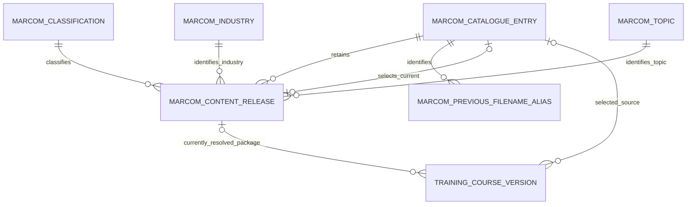

# Use a Reusable MARCOM Content Catalogue

## Context and Problem Statement

The internal knowledge-transfer call describes several hundred MARCOM SCORM packages and a need for Terra-Gen to view and select content for its own training courses. It proposes a catalogue object within Training Management rather than maintaining provider content only on individual client course versions. [KT, 0:03–2:56; 4:00–5:58]

## Decision Drivers

* Store provider course metadata and packages together. [KT, 0:03–2:56]
* Make the entire provider catalogue available for client course mapping. [KT, 4:00–5:58]
* Make the object reusable for other clients with modest additional design effort. [KT, 3:55–5:52]
* Distinguish industry and language variants that reuse the same three-digit ID, while preserving unique Product Codes. [Metadata, English A3/L3 and A59/L59; Spanish A2/M2]
* Preserve separate content descriptions, bilingual titles, optional historical filenames, and release evidence. [Metadata, English M,S:X; Spanish C:D,N,T:Y; ADR-013]

## Considered Options

* Maintain a reusable MARCOM catalogue with metadata and package attachments.
* Store provider metadata and packages independently on each client course version (analyst-derived alternative).
* Use one row per three-digit ID with language columns or overwrite its package on refresh (analyst-derived alternative, rejected because it conflates observed variants and weakens historical reconstruction).

## Decision Outcome

Chosen option: **Maintain a reusable MARCOM catalogue within Training Management**, because the team intends to load the entire provider catalogue and let client training course versions select its content. [KT, 0:03–2:56; 4:00–5:58]

The metadata follow-up defines the following **proposed logical target**, extending the call's conceptual catalogue. This structure is analyst-designed from the supplied workbook and ADR-013's audit requirement; it is not an approved or verified Intelex schema. The catalogue remains provider inventory, mapped separately to Terra-Gen training courses. [KT, 0:03–2:56; 7:01–8:37; 16:47–17:45; Metadata, active tabs]

### Objects, Keys, and Relationships

| Logical object | Grain and identifier | Relationships and rules |
|---|---|---|
| MARCOM Catalogue Entry | One provider product in one language and industry context; system-generated immutable Entry ID | Proposed alternate key: Producer + trimmed Product Code. Store raw Product Code unchanged separately. Three-digit ID, title, filename, and topic are not keys. Language is explicit, not inferred as the identifier. |
| MARCOM Content Release | One retained package/metadata snapshot for an Entry; system-generated immutable Release ID | Exactly one owning Entry; an Entry has zero or more releases. Contains metadata snapshot, expected filenames, actual attached assets, source provenance, and optional provider revision reference. The Entry has zero or one Current Release pointer, which must reference its own usable release. |
| MARCOM Previous Filename Alias | One former filename occurrence associated with an Entry and its source evidence; system-generated Alias ID | Exactly one owning Entry. Preserve original cell, source release/import reference, and parsed filename. An Entry has zero or more aliases. The same legacy filename may be claimed by multiple entries; imports must surface ambiguity rather than force global uniqueness. |
| MARCOM Classification | One reusable provider classification; system-generated immutable Classification ID | Catalogue object with Name and a trimmed name comparison key unique within this object. One Classification may be referenced by zero or more Content Releases. |
| MARCOM Industry | One reusable provider industry; system-generated immutable Industry ID | Catalogue object with Name and a trimmed name comparison key unique within this object. One Industry may be referenced by zero or more Content Releases. |
| MARCOM Topic | One reusable provider topic; system-generated immutable Topic ID | Catalogue object with Name and a trimmed name comparison key unique within this object. One Topic may be referenced by zero or more Content Releases. |

Classification, Industry, and Topic are discrete catalogue objects named **MARCOM Classification**, **MARCOM Industry**, and **MARCOM Topic**, as explicitly requested by the user on 2026-10-23. Each Content Release references exactly one record from each object. These are three independent reference relationships, not text picklists or a parent-child taxonomy. Preserve the original provider labels on each release alongside the relationships so later catalogue-label maintenance does not rewrite source history. Language remains a controlled value. The proposed name-based comparison keys support initial loading; provider codes can be added if supplied later without replacing immutable object IDs.

An Entry stores identity, raw and normalized language, raw three-digit ID as text, and current-release reference. Display title and filters are read from its current release, or from an explicitly marked draft release while awaiting an upload; an entry without a usable current release may be browsed for mapping but cannot supply a launchable package. Preserve leading-zero IDs such as `075` and `025`; never use the shared ID to merge industry variants. Product-code uniqueness is demonstrated only for this workbook; future duplicates or code changes require review, not automatic rekeying. [Metadata, English A50,A160,L2:L359; Spanish M2:M195]

English and Spanish entries remain independently selectable and independently revisioned. Do not add a mandatory language-neutral parent or establish equivalence by title, three-digit ID, or suffix substitution. Those heuristics leave unmatched Spanish products and encounter divergent titles/dates. A verified translation-family relation can be considered later. [Metadata analysis, Identity and Language]

The current-release and resolved-release links are optional until assets are usable; enforce owner consistency. Training course versions selecting manual uploads have no catalogue relation. Training Management already provides attempt, completion, and historical learning-evidence functionality. That functionality remains within Training Management; the MARCOM catalogue supplies content to course versions and does not add an evidence object or attempt/completion linkage requirement. [User scope clarification, 2026-10-23]

### Source-to-Target Metadata Mapping

All columns below refer only to the active tabs. `EN` means `English language`, `ES` means `Spanish language`. Snapshot provider metadata on Content Release unless the ownership column says Entry or Alias. Raw values and exact workbook/sheet/row provenance remain available even when a normalized value is used. Logical field names are proposals.

| Source field | EN | ES | Target field/type and treatment |
|---|---|---|---|
| MARCOM's 3-Digit ID | A | A | Entry: Provider Course ID, text; non-unique, retain leading zeros. |
| Producer | B | B | Entry: Producer, text; part of alternate key; retain source spelling. |
| Title | C | C | Release: Reference Title, Unicode text; populated in both tabs. |
| Title (in Spanish) | — | D | Release: Localized Title, optional Unicode text; display this for Spanish entries. Do not translate other fields automatically. |
| Course File Name | D | E | Release: Expected SCORM Filename, raw text plus trimmed match value; separate SCORM ZIP attachment. |
| Classification | E | F | Release: required reference to MARCOM Classification, plus original source label. |
| Industry | F | G | Release: required reference to MARCOM Industry, plus original source label. |
| Language | G | H | Entry: Language code `en`/`es` plus raw language; retain provider filename token `sp` as supplied. |
| Course Length (minutes) | H | I | Release: Duration Minutes, positive integer; not learner actual time or a recurrence interval. |
| Copyright Date | I | J | Release: Copyright Text plus parsed year/month where valid; preserve month precision, not an invented day or release sequence. |
| Suggested Single Access Price | J | K | Release: Suggested Price, decimal; reference only; currency unknown/null. |
| Quantity Discounts Available | K | L | Release: Discount Availability, nullable Boolean mapped from Y/N with raw indicator preserved; unexpected values flagged. |
| Product Code | L | M | Entry: Provider Product Code raw text, immutable after reconciliation; separate trimmed comparison key. Do not reconstruct from ID, title, industry, or filename. |
| Previous Course File Name | M | N | Alias children plus raw cell retained on release/import evidence; optional, potentially several filenames in one cell. |
| Topic | N | O | Release: required reference to MARCOM Topic, plus original source label. |
| Course Thumbnail with Logo | O | P | Release: Expected Logo Thumbnail Filename and optional uploaded image attachment. |
| Course Thumbnail without Logo | P | Q | Release: Expected No-Logo Thumbnail Filename and optional uploaded image attachment. |
| Course Question File | Q | R | Release: Expected Question Workbook Filename and optional uploaded workbook; no automatic Quiz Builder conversion. |
| Keyterms | R | S | Release: Keyterms, long text; preserve original text; search indexing may derive tokens. |
| Short Description | S | T | Release: Short Description, long text. |
| Long SCORM Description | T | U | Release: SCORM Description, long text; preferred long description for this installed-content catalogue. |
| Long Online Training Description | U | V | Release: Provider-Hosted Description, separate long text; not evidence that hosted LMS features exist in Intelex. |
| Course Objectives | V | W | Release: Objectives Text, long text. |
| Course Objectives with HTML | W | X | Release: Objectives HTML, retained separately; controlled rendering must not reinterpret the stored source. |
| Associated OSHA/DOT Regulations | X | Y | Release: Regulation References, nullable long text; retain the provider's combined string, not an invented compliance taxonomy. |
| Unheaded extra cells | Y | Z | Import evidence only: preserve coordinate/value and flag review; seven English Y values are not automatically mapped into regulations. Spanish Z is empty. |

This maps every named source field. The generic call's “categories” is represented by references to MARCOM Classification, MARCOM Industry, and MARCOM Topic; no additional Category object is required. These three catalogue objects are explicit model requirements from the user's clarification, rather than optional platform implementation choices. No parent-child taxonomy or many-to-many classification is introduced.

Use Unicode short text for names/identifiers and long text for descriptions, objectives, keywords, and regulations. Observed maximum lengths exceed 255 characters in several columns; exact Intelex field capacities must be checked before configuration. Preserve plain and HTML objectives separately and preserve distinct SCORM versus hosted descriptions. Filename metadata does not prove possession of its file; auxiliary attachments are optional and the SCORM attachment is required before a release can be current/usable. [Metadata analysis, Shape and Optional Values]

### Release and Import Rules

The call first described catalogue versioning as a stretch goal. **This target now proposes retained Content Release records as part of the catalogue design**, to preserve metadata/package history while allowing automatic current-content selection. This is an explicit analyst recommendation for approval, not a claim that the call approved mandatory versioning. [KT, 0:03–2:56; 11:37–12:57; ADR-013]

Retain imported metadata as a draft release even before the package is available. When the actual package arrives, record its attachment and content digest; record source workbook/sheet/row, import timestamp, and an optional provider revision label if supplied. Internally generated release identifiers and timestamps are not provider release dates. A validated, explicitly designated Current Release drives propagation. Do not select latest by three-digit ID, copyright month, filename ordering, or metadata-guide filename. Subsequent changed metadata/packages produce retained releases rather than overwriting historical snapshots; an identical reimport reuses the existing snapshot after comparison. Keep the previous usable current pointer until a replacement is ready. These lifecycle rules are proposed design controls, not observed spreadsheet columns.

Draft releases can be completed before use. Once designated current or supplied to a training course version, preserve their metadata and attached asset bytes; corrections create a replacement release. Release readiness, current designation, package digest, import timestamp, source workbook fingerprint, and source sheet/row are system-managed control attributes. Alias records retain their Entry reference, normalized former filename, raw former-filename cell, and source sheet/row/release provenance. Reimports must reconcile aliases by Entry and normalized filename while retaining additional provenance, rather than creating duplicates solely because a load is rerun. No generic asset object is needed for the four fixed asset roles currently evidenced: SCORM ZIP, thumbnail with logo, thumbnail without logo, and question workbook.

Preserve provider values and exact source provenance; trim comparison values for Product Code, Language, Classification, Industry, Topic, and filenames while retaining raw values. Load or resolve MARCOM Classification, MARCOM Industry, and MARCOM Topic records before assigning their references on Content Releases; reuse records across languages when the trimmed provider label matches within the same object. Reject or quarantine duplicate alternate keys, missing essential identity or catalogue references, unexpected language, ambiguous historical matches, and unmapped non-empty cells for review. EN M128/M129 require multiple alias children; preserve both original combined cells. No excluded-tab or missing-row inference may delete or deactivate an entry. See ADR-018 for load reconciliation.

Reuse is a design preference for this object. The discussion does not authorize rollout to other clients or a centrally operated commercial distribution service. [KT, 2:58–5:52]

## Consequences

The following are architectural analysis of the proposal:

* Multiple client courses can refer to the same provider content identity without making provider entries employee assignments.
* Catalogue metadata and attachments require maintenance in addition to the client course catalogue.
* Six logical catalogue object types and explicit current-release selection add configuration and storage compared with a flat attachment list.
* Shared Classification, Industry, and Topic records support consistent filtering across provider products and languages; their maintenance and load dependencies must be managed explicitly.
* Historical catalogue releases remain available after the current package changes; existing Training Management functionality owns learner attempts, completions, and their history.
* Language-specific entries avoid silently replacing Spanish content with an English update, but a verified translation-family map is separate work.

## More Information

[MARCOM Course Catalog Technical Specification](../MARCOM-COURSE-CATALOG-TECHNICAL-SPECIFICATION.md) is the proposed field-level implementation contract for this ADR and ADR-017. It retains the required separate Classification/Industry/Topic catalogues and proposes normalized Language and E-learning Content Source selectors, subject to native-equivalence verification. It does not change this ADR's proposed status.

[KT — MARCOM Requirements Knowledge Transfer, October 23, 2026](<../raw artifacts/meeting_transcripts/2026-10-23-terra-gen-training-management-marcom-requirements-knowledge-transfer.md>), 0:03–2:56, 2:58–5:58, 7:01–8:37, and 11:37–12:57. This records internal direction as a proposal; no client approval or implemented capability is demonstrated.

Provider notifications and content delivery remain unresolved under [ADR-011](ADR-011-establish-an-ongoing-marcom-content-refresh-process.md). Related: [ADR-005](ADR-005-model-independently-governed-training-topics-as-atomic-courses.md), [ADR-013](ADR-013-version-training-content-for-audit-traceability.md), [ADR-017](ADR-017-source-and-refresh-course-packages-from-the-marcom-catalogue.md), and [ADR-018](ADR-018-constrain-api-assisted-marcom-catalogue-loading.md).

[Metadata — supplied MARCOM guide](<../raw artifacts/MARCOM Adaptive Learning Course File Name and Metadata Guide 09 10 26.xlsx>), `English language!A1:Y359` and `Spanish language!A1:Z195`, excluding discontinued tabs. [Analysis](../MARCOM-METADATA-ANALYSIS-2026-10-23.md) records counts, anomalies, field lengths, and exact examples; [metadata reconciliation](../ADR-RECONCILIATION-2026-10-23-METADATA.md) accounts for all 18 existing ADRs. Provider revision IDs, future Product Code stability, publication authority, actual field capacities, package rights, and provider update notifications remain open. User clarification on 2026-10-23 confirms that learning-evidence functionality is already built in Training Management and is outside the MARCOM catalogue scope.
