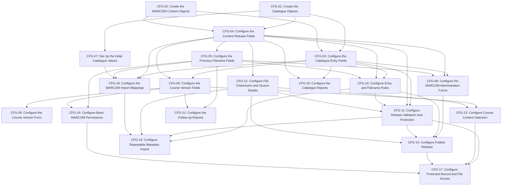

# Implementation Plan: MARCOM Course Catalog

## 1. Scope and planning basis

This plan configures the current [MARCOM Course Catalog Technical Specification](MARCOM-COURSE-CATALOG-TECHNICAL-SPECIFICATION.md), including Display Field using MARCOM Language.Name and a visible pipe separator. The specification remains proposed; tenant verification and capability gaps remain open. No implementation or source loading is claimed complete.

Training Management is reused. The build covers eight new-or-reused object definitions and five affected fields on the existing Training Course Version: nine objects, 80 field rows, 11 relationships, five catalogue forms, three provider-record forms, and the existing course-version form. Existing IDs, platform inheritance, learner delivery/evidence, audit, and execution diagnostics are reused. There is no new application, catalogue parent, workflow, approval stage, Event Service, provider polling service, or learner-evidence object.

Initial catalogue values are configuration: 158 specified records are included. Actual loading of 552 provider Entries/releases, packages, aliases, historical data, and customer course mappings is excluded migration work. Import definitions and processing configuration are included without executing that loading workstream.

Use the minimum implementer role shown. Every recommended reviewer/approver is the **Senior Consultant**, acting as Product Build Manager; no named approver was supplied. Review does not create a dependency edge. Routine assignments are bounded. Former CFG-15 (automatic course updates/retry) is retired after the user's pinning decision; its ID is not reused. There are 20 active tasks. No hour estimates or critical-path claim is made.

Dependency basis: create catalogue and content object definitions first, then references after every target exists. Current Release remains nullable, avoiding a circular Entry/Release build dependency. Configure field-dependent forms and logic after their fields; publication after validation/file/display functions; guarded course selection after its fields and file operations exist. No catalogue event depends on or invokes a course-update process. Reports depend on fields, not completion of the automation that later populates them. Forms have no workflow-stage dependency.

Current adoption direction: [user-provided pinning decision](<raw artifacts/2026-10-23-marcom-course-version-pinning-decision.md>). The training team manually creates a Course Version to adopt a newer release. Capture content on Create/Update only for a populated and changed MARCOM Course; ordinary saves and catalogue updates preserve existing content.

## 2. Task summary

| Task Number | Task Category | Task Name | Objective and Detailed Scope | Recommended Implementer |
|---|---|---|---|---|
| CFG-01 | Object configuration | Create the Catalogue Objects | **Objective:** Make the five reusable selection catalogues available in Training Management.  **Detailed scope:** Create or reuse MARCOM Classification, MARCOM Industry, MARCOM Topic, MARCOM Language, and E-learning Content Source. Configure Code, Name, Active?, and Sort on each object, ordinary administration forms, localized Name, unique stable Code, defaults, and display order. Add no parent object or consumer inverse grid. | Associate Consultant |
| CFG-02 | Object configuration | Create the MARCOM Content Objects | **Objective:** Provide the three record types for provider entries, releases, and former filenames.  **Detailed scope:** Create or reuse MARCOM Catalogue Entry, MARCOM Content Release, and MARCOM Previous Filename Alias in the existing Training Management application. Retain native record IDs and existing inheritance. Create the object definitions before their relationship fields; add no learner-evidence, audit, run, or workflow-state object. | Associate Consultant |
| CFG-03 | Field configuration | Configure the Catalogue Entry Fields | **Objective:** Give each language-specific provider product a stable catalogue record.  **Detailed scope:** Configure all nine section 7.1 fields, including raw provider identifiers, Language, Product Code Key, Active?, nullable Current Release, and Display Field. Apply types, lengths, ordinary defaults, requiredness, and read-only properties; disable relationship inverses. CFG-10 supplies identity/display behavior and CFG-14 controls Current Release. | Associate Consultant |
| CFG-04 | Field configuration | Configure the Content Release Fields | **Objective:** Provide all provider metadata, attachments, and source details needed by a release.  **Detailed scope:** Configure all 42 section 7.2 fields: owner, taxonomy references and raw labels, titles, descriptions, objectives, four attachment roles and their expected filenames, copyright, pricing, checksums, provenance, and Published On. Apply the specified types, lengths, numeric/timezone settings, ordinary defaults, and read-only outputs; disable every relationship inverse. Leave calculations and protection to CFG-11/12/14. | Associate Consultant |
| CFG-05 | Field configuration | Configure the Previous Filename Fields | **Objective:** Store each former filename without merging unrelated products.  **Detailed scope:** Configure Catalogue Entry, Former Filename, Filename Key, and First Source Release as specified in section 7.3. Set requiredness, lengths, and read-only outputs; disable both inverses. Apply the supplied supported uniqueness setting for Entry plus Filename Key. CFG-10 supplies key normalization and owner checks. | Associate Consultant |
| CFG-06 | Field configuration | Configure the Course Version Fields | **Objective:** Let existing course versions hold their source and resolved MARCOM package.  **Detailed scope:** Reuse or configure the five section 7.9 fields: Has E-learning?, E-learning Source, MARCOM Course, Resolved MARCOM Release, and E-learning Package. Preserve unrelated Training Management fields and inheritance. Apply ordinary defaults and protected outputs; disable all three relationship inverses. CFG-09 adds form behavior and CFG-13 resolves packages. | Associate Consultant |
| CFG-07 | Initial configuration | Set Up the Initial Catalogue Values | **Objective:** Supply the selection values required by the feature.  **Detailed scope:** Create the exact section 7.4–7.8 configuration values: 1 Classification, 11 Industries, 142 Topics, 2 Languages, and 2 Content Sources. Preserve Codes, Names, Active?, Sort, and the initial label-to-Code mapping. Reuse matching Codes without duplicates. Do not load provider Entries, release data, packages, aliases, or customer course mappings. | Associate Consultant |
| CFG-08 | Forms | Configure the MARCOM Administration Forms | **Objective:** Make entries, draft releases, and former filenames practical to administer.  **Detailed scope:** Configure Entry, Release, and Alias forms and navigation. Group metadata, taxonomies, assets, source details, and publication fields clearly; apply Spanish-title conditions, active-value filters, generated-field read-only presentation, and draft/published presentation. Keep pricing and provider-hosted descriptions in suitable administration views and use the supplied safe Objectives HTML renderer. CFG-14 adds the publication button; there is no course-refresh/retry button. | Senior Associate Consultant |
| CFG-09 | Forms | Configure the Course Version Form | **Objective:** Make manual and MARCOM content setup clear for course authors.  **Detailed scope:** Apply no-e-learning, MANUAL, and MARCOM visibility/requiredness rules to the existing form. Present the MARCOM selector with title, Language.Name, Industry, Topic, and Product Code; protect generated package fields. Configure the supplied confirmation mechanism before replacement, delegating processing to CFG-13, and retain native course-version editing restrictions. Explain that the training user manually creates a new Course Version to adopt a newer release of the same MARCOM course; an unchanged selection must not refresh on save. | Senior Associate Consultant |
| CFG-10 | Business logic | Configure Entry and Filename Rules | **Objective:** Protect provider identities and generate a readable Entry display.  **Detailed scope:** Configure AH-01 and Alias key rules: preserve raw values, trim comparison values, preserve case and leading zeros, enforce supplied uniqueness controls, freeze reconciled identity, and validate Alias release ownership. Configure the Entry display updater from current release or the specified draft fallback using Reference Title, Language.Name, and Product Code Key with pipe separators and spaces. Prevent handler-written values from repeatedly triggering the same logic. | Consultant |
| CFG-11 | Automation | Configure Release Validation and Protection | **Objective:** Allow draft changes while preventing changes to published metadata and files.  **Detailed scope:** Configure AH-02 before every Release create/update, including direct API and attachment edits. Validate owner, required references, Spanish title, positive duration, copyright, discount indicator, and source-cell disposition. Derive Copyright Year, Copyright Month, and Quantity Discounts Available?; invoke CFG-10 for display updates and CFG-12 for checksum/source functions. Protect all published values and allow Published On writes only through trusted CMD-01 context. | Senior Consultant |
| CFG-12 | Automation | Configure File Checksums and Source Details | **Objective:** Populate file checksums and reliable import-source details.  **Detailed scope:** Configure the supplied native file operations used by release handlers, publication, guarded course selection, and import. Calculate Package Digest from SCORM bytes and Source Workbook Digest from original workbook bytes. Populate Source Workbook, Source Sheet, Source Row, Imported On, and Unmapped Source Cells through the import context. Provide the supported package copy/association and verification operations for CFG-13/14, keeping optional assets separate and adding no file-history object. | Consultant |
| CFG-13 | Automation | Configure Course Content Selection | **Objective:** Pin the exact release and package only when a non-empty MARCOM Course selection is created or changed.  **Detailed scope:** Configure AH-03 on Course Version Create and Update with the mandatory guard: MARCOM Course is not null and ISCHANGED for that field. Treat the first non-empty Create selection as changed. Resolve the selected Entry's usable Current Release and use CFG-12 to store its exact reference/file together. An unchanged selection on Update must retain its pinned pair without rereading latest content, including after catalogue publication or deactivation. Keep source-clearing/manual-mode validation separate from resolution, prevent internal-output recursion, and preserve the previous saved pair on eligible-save failure. Do not create Course Versions or refresh content from catalogue events. | Senior Consultant |
| CFG-14 | Automation | Configure Publish Release | **Objective:** Make a validated release current as one controlled catalogue change.  **Detailed scope:** Configure CMD-01 and its Administrator-only Publish Release button. Recheck actor access and concurrent edits; validate package/checksum, Entry, active selections, metadata, and source-cell decisions. Set Published On once with Entry.Current Release and update the Name-based display. Support safe repeat publication and explicit catalogue rollback without editing retained bytes. Record native errors. Publication changes the catalogue only: do not invoke a course-update handler, create a Course Version, or enqueue refresh work. | Senior Consultant |
| CFG-16 | Security | Configure Basic MARCOM Permissions | **Objective:** Give each responsibility its ordinary object and field access.  **Detailed scope:** Configure straightforward Administrator, Integration, Author, and existing Learner permissions across the specified objects/fields. Permit author selection without provider editing, restrict Integration to catalogue import fields without Course Version creation or pinned-file writes, and limit pricing/provider-hosted views appropriately. Preserve existing learner execution access. Leave conditional published-record, attachment, and trusted-action enforcement to CFG-17; use supplied group mappings. | Associate Consultant |
| CFG-17 | Security | Configure Protected Record and File Access | **Objective:** Enforce publication and attachment boundaries beyond the forms.  **Detailed scope:** Configure supplied record, relationship, action, and file controls around published Releases, generated course fields, CMD-01, and guarded AH-03 output writes. Prevent extra access through direct URL/API/export/navigation paths; restrict Integration and trusted publication context while retaining native learner execution. Enable existing audit on mutable objects/relationships and native failure visibility. Add no custom security or audit object. | Senior Consultant |
| CFG-18 | Integration | Configure the MARCOM Import Mappings | **Objective:** Map both active workbook tabs to their correct fields and catalogue values.  **Detailed scope:** Configure English language and Spanish language mappings with their different column positions. Map Entry identity, all release metadata/expected filenames, source locators, and fixed catalogue Codes. Preserve raw whitespace, text IDs, month/year, nulls, descriptions/objectives, unheaded coordinates, and the two observed multi-filename cases. Exclude discontinued tabs. Prepare configuration only; do not execute provider-content or customer-course loading. No mapping may create Training Course Versions or change their pinned content. | Consultant |
| CFG-19 | Integration | Configure Repeatable Metadata Import | **Objective:** Make metadata processing safe to repeat without duplicate provider records.  **Detailed scope:** Configure processing behind CFG-18 using identity/Alias, release-protection, and file/source functions. Match or create Entries, reuse unchanged draft/published business content, create new drafts for changed content, and reconcile aliases. Exclude source locators/timestamps from content comparisons. Configure native diagnostics for keys, unknown mappings, missing assets, unmapped cells, row totals, language subtotals, and readiness. Preserve released content and create no current pointer from a filename. Actual migration/loading remains excluded. Import processing must never create or update Training Course Versions, including when an existing catalogue Entry acquires a newer release. | Senior Consultant |
| CFG-20 | Reports | Configure the Catalogue Reports | **Objective:** Make inventory, release history, and package readiness visible.  **Detailed scope:** Configure catalogue browsing, release-history, and current-package-readiness reports on objects holding the references. Show title, Language.Name, product identifier, Classification, Industry, Topic, and current release where relevant; restrict raw source/pricing details to administration views. Read relationships without enabling inverse grids. | Senior Associate Consultant |
| CFG-21 | Reports | Configure the Follow-up Reports | **Objective:** Show ambiguous filenames and catalogue content differences for manual adoption.  **Detailed scope:** Configure the Alias report grouping Filename Key across Entries and an informational Course Version comparison of pinned Resolved MARCOM Release against MARCOM Course.Current Release. Limit comparison to MARCOM mode with an available current release and show the exact identities. A difference is expected for pinned courses and is not a failed-update condition. Offer no automatic refresh/retry or Course Version creation action; the training user manually creates a Course Version to adopt new content. | Consultant |

## 3. External inputs and constraints

These are inputs from the separate project process, not assignments. They have no task number, assignee, reviewer, acceptance criteria, or diagram edge. Their required results have not been supplied, so affected implementation tasks are blocked. Completing a technical predecessor does not resolve an external input. No discovery, prototype, or tenant-verification task is created.

| Input reference | Required result | Affected implementation work |
|---|---|---|
| E-MAP | Verified application/object/field names and IDs, native reuse and shared-catalogue ownership decisions, and existing platform inheritance. No .ipack baseline was supplied. | CFG-01–07 directly; later assignments use their outputs. |
| E-TYPE | Supported field lengths/types, numeric/timezone settings, attachment field limits, and uniqueness settings for specified keys. | CFG-01, CFG-03–06. |
| E-EXP | Supported default/calculation syntax, related-field report expressions, form conditions/confirmation, handler invocation including Create/Update ISCHANGED evaluation, and safe Objectives HTML rendering. Display calculation must use Language.Name. | CFG-08–11, CFG-13, CFG-20–21. |
| E-FILE | Supported native file reading/checksum/copy-or-association operations and access behavior preserving exact package bytes. | CFG-12 and CFG-17; downstream logic uses CFG-12 outputs. |
| E-CONTROL | Supplied uniqueness/locking, complete-or-no-change catalogue/course updates, trusted publication context, native audit/error outputs, and source-cell disposition mechanism. | CFG-10–11, CFG-13–14, CFG-17, CFG-19. |
| E-COURSE | User has supplied the pinned-content/native-version direction. Remaining input: actual Course Version field mapping, native edit permissions, and initial Create/Update ISCHANGED evaluation for MARCOM Course. No automatic update/successor/batch decision is required. | CFG-09, CFG-13. |
| E-ACCESS | Actual group/role mapping and object, field, command, record, file, Integration, audit, and diagnostic access decisions; existing learner execution rights. | CFG-14, CFG-16–17 and CFG-20. |
| E-IMPORT | Selected supported import runtime, workbook/file interface, endpoints/authentication contract where used, import context, and native diagnostic mechanism. The source workbook mapping itself is already supplied. | CFG-12, CFG-18–19. |

## 4. Implementation tasks

### CFG-01 — Create the Catalogue Objects

**Task ID:** CFG-01

**Title:** Create the Catalogue Objects

**Category:** Object configuration

**Objective:** Make the five reusable selection catalogues available in Training Management.

**Detailed scope:** Create or reuse MARCOM Classification, MARCOM Industry, MARCOM Topic, MARCOM Language, and E-learning Content Source. Configure Code, Name, Active?, and Sort on each object, ordinary administration forms, localized Name, unique stable Code, defaults, and display order. Add no parent object or consumer inverse grid.

**Deliverable:** Five catalogue definitions, 20 fields, and five ordinary administration forms.

**Strict technical prerequisites:** None

**Blocked status:** Blocked by missing E-MAP, E-TYPE. No in-plan predecessor.

**Recommended implementer role:** Associate Consultant

**Recommended reviewer/approver role:** Senior Consultant

**Role rationale:** Known object, field, localization, and basic form settings are routine configuration.

**Specification references:** Sections 5; 7.4–7.8

**Assumptions and open questions:** None; unresolved external results are identified in Blocked status.

**Acceptance criteria:**

- Each of the five catalogues has the four specified fields and its own administration form.
- Code uniqueness, Name localization, Active? default, and Sort match sections 7.4–7.8.

### CFG-02 — Create the MARCOM Content Objects

**Task ID:** CFG-02

**Title:** Create the MARCOM Content Objects

**Category:** Object configuration

**Objective:** Provide the three record types for provider entries, releases, and former filenames.

**Detailed scope:** Create or reuse MARCOM Catalogue Entry, MARCOM Content Release, and MARCOM Previous Filename Alias in the existing Training Management application. Retain native record IDs and existing inheritance. Create the object definitions before their relationship fields; add no learner-evidence, audit, run, or workflow-state object.

**Deliverable:** Three content object definitions ready for fields.

**Strict technical prerequisites:** None

**Blocked status:** Blocked by missing E-MAP. No in-plan predecessor.

**Recommended implementer role:** Associate Consultant

**Recommended reviewer/approver role:** Senior Consultant

**Role rationale:** Ordinary object creation without unusual behavior is bounded configuration.

**Specification references:** Sections 1; 4–6

**Assumptions and open questions:** None; unresolved external results are identified in Blocked status.

**Acceptance criteria:**

- The three specified objects exist in Training Management.
- No custom ID field, inheritance parent, or extra evidence object is introduced.

### CFG-03 — Configure the Catalogue Entry Fields

**Task ID:** CFG-03

**Title:** Configure the Catalogue Entry Fields

**Category:** Field configuration

**Objective:** Give each language-specific provider product a stable catalogue record.

**Detailed scope:** Configure all nine section 7.1 fields, including raw provider identifiers, Language, Product Code Key, Active?, nullable Current Release, and Display Field. Apply types, lengths, ordinary defaults, requiredness, and read-only properties; disable relationship inverses. CFG-10 supplies identity/display behavior and CFG-14 controls Current Release.

**Deliverable:** Complete nine-field Catalogue Entry configuration.

**Strict technical prerequisites:** CFG-01, CFG-02

**Blocked status:** Blocked by missing E-MAP, E-TYPE. Also waiting for CFG-01, CFG-02.

**Recommended implementer role:** Associate Consultant

**Recommended reviewer/approver role:** Senior Consultant

**Role rationale:** Routine field settings are separated from consequential identity and publication logic.

**Specification references:** Sections 6; 7.1

**Assumptions and open questions:** None; unresolved external results are identified in Blocked status.

**Acceptance criteria:**

- All nine fields match section 7.1 and target the correct related objects.
- Current Release can remain blank; Language and Current Release have inverse disabled.

### CFG-04 — Configure the Content Release Fields

**Task ID:** CFG-04

**Title:** Configure the Content Release Fields

**Category:** Field configuration

**Objective:** Provide all provider metadata, attachments, and source details needed by a release.

**Detailed scope:** Configure all 42 section 7.2 fields: owner, taxonomy references and raw labels, titles, descriptions, objectives, four attachment roles and their expected filenames, copyright, pricing, checksums, provenance, and Published On. Apply the specified types, lengths, numeric/timezone settings, ordinary defaults, and read-only outputs; disable every relationship inverse. Leave calculations and protection to CFG-11/12/14.

**Deliverable:** Complete 42-field Content Release configuration.

**Strict technical prerequisites:** CFG-01, CFG-02

**Blocked status:** Blocked by missing E-MAP, E-TYPE. Also waiting for CFG-01, CFG-02.

**Recommended implementer role:** Associate Consultant

**Recommended reviewer/approver role:** Senior Consultant

**Role rationale:** Repetitive field setup remains routine because validation, file processing, and conditional forms are separate.

**Specification references:** Sections 6; 7.2

**Assumptions and open questions:** None; unresolved external results are identified in Blocked status.

**Acceptance criteria:**

- Every section 7.2 field exists once; file fields are separate from expected filenames.
- Required Classification, Industry, Topic, and Entry references use the correct objects with inverse disabled.

### CFG-05 — Configure the Previous Filename Fields

**Task ID:** CFG-05

**Title:** Configure the Previous Filename Fields

**Category:** Field configuration

**Objective:** Store each former filename without merging unrelated products.

**Detailed scope:** Configure Catalogue Entry, Former Filename, Filename Key, and First Source Release as specified in section 7.3. Set requiredness, lengths, and read-only outputs; disable both inverses. Apply the supplied supported uniqueness setting for Entry plus Filename Key. CFG-10 supplies key normalization and owner checks.

**Deliverable:** Four Alias fields and the supported uniqueness setting.

**Strict technical prerequisites:** CFG-04

**Blocked status:** Blocked by missing E-MAP, E-TYPE. Also waiting for CFG-04.

**Recommended implementer role:** Associate Consultant

**Recommended reviewer/approver role:** Senior Consultant

**Role rationale:** This is a small standard field assignment; cross-record behavior is delegated.

**Specification references:** Sections 6; 7.3

**Assumptions and open questions:** None; unresolved external results are identified in Blocked status.

**Acceptance criteria:**

- All four fields match section 7.3 with both relationship inverses disabled.
- Filename uniqueness is scoped to an Entry, not imposed globally across products.

### CFG-06 — Configure the Course Version Fields

**Task ID:** CFG-06

**Title:** Configure the Course Version Fields

**Category:** Field configuration

**Objective:** Let existing course versions hold their source and resolved MARCOM package.

**Detailed scope:** Reuse or configure the five section 7.9 fields: Has E-learning?, E-learning Source, MARCOM Course, Resolved MARCOM Release, and E-learning Package. Preserve unrelated Training Management fields and inheritance. Apply ordinary defaults and protected outputs; disable all three relationship inverses. CFG-09 adds form behavior and CFG-13 resolves packages.

**Deliverable:** Five affected fields configured on the existing Course Version.

**Strict technical prerequisites:** CFG-03, CFG-04

**Blocked status:** Blocked by missing E-MAP, E-TYPE. Also waiting for CFG-03, CFG-04.

**Recommended implementer role:** Associate Consultant

**Recommended reviewer/approver role:** Senior Consultant

**Role rationale:** The task is ordinary field setup after relationship targets exist, without package-update logic.

**Specification references:** Sections 6; 7.9

**Assumptions and open questions:** None; unresolved external results are identified in Blocked status.

**Acceptance criteria:**

- Existing e-learning/package fields are reused where identified in the supplied mapping.
- All five specified fields are covered and no learner-evidence or assignment field is added.

### CFG-07 — Set Up the Initial Catalogue Values

**Task ID:** CFG-07

**Title:** Set Up the Initial Catalogue Values

**Category:** Initial configuration

**Objective:** Supply the selection values required by the feature.

**Detailed scope:** Create the exact section 7.4–7.8 configuration values: 1 Classification, 11 Industries, 142 Topics, 2 Languages, and 2 Content Sources. Preserve Codes, Names, Active?, Sort, and the initial label-to-Code mapping. Reuse matching Codes without duplicates. Do not load provider Entries, release data, packages, aliases, or customer course mappings.

**Deliverable:** 158 initial configuration records across five catalogues.

**Strict technical prerequisites:** CFG-01

**Blocked status:** Blocked by missing E-MAP. Also waiting for CFG-01.

**Recommended implementer role:** Associate Consultant

**Recommended reviewer/approver role:** Senior Consultant

**Role rationale:** Creating specified configuration records with fixed keys is routine and separate from migration.

**Specification references:** Sections 7.4–7.8; 9

**Assumptions and open questions:** None; unresolved external results are identified in Blocked status.

**Acceptance criteria:**

- Catalogue counts are 1, 11, 142, 2, and 2, with the exact specified values.
- Repeating setup does not duplicate Codes or renumber records.

### CFG-08 — Configure the MARCOM Administration Forms

**Task ID:** CFG-08

**Title:** Configure the MARCOM Administration Forms

**Category:** Forms

**Objective:** Make entries, draft releases, and former filenames practical to administer.

**Detailed scope:** Configure Entry, Release, and Alias forms and navigation. Group metadata, taxonomies, assets, source details, and publication fields clearly; apply Spanish-title conditions, active-value filters, generated-field read-only presentation, and draft/published presentation. Keep pricing and provider-hosted descriptions in suitable administration views and use the supplied safe Objectives HTML renderer. CFG-14 adds the publication button; there is no course-refresh/retry button.

**Deliverable:** Three administration forms with specified selection and visibility behavior.

**Strict technical prerequisites:** CFG-03, CFG-04, CFG-05

**Blocked status:** Blocked by missing E-EXP. Also waiting for CFG-03, CFG-04, CFG-05.

**Recommended implementer role:** Senior Associate Consultant

**Recommended reviewer/approver role:** Senior Consultant

**Role rationale:** The large release layout and related-language conditions require independent form judgment.

**Specification references:** Sections 7.1–7.3; 8; 10

**Assumptions and open questions:** None; unresolved external results are identified in Blocked status.

**Acceptance criteria:**

- Metadata-only drafts can be entered and browsed without implying a package is ready.
- Spanish-title and active-value conditions work; generated and published values are presented read only.
- No navigation creates a catalogue consumer inverse.

### CFG-09 — Configure the Course Version Form

**Task ID:** CFG-09

**Title:** Configure the Course Version Form

**Category:** Forms

**Objective:** Make manual and MARCOM content setup clear for course authors.

**Detailed scope:** Apply no-e-learning, MANUAL, and MARCOM visibility/requiredness rules to the existing form. Present the MARCOM selector with title, Language.Name, Industry, Topic, and Product Code; protect generated package fields. Configure the supplied confirmation mechanism before replacement, delegating processing to CFG-13, and retain native course-version editing restrictions. Explain that the training user manually creates a new Course Version to adopt a newer release of the same MARCOM course; an unchanged selection must not refresh on save.

**Deliverable:** Updated course-authoring form and confirmation behavior.

**Strict technical prerequisites:** CFG-06

**Blocked status:** Blocked by missing E-EXP, E-COURSE. Also waiting for CFG-06.

**Recommended implementer role:** Senior Associate Consultant

**Recommended reviewer/approver role:** Senior Consultant

**Role rationale:** Related-value display, source conditions, and replacement confirmation exceed a basic form layout.

**Specification references:** Sections 7.9; 8; 10

**Assumptions and open questions:** None; unresolved external results are identified in Blocked status.

**Acceptance criteria:**

- MANUAL permits upload, MARCOM displays the Entry selection and generated package, and no-e-learning hides source fields.
- Unconfirmed replacement is rejected without bypassing native editing restrictions.

### CFG-10 — Configure Entry and Filename Rules

**Task ID:** CFG-10

**Title:** Configure Entry and Filename Rules

**Category:** Business logic

**Objective:** Protect provider identities and generate a readable Entry display.

**Detailed scope:** Configure AH-01 and Alias key rules: preserve raw values, trim comparison values, preserve case and leading zeros, enforce supplied uniqueness controls, freeze reconciled identity, and validate Alias release ownership. Configure the Entry display updater from current release or the specified draft fallback using Reference Title, Language.Name, and Product Code Key with pipe separators and spaces. Prevent handler-written values from repeatedly triggering the same logic.

**Deliverable:** AH-01, Alias key/owner rules, and Entry display updater.

**Strict technical prerequisites:** CFG-03, CFG-04, CFG-05

**Blocked status:** Blocked by missing E-EXP, E-CONTROL. Also waiting for CFG-03, CFG-04, CFG-05.

**Recommended implementer role:** Consultant

**Recommended reviewer/approver role:** Senior Consultant

**Role rationale:** Cross-object display and controlled identity changes require broader technical judgment using the supplied supported controls.

**Specification references:** Sections 7.1; 7.3; 8 AH-01/AH-02; 9

**Assumptions and open questions:** None; unresolved external results are identified in Blocked status.

**Acceptance criteria:**

- Display Field shows Back Safety | English | cst_bak_adl_en and uses Language.Name, not Code.
- Shared three-digit IDs never merge Entries; raw values and leading zeros remain intact.
- Alias ownership and key rules hold without duplicate creation or repeated handler loops.

### CFG-11 — Configure Release Validation and Protection

**Task ID:** CFG-11

**Title:** Configure Release Validation and Protection

**Category:** Automation

**Objective:** Allow draft changes while preventing changes to published metadata and files.

**Detailed scope:** Configure AH-02 before every Release create/update, including direct API and attachment edits. Validate owner, required references, Spanish title, positive duration, copyright, discount indicator, and source-cell disposition. Derive Copyright Year, Copyright Month, and Quantity Discounts Available?; invoke CFG-10 for display updates and CFG-12 for checksum/source functions. Protect all published values and allow Published On writes only through trusted CMD-01 context.

**Deliverable:** AH-02 metadata derivations and server-side published-release protection.

**Strict technical prerequisites:** CFG-03, CFG-04, CFG-10, CFG-12

**Blocked status:** Blocked by missing E-EXP, E-CONTROL. Also waiting for CFG-03, CFG-04, CFG-10, CFG-12.

**Recommended implementer role:** Senior Consultant

**Recommended reviewer/approver role:** Senior Consultant

**Role rationale:** Trusted publication exceptions and API-safe lifecycle enforcement have high consequences and require advanced automation.

**Specification references:** Sections 7.2; 8 AH-02; 10

**Assumptions and open questions:** None; unresolved external results are identified in Blocked status.

**Acceptance criteria:**

- Draft validation derives the specified outputs and rejects invalid data before saving.
- Published metadata and file changes fail through ordinary UI/API edits, and unauthorized updates cannot stamp Published On.
- Derived writes and display updates do not create repeated handler calls.

### CFG-12 — Configure File Checksums and Source Details

**Task ID:** CFG-12

**Title:** Configure File Checksums and Source Details

**Category:** Automation

**Objective:** Populate file checksums and reliable import-source details.

**Detailed scope:** Configure the supplied native file operations used by release handlers, publication, guarded course selection, and import. Calculate Package Digest from SCORM bytes and Source Workbook Digest from original workbook bytes. Populate Source Workbook, Source Sheet, Source Row, Imported On, and Unmapped Source Cells through the import context. Provide the supported package copy/association and verification operations for CFG-13/14, keeping optional assets separate and adding no file-history object.

**Deliverable:** Reusable supported attachment operations and checksum/source population.

**Strict technical prerequisites:** CFG-04

**Blocked status:** Blocked by missing E-FILE, E-IMPORT. Also waiting for CFG-04.

**Recommended implementer role:** Consultant

**Recommended reviewer/approver role:** Senior Consultant

**Role rationale:** File reading and controlled import-field population are moderately complex automation using a supplied mechanism.

**Specification references:** Sections 7.2; 8 AH-02; 9

**Assumptions and open questions:** None; unresolved external results are identified in Blocked status.

**Acceptance criteria:**

- Checksums reflect actual contents; a filename alone does not supply an attachment.
- Source locators and timestamp reflect the original import, with the specified timezone behavior.
- The reusable file operation preserves package bytes without adding a custom history object.

### CFG-13 — Configure Course Content Selection

**Task ID:** CFG-13

**Title:** Configure Course Content Selection

**Category:** Automation

**Objective:** Pin the exact release and package only when a non-empty MARCOM Course selection is created or changed.

**Detailed scope:** Configure AH-03 on Course Version Create and Update with the mandatory guard: MARCOM Course is not null and ISCHANGED for that field. Treat the first non-empty Create selection as changed. Resolve the selected Entry's usable Current Release and use CFG-12 to store its exact reference/file together. An unchanged selection on Update must retain its pinned pair without rereading latest content, including after catalogue publication or deactivation. Keep source-clearing/manual-mode validation separate from resolution, prevent internal-output recursion, and preserve the previous saved pair on eligible-save failure. Do not create Course Versions or refresh content from catalogue events.

**Deliverable:** AH-03 guarded Create/Update pinning with unchanged-save preservation.

**Strict technical prerequisites:** CFG-06, CFG-12

**Blocked status:** Blocked by missing E-COURSE, E-CONTROL, E-EXP. Also waiting for CFG-06, CFG-12.

**Recommended implementer role:** Senior Consultant

**Recommended reviewer/approver role:** Senior Consultant

**Role rationale:** Saving the selected file/reference together, enforcing change detection through UI/API, and preserving previous values on failure require advanced automation; no bulk update process is included.

**Specification references:** Sections 7.9; 8.2; later user pinning decision

**Assumptions and open questions:** None; unresolved external results are identified in Blocked status.

**Acceptance criteria:**

- Create with a non-null new selection captures current release/file; Update with a different non-null selection does the same.
- Publish a newer catalogue release, then save the existing Course Version without changing MARCOM Course: the old reference/file remain unchanged.
- Creating a new Course Version manually and selecting the same Entry captures the new current release; catalogue import/publication never creates a Course Version.
- Clearing/source switching does not bypass the guard; failed save preserves the prior saved pair and internal output writes do not run resolution again.

### CFG-14 — Configure Publish Release

**Task ID:** CFG-14

**Title:** Configure Publish Release

**Category:** Automation

**Objective:** Make a validated release current as one controlled catalogue change.

**Detailed scope:** Configure CMD-01 and its Administrator-only Publish Release button. Recheck actor access and concurrent edits; validate package/checksum, Entry, active selections, metadata, and source-cell decisions. Set Published On once with Entry.Current Release and update the Name-based display. Support safe repeat publication and explicit catalogue rollback without editing retained bytes. Record native errors. Publication changes the catalogue only: do not invoke a course-update handler, create a Course Version, or enqueue refresh work.

**Deliverable:** Catalogue-only Publish Release command/button and controlled current pointer.

**Strict technical prerequisites:** CFG-08, CFG-10, CFG-11, CFG-12

**Blocked status:** Blocked by missing E-CONTROL, E-ACCESS. Also waiting for CFG-08, CFG-10, CFG-11, CFG-12.

**Recommended implementer role:** Senior Consultant

**Recommended reviewer/approver role:** Senior Consultant

**Role rationale:** Publication permissions, concurrent changes, and complete-or-no-change behavior require Senior Consultant authority.

**Specification references:** Sections 7.1–7.2; 8.1; 10

**Assumptions and open questions:** None; unresolved external results are identified in Blocked status.

**Acceptance criteria:**

- Rejected publication preserves the previous pointer and timestamp.
- Successful publication saves both values together, updates the Name-based display, and does not restamp a published release.
- Only authorized Administrators can publish or select a retained release for rollback.
- Successful publication or rollback leaves existing Course Version count, pinned releases, and package files unchanged.

### CFG-16 — Configure Basic MARCOM Permissions

**Task ID:** CFG-16

**Title:** Configure Basic MARCOM Permissions

**Category:** Security

**Objective:** Give each responsibility its ordinary object and field access.

**Detailed scope:** Configure straightforward Administrator, Integration, Author, and existing Learner permissions across the specified objects/fields. Permit author selection without provider editing, restrict Integration to catalogue import fields without Course Version creation or pinned-file writes, and limit pricing/provider-hosted views appropriately. Preserve existing learner execution access. Leave conditional published-record, attachment, and trusted-action enforcement to CFG-17; use supplied group mappings.

**Deliverable:** Basic object and field permissions for the feature.

**Strict technical prerequisites:** CFG-05, CFG-06

**Blocked status:** Blocked by missing E-ACCESS. Also waiting for CFG-05, CFG-06.

**Recommended implementer role:** Associate Consultant

**Recommended reviewer/approver role:** Senior Consultant

**Role rationale:** Ordinary object/field permissions are routine; nuanced security is explicitly separate.

**Specification references:** Sections 7 editability columns; 10

**Assumptions and open questions:** None; unresolved external results are identified in Blocked status.

**Acceptance criteria:**

- Authors cannot directly edit provider content, current pointers, or generated course outputs.
- Catalogue browsing does not automatically expose administrative records to learners.

### CFG-17 — Configure Protected Record and File Access

**Task ID:** CFG-17

**Title:** Configure Protected Record and File Access

**Category:** Security

**Objective:** Enforce publication and attachment boundaries beyond the forms.

**Detailed scope:** Configure supplied record, relationship, action, and file controls around published Releases, generated course fields, CMD-01, and guarded AH-03 output writes. Prevent extra access through direct URL/API/export/navigation paths; restrict Integration and trusted publication context while retaining native learner execution. Enable existing audit on mutable objects/relationships and native failure visibility. Add no custom security or audit object.

**Deliverable:** Server-side record/file/action protection and native audit settings.

**Strict technical prerequisites:** CFG-11, CFG-13, CFG-14, CFG-16

**Blocked status:** Blocked by missing E-ACCESS, E-CONTROL, E-FILE. Also waiting for CFG-11, CFG-13, CFG-14, CFG-16.

**Recommended implementer role:** Senior Consultant

**Recommended reviewer/approver role:** Senior Consultant

**Role rationale:** Cross-object attachment access and trusted command boundaries are nuanced, high-consequence security.

**Specification references:** Sections 4; 7 rule D; 8; 10

**Assumptions and open questions:** None; unresolved external results are identified in Blocked status.

**Acceptance criteria:**

- Ordinary direct edits cannot change published assets/metadata or generated course fields.
- Permitted course execution remains available and native audit/diagnostics record actions and failures.

### CFG-18 — Configure the MARCOM Import Mappings

**Task ID:** CFG-18

**Title:** Configure the MARCOM Import Mappings

**Category:** Integration

**Objective:** Map both active workbook tabs to their correct fields and catalogue values.

**Detailed scope:** Configure English language and Spanish language mappings with their different column positions. Map Entry identity, all release metadata/expected filenames, source locators, and fixed catalogue Codes. Preserve raw whitespace, text IDs, month/year, nulls, descriptions/objectives, unheaded coordinates, and the two observed multi-filename cases. Exclude discontinued tabs. Prepare configuration only; do not execute provider-content or customer-course loading. No mapping may create Training Course Versions or change their pinned content.

**Deliverable:** Complete source-to-field mapping definitions for two active tabs.

**Strict technical prerequisites:** CFG-03, CFG-04, CFG-05, CFG-07

**Blocked status:** Blocked by missing E-IMPORT. Also waiting for CFG-03, CFG-04, CFG-05, CFG-07.

**Recommended implementer role:** Consultant

**Recommended reviewer/approver role:** Senior Consultant

**Role rationale:** Differing worksheet layouts and cross-object value matching require technical interpretation.

**Specification references:** Sections 7.1–7.3; 9

**Assumptions and open questions:** None; unresolved external results are identified in Blocked status.

**Acceptance criteria:**

- All named columns map correctly; Spanish title and package columns are not confused.
- Catalogue lookups use fixed Codes, and unheaded cells are preserved rather than silently mapped.
- Discontinued tabs and inferred deactivations are absent from processing.

### CFG-19 — Configure Repeatable Metadata Import

**Task ID:** CFG-19

**Title:** Configure Repeatable Metadata Import

**Category:** Integration

**Objective:** Make metadata processing safe to repeat without duplicate provider records.

**Detailed scope:** Configure processing behind CFG-18 using identity/Alias, release-protection, and file/source functions. Match or create Entries, reuse unchanged draft/published business content, create new drafts for changed content, and reconcile aliases. Exclude source locators/timestamps from content comparisons. Configure native diagnostics for keys, unknown mappings, missing assets, unmapped cells, row totals, language subtotals, and readiness. Preserve released content and create no current pointer from a filename. Actual migration/loading remains excluded. Import processing must never create or update Training Course Versions, including when an existing catalogue Entry acquires a newer release.

**Deliverable:** Repeatable import behavior with native reconciliation/error outputs.

**Strict technical prerequisites:** CFG-10, CFG-11, CFG-12, CFG-18

**Blocked status:** Blocked by missing E-IMPORT, E-CONTROL. Also waiting for CFG-10, CFG-11, CFG-12, CFG-18.

**Recommended implementer role:** Senior Consultant

**Recommended reviewer/approver role:** Senior Consultant

**Role rationale:** Cross-object creation, uniqueness, matching existing content, and safe recovery require advanced integration configuration. Matching the Entry, release, and aliases for one source row stays together so separate processes cannot create conflicting records.

**Specification references:** Sections 7.1–7.3 initial values; 9

**Assumptions and open questions:** None; unresolved external results are identified in Blocked status.

**Acceptance criteria:**

- Repeating sample input creates no duplicate Entry, unchanged release, or Entry/filename Alias.
- Changed content creates a draft; a new workbook locator alone does not change a published record.
- Outputs separately identify row outcomes, metadata releases, package readiness, and exceptions.

### CFG-20 — Configure the Catalogue Reports

**Task ID:** CFG-20

**Title:** Configure the Catalogue Reports

**Category:** Reports

**Objective:** Make inventory, release history, and package readiness visible.

**Detailed scope:** Configure catalogue browsing, release-history, and current-package-readiness reports on objects holding the references. Show title, Language.Name, product identifier, Classification, Industry, Topic, and current release where relevant; restrict raw source/pricing details to administration views. Read relationships without enabling inverse grids.

**Deliverable:** Catalogue browsing, release-history, and readiness report definitions.

**Strict technical prerequisites:** CFG-03, CFG-04

**Blocked status:** Blocked by missing E-EXP, E-ACCESS. Also waiting for CFG-03, CFG-04.

**Recommended implementer role:** Senior Associate Consultant

**Recommended reviewer/approver role:** Senior Consultant

**Role rationale:** Bounded related-record reporting and role-aware layouts suit a Senior Associate without report-fed automation.

**Specification references:** Sections 7.1–7.2; 10

**Assumptions and open questions:** None; unresolved external results are identified in Blocked status.

**Acceptance criteria:**

- Reports distinguish metadata-only records from usable published content and show retained releases.
- Language uses Name and appropriate catalogue labels; no inverse consumer relationship is added.

### CFG-21 — Configure the Follow-up Reports

**Task ID:** CFG-21

**Title:** Configure the Follow-up Reports

**Category:** Reports

**Objective:** Show ambiguous filenames and catalogue content differences for manual adoption.

**Detailed scope:** Configure the Alias report grouping Filename Key across Entries and an informational Course Version comparison of pinned Resolved MARCOM Release against MARCOM Course.Current Release. Limit comparison to MARCOM mode with an available current release and show the exact identities. A difference is expected for pinned courses and is not a failed-update condition. Offer no automatic refresh/retry or Course Version creation action; the training user manually creates a Course Version to adopt new content.

**Deliverable:** Alias-ambiguity and catalogue-content-difference reports without update actions.

**Strict technical prerequisites:** CFG-05, CFG-06

**Blocked status:** Blocked by missing E-EXP. Also waiting for CFG-05, CFG-06.

**Recommended implementer role:** Consultant

**Recommended reviewer/approver role:** Senior Consultant

**Role rationale:** Cross-object comparisons and grouping ambiguous identities require broader technical judgment.

**Specification references:** Sections 7.3; 8.2; 10

**Assumptions and open questions:** None; unresolved external results are identified in Blocked status.

**Acceptance criteria:**

- Alias ambiguity lists every affected Entry rather than silently choosing a match.
- The comparison excludes MANUAL/blank-current configurations, labels different current content as information, and does not treat an older pinned release as an error.
- Viewing or acting on the report cannot automatically create or refresh Course Versions.

## 5. Strict technical dependency diagram

Only active implementation-task prerequisites appear. External inputs and retired CFG-15 have no nodes or edges.

## 6. Assumptions and exclusions

- CFG task IDs and AH-01/AH-02/AH-03/CMD-01 identify plan/specification items, not invented tenant system names. Use supplied actual names, IDs, syntax, and interfaces. Do not introduce a new provider integration or security group by assumption.
- All 20 active assignments are proposed, not completed. No critical path or environment schedule is inferred. Reviewer support does not create artificial task predecessors.
- Catalogue Code, Name, Active?, and Sort remain on each separate concrete object; no catalogue inheritance, consumer inverse, or externally owned base-object change is introduced.
- Discovery, tenant verification, uncertainty-resolving prototypes, estimates, scheduling, migration/backfill, formal testing, deployment, training, documentation, and project governance are excluded workstreams. Compatibility and learner-regression results are supplied separately; this plan configures the specified feature without claiming those results.
- Initial configuration includes only the five supplied catalogue value sets. Actual 552-row provider loading, asset loading, customer mapping, and temporary import-credential session/deactivation are separate loading work. Small representative records used to prove configuration behavior are implementation checks, not bulk migration or formal testing.
- Provider notifications, adaptive-learning engine development, hosted LMS integration, recurrence changes, qualifications, and learner history are outside this feature's implementation scope.

## 7. Specification coverage

### 7.1 Component coverage

| Specification component | Treatment | Task or deliberate reuse |
|---|---|---|
| Existing Training Management application and platform inheritance | Reuse | No creation or reparenting task |
| Five catalogue definitions, 20 fields and ordinary forms | Configure/reuse | CFG-01; CFG-07 values |
| Entry, Release, Alias object definitions | Create/reuse before relationships | CFG-02 |
| Entry 9 fields, Release 42 fields, Alias 4 fields | Configure all rows | CFG-03/04/05 |
| Existing Course Version, 5 affected fields | Modify/reuse specified fields only | CFG-06 |
| Eleven relationship fields | Targets exist first; inverse disabled | CFG-03/04/05/06 |
| Entry, Release, Alias, and course forms | Configure conditions and layout | CFG-08/09; CFG-14 publication action; no refresh action |
| AH-01, Alias key/owner rules, Entry Display Field | Configure business logic | CFG-10; Name and pipe retained |
| AH-02 metadata, publication protection | Configure | CFG-11 |
| Checksum/source fields and reusable file operations | Configure | CFG-12 |
| AH-03 guarded selection-time pinning | Configure | CFG-13 |
| CMD-01 and explicit current release | Configure | CFG-14 |
| Former AH-04 automatic updates/retry | Removed from current target | CFG-15 retired; no replacement automation |
| Ordinary and nuanced security | Separate by complexity | CFG-16/17 |
| Native audit and execution diagnostics | Reuse/configure | CFG-14/17/19; no custom evidence objects |
| Source mapping, normalization, matching, and rerun outputs | Configure processing only | CFG-18/19; migration excluded |
| Catalogue browsing, release history, readiness | Configure reports | CFG-20 |
| Alias ambiguity and catalogue-content-difference information | Configure reports | CFG-21 |
| 1 Classification, 11 Industries, 142 Topics, 2 Languages, 2 Sources | Create 158 configuration records | CFG-07 |
| Workflow, Event Service, scheduled provider integration | Not specified | Not applicable; no task |
| Native learner delivery/evidence, recurrence, qualifications | Reuse without structural change | No new implementation task |
| Formal compatibility/regression testing and tenant verification | Separate project process | Excluded; not build tasks |

### 7.2 Field configuration coverage

Every field has one field-creation/configuration owner below. Later behavior, form, security, and report tasks use these fields without creating another definition.

| Specification section | Object | Field | Field configuration task |
|---|---|---|---|
| 7.1 | MARCOM Catalogue Entry | Producer | CFG-03 |
| 7.1 | MARCOM Catalogue Entry | Provider Product Code | CFG-03 |
| 7.1 | MARCOM Catalogue Entry | Product Code Key | CFG-03 |
| 7.1 | MARCOM Catalogue Entry | Provider Course ID | CFG-03 |
| 7.1 | MARCOM Catalogue Entry | Language | CFG-03 |
| 7.1 | MARCOM Catalogue Entry | Source Language | CFG-03 |
| 7.1 | MARCOM Catalogue Entry | Active? | CFG-03 |
| 7.1 | MARCOM Catalogue Entry | Current Release | CFG-03 |
| 7.1 | MARCOM Catalogue Entry | Display Field | CFG-03 |
| 7.2 | MARCOM Content Release | Catalogue Entry | CFG-04 |
| 7.2 | MARCOM Content Release | Reference Title | CFG-04 |
| 7.2 | MARCOM Content Release | Localized Title | CFG-04 |
| 7.2 | MARCOM Content Release | Expected SCORM Filename | CFG-04 |
| 7.2 | MARCOM Content Release | SCORM Package | CFG-04 |
| 7.2 | MARCOM Content Release | Package Digest | CFG-04 |
| 7.2 | MARCOM Content Release | Classification | CFG-04 |
| 7.2 | MARCOM Content Release | Source Classification | CFG-04 |
| 7.2 | MARCOM Content Release | Industry | CFG-04 |
| 7.2 | MARCOM Content Release | Source Industry | CFG-04 |
| 7.2 | MARCOM Content Release | Topic | CFG-04 |
| 7.2 | MARCOM Content Release | Source Topic | CFG-04 |
| 7.2 | MARCOM Content Release | Duration Minutes | CFG-04 |
| 7.2 | MARCOM Content Release | Copyright Text | CFG-04 |
| 7.2 | MARCOM Content Release | Copyright Year | CFG-04 |
| 7.2 | MARCOM Content Release | Copyright Month | CFG-04 |
| 7.2 | MARCOM Content Release | Suggested Price | CFG-04 |
| 7.2 | MARCOM Content Release | Price Currency | CFG-04 |
| 7.2 | MARCOM Content Release | Source Discount Indicator | CFG-04 |
| 7.2 | MARCOM Content Release | Quantity Discounts Available? | CFG-04 |
| 7.2 | MARCOM Content Release | Previous Filenames Source | CFG-04 |
| 7.2 | MARCOM Content Release | Expected Logo Thumbnail Filename | CFG-04 |
| 7.2 | MARCOM Content Release | Logo Thumbnail | CFG-04 |
| 7.2 | MARCOM Content Release | Expected No-Logo Thumbnail Filename | CFG-04 |
| 7.2 | MARCOM Content Release | No-Logo Thumbnail | CFG-04 |
| 7.2 | MARCOM Content Release | Expected Question Workbook Filename | CFG-04 |
| 7.2 | MARCOM Content Release | Question Workbook | CFG-04 |
| 7.2 | MARCOM Content Release | Keyterms | CFG-04 |
| 7.2 | MARCOM Content Release | Short Description | CFG-04 |
| 7.2 | MARCOM Content Release | SCORM Description | CFG-04 |
| 7.2 | MARCOM Content Release | Provider-Hosted Description | CFG-04 |
| 7.2 | MARCOM Content Release | Objectives Text | CFG-04 |
| 7.2 | MARCOM Content Release | Objectives HTML | CFG-04 |
| 7.2 | MARCOM Content Release | Regulation References | CFG-04 |
| 7.2 | MARCOM Content Release | Source Workbook | CFG-04 |
| 7.2 | MARCOM Content Release | Source Workbook Digest | CFG-04 |
| 7.2 | MARCOM Content Release | Source Sheet | CFG-04 |
| 7.2 | MARCOM Content Release | Source Row | CFG-04 |
| 7.2 | MARCOM Content Release | Imported On | CFG-04 |
| 7.2 | MARCOM Content Release | Unmapped Source Cells | CFG-04 |
| 7.2 | MARCOM Content Release | Provider Revision Reference | CFG-04 |
| 7.2 | MARCOM Content Release | Published On | CFG-04 |
| 7.3 | MARCOM Previous Filename Alias | Catalogue Entry | CFG-05 |
| 7.3 | MARCOM Previous Filename Alias | Former Filename | CFG-05 |
| 7.3 | MARCOM Previous Filename Alias | Filename Key | CFG-05 |
| 7.3 | MARCOM Previous Filename Alias | First Source Release | CFG-05 |
| 7.4 | MARCOM Classification | Code | CFG-01 |
| 7.4 | MARCOM Classification | Name | CFG-01 |
| 7.4 | MARCOM Classification | Active? | CFG-01 |
| 7.4 | MARCOM Classification | Sort | CFG-01 |
| 7.5 | MARCOM Industry | Code | CFG-01 |
| 7.5 | MARCOM Industry | Name | CFG-01 |
| 7.5 | MARCOM Industry | Active? | CFG-01 |
| 7.5 | MARCOM Industry | Sort | CFG-01 |
| 7.6 | MARCOM Topic | Code | CFG-01 |
| 7.6 | MARCOM Topic | Name | CFG-01 |
| 7.6 | MARCOM Topic | Active? | CFG-01 |
| 7.6 | MARCOM Topic | Sort | CFG-01 |
| 7.7 | MARCOM Language | Code | CFG-01 |
| 7.7 | MARCOM Language | Name | CFG-01 |
| 7.7 | MARCOM Language | Active? | CFG-01 |
| 7.7 | MARCOM Language | Sort | CFG-01 |
| 7.8 | E-learning Content Source | Code | CFG-01 |
| 7.8 | E-learning Content Source | Name | CFG-01 |
| 7.8 | E-learning Content Source | Active? | CFG-01 |
| 7.8 | E-learning Content Source | Sort | CFG-01 |
| 7.9 | Training Course Version — affected fields only | Has E-learning? | CFG-06 |
| 7.9 | Training Course Version — affected fields only | E-learning Source | CFG-06 |
| 7.9 | Training Course Version — affected fields only | MARCOM Course | CFG-06 |
| 7.9 | Training Course Version — affected fields only | Resolved MARCOM Release | CFG-06 |
| 7.9 | Training Course Version — affected fields only | E-learning Package | CFG-06 |

### 7.3 Requirement coverage

| Requirement | Build tasks or deliberate reuse |
|---|---|
| MCC-001 | CFG-02/03/06/18/19; provider inventory does not create employee requirements |
| MCC-002 | CFG-01/03/07/10/18/19 |
| MCC-003 | CFG-01/04/07/08/18 |
| MCC-004 | CFG-03/04/05/08/12/18/19 |
| MCC-005 | CFG-03/04/11/12/14/17 |
| MCC-006 | CFG-01/06/07/09/13 |
| MCC-007 | CFG-06/12/13 |
| MCC-008 | CFG-13/14/21; manual adoption, no automatic Course Version changes |
| MCC-009 | CFG-01/03/08/09/11/13/14 |
| MCC-010 | Existing Training Management; no learner-evidence build task |
| MCC-011 | CFG-07/18/19 configuration and reconciliation outputs; actual source load excluded |
| MCC-012 | CFG-04/12/13/14/17 preserve files/checksums; compatibility testing separate |
| MCC-013 | All active CFG tasks except retired CFG-15; unresolved capabilities remain external inputs |

## 8. Plan validation

Validation checks 20 active tasks with unchanged IDs other than retired CFG-15; exact summary/detail agreement; complete task fields and role assignments; a cycle-free graph with edges matching active prerequisites; and all 80 fields across nine objects. The four current handler/command contracts are AH-01, AH-02, AH-03, and CMD-01. No AH-04, automatic successor, catalogue-driven refresh/retry, or related dependency remains active. Catalogue-content-difference reporting is informational. External input E-COURSE now covers native field/permission and ISCHANGED details, not an unresolved adoption decision. Initial configuration, migration exclusions, and other external limitations remain. No runtime implementation is claimed.
