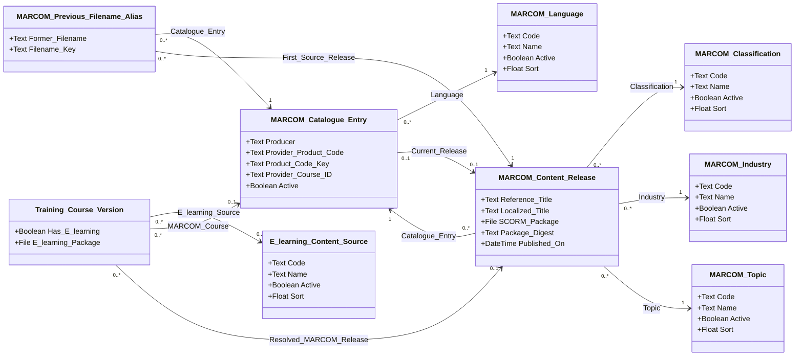

# Technical Specification: MARCOM Course Catalog

## 1. Outcome and design boundary

Provide a reusable MARCOM content inventory in Training Management. Administrators maintain provider metadata and retained packages. When a user creates a Training Course Version and selects a MARCOM Course, the system captures that Entry's usable Current Release and its file. The same guarded resolution applies on Update only when MARCOM Course changes. Catalogue updates neither alter existing Training Course Versions nor create new ones; adopting a new release of the same provider course requires a user-created Course Version.

The primary design authorities are [ADR-016](ADRs/ADR-016-use-a-reusable-marcom-content-catalogue.md) and [ADR-017](ADRs/ADR-017-pin-marcom-content-to-training-course-versions.md). Their six business objects are retained: MARCOM Catalogue Entry, MARCOM Content Release, MARCOM Previous Filename Alias, MARCOM Classification, MARCOM Industry, and MARCOM Topic. This specification adds two small selector catalogues as **proposed technical normalization**: MARCOM Language and E-learning Content Source. Reuse semantically identical native catalogues if verified; do not create duplicates. The latter may be shared with manual e-learning setup but is defined here until a shared authority is identified.

Existing Training Management owns learner delivery, attempts, completions, and historical learner evidence. This feature supplies course content; it does not add learner-evidence records, assessment workflows, assignments, recurrences, qualification integration, an adaptive-learning engine, or a hosted MARCOM LMS integration. Classification, Industry, and Topic are distinct catalogue objects, as requested. No abstraction parent or catalogue inheritance is introduced.

## 2. Evidence, baseline, and classifications

No `.ipack` or verified existing object model is present. The **baseline is unavailable**, not an empty tenant. This is a **proposed target logical Intelex object model**, not an extracted configuration or physical database schema. Do not deploy object definitions until native capability, internal names, stable object/field IDs, security groups, attachment mechanics, and publication/update behavior have been verified in the target tenant.

| Source | Locators and use |
|---|---|
| ADR-016 | Objects, keys, relationships, complete source mapping, and release/import rules |
| ADR-017 | Course-version source selection, stable entry link, and pinned release/file under the changed-selection guard |
| [Metadata analysis](MARCOM-METADATA-ANALYSIS-2026-10-23.md) | Counts, lengths, key collisions, whitespace, aliases, and unheaded-cell exceptions |
| [MARCOM guide](<raw artifacts/MARCOM Adaptive Learning Course File Name and Metadata Guide 09 10 26.xlsx>) | `English language!A1:Y359` and `Spanish language!A1:Z195` only; both discontinued tabs excluded |
| User clarifications, 2026-10-23 | Existing Training Management provides learner evidence; Classification/Industry/Topic must be separate catalogue objects |
| [ADR-018](ADRs/ADR-018-constrain-api-assisted-marcom-catalogue-loading.md) | Supporting load-control boundary; not an additional primary design authority |

**Extracted:** active workbook metadata, not tenant configuration. **Inferred:** product-code-based matching is safer than three-digit-ID matching in this snapshot. **Proposed:** all object/field contracts, lengths, codes, handlers, permissions, and transaction behavior below. **Unresolved:** tenant metadata and execution feasibility. No source language is treated as approval or executable instructions.

Names in field tables are exact **proposed display names**; diagram names are shortened labels only. Native record identity is reused for every object and is not redeclared as a custom ID field. Its actual field name/type and configuration IDs still need to be confirmed in the tenant. Native creation/modification actor/time and execution/audit history are also reused; no parallel custom audit, run, exception, workflow-state, or notification object is added.

## 3. Requirements and refinements

| ID | Requirement | Evidence |
|---|---|---|
| MCC-001 | Keep provider inventory separate from Terra-Gen employee-course requirements. | ADR-016 |
| MCC-002 | Identify one language-specific provider product by Producer and trimmed Product Code; retain raw identifiers and leading zeros. | ADR-016; metadata English A,L and Spanish A,M |
| MCC-003 | Implement separate MARCOM Classification, MARCOM Industry, and MARCOM Topic objects, one reference to each per release. | ADR-016; explicit user instruction |
| MCC-004 | Preserve all named metadata, separate descriptions/objective formats, filenames, optional values, and source provenance. | ADR-016 source mapping |
| MCC-005 | Retain independently governed releases and select current explicitly; never infer latest from copyright or filename. | ADR-016 |
| MCC-006 | Allow no e-learning, manual upload, or MARCOM-library content through course-version setup. | ADR-017 |
| MCC-007 | Store the exact selected Current Release and its package on the Course Version; keep them pinned on ordinary saves. | ADR-017; later user update decision |
| MCC-008 | Resolve only on Create/Update when MARCOM Course is non-null and changed; never create or update Course Versions from catalogue changes. | ADR-017; later user update decision |
| MCC-009 | Preserve inactive catalogue references and historical package releases; block inappropriate new selections. | Proposed lifecycle control supporting ADR-016 |
| MCC-010 | Reuse existing Training Management learner-evidence capability without extending its model. | User scope clarification |
| MCC-011 | Load active English/Spanish tabs only; reconcile 358 + 194 rows, aliases, and anomalies. | ADR-016; supporting ADR-018 |
| MCC-012 | Preserve asset bytes, verify attachment identity, and validate provider-described adaptive SCORM behavior in the tenant. | ADR-016/017; metadata English T2, Spanish U2 |
| MCC-013 | Use native audit/security/execution mechanisms; define every proposed field, relationship, and seed value. | Modelling/specification rules applied to this target |

Refinements: separate Classification/Industry/Topic objects and the existing learner-evidence boundary remain. The later [pinning decision](<raw artifacts/2026-10-23-marcom-course-version-pinning-decision.md>), Supplied decision paragraphs 2–5, replaces automatic package distribution with a stored selection-time release/file. MCC-007/008 are refined accordingly. AH-04 and its retry action are removed from the current target; the implementation plan retires CFG-15 without reusing its ID. All existing ADR statuses and the 80-field inventory are unchanged.

## 4. Native capability assessment and assumptions

| Capability | Reuse decision | Required tenant check |
|---|---|---|
| Native training course/version and SCORM package storage | Reuse; pin provider release/file at eligible selection | Actual field identities, native Create/Update change detection, and attachment-copy mechanics; no automatic successor-version mechanism required |
| Native audit and execution diagnostics | Reuse for edits, publication attempts, and guarded course-selection saves | Actor/time, old/new values, errors, permissions, query/report availability |
| Learner evidence and execution | Already built per user; outside catalogue implementation | Regression-test existing behavior during package changes; no new evidence schema |
| Provider catalogue/release metadata | ADR-016 establishes separate business responsibility | Reuse an existing equivalent object if found; native attachment revisioning must preserve the required package and metadata identity before substituting for Content Release |
| Governed Classification/Industry/Topic | Distinct objects required by user | Check for existing objects of exactly these semantic domains before adding |
| Language and source selectors | Reuse native equivalent or add the proposed catalogues below | Shared ownership and stable code availability |

Assumptions for the target: catalogue administration is centralized; ordinary course authors can select but not publish provider content; native audit is enabled on mutable records/relationships. The user did not request an approval workflow, so draft releases are directly maintained and explicitly published by authorized administrators. A Content Release is itself the editable draft that becomes immutable on publication; Catalogue Entry is stable identity, not a duplicate metadata-authoring object. Therefore no second authoring snapshot graph or mirrored metadata field set is introduced. If native immutable-version functionality can implement this contract, reuse it.

## 5. Object inventory

Every object below has its own field-contract subsection. All stable configuration IDs, verified internal names, inherited native base fields, and existing security ownership are unresolved. Proposed objects have this specification as their definition source. No target object inherits from another object in this design; existing platform inheritance remains unchanged and unverified.

| Logical alias | Display name | Responsibility | Baseline / target classification | Fields / identity / relationships authority |
|---|---|---|---|---|
| MARCOM_Catalogue_Entry | MARCOM Catalogue Entry | Stable language-specific provider identity and current pointer | Unverified baseline; proposed add/reuse | Section 7.1; existing record ID; Producer + Product Code Key alternate key |
| MARCOM_Content_Release | MARCOM Content Release | Draft then immutable provider package/metadata | Unverified baseline; proposed add/reuse | Section 7.2; existing record ID; owning Entry |
| MARCOM_Previous_Filename_Alias | MARCOM Previous Filename Alias | Former filename associated with an Entry | Unverified baseline; proposed add/reuse | Section 7.3; existing record ID; Entry + Filename Key |
| MARCOM_Classification | MARCOM Classification | Reusable classification values | Unverified baseline; proposed add/reuse | Section 7.4; existing record ID; unique Code |
| MARCOM_Industry | MARCOM Industry | Reusable industry values | Unverified baseline; proposed add/reuse | Section 7.5; existing record ID; unique Code |
| MARCOM_Topic | MARCOM Topic | Reusable topic values | Unverified baseline; proposed add/reuse | Section 7.6; existing record ID; unique Code |
| MARCOM_Language | MARCOM Language | Provider package language selector | Proposed technical add/reuse | Section 7.7; existing record ID; unique Code |
| E_learning_Content_Source | E-learning Content Source | Manual versus MARCOM source selector | Proposed technical add/reuse | Section 7.8; existing record ID; unique Code |
| Training_Course_Version | Training Course Version | Existing consumer receiving content | Existing application per ADR; baseline metadata unverified; modify/reuse | Section 7.9; existing existing record ID; five affected fields only |

## 6. Proposed structural model

The diagram shows every designed relationship. The diagram summarizes the ordinary fields; section 7 contains the full field definitions. The number of allowed records in each relationship is a proposed design rule, not verified tenant configuration. All associations are relationships owned by the object selecting the value and have **inverse disabled**, including Entry/Release links; navigation uses filtered reports on the object that holds the relationship instead of catalogue-side consumer grids. There are no designed inverse grids, M:N junctions, inheritance edges, or custom learner-evidence objects.

Each Current Release must belong to its declaring Entry; a release cannot be current for another Entry. Alias.First Source Release must belong to Alias.Catalogue Entry. Course-version Resolved MARCOM Release must belong to its MARCOM Course. Optional course references become required under the exact conditions in section 7.9. Zero-release Entries are permitted during initial metadata loading.

## 7. Field-level implementation contract

All field definitions are **Proposed**. Native IDs/audit fields are inherited from the unverified platform and are not custom redeclarations. No other custom field, hidden helper, or inverse grid is implied. All objects have **Parent: no proposed parent; native platform base unresolved**. The tables describe directly declared target fields or the explicitly affected existing course-version fields.

**Roles:** Administrator = proposed MARCOM catalogue administration permission; Author = existing authorized course configurator; Integration = limited import principal. These are permission responsibilities, not claims that named security groups already exist. Ordinary learners have only the existing access needed to run assigned course packages.

**Field types:** Text is a standard Intelex text field; no encoding option needs to be configured. Long Text identifies text that needs more space, with a proposed limit of 16,384 characters. All lengths and number limits are proposed and must be checked in the tenant. Reject values that exceed the supported limit rather than cutting them off. Integer means a whole number. Float is the numeric field used for sorting. Decimal allows 18 digits in total, including 2 decimal places, for prices. File means one existing Intelex attachment field; supported file sizes still need confirmation. Date/Time uses timezone support so users see their local time. Descriptions of defaulting and calculation behavior are design instructions, not ready-to-paste Intelex formulas.

**Reading the tables:** `Y` means required, `N` means optional, and `Conditional` means required only in the stated situation. `NULL` means blank; `TRUE` and `FALSE` mean Yes and No. `M:1` means many records can select one catalogue record. `Inverse disabled` means Intelex should not add a reverse list on that catalogue. Code is the stable identifier of a catalogue record, used when rules select specific values. A file digest is a checksum used to confirm that two files have the same contents.

**Editing rule D:** Administrator/Integration may edit unpublished release fields; after Published On is populated, fields and asset bytes are immutable. Changing any published value requires a new release. All release metadata rows identify their import/manual source; no copying from Catalogue Entry is implied except the owning reference. Publication validates the entire release before changing Entry.Current Release. There is no version-number field because the native release identity is the release key.

### 7.1 MARCOM Catalogue Entry

**Parent:** no proposed parent; existing platform base object not yet confirmed. **Directly declared fields:** the nine rows below. Existing record ID is not a custom field. Provider Product Code is the original source value; Product Code Key is a separate matching value with surrounding spaces removed. Enforce uniqueness on Producer plus Product Code Key and freeze identity after initial reconciliation/first publication.

| Field | Type / relationship | Req | Default / calculation | Editability and visibility | Automation / lifecycle |
|---|---|---:|---|---|---|
| Producer | Text, max 255 | Y | None; EN B / ES B | Administrator/Integration on creation; read only after identity reconciliation | Import exact value; compare Producer without surrounding spaces together with Product Code Key; retained on the Entry rather than copied to each release |
| Provider Product Code | Text, max 100 | Y | None; EN L / ES M | Administrator/Integration on creation; immutable after reconciliation | Import raw value; never derive from filename or three-digit ID; retained identity |
| Product Code Key | Text, max 100 | Y | Trim surrounding whitespace from Provider Product Code | Read only; visible to Administrator/Integration | Create/Update identity handler populates before uniqueness check; exact case preserved; never auto-rekeys an existing Entry |
| Provider Course ID | Text, max 100 | Y | None; EN A / ES A | Administrator/Integration before reconciliation; read only afterward | Import as text preserving leading zeros; non-unique; identity correction requires reviewed import mapping |
| Language | M:1 to MARCOM Language; each Entry exactly 1; inverse disabled | Y | None; import maps trimmed English/Spanish to Code en/es | Administrator/Integration before first release; new filter Active?=TRUE; retained afterward | Stable Entry dimension; unchanged by catalogue release updates |
| Source Language | Text, max 100 | Y | None; exact EN G / ES H | Administrator/Integration on import; read only after reconciliation | Retain original whitespace/spelling alongside Language; not a translated display value |
| Active? | Yes/No | Y | TRUE | Administrator editable; Integration only on explicit instruction | FALSE blocks new course selection and current-release publication; preserves existing pinned references/files and ordinary saves; absence in a load never sets FALSE |
| Current Release | M:1 to MARCOM Content Release; each Entry 0..1; each Release current for 0..1 Entry; inverse disabled | N | NULL | Read only; set by Publish Release; filter own Entry and Published On populated | Publish updates the catalogue pointer after validation; future eligible selections use it; existing Course Versions are untouched |
| Display Field | Text, max 1,024 | Y | Reference Title + Language.Name + Product Code Key, separated by ` \| `; omit blank parts | Read only; visible to administrators/authors | Release-save/display handler sets from current release, otherwise most recently imported draft with record ID to resolve a tie; initial create uses mapped title and the selected MARCOM Language's Name; no usable-package implication |

Display example: `Back Safety | English | cst_bak_adl_en`. Language.Name is the Name of the selected MARCOM Language record. The separator is a pipe character (`|`) with a space on each side.

Initial values:

552 source-keyed Entries from the active tabs, not hand-maintained seeds. EN rows 2–359 and ES rows 2–195. No package is assumed to exist merely because an Entry exists. Source identity correction cannot silently move old releases to a different product.

### 7.2 MARCOM Content Release

**Parent:** no proposed parent; existing platform base object not yet confirmed. **Directly declared fields:** every row in this table. Metadata/asset fields use rule D; Published On is the immutable-publication boundary. All M:1 inverses are disabled. Catalogue selector deactivation preserves existing release references and raw labels; an unpublished release must select an active value before publication.

| Field | Type / relationship | Req | Default / calculation | Editability and visibility | Automation / lifecycle |
|---|---|---:|---|---|---|
| Catalogue Entry | M:1 to MARCOM Catalogue Entry; each Release exactly 1; inverse disabled | Y | None; import resolves Entry composite key | Administrator/Integration on create; then read only; new filter Active?=TRUE | Retained owner; validate scope on all references; no reassignment after create |
| Reference Title | Text, max 255 | Y | None; EN C / ES C | Rule D; visible to authors | Import/direct draft edit; retained on publication |
| Localized Title | Text, max 255 | Conditional | NULL; ES D when supplied | Rule D; required for Entry.Language.Code=es; visible for es; retain read only if legacy non-es value exists | Preserve supplied Spanish title; no automatic translation; language change on Entry is prohibited after release creation |
| Expected SCORM Filename | Text, max 255 | Y | None; raw EN D / ES E | Rule D; visible | Import source string unchanged; trim only when matching assets |
| SCORM Package | Native File, one ZIP; size limit unresolved | Conditional | NULL | Rule D; required for Publish Release; visible to authorized package users | Upload/import actual bytes; not populated by filename alone; do not alter after publication |
| Package Digest | Text, max 64; SHA-256 checksum, 64 characters using 0–9 and a–f | Conditional | NULL until SCORM Package available | Read only; required when SCORM Package exists | Attachment-change handler hashes actual bytes; Publish rechecks; not generated from filename |
| Classification | M:1 to MARCOM Classification; each Release exactly 1; inverse disabled | Y | None; resolve EN E / ES F by initial label map | Rule D; filter Active?=TRUE for new selection; retain inactive references on published releases | Import stable catalogue identity; validate with Source Classification; no consumer grid |
| Source Classification | Text, max 255 | Y | None; exact EN E / ES F | Rule D; raw source visible to Administrator | Preserve exact source label even if catalogue Name is later localized/renamed |
| Industry | M:1 to MARCOM Industry; each Release exactly 1; inverse disabled | Y | None; resolve EN F / ES G by initial label map | Rule D; filter Active?=TRUE for new selection; retain inactive references on published releases | Import stable catalogue identity; validate with Source Industry; no consumer grid |
| Source Industry | Text, max 255 | Y | None; exact EN F / ES G | Rule D; raw source visible to Administrator | Retain original label/whitespace; no automatic hierarchy relationship |
| Topic | M:1 to MARCOM Topic; each Release exactly 1; inverse disabled | Y | None; resolve EN N / ES O by initial label map | Rule D; filter Active?=TRUE for new selection; retain inactive references on published releases | Import stable catalogue identity; validate with Source Topic; no consumer grid |
| Source Topic | Text, max 255 | Y | None; exact EN N / ES O | Rule D; raw source visible to Administrator | Retain original label/whitespace; independent of Industry and Classification |
| Duration Minutes | Integer, positive | Y | None; EN H / ES I | Rule D; visible | Validate >0; retain provider duration, not actual learner elapsed time |
| Copyright Text | Text, max 100 | Y | None; EN I / ES J | Rule D; visible | Retain supplied month/year; no assumed day or ordering significance |
| Copyright Year | Integer | N | Parsed four-digit year from valid Copyright Text; otherwise NULL | Read only; visible | Draft copyright-change handler stores parsed year; invalid input flags validation; frozen on publication |
| Copyright Month | Integer, range 1–12 | N | Parsed month from valid Copyright Text; otherwise NULL | Read only; visible | Same handler as Copyright Year; no invented day; frozen on publication |
| Suggested Price | Decimal, 18 digits total with 2 decimal places | N | NULL; EN J / ES K when supplied | Rule D; Administrator visibility | Reference price only; preserve zero if supplied; no contract/billing calculation |
| Price Currency | Text, max 3 | N | NULL; workbook supplies no currency | Rule D; Administrator visibility | Populate only with provider-confirmed currency; no USD assumption |
| Source Discount Indicator | Text, max 10 | N | NULL; exact EN K / ES L | Rule D; Administrator visibility | Preserve raw source; handler derives Quantity Discounts Available? |
| Quantity Discounts Available? | Nullable Yes/No | N | Trimmed indicator Y maps TRUE; N maps FALSE; blank maps NULL | Read only; visible to Administrator | Indicator-change handler populates; unexpected value blocks publication and is reported; frozen thereafter |
| Previous Filenames Source | Long Text, max 16,384 | N | NULL; exact EN M / ES N | Rule D; Administrator visibility | Retain complete raw cell; import reconciles alias rows; do not overwrite other releases' cells |
| Expected Logo Thumbnail Filename | Text, max 255 | N | NULL; EN O / ES P | Rule D; visible | Retain expected filename; no image assumed |
| Logo Thumbnail | Native File, one image; size limit unresolved | N | NULL | Rule D; visible when supplied | Optional uploaded asset; included in release freeze; not required for SCORM playback |
| Expected No-Logo Thumbnail Filename | Text, max 255 | N | NULL; EN P / ES Q | Rule D; visible | Retain expected filename independently of logo image |
| No-Logo Thumbnail | Native File, one image; size limit unresolved | N | NULL | Rule D; visible when supplied | Optional uploaded asset; included in release freeze |
| Expected Question Workbook Filename | Text, max 255 | N | NULL; EN Q / ES R | Rule D; Administrator/Author visibility | Retain filename; no automatic assessment configuration |
| Question Workbook | Native File, one workbook; size limit unresolved | N | NULL | Rule D; Administrator/Author visibility | Optional uploaded asset; freeze on publication; no Quiz Builder import implied |
| Keyterms | Long Text, max 16,384 | N | NULL; EN R / ES S | Rule D; visible/searchable | Import exact text; any derived search index is native, not another custom field |
| Short Description | Long Text, max 16,384 | N | NULL; EN S / ES T | Rule D; visible | Retain source; no shortening/truncation |
| SCORM Description | Long Text, max 16,384 | N | NULL; EN T / ES U | Rule D; visible | Preferred installed-content description; preserve provider claims without treating them as test results |
| Provider-Hosted Description | Long Text, max 16,384 | N | NULL; EN U / ES V | Rule D; Administrator/Author visibility | Separate hosted-product description; does not enable hosted LMS features |
| Objectives Text | Long Text, max 16,384 | N | NULL; EN V / ES W | Rule D; visible | Preserve line breaks and language supplied |
| Objectives HTML | Long Text, max 16,384 | N | NULL; EN W / ES X | Rule D; source visible to Administrator; controlled rendering for other users | Store original markup; use supported safe renderer; no executable content execution |
| Regulation References | Long Text, max 16,384 | N | NULL; EN X / ES Y | Rule D; visible | Optional raw combined string; NULL does not assert exemption; no inferred regulation catalogue |
| Source Workbook | Text, max 255 | Conditional | NULL; importer supplies original workbook filename | Read only; required for workbook imports; visible to Administrator | Set on imported draft creation; manual release creation may omit; archived workbook identified by digest |
| Source Workbook Digest | Text, max 64; SHA-256 checksum, 64 characters using 0–9 and a–f | Conditional | NULL; importer hashes original workbook bytes | Read only; required when Source Workbook populated | Preserve source fingerprint; no regeneration from transformed rows |
| Source Sheet | Text, max 100 | Conditional | NULL; active sheet name from importer | Read only; required when Source Workbook populated | Only English language or Spanish language for this supplied edition; preserve on publication |
| Source Row | Integer, >1 | Conditional | NULL; importer supplies original worksheet row | Read only; required when Source Workbook populated | Preserve original locator, not reordered staging position |
| Imported On | Date/Time; timezone enabled | Conditional | NULL; importer records UTC commit time | Read only; required when Source Workbook populated | Stamp once on imported draft creation; native audit owns later edits |
| Unmapped Source Cells | Long Text, max 16,384 | N | NULL; importer writes coordinate/value JSON for non-empty unheaded cells | Read only; Administrator visibility | Preserve EN Y exceptions; publication blocked until disposition recorded in native audit; no silent mapping to Regulation References |
| Provider Revision Reference | Text, max 255 | N | NULL; not supplied by this workbook | Rule D; Administrator/Author visibility | Populate only from provider evidence; no invented release date/version |
| Published On | Date/Time; timezone enabled | N | NULL | Read only; Publish Release handler only | Stamp once after validation; marks immutable release; native audit retains actor; never clear on later current-release replacement |

Initial values:

One unpublished metadata release per Entry for the first accepted workbook import. Actual packages and optional assets are associated later. The initial import creates no Published On values and no Current Release pointers merely from filenames. Raw unmapped-cell values remain attached to their originating draft.

### 7.3 MARCOM Previous Filename Alias

**Parent:** no proposed parent; existing platform base object not yet confirmed. **Directly declared fields:** the four rows below. Uniqueness is Entry plus Filename Key. Raw multi-value cells and their source locators remain on Content Release; native audit/import diagnostics retain subsequent alias discoveries rather than adding a provenance junction object.

| Field | Type / relationship | Req | Default / calculation | Editability and visibility | Automation / lifecycle |
|---|---|---:|---|---|---|
| Catalogue Entry | M:1 to MARCOM Catalogue Entry; each Alias exactly 1; inverse disabled | Y | None; owning imported release.Catalogue Entry | Integration on create; read only afterward; retain inactive references | Import sets; immutable owner; never use alias to auto-merge Entries |
| Former Filename | Text, max 255 | Y | None; one parsed token from Previous Filenames Source | Integration on create; read only afterward; Administrator can correct only by audited reconciliation | Retain original token; one row per filename, not a slash-joined list |
| Filename Key | Text, max 255 | Y | Trim surrounding whitespace from Former Filename | Read only | Alias-import handler populates; composite uniqueness with Entry; collisions between Entries flagged, not prohibited globally |
| First Source Release | M:1 to MARCOM Content Release; each Alias exactly 1; inverse disabled | Y | None; first importing release | Integration on create; read only afterward | Must belong to Catalogue Entry; later discoveries reuse Alias and retain raw evidence on their own release |

Initial values:

Derive from 89 populated previous-filename cells; the two slash-separated English cells yield 91 source occurrences before Entry/filename deduplication. Do not assert 91 unique Alias records without reconciliation.

### 7.4 MARCOM Classification

**Parent:** no proposed parent; existing platform base object not yet confirmed. **Directly declared fields:** Code, Name, Active?, Sort. Configure this concrete catalogue and Name as localizable. Uniqueness of Code is scoped to this object. Existing record ID remains stable if Name changes; initial trimmed English-label matching establishes Code mapping, then integrations use Code. No consumer inverse grid.

| Field | Type / relationship | Req | Default / calculation | Editability and visibility | Automation / lifecycle |
|---|---|---:|---|---|---|
| Code | Text, max 100 | Y | None; proposed seed/import mapping | Administrator/Integration on create; immutable once referenced | Stable non-localizable key; release references retain identity |
| Name | Text, max 255; localizable | Y | None; trimmed source label | Administrator editable; visible to authors | Native audit records renames/localization; raw release label unchanged |
| Active? | Yes/No | Y | TRUE | Administrator editable | FALSE prevents new release selection/publication using this value; existing published references remain valid |
| Sort | Float | N | NULL; seed order when supplied | Administrator editable | Presentation ordering only; no business-rule comparison |

Initial values:

| Code | Name | Active? | Sort |
|---|---|---:|---:|
| MCC_CLASS_001 | General Safety, Regulatory Compliance and Human Resources | TRUE | 10 |

### 7.5 MARCOM Industry

**Parent:** no proposed parent; existing platform base object not yet confirmed. **Directly declared fields:** Code, Name, Active?, Sort. Independent concrete catalogue; object and Name localizable. Uniqueness of Code is object-scoped. No hierarchy to Classification or Topic and no consumer inverse grid.

| Field | Type / relationship | Req | Default / calculation | Editability and visibility | Automation / lifecycle |
|---|---|---:|---|---|---|
| Code | Text, max 100 | Y | None; proposed seed/import mapping | Administrator/Integration on create; immutable once referenced | Stable non-localizable key; preserve across label changes |
| Name | Text, max 255; localizable | Y | None; trimmed source label | Administrator editable; visible to authors | Native audit captures changes; release source text unchanged |
| Active? | Yes/No | Y | TRUE | Administrator editable | FALSE blocks new release selection/publication; existing published references retained |
| Sort | Float | N | NULL; seed order when supplied | Administrator editable | Controls presentation only |

Initial values:

| Code | Name | Active? | Sort |
|---|---|---:|---:|
| MCC_IND_001 | Construction | TRUE | 10 |
| MCC_IND_002 | Food Processing and Handling | TRUE | 20 |
| MCC_IND_003 | General | TRUE | 30 |
| MCC_IND_004 | HAZWOPER | TRUE | 40 |
| MCC_IND_005 | Healthcare All Personnel | TRUE | 50 |
| MCC_IND_006 | Healthcare Medical Personnel | TRUE | 60 |
| MCC_IND_007 | Healthcare Office and Facilities Personnel | TRUE | 70 |
| MCC_IND_008 | Industrial | TRUE | 80 |
| MCC_IND_009 | Laboratory | TRUE | 90 |
| MCC_IND_010 | Office | TRUE | 100 |
| MCC_IND_011 | Transportation and Warehouse | TRUE | 110 |

### 7.6 MARCOM Topic

**Parent:** no proposed parent; existing platform base object not yet confirmed. **Directly declared fields:** Code, Name, Active?, Sort. Independent concrete catalogue; object and Name localizable. Uniqueness of Code is object-scoped. Match shared English/Spanish metadata labels during initial load; this does not assert equivalence between course packages. No consumer inverse grid.

| Field | Type / relationship | Req | Default / calculation | Editability and visibility | Automation / lifecycle |
|---|---|---:|---|---|---|
| Code | Text, max 100 | Y | None; proposed seed/import mapping | Administrator/Integration on create; immutable once referenced | Stable non-localizable key; newly introduced topics need new codes, not renumbering |
| Name | Text, max 255; localizable | Y | None; trimmed source label | Administrator editable; visible to authors | Native audit records changes; published raw labels retained |
| Active? | Yes/No | Y | TRUE | Administrator editable | FALSE blocks new release selection/publication; existing published references retained |
| Sort | Float | N | NULL; seed order when supplied | Administrator editable | Controls presentation only |

Initial values:

| Code | Name | Active? | Sort |
|---|---|---:|---:|
| MCC_TOPIC_001 | Accident Investigation | TRUE | 10 |
| MCC_TOPIC_002 | Accident Prevention | TRUE | 20 |
| MCC_TOPIC_003 | Active Shooter | TRUE | 30 |
| MCC_TOPIC_004 | Aerial Lifts | TRUE | 40 |
| MCC_TOPIC_005 | Arc Flash | TRUE | 50 |
| MCC_TOPIC_006 | Asbestos Awareness | TRUE | 60 |
| MCC_TOPIC_007 | Back Safety | TRUE | 70 |
| MCC_TOPIC_008 | Backhoe Safety | TRUE | 80 |
| MCC_TOPIC_009 | Bloodborne Pathogens | TRUE | 90 |
| MCC_TOPIC_010 | Bucket Truck Safety | TRUE | 100 |
| MCC_TOPIC_011 | Bullying and Other Disruptive Behavior | TRUE | 110 |
| MCC_TOPIC_012 | Caught-In/Between Hazards | TRUE | 120 |
| MCC_TOPIC_013 | CDL Driving Defensively | TRUE | 130 |
| MCC_TOPIC_014 | Cleaning and Sanitizing | TRUE | 140 |
| MCC_TOPIC_015 | CMV Backing and Parking | TRUE | 150 |
| MCC_TOPIC_016 | CMV Personal Safety | TRUE | 160 |
| MCC_TOPIC_017 | Cold Stress | TRUE | 170 |
| MCC_TOPIC_018 | Compressed Gas Cylinders | TRUE | 180 |
| MCC_TOPIC_019 | Compressed Gas in the Lab | TRUE | 190 |
| MCC_TOPIC_020 | Computer Workstation Safety | TRUE | 200 |
| MCC_TOPIC_021 | Confined Space Entry | TRUE | 210 |
| MCC_TOPIC_022 | Conflict Resolution | TRUE | 220 |
| MCC_TOPIC_023 | Crane Safety | TRUE | 230 |
| MCC_TOPIC_024 | DEIB | TRUE | 240 |
| MCC_TOPIC_025 | DOT Cargo Securement | TRUE | 250 |
| MCC_TOPIC_026 | DOT CMV Inspections | TRUE | 260 |
| MCC_TOPIC_027 | DOT HAZMAT | TRUE | 270 |
| MCC_TOPIC_028 | DOT Hours of Service | TRUE | 280 |
| MCC_TOPIC_029 | DOT Security Awareness | TRUE | 290 |
| MCC_TOPIC_030 | DOT Vehicle Inspections | TRUE | 300 |
| MCC_TOPIC_031 | Driver Fatigue | TRUE | 310 |
| MCC_TOPIC_032 | Driving Safety | TRUE | 320 |
| MCC_TOPIC_033 | Drug & Alcohol Abuse | TRUE | 330 |
| MCC_TOPIC_034 | Drug and Alcohol Testing | TRUE | 340 |
| MCC_TOPIC_035 | Drug and Alcohol Use Disorders | TRUE | 350 |
| MCC_TOPIC_036 | Drugs and Alcohol | TRUE | 360 |
| MCC_TOPIC_037 | Dump Truck Safety | TRUE | 370 |
| MCC_TOPIC_038 | Electrical Safety | TRUE | 380 |
| MCC_TOPIC_039 | Electrical Safety in the Lab | TRUE | 390 |
| MCC_TOPIC_040 | Electrocution Hazards | TRUE | 400 |
| MCC_TOPIC_041 | Emergency Planning | TRUE | 410 |
| MCC_TOPIC_042 | Evacuation Procedures | TRUE | 420 |
| MCC_TOPIC_043 | Excavator Safety | TRUE | 430 |
| MCC_TOPIC_044 | Eye Safety | TRUE | 440 |
| MCC_TOPIC_045 | Fall Protection | TRUE | 450 |
| MCC_TOPIC_046 | Fatigue | TRUE | 460 |
| MCC_TOPIC_047 | Fire Extinguishers | TRUE | 470 |
| MCC_TOPIC_048 | Fire Prevention | TRUE | 480 |
| MCC_TOPIC_049 | Fire Prevention and Safety | TRUE | 490 |
| MCC_TOPIC_050 | First Aid | TRUE | 500 |
| MCC_TOPIC_051 | Fitness & Wellness | TRUE | 510 |
| MCC_TOPIC_052 | Flammables & Explosives in the Lab | TRUE | 520 |
| MCC_TOPIC_053 | Food Allergens | TRUE | 530 |
| MCC_TOPIC_054 | Food Handling Safety | TRUE | 540 |
| MCC_TOPIC_055 | Forklift Safety | TRUE | 550 |
| MCC_TOPIC_056 | Front-End Loader Safety | TRUE | 560 |
| MCC_TOPIC_057 | GHS | TRUE | 570 |
| MCC_TOPIC_058 | GHS Labels | TRUE | 580 |
| MCC_TOPIC_059 | GHS Safety Data Sheets | TRUE | 590 |
| MCC_TOPIC_060 | Good Manufacturing Practices | TRUE | 600 |
| MCC_TOPIC_061 | HACCP | TRUE | 610 |
| MCC_TOPIC_062 | Hand & Power Tool Safety | TRUE | 620 |
| MCC_TOPIC_063 | Hand and Power Tool Safety | TRUE | 630 |
| MCC_TOPIC_064 | Hand, Wrist & Finger Safety | TRUE | 640 |
| MCC_TOPIC_065 | Hand, Wrist and Finger Safety | TRUE | 650 |
| MCC_TOPIC_066 | Hazard Communication | TRUE | 660 |
| MCC_TOPIC_067 | Hazard Recognition | TRUE | 670 |
| MCC_TOPIC_068 | Hazardous Materials Labeling | TRUE | 680 |
| MCC_TOPIC_069 | Hazardous Materials Labels | TRUE | 690 |
| MCC_TOPIC_070 | Hazardous Spills | TRUE | 700 |
| MCC_TOPIC_071 | HAZCOM Final Rule | TRUE | 710 |
| MCC_TOPIC_072 | HAZWOPER | TRUE | 720 |
| MCC_TOPIC_073 | Hearing Safety | TRUE | 730 |
| MCC_TOPIC_074 | Heat Illness Prevention | TRUE | 740 |
| MCC_TOPIC_075 | Heat Stress | TRUE | 750 |
| MCC_TOPIC_076 | HIPAA Rules and Compliance | TRUE | 760 |
| MCC_TOPIC_077 | Hot Work Permits | TRUE | 770 |
| MCC_TOPIC_078 | I2P2... Injury and Illness Prevention Programs | TRUE | 780 |
| MCC_TOPIC_079 | Indoor Air Quality | TRUE | 790 |
| MCC_TOPIC_080 | Industrial Ergonomics | TRUE | 800 |
| MCC_TOPIC_081 | Industrial Hygiene | TRUE | 810 |
| MCC_TOPIC_082 | Infection Control | TRUE | 820 |
| MCC_TOPIC_083 | Injury Prevention | TRUE | 830 |
| MCC_TOPIC_084 | Laboratory Ergonomics | TRUE | 840 |
| MCC_TOPIC_085 | Laboratory Hoods | TRUE | 850 |
| MCC_TOPIC_086 | Ladder Safety | TRUE | 860 |
| MCC_TOPIC_087 | Loading Dock Safety | TRUE | 870 |
| MCC_TOPIC_088 | Lock-Out/Tag-Out | TRUE | 880 |
| MCC_TOPIC_089 | Machine Guard Safety | TRUE | 890 |
| MCC_TOPIC_090 | Manual Pallet Jack Safety | TRUE | 900 |
| MCC_TOPIC_091 | Materials Handling Safety | TRUE | 910 |
| MCC_TOPIC_092 | Mental Health | TRUE | 920 |
| MCC_TOPIC_093 | Motorized Pallet Truck Safety | TRUE | 930 |
| MCC_TOPIC_094 | NFPA 70E | TRUE | 940 |
| MCC_TOPIC_095 | Occupational Safety and Health Administration (OSHA) | TRUE | 950 |
| MCC_TOPIC_096 | Office Ergonomics | TRUE | 960 |
| MCC_TOPIC_097 | Office Safety | TRUE | 970 |
| MCC_TOPIC_098 | Orientation to Laboratory Safety | TRUE | 980 |
| MCC_TOPIC_099 | OSHA Formaldehyde Standard | TRUE | 990 |
| MCC_TOPIC_100 | OSHA Lead Standards | TRUE | 1000 |
| MCC_TOPIC_101 | OSHA Recordkeeping | TRUE | 1010 |
| MCC_TOPIC_102 | Patient Handling | TRUE | 1020 |
| MCC_TOPIC_103 | Patient Handling Safety | TRUE | 1030 |
| MCC_TOPIC_104 | Personal Protective Equipment | TRUE | 1040 |
| MCC_TOPIC_105 | Planning for Laboratory Emergencies | TRUE | 1050 |
| MCC_TOPIC_106 | Preventing Contamination in the Lab | TRUE | 1060 |
| MCC_TOPIC_107 | Reasonable Suspicion Testing | TRUE | 1070 |
| MCC_TOPIC_108 | Respiratory Safety | TRUE | 1080 |
| MCC_TOPIC_109 | Rigging Safety | TRUE | 1090 |
| MCC_TOPIC_110 | Safe Handling Laboratory Glassware | TRUE | 1100 |
| MCC_TOPIC_111 | Safe Lifting | TRUE | 1110 |
| MCC_TOPIC_112 | Safety Audits | TRUE | 1120 |
| MCC_TOPIC_113 | Safety Awareness | TRUE | 1130 |
| MCC_TOPIC_114 | Safety Housekeeping | TRUE | 1140 |
| MCC_TOPIC_115 | Safety Orientation | TRUE | 1150 |
| MCC_TOPIC_116 | Safety Showers | TRUE | 1160 |
| MCC_TOPIC_117 | Safety Showers & Eye Washes in the Lab | TRUE | 1170 |
| MCC_TOPIC_118 | Scaffolding Safety | TRUE | 1180 |
| MCC_TOPIC_119 | Scissor Lifts | TRUE | 1190 |
| MCC_TOPIC_120 | Sexual Harassment | TRUE | 1200 |
| MCC_TOPIC_121 | Shocks and Arc Flash | TRUE | 1210 |
| MCC_TOPIC_122 | Silica Safety | TRUE | 1220 |
| MCC_TOPIC_123 | Skid Steer Safety | TRUE | 1230 |
| MCC_TOPIC_124 | Slips, Trips & Falls | TRUE | 1240 |
| MCC_TOPIC_125 | Slips, Trips and Falls | TRUE | 1250 |
| MCC_TOPIC_126 | Struck-By Hazards | TRUE | 1260 |
| MCC_TOPIC_127 | Suspended Scaffolding Safety | TRUE | 1270 |
| MCC_TOPIC_128 | Trenching and Shoring | TRUE | 1280 |
| MCC_TOPIC_129 | Tuberculosis | TRUE | 1290 |
| MCC_TOPIC_130 | Unconscious Bias | TRUE | 1300 |
| MCC_TOPIC_131 | Universal Waste | TRUE | 1310 |
| MCC_TOPIC_132 | Walking and Working Surfaces | TRUE | 1320 |
| MCC_TOPIC_133 | Warehouse Safety | TRUE | 1330 |
| MCC_TOPIC_134 | Welding Safety | TRUE | 1340 |
| MCC_TOPIC_135 | Winter Safety | TRUE | 1350 |
| MCC_TOPIC_136 | Work Zone Safety | TRUE | 1360 |
| MCC_TOPIC_137 | Workplace Discrimination | TRUE | 1370 |
| MCC_TOPIC_138 | Workplace Diversity | TRUE | 1380 |
| MCC_TOPIC_139 | Workplace Harassment | TRUE | 1390 |
| MCC_TOPIC_140 | Workplace Security | TRUE | 1400 |
| MCC_TOPIC_141 | Workplace Stress | TRUE | 1410 |
| MCC_TOPIC_142 | Workplace Violence | TRUE | 1420 |

### 7.7 MARCOM Language

**Parent:** no proposed parent; existing platform base object not yet confirmed. **Directly declared fields:** Code, Name, Active?, Sort. Proposed normalization of ADR-016's language controlled value. Reuse an existing language catalogue only if its semantics/codes satisfy the contract. Object and Name localizable; no consumer inverse grid.

| Field | Type / relationship | Req | Default / calculation | Editability and visibility | Automation / lifecycle |
|---|---|---:|---|---|---|
| Code | Text, max 100 | Y | None; en or es from seeds | Administrator on create; immutable once referenced | Stable language comparison; provider filename token sp is never rewritten |
| Name | Text, max 255; localizable | Y | None; seeded label | Administrator editable | Display only; rules compare Code |
| Active? | Yes/No | Y | TRUE | Administrator editable | FALSE blocks new Entry selection; preserves existing Entries and published releases |
| Sort | Float | N | NULL; seeded order | Administrator editable | Presentation only |

Initial values:

| Code | Name | Active? | Sort |
|---|---|---:|---:|
| en | English | TRUE | 10 |
| es | Spanish | TRUE | 20 |

### 7.8 E-learning Content Source

**Parent:** no proposed parent; existing platform base object not yet confirmed. **Directly declared fields:** Code, Name, Active?, Sort. Proposed normalization of ADR-017's manual/library selector. Configure object and Name as localizable; rules compare stable Code. Reuse a verified native equivalent and identify its owning specification before sharing; do not redefine an externally owned catalogue or reparent it. No consumer inverse grid.

| Field | Type / relationship | Req | Default / calculation | Editability and visibility | Automation / lifecycle |
|---|---|---:|---|---|---|
| Code | Text, max 100 | Y | None; seed | Administrator on create; immutable once referenced | Only MANUAL and MARCOM enable defined handlers; unsupported code blocks course activation |
| Name | Text, max 255; localizable | Y | None; seed | Administrator editable | Display only; never controls automation |
| Active? | Yes/No | Y | TRUE | Administrator editable | FALSE blocks new source selection; preserves existing source configurations and pinned content |
| Sort | Float | N | NULL; seed | Administrator editable | Presentation ordering only |

Initial values:

| Code | Name | Active? | Sort |
|---|---|---:|---:|
| MANUAL | Manual Upload | TRUE | 10 |
| MARCOM | MARCOM Library | TRUE | 20 |

### 7.9 Training Course Version — affected fields only

**Parent:** existing platform inheritance unresolved; no reparenting. **Directly declared or reused affected fields:** five rows below. All unrelated native fields remain under Training Management ownership. Reuse native Has E-learning? and package fields where available; actual metadata names/types need mapping before configuration. No new learner-evidence fields or inverse grids.

| Field | Type / relationship | Req | Default / calculation | Editability and visibility | Automation / lifecycle |
|---|---|---:|---|---|---|
| Has E-learning? | Yes/No; reuse native equivalent | Y | FALSE on new configuration unless native requirement specifies otherwise | Author editable when native course-version rules permit | Existing source validation clears only permitted course configuration when FALSE; changing this flag alone cannot refresh an unchanged MARCOM Course |
| E-learning Source | M:1 to E-learning Content Source; each Course Version 0..1; inverse disabled | Conditional | NULL; no silent default to MARCOM | Required/visible when Has E-learning?=TRUE; active-value filter for new selection; hidden/cleared when FALSE | Apply source-switch validation; MARCOM resolution additionally requires MARCOM Course non-null and changed; a source-only save cannot refresh it |
| MARCOM Course | M:1 to MARCOM Catalogue Entry; each Course Version 0..1; inverse disabled | Conditional | NULL | Visible/editable and required in MARCOM mode; new selection filter Entry.Active?=TRUE with usable Current Release; retain inactive existing selection on unchanged saves; hidden/cleared outside MARCOM mode | On Create/Update resolve only when populated and changed (ISCHANGED); initial non-empty Create selection counts as changed; never resolve from a catalogue event |
| Resolved MARCOM Release | M:1 to MARCOM Content Release; each Course Version 0..1; inverse disabled | Conditional | NULL until eligible MARCOM selection is saved | Read only; required in MARCOM mode before save/activation succeeds; clear outside MARCOM mode | Store the selected Entry's Current Release only under AH-03's populated-and-changed guard; preserve on unchanged saves; owner must equal MARCOM Course |
| E-learning Package | Native File, one SCORM ZIP; reuse existing execution attachment; size limit unresolved | Conditional | NULL | MANUAL: Author uploads; MARCOM: read only and populated at eligible selection; required before native activation; hidden/cleared when no e-learning | Use only pinned Resolved MARCOM Release.SCORM Package bytes; save package/reference together; no live current-pointer lookup or catalogue-triggered refresh; preserve native history |

Initial values:

No new Training Course Version records are created by loading the provider catalogue. Existing course versions require an explicit customer mapping to a Catalogue Entry or confirmed MANUAL mode. Do not infer that every existing package is MARCOM-backed.

## 8. Configuration, handlers, and publication behavior

These are design instructions, not ready-to-paste platform expressions. Use native Action Handlers, audit, and diagnostics. There is no catalogue-to-course update handler, course-version generator, refresh action, update-retry queue, Event Service, or scheduled propagation batch. Earlier AH-04 is removed and must not be configured.

| ID | Mechanism and exact trigger | Behavior and failure boundary |
|---|---|---|
| AH-01 | Entry Create/Update; watches Producer, Provider Product Code, Provider Course ID, Language, Source Language | Preserve raw values, populate Product Code Key, enforce identity uniqueness/freeze, prevent recursion. |
| AH-02 | Release Create/Update; before every change to any section 7.2 field | Protect published fields/assets through UI/API; trusted CMD-01 alone can set Published On. Derive copyright parts, discount Boolean, and file checksum from their specified inputs. Refresh Entry.Display Field from the chosen current/draft release using Language.Name. Never write Course Versions. |
| CMD-01 | Administrator-only Publish Release command; not a workflow action | Validate and freeze a release, stamp Published On once, and set Entry.Current Release as one catalogue change. Update Entry display only. Do not create, refresh, or enqueue a Training Course Version. |
| AH-03 | Course Version Create and Update; resolve package only when MARCOM Course is non-null and changed (ISCHANGED) | Initial non-empty Create selection is the initial change. Resolve a usable Current Release of the selected Entry and save its exact reference/file together. An unchanged selection preserves the pinned pair without rereading latest content. Internal output-field writes must not retrigger resolution. |

### 8.1 Publish Release

1. Recheck Administrator membership and access; use the supplied supported lock/change check for the Entry and release.
2. Validate Entry.Active?=TRUE, active taxonomy references for new publication, owner, required metadata, SCORM bytes/checksum, and recorded source-cell decisions. A filename alone is not usable content.
3. For first publication, stamp Published On and set Entry.Current Release together. If already published/current, retain the existing timestamp. An authorized rollback may select a retained published release without editing its bytes.
4. Refresh Catalogue Entry.Display Field using Language.Name. On failure, preserve the previous catalogue pointer/publication state. Native diagnostics record the failure. No course records are selected or updated; a later catalogue change affects future eligible selections only.

### 8.2 Guarded course selection and pinning

The user supplied `ISCHANGED` as the required change-detection condition. Configure that condition against the actual MARCOM Course field on both Create and Update; do not invent its internal name or function argument syntax. Confirm that an initially populated relationship on Create is treated as changed. Native Course Version permissions remain applicable.

| Save/event | Required result |
|---|---|
| Create with a non-empty MARCOM Course selection | Capture that Entry's usable Current Release and file at this save; disregard any inherited/copied resolved output in favor of the initial selected release. |
| Update with a changed, non-empty MARCOM Course | Validate new selection and replace resolved release/file together; preserve previously saved values if validation/save fails. |
| Update with the same MARCOM Course | Preserve the existing pinned pair, even if a newer catalogue release exists or the selected Entry was later deactivated. Do not run a latest-content lookup. |
| MARCOM Course cleared or source changed to MANUAL/no e-learning | Apply the existing explicit source-change/confirmation rules and clear the no-longer-applicable MARCOM references; do not invoke non-null resolution. |
| Catalogue import, package upload, release publication, or Current Release change | No Training Course Version creation/update and no package refresh. |
| User adopts a newer release of the same MARCOM course | User manually creates a new Training Course Version and selects the MARCOM Course; the initial selection captures latest at its save. |

The stable MARCOM Course selector identifies the provider product; Resolved MARCOM Release identifies the exact retained version. Package execution must use only the pinned release's file, not an attachment resolved through Entry.Current Release at launch. Copy/associate through the verified native mechanism that preserves the original bytes.

Eligible source resolution validates MARCOM mode, selection ownership, active/usable new selection, and the supported record-change protection before saving release/file together. If Current Release changes while resolution is being saved, use the supplied consistency mechanism to capture a valid single release/file pair; never leave a mismatched pair. No background retry may refresh already saved courses. Retry of a failed user save is the same guarded operation, not a catalogue update service.

MANUAL uploads and confirmed source clearing remain as specified in section 7.9. Switching modes cannot bypass the populated-and-changed selection guard. Selecting a different Entry is a real relationship change; an ordinary save or source-only change with the same populated Entry is not. To adopt a newer release for the same Entry, create a new Course Version manually. Existing Training Management retains learner routing to native Course Versions, history, recurrence, and completion behavior; the stated latest-version behavior is supplied by the user, not a new catalogue feature.

## 9. Source mapping and load contract

The source mappings in the field tables cover every named source column. Initial taxonomy seeds below are the union of trimmed active-tab labels: **1 Classification, 11 Industries, and 142 Topics**. They are not translated package-family mappings. Seed Codes are proposed local integration identifiers, not provider-issued codes; lock them after initial deployment. Future new values receive new unused codes without renumbering existing ones. Rules use Code, not localizable Name.

Load order: resolve/reuse five selector catalogues; create Entries with Current Release=NULL; import draft Releases; reconcile aliases; associate actual package and optional asset bytes; validate and publish selected usable releases; then map customer Course Versions. Required references must exist before creating dependent rows, avoiding a circular required Entry/Current Release dependency. Never infer a deletion or deactivation from an excluded sheet or missing row.

Identity and rerun rules:

- Entry key: trimmed Producer plus Product Code Key, case-sensitive. Preserve the original Product Code and text IDs. Report unexpected differences in letter case or formatting rather than merging records.
- Initial taxonomy match: exact trimmed source label within each concrete object; after seeding, use the fixed label-to-Code map. Localized display changes must not change import keys; unknown labels require controlled new mapping.
- Reimport: compare business metadata, raw source labels/filenames, and attached asset bytes/digests where available. Exclude provenance fields Source Workbook, Source Workbook Digest, Source Sheet, Source Row, Imported On, native audit timestamps, and Published On from content-equivalence comparisons; a changed workbook locator alone is not a changed package/metadata release. Unmapped Source Cells remain part of source-content reconciliation. Reuse an identical existing draft/published content snapshot; attach new source locators to retained native import evidence rather than mutating a published release. Changed business content creates a new draft release. The original workbook remains authoritative source evidence.
- Alias key: Entry plus trimmed filename. Parse the two observed slash-separated cells individually; preserve raw combined cells on their releases. An alias claimed by several Entries is an exception for manual mapping, not a global-uniqueness failure.
- Reconcile all 552 active rows to matched/created Entries or explicit import exceptions, with 358 English and 194 Spanish subtotals. Count metadata releases separately from package-ready and published releases. Report 89 populated previous-filename cells / 91 parsed occurrences before deduplication. No completed load is claimed here.
- Preserve unheaded English Y42,Y83,Y135,Y189,Y261,Y304,Y352 as coordinate/value JSON and require a native-audit disposition before publication. Do not silently append to regulations. Spanish N1's stale “column D” wording does not override actual package column E.
- Preserve month/year precision, distinct descriptions/objective formats, optional NULL regulations/currency, exact raw whitespace, and all leading zeros. Expected filenames do not establish that ZIPs, thumbnails, or question workbooks were supplied.

Supporting ADR-018 retains the non-personal-data boundary, development-build/test-load direction, and temporary-credential deactivation requirement. No tenant load is authorized by this document's existence. Build/migration effort and scheduling are outside this technical contract.

## 10. Permissions, administration, and reporting

| Responsibility | Permitted behavior | Enforcement |
|---|---|---|
| Administrator | Manage concrete catalogue records, Entries, drafts, publication and current pointer through command | Object/field/action permissions plus actor recheck at command time; native audit; published release immutability applies even to ordinary administration |
| Integration | Import mapped catalogue source data/assets only through permitted fields | Limited object/field allowlist and native validation; no automatic Course Version creation, pinned-content updates, or unrestricted publication |
| Author | Browse permitted catalogue metadata, select usable Entry, maintain manual package when allowed | No direct mutation of provider packages, Current Release, or Resolved MARCOM Release; native course-version edit rules |
| Learner | Execute assigned course through existing Training Management | Existing course/attachment permissions; catalogue administrative records are not automatically exposed |

Use source-object reports for catalogue browsing, release history, package readiness, alias ambiguity, and Course Versions whose pinned release differs from the Entry's current release. The last comparison is **catalogue-content difference information for manual adoption**, not a failed-update queue. It must not create or refresh course versions or expose an automatic-refresh action. Keep inverse consumers disabled and apply the specified role/attachment visibility.

## 11. Change summary and impacts

Because no baseline metadata is available, “Add/reuse” means a target requirement pending native-equivalence verification, not proof that the tenant lacks the element.

| Change ID | Action | Element | Baseline | Proposed | Requirement | Rationale | Confidence |
|---|---|---|---|---|---|---|---|
| MCC-CH01 | Add/reuse | Entry, Release, Alias | Unverified | Stable identity, retained package releases, former filenames | MCC-001/002/004/005 | Separate provider content responsibilities | High in logical need; implementation unresolved |
| MCC-CH02 | Add/reuse | Classification, Industry, Topic | User requires separate objects; tenant unknown | Three independent localizable catalogues, complete seeds | MCC-003/009 | Reuse/reference values rather than text selectors | High |
| MCC-CH03 | Add/reuse | Language, E-learning Content Source | Native equivalents unknown | Two normalized selector catalogues | MCC-002/006/013 | Stable codes and localization | Proposed technical refinement |
| MCC-CH04 | Modify/reuse | Five Course Version fields | Existing native metadata unverified | Pin the selected release/file on guarded Create/Update | MCC-006/007/008 | Training team manually controls adoption | User-directed behavior; syntax/mapping unresolved |
| MCC-CH05 | No structural change | Existing learner evidence | Already built per user | Remains solely in Training Management | MCC-010 | Avoid duplicate functionality | User-confirmed scope |
| MCC-CH06 | Add/reuse | AH-01/02/03 and CMD-01 | Unknown tenant mapping | Catalogue publication plus guarded course selection only | MCC-005/008/012/013 | Remove AH-04 and automatic course creation/update | Direction resolved; native syntax/mechanics need confirmation |

No shared base-object changes or inheritance migrations are proposed. Reuse semantically equivalent native catalogues only under their owning authority. Retained releases/files must remain accessible to pinned course references. Catalogue release/current-pointer changes do not alter existing course content; a training user manually creates a new Course Version to adopt new content. Manual uploads remain independent.

## 12. Requirement traceability

Statuses describe the **design**, never implementation completion.

| Requirement | Affected model elements | Design response | Status |
|---|---|---|---|
| MCC-001 | Entry and Course Version | Separate provider rows from customer course creation/assignment | Satisfied |
| MCC-002 | Entry and Language | Provider/product key, raw IDs, language-specific identity | Satisfied |
| MCC-003 | Classification, Industry, Topic and Release | Three required independent M:1 references, concrete field/seed sections | Satisfied |
| MCC-004 | Release and Alias | Full column mappings, separate formats/files, raw provenance | Satisfied |
| MCC-005 | Entry.Current Release and Release | Explicit publication/current pointer and immutable bytes | Requires confirmation |
| MCC-006 | Content Source and Course Version | Conditional manual/MARCOM fields with clearing/replacement rules | Satisfied |
| MCC-007 | Course Version and AH-03 | Store exact selection-time release/file and retain it on unchanged saves | Requires confirmation |
| MCC-008 | AH-03; removed AH-04 | Non-null/changed guard; no catalogue-driven Course Version creation/update | Requires confirmation |
| MCC-009 | Active? fields and selection filters | Block new use; preserve existing references/history | Satisfied |
| MCC-010 | Existing Training Management | No new learner-evidence objects/fields | Satisfied |
| MCC-011 | Initial data and import contract | Active-sheet counts, complete taxonomy seeds, alias/unmapped exceptions | Satisfied |
| MCC-012 | Assets, package handler, existing player | Byte digest/retention rules; tenant compatibility acceptance tests | Partially satisfied |
| MCC-013 | All sections | Native capability assessment, complete field tables, permission boundaries | Requires confirmation |

## 13. Acceptance criteria

| Test | Expected result |
|---|---|
| AC-01 — Native mapping | Map every inventory object and affected field to verified tenant metadata or an approved new definition; preserve baseline separately. |
| AC-02 — Identity | English ID 403 industry variants remain separate Entries; English/Spanish product rows remain separate; 075/025 retain leading zeros; duplicate provider/product key is rejected without corrupting existing data. |
| AC-03 — Taxonomies | Seed 1 Classification, 11 Industries, 142 Topics; each release has exactly one valid reference to each. Names localize independently; Code stays stable; no consumer inverse grid appears. |
| AC-04 — Complete import | Reconcile 552 active rows and all named columns without truncation; ignore discontinued tabs; preserve raw whitespace, optional nulls, Spanish titles, and distinct descriptions/objectives. |
| AC-05 — Aliases/anomalies | Retain two aliases per observed combined cell, avoid duplicates on rerun, flag cross-Entry alias ambiguity, and preserve seven unheaded English cells pending disposition. |
| AC-06 — Draft readiness | Metadata-only Entry/draft can be browsed for mapping; it cannot supply a runnable package or become current from filename alone. |
| AC-07 — Publication | Reject missing assets, invalid ownership, inactive new taxonomy selections, unresolved anomalies, stale actor/concurrency; no partial catalogue commit. Published bytes/metadata cannot be edited; rollback selects an old valid release without modifying it. |
| AC-08 — Manual mode | Manual upload works through existing Training Management; MARCOM fields clear on confirmed source change; no library update overwrites a manual course. |
| AC-09 — MARCOM pinning | Create with populated MARCOM Course resolves current release/file; Update with a different populated selection resolves it; outputs belong to the same Entry/release. |
| AC-10 — Controlled adoption | Publish/import a newer MARCOM release: existing course count, pinned reference, and package remain unchanged. An unrelated save with the same selection does not refresh it. A manually created Course Version selecting the same Entry captures the new current release. Include initial Create ISCHANGED and generated-field recursion checks. |
| AC-11 — Deactivation | Inactive values block new selections/publication as specified, but unchanged saved course references/files remain valid and unrefreshed. No deactivation is inferred from excluded/missing source rows. |
| AC-12 — Learner regression | Existing attempts, completion reporting, history, recurrence, and qualifications behave under native Training Management rules after package changes; no new catalogue evidence schema is created. |
| AC-13 — SCORM behavior | Representative actual English/Spanish packages launch, resume, demonstrate provider-described chapter test-out where applicable, and report completion/results correctly in the configured player. Provider metadata alone cannot pass this test. |
| AC-14 — Access and retention | Unauthorized edits to published assets or pinned outputs fail; native audit retains catalogue publication and eligible course-selection results; retained pinned bytes/digests remain retrievable. |
| AC-15 — Field/seed reconciliation | Every designed field is in exactly one owning table; all nine inventory objects have separate numbered sections; all concrete catalogue seed records have individual rows; no unverified executable formulas. |

## 14. Validation results and release gates

Document-level validation passed: all nine inventory objects have their own numbered field-contract section; 80 field rows use the required six-column format with one field per row and explicit requiredness; all 11 relationship rows state targets/cardinality and inverse disabled and match the 11 diagram associations. All source-derived taxonomy names match the active-tab union exactly (1 Classification, 11 Industries, 142 Topics), with unique proposed Codes and individual seed rows. Selector seeds are defined under their owning objects. Local file links and Git whitespace checks passed. Mermaid structure was checked against the field relationships; no graphical rendering is claimed.

Runtime validation has **not been performed**. Object IDs, actual field names/types/limits, existing inheritance, native equivalent catalogue ownership, file operations, handler invocation/recursion, transaction/locking support, and Create/Update change detection require tenant confirmation.

Structural review: no proposed inheritance parents/cycles, no M:N/junction requirement, no designed inverse grid, no custom audit/run/state/evidence object, and no executable formula is claimed. Required Release owner references are creatable because Entry.Current Release is nullable. Alias owner/source-release consistency and Current Release ownership require explicit validation. Display names and diagram names are matched in section 5; the field tables provide the full definitions where the diagram omits ordinary fields.

Release gates:

1. Verify/reuse native capability and map the proposed field contract to real metadata; verify composite uniqueness, localized Name behavior, and inverse suppression.
2. Confirm supported draft-to-immutable release and atomic current-pointer transaction, asset digest/copy/reference behavior, and permission enforcement.
3. Confirm exact Create/Update ISCHANGED behavior for MARCOM Course and demonstrate that an unchanged selection/catalogue event cannot refresh or create Course Versions. Verify native package association preserves the pinned file; no automatic successor-version/update mechanism is required.
4. Resolve source anomalies/actual package availability and run representative compatibility and learner-regression tests. Confirm publisher responsibility; provider release notifications remain outside this implementation until a separate mechanism is established.

The proposed contract is complete as a logical field design; it is not an implementation-ready tenant configuration until these named metadata/execution gates are closed. ADR statuses and approved baseline history are unchanged.

Revision evidence: [user-provided update decision](<raw artifacts/2026-10-23-marcom-course-version-pinning-decision.md>), Supplied decision paragraphs 2–5; [pinning reconciliation](ADR-RECONCILIATION-2026-10-23-PINNING.md). Earlier automatic-distribution requirements and AH-04 are replaced, not implemented. No field was added/removed by this revision.
