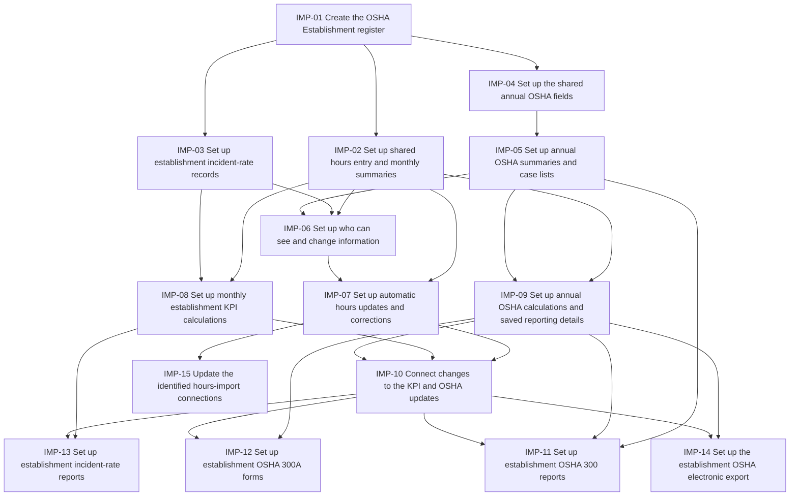

# Shared Hours Worked and OSHA Establishment configuration implementation plan

Draft implementation plan, plain-language edition. Date: November 12, 2026. Based on the [technical specification revision 2](technical-specification.md), [field definitions](target-model.json) and [supplied configuration package](package-evidence.json). The work adds seven record types and changes the existing location summary. This is the build plan; no changes have been made in Intelex.

## Scope and planning basis

The fifteen tasks set up the establishment register, one place to enter hours, monthly summaries, KPI and OSHA calculations, user access, screens and reports. The new setup will use the existing Safety Metrics application, where the source analytics already sit. The plan does not add another application or workflow, change the existing classification choices or enter business records.

Moving existing data, entering the establishment list, agreeing allocations and checking starting totals are managed separately. Checking the live system's capabilities, formal testing, the production switch, training, estimates and separate documentation are also outside these build tasks. Each task includes checks that demonstrate its result, rather than a separate testing assignment. Incident, employee and asset record changes remain outside this plan.

Related field settings and screens are grouped together. More complex automatic calculations have separate assignments because they need those records and fields to exist first. The hours-save process stays in one task: the entry and both summaries must save together or keep their previous values. Existing period checks, automatic numbering, location hierarchy and incident-access rules are reused. Intelex manages its own background-processing access; no new processing account is requested.

The information-needed section explains what the team still needs and why. Work with clear settings can continue while other details are supplied. Each task identifies the parts that are waiting and the earlier work it needs. Finding missing information is not added as a configuration task.

An Intelex object is a type of record. The tables describe its fields in plain language and retain the actual system names in parentheses so the build team can locate the correct settings. Related-record lists show links that already exist; they do not store the same relationship twice. In the establishment reports, the retained Lo and Ru measures cover the same establishment and must not be added together.

## Task summary

| Task Number | Task Category | Task Name | Objective and Detailed Scope | Recommended Implementer |
|---|---|---|---|---|
| IMP-01 | Establishment records and screens | Create the OSHA Establishment register | **Objective:** Give the company a separate list of OSHA establishments for hours entry and regulatory reporting.  **Detailed scope:** Create the establishment register, its sixteen information fields, unique establishment codes, change history and administration screens in Safety Metrics. Set up the existing classification choices. Later tasks add the lists of related records and protect codes once they are in use. | Associate Consultant |
| IMP-02 | Hours entry and monthly summaries | Set up shared hours entry and monthly summaries | **Objective:** Let users enter hours once and maintain headcounts separately on the monthly summaries.  **Detailed scope:** Create Hours Worked and Establishment Hours and Headcount with the fields, screens, selection rules and related-record lists below. Update the existing Location Hours and Headcount screen so calculated hours cannot be edited and a saved summary cannot be moved to another location or month. Add change history to that existing object. IMP-07 supplies the automatic update of hours totals. | Consultant |
| IMP-03 | KPI records and screens | Set up establishment incident-rate records | **Objective:** Store monthly incident measures for each establishment and let authorized users enter their rate targets.  **Detailed scope:** Create the shared incident-rate definition and the establishment KPI record type, including twenty saved measures, establishment and month details, supporting fields and four editable targets. Add the screens and related KPI list on the establishment. Later tasks fill the measures and display the actual rates. | Senior Associate Consultant |
| IMP-04 | Annual OSHA records and screens | Set up the shared annual OSHA fields | **Objective:** Provide the annual case counts, day totals and saved establishment details needed for OSHA reporting.  **Detailed scope:** Create the shared annual OSHA definition with thirty-five fields, its January 1 and duplicate-record checks, and its screens. Include the saved report header and link to the correct OSHA settings. IMP-09 fills the annual totals and copies the reporting details when a summary is created. | Senior Associate Consultant |
| IMP-05 | Annual summaries and case lists | Set up annual OSHA summaries and case lists | **Objective:** Give users an annual establishment summary with workforce figures, reporting details and access to the correct OSHA cases.  **Detailed scope:** Create the annual summary record type with seventeen additional fields, the shared annual fields, its screens and the related-summary list on the establishment. Add a read-only case list and OSHA 301 print link once the separate incident design supplies the required case links. Other report print links have their own tasks. | Consultant |
| IMP-06 | User access | Set up who can see and change information | **Objective:** Give users the access they need without allowing a location or establishment selection to expose other information.  **Detailed scope:** Set user-group, record and field access for all eight new or changed objects. Check location and establishment access separately. Protect calculated hours, summary links, establishment codes already in use and restricted corrections. Apply the rules to screens, links and imports while retaining the existing incident-security rules. | Senior Consultant |
| IMP-07 | Automatic hours updates | Set up automatic hours updates and corrections | **Objective:** Keep an hours entry, its summary links and both sets of monthly totals consistent when the entry is added, changed or deleted.  **Detailed scope:** Add the proposed Synchronize Hours Worked process and the actions that run it when an entry is created, changed or deleted. Check entries, create or reuse monthly summaries, maintain their links and recalculate affected hours. Save the entry and all related summary changes together, handle repeated or simultaneous updates safely, and allow authorized recalculation. A later task connects successful changes to the KPI and OSHA updates. | Senior Consultant |
| IMP-08 | Monthly KPI calculations | Set up monthly establishment KPI calculations | **Objective:** Fill each establishment's monthly incident measures and hours without changing its manually entered targets.  **Detailed scope:** Add the proposed Refresh Establishment Monthly Metrics process to create or update one monthly KPI and replace its twenty saved measures. Copy hours only from the matching establishment summary. Use the supplied incident rules and establishment assignments for case-related calculations. Keep actual-rate reporting and target editing separate. | Senior Consultant |
| IMP-09 | Annual OSHA calculations | Set up annual OSHA calculations and saved reporting details | **Objective:** Produce one complete annual establishment summary with the right case totals, workforce figures and saved reporting details.  **Detailed scope:** Add the proposed Refresh Establishment Annual OSHA process, copy establishment details when a summary is created, and calculate its twenty-four case/day fields, four workforce fields and case list. Add authorized header correction and one shared check of information needed for reporting. Routine recalculation must retain permitted user changes and historical reporting details. | Senior Consultant |
| IMP-10 | Automatic report updates | Connect changes to the KPI and OSHA updates | **Objective:** Recalculate the right location and establishment results after hours, headcounts or incidents change.  **Detailed scope:** Add the process that receives successful hours changes and summary headcount changes, then requests the affected monthly and annual calculations. Connect the new establishment calculations and the supplied existing location calculations. Prevent unfinished or failed updates from appearing current. No separate scheduler, processing-history object or incident-side automation is added. | Senior Consultant |
| IMP-11 | OSHA 300 reports | Set up establishment OSHA 300 reports | **Objective:** Print OSHA and Cal/OSHA case logs for the selected establishment and year.  **Detailed scope:** Add four print options on the new annual summary: OSHA 300, Combined OSHA 300, Cal/OSHA 300 and Combined Cal/OSHA 300. Use the supported reporting method and templates, the correct cases, protected employee names and reports with or without cases. Call the shared reporting-information check before printing. Existing location report links remain in use. | Senior Consultant |
| IMP-12 | OSHA 300A forms | Set up establishment OSHA 300A forms | **Objective:** Print OSHA and Cal/OSHA annual summary forms using the saved annual details and workforce totals.  **Detailed scope:** Add the two annual-form print options to the establishment summary and connect the supplied templates to its saved header, case/day totals and workforce figures. Apply the shared required-information check and preserve historical reporting details. Existing location form links remain unchanged. | Consultant |
| IMP-13 | Incident-rate reports | Set up establishment incident-rate reports | **Objective:** Show each establishment's four actual incident rates beside its manually entered targets.  **Detailed scope:** Create the proposed Establishment Incident Rates report/dashboard using monthly KPI measures and the supplied calculation rules. Add establishment and period selection, target comparisons and checks that results are complete and current. Calculate actual rates in the report, without adding new stored-rate fields or combining location and establishment totals. | Consultant |
| IMP-14 | Electronic OSHA export | Set up the establishment OSHA electronic export | **Objective:** Produce the required electronic OSHA file using each establishment's annual information and reporting identifiers.  **Detailed scope:** Create the proposed Establishment OSHA Electronic Export report using the supplied current export and file requirements. Connect the annual fields to the required file columns, check required values and formatting, and add a link from the summary. This task generates a file; it does not send it directly to the regulator. | Consultant |
| IMP-15 | Hours-import connections | Update the identified hours-import connections | **Objective:** Send imported hours through Hours Worked so imports no longer compete with calculated summary totals.  **Detailed scope:** Change only the existing imports or connections identified in the supplied information. Send their hours, reporting selections and stable entry references to Hours Worked through the automatic save process. Keep headcount imports separate. Finding connections, loading past data and switching the production system are outside this task. | Consultant |

## External inputs and constraints

The team needs the information and decisions below to complete the relevant parts of the build. Providing this information is outside the configuration tasks in this plan. Work that has enough information can continue; each task explains which parts are waiting.

- **IN-01 — How Intelex will save and recalculate hours safely:** The Intelex technical team needs to provide the supported way to update an hours entry and all related summaries together, so either every change succeeds or none is saved. This must cover adding, changing and deleting entries; retaining the original establishment, location and month when an entry changes; preventing simultaneous updates from producing conflicting totals; assigning a unique reference to a manually entered record before it is checked; protecting a saved summary's location and month; and allowing an authorized recalculation. The package does not show how to configure these features.

- **IN-02 — Field sizes and record-number settings:** The team needs the maximum text lengths allowed in the copied summary fields, the settings for automatic record numbering, and the supported way to allow a field to be edited when a record is first created but protect it afterward. Lengths are already specified for the new establishment register, but the package does not give the limits for all copied names, addresses and supporting fields.

- **IN-03 — Existing OSHA classification choices:** Provide the current choices and their reference codes for OSHA Establishment Type, OSHA Establishment Size and Has OSHA Recordable Injuries. The team also needs to know how choices that are no longer available for new records are identified. The package does not include these lists. New choices, employee-size thresholds or submission codes must not be assumed.

- **IN-04 — Who can see and change information:** Provide the approved user groups and access rules for maintaining establishments, entering hours, changing headcounts, setting KPI targets, correcting OSHA information and viewing reports. Specify which locations and establishments each group can access, who can correct historical records for inactive locations or establishments, and what people may see through links and exports. An entry assigned to both a location and an establishment must require access to both. The technical team also needs the supported way to apply these rules; the establishment list will not become a new security hierarchy.

- **IN-05 — Rules for monthly incident measures and rates:** Provide the current rules for which incidents are included, which incident date is used, whether incidents or individual injury cases are counted, which workers are included, and how lost-time incidents and days are counted. For incident rates, specify whether employee hours, contractor hours or both are used, the number used to scale each rate, rounding, how several months are combined, and how missing or zero hours are handled. The package does not contain these calculation rules.

- **IN-06 — How incidents are assigned to establishments:** The separately owned incident design must explain how every relevant incident type is assigned to an OSHA establishment and how this solution will be told when that assignment or reporting period changes. Both the previous and corrected assignments must be available so the right totals can be recalculated. The technical team also needs the existing links between annual summaries, injury/illness records and OSHA case details, including how many records each link can contain and how confidential employee information stays protected. Designing or changing the incident records remains outside this plan.

- **IN-07 — Rules for annual OSHA totals and workforce figures:** Provide the existing rules for which cases enter the annual OSHA totals, how a case is classified when more than one outcome applies, and any limits on the days counted. Specify which employee hours enter the annual total and how average headcount is calculated, including partial years, missing months and rounding. The team also needs the rule for deciding when missing hours or headcounts prevent reporting, and how a deliberately entered zero is treated differently from missing information.

- **IN-08 — OSHA reporting settings and form templates:** Provide the OSHA reporting settings and form templates used in the intended Intelex environment, including their system references, required information and case-level OSHA 301 links. The technical team must establish whether the standard OSHA and Cal/OSHA reporting tools can use the new establishment summaries; if they cannot, an approved supported reporting method is needed. Clarify how the combined forms should behave, particularly the Combined Cal/OSHA form, whose exported setting currently matches the non-combined form. Settings references from the source environment must not be assumed to work in another environment.

- **IN-09 — How existing reports are refreshed:** The technical team needs the names and calling details of the existing processes that recalculate location KPIs and annual OSHA figures after hours or headcounts change. It also needs to know how Intelex signals that a recalculation succeeded or failed, and how reports can be prevented from appearing current while an update is unfinished or has failed. These process details are not included in the package.

- **IN-10 — Existing sources of imported hours:** Provide the names and settings of any imports or connections that currently send hours into Intelex: which source fields they read, which Intelex fields they update, and how each source entry or allocation line is uniquely identified. Specify how those connections will create or correct entries in Hours Worked and which old direct-summary mappings will be retired. The package shows built-in importing turned off for the original summary, but does not identify any other hours feeds. No existing connection is assumed.

- **IN-11 — Current incident-rate report design:** Provide the current report or dashboard setup that displays the four actual incident rates and compares them with their targets. The team needs its calculations, display settings, reporting groups and access rules, plus the supported way to reproduce them for establishments. The package includes descriptions of the rates, but not the working report or its calculations.

- **IN-12 — OSHA electronic-file requirements:** Provide the current OSHA electronic-export report behind the OSHA Esub link and the submission-file requirements it must meet. This includes the applicable version, required columns and order, source information for each column, permitted values, formatting and the supported way to generate the file in the intended environment. The package includes a link to the report, not the report itself or a confirmed direct-submission service.

The data-migration team and client administrators provide the establishment list and agreed starting hours, including how hours are allocated and confirmation that the totals have been checked. The release team decides when to stop the old hours-entry process and switch to the new one, after those checks are complete. This plan prepares the new connections and editing restrictions; moving data, checking what the live system supports and making the production switch are separate responsibilities. Intelex manages access for its own background processing, so no additional processing account or permission setup is requested.

## Detailed configuration tasks

### IMP-01 — Create the OSHA Establishment register

**Task ID:** IMP-01

**Title:** Create the OSHA Establishment register

**Category:** Establishment records and screens

**Objective:** Give the company a separate list of OSHA establishments for hours entry and regulatory reporting.

**Detailed scope:** Create the establishment register, its sixteen information fields, unique establishment codes, change history and administration screens in Safety Metrics. Set up the existing classification choices. Later tasks add the lists of related records and protect codes once they are in use.

**Deliverable:** An establishment register with the specified fields, unique codes and administration screens.

**Work needed first:** None

**What is waiting:** Parts of this task can proceed; the following information is still needed. IN-03: Provide the existing Establishment Type and Size choices, their reference codes and the rule for excluding choices that are no longer available. Only those selection rules are waiting; the register and its other fields can be created. Existing choices will be reused.

**Recommended implementer role:** Associate Consultant

**Recommended reviewer/approver role:** Senior Consultant (product build manager; a different person from the implementer)

**Why this role is recommended:** The work uses standard field settings, a simple unique-code check and two administration screens. The more complex access rules have their own assignment.

Fields and features to set up:

| Field or feature | What to set up |
|---|---|
| OSHA Establishment.Code | Add Code (Code) on OSHA Establishment (TG_OSHAEstablishmentObject). Text, up to 100 characters. Require a value before a successful save finishes. Leave blank for entry. Require a unique value and do not translate it. Administrators can enter or change it before the establishment is used. The user-access task adds the protection needed once linked records exist. |
| OSHA Establishment.Name | Add Name (Name) on OSHA Establishment (TG_OSHAEstablishmentObject). Text, up to 255 characters; use the legal reporting name and do not translate it. Require a value before a successful save finishes. No default value. Establishment administrators may edit it. |
| OSHA Establishment.Active? | Add Active? (Active) on OSHA Establishment (TG_OSHAEstablishmentObject). A Yes/No field. Require a value before a successful save finishes. Start new records at TRUE (Yes). Establishment administrators may edit it. |
| OSHA Establishment.Company Name | Add Company Name (CompanyName) on OSHA Establishment (TG_OSHAEstablishmentObject). Text, up to 255 characters. Require it only under the conditions below. No default value. Administrators may edit it. It is required before generating a report, not before saving an incomplete master record. |
| OSHA Establishment.Street | Add Street (Street) on OSHA Establishment (TG_OSHAEstablishmentObject). Text, up to 255 characters. Require it only under the conditions below. No default value. Administrators may edit it. It is required before generating a report, not before saving an incomplete master record. |
| OSHA Establishment.City | Add City (City) on OSHA Establishment (TG_OSHAEstablishmentObject). Text, up to 100 characters. Require it only under the conditions below. No default value. Administrators may edit it. It is required before generating a report, not before saving an incomplete master record. |
| OSHA Establishment.State | Add State (State) on OSHA Establishment (TG_OSHAEstablishmentObject). Text, up to 100 characters. Require it only under the conditions below. No default value. Administrators may edit it. It is required before generating a report, not before saving an incomplete master record. |
| OSHA Establishment.Postal Code | Add Postal Code (PostalCode) on OSHA Establishment (TG_OSHAEstablishmentObject). Text, up to 30 characters. Require it only under the conditions below. No default value. Administrators may edit it. It is required before generating a report, not before saving an incomplete master record. |
| OSHA Establishment.EIN Number | Add EIN Number (EINNumber) on OSHA Establishment (TG_OSHAEstablishmentObject). Text, up to 30 characters. The field is optional. No default value. Administrators may edit it. |
| OSHA Establishment.NAICS Code | Add NAICS Code (NAICSCode) on OSHA Establishment (TG_OSHAEstablishmentObject). A whole-number field (bigint/System.Int64). The field is optional. No default value. Administrators may edit it. |
| OSHA Establishment.SIC Code | Add SIC Code (SICCode) on OSHA Establishment (TG_OSHAEstablishmentObject). A whole-number field (bigint/System.Int64). The field is optional. No default value. Administrators may edit it. |
| OSHA Establishment.Industry Description | Add Industry Description (IndustryDescription) on OSHA Establishment (TG_OSHAEstablishmentObject). Text, up to 1000 characters. The field is optional. No default value. Administrators may edit it. |
| OSHA Establishment.Establishment Type | Add Establishment Type (EstablishmentType) on OSHA Establishment (TG_OSHAEstablishmentObject). Select one OSHA Establishment Type (EHSIncidentMang_EstablishmeTypeObject) (M:1). The link can hold zero or one record; the required-field rule below determines when it may be blank. Leave the reverse list disabled on the selected record (inverse relationship off). The field is optional. No default value. Administrators may select a value. Keep past selections if a choice later becomes inactive. The rule for limiting new choices is waiting for the supplied classification details. |
| OSHA Establishment.Establishment Size | Add Establishment Size (EstablishmentSize) on OSHA Establishment (TG_OSHAEstablishmentObject). Select one OSHA Establishment Size (EHSIncidentMang_EstablishmeSizeObject) (M:1). The link can hold zero or one record; the required-field rule below determines when it may be blank. Leave the reverse list disabled on the selected record (inverse relationship off). The field is optional. No default value. Administrators may select a value. Keep past selections if a choice later becomes inactive. The rule for limiting new choices is waiting for the supplied classification details. |
| OSHA Establishment.Establishment ID | Add Establishment ID (EstablishmentID) on OSHA Establishment (TG_OSHAEstablishmentObject). Text, up to 100 characters. The field is optional. No default value. Administrators may edit it. |
| OSHA Establishment.OSHA 300a ID | Add OSHA 300a ID (OSHA300aID) on OSHA Establishment (TG_OSHAEstablishmentObject). Text, up to 100 characters. The field is optional. No default value. Administrators may edit it. |

Build instructions:

1. Create OSHA Establishment (TG_OSHAEstablishmentObject) in Safety Metrics (E36). It must stand on its own, without a Location Structure connection, a shared base record type or a workflow. Set IsAbstract=FALSE and IsLocationBound=FALSE, and enable Intelex change history. Create TG_OSHAEstablishment_Detail and TG_OSHAEstablishment_Inventory; use Name as the record's displayed label.

2. Require a unique Code of up to 100 characters. Do not translate Code. Set Active? to TRUE for new records and keep Name as the company's reporting name, without translation. Connect Establishment Type and Establishment Size to the supplied existing choices. Do not add a list of establishments on either classification record; retain past selections when a choice becomes inactive.

3. Place the fields below on the administration screen. Company Name, Street, City, State and Postal Code can remain blank while an establishment is being maintained. The report tasks will require this information before producing a report.

**How to check the result:**

- An administrator can create an establishment without selecting a Location Structure record or starting a workflow.

- A duplicate Code is rejected, Active? starts as TRUE and Name appears as the record label.

- An administrator can save the establishment before all reporting-address details are available.

**Information needed for this task:** IN-03: Provide the existing Establishment Type and Size choices, their reference codes and the rule for excluding choices that are no longer available. Only those selection rules are waiting; the register and its other fields can be created. Existing choices will be reused.

**Specification references:** Technical specification revision 2 sections 1, 3, 4.1, 6.3; R3, R4. Package module Safety Metrics (E36), object GUID 86db71b3-d191-44f6-8ae1-2867c7a5c36f.

**Assumptions and open questions:** None

### IMP-02 — Set up shared hours entry and monthly summaries

**Task ID:** IMP-02

**Title:** Set up shared hours entry and monthly summaries

**Category:** Hours entry and monthly summaries

**Objective:** Let users enter hours once and maintain headcounts separately on the monthly summaries.

**Detailed scope:** Create Hours Worked and Establishment Hours and Headcount with the fields, screens, selection rules and related-record lists below. Update the existing Location Hours and Headcount screen so calculated hours cannot be edited and a saved summary cannot be moved to another location or month. Add change history to that existing object. IMP-07 supplies the automatic update of hours totals.

**Deliverable:** Shared hours-entry screens, establishment monthly summaries, related-entry lists and the specified updates to location summaries.

**Work needed first:** IMP-01

**What is waiting:** Parts of this task can proceed; the following information is still needed. IN-01: The technical team must provide the supported way to prevent a saved summary's location, establishment or month from being changed, and to fill in the establishment name when a new summary is created. Those checks and the name-copying step are waiting. IMP-07 handles unique entry references and coordinated updates to hours totals. IN-02: Provide the allowed length of the summary's saved establishment name and the supported setting for fields that are editable only when first created. The known number, date and relationship fields can be configured while these details are supplied. Work needed first: IMP-01 (Create the OSHA Establishment register).

**Recommended implementer role:** Consultant

**Recommended reviewer/approver role:** Senior Consultant (product build manager; a different person from the implementer)

**Why this role is recommended:** This assignment connects one entry screen to two kinds of monthly summary. A Consultant can keep their field settings, selection rules and screen behavior consistent.

What the earlier tasks provide: IMP-01 provides An establishment register with the specified fields, unique codes and administration screens.

Fields and features to set up:

| Field or feature | What to set up |
|---|---|
| Hours Worked.Source Entry ID | Add Source Entry ID (SourceEntryID) on Hours Worked (TG_HoursWorkedObject). Text, up to 255 characters; keep unique within Hours Worked and do not translate it. Require a value before a successful save finishes. For imports, use a stable reference that identifies the source feed and entry. For manual entry, Synchronize Hours Worked supplies manual: followed by the record identifier before required-field checks, using the supplied supported method. Imports must supply it. After creation it is read only and acts as the displayed record label. |
| Hours Worked.Month | Add Month (Month) on Hours Worked (TG_HoursWorkedObject). A calendar date (Date), with time-zone capture turned off. Require a value before a successful save finishes. Start with the first day of the current month, using MonthStartValueGenerator. Hours editors may edit it and always see it. Reject dates other than the first day of the month. |
| Hours Worked.Location | Add Location (Location) on Hours Worked (TG_HoursWorkedObject). Select one Location (SysLocationEntity) (M:1). The link can hold zero or one record; the required-field rule below determines when it may be blank. Leave the reverse list disabled on the selected record (inverse relationship off). Require it only under the conditions below. Start blank (NULL). Always show it and allow editing. Require it when OSHA Establishment is blank (NULL). New selections require Deleted=FALSE and the user's existing location access. Do not default it from the login or home location. |
| Hours Worked.OSHA Establishment | Add OSHA Establishment (OSHAEstablishment) on Hours Worked (TG_HoursWorkedObject). Select one OSHA Establishment (M:1). The link can hold zero or one record; the required-field rule below determines when it may be blank. Leave the reverse list disabled on the selected record (inverse relationship off). Require it only under the conditions below. Start blank (NULL). Always show it and allow editing. Require it when Location is blank (NULL). New selections require Active?=TRUE. Do not fill it from Location, and retain existing assignments to inactive establishments. |
| Hours Worked.Employee Hours | Add Employee Hours (EmployeeHours) on Hours Worked (TG_HoursWorkedObject). Hours as a number allowing decimals (Float/System.Double). Require a valid finite value of 0 or greater; no additional fixed precision or decimal-place limit is specified. Require a value before a successful save finishes. Start at 0. Hours editors may edit it and always see it. Allow an intentional zero, but reject a blank value (NULL). |
| Hours Worked.Contractor Hours | Add Contractor Hours (ContractorHours) on Hours Worked (TG_HoursWorkedObject). Hours as a number allowing decimals (Float/System.Double). Require a valid finite value of 0 or greater; no additional fixed precision or decimal-place limit is specified. Require a value before a successful save finishes. Start at 0. Hours editors may edit it and always see it. Allow an intentional zero, but reject a blank value (NULL). |
| Hours Worked.Location Hours and Headcount | Add Location Hours and Headcount (LocationHoursHeadcount) on Hours Worked (TG_HoursWorkedObject). Select one Location Hours and Headcount (M:1). The link can hold zero or one record; the required-field rule below determines when it may be blank. Show linked records through its Hours Worked Entries list, using this same link. Require it only under the conditions below. Start blank (NULL); Synchronize Hours Worked fills the correct summary link before a successful save finishes. Show it as read only when Location is selected, and require its correct value before the save finishes. Otherwise keep it blank (NULL) and hide it. |
| Hours Worked.Establishment Hours and Headcount | Add Establishment Hours and Headcount (EstablishmentHoursHeadcount) on Hours Worked (TG_HoursWorkedObject). Select one Establishment Hours and Headcount (M:1). The link can hold zero or one record; the required-field rule below determines when it may be blank. Show linked records through its Hours Worked Entries list, using this same link. Require it only under the conditions below. Start blank (NULL); Synchronize Hours Worked fills the correct summary link before a successful save finishes. Show it as read only when OSHA Establishment is selected, and require its correct value before the save finishes. Otherwise keep it blank (NULL) and hide it. |
| Establishment Hours and Headcount.Date | Add Date (Date) on Establishment Hours and Headcount (TG_EstHrsHeadcountObject). A calendar date (Date), with time-zone capture turned off. Require a value before a successful save finishes. When creating the summary automatically, copy Hours Worked.Month. For headcount-only entry, use MonthStartValueGenerator to start at the first day of the current month. A headcount editor selects it when creating the summary. Make it read only after the first save. |
| Establishment Hours and Headcount.Contractor Headcount | Add Contractor Headcount (ContractrHCount) on Establishment Hours and Headcount (TG_EstHrsHeadcountObject). A number allowing decimals (Float/System.Double); the package sets no fixed precision or number of decimal places. The field is optional. Start at 0. Authorized headcount editors may edit it. Apply the same checks through the API and imports, with the source numeric type and default. |
| Establishment Hours and Headcount.Employees Hours | Add Employees Hours (EmployeeHrs) on Establishment Hours and Headcount (TG_EstHrsHeadcountObject). A number allowing decimals (Float/System.Double); the package sets no fixed precision or number of decimal places. The field is optional. Start at 0. Synchronize Hours Worked replaces this with the total Employee Hours for the same establishment and Month = Date. Show it as read only and prevent direct user, API or import edits. Only the authorized automatic calculation writes this total. |
| Establishment Hours and Headcount.OSHA Establishment | Add OSHA Establishment (OSHAEstablishment) on Establishment Hours and Headcount (TG_EstHrsHeadcountObject). Select one OSHA Establishment (M:1). Each record requires one selection. Show linked records through its Hours and Headcounts list, using this same link. Require a value before a successful save finishes. No default. The hours-update process supplies the establishment, or an authorized headcount editor selects it when first creating the summary. Require a selection when creating the summary, with Active?=TRUE for new ordinary selections. Make it read only after saving and retain historical inactive assignments. |
| Establishment Hours and Headcount.[Helper] Establishment Name | Add [Helper] Establishment Name (LocNameHelper) on Establishment Hours and Headcount (TG_EstHrsHeadcountObject). A text field (nvarchar); its permitted length still needs to be supplied. The field is optional. Copy OSHA Establishment.Name when the responsible process creates the record. Analytics users may view it but cannot edit it. |
| Establishment Hours and Headcount.Employees Headcount | Add Employees Headcount (EmployeeHCount) on Establishment Hours and Headcount (TG_EstHrsHeadcountObject). A number allowing decimals (Float/System.Double); the package sets no fixed precision or number of decimal places. The field is optional. Start at 0. Authorized headcount editors may edit it. Apply the same checks through the API and imports, with the source numeric type and default. |
| Establishment Hours and Headcount.Record No | Add Record No (RecordNo) on Establishment Hours and Headcount (TG_EstHrsHeadcountObject). An automatically assigned record number (AutoNumber/System.Int64). The field is optional. Use Intelex automatic numbering with a new sequence; the source package includes the number generator. Analytics users may view it but cannot edit it. |
| Establishment Hours and Headcount.Contractor Hours | Add Contractor Hours (ContractrHrs) on Establishment Hours and Headcount (TG_EstHrsHeadcountObject). A number allowing decimals (Float/System.Double); the package sets no fixed precision or number of decimal places. The field is optional. Start at 0. Synchronize Hours Worked replaces this with the total Contractor Hours for the same establishment and Month = Date. Show it as read only and prevent direct user, API or import edits. Only the authorized automatic calculation writes this total. |
| Establishment Hours and Headcount.Hours Worked Entries | Add Hours Worked Entries (HoursWorkedEntries) on Establishment Hours and Headcount (TG_EstHrsHeadcountObject). A read-only list of records linked through Hours Worked.Establishment Hours and Headcount. Use that existing link; do not store a second relationship. The field is optional. No default value. Authorized hours and analytics users may view the list but cannot edit links through it. |
| Location Hours and Headcount.Hours Worked Entries | Add Hours Worked Entries (HoursWorkedEntries) on Location Hours and Headcount (SafetyMetrics_HrsandHeadcountObject). A read-only list of records linked through Hours Worked.Location Hours and Headcount. Use that existing link; do not store a second relationship. The field is optional. No default value. Show the list as read only under the existing location-access rules. Separately check access to each underlying hours entry. |
| OSHA Establishment.Hours and Headcounts | Add Hours and Headcounts (HoursHeadcounts) on OSHA Establishment (TG_OSHAEstablishmentObject). A read-only list of records linked through Establishment Hours and Headcount.OSHA Establishment. Use that existing link; do not store a second relationship. The field is optional. No default value. Authorized analytics users may view the list but cannot edit links through it. |

Changes to the existing setup:

| Existing field or screen | What needs to change |
|---|---|
| SafetyMetrics_HrsandHeadcountObject (E84) | Enable change history on the existing Location Hours and Headcount object by changing IsAuditEnabled from FALSE to TRUE. Its existing Location Structure access rules, links and record identifier stay in place. |
| EmployeeHrs (E169) and ContractrHrs (E316) | After the separately managed switch to the new entry process is approved and the starting totals are checked, change EmployeeHrs and ContractrHrs from IsReadOnly=FALSE to TRUE. Show both as read only on SafetyMetrics_HrsandHeadcount_Detail (E209). IMP-06 also prevents users and imports from bypassing those restrictions. |
| Date (E82) and Location (E185) on SafetyMetrics_HrsandHeadcount_Detail (E209) | The package shows IsReadOnly=FALSE for Date and Location, a normal Date control and a Location control with DisplayAs=String on the existing detail screen. Add screen rules that allow these selections when creating a summary but make them read only afterward. Do not assume the current live Location editor has been checked. Keep their existing required settings and initial Date default. Protect Monthly Summary Identity prevents the same changes through other save routes. |

Build instructions:

1. Create Hours Worked (TG_HoursWorkedObject) and Establishment Hours and Headcount (TG_EstHrsHeadcountObject) in Safety Metrics (E36). Both allow their own records, use no shared base record type, have no workflow and are not tied to Location Structure. Enable change history. Create TG_HoursWorked_Detail, TG_HoursWorked_Inventory, TG_EstHrsHeadcount_Detail and TG_EstHrsHeadcount_Inventory.

2. Use Source Entry ID (SourceEntryID) as the Hours Worked record label and require it to be unique. Require Month to be the first day of a month, using DAY(Month)=1. Always show both Location and OSHA Establishment. Location is required when OSHA Establishment is blank; OSHA Establishment is required when Location is blank. Show the corresponding summary link when a selection is present. That link must be filled by the automatic update before the save finishes, rather than required before the update can run. Selecting or changing one reporting choice must not fill in or clear the other.

3. Show Employee Hours and Contractor Hours as separate editable fields. Require both, start them at 0 and allow zero or fractional hours; reject missing, negative or invalid numeric values. Show summary links for information only. IMP-07 handles the save-time checks and link changes, so do not add a second copy of that logic to the screen.

4. On the new establishment summary, allow only one record for each OSHAEstablishment and Date, and require DAY(Date)=1. Add the proposed Protect Monthly Summary Identity check to both summary types: once saved, their location or establishment and Date cannot change, and a summary used by Hours Worked cannot be deleted. The existing location checks Unique Location-Date (E183) and Date on first of month (E80) already cover duplicate periods and first-of-month dates; use them without creating replacements.

5. Add the proposed Initialize Establishment Monthly Summary create Action Handler. When the summary is first created, copy OSHAEstablishment.Name into LocNameHelper and use Intelex automatic numbering for RecordNo. Later establishment name changes or deactivation must not replace the saved name. New headcounts start at zero; an update must never reset an existing headcount. This handler does not calculate hours or refresh reports.

6. Allow authorized users to create a monthly summary to enter headcount even when it has no hours entries. They must select the location or establishment and the first day of the month when creating it; those selections become read only after saving. Keep employee and contractor headcounts editable and separate. Add the read-only Hours Worked Entries lists using the links already stored on Hours Worked, without storing another relationship.

**How to check the result:**

- The entry screen supports Location only, OSHA Establishment only, or both. Once IMP-07 is in place, saving with neither is rejected.

- Each summary's Hours Worked Entries list shows the entries linked to that summary without a second stored relationship.

- Users can edit headcounts but cannot edit calculated summary hours or move a saved summary to another reporting place or month.

- The existing location-summary records, field identifiers and two period checks remain in use.

**Information needed for this task:** IN-01: The technical team must provide the supported way to prevent a saved summary's location, establishment or month from being changed, and to fill in the establishment name when a new summary is created. Those checks and the name-copying step are waiting. IMP-07 handles unique entry references and coordinated updates to hours totals. IN-02: Provide the allowed length of the summary's saved establishment name and the supported setting for fields that are editable only when first created. The known number, date and relationship fields can be configured while these details are supplied.

**Specification references:** Technical specification revision 2 sections 4.6–4.8, 5.4, 6.1–6.4; R1, R7–R9. Location Hours and Headcount source fields and views are in package-evidence.json.

**Assumptions and open questions:** None

### IMP-03 — Set up establishment incident-rate records

**Task ID:** IMP-03

**Title:** Set up establishment incident-rate records

**Category:** KPI records and screens

**Objective:** Store monthly incident measures for each establishment and let authorized users enter their rate targets.

**Detailed scope:** Create the shared incident-rate definition and the establishment KPI record type, including twenty saved measures, establishment and month details, supporting fields and four editable targets. Add the screens and related KPI list on the establishment. Later tasks fill the measures and display the actual rates.

**Deliverable:** The twenty-nine monthly/KPI fields, period checks, four screens and the establishment's related KPI list.

**Work needed first:** IMP-01

**What is waiting:** Parts of this task can proceed; the following information is still needed. IN-02: Provide the allowed length of the saved establishment name and the automatic record-number settings for the new KPI records. Only these settings are waiting; the remaining KPI fields and record setup can be completed. Work needed first: IMP-01 (Create the OSHA Establishment register).

**Recommended implementer role:** Senior Associate Consultant

**Recommended reviewer/approver role:** Senior Consultant (product build manager; a different person from the implementer)

**Why this role is recommended:** The source provides a defined set of fields and straightforward monthly checks. A Senior Associate Consultant can configure the shared definition and screens without taking on the calculation design.

What the earlier tasks provide: IMP-01 provides An establishment register with the specified fields, unique codes and administration screens.

Fields and features to set up:

| Field or feature | What to set up |
|---|---|
| Establishment Incident Rate Abstract.Record No | Add Record No (RecordNo) on Establishment Incident Rate Abstract (TG_EstIncRateAbstractObject). An automatically assigned record number (AutoNumber/System.Int64). Require a value before a successful save finishes. Use Intelex automatic numbering (AutoNumber). Its default setting still needs to be supplied; do not assume the record number is manually entered. Analytics users may view it but cannot edit it. |
| Establishment Incident Rate Abstract.Date | Add Date (Date) on Establishment Incident Rate Abstract (TG_EstIncRateAbstractObject). A calendar date (Date), with time-zone capture turned off. Require a value before a successful save finishes. No user-entered default. Refresh Establishment Monthly Metrics supplies the first day of the requested month. Analytics users may view it but cannot edit it. |
| Establishment Incident Rate Abstract.OSHA Establishment | Add OSHA Establishment (OSHAEstablishment) on Establishment Incident Rate Abstract (TG_EstIncRateAbstractObject). Select one OSHA Establishment (M:1). Each record requires one selection. Show linked records through its Incident Rate KPIs list, using this same link. Require a value before a successful save finishes. No default. Creating the record automatically or importing it must supply the establishment. Show it as read only on automatically created records. Refresh Establishment Monthly Metrics supplies it; keep historical inactive assignments. |
| Establishment Incident Rate Abstract.Number of Days Away - Rollup | Add Number of Days Away - Rollup (RuNumDaysAway) on Establishment Incident Rate Abstract (TG_EstIncRateAbstractObject). A whole-number field (bigint/System.Int64). The field is optional. Start at 0. Analytics users may view it but cannot edit it. |
| Establishment Incident Rate Abstract.Number of Recordable/Reportable - Rollup | Add Number of Recordable/Reportable - Rollup (RuCtRecordable) on Establishment Incident Rate Abstract (TG_EstIncRateAbstractObject). A whole-number field (bigint/System.Int64). The field is optional. Start at 0. Analytics users may view it but cannot edit it. |
| Establishment Incident Rate Abstract.Number of Fatalities - Establishment | Add Number of Fatalities - Establishment (LoNumFatalities) on Establishment Incident Rate Abstract (TG_EstIncRateAbstractObject). A whole-number field (bigint/System.Int64). The field is optional. Start at 0. Analytics users may view it but cannot edit it. |
| Establishment Incident Rate Abstract.Number of Incidents - Rollup | Add Number of Incidents - Rollup (RuCtIncidents) on Establishment Incident Rate Abstract (TG_EstIncRateAbstractObject). A whole-number field (bigint/System.Int64). The field is optional. Start at 0. Analytics users may view it but cannot edit it. |
| Establishment Incident Rate Abstract.[Helper] Establishment Name | Add [Helper] Establishment Name (LocNameHelper) on Establishment Incident Rate Abstract (TG_EstIncRateAbstractObject). A text field (nvarchar); its permitted length still needs to be supplied. The field is optional. Copy OSHA Establishment.Name when the responsible process creates the record. Analytics users may view it but cannot edit it. |
| Establishment Incident Rate Abstract.Number of Lost Days - Rollup | Add Number of Lost Days - Rollup (RuNumLostDays) on Establishment Incident Rate Abstract (TG_EstIncRateAbstractObject). A whole-number field (bigint/System.Int64). The field is optional. Start at 0. Analytics users may view it but cannot edit it. |
| Establishment Incident Rate Abstract.Contractor Worked Hours - Establishment | Add Contractor Worked Hours - Establishment (LoCntrctWrkdHrs) on Establishment Incident Rate Abstract (TG_EstIncRateAbstractObject). A number allowing decimals (Float/System.Double); the package sets no fixed precision or number of decimal places. The field is optional. Start at 0. Analytics users may view it but cannot edit it. |
| Establishment Incident Rate Abstract.[Helper] Establishment ID | Add [Helper] Establishment ID (LocationIdHelp) on Establishment Incident Rate Abstract (TG_EstIncRateAbstractObject). A unique record identifier (GUID). Require a value before a successful save finishes. Save the selected establishment record identifier (GUID), filled by the responsible process. Users cannot edit it; hide it on ordinary screens. |
| Establishment Incident Rate Abstract.Number of Incidents - Establishment | Add Number of Incidents - Establishment (LoCtIncidents) on Establishment Incident Rate Abstract (TG_EstIncRateAbstractObject). A whole-number field (bigint/System.Int64). The field is optional. Start at 0. Analytics users may view it but cannot edit it. |
| Establishment Incident Rate Abstract.Number of Incidents with Days Away - Rollup | Add Number of Incidents with Days Away - Rollup (RuNumIncDayAway) on Establishment Incident Rate Abstract (TG_EstIncRateAbstractObject). A whole-number field (bigint/System.Int64). The field is optional. Start at 0. Analytics users may view it but cannot edit it. |
| Establishment Incident Rate Abstract.Number of Lost Days - Establishment | Add Number of Lost Days - Establishment (LoNumLostDays) on Establishment Incident Rate Abstract (TG_EstIncRateAbstractObject). A whole-number field (bigint/System.Int64). The field is optional. Start at 0. Analytics users may view it but cannot edit it. |
| Establishment Incident Rate Abstract.Number of Incidents with Days Away - Establishment | Add Number of Incidents with Days Away - Establishment (LoNumIncDayAway) on Establishment Incident Rate Abstract (TG_EstIncRateAbstractObject). A whole-number field (bigint/System.Int64). The field is optional. Start at 0. Analytics users may view it but cannot edit it. |
| Establishment Incident Rate Abstract.Contractor Worked Hours - Rollup | Add Contractor Worked Hours - Rollup (RuCntrctWrkdHrs) on Establishment Incident Rate Abstract (TG_EstIncRateAbstractObject). A number allowing decimals (Float/System.Double); the package sets no fixed precision or number of decimal places. The field is optional. Start at 0. Analytics users may view it but cannot edit it. |
| Establishment Incident Rate Abstract.Number of Incidents with Lost Time - Rollup | Add Number of Incidents with Lost Time - Rollup (RuNumIncLostTim) on Establishment Incident Rate Abstract (TG_EstIncRateAbstractObject). A whole-number field (bigint/System.Int64). The field is optional. Start at 0. Analytics users may view it but cannot edit it. |
| Establishment Incident Rate Abstract.Employee Worked Hours - Rollup | Add Employee Worked Hours - Rollup (RuEmplWrkdHours) on Establishment Incident Rate Abstract (TG_EstIncRateAbstractObject). A number allowing decimals (Float/System.Double); the package sets no fixed precision or number of decimal places. The field is optional. Start at 0. Analytics users may view it but cannot edit it. |
| Establishment Incident Rate Abstract.Number of Incidents with Lost Time - Establishment | Add Number of Incidents with Lost Time - Establishment (LoNumIncLostTim) on Establishment Incident Rate Abstract (TG_EstIncRateAbstractObject). A whole-number field (bigint/System.Int64). The field is optional. Start at 0. Analytics users may view it but cannot edit it. |
| Establishment Incident Rate Abstract.Number of Job Transfer and Restricted Days - Rollup | Add Number of Job Transfer and Restricted Days - Rollup (RuNumTrnsfRstDy) on Establishment Incident Rate Abstract (TG_EstIncRateAbstractObject). A whole-number field (bigint/System.Int64). The field is optional. Start at 0. Analytics users may view it but cannot edit it. |
| Establishment Incident Rate Abstract.Number of Job Transfer and Restricted Days - Establishment | Add Number of Job Transfer and Restricted Days - Establishment (LoNumTrnsfRstDy) on Establishment Incident Rate Abstract (TG_EstIncRateAbstractObject). A whole-number field (bigint/System.Int64). The field is optional. Start at 0. Analytics users may view it but cannot edit it. |
| Establishment Incident Rate Abstract.Number of Days Away - Establishment | Add Number of Days Away - Establishment (LoNumDaysAway) on Establishment Incident Rate Abstract (TG_EstIncRateAbstractObject). A whole-number field (bigint/System.Int64). The field is optional. Start at 0. Analytics users may view it but cannot edit it. |
| Establishment Incident Rate Abstract.Number of Recordable/Reportable - Establishment | Add Number of Recordable/Reportable - Establishment (LoCtRecordable) on Establishment Incident Rate Abstract (TG_EstIncRateAbstractObject). A whole-number field (bigint/System.Int64). The field is optional. Start at 0. Analytics users may view it but cannot edit it. |
| Establishment Incident Rate Abstract.Employee Worked Hours - Establishment | Add Employee Worked Hours - Establishment (LoEmplWrkdHours) on Establishment Incident Rate Abstract (TG_EstIncRateAbstractObject). A number allowing decimals (Float/System.Double); the package sets no fixed precision or number of decimal places. The field is optional. Start at 0. Analytics users may view it but cannot edit it. |
| Establishment Incident Rate Abstract.Number of Fatalities - Rollup | Add Number of Fatalities - Rollup (RuNumFatalities) on Establishment Incident Rate Abstract (TG_EstIncRateAbstractObject). A whole-number field (bigint/System.Int64). The field is optional. Start at 0. Analytics users may view it but cannot edit it. |
| Establishment Incident Rate KPI.Target LTIR | Add Target LTIR (TargetLTIR) on Establishment Incident Rate KPI (TG_EstIncidentRateKPIObject). A number allowing decimals (Float/System.Double); the package sets no fixed precision or number of decimal places. The field is optional. No default value. Authorized analytics administrators may edit it. |
| Establishment Incident Rate KPI.Target Severity Rate | Add Target Severity Rate (TargetSeverRate) on Establishment Incident Rate KPI (TG_EstIncidentRateKPIObject). A number allowing decimals (Float/System.Double); the package sets no fixed precision or number of decimal places. The field is optional. No default value. Authorized analytics administrators may edit it. |
| Establishment Incident Rate KPI.Target DAIR | Add Target DAIR (TargetDART) on Establishment Incident Rate KPI (TG_EstIncidentRateKPIObject). A number allowing decimals (Float/System.Double); the package sets no fixed precision or number of decimal places. The field is optional. No default value. Authorized analytics administrators may edit it. |
| Establishment Incident Rate KPI.Target TRIR | Add Target TRIR (TargetTRIR) on Establishment Incident Rate KPI (TG_EstIncidentRateKPIObject). A number allowing decimals (Float/System.Double); the package sets no fixed precision or number of decimal places. The field is optional. No default value. Authorized analytics administrators may edit it. |
| OSHA Establishment.Incident Rate KPIs | Add Incident Rate KPIs (IncidentRateKPIs) on OSHA Establishment (TG_OSHAEstablishmentObject). A read-only list of records linked through Establishment Incident Rate KPI.OSHA Establishment (inherited). Use that existing link; do not store a second relationship. The field is optional. No default value. Authorized analytics users may view the list but cannot edit links through it. |

Build instructions:

1. Create Establishment Incident Rate Abstract (TG_EstIncRateAbstractObject) as a shared field definition that cannot hold records. Create Establishment Incident Rate KPI (TG_EstIncidentRateKPIObject) directly from it. Put both in Safety Metrics (E36), set IsLocationBound=FALSE, enable change history and add no workflow. Define the shared fields only once on the abstract object and the four target fields only on the KPI object.

2. Allow one record per OSHAEstablishment and Date, and require DAY(Date)=1. Monthly generation supplies the establishment and month; users cannot reassign generated records. Use RecordNo as an automatically numbered record label with a new number sequence.

3. Create TG_EstIncRateAbstract_Detail/Inventory and TG_EstIncidentRateKPI_Detail/Inventory. Show RecordNo, OSHA Establishment and Date, then sections for editable targets, incident counts, lost days and employee/contractor hours. Show all saved measures as read only. Keep the field name TargetDART with the label Target DAIR. Hide LocationIdHelp on ordinary screens; it stores the establishment's unique record identifier.

4. Build the new screens' field lists from the fields that actually exist on these two objects. Leave out the source screen's obsolete DisplayField, Month, RepLocationId and missing OSHA-category fields. Add Incident Rate KPIs to the establishment screen using the KPI object's existing OSHAEstablishment link; do not store a second link.

**How to check the result:**

- Records can be created on the KPI object, but not directly on its abstract definition; shared fields appear only once.

- The four targets can be edited by authorized users and all twenty saved measures are read only.

- A duplicate establishment/month or a date other than the first of the month is rejected.

- Every new screen field exists, and TargetDART is displayed as Target DAIR.

**Information needed for this task:** IN-02: Provide the allowed length of the saved establishment name and the automatic record-number settings for the new KPI records. Only these settings are waiting; the remaining KPI fields and record setup can be completed.

**Specification references:** Technical specification revision 2 sections 4.2–4.3, 5.1–5.2, 7; R2, R3. Source incident-rate objects, fields and view definitions in package-evidence.json.

**Assumptions and open questions:** None

### IMP-04 — Set up the shared annual OSHA fields

**Task ID:** IMP-04

**Title:** Set up the shared annual OSHA fields

**Category:** Annual OSHA records and screens

**Objective:** Provide the annual case counts, day totals and saved establishment details needed for OSHA reporting.

**Detailed scope:** Create the shared annual OSHA definition with thirty-five fields, its January 1 and duplicate-record checks, and its screens. Include the saved report header and link to the correct OSHA settings. IMP-09 fills the annual totals and copies the reporting details when a summary is created.

**Deliverable:** Thirty-five annual fields, annual-period checks and two screens for the shared OSHA definition.

**Work needed first:** IMP-01

**What is waiting:** Parts of this task can proceed; the following information is still needed. IN-02: Provide the allowed text lengths for the annual summary's saved establishment name and address, plus its automatic record-number settings. Only these settings are waiting; the known case-count and day-total fields can be created. IN-08: Identify the OSHA reporting-settings record to use in the intended environment. It is needed to connect the new annual summaries to the correct reporting settings. The record reference in the source package must not be assumed to work there. Work needed first: IMP-01 (Create the OSHA Establishment register).

**Recommended implementer role:** Senior Associate Consultant

**Recommended reviewer/approver role:** Senior Consultant (product build manager; a different person from the implementer)

**Why this role is recommended:** The field list and date rules are defined. A Senior Associate Consultant can keep the shared fields and screens consistent without deciding the missing regulatory calculation rules.

What the earlier tasks provide: IMP-01 provides An establishment register with the specified fields, unique codes and administration screens.

Fields and features to set up:

| Field or feature | What to set up |
|---|---|
| Establishment OSHA Abstract.Total number of job transfer or restriction days (L) - roll up | Add Total number of job transfer or restriction days (L) - roll up (RuNumRstOrJobTr) on Establishment OSHA Abstract (TG_EstOSHAAbstractObject). A whole-number field (bigint/System.Int64). The field is optional. Start at 0. Analytics users may view it but cannot edit it. |
| Establishment OSHA Abstract.Total number of days away from work (K) - roll up | Add Total number of days away from work (K) - roll up (RuNumDaysAway) on Establishment OSHA Abstract (TG_EstOSHAAbstractObject). A whole-number field (bigint/System.Int64). The field is optional. Start at 0. Analytics users may view it but cannot edit it. |
| Establishment OSHA Abstract.Injuries (M1) - roll up | Add Injuries (M1) - roll up (RuCtInjuries) on Establishment OSHA Abstract (TG_EstOSHAAbstractObject). A whole-number field (bigint/System.Int64). The field is optional. Start at 0. Analytics users may view it but cannot edit it. |
| Establishment OSHA Abstract.Respiratory Conditions (M3) - establishment | Add Respiratory Conditions (M3) - establishment (LoCtRespiratorC) on Establishment OSHA Abstract (TG_EstOSHAAbstractObject). A whole-number field (bigint/System.Int64). The field is optional. Start at 0. Analytics users may view it but cannot edit it. |
| Establishment OSHA Abstract.OSHA Establishment | Add OSHA Establishment (OSHAEstablishment) on Establishment OSHA Abstract (TG_EstOSHAAbstractObject). Select one OSHA Establishment (M:1). Each record requires one selection. Show linked records through its OSHA Summaries list, using this same link. Require a value before a successful save finishes. No default. Creating the record automatically or importing it must supply the establishment. Show it as read only on automatically created records. Refresh Establishment Annual OSHA supplies it; keep historical inactive assignments. |
| Establishment OSHA Abstract.Other Recordable Cases (J) - roll up | Add Other Recordable Cases (J) - roll up (RuCtOthrRecrdbl) on Establishment OSHA Abstract (TG_EstOSHAAbstractObject). A whole-number field (bigint/System.Int64). The field is optional. Start at 0. Analytics users may view it but cannot edit it. |
| Establishment OSHA Abstract.All other illnesses (M6) - establishment | Add All other illnesses (M6) - establishment (LoCtAllOtherIln) on Establishment OSHA Abstract (TG_EstOSHAAbstractObject). A whole-number field (bigint/System.Int64). The field is optional. Start at 0. Analytics users may view it but cannot edit it. |
| Establishment OSHA Abstract.Other Recordable Cases (J) - establishment | Add Other Recordable Cases (J) - establishment (LoCtOthrRecrdbl) on Establishment OSHA Abstract (TG_EstOSHAAbstractObject). A whole-number field (bigint/System.Int64). The field is optional. Start at 0. Analytics users may view it but cannot edit it. |
| Establishment OSHA Abstract.Job Transfer or Restricted Days Cases (I) - roll up | Add Job Transfer or Restricted Days Cases (I) - roll up (RuCtTrnfrOrRest) on Establishment OSHA Abstract (TG_EstOSHAAbstractObject). A whole-number field (bigint/System.Int64). The field is optional. Start at 0. Analytics users may view it but cannot edit it. |
| Establishment OSHA Abstract.Establishment Street | Add Establishment Street (LocationStreet) on Establishment OSHA Abstract (TG_EstOSHAAbstractObject). A text field (nvarchar); its permitted length still needs to be supplied. The field is optional. When the annual record is first created, copy and save OSHA Establishment.Street. Later master changes must not automatically replace this saved value. Analytics users may view it but cannot edit it. |
| Establishment OSHA Abstract.Date | Add Date (Date) on Establishment OSHA Abstract (TG_EstOSHAAbstractObject). A calendar date (Date), with time-zone capture turned off. Require a value before a successful save finishes. No user-entered default. Refresh Establishment Annual OSHA supplies January 1 of the requested year. Analytics users may view it but cannot edit it. |
| Establishment OSHA Abstract.Poisonings (M4) - establishment | Add Poisonings (M4) - establishment (LoCtPoisonings) on Establishment OSHA Abstract (TG_EstOSHAAbstractObject). A whole-number field (bigint/System.Int64). The field is optional. Start at 0. Analytics users may view it but cannot edit it. |
| Establishment OSHA Abstract.Hearing loss (M5) - establishment | Add Hearing loss (M5) - establishment (LoCtHearingLoss) on Establishment OSHA Abstract (TG_EstOSHAAbstractObject). A whole-number field (bigint/System.Int64). The field is optional. Start at 0. Analytics users may view it but cannot edit it. |
| Establishment OSHA Abstract.Skin Disorders (M2) - roll up | Add Skin Disorders (M2) - roll up (RuCtSkinDisordr) on Establishment OSHA Abstract (TG_EstOSHAAbstractObject). A whole-number field (bigint/System.Int64). The field is optional. Start at 0. Analytics users may view it but cannot edit it. |
| Establishment OSHA Abstract.Respiratory Conditions (M3) - roll up | Add Respiratory Conditions (M3) - roll up (RuCtRespiratorC) on Establishment OSHA Abstract (TG_EstOSHAAbstractObject). A whole-number field (bigint/System.Int64). The field is optional. Start at 0. Analytics users may view it but cannot edit it. |
| Establishment OSHA Abstract.Death (G) - establishment | Add Death (G) - establishment (LoCtFatalities) on Establishment OSHA Abstract (TG_EstOSHAAbstractObject). A whole-number field (bigint/System.Int64). The field is optional. Start at 0. Analytics users may view it but cannot edit it. |
| Establishment OSHA Abstract.Job Transfer or Restricted Days Cases (I) - establishment | Add Job Transfer or Restricted Days Cases (I) - establishment (LoCtTrnfrOrRest) on Establishment OSHA Abstract (TG_EstOSHAAbstractObject). A whole-number field (bigint/System.Int64). The field is optional. Start at 0. Analytics users may view it but cannot edit it. |
| Establishment OSHA Abstract.Injuries (M1) - establishment | Add Injuries (M1) - establishment (LoCtInjuries) on Establishment OSHA Abstract (TG_EstOSHAAbstractObject). A whole-number field (bigint/System.Int64). The field is optional. Start at 0. Analytics users may view it but cannot edit it. |
| Establishment OSHA Abstract.Establishment City | Add Establishment City (LocationCity) on Establishment OSHA Abstract (TG_EstOSHAAbstractObject). A text field (nvarchar); its permitted length still needs to be supplied. The field is optional. When the annual record is first created, copy and save OSHA Establishment.City. Later master changes must not automatically replace this saved value. Analytics users may view it but cannot edit it. |
| Establishment OSHA Abstract.Establishment Postal Code | Add Establishment Postal Code (LocationPostal) on Establishment OSHA Abstract (TG_EstOSHAAbstractObject). A text field (nvarchar); its permitted length still needs to be supplied. The field is optional. When the annual record is first created, copy and save OSHA Establishment.Postal Code. Later master changes must not automatically replace this saved value. Analytics users may view it but cannot edit it. |
| Establishment OSHA Abstract.Death (G) - roll up | Add Death (G) - roll up (RuCtFatalities) on Establishment OSHA Abstract (TG_EstOSHAAbstractObject). A whole-number field (bigint/System.Int64). The field is optional. Start at 0. Analytics users may view it but cannot edit it. |
| Establishment OSHA Abstract.Days Away From Work Cases (H) - roll up | Add Days Away From Work Cases (H) - roll up (RuCtDaysAway) on Establishment OSHA Abstract (TG_EstOSHAAbstractObject). A whole-number field (bigint/System.Int64). The field is optional. Start at 0. Analytics users may view it but cannot edit it. |
| Establishment OSHA Abstract.Establishment State | Add Establishment State (LocationState) on Establishment OSHA Abstract (TG_EstOSHAAbstractObject). A text field (nvarchar); its permitted length still needs to be supplied. The field is optional. When the annual record is first created, copy and save OSHA Establishment.State. Later master changes must not automatically replace this saved value. Analytics users may view it but cannot edit it. |
| Establishment OSHA Abstract.Record No | Add Record No (RecordNo) on Establishment OSHA Abstract (TG_EstOSHAAbstractObject). An automatically assigned record number (AutoNumber/System.Int64). Require a value before a successful save finishes. Use Intelex automatic numbering (AutoNumber). Its default setting still needs to be supplied; do not assume the record number is manually entered. Analytics users may view it but cannot edit it. |
| Establishment OSHA Abstract.Days Away From Work Cases (H) - establishment | Add Days Away From Work Cases (H) - establishment (LoCtDaysAway) on Establishment OSHA Abstract (TG_EstOSHAAbstractObject). A whole-number field (bigint/System.Int64). The field is optional. Start at 0. Analytics users may view it but cannot edit it. |
| Establishment OSHA Abstract.[Helper] Establishment ID | Add [Helper] Establishment ID (ReporLocationId) on Establishment OSHA Abstract (TG_EstOSHAAbstractObject). A unique record identifier (GUID). Require a value before a successful save finishes. Save the selected establishment record identifier (GUID), filled by the responsible process. Users cannot edit it; hide it on ordinary screens. |
| Establishment OSHA Abstract.Year | Add Year (Year) on Establishment OSHA Abstract (TG_EstOSHAAbstractObject). A whole-number field (bigint/System.Int64). The field is optional. Refresh Establishment Annual OSHA saves the calendar year from Date. Do not add a continuously recalculated expression. Analytics users may view it but cannot edit it. |
| Establishment OSHA Abstract.All other illnesses (M6) - roll up | Add All other illnesses (M6) - roll up (RuCtAllOtherIln) on Establishment OSHA Abstract (TG_EstOSHAAbstractObject). A whole-number field (bigint/System.Int64). The field is optional. Start at 0. Analytics users may view it but cannot edit it. |
| Establishment OSHA Abstract.Establishment Display Name | Add Establishment Display Name (LocationName) on Establishment OSHA Abstract (TG_EstOSHAAbstractObject). A text field (nvarchar); its permitted length still needs to be supplied. The field is optional. When the annual record is first created, copy and save OSHA Establishment.Name. Later master changes must not automatically replace this saved value. Analytics users may view it but cannot edit it. |
| Establishment OSHA Abstract.OII Settings | Add OII Settings (OIISettings) on Establishment OSHA Abstract (TG_EstOSHAAbstractObject). Select one OII Setting (EHSIncidentMang_OIISettingObject) (M:1). The link can hold zero or one record; the required-field rule below determines when it may be blank. Leave the reverse list disabled on the selected record (inverse relationship off). The field is optional. Use the supplied OSHA settings record for the intended environment. This default is waiting for that information; do not copy the source environment record identifier. Users cannot edit it; hide it on ordinary summary screens. |
| Establishment OSHA Abstract.Total number of days away from work (K) - establishment | Add Total number of days away from work (K) - establishment (LoNumDaysAway) on Establishment OSHA Abstract (TG_EstOSHAAbstractObject). A whole-number field (bigint/System.Int64). The field is optional. Start at 0. Analytics users may view it but cannot edit it. |
| Establishment OSHA Abstract.Hearing loss (M5) - roll up | Add Hearing loss (M5) - roll up (RuCtHearingLoss) on Establishment OSHA Abstract (TG_EstOSHAAbstractObject). A whole-number field (bigint/System.Int64). The field is optional. Start at 0. Analytics users may view it but cannot edit it. |
| Establishment OSHA Abstract.Skin Disorders (M2) - establishment | Add Skin Disorders (M2) - establishment (LoCtSkinDisordr) on Establishment OSHA Abstract (TG_EstOSHAAbstractObject). A whole-number field (bigint/System.Int64). The field is optional. Start at 0. Analytics users may view it but cannot edit it. |
| Establishment OSHA Abstract.Poisonings (M4) - roll up | Add Poisonings (M4) - roll up (RuCtPoisonings) on Establishment OSHA Abstract (TG_EstOSHAAbstractObject). A whole-number field (bigint/System.Int64). The field is optional. Start at 0. Analytics users may view it but cannot edit it. |
| Establishment OSHA Abstract.Total number of job transfer or restriction days (L) - establishment | Add Total number of job transfer or restriction days (L) - establishment (LoNumRstOrJobTr) on Establishment OSHA Abstract (TG_EstOSHAAbstractObject). A whole-number field (bigint/System.Int64). The field is optional. Start at 0. Analytics users may view it but cannot edit it. |

Build instructions:

1. Create Establishment OSHA Abstract (TG_EstOSHAAbstractObject) in Safety Metrics (E36) as an independent shared field definition that cannot hold records. Set IsAbstract=TRUE and IsLocationBound=FALSE, enable change history and add no workflow.

2. Allow one record per OSHAEstablishment and Date. Require January 1 using AND(MONTH(Date)=1, DAY(Date)=1). Annual generation supplies the required establishment and date, shown read only. Use a new automatic number sequence for RecordNo and the record label. ReporLocationId must hold the establishment's unique record identifier, not a Location Structure identifier.

3. Create TG_EstOSHAAbstract_Detail and TG_EstOSHAAbstract_Inventory. Show the case counts, day totals, year, annual date, establishment and saved header fields as read only. Hide OIISettings on ordinary summary screens. Leave related-record lists off on settings and classification records. Include only fields that exist on the shared definition.

4. Add LocationName, LocationStreet, LocationCity, LocationState and LocationPostal as saved copies for the annual report header. Later master changes must not continuously rewrite them. Year is also a saved value filled by annual processing. This new definition must not inherit the original location-based OSHA object or contain a Location reference.

**How to check the result:**

- The twenty-four annual count/day fields exist once on the independent establishment definition.

- Dates other than January 1 and duplicate establishment/year records are rejected.

- The annual record keeps its own header values, and ReporLocationId holds the establishment identifier.

- The settings link uses the supplied record for the intended environment, or remains waiting for that information. It does not silently reuse the source environment's reference.

**Information needed for this task:** IN-02: Provide the allowed text lengths for the annual summary's saved establishment name and address, plus its automatic record-number settings. Only these settings are waiting; the known case-count and day-total fields can be created. IN-08: Identify the OSHA reporting-settings record to use in the intended environment. It is needed to connect the new annual summaries to the correct reporting settings. The record reference in the source package must not be assumed to work there.

**Specification references:** Technical specification revision 2 sections 4.4, 5.1, 6.3; R2–R4. Source OSHA Abstract fields and validations in package-evidence.json.

**Assumptions and open questions:** None

### IMP-05 — Set up annual OSHA summaries and case lists

**Task ID:** IMP-05

**Title:** Set up annual OSHA summaries and case lists

**Category:** Annual summaries and case lists

**Objective:** Give users an annual establishment summary with workforce figures, reporting details and access to the correct OSHA cases.

**Detailed scope:** Create the annual summary record type with seventeen additional fields, the shared annual fields, its screens and the related-summary list on the establishment. Add a read-only case list and OSHA 301 print link once the separate incident design supplies the required case links. Other report print links have their own tasks.

**Deliverable:** Annual establishment summaries, seventeen additional fields, summary screens, the establishment's related-summary list and the OSHA case list.

**Work needed first:** IMP-04

**What is waiting:** Parts of this task can proceed; the following information is still needed. IN-02: Provide the allowed text lengths for company name, EIN, establishment name, industry description, change reason and reporting IDs. Only those length settings are waiting. IN-03: Provide the existing Establishment Type, Establishment Size and Has OSHA Recordable Injuries choices, their reference codes and the rule for excluding choices no longer available. The plan does not authorize new choices. IN-06: Explain how the annual summary is linked to injury/illness and OSHA case records, including how many records each link can contain and which case information is available. The case list and its links are waiting for this information; the known individual fields can be created. IN-08: Provide the OSHA 301 template and its links to the correct case records, together with the information that must be present before reporting. Only the case-level print link and related reporting checks are waiting. Work needed first: IMP-04 (Set up the shared annual OSHA fields).

**Recommended implementer role:** Consultant

**Recommended reviewer/approver role:** Senior Consultant (product build manager; a different person from the implementer)

**Why this role is recommended:** A Consultant is needed to connect the shared annual fields to case information and case printing while preserving confidential employee details.

What the earlier tasks provide: IMP-04 provides Thirty-five annual fields, annual-period checks and two screens for the shared OSHA definition.

Fields and features to set up:

| Field or feature | What to set up |
|---|---|
| Establishment OSHA Summary.Total hours worked by all employees this year Establishment | Add Total hours worked by all employees this year Establishment (LoNumHrsWorked) on Establishment OSHA Summary (TG_EstOSHASummaryObject). A number allowing decimals (Float/System.Double); the package sets no fixed precision or number of decimal places. The field is optional. No default value. Analytics users may view it but cannot edit it. |
| Establishment OSHA Summary.Company Name | Add Company Name (CompanyName) on Establishment OSHA Summary (TG_EstOSHASummaryObject). A text field (nvarchar); its permitted length still needs to be supplied. The field is optional. When the annual record is first created, copy and save OSHA Establishment.Company Name. Later master changes must not automatically replace this saved value. Authorized analytics administrators may edit it. |
| Establishment OSHA Summary.Annual average number of employees Establishment | Add Annual average number of employees Establishment (LoAvgNumEmploye) on Establishment OSHA Summary (TG_EstOSHASummaryObject). A number allowing decimals (Float/System.Double); the package sets no fixed precision or number of decimal places. The field is optional. No default value. Analytics users may view it but cannot edit it. |
| Establishment OSHA Summary.EIN Number | Add EIN Number (EINNumber) on Establishment OSHA Summary (TG_EstOSHASummaryObject). A text field (nvarchar); its permitted length still needs to be supplied. The field is optional. When the annual record is first created, copy and save OSHA Establishment.EIN Number. Later master changes must not automatically replace this saved value. Authorized analytics administrators may edit it. |
| Establishment OSHA Summary.Annual average number of employees Rollup | Add Annual average number of employees Rollup (RuAvgNumEmploye) on Establishment OSHA Summary (TG_EstOSHASummaryObject). A number allowing decimals (Float/System.Double); the package sets no fixed precision or number of decimal places. The field is optional. No default value. Analytics users may view it but cannot edit it. |
| Establishment OSHA Summary.Total hours worked by all employees this year Rollup | Add Total hours worked by all employees this year Rollup (RUNumHrsWorked) on Establishment OSHA Summary (TG_EstOSHASummaryObject). A number allowing decimals (Float/System.Double); the package sets no fixed precision or number of decimal places. The field is optional. No default value. Analytics users may view it but cannot edit it. |
| Establishment OSHA Summary.Change Reason | Add Change Reason (ChangeReason) on Establishment OSHA Summary (TG_EstOSHASummaryObject). A text field (nvarchar); its permitted length still needs to be supplied. The field is optional. No default value. Authorized analytics administrators may edit it. |
| Establishment OSHA Summary.Establishment Type | Add Establishment Type (EstablishmeType) on Establishment OSHA Summary (TG_EstOSHASummaryObject). Select one OSHA Establishment Type (EHSIncidentMang_EstablishmeTypeObject) (M:1). The link can hold zero or one record; the required-field rule below determines when it may be blank. Leave the reverse list disabled on the selected record (inverse relationship off). The field is optional. When the annual record is first created, copy and save OSHA Establishment.Establishment Type. Later master changes must not automatically replace this saved value. Regulatory administrators may edit it. Keep existing inactive or older selections. New-choice restrictions are waiting for the supplied classification details. |
| Establishment OSHA Summary.Establishment Name | Add Establishment Name (EstablishmeName) on Establishment OSHA Summary (TG_EstOSHASummaryObject). A text field (nvarchar); its permitted length still needs to be supplied. The field is optional. When the annual record is first created, copy and save OSHA Establishment.Name. Later master changes must not automatically replace this saved value. Authorized analytics administrators may edit it. |
| Establishment OSHA Summary.Establishment Size | Add Establishment Size (EstablishmtSize) on Establishment OSHA Summary (TG_EstOSHASummaryObject). Select one OSHA Establishment Size (EHSIncidentMang_EstablishmeSizeObject) (M:1). The link can hold zero or one record; the required-field rule below determines when it may be blank. Leave the reverse list disabled on the selected record (inverse relationship off). The field is optional. When the annual record is first created, copy and save OSHA Establishment.Establishment Size. Later master changes must not automatically replace this saved value. Regulatory administrators may edit it. Keep existing inactive or older selections. New-choice restrictions are waiting for the supplied classification details. |
| Establishment OSHA Summary.SIC Code | Add SIC Code (SICCode) on Establishment OSHA Summary (TG_EstOSHASummaryObject). A whole-number field (bigint/System.Int64). The field is optional. When the annual record is first created, copy and save OSHA Establishment.SIC Code. Later master changes must not automatically replace this saved value. Analytics users may view it but cannot edit it. |
| Establishment OSHA Summary.Associated OIIs | Add Associated OIIs (AssociatedOIIs) on Establishment OSHA Summary (TG_EstOSHASummaryObject). A list of zero or more Injury/Illness cases. The exact stored relationship and return link are waiting for the separately supplied incident details. The field is optional. No default value. Authorized regulatory users may view this read-only list. The OSHA case list shows recordable cases only. |
| Establishment OSHA Summary.NAICS Code | Add NAICS Code (NAICSCode) on Establishment OSHA Summary (TG_EstOSHASummaryObject). A whole-number field (bigint/System.Int64). The field is optional. When the annual record is first created, copy and save OSHA Establishment.NAICS Code. Later master changes must not automatically replace this saved value. Analytics users may view it but cannot edit it. |
| Establishment OSHA Summary.Any Recordable Incidents | Add Any Recordable Incidents (AnyRecrdblIncid) on Establishment OSHA Summary (TG_EstOSHASummaryObject). Select one Has OSHA Recordable Injuries (EHSIncidentMang_HasRecordaInjurObject) (M:1). The link can hold zero or one record; the required-field rule below determines when it may be blank. Leave the reverse list disabled on the selected record (inverse relationship off). The field is optional. No default value. Regulatory administrators may edit it. Keep existing inactive or older selections. New-choice restrictions are waiting for the supplied classification details. |
| Establishment OSHA Summary.OSHA 300a ID | Add OSHA 300a ID (OSHA300aID) on Establishment OSHA Summary (TG_EstOSHASummaryObject). A text field (nvarchar); its permitted length still needs to be supplied. The field is optional. When the annual record is first created, copy and save OSHA Establishment.OSHA 300a ID. Later master changes must not automatically replace this saved value. Authorized analytics administrators may edit it. |
| Establishment OSHA Summary.Establishment ID | Add Establishment ID (EstablishmentID) on Establishment OSHA Summary (TG_EstOSHASummaryObject). A text field (nvarchar); its permitted length still needs to be supplied. The field is optional. When the annual record is first created, copy and save OSHA Establishment.Establishment ID. Later master changes must not automatically replace this saved value. Authorized analytics administrators may edit it. |
| Establishment OSHA Summary.Industry Description | Add Industry Description (InduDescription) on Establishment OSHA Summary (TG_EstOSHASummaryObject). A text field (nvarchar); its permitted length still needs to be supplied. The field is optional. When the annual record is first created, copy and save OSHA Establishment.Industry Description. Later master changes must not automatically replace this saved value. Authorized analytics administrators may edit it. |
| OSHA Establishment.OSHA Summaries | Add OSHA Summaries (OSHASummaries) on OSHA Establishment (TG_OSHAEstablishmentObject). A read-only list of records linked through Establishment OSHA Summary.OSHA Establishment (inherited). Use that existing link; do not store a second relationship. The field is optional. No default value. Authorized regulatory users may view the list but cannot edit links through it. |

Build instructions:

1. Create Establishment OSHA Summary (TG_EstOSHASummaryObject) directly from TG_EstOSHAAbstractObject in Safety Metrics (E36). Enable change history, leave it independent of Location Structure and add no workflow. Add only its seventeen additional fields; use the shared fields without redefining them.

2. Create TG_EstOSHASummary_Detail and TG_EstOSHASummary_Inventory with establishment/year details and sections for G–J cases, K/L days, M1–M6 injury/illness types and employment figures. Allow authorized edits to CompanyName, EINNumber, EstablishmeName, InduDescription, EstablishmeType, EstablishmtSize, AnyRecrdblIncid, OSHA300aID, EstablishmentID and ChangeReason. Other saved header/code corrections use the authorized annual-correction process. Hide OIISettings.

3. Add AssociatedOIIs only when the separate incident design supplies its exact relationship and permitted number of linked records. Do not invent a new incident field. Add a read-only case list through AssociatedOIIs.OSHARecord, filtered to InjuryIllnes.OSHARecordable=TRUE. Show CaseNo, InjuryIllnes.NameHidden, InjuryIllnes.DateUserEntered, InjuryOutcome, InjuryIllnes.NumDaysAwayOSHA, InjuryIllnes.NumJobTAndRest and PrInjuryIllness. Show each case once and apply the existing confidential-name and case-access rules.

4. Add the OSHA 301 print control using InjuryIllnes.OIISetting.OSHA301TempId and OSHAObjectID with the case's record ID. Do not use the annual summary's ID for the case form. Complete the link only after the case/template details are supplied. Add OSHA Summaries to the establishment screen using the summary's OSHAEstablishment link, without storing another relationship.

**How to check the result:**

- The annual summary has its seventeen additional fields and uses each shared field once. Establishment Display Name and Establishment Name remain distinct.

- The case list shows only the eligible cases for that establishment and year, with confidential names protected and editing disabled.

- The OSHA 301 link prints the selected case, rather than the annual summary record.

- Recalculating the measures does not lock or reset reporting details that users are allowed to edit.

**Information needed for this task:** IN-02: Provide the allowed text lengths for company name, EIN, establishment name, industry description, change reason and reporting IDs. Only those length settings are waiting. IN-03: Provide the existing Establishment Type, Establishment Size and Has OSHA Recordable Injuries choices, their reference codes and the rule for excluding choices no longer available. The plan does not authorize new choices. IN-06: Explain how the annual summary is linked to injury/illness and OSHA case records, including how many records each link can contain and which case information is available. The case list and its links are waiting for this information; the known individual fields can be created. IN-08: Provide the OSHA 301 template and its links to the correct case records, together with the information that must be present before reporting. Only the case-level print link and related reporting checks are waiting.

**Specification references:** Technical specification revision 2 sections 4.5, 4.9, 7–8; R2, R5, R6. SafetyMetrics_OSHASummary_Detail (E100) supplies the extracted case-grid paths; their target field definitions are not exported.

**Assumptions and open questions:** None

### IMP-06 — Set up who can see and change information

**Task ID:** IMP-06

**Title:** Set up who can see and change information

**Category:** User access

**Objective:** Give users the access they need without allowing a location or establishment selection to expose other information.

**Detailed scope:** Set user-group, record and field access for all eight new or changed objects. Check location and establishment access separately. Protect calculated hours, summary links, establishment codes already in use and restricted corrections. Apply the rules to screens, links and imports while retaining the existing incident-security rules.

**Deliverable:** User access settings, protected fields and establishment codes, and the access check used when an hours entry contains either or both reporting choices.

**Work needed first:** IMP-02, IMP-03, IMP-05

**What is waiting:** Parts of this task can proceed; the following information is still needed. IN-04: Provide the actual user groups and the locations, establishments, fields and reports each group may see or change, including historical corrections. These access settings cannot be completed from business-role labels alone. IN-01: The technical team must provide the supported way to check whether an establishment is already in use. This is needed to prevent its code from being changed, or the establishment from being deleted, once other records use it. The required record links will already exist from the earlier tasks. Work needed first: IMP-02 (Set up shared hours entry and monthly summaries); IMP-03 (Set up establishment incident-rate records); IMP-05 (Set up annual OSHA summaries and case lists).

**Recommended implementer role:** Senior Consultant

**Recommended reviewer/approver role:** Senior Consultant (product build manager; a different person from the implementer)

**Why this role is recommended:** A Senior Consultant is needed because an entry may involve two independent access rules and must not expose confidential incident or employee information.

What the earlier tasks provide: IMP-02 provides Shared hours-entry screens, establishment monthly summaries, related-entry lists and the specified updates to location summaries. IMP-03 provides The twenty-nine monthly/KPI fields, period checks, four screens and the establishment's related KPI list. IMP-05 provides Annual establishment summaries, seventeen additional fields, summary screens, the establishment's related-summary list and the OSHA case list.

Build instructions:

1. Connect the supplied user groups to their responsibilities: establishment administrators maintain establishments; hours editors add/change/delete permitted Hours Worked records; headcount editors maintain summary headcounts; analytics administrators set KPI targets; regulatory administrators maintain annual reporting details and authorized corrections; reporting users see only permitted results. Prevent ordinary users, APIs and imports from writing summary EmployeeHrs/ContractrHrs or source LocationHoursHeadcount/EstablishmentHoursHeadcount directly.

2. Set the access check so Location-only entry requires access to that location, establishment-only entry requires access to that establishment, and an entry containing both requires both permissions. Recheck access when selections change. Opening a related record must not grant access to the other reporting choice. Make this check available to the hours-update process; do not create a new security hierarchy.

3. Prevent users from changing SourceEntryID after creation. Restrict new assignments to inactive locations or establishments to the approved historical-correction role. Existing inactive assignments remain usable for authorized hours/month corrections and historical reporting. Only the authorized annual-header correction process may change its protected header fields.

4. Apply the same user-access rules through screens, direct record URLs, search, exports and related-record lists. Keep the original location summary's Location Structure access rules. Use the supplied independent rules for establishments and Hours Worked, while retaining existing case permissions and confidential-name handling.

5. Add the proposed Protect Establishment Code check and make Code read only once the establishment is used by Hours Worked.OSHAEstablishment, Establishment Hours and Headcount.OSHAEstablishment, Establishment Incident Rate KPI.OSHAEstablishment or Establishment OSHA Summary.OSHAEstablishment. Reject later code changes before saving, but allow Name to be updated. Prevent deletion of an establishment already in use and never delete its linked records automatically. Setting Active? to FALSE must retain historical links.

**How to check the result:**

- A user who has access to only one of the two selected reporting places cannot save an entry assigned to both.

- Users and imports cannot directly change calculated summary hours or summary links, while authorized headcount and target changes still work.

- A list, link or export does not expose source entries or cases the user cannot otherwise view.

- Existing inactive assignments remain accessible as permitted without allowing everyone to make new inactive assignments.

- An establishment already in use cannot have its Code changed or be deleted. Its Name can still change, and deactivation retains its history.

**Information needed for this task:** IN-04: Provide the actual user groups and the locations, establishments, fields and reports each group may see or change, including historical corrections. These access settings cannot be completed from business-role labels alone. IN-01: The technical team must provide the supported way to check whether an establishment is already in use. This is needed to prevent its code from being changed, or the establishment from being deleted, once other records use it. The required record links will already exist from the earlier tasks.

**Specification references:** Technical specification revision 2 sections 4, 6.2–6.3, 8; R1, R3, R8, R9. Accepted incident privacy controls are retained; no incident-side configuration is assigned.

**Assumptions and open questions:** None

### IMP-07 — Set up automatic hours updates and corrections

**Task ID:** IMP-07

**Title:** Set up automatic hours updates and corrections

**Category:** Automatic hours updates

**Objective:** Keep an hours entry, its summary links and both sets of monthly totals consistent when the entry is added, changed or deleted.

**Detailed scope:** Add the proposed Synchronize Hours Worked process and the actions that run it when an entry is created, changed or deleted. Check entries, create or reuse monthly summaries, maintain their links and recalculate affected hours. Save the entry and all related summary changes together, handle repeated or simultaneous updates safely, and allow authorized recalculation. A later task connects successful changes to the KPI and OSHA updates.

**Deliverable:** An automatic hours-update process, its create/change/delete actions and an authorized recalculation option with clear failure handling.

**Work needed first:** IMP-02, IMP-06

**What is waiting:** Parts of this task can proceed; the following information is still needed. IN-01: The technical team must provide the supported way to run the hours update when an entry is added, changed or deleted; retain its previous assignments before deletion; assign a unique manual-entry reference; save the entry and summaries together; avoid conflicting simultaneous updates; and allow an authorized recalculation. The behavior is defined, but the automated update cannot be built until these system details are supplied. Work needed first: IMP-02 (Set up shared hours entry and monthly summaries); IMP-06 (Set up who can see and change information).

**Recommended implementer role:** Senior Consultant

**Recommended reviewer/approver role:** Principal Consultant (technical approver; a different person from the implementer)

**Why this role is recommended:** A Senior Consultant is needed to ensure simultaneous updates and corrections cannot leave the two reporting views inconsistent. Both summaries must succeed or fail together, so the save process stays in one assignment.

What the earlier tasks provide: IMP-02 provides Shared hours-entry screens, establishment monthly summaries, related-entry lists and the specified updates to location summaries. IMP-06 provides User access settings, protected fields and establishment codes, and the access check used when an hours entry contains either or both reporting choices.

Build instructions:

1. Add the proposed Synchronize Hours Worked process and Create/Update/Delete Action Handlers on TG_HoursWorkedObject. Before checking required fields, give a manual entry its SourceEntryID using manual: followed by the record's unique identifier through the supplied supported method. Imports supply their own stable reference. Use the existing unique-key check: sending the same reference and values again must add nothing; changed values must be an authorized update of the original entry.

2. Before saving, run the installed user-access and protected-source-reference checks. Require the first day of the month, valid nonnegative EmployeeHours/ContractorHours and at least one of Location or OSHAEstablishment. Do not accept user-supplied summary links. Run the update when Month, Location, OSHAEstablishment, EmployeeHours or ContractorHours changes. Changes made only to calculated links must not start it again.

3. Before changing or deleting an entry, retain its old location, establishment, month and summary links. Include both previous and new reporting places/months in the work to be recalculated. Protect the affected records against conflicting updates in a fixed order: object kind, reporting-place identifier, then month. Reuse each unique monthly summary or create it with the correct selection, Date=Month, automatic RecordNo, saved name and initial headcounts. Do not reset existing headcounts. If another update creates the summary first, use that record and retry safely.

4. Set LocationHoursHeadcount to the summary whose Location matches the entry and whose Date matches Month. Set EstablishmentHoursHeadcount in the same way using OSHAEstablishment. Every selected reporting choice must have its correct link before the save finishes. Clearing one choice clears only that link and recalculates its previous summary; it must not change the other choice.

5. For every affected location/month, replace EmployeeHrs with the total of EmployeeHours and ContractrHrs with the total of ContractorHours from the resulting matching Hours Worked entries. Do the same for each affected establishment/month. Count an entry once in each selected reporting view. Set the total to zero when no entries remain. Do not add the previous summary total, create entries for higher locations or change headcounts, record identifiers or other saved information.

6. Save the entry, any new summaries, their links and both hours totals together. If any part fails, keep all previous values and show the affected reporting place and error in Intelex's processing history. Prevent an older simultaneous update from replacing newer results. Keep a summary when its last hours entry is removed. Add an authorized option to recalculate a selected summary from existing entries without creating an artificial Hours Worked record or SourceEntryID.

7. After a successful save, provide the list of previous and new reporting places, months and years to the report-update process. Updates to links or summaries must not create more hours entries or start the same source update repeatedly. Calls to the existing location and report calculations are connected in their separate task; this process adds no separate processing-history object or background-processing account.

**How to check the result:**

- One entry containing both selections contributes 1,200 hours to each matching summary and still counts as one source entry. Changing it to 1,250 replaces its contribution.

- Changing its month or either selection updates the previous and new summaries and only the relevant links.

- Deleting the last contribution sets summary hours to zero without deleting the summary or changing its headcounts.

- A failed or simultaneous update cannot leave just one reporting view changed, a broken link or two summaries for the same place and month.

**Information needed for this task:** IN-01: The technical team must provide the supported way to run the hours update when an entry is added, changed or deleted; retain its previous assignments before deletion; assign a unique manual-entry reference; save the entry and summaries together; avoid conflicting simultaneous updates; and allow an authorized recalculation. The behavior is defined, but the automated update cannot be built until these system details are supplied.

**Specification references:** Technical specification revision 2 sections 4.8, 5.4, 6.1–6.4; R7–R9. A0 is a design responsibility label; Synchronize Hours Worked and its handlers are proposed additions, not exported existing operations.

**Assumptions and open questions:** None

### IMP-08 — Set up monthly establishment KPI calculations

**Task ID:** IMP-08

**Title:** Set up monthly establishment KPI calculations

**Category:** Monthly KPI calculations

**Objective:** Fill each establishment's monthly incident measures and hours without changing its manually entered targets.

**Detailed scope:** Add the proposed Refresh Establishment Monthly Metrics process to create or update one monthly KPI and replace its twenty saved measures. Copy hours only from the matching establishment summary. Use the supplied incident rules and establishment assignments for case-related calculations. Keep actual-rate reporting and target editing separate.

**Deliverable:** A monthly establishment recalculation that produces one complete KPI result and can be safely run again.

**Work needed first:** IMP-02, IMP-03

**What is waiting:** Parts of this task can proceed; the following information is still needed. IN-05: Provide the monthly rules for included incidents, reporting dates, worker groups, incident-versus-case counts and lost-time/day totals. These rules are needed for sixteen incident measures. The source of the four hours measures is already defined. IN-06: Provide the way to select incidents for an establishment and the information sent when an incident's previous establishment or reporting period is corrected. The task must not assume an incident field or default assignment. IN-01: The technical team must provide the supported way to run the monthly recalculation and save a complete set of results without conflicting updates. The earlier tasks already provide the fields; this information is needed to make them update automatically. Work needed first: IMP-02 (Set up shared hours entry and monthly summaries); IMP-03 (Set up establishment incident-rate records).

**Recommended implementer role:** Senior Consultant

**Recommended reviewer/approver role:** Senior Consultant (product build manager; a different person from the implementer)

**Why this role is recommended:** A Senior Consultant is needed to apply the incident-counting rules correctly and prevent incomplete or conflicting calculations from replacing a complete monthly result.

What the earlier tasks provide: IMP-02 provides Shared hours-entry screens, establishment monthly summaries, related-entry lists and the specified updates to location summaries. IMP-03 provides The twenty-nine monthly/KPI fields, period checks, four screens and the establishment's related KPI list.

Build instructions:

1. Add the proposed Refresh Establishment Monthly Metrics process, taking an establishment identifier and a first-of-month Date. Reject other dates. Prevent conflicting updates to that month and create or update one TG_EstIncidentRateKPIObject using OSHAEstablishment + Date. On creation, fill the required establishment/date/RecordNo, set LocationIdHelp to the establishment's unique record identifier and copy its Name into LocNameHelper. Ordinary recalculation retains the saved name and identifier.

2. Set LoEmplWrkdHours and RuEmplWrkdHours from TG_EstHrsHeadcountObject.EmployeeHrs for the same establishment and Date. Set LoCntrctWrkdHrs and RuCntrctWrkdHrs from ContractrHrs. Do not add raw Hours Worked amounts or location totals. Apply the supplied rule for missing monthly input rather than treating it as confirmed zero.

3. Apply the supplied incident rules and establishment selection to both the Lo and Ru fields for CtIncidents, CtRecordable, NumIncDayAway, NumIncLostTim, NumFatalities, NumDaysAway, NumLostDays and NumTrnsfRstDy. Include dates from the start of the month up to, but not including, the next month. Each Lo/Ru pair uses the same establishment population. Use the supplied rules to distinguish incidents from cases and to classify lost-time/day measures.

4. Save all twenty measures together or keep the previous complete set if the calculation fails. Running the process again must recalculate from current data rather than add to old totals. Preserve TargetTRIR, TargetDART, TargetLTIR and TargetSeverRate. Send the result and any error to the installed report-readiness check.

**How to check the result:**

- The four hours measures equal the matching monthly summary, with matching Lo/Ru values and no extra raw-hours contribution.

- The sixteen incident measures use the supplied counting rules for the selected establishment and month.

- Running the process again creates no duplicate KPI and leaves all four targets unchanged.

- A failed calculation retains the previous complete measures and shows which month and establishment failed.

**Information needed for this task:** IN-05: Provide the monthly rules for included incidents, reporting dates, worker groups, incident-versus-case counts and lost-time/day totals. These rules are needed for sixteen incident measures. The source of the four hours measures is already defined. IN-06: Provide the way to select incidents for an establishment and the information sent when an incident's previous establishment or reporting period is corrected. The task must not assume an incident field or default assignment. IN-01: The technical team must provide the supported way to run the monthly recalculation and save a complete set of results without conflicting updates. The earlier tasks already provide the fields; this information is needed to make them update automatically.

**Specification references:** Technical specification revision 2 sections 4.2–4.3, 5, 6; R2, R3. All source metric Calculation values are null; only the stored-field contract is extracted.

**Assumptions and open questions:** None

### IMP-09 — Set up annual OSHA calculations and saved reporting details

**Task ID:** IMP-09

**Title:** Set up annual OSHA calculations and saved reporting details

**Category:** Annual OSHA calculations

**Objective:** Produce one complete annual establishment summary with the right case totals, workforce figures and saved reporting details.

**Detailed scope:** Add the proposed Refresh Establishment Annual OSHA process, copy establishment details when a summary is created, and calculate its twenty-four case/day fields, four workforce fields and case list. Add authorized header correction and one shared check of information needed for reporting. Routine recalculation must retain permitted user changes and historical reporting details.

**Deliverable:** Annual recalculation, authorized header correction and shared reporting-information checks, with the complete copy rules and preserved annual history.

**Work needed first:** IMP-02, IMP-05

**What is waiting:** Parts of this task can proceed; the following information is still needed. IN-06: Provide the links between the annual summary and its cases, and the rule for selecting cases assigned to the same establishment. This is needed to populate the annual case list and totals; changing the incident records is outside this task. IN-07: Provide the annual case classifications, day-count limits, included employee hours and average-headcount calculation, including missing months and partial years. The annual calculations and checks for missing information are waiting for these rules. IN-08: Identify the OSHA reporting-settings record to use in the intended environment and any additional information each output requires. These details are needed when creating annual records and adding output-specific checks to the five shared company-name and address checks. IN-01: The technical team must provide the supported way to run an annual recalculation or an authorized header correction and save a complete result without conflicting updates. No particular workflow button or system method is assumed. Work needed first: IMP-02 (Set up shared hours entry and monthly summaries); IMP-05 (Set up annual OSHA summaries and case lists).

**Recommended implementer role:** Senior Consultant

**Recommended reviewer/approver role:** Senior Consultant (product build manager; a different person from the implementer)

**Why this role is recommended:** A Senior Consultant is needed because classification rules, workforce averaging and saved annual reporting details must work together without changing historical meaning.

What the earlier tasks provide: IMP-02 provides Shared hours-entry screens, establishment monthly summaries, related-entry lists and the specified updates to location summaries. IMP-05 provides Annual establishment summaries, seventeen additional fields, summary screens, the establishment's related-summary list and the OSHA case list.

Build instructions:

1. Add the proposed Refresh Establishment Annual OSHA process, taking an establishment identifier and year. Set Date to January 1, prevent conflicting updates and create or update one TG_EstOSHASummaryObject using OSHAEstablishment + Date. On creation, set the automatic RecordNo, ReporLocationId to the establishment identifier, Year from Date and OIISettings to the supplied settings record for the intended environment.

2. When first creating the annual record, copy master Name to LocationName and EstablishmeName; Street to LocationStreet; City to LocationCity; State to LocationState; PostalCode to LocationPostal; CompanyName to CompanyName; EINNumber to EINNumber; NAICSCode to NAICSCode; SICCode to SICCode; IndustryDescription to InduDescription; EstablishmentType to EstablishmeType; EstablishmentSize to EstablishmtSize; EstablishmentID to EstablishmentID; and OSHA300aID to OSHA300aID. Save these values on the annual record; do not make them continuously follow later master changes.

3. For incidents from January 1 up to, but not including, the following January 1, apply the supplied inclusion, classification and day-limit rules. Replace both Lo/Ru values for CtFatalities, CtDaysAway, CtTrnfrOrRest, CtOthrRecrdbl, NumDaysAway, NumRstOrJobTr, CtInjuries, CtSkinDisordr, CtRespiratorC, CtPoisonings, CtHearingLoss and CtAllOtherIln. Both sets cover the same establishment; do not include other records because they sit below a location in the organization.

4. Set LoNumHrsWorked and RUNumHrsWorked from the same establishment's monthly EmployeeHrs using the supplied annual inclusion rule. Set LoAvgNumEmploye and RuAvgNumEmploye from monthly EmployeeHCount using the supplied averaging rule, including partial years, missing months and rounding. Do not sum headcounts or automatically divide by the number of months entered. Fill AssociatedOIIs using the supplied case relationship and the same establishment/year selection.

5. Save the totals and case-list changes as a complete result, or retain the previous complete result on failure. Do not overwrite permitted changes to CompanyName, EINNumber, EstablishmeName, InduDescription, EstablishmeType, EstablishmtSize, AnyRecrdblIncid, OSHA300aID, EstablishmentID or ChangeReason. Master name changes and deactivation must not replace saved annual header details.

6. Add the proposed Correct Annual OSHA Header process for the approved regulatory-administrator group. Allow explicit corrections to LocationName, LocationStreet, LocationCity, LocationState, LocationPostal, SICCode and NAICSCode on the selected annual record. Use Intelex change history to show the old and new values and who changed them. Ordinary recalculation must not run this correction process.

7. Add the proposed Validate Annual OSHA Output check before a print, merge or export request. Require CompanyName, LocationStreet, LocationCity, LocationState and LocationPostal on the selected annual record, and return clear messages naming any missing fields without changing data. Allow each output to supply its additional required fields. Do not make these fields mandatory during master maintenance. The electronic-export task adds its own file-format and recordable-case consistency checks.

**How to check the result:**

- Creating an annual summary fills all fifteen copied target fields and its date, year, establishment identifier and reporting settings once.

- Changing the current establishment or recalculating totals does not overwrite saved annual details or permitted user changes.

- The twenty-four case/day fields and four workforce fields follow the supplied annual rules, with matching Lo/Ru establishment totals.

- Authorized header correction appears in change history, leaves master data unchanged and does not allow ordinary users to edit protected fields.

**Information needed for this task:** IN-06: Provide the links between the annual summary and its cases, and the rule for selecting cases assigned to the same establishment. This is needed to populate the annual case list and totals; changing the incident records is outside this task. IN-07: Provide the annual case classifications, day-count limits, included employee hours and average-headcount calculation, including missing months and partial years. The annual calculations and checks for missing information are waiting for these rules. IN-08: Identify the OSHA reporting-settings record to use in the intended environment and any additional information each output requires. These details are needed when creating annual records and adding output-specific checks to the five shared company-name and address checks. IN-01: The technical team must provide the supported way to run an annual recalculation or an authorized header correction and save a complete result without conflicting updates. No particular workflow button or system method is assumed.

**Specification references:** Technical specification revision 2 sections 4.4–4.5, 5, 6.3; R2–R6. A3 is a design label; the two named operations are proposed additions.

**Assumptions and open questions:** None

### IMP-10 — Connect changes to the KPI and OSHA updates

**Task ID:** IMP-10

**Title:** Connect changes to the KPI and OSHA updates

**Category:** Automatic report updates

**Objective:** Recalculate the right location and establishment results after hours, headcounts or incidents change.

**Detailed scope:** Add the process that receives successful hours changes and summary headcount changes, then requests the affected monthly and annual calculations. Connect the new establishment calculations and the supplied existing location calculations. Prevent unfinished or failed updates from appearing current. No separate scheduler, processing-history object or incident-side automation is added.

**Deliverable:** The proposed Dispatch Hours Analytics Refresh process, headcount-change actions and report-readiness checks.

**Work needed first:** IMP-07, IMP-08, IMP-09

**What is waiting:** Parts of this task can proceed; the following information is still needed. IN-09: Provide the existing location-recalculation process names, how to call them, and how Intelex indicates success or failure. Connecting the existing location calculations and preventing unfinished results from appearing current are waiting for these details. IN-06: The separately owned incident solution must send both the previous and corrected establishment and reporting period when an incident changes. This task will receive that information and request recalculation; it will not add automation to the incident records. Work needed first: IMP-07 (Set up automatic hours updates and corrections); IMP-08 (Set up monthly establishment KPI calculations); IMP-09 (Set up annual OSHA calculations and saved reporting details).

**Recommended implementer role:** Senior Consultant

**Recommended reviewer/approver role:** Senior Consultant (product build manager; a different person from the implementer)

**Why this role is recommended:** A Senior Consultant is needed to connect existing and new automatic calculations in the right order and handle failures without presenting old results as current.

What the earlier tasks provide: IMP-07 provides An automatic hours-update process, its create/change/delete actions and an authorized recalculation option with clear failure handling. IMP-08 provides A monthly establishment recalculation that produces one complete KPI result and can be safely run again. IMP-09 provides Annual recalculation, authorized header correction and shared reporting-information checks, with the complete copy rules and preserved annual history.

Build instructions:

1. Add the proposed Dispatch Hours Analytics Refresh process to receive the affected previous and new places/months after Synchronize Hours Worked saves successfully. Run Refresh Establishment Monthly Metrics once for each affected establishment/month and Refresh Establishment Annual OSHA once for each affected establishment/year. Call the supplied existing location KPI/annual processes for each affected location/month/year and their required organizational roll-ups. Do not create source hours entries for higher locations.

2. Add Update actions on both monthly summaries for changes to EmployeeHCount or ContractrHCount only. Establishment headcount changes request the annual establishment workforce update; location changes request the supplied location workforce update. Changes only to calculated hours, saved names or links must not restart the source hours update. When a headcount-only summary is created, recalculate its hours from existing entries before requesting dependent reports.

3. Connect to the supplied incident-change notice and use both the previous and corrected establishment and reporting period to request recalculation. Include changes crossing months or years and authorized corrections for inactive reporting places. This task receives notices; it does not add incident fields, defaults or workflow actions.

4. Combine repeated requests for the same process, kind of reporting place, record identifier and period. Prevent competing result updates and calculate from the latest successfully saved data. Use Intelex's supplied success/failure information to stop affected KPI or report screens from appearing current while a required update is unfinished or has failed. A report-calculation failure must not undo already consistent hours entries and summaries. A retry recalculates current results instead of adding to old totals.

**How to check the result:**

- Moving an hours entry across years updates both affected annual establishment summaries and all relevant monthly and location results.

- A headcount change updates workforce figures without changing the hours entries or repeatedly starting the source update.

- A failed report update leaves hours consistent and visibly prevents the result from appearing current; retry replaces the result.

- The task adds no scheduler, separate queue/history object or incident-record workflow.

**Information needed for this task:** IN-09: Provide the existing location-recalculation process names, how to call them, and how Intelex indicates success or failure. Connecting the existing location calculations and preventing unfinished results from appearing current are waiting for these details. IN-06: The separately owned incident solution must send both the previous and corrected establishment and reporting period when an incident changes. This task will receive that information and request recalculation; it will not add automation to the incident records.

**Specification references:** Technical specification revision 2 sections 6, 7–8; R1, R2, R5, R8, R9.

**Assumptions and open questions:** None

### IMP-11 — Set up establishment OSHA 300 reports

**Task ID:** IMP-11

**Title:** Set up establishment OSHA 300 reports

**Category:** OSHA 300 reports

**Objective:** Print OSHA and Cal/OSHA case logs for the selected establishment and year.

**Detailed scope:** Add four print options on the new annual summary: OSHA 300, Combined OSHA 300, Cal/OSHA 300 and Combined Cal/OSHA 300. Use the supported reporting method and templates, the correct cases, protected employee names and reports with or without cases. Call the shared reporting-information check before printing. Existing location report links remain in use.

**Deliverable:** Four establishment case-log print options connected to the supplied supported reporting method and templates.

**Work needed first:** IMP-05, IMP-09, IMP-10

**What is waiting:** Parts of this task can proceed; the following information is still needed. IN-08: Provide the supported reporting method and the templates for OSHA 300 and Cal/OSHA 300 reports, both with cases and with no cases. Clarify the Combined Cal/OSHA behavior. The four print links cannot be completed until the team has a supported method that works with the new establishment summaries. Work needed first: IMP-05 (Set up annual OSHA summaries and case lists); IMP-09 (Set up annual OSHA calculations and saved reporting details); IMP-10 (Connect changes to the KPI and OSHA updates).

**Recommended implementer role:** Senior Consultant

**Recommended reviewer/approver role:** Senior Consultant (product build manager; a different person from the implementer)

**Why this role is recommended:** A Senior Consultant is needed to connect reporting tools to the new summary type and handle combined-report behavior correctly.

What the earlier tasks provide: IMP-05 provides Annual establishment summaries, seventeen additional fields, summary screens, the establishment's related-summary list and the OSHA case list. IMP-09 provides Annual recalculation, authorized header correction and shared reporting-information checks, with the complete copy rules and preserved annual history. IMP-10 provides The proposed Dispatch Hours Analytics Refresh process, headcount-change actions and report-readiness checks.

Fields and features to set up:

| Field or feature | What to set up |
|---|---|
| Print OSHA 300 Form | Add this link on TG_EstOSHASummaryObject using the supported reporting method, the new summary object's identifier and the selected summary record. Use OSHA300TempId for the case template and OSHA300EmptyId for no cases; use oshaType=OSHA if supported by the supplied method. The source Print OSHA 300 Form (E329) contains the original summary identifier, which must not be copied into the new link. |
| Print Combined OSHA 300 Form | Add the combined print option using OSHA300TempId/OSHA300EmptyId and the supplied combined-report rules. The source Print Combined OSHA 300 Form (E214) uses oshaType=Combined. Include only the approved establishment/year cases, without adding organizational descendants. |
| Print Cal/OSHA 300 Form | Add the Cal print option using CALOSHA300TempId/CALOSHA300EmptyId and the supplied reporting method. The source Print Cal/OSHA 300 Form (E203) uses oshaType=OSHA. Use the same selected establishment/year and protect confidential names. |
| Print Combined Cal/OSHA 300 Form | Add this option only with the supplied confirmed combined-report behavior. The source Print Combined Cal/OSHA 300 Form (E337) sends oshaType=OSHA even though its name says Combined. Do not assume a corrected parameter or promise combined behavior without that decision. |

Build instructions:

1. Connect each print option to the selected new annual header and the eligible cases used for its totals. Before preparing the report, run Validate Annual OSHA Output with any additional fields required by that output. This existing shared check owns the company-name/address requirements; master maintenance remains possible before those details are complete.

2. Connect both case and no-case templates, confidential-name handling and the installed report-readiness check before download. The original location report links and their identifiers are unchanged.

**How to check the result:**

- All four new options use the new summary and supplied supported report method, rather than the original hard-coded object reference.

- Reports with and without cases use the selected establishment/year and protect confidential employee names.

- Printing is stopped when required details are missing or a necessary calculation has not completed successfully.

- The Combined Cal/OSHA report follows the supplied decision rather than an assumed change to the source setting.

**Information needed for this task:** IN-08: Provide the supported reporting method and the templates for OSHA 300 and Cal/OSHA 300 reports, both with cases and with no cases. Clarify the Combined Cal/OSHA behavior. The four print links cannot be completed until the team has a supported method that works with the new establishment summaries.

**Specification references:** Technical specification revision 2 section 7; R6. Four source print links are extracted; their templates and native custom-object compatibility are absent.

**Assumptions and open questions:** None

### IMP-12 — Set up establishment OSHA 300A forms

**Task ID:** IMP-12

**Title:** Set up establishment OSHA 300A forms

**Category:** OSHA 300A forms

**Objective:** Print OSHA and Cal/OSHA annual summary forms using the saved annual details and workforce totals.

**Detailed scope:** Add the two annual-form print options to the establishment summary and connect the supplied templates to its saved header, case/day totals and workforce figures. Apply the shared required-information check and preserve historical reporting details. Existing location form links remain unchanged.

**Deliverable:** Two establishment 300A form templates and print options with the required pre-print checks.

**Work needed first:** IMP-09, IMP-10

**What is waiting:** Parts of this task can proceed; the following information is still needed. IN-08: Provide the OSHA 300A and Cal/OSHA 300A templates and their system references, the supported way to fill them from the new establishment summary, and the information each form requires. These details are needed to complete both annual-form outputs. Work needed first: IMP-09 (Set up annual OSHA calculations and saved reporting details); IMP-10 (Connect changes to the KPI and OSHA updates).

**Recommended implementer role:** Consultant

**Recommended reviewer/approver role:** Senior Consultant (product build manager; a different person from the implementer)

**Why this role is recommended:** A Consultant is needed to connect the annual fields to the right form entries and ensure the selected summary and year are used.

What the earlier tasks provide: IMP-09 provides Annual recalculation, authorized header correction and shared reporting-information checks, with the complete copy rules and preserved annual history. IMP-10 provides The proposed Dispatch Hours Analytics Refresh process, headcount-change actions and report-readiness checks.

Fields and features to set up:

| Field or feature | What to set up |
|---|---|
| Print OSHA 300 A Form | Add the new summary's form link using OIISettings.OSHA300ATempId from the intended environment, the new TG_EstOSHASummaryObject identifier and the selected record. The source Print OSHA 300 A Form (E354) contains the original summary identifier; use the new one only on the new link. |
| Print Cal/OSHA 300 A Form | Add the Cal form link using OIISettings.CalOSHA300AFormId, the new summary identifier and the selected record. Retain the source Print Cal/OSHA 300 A Form (E205) on the original location family. |

Build instructions:

1. Fill the form header from saved LocationName, LocationStreet, LocationCity, LocationState, LocationPostal, EstablishmeName, CompanyName, EINNumber, SICCode, NAICSCode and InduDescription. Use Year and one complete set of measures: RuCtFatalities (G), RuCtDaysAway (H), RuCtTrnfrOrRest (I), RuCtOthrRecrdbl (J), RuNumDaysAway (K), RuNumRstOrJobTr (L), RuCtInjuries (M1), RuCtSkinDisordr (M2), RuCtRespiratorC (M3), RuCtPoisonings (M4), RuCtHearingLoss (M5) and RuCtAllOtherIln (M6). Use RuAvgNumEmploye and RUNumHrsWorked for workforce figures. Do not add the matching Lo values. The supplied template identifies where these values belong on the form.

2. Before preparing either form, run Validate Annual OSHA Output with the template's additional required fields and apply the report-readiness check. Do not create another copy of the shared company-name/address checks. Later changes to the establishment master must not replace the saved annual header.

**How to check the result:**

- Each new print option uses the selected annual summary and the supplied template for the intended environment.

- Workforce and G–M values appear once, without adding matching Lo and Ru totals together.

- Updating current establishment details does not silently change the saved annual information used on the form.

**Information needed for this task:** IN-08: Provide the OSHA 300A and Cal/OSHA 300A templates and their system references, the supported way to fill them from the new establishment summary, and the information each form requires. These details are needed to complete both annual-form outputs.

**Specification references:** Technical specification revision 2 sections 4.4–4.5, 6.3, 7; R4, R6.

**Assumptions and open questions:** None

### IMP-13 — Set up establishment incident-rate reports

**Task ID:** IMP-13

**Title:** Set up establishment incident-rate reports

**Category:** Incident-rate reports

**Objective:** Show each establishment's four actual incident rates beside its manually entered targets.

**Detailed scope:** Create the proposed Establishment Incident Rates report/dashboard using monthly KPI measures and the supplied calculation rules. Add establishment and period selection, target comparisons and checks that results are complete and current. Calculate actual rates in the report, without adding new stored-rate fields or combining location and establishment totals.

**Deliverable:** An establishment rate report showing the four actual rates, their targets and the selected reporting period.

**Work needed first:** IMP-08, IMP-10

**What is waiting:** Parts of this task can proceed; the following information is still needed. IN-05: Specify whether each rate uses employee hours, contractor hours or both; the number used to scale the rate; rounding; treatment of zero or missing hours; and how several months are combined. The actual-rate calculations are waiting for these rules. IN-11: Provide the working incident-rate report or dashboard and the supported way to reproduce its display and target comparisons. The package contains rate descriptions only, so it cannot supply the complete report setup. Work needed first: IMP-08 (Set up monthly establishment KPI calculations); IMP-10 (Connect changes to the KPI and OSHA updates).

**Recommended implementer role:** Consultant

**Recommended reviewer/approver role:** Senior Consultant (product build manager; a different person from the implementer)

**Why this role is recommended:** A Consultant is needed to apply the correct hours, rounding and multi-month calculations and connect them to the report display.

What the earlier tasks provide: IMP-08 provides A monthly establishment recalculation that produces one complete KPI result and can be safely run again. IMP-10 provides The proposed Dispatch Hours Analytics Refresh process, headcount-change actions and report-readiness checks.

Fields and features to set up:

| Field or feature | What to set up |
|---|---|
| TRIR and target | Calculate actual TRIR from RuCtRecordable divided by the supplied Hours total, multiplied by the supplied scaling number. Compare it with TargetTRIR. Use only supplied, supported calculation settings for the hours, scaling number, rounding and missing/zero values. |
| DAIR and target | Calculate actual DAIR from RuNumIncDayAway using the supplied hours and scaling rules. Compare it with TargetDART, displayed as Target DAIR. Do not change the target label to DART. |
| LTIR and target | Calculate actual LTIR from RuNumIncLostTim once its days-away or transfer/restricted incident classification follows the supplied rules. Apply the supplied hours and scaling number and compare with TargetLTIR. Count incidents, not day totals. |
| Severity and target | Calculate Severity Rate using RuNumDaysAway plus RuNumTrnsfRstDy under the supplied day-count, hours and scaling rules. Compare it with TargetSeverRate. |

Build instructions:

1. Connect the report to TG_EstIncidentRateKPIObject and allow selection of establishment and calendar month or period. For several months, use the applicable total counts/days and hours under the supplied policy; do not average monthly rates. Keep employee and contractor hours distinct and never add matching Lo/Ru values.

2. Apply the installed user-access and report-readiness rules. A default zero or missing-input period must not appear as a completed actual rate. Keep the actual-rate calculations in the report rather than adding fields to the object.

**How to check the result:**

- Users see four actual rates and the matching targets for the selected establishment and period.

- Zero or missing hours, rounding and several-month results follow the supplied rules, with no assumed scaling number.

- Selecting a longer period does not average monthly rates or add raw hours to summary hours.

**Information needed for this task:** IN-05: Specify whether each rate uses employee hours, contractor hours or both; the number used to scale the rate; rounding; treatment of zero or missing hours; and how several months are combined. The actual-rate calculations are waiting for these rules. IN-11: Provide the working incident-rate report or dashboard and the supported way to reproduce its display and target comparisons. The package contains rate descriptions only, so it cannot supply the complete report setup.

**Specification references:** Technical specification revision 2 section 5.2; R2, R3. SafetyMetrics_IncidentRateKPI_Detail (E23) tooltips provide conceptual definitions only.

**Assumptions and open questions:** None

### IMP-14 — Set up the establishment OSHA electronic export

**Task ID:** IMP-14

**Title:** Set up the establishment OSHA electronic export

**Category:** Electronic OSHA export

**Objective:** Produce the required electronic OSHA file using each establishment's annual information and reporting identifiers.

**Detailed scope:** Create the proposed Establishment OSHA Electronic Export report using the supplied current export and file requirements. Connect the annual fields to the required file columns, check required values and formatting, and add a link from the summary. This task generates a file; it does not send it directly to the regulator.

**Deliverable:** An establishment electronic-export report, its file-column setup and a summary navigation link.

**Work needed first:** IMP-09, IMP-10

**What is waiting:** Parts of this task can proceed; the following information is still needed. IN-12: Provide the electronic-export report, its required file version, columns and formats, and the supported way to generate it. The export's data selection and file layout are waiting for these details. IN-03: Provide the reference codes for the recordable-injury, establishment-type and establishment-size choices. The export must use the codes required by the submission file, rather than translated display labels. IN-08: Provide the reporting settings to use in the intended environment and the information that must be present before export. These are needed to complete the pre-export checks; source-environment record references will not be assumed to work. Work needed first: IMP-09 (Set up annual OSHA calculations and saved reporting details); IMP-10 (Connect changes to the KPI and OSHA updates).

**Recommended implementer role:** Consultant

**Recommended reviewer/approver role:** Senior Consultant (product build manager; a different person from the implementer)

**Why this role is recommended:** A Consultant is needed to connect annual reporting information to the required file layout and classification codes.

What the earlier tasks provide: IMP-09 provides Annual recalculation, authorized header correction and shared reporting-information checks, with the complete copy rules and preserved annual history. IMP-10 provides The proposed Dispatch Hours Analytics Refresh process, headcount-change actions and report-readiness checks.

Build instructions:

1. Add a link on TG_EstOSHASummaryObject to the proposed Establishment OSHA Electronic Export report. The source OSHA Esub (E98) links to dashboard 6a9aa80a-174a-415e-b2c3-be5a41c08424; the report details must be supplied separately. This link does not establish a direct submission service. Leave the original link unchanged.

2. Connect the export to TG_EstOSHASummaryObject by establishment and year. Fill the supplied file columns from EstablishmentID, OSHA300aID, EINNumber, CompanyName, EstablishmeName, saved address, SICCode, NAICSCode, InduDescription, EstablishmeType, EstablishmtSize, AnyRecrdblIncid, Year, annual G–M measures and workforce totals. Apply the exact required formatting and stable classification codes rather than translated display labels.

3. Before export, run Validate Annual OSHA Output with the file's additional required fields. Add the file-format checks and check that AnyRecrdblIncid agrees with the annual totals using the supplied choice codes. Apply the report-readiness check. Export each establishment/year under its own identifiers, without adding organizational descendants or matching Lo/Ru totals. Do not add transmission credentials, scheduled submission or a direct-submit connection.

**How to check the result:**

- The new link selects the new establishment summaries and does not change the original report link.

- The file has the supplied columns, order, values and formatting, including the correct classification codes and reporting identifiers.

- Export is stopped for inconsistent recordability, missing required information or an unfinished calculation.

**Information needed for this task:** IN-12: Provide the electronic-export report, its required file version, columns and formats, and the supported way to generate it. The export's data selection and file layout are waiting for these details. IN-03: Provide the reference codes for the recordable-injury, establishment-type and establishment-size choices. The export must use the codes required by the submission file, rather than translated display labels. IN-08: Provide the reporting settings to use in the intended environment and the information that must be present before export. These are needed to complete the pre-export checks; source-environment record references will not be assumed to work.

**Specification references:** Technical specification revision 2 sections 4.5, 7; R6. OSHA Esub (E98) is exported navigation; dashboard/query/schema are absent.

**Assumptions and open questions:** None

### IMP-15 — Update the identified hours-import connections

**Task ID:** IMP-15

**Title:** Update the identified hours-import connections

**Category:** Hours-import connections

**Objective:** Send imported hours through Hours Worked so imports no longer compete with calculated summary totals.

**Detailed scope:** Change only the existing imports or connections identified in the supplied information. Send their hours, reporting selections and stable entry references to Hours Worked through the automatic save process. Keep headcount imports separate. Finding connections, loading past data and switching the production system are outside this task.

**Deliverable:** The identified import mappings changed to shared hours entry, with safe correction/retry behavior and old direct-hour mappings disabled.

**Work needed first:** IMP-07

**What is waiting:** Waiting for information before this task can start. IN-10: Provide the names and current settings of the actual hours imports or connections, the fields they read and update, and the supported way to send entries into Hours Worked. This task cannot start until those connections and required changes are identified; the package does not establish that any such connection exists. Work needed first: IMP-07 (Set up automatic hours updates and corrections).

**Recommended implementer role:** Consultant

**Recommended reviewer/approver role:** Senior Consultant (product build manager; a different person from the implementer)

**Why this role is recommended:** A Consultant is needed to change the field mappings and correction rules without duplicating imported hours or redesigning the shared save process.

What the earlier tasks provide: IMP-07 provides An automatic hours-update process, its create/change/delete actions and an authorized recalculation option with clear failure handling.

Build instructions:

1. For each supplied named hours import or connection, change its target from summary EmployeeHrs/ContractrHrs to TG_HoursWorkedObject.EmployeeHours/ContractorHours through Synchronize Hours Worked. Set Month from the source period using its first calendar day. Fill Location only when supplied by the source, and OSHAEstablishment only when supplied. Do not derive one selection from the other or send the calculated summary-link fields.

2. Use the supplied stable feed/allocation-line reference as SourceEntryID. Sending it again must update the same entry or leave an identical entry unchanged, rather than add another record. A correction replaces the original contribution. Split amounts only using an approved allocation that does not overlap; never repeat full hours under several references. Reject missing reporting selections, invalid dates and missing, negative or invalid numeric hours before completing the import.

3. Disable the identified old direct-hour mappings as part of the same connection change. Keep any separately supplied headcount mappings pointed at their existing summary fields. Use the installed user-access rules for the connection. Do not invent unidentified interfaces or set up Intelex background-processing permissions. Moving historical data, supplying connection credentials and the production switch remain separate responsibilities.

**How to check the result:**

- Each supplied hours connection writes through Hours Worked and no longer directly changes calculated summary-hour fields.

- Sending the same source reference again creates no extra contribution, and an authorized correction updates its existing entry.

- Headcounts are not imported into Hours Worked, and establishment assignments are not inferred from organizational location.

**Information needed for this task:** IN-10: Provide the names and current settings of the actual hours imports or connections, the fields they read and update, and the supported way to send entries into Hours Worked. This task cannot start until those connections and required changes are identified; the package does not establish that any such connection exists.

**Specification references:** Technical specification revision 2 sections 8–10; R9. Original summary IsDataImportEnabled=FALSE; actual writer existence/names are not established by the package.

**Assumptions and open questions:** None

## Work that depends on earlier tasks

Each arrow means the later task needs something built by the earlier task. The diagram shows build dependencies only. Information requests, reviewers, staffing, data migration and the production switch are not tasks in this diagram. It is not a schedule or time estimate.

## Who covers each part of the build

Each new or changed field and related-record list has one build owner. All 126 definitions are accounted for: 118 additions, four changes and four existing fields kept as they are. Those unchanged location-summary fields are RecordNo, LocNameHelper, EmployeeHCount and ContractrHCount. Connecting later actions to headcount changes is new work, but it does not require recreating the fields.

| Part of the build | Responsible task | What happens |
|---|---|---|
| Establishment's sixteen information fields and register screens | IMP-01 | Add the register |
| Eight hours-entry fields, new monthly summary, three related-record lists and four existing summary field/control changes | IMP-02 | Add or update records and screens; IMP-07 updates totals |
| Twenty-nine monthly/KPI fields, four screens and the related KPI list | IMP-03 | Add the records/screens; IMP-08 fills the measures |
| Thirty-five shared annual fields and two screens | IMP-04 | Add the fields/screens; IMP-09 fills saved details and totals |
| Seventeen extra annual fields, summary screens, case/301 links and related-summary list | IMP-05 | Add these features; case links need the separate incident design |
| User access and protected fields | IMP-06 | Apply the supplied access rules |
| Saving, correcting, deleting and recalculating hours | IMP-07 | Save the entry and both summaries together |
| Monthly establishment measures | IMP-08 | Add the calculation process using supplied incident rules |
| Annual totals, saved reporting details and authorized header correction | IMP-09 | Add the annual calculation and correction processes |
| Requests to update affected KPI and OSHA results | IMP-10 | Connect existing and new calculation processes |
| Four OSHA 300 case-log outputs | IMP-11 | Add establishment print options; keep the original links |
| Two OSHA 300A annual forms | IMP-12 | Add establishment templates and print options |
| Actual incident rates and targets | IMP-13 | Calculate rates in the report; keep the existing target fields |
| Electronic OSHA file | IMP-14 | Generate the required export; do not transmit it directly |
| Identified existing hours imports | IMP-15 | Update only the supplied connections; waiting for their details |
| Existing period checks, numbering, choices, location records and links | Already available | Use the current setup without recreating it |
| Changes to incident, employee or asset records | Managed separately | This plan receives the information it needs; it does not build those changes |
| Entering master data, moving/checking data, live-system verification, formal testing and production release | Managed separately | Outside these configuration tasks |

The plain-language revision retains the same fifteen task IDs, responsibilities and build dependencies. The technical specification remains revision 2. The plan's review files show that the assignments, coverage and summary are consistent; they do not mean the setup has been built or checked in the live system.

