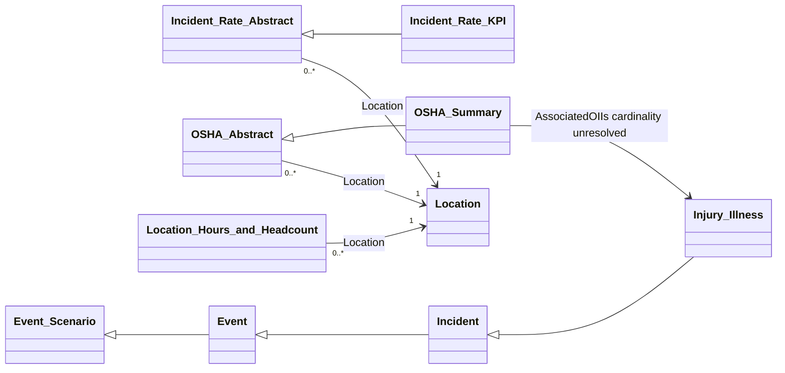
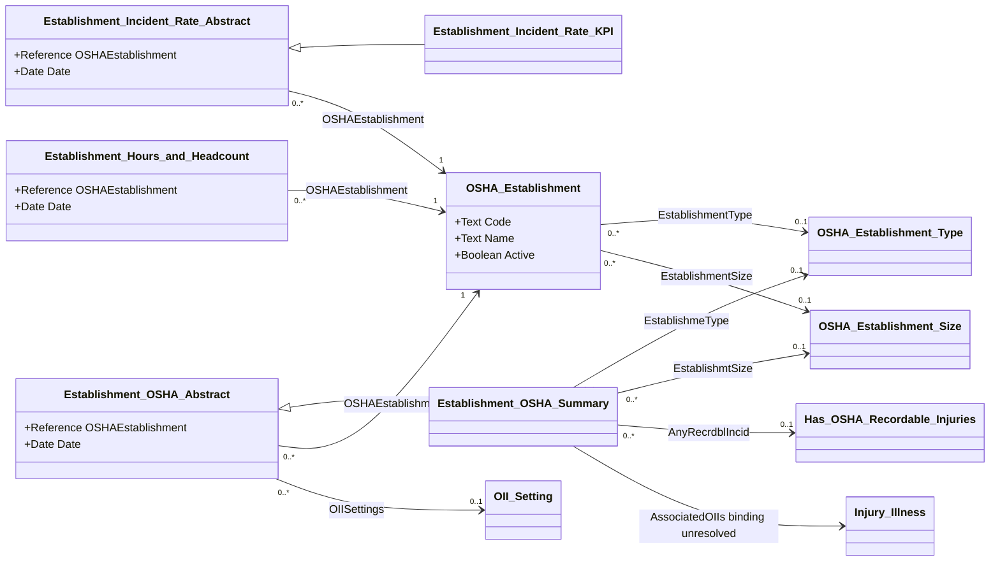

# OSHA Establishment analytics technical specification

Status: proposed target design for review. Date: November 12, 2026. No tenant configuration has been changed. This specification is the proposed authority for the OSHA Establishment master and its parallel analytics objects. It does not supersede repository ADRs or existing employee, asset, incident, or security contracts.

Create a separate OSHA Establishment master and five parallel analytics objects. Retain the original location-based objects. Each new period record belongs directly to one OSHA Establishment, without a relationship to Location Structure for calculation or regulatory attribution. All 89 exported analytics field declarations have a target counterpart, including location references exported as dependencies rather than ObjectProperties. Two abstract bases are recreated so the new family does not inherit location binding from the existing bases.

The package does not contain the metric-population implementation or the report templates. Field coverage is complete against this extract; calculation and report parity remain conditional on verifying those dependencies. Incident-to-establishment linkage is an integration prerequisite only: this specification intentionally does not design incident fields, defaulting, handlers, or workflow.

## 1 Requirements and design boundaries

| Requirement | Contract |
|---|---|
| R1 | Preserve all existing location-driven objects and behavior; add a parallel family. |
| R2 | Supply a counterpart for every exported analytics field, input, target, aggregate, helper, and reporting attribute. |
| R3 | Scope new analytics and log selection by OSHA Establishment, independent of Location Structure. |
| R4 | Define inferred master fields needed to supply the existing annual report metadata. |
| R5 | Account for incident attribution and correction dependencies without specifying the incident-side design. |
| R6 | Preserve output capabilities: OSHA and Cal/OSHA 300/300A, combined variants, electronic-submission path, and case-level 301 navigation. |

Extracted means directly present in the package. Inferred means the role follows from fields or view content but implementation is absent. Proposed means a target design choice. Unresolved means evidence is insufficient. Target object names and all new identifiers are proposed; native object/field GUIDs are to be assigned during configuration. No physical database design is implied by exported TableName values.

Proposed interpretation: establishments form a flat governed master. No establishment hierarchy, organizational-location mapping, or employee/home-location fallback is introduced. Preserve both Lo and Ru metric families for compatibility; in this flat scope each corresponding pair aggregates the same establishment population and therefore matches. This is a deliberate adaptation of hierarchy roll-up behavior. Do not sum both families together. Cross-establishment totals are reporting aggregations and must not enlarge any establishment's OSHA log. A future establishment hierarchy would be a new requirement.

The sole reference-field replacement is Location → OSHA Establishment. Internal Lo/Ru metric names and existing helper/metadata internal names remain as mapped for compatibility, but all source values and captions use establishment context. A retained internal name beginning Location is not a location reference. Helper captions receive the [Helper] prefix. This is a naming adaptation only; the counterpart remains traceable.

## 2 Package inspection and baseline

The supplied .ipack is UTF-8 JSON with a byte-order mark, not a ZIP archive. It was parsed directly without modifying the source. Package: [SummitEHSQ] Safety KPI Objects Extract, version 1.0.0.0, ID `1677184a-19e1-4e9a-8efd-2f1db8d65042`. Source owner: TerraGenTest; platform 6.6.29.0; exported 2026-11-12T17:13:03.4268393Z. SHA-256: `e9ee1a3f78189c356b522b04d0f08d7cf45b81ab994e27979cd1e52b3446889d`.

The graph contains 152 items, 388 relations, 126 included items, and 26 dependencies. It includes 12 Object items, 3 Lookup Object items, 91 fields (89 on the analytics family and 2 on Location), 7 simple types, 10 views, 10 view profiles, 6 validations, 7 links, 1 Action Handler, and 5 application records. Object ownership, type, inheritance and view bindings were resolved through GraphData.Relations, not inferred from names. Package graph IsMandatory describes export dependency, not business requiredness; field IsRequired supplies the latter.

[Package evidence](package-evidence.json) preserves exact exported field metadata, default-generator XML, validators, views, profiles, links, and resolved graph endpoints. The graphId in that file identifies the source item's $id, and recordId is the stable configuration identifier. [Target model](target-model.json) records every source-to-target field mapping and canonical contract row.

### 2.1 Baseline object inventory

Counts are directly declared fields present in this extract, not proof of a complete external object's schema. None in exported graph means no exported SuperType edge; it does not establish the full platform system inheritance chain. External dependency objects are not cloned.

| Display name | Internal name | Stable ID | Inheritance parent | Exported fields | Flags |
|---|---|---|---|---:|---|
| OSHA Abstract | `SafetyMetrics_OSHAAbstractObject` | `c6059869-bf10-47f0-b0a7-5d31536a49a4` | None in exported graph | 35 | Abstract; location-bound flag true |
| Incident Rate KPI | `SafetyMetrics_IncidentRateKPIObject` | `ec05b841-5259-4905-bbe1-57a302189d32` | SafetyMetrics_IncRateAbstractObject | 4 | Concrete; location-bound flag false |
| Incident Rate Abstract | `SafetyMetrics_IncRateAbstractObject` | `1c5170ba-c22c-4b43-9471-b3f4e32dd736` | None in exported graph | 25 | Abstract; location-bound flag true |
| Incident | `EHSIncidentMang_IncidentObject` | `fd73e13c-2359-43e8-b6ea-8b79743a5aff` | EventFwk_EventObject | 0 | Abstract; location-bound flag false |
| Event | `EventFwk_EventObject` | `3979d543-6df2-46a1-a26e-293cd7978bdc` | EventFwk_EventScenarioObject | 0 | Concrete; location-bound flag false |
| Location | `SysLocationEntity` | `f5d5209b-0a7d-4858-a302-678fcc065dd2` | None in exported graph | 2 | Concrete; location-bound flag false |
| OSHA Summary | `SafetyMetrics_OSHASummaryObject` | `420f7f71-a61f-45ab-a9b6-9b64c7a3a1e9` | SafetyMetrics_OSHAAbstractObject | 17 | Concrete; location-bound flag false |
| Injury/Illness | `EHSIncidentMang_OIIObject` | `bbc02abb-6a22-4d72-9e8c-cb7cb26a596a` | EHSIncidentMang_IncidentObject | 0 | Concrete; location-bound flag false |
| Location Hours and Headcount | `SafetyMetrics_HrsandHeadcountObject` | `0f0ecb2a-5f62-4faf-9609-b98873007c83` | None in exported graph | 8 | Concrete; location-bound flag true |
| OSHA Establishment Type | `EHSIncidentMang_EstablishmeTypeObject` | `bfd31eec-2b15-46e6-bf3e-1583e382745c` | None in exported graph | 0 | Concrete; location-bound flag false |
| Setting Abstract | `FragApplication_SettingAbsObject` | `e838a178-5e15-47f6-81fc-dbae30b9b603` | None in exported graph | 0 | Abstract; location-bound flag false |
| Event Scenario | `EventFwk_EventScenarioObject` | `c0d0d372-c03c-46cd-9f51-cdd28b620177` | None in exported graph | 0 | Concrete; location-bound flag true |
| OSHA Establishment Size | `EHSIncidentMang_EstablishmeSizeObject` | `bcb89cad-109b-47cf-a3b2-3bb8ac766f7a` | None in exported graph | 0 | Concrete; location-bound flag false |
| OII Setting | `EHSIncidentMang_OIISettingObject` | `bf46dd3b-cefa-48e8-865a-add097587ba4` | FragApplication_SettingAbsObject | 0 | Concrete; location-bound flag false |
| Has OSHA Recordable Injuries | `EHSIncidentMang_HasRecordaInjurObject` | `d61d4b82-b2f4-43d0-acc4-af4f6484cbd3` | None in exported graph | 0 | Concrete; location-bound flag false |

### 2.2 Baseline structure

Diagram identifiers replace spaces and punctuation in the display names. Location relationships are required single references (IsStartOfRelation=TRUE, target Type=SysLocationEntity). AssociatedOIIs has IsStartOfRelation=FALSE but the opposing property and relation metadata are not exported; do not assert a verified 1:M inverse or M:N mapping. The OSHA log grid traverses AssociatedOIIs.OSHARecord and filters InjuryIllnes.OSHARecordable=TRUE. Those incident fields and OSHARecord schema are view references, not exported field definitions.

### 2.3 Baseline findings affecting parity

1. All 91 field Calculation values are null. The readonly metrics are stored fields, commonly initialized to zero. No aggregation service or rate calculation is exported. Do not present a default of zero as proof of completed calculation.
2. Incident Rate KPI declares four target fields only. TargetDART is displayed as Target DAIR. Preserve that exact internal-name/display-label pairing; do not reinterpret it as a DART rate. Actual rate expressions, normalizer, denominator policy, rounding and reporting grain must be recovered from runtime/report configuration.
3. The sole exported Action Handler, Set Location Name Helper (graphId 247), belongs to Location Hours and Headcount. It sets LocNameHelper from Location.Name when AND(ISCHANGED(Location), NOT(Location.Deleted)); ActionType=3. The numeric event code is not decoded here. No equivalent population handler for the other readonly helper fields is exported.
4. Six validations enforce unique Location + Date and first-of-month/first-of-year dates on the three base/input objects. These are copied to new validators with OSHAEstablishment replacing Location.
5. Every print link hard-codes the source summary object ID 420f7f71-a61f-45ab-a9b6-9b64c7a3a1e9. Four call DownloadOSHAReport and two use MailMerge/MergeTemplate. Esub points to a dashboard whose definition is absent. Swapping objectId alone does not prove the native endpoint accepts the new object.
6. Configurable view profiles conflict with their view content. For example graphId 92 references DisplayField, Month, RepLocationId and numerous fields absent from the KPI object and its exported base. New views/profiles must be rebuilt from the canonical field contract rather than blindly copied. Other view paths, including OSHARecord, require external-schema validation.
7. The Combined Cal/OSHA 300 link sends oshaType=OSHA, the same as the non-combined link, despite its label. Verify actual source behavior before defining a corrected target parameter; do not silently copy or fix it.
8. Destination OII Settings, template IDs, dashboard and lookup values are not included as records. A source-GUID default cannot be assumed to resolve in another environment.

## 3 Proposed object model

All six objects use new configuration identities. Set IsLocationBound=FALSE on the new master, abstract bases and concrete objects; do not inherit from either source abstract base. Preserve the original family, applications and system Location metadata. Enable native audit for mutable master/input/target/report-metadata values. Do not introduce a new workflow, custom audit object, or security hierarchy. Use existing access controls with the privacy constraints described in section 8.

| Source object | Target object and proposed internal name | Inheritance parent | Direct fields |
|---|---|---|---:|
| New independent master | OSHA Establishment / TG_OSHAEstablishmentObject | None | 19 |
| `SafetyMetrics_IncRateAbstractObject` | Establishment Incident Rate Abstract / `TG_EstIncRateAbstractObject` | None | 25 |
| `SafetyMetrics_IncidentRateKPIObject` | Establishment Incident Rate KPI / `TG_EstIncidentRateKPIObject` | TG_EstIncRateAbstractObject | 4 |
| `SafetyMetrics_OSHAAbstractObject` | Establishment OSHA Abstract / `TG_EstOSHAAbstractObject` | None | 35 |
| `SafetyMetrics_OSHASummaryObject` | Establishment OSHA Summary / `TG_EstOSHASummaryObject` | TG_EstOSHAAbstractObject | 17 |
| `SafetyMetrics_HrsandHeadcountObject` | Establishment Hours and Headcount / `TG_EstHrsHeadcountObject` | None | 8 |

The last five classes are unchanged external dependencies, not new objects. Incident-to-establishment linkage is deliberately omitted from the diagram pending the separate incident design. Target cardinalities are proposed constraints; external collection cardinality remains unresolved. Establishment master inverse grids are navigation over the three declaring references, never additional stored relationships. No inverse is enabled on shared catalogue references.

## 4 Field level implementation contract

The following tables are canonical. One row defines one directly declared field or designed inverse grid. Internal names retained from the source are shown in each object's mapping table; master names are mapped likewise. Inherited fields are declared once on the new base and not duplicated on its concrete child. Default, readonly, numeric type and field availability follow the package except the explicitly proposed establishment scoping, lifecycle and snapshots below. Audit, generation and refresh procedures are proposed and are defined in section 6.

For cloned Text fields, maximum length is null in both field/type metadata; do not interpret null as unlimited capacity. Confirm tenant storage capacity before loading long values. Proposed master limits must fit the corresponding summary fields. Float remains System.Double rather than introducing decimal rounding. All exported Date fields have TimeZoneCapture=FALSE; use calendar periods and validate business dates before generation.

### 4.1 OSHA Establishment

**Inheritance parent:** None. Independent governed master, not a Location subtype or lookup catalogue. Its business identity is Code plus native record GUID; reporting IDs are separate.

| Field | Type / relationship | Req | Default / calculation | Editability and visibility | Automation / lifecycle |
|---|---|---:|---|---|---|
| Code | Text, max 100 | Y | None; unique, non-localizable | Establishment administrator editable before first use | Stable integration key after first use; native audit |
| Name | Text, max 255; legal reporting label, non-localizable | Y | None | Establishment administrator editable | Display field; does not rewrite existing annual snapshots |
| Active? | Yes/No | Y | TRUE | Establishment administrator editable | FALSE prevents new ordinary selections and routine period generation; retains history and authorized historical corrections |
| Company Name | Text, max 255 | Conditional | None | Administrator editable; required for report generation | Copied to annual CompanyName at initial generation; later changes do not cascade |
| Street | Text, max 255 | Conditional | None | Administrator editable; required for report generation | Copied to annual LocationStreet at initial generation |
| City | Text, max 100 | Conditional | None | Administrator editable; required for report generation | Copied to annual LocationCity at initial generation |
| State | Text, max 100 | Conditional | None | Administrator editable; required for report generation | Copied to annual LocationState at initial generation |
| Postal Code | Text, max 30 | Conditional | None | Administrator editable; required for report generation | Copied to annual LocationPostal at initial generation |
| EIN Number | Text, max 30 | N | None | Administrator editable | Copied to annual EINNumber at initial generation; submission validation is output-specific |
| NAICS Code | Number / bigint, System.Int64 | N | None | Administrator editable | Copied to annual NAICSCode at initial generation; retain original numeric representation for parity |
| SIC Code | Number / bigint, System.Int64 | N | None | Administrator editable | Copied to annual SICCode at initial generation |
| Industry Description | Text, max 1000 | N | None | Administrator editable | Copied to annual InduDescription at initial generation |
| Establishment Type | M:1 to EHSIncidentMang_EstablishmeTypeObject, 0..1 target; inverse disabled | N | None | Administrator editable; preserve referenced values; available-value filter unresolved because catalogue fields are not exported | Reuses existing catalogue; copied to annual EstablishmeType; no new values seeded |
| Establishment Size | M:1 to EHSIncidentMang_EstablishmeSizeObject, 0..1 target; inverse disabled | N | None | Administrator editable; preserve referenced values; available-value filter unresolved because catalogue fields are not exported | Reuses existing catalogue; copied to annual EstablishmtSize; do not invent size thresholds |
| Establishment ID | Text, max 100 | N | None | Administrator editable | External reporting identifier; distinct from Code and native record GUID; copied to annual EstablishmentID |
| OSHA 300a ID | Text, max 100 | N | None | Administrator editable | External reporting identifier; copied to annual OSHA300aID; format and annual applicability require output validation |
| Hours and Headcounts | Inverse 1:M grid from Establishment Hours and Headcount.OSHA Establishment | N | None | Read only; authorized analytics users | Navigation over the declaring relationship; no duplicate storage |
| Incident Rate KPIs | Inverse 1:M grid from Establishment Incident Rate KPI.OSHA Establishment (inherited) | N | None | Read only; authorized analytics users | Navigation over the declaring relationship; no duplicate storage; concrete records only |
| OSHA Summaries | Inverse 1:M grid from Establishment OSHA Summary.OSHA Establishment (inherited) | N | None | Read only; authorized regulatory users | Navigation over the declaring relationship; no duplicate storage; concrete records only |

| Display name | Proposed internal name |
|---|---|
| Code | `Code` |
| Name | `Name` |
| Active? | `Active` |
| Company Name | `CompanyName` |
| Street | `Street` |
| City | `City` |
| State | `State` |
| Postal Code | `PostalCode` |
| EIN Number | `EINNumber` |
| NAICS Code | `NAICSCode` |
| SIC Code | `SICCode` |
| Industry Description | `IndustryDescription` |
| Establishment Type | `EstablishmentType` |
| Establishment Size | `EstablishmentSize` |
| Establishment ID | `EstablishmentID` |
| OSHA 300a ID | `OSHA300aID` |
| Hours and Headcounts | `HoursHeadcounts` |
| Incident Rate KPIs | `IncidentRateKPIs` |
| OSHA Summaries | `OSHASummaries` |

Initial values: No establishment records are inferred or seeded. TerraGen supplies its governed establishment register. Address, Company Name and Name completeness is checked when requesting report generation, not as a reason to create location nodes. Other report/submission-specific mandatory fields must follow verified destination templates and schema; the package does not establish those rules.

### 4.2 Establishment Incident Rate Abstract

**Inheritance parent:** None. Abstract and non-instantiable.

**Directly declared fields:** 25. 

| Field | Type / relationship | Req | Default / calculation | Editability and visibility | Automation / lifecycle |
|---|---|---:|---|---|---|
| Record No | AutoNumber, System.Int64 | Y | None in metadata; native AutoNumber population required | Read only; analytics users may view | Native AutoNumber; new target sequence, never reuse source identity |
| Date | Date; calendar date, timezone capture disabled | Y | None; A2 supplies month start or A3 supplies January 1 | Read only; analytics users may view | A2 sets first day of month; unique OSHAEstablishment + Date |
| OSHA Establishment | M:1 to OSHA Establishment; exactly 1 target per record; inverse Incident Rate KPIs | Y | None; mandatory generation/import scope | Read only on generated period forms; A2/A3 supplies scope; historical inactive references retained | A2/A3 supplies reference at creation; no ordinary user reassignment of generated periods |
| Number of Days Away - Rollup | Number / bigint, System.Int64 | N | 0 | Read only; analytics users may view | A2 writes stored aggregate; Lo/Ru pair uses the identical flat establishment scope; calculation source unresolved |
| Number of Recordable/Reportable - Rollup | Number / bigint, System.Int64 | N | 0 | Read only; analytics users may view | A2 writes stored aggregate; Lo/Ru pair uses the identical flat establishment scope; calculation source unresolved |
| Number of Fatalities - Establishment | Number / bigint, System.Int64 | N | 0 | Read only; analytics users may view | A2 writes stored aggregate; Lo/Ru pair uses the identical flat establishment scope; calculation source unresolved |
| Number of Incidents - Rollup | Number / bigint, System.Int64 | N | 0 | Read only; analytics users may view | A2 writes stored aggregate; Lo/Ru pair uses the identical flat establishment scope; calculation source unresolved |
| [Helper] Establishment Name | Text / nvarchar; length not constrained in export | N | None; populated from OSHA Establishment.Name | Read only; analytics users may view | A2 stamps at generation; preserves display for inactive establishments; explicit administrator correction only |
| Number of Lost Days - Rollup | Number / bigint, System.Int64 | N | 0 | Read only; analytics users may view | A2 writes stored aggregate; Lo/Ru pair uses the identical flat establishment scope; calculation source unresolved |
| Contractor Worked Hours - Establishment | Float, System.Double; precision/scale not constrained in export | N | 0 | Read only; analytics users may view | A2 writes stored aggregate; Lo/Ru pair uses the identical flat establishment scope; calculation source unresolved |
| [Helper] Establishment ID | GUID | Y | None; native GUID of OSHA Establishment reference | Read only; hidden on ordinary form | A2/A3 stamps at creation; hidden helper, never uses SysLocationEntity GUID |
| Number of Incidents - Establishment | Number / bigint, System.Int64 | N | 0 | Read only; analytics users may view | A2 writes stored aggregate; Lo/Ru pair uses the identical flat establishment scope; calculation source unresolved |
| Number of Incidents with Days Away - Rollup | Number / bigint, System.Int64 | N | 0 | Read only; analytics users may view | A2 writes stored aggregate; Lo/Ru pair uses the identical flat establishment scope; calculation source unresolved |
| Number of Lost Days - Establishment | Number / bigint, System.Int64 | N | 0 | Read only; analytics users may view | A2 writes stored aggregate; Lo/Ru pair uses the identical flat establishment scope; calculation source unresolved |
| Number of Incidents with Days Away - Establishment | Number / bigint, System.Int64 | N | 0 | Read only; analytics users may view | A2 writes stored aggregate; Lo/Ru pair uses the identical flat establishment scope; calculation source unresolved |
| Contractor Worked Hours - Rollup | Float, System.Double; precision/scale not constrained in export | N | 0 | Read only; analytics users may view | A2 writes stored aggregate; Lo/Ru pair uses the identical flat establishment scope; calculation source unresolved |
| Number of Incidents with Lost Time - Rollup | Number / bigint, System.Int64 | N | 0 | Read only; analytics users may view | A2 writes stored aggregate; Lo/Ru pair uses the identical flat establishment scope; calculation source unresolved |
| Employee Worked Hours - Rollup | Float, System.Double; precision/scale not constrained in export | N | 0 | Read only; analytics users may view | A2 writes stored aggregate; Lo/Ru pair uses the identical flat establishment scope; calculation source unresolved |
| Number of Incidents with Lost Time - Establishment | Number / bigint, System.Int64 | N | 0 | Read only; analytics users may view | A2 writes stored aggregate; Lo/Ru pair uses the identical flat establishment scope; calculation source unresolved |
| Number of Job Transfer and Restricted Days - Rollup | Number / bigint, System.Int64 | N | 0 | Read only; analytics users may view | A2 writes stored aggregate; Lo/Ru pair uses the identical flat establishment scope; calculation source unresolved |
| Number of Job Transfer and Restricted Days - Establishment | Number / bigint, System.Int64 | N | 0 | Read only; analytics users may view | A2 writes stored aggregate; Lo/Ru pair uses the identical flat establishment scope; calculation source unresolved |
| Number of Days Away - Establishment | Number / bigint, System.Int64 | N | 0 | Read only; analytics users may view | A2 writes stored aggregate; Lo/Ru pair uses the identical flat establishment scope; calculation source unresolved |
| Number of Recordable/Reportable - Establishment | Number / bigint, System.Int64 | N | 0 | Read only; analytics users may view | A2 writes stored aggregate; Lo/Ru pair uses the identical flat establishment scope; calculation source unresolved |
| Employee Worked Hours - Establishment | Float, System.Double; precision/scale not constrained in export | N | 0 | Read only; analytics users may view | A2 writes stored aggregate; Lo/Ru pair uses the identical flat establishment scope; calculation source unresolved |
| Number of Fatalities - Rollup | Number / bigint, System.Int64 | N | 0 | Read only; analytics users may view | A2 writes stored aggregate; Lo/Ru pair uses the identical flat establishment scope; calculation source unresolved |

Source mapping (each source GUID remains in target-model.json; IDs below address package-evidence.json):

| Source field / graphId | Target internal name | Target display name |
|---|---|---|
| `RecordNo` / 50 | `RecordNo` | Record No |
| `Date` / 56 | `Date` | Date |
| `Location` / 58 | `OSHAEstablishment` | OSHA Establishment |
| `RuNumDaysAway` / 78 | `RuNumDaysAway` | Number of Days Away - Rollup |
| `RuCtRecordable` / 94 | `RuCtRecordable` | Number of Recordable/Reportable - Rollup |
| `LoNumFatalities` / 96 | `LoNumFatalities` | Number of Fatalities - Establishment |
| `RuCtIncidents` / 133 | `RuCtIncidents` | Number of Incidents - Rollup |
| `LocNameHelper` / 159 | `LocNameHelper` | [Helper] Establishment Name |
| `RuNumLostDays` / 193 | `RuNumLostDays` | Number of Lost Days - Rollup |
| `LoCntrctWrkdHrs` / 197 | `LoCntrctWrkdHrs` | Contractor Worked Hours - Establishment |
| `LocationIdHelp` / 199 | `LocationIdHelp` | [Helper] Establishment ID |
| `LoCtIncidents` / 212 | `LoCtIncidents` | Number of Incidents - Establishment |
| `RuNumIncDayAway` / 259 | `RuNumIncDayAway` | Number of Incidents with Days Away - Rollup |
| `LoNumLostDays` / 267 | `LoNumLostDays` | Number of Lost Days - Establishment |
| `LoNumIncDayAway` / 275 | `LoNumIncDayAway` | Number of Incidents with Days Away - Establishment |
| `RuCntrctWrkdHrs` / 320 | `RuCntrctWrkdHrs` | Contractor Worked Hours - Rollup |
| `RuNumIncLostTim` / 331 | `RuNumIncLostTim` | Number of Incidents with Lost Time - Rollup |
| `RuEmplWrkdHours` / 333 | `RuEmplWrkdHours` | Employee Worked Hours - Rollup |
| `LoNumIncLostTim` / 356 | `LoNumIncLostTim` | Number of Incidents with Lost Time - Establishment |
| `RuNumTrnsfRstDy` / 358 | `RuNumTrnsfRstDy` | Number of Job Transfer and Restricted Days - Rollup |
| `LoNumTrnsfRstDy` / 360 | `LoNumTrnsfRstDy` | Number of Job Transfer and Restricted Days - Establishment |
| `LoNumDaysAway` / 364 | `LoNumDaysAway` | Number of Days Away - Establishment |
| `LoCtRecordable` / 368 | `LoCtRecordable` | Number of Recordable/Reportable - Establishment |
| `LoEmplWrkdHours` / 370 | `LoEmplWrkdHours` | Employee Worked Hours - Establishment |
| `RuNumFatalities` / 372 | `RuNumFatalities` | Number of Fatalities - Rollup |

Initial values: No operational records seeded. No records can be created directly.

### 4.3 Establishment Incident Rate KPI

**Inheritance parent:** TG_EstIncRateAbstractObject. Concrete object.

**Directly declared fields:** 4. All base fields are inherited from Establishment Incident Rate Abstract; their contracts apply without redeclaration. 

| Field | Type / relationship | Req | Default / calculation | Editability and visibility | Automation / lifecycle |
|---|---|---:|---|---|---|
| Target LTIR | Float, System.Double; precision/scale not constrained in export | N | None | Authorized analytics administrator editable | Manual target, preserved by A2; not an actual calculated rate |
| Target Severity Rate | Float, System.Double; precision/scale not constrained in export | N | None | Authorized analytics administrator editable | Manual target, preserved by A2; not an actual calculated rate |
| Target DAIR | Float, System.Double; precision/scale not constrained in export | N | None | Authorized analytics administrator editable | Manual target, preserved by A2; not an actual calculated rate |
| Target TRIR | Float, System.Double; precision/scale not constrained in export | N | None | Authorized analytics administrator editable | Manual target, preserved by A2; not an actual calculated rate |

Source mapping (each source GUID remains in target-model.json; IDs below address package-evidence.json):

| Source field / graphId | Target internal name | Target display name |
|---|---|---|
| `TargetLTIR` / 21 | `TargetLTIR` | Target LTIR |
| `TargetSeverRate` / 34 | `TargetSeverRate` | Target Severity Rate |
| `TargetDART` / 38 | `TargetDART` | Target DAIR |
| `TargetTRIR` / 42 | `TargetTRIR` | Target TRIR |

Initial values: No operational records seeded. Create records only under the lifecycle rules in section 6.

### 4.4 Establishment OSHA Abstract

**Inheritance parent:** None. Abstract and non-instantiable.

**Directly declared fields:** 35. 

| Field | Type / relationship | Req | Default / calculation | Editability and visibility | Automation / lifecycle |
|---|---|---:|---|---|---|
| Total number of job transfer or restriction days (L) - roll up | Number / bigint, System.Int64 | N | 0 | Read only; analytics users may view | A3 writes stored aggregate; Lo/Ru pair uses the identical flat establishment scope; calculation source unresolved |
| Total number of days away from work (K) - roll up | Number / bigint, System.Int64 | N | 0 | Read only; analytics users may view | A3 writes stored aggregate; Lo/Ru pair uses the identical flat establishment scope; calculation source unresolved |
| Injuries (M1) - roll up | Number / bigint, System.Int64 | N | 0 | Read only; analytics users may view | A3 writes stored aggregate; Lo/Ru pair uses the identical flat establishment scope; calculation source unresolved |
| Respiratory Conditions (M3) - establishment | Number / bigint, System.Int64 | N | 0 | Read only; analytics users may view | A3 writes stored aggregate; Lo/Ru pair uses the identical flat establishment scope; calculation source unresolved |
| OSHA Establishment | M:1 to OSHA Establishment; exactly 1 target per record; inverse OSHA Summaries | Y | None; mandatory generation/import scope | Read only on generated period forms; A2/A3 supplies scope; historical inactive references retained | A2/A3 supplies reference at creation; no ordinary user reassignment of generated periods |
| Other Recordable Cases (J) - roll up | Number / bigint, System.Int64 | N | 0 | Read only; analytics users may view | A3 writes stored aggregate; Lo/Ru pair uses the identical flat establishment scope; calculation source unresolved |
| All other illnesses (M6) - establishment | Number / bigint, System.Int64 | N | 0 | Read only; analytics users may view | A3 writes stored aggregate; Lo/Ru pair uses the identical flat establishment scope; calculation source unresolved |
| Other Recordable Cases (J) - establishment | Number / bigint, System.Int64 | N | 0 | Read only; analytics users may view | A3 writes stored aggregate; Lo/Ru pair uses the identical flat establishment scope; calculation source unresolved |
| Job Transfer or Restricted Days Cases (I) - roll up | Number / bigint, System.Int64 | N | 0 | Read only; analytics users may view | A3 writes stored aggregate; Lo/Ru pair uses the identical flat establishment scope; calculation source unresolved |
| Establishment Street | Text / nvarchar; length not constrained in export | N | At initial annual generation: OSHA Establishment.Street | Read only; analytics users may view | A3 copies stored snapshot at creation; later master edits do not cascade; authorized explicit metadata correction through A3 with native audit |
| Date | Date; calendar date, timezone capture disabled | Y | None; A2 supplies month start or A3 supplies January 1 | Read only; analytics users may view | A3 sets January 1; unique OSHAEstablishment + Date |
| Poisonings (M4) - establishment | Number / bigint, System.Int64 | N | 0 | Read only; analytics users may view | A3 writes stored aggregate; Lo/Ru pair uses the identical flat establishment scope; calculation source unresolved |
| Hearing loss (M5) - establishment | Number / bigint, System.Int64 | N | 0 | Read only; analytics users may view | A3 writes stored aggregate; Lo/Ru pair uses the identical flat establishment scope; calculation source unresolved |
| Skin Disorders (M2) - roll up | Number / bigint, System.Int64 | N | 0 | Read only; analytics users may view | A3 writes stored aggregate; Lo/Ru pair uses the identical flat establishment scope; calculation source unresolved |
| Respiratory Conditions (M3) - roll up | Number / bigint, System.Int64 | N | 0 | Read only; analytics users may view | A3 writes stored aggregate; Lo/Ru pair uses the identical flat establishment scope; calculation source unresolved |
| Death (G) - establishment | Number / bigint, System.Int64 | N | 0 | Read only; analytics users may view | A3 writes stored aggregate; Lo/Ru pair uses the identical flat establishment scope; calculation source unresolved |
| Job Transfer or Restricted Days Cases (I) - establishment | Number / bigint, System.Int64 | N | 0 | Read only; analytics users may view | A3 writes stored aggregate; Lo/Ru pair uses the identical flat establishment scope; calculation source unresolved |
| Injuries (M1) - establishment | Number / bigint, System.Int64 | N | 0 | Read only; analytics users may view | A3 writes stored aggregate; Lo/Ru pair uses the identical flat establishment scope; calculation source unresolved |
| Establishment City | Text / nvarchar; length not constrained in export | N | At initial annual generation: OSHA Establishment.City | Read only; analytics users may view | A3 copies stored snapshot at creation; later master edits do not cascade; authorized explicit metadata correction through A3 with native audit |
| Establishment Postal Code | Text / nvarchar; length not constrained in export | N | At initial annual generation: OSHA Establishment.Postal Code | Read only; analytics users may view | A3 copies stored snapshot at creation; later master edits do not cascade; authorized explicit metadata correction through A3 with native audit |
| Death (G) - roll up | Number / bigint, System.Int64 | N | 0 | Read only; analytics users may view | A3 writes stored aggregate; Lo/Ru pair uses the identical flat establishment scope; calculation source unresolved |
| Days Away From Work Cases (H) - roll up | Number / bigint, System.Int64 | N | 0 | Read only; analytics users may view | A3 writes stored aggregate; Lo/Ru pair uses the identical flat establishment scope; calculation source unresolved |
| Establishment State | Text / nvarchar; length not constrained in export | N | At initial annual generation: OSHA Establishment.State | Read only; analytics users may view | A3 copies stored snapshot at creation; later master edits do not cascade; authorized explicit metadata correction through A3 with native audit |
| Record No | AutoNumber, System.Int64 | Y | None in metadata; native AutoNumber population required | Read only; analytics users may view | Native AutoNumber; new target sequence, never reuse source identity |
| Days Away From Work Cases (H) - establishment | Number / bigint, System.Int64 | N | 0 | Read only; analytics users may view | A3 writes stored aggregate; Lo/Ru pair uses the identical flat establishment scope; calculation source unresolved |
| [Helper] Establishment ID | GUID | Y | None; native GUID of OSHA Establishment reference | Read only; hidden on ordinary form | A2/A3 stamps at creation; hidden helper, never uses SysLocationEntity GUID |
| Year | Number / bigint, System.Int64 | N | Calendar year of Date, declarative; executable expression unresolved | Read only; analytics users may view | A3 stores year during annual generation; read only |
| All other illnesses (M6) - roll up | Number / bigint, System.Int64 | N | 0 | Read only; analytics users may view | A3 writes stored aggregate; Lo/Ru pair uses the identical flat establishment scope; calculation source unresolved |
| Establishment Display Name | Text / nvarchar; length not constrained in export | N | At initial annual generation: OSHA Establishment.Name | Read only; analytics users may view | A3 copies stored snapshot at creation; later master edits do not cascade; authorized explicit metadata correction through A3 with native audit |
| OII Settings | M:1 to EHSIncidentMang_OIISettingObject; 0..1 target; inverse disabled | N | Export default points to b2102af3-2dbe-4bc2-9395-cd1202ae0192; resolve equivalent OII Setting in destination | Read only; hidden on ordinary summary form | A3 binds destination settings before report availability; never assume source GUID is portable |
| Total number of days away from work (K) - establishment | Number / bigint, System.Int64 | N | 0 | Read only; analytics users may view | A3 writes stored aggregate; Lo/Ru pair uses the identical flat establishment scope; calculation source unresolved |
| Hearing loss (M5) - roll up | Number / bigint, System.Int64 | N | 0 | Read only; analytics users may view | A3 writes stored aggregate; Lo/Ru pair uses the identical flat establishment scope; calculation source unresolved |
| Skin Disorders (M2) - establishment | Number / bigint, System.Int64 | N | 0 | Read only; analytics users may view | A3 writes stored aggregate; Lo/Ru pair uses the identical flat establishment scope; calculation source unresolved |
| Poisonings (M4) - roll up | Number / bigint, System.Int64 | N | 0 | Read only; analytics users may view | A3 writes stored aggregate; Lo/Ru pair uses the identical flat establishment scope; calculation source unresolved |
| Total number of job transfer or restriction days (L) - establishment | Number / bigint, System.Int64 | N | 0 | Read only; analytics users may view | A3 writes stored aggregate; Lo/Ru pair uses the identical flat establishment scope; calculation source unresolved |

Source mapping (each source GUID remains in target-model.json; IDs below address package-evidence.json):

| Source field / graphId | Target internal name | Target display name |
|---|---|---|
| `RuNumRstOrJobTr` / 9 | `RuNumRstOrJobTr` | Total number of job transfer or restriction days (L) - roll up |
| `RuNumDaysAway` / 15 | `RuNumDaysAway` | Total number of days away from work (K) - roll up |
| `RuCtInjuries` / 131 | `RuCtInjuries` | Injuries (M1) - roll up |
| `LoCtRespiratorC` / 135 | `LoCtRespiratorC` | Respiratory Conditions (M3) - establishment |
| `Location` / 137 | `OSHAEstablishment` | OSHA Establishment |
| `RuCtOthrRecrdbl` / 145 | `RuCtOthrRecrdbl` | Other Recordable Cases (J) - roll up |
| `LoCtAllOtherIln` / 147 | `LoCtAllOtherIln` | All other illnesses (M6) - establishment |
| `LoCtOthrRecrdbl` / 153 | `LoCtOthrRecrdbl` | Other Recordable Cases (J) - establishment |
| `RuCtTrnfrOrRest` / 155 | `RuCtTrnfrOrRest` | Job Transfer or Restricted Days Cases (I) - roll up |
| `LocationStreet` / 161 | `LocationStreet` | Establishment Street |
| `Date` / 165 | `Date` | Date |
| `LoCtPoisonings` / 176 | `LoCtPoisonings` | Poisonings (M4) - establishment |
| `LoCtHearingLoss` / 191 | `LoCtHearingLoss` | Hearing loss (M5) - establishment |
| `RuCtSkinDisordr` / 195 | `RuCtSkinDisordr` | Skin Disorders (M2) - roll up |
| `RuCtRespiratorC` / 245 | `RuCtRespiratorC` | Respiratory Conditions (M3) - roll up |
| `LoCtFatalities` / 255 | `LoCtFatalities` | Death (G) - establishment |
| `LoCtTrnfrOrRest` / 261 | `LoCtTrnfrOrRest` | Job Transfer or Restricted Days Cases (I) - establishment |
| `LoCtInjuries` / 263 | `LoCtInjuries` | Injuries (M1) - establishment |
| `LocationCity` / 265 | `LocationCity` | Establishment City |
| `LocationPostal` / 273 | `LocationPostal` | Establishment Postal Code |
| `RuCtFatalities` / 277 | `RuCtFatalities` | Death (G) - roll up |
| `RuCtDaysAway` / 279 | `RuCtDaysAway` | Days Away From Work Cases (H) - roll up |
| `LocationState` / 281 | `LocationState` | Establishment State |
| `RecordNo` / 283 | `RecordNo` | Record No |
| `LoCtDaysAway` / 285 | `LoCtDaysAway` | Days Away From Work Cases (H) - establishment |
| `ReporLocationId` / 287 | `ReporLocationId` | [Helper] Establishment ID |
| `Year` / 289 | `Year` | Year |
| `RuCtAllOtherIln` / 291 | `RuCtAllOtherIln` | All other illnesses (M6) - roll up |
| `LocationName` / 293 | `LocationName` | Establishment Display Name |
| `OIISettings` / 297 | `OIISettings` | OII Settings |
| `LoNumDaysAway` / 300 | `LoNumDaysAway` | Total number of days away from work (K) - establishment |
| `RuCtHearingLoss` / 302 | `RuCtHearingLoss` | Hearing loss (M5) - roll up |
| `LoCtSkinDisordr` / 304 | `LoCtSkinDisordr` | Skin Disorders (M2) - establishment |
| `RuCtPoisonings` / 306 | `RuCtPoisonings` | Poisonings (M4) - roll up |
| `LoNumRstOrJobTr` / 308 | `LoNumRstOrJobTr` | Total number of job transfer or restriction days (L) - establishment |

Initial values: No operational records seeded. No records can be created directly.

### 4.5 Establishment OSHA Summary

**Inheritance parent:** TG_EstOSHAAbstractObject. Concrete object.

**Directly declared fields:** 17. All base fields are inherited from Establishment OSHA Abstract; their contracts apply without redeclaration. 

| Field | Type / relationship | Req | Default / calculation | Editability and visibility | Automation / lifecycle |
|---|---|---:|---|---|---|
| Total hours worked by all employees this year Establishment | Float, System.Double; precision/scale not constrained in export | N | None | Read only; analytics users may view | A3 writes stored aggregate; Lo/Ru pair uses the identical flat establishment scope; calculation source unresolved |
| Company Name | Text / nvarchar; length not constrained in export | N | At initial annual generation: OSHA Establishment.Company Name | Authorized analytics administrator editable | A3 copies stored snapshot at creation; later master edits do not cascade; authorized annual override retained on metric refresh |
| Annual average number of employees Establishment | Float, System.Double; precision/scale not constrained in export | N | None | Read only; analytics users may view | A3 writes stored aggregate; Lo/Ru pair uses the identical flat establishment scope; calculation source unresolved |
| EIN Number | Text / nvarchar; length not constrained in export | N | At initial annual generation: OSHA Establishment.EIN Number | Authorized analytics administrator editable | A3 copies stored snapshot at creation; later master edits do not cascade; authorized annual override retained on metric refresh |
| Annual average number of employees Rollup | Float, System.Double; precision/scale not constrained in export | N | None | Read only; analytics users may view | A3 writes stored aggregate; Lo/Ru pair uses the identical flat establishment scope; calculation source unresolved |
| Total hours worked by all employees this year Rollup | Float, System.Double; precision/scale not constrained in export | N | None | Read only; analytics users may view | A2 or A3 writes this stored metric; source calculation missing, parity verification required |
| Change Reason | Text / nvarchar; length not constrained in export | N | None | Authorized analytics administrator editable | Regulatory administrator maintains explanation for reporting correction; native audit; never overwritten by refresh |
| Establishment Type | M:1 to EHSIncidentMang_EstablishmeTypeObject; 0..1 target; inverse disabled | N | At initial annual generation: OSHA Establishment.Establishment Type | Regulatory administrator editable; preserve selected inactive/legacy values; active-selection filter unresolved in external catalogue export | A3 copies stored snapshot at creation; later master edits do not cascade; authorized annual override retained on metric refresh |
| Establishment Name | Text / nvarchar; length not constrained in export | N | At initial annual generation: OSHA Establishment.Name | Authorized analytics administrator editable | A3 copies stored snapshot at creation; later master edits do not cascade; authorized annual override retained on metric refresh |
| Establishment Size | M:1 to EHSIncidentMang_EstablishmeSizeObject; 0..1 target; inverse disabled | N | At initial annual generation: OSHA Establishment.Establishment Size | Regulatory administrator editable; preserve selected inactive/legacy values; active-selection filter unresolved in external catalogue export | A3 copies stored snapshot at creation; later master edits do not cascade; authorized annual override retained on metric refresh |
| SIC Code | Number / bigint, System.Int64 | N | At initial annual generation: OSHA Establishment.SIC Code | Read only; analytics users may view | A3 copies stored snapshot at creation; later master edits do not cascade; authorized explicit metadata correction through A3 with native audit |
| Associated OIIs | Related Injury/Illness collection; 0..* results, storage cardinality/inverse unresolved in export | N | None | Read only in target; authorized regulatory users; recordable-only log grid | A3 resolves same-establishment/year membership through incident attribution dependency; binding cannot be configured until declaring relationship is verified |
| NAICS Code | Number / bigint, System.Int64 | N | At initial annual generation: OSHA Establishment.NAICS Code | Read only; analytics users may view | A3 copies stored snapshot at creation; later master edits do not cascade; authorized explicit metadata correction through A3 with native audit |
| Any Recordable Incidents | M:1 to EHSIncidentMang_HasRecordaInjurObject; 0..1 target; inverse disabled | N | None | Regulatory administrator editable; preserve selected inactive/legacy values; active-selection filter unresolved in external catalogue export | Annual submission value; preserve manual edit on refresh and validate against totals before output; source enumeration not exported |
| OSHA 300a ID | Text / nvarchar; length not constrained in export | N | At initial annual generation: OSHA Establishment.OSHA 300a ID | Authorized analytics administrator editable | A3 copies stored snapshot at creation; later master edits do not cascade; authorized annual override retained on metric refresh |
| Establishment ID | Text / nvarchar; length not constrained in export | N | At initial annual generation: OSHA Establishment.Establishment ID | Authorized analytics administrator editable | A3 copies stored snapshot at creation; later master edits do not cascade; authorized annual override retained on metric refresh |
| Industry Description | Text / nvarchar; length not constrained in export | N | At initial annual generation: OSHA Establishment.Industry Description | Authorized analytics administrator editable | A3 copies stored snapshot at creation; later master edits do not cascade; authorized annual override retained on metric refresh |

Source mapping (each source GUID remains in target-model.json; IDs below address package-evidence.json):

| Source field / graphId | Target internal name | Target display name |
|---|---|---|
| `LoNumHrsWorked` / 70 | `LoNumHrsWorked` | Total hours worked by all employees this year Establishment |
| `CompanyName` / 86 | `CompanyName` | Company Name |
| `LoAvgNumEmploye` / 141 | `LoAvgNumEmploye` | Annual average number of employees Establishment |
| `EINNumber` / 167 | `EINNumber` | EIN Number |
| `RuAvgNumEmploye` / 216 | `RuAvgNumEmploye` | Annual average number of employees Rollup |
| `RUNumHrsWorked` / 218 | `RUNumHrsWorked` | Total hours worked by all employees this year Rollup |
| `ChangeReason` / 220 | `ChangeReason` | Change Reason |
| `EstablishmeType` / 238 | `EstablishmeType` | Establishment Type |
| `EstablishmeName` / 243 | `EstablishmeName` | Establishment Name |
| `EstablishmtSize` / 324 | `EstablishmtSize` | Establishment Size |
| `SICCode` / 335 | `SICCode` | SIC Code |
| `AssociatedOIIs` / 339 | `AssociatedOIIs` | Associated OIIs |
| `NAICSCode` / 343 | `NAICSCode` | NAICS Code |
| `AnyRecrdblIncid` / 345 | `AnyRecrdblIncid` | Any Recordable Incidents |
| `OSHA300aID` / 348 | `OSHA300aID` | OSHA 300a ID |
| `EstablishmentID` / 350 | `EstablishmentID` | Establishment ID |
| `InduDescription` / 352 | `InduDescription` | Industry Description |

Initial values: No operational records seeded. Create records only under the lifecycle rules in section 6.

### 4.6 Establishment Hours and Headcount

**Inheritance parent:** None. Concrete object.

**Directly declared fields:** 8. 

| Field | Type / relationship | Req | Default / calculation | Editability and visibility | Automation / lifecycle |
|---|---|---:|---|---|---|
| Date | Date; calendar date, timezone capture disabled | Y | Native MonthStartValueGenerator at creation | Authorized hours editor editable, matching the source input field | A1 validates DAY(Date)=1; unique OSHAEstablishment + Date; correction refreshes original and corrected periods |
| Contractor Headcount | Float, System.Double; precision/scale not constrained in export | N | 0 | Authorized hours editor editable; API/import uses same validation; no numeric range constraint exported | A1 save validates scope/date uniqueness; A2/A3 refresh affected month/year after commit; maintain employee/contractor separation |
| Employees Hours | Float, System.Double; precision/scale not constrained in export | N | 0 | Authorized hours editor editable; API/import uses same validation; no numeric range constraint exported | A1 save validates scope/date uniqueness; A2/A3 refresh affected month/year after commit; maintain employee/contractor separation |
| OSHA Establishment | M:1 to OSHA Establishment; exactly 1 target per record; inverse Hours and Headcounts | Y | None; mandatory generation/import scope | Authorized hours editor editable; new selections Active?=TRUE; historical inactive references retained | A1 validates reference on save; correction refreshes both original and corrected scopes; never a Location Structure binding |
| [Helper] Establishment Name | Text / nvarchar; length not constrained in export | N | None; populated from OSHA Establishment.Name | Read only; analytics users may view | A1 stamps at creation and changed active establishment reference; preserves display for inactive establishments and master renames; explicit administrator correction allowed |
| Employees Headcount | Float, System.Double; precision/scale not constrained in export | N | 0 | Authorized hours editor editable; API/import uses same validation; no numeric range constraint exported | A1 save validates scope/date uniqueness; A2/A3 refresh affected month/year after commit; maintain employee/contractor separation |
| Record No | AutoNumber, System.Int64 | N | Native auto-number sequence (source generator exported) | Read only; analytics users may view | Native AutoNumber; new target sequence, never reuse source identity |
| Contractor Hours | Float, System.Double; precision/scale not constrained in export | N | 0 | Authorized hours editor editable; API/import uses same validation; no numeric range constraint exported | A1 save validates scope/date uniqueness; A2/A3 refresh affected month/year after commit; maintain employee/contractor separation |

Source mapping (each source GUID remains in target-model.json; IDs below address package-evidence.json):

| Source field / graphId | Target internal name | Target display name |
|---|---|---|
| `Date` / 82 | `Date` | Date |
| `ContractrHCount` / 157 | `ContractrHCount` | Contractor Headcount |
| `EmployeeHrs` / 169 | `EmployeeHrs` | Employees Hours |
| `Location` / 185 | `OSHAEstablishment` | OSHA Establishment |
| `LocNameHelper` / 249 | `LocNameHelper` | [Helper] Establishment Name |
| `EmployeeHCount` / 253 | `EmployeeHCount` | Employees Headcount |
| `RecordNo` / 314 | `RecordNo` | Record No |
| `ContractrHrs` / 316 | `ContractrHrs` | Contractor Hours |

Initial values: No operational records seeded. Create records only under the lifecycle rules in section 6.

### 4.7 External dependency contracts

These unchanged objects are referenced by the target, but their complete field definitions are outside the supplied extract. Each dependency has its own subsection. No additions or inherited field redeclarations are proposed here.

#### 4.7.1 OII Setting

**Inheritance parent:** Setting Abstract (exported SuperType edge). **Directly declared fields:** None exported; no changes proposed. Reuse the destination settings record. Its template properties are referenced by existing URLs but not defined in this package. Verify each property before report configuration.

#### 4.7.2 OSHA Establishment Type

**Inheritance parent:** None in exported graph. **Directly declared fields:** None exported; no changes proposed. Reuse existing values without reseeding or reparenting. Verify stable selection keys and any active-value property before applying a new-selection filter. Inverse disabled.

#### 4.7.3 OSHA Establishment Size

**Inheritance parent:** None in exported graph. **Directly declared fields:** None exported; no changes proposed. Reuse existing values and definitions; do not infer headcount thresholds. Inverse disabled.

#### 4.7.4 Has OSHA Recordable Injuries

**Inheritance parent:** None in exported graph. **Directly declared fields:** None exported; no changes proposed. Reuse existing submission values; the field is a relationship, not a new Boolean. Verify codes and consistency checks against annual totals. Inverse disabled.

#### 4.7.5 Injury/Illness

**Inheritance parent:** Incident (which inherits Event, which inherits Event Scenario). **Directly declared fields:** None exported; no changes proposed in this specification. AssociatedOIIs and downstream OSHARecord navigation require the separately verified incident attribution/report relationship. Its physical binding and inverse must not be guessed from the collection name.

## 5 Calculation and KPI parity

All logic in this section is declarative, not deployable Intelex syntax. The exported monthly validators DAY(Date)=1 and annual validator AND(MONTH(Date)=1, DAY(Date)=1) are the only calculation-like expressions reused verbatim. No aggregation function, service API or report endpoint extension is asserted as available.

### 5.1 Scope and metric families

Monthly scope is a single establishment and a calendar month [month start, next month start). Annual scope is a single establishment and calendar year [January 1, next January 1). Incident date basis, eligibility states, worker categories, incident-type inclusion and counting unit must match the verified source processor. A monthly incident count is not assumed to be a case count. Do not adopt reported-at location or organizational Home Location as fallback for missing establishment attribution.

Preserve all ten monthly Lo/Ru pairs: incident count (CtIncidents), recordable/reportable count (CtRecordable), days-away incident count (NumIncDayAway), lost-time incident count (NumIncLostTim), fatalities (NumFatalities), days away (NumDaysAway), lost days (NumLostDays), transfer/restricted days (NumTrnsfRstDy), employee worked hours (EmplWrkdHours) and contractor worked hours (CntrctWrkdHrs). Ru and Lo must match under the flat establishment scope. Lost-days and lost-time classification logic are not defined by field names and must be verified against source behavior.

Annual OSHA Abstract preserves twelve Lo/Ru pairs: G death, H days-away cases, I transfer/restricted cases, J other recordable cases, K days away, L transfer/restriction days, and M1 injuries, M2 skin disorders, M3 respiratory conditions, M4 poisonings, M5 hearing loss, M6 all other illnesses. Annual OSHA Summary preserves employee annual-average headcount and annual hours as both Lo/Ru pairs. The G–M mappings are extracted captions; classification precedence, day caps, case eligibility and contractor applicability remain governed by the existing processor, not newly inferred legal rules.

EmployeeHrs, EmployeeHCount, ContractrHrs and ContractrHCount are separate monthly inputs. Sum eligible monthly hours for annual hours using the verified source inclusion policy. Annual average employee headcount must reproduce the original averaging policy, including missing months, partial years and rounding; do not sum headcounts or silently divide by the number of entered rows. Missing input is not automatically an entered zero.

### 5.2 Rate outputs and manual targets

The following source tooltips specify conceptual rate outputs. They are not exported calculated fields and this design does not add unrequested stored rate columns.

| Output | Extracted conceptual definition | Target field that stores the manual goal |
|---|---|---|
| TRIR | Recordable or reportable incidents / Hours × Normalizer | TargetTRIR |
| DAIR | Days-away incidents / Hours × Normalizer | TargetDART (caption Target DAIR) |
| LTIR | Days-away or restricted/transfer incidents / Hours × Normalizer | TargetLTIR |
| Severity Rate | Days-away and restricted/transfer days / Hours × Normalizer | TargetSeverRate |

The target reports/dashboard must calculate actual outputs from the corresponding new monthly totals and the same verified source denominator/normalizer. Whether Hours includes employee hours, contractor hours or both is unresolved. Zero/null denominator handling, aggregation across months, rounding, units and normalizer are unresolved. Do not assume a numeric normalizer or average monthly rates. Recompute a period rate from the appropriate aggregate numerator and denominator once source policy is verified. Retain goals as entered; recalculation never overwrites them.

### 5.3 Parity evidence needed

Obtain the source aggregation job/service configuration or code, KPI report/dashboard expressions, relevant incident schemas and classifications, settings records, and report templates. Compare the new processor with the source using an equivalent leaf-location population mapped to one establishment. Then test an establishment spanning incidents in multiple organizational locations to prove the new reference determines scope. A source hierarchy aggregate is not a like-for-like comparator for one flat establishment unless the included populations are demonstrably identical.

## 6 Creation and refresh lifecycle

These are proposed processing responsibilities, not verified platform services. Choose a supported Action Handler/batch implementation after inspecting the destination runtime. No Event Service cadence or hidden workflow action is invented. Until binding is implemented and validated, report generation and published KPI results remain unavailable; readonly initialized zeroes must not be represented as calculated results.

| Procedure | Trigger and responsibility | Persisted effects and retry rules |
|---|---|---|
| A1 Hours validation and helper population | On authorized create/update/import of Establishment Hours and Headcount, before commit; after successful commit request A2/A3 refresh. Deletion requests refresh for the original scope. | Require establishment, first-of-month Date and unique establishment + Date. Native unique-index validation must cover concurrent saves. Stamp LocNameHelper from master Name at creation and establishment-reference change when the selected master is active. Permit authorized input scope/date correction as the source editable properties do; refresh both original and corrected scopes. No refresh on failed save. Use a new source/target handler identity. |
| A2 Monthly metric refresh | Authorized explicit refresh for a requested establishment/month; automatically request the same refresh after successful A1 changes. Incident-change refresh is a dependency on the separate incident implementation. | Upsert one concrete KPI per establishment + month-start Date. Native unique-index/locking prevents duplicate concurrent generation. Stamp helper name and GUID at creation. Recompute all 20 monthly aggregates together; preserve four target values. On failure leave prior complete values and surface native execution error; retry performs full recomputation, never additive increments. |
| A3 Annual OSHA refresh | Authorized explicit refresh for establishment/year; request after A1 changes and incident correction notifications. No automatic current-year-only restriction. | Upsert one concrete summary per establishment + January 1. On initial creation copy every field listed below, bind settings, stamp GUID and Year. Refresh all 24 base counts/days and four employment aggregates as one coherent result; preserve editable annual metadata and ChangeReason. Resolve AssociatedOIIs scope from the verified incident contract. Failed refresh must not release partial reports; native errors identify owner and scope for retry. |

A3 initial-copy mapping is exhaustive: master Name → LocationName and EstablishmeName; Street → LocationStreet; City → LocationCity; State → LocationState; Postal Code → LocationPostal; Company Name → CompanyName; EIN Number → EINNumber; NAICS Code → NAICSCode; SIC Code → SICCode; Industry Description → InduDescription; Establishment Type → EstablishmeType; Establishment Size → EstablishmtSize; Establishment ID → EstablishmentID; OSHA 300a ID → OSHA300aID. Defaults are stored creation snapshots, not continuing calculated fields. OIISettings is resolved separately; Year derives from the annual Date; ReporLocationId stores the establishment native GUID.

Corrections to readonly annual metadata require an explicit authorized A3 metadata-correction operation with chosen corrected values and native audit; ordinary metric refresh never recopies current master data over historical snapshots. Manually editable summary values remain overridable as in the source. No new approval workflow or custom revision object is introduced.

Refresh requests must retain the source change's original and corrected establishment/period contexts. If attribution or date is corrected, recompute both affected scopes so stale counts are removed. Deduplicate refresh work by procedure + establishment GUID + period Date; serialize writes to the same scope, and do not replace a newer complete result with an older concurrent read. Use supported native locking/transactions; availability is a build-verification gate. No claim of a deployed queue or scheduler is made.

Generation is allowed for an active establishment even when it has zero eligible cases, so zero-case output and entered hours can be handled. An inactive establishment remains available for authorized historical recalculation and existing report reproduction; deactivation does not delete periods, clear references or change incident history. Hard deletion is restricted while referenced. The master is independent of organizational access changes.

## 7 OSHA logs and output bindings

The target must retain each source capability. New links use newly assigned summary object IDs and corresponding destination templates/report definitions. Existing links remain untouched. The source endpoints below are extracted evidence, not proof that a cloned custom object is supported.

| Capability | Source graphId and binding | Required target work |
|---|---|---|
| OSHA 300 | 329; DownloadOSHAReport, OSHA300TempId / OSHA300EmptyId; oshaType=OSHA | Verify supported custom-object binding or implement a supported equivalent report reading the new summary and establishment-scoped case set. |
| Combined OSHA 300 | 214; same endpoint/template keys; oshaType=Combined | Preserve verified combined scope/meaning without including other establishments by organizational hierarchy. |
| Cal/OSHA 300 | 203; CALOSHA300TempId / CALOSHA300EmptyId; oshaType=OSHA | Verify Cal template and custom-object support. |
| Combined Cal/OSHA 300 | 337; same Cal template keys; oshaType=OSHA in extract | Resolve label/parameter discrepancy against runtime behavior before setting target parameters. |
| OSHA 300A | 354; MailMerge/MergeTemplate; OSHA300ATempId | Clone/adapt destination template object and field bindings, including annual snapshots and employment totals. |
| Cal/OSHA 300A | 205; MailMerge/MergeTemplate; CalOSHA300AFormId | Clone/adapt Cal template and verify all fields. |
| Electronic submission | 98; dashboard 6a9aa80a-174a-415e-b2c3-be5a41c08424 | Obtain dashboard/query/export schema; rebind to new objects, preserve identifiers and submission attributes, validate generated data. This link is not evidence of a direct submission API. |
| OSHA 301 navigation | Summary detail view 100 | Retain the verified source case-level OSHA301 template and OSHA object-ID lookup; do not substitute the summary ID for the case object. |

The source OSHA 301 navigation is in Configurable View 100, SafetyMetrics_OSHASummary_Detail. The detail traverses AssociatedOIIs.OSHARecord, filters InjuryIllnes.OSHARecordable=TRUE, uses NameHidden for employee display, and passes InjuryIllnes.OIISetting.OSHA301TempId and OSHAObjectID to case mail merge. Verify these external paths before reproducing them. Render the target grid as readonly, suppress duplicate case rows, preserve privacy masking, and ensure the row set is the same establishment/year population used for annual totals under the verified source eligibility rules.

Clone the five source detail/inventory view pairs to new names and bind them to the new family. Update every field caption, grid caption, scope filter and view-profile path that refers to location. Preserve all four target entries, all metric inputs/outputs and all log columns. Rebuild profiles from actual fields, omit stale references rather than manufacturing fields to satisfy an obsolete profile, and verify final views against the tenant. No target query may fall back to Location descendants.

If native DownloadOSHAReport is tied to the original CLR object type or hierarchy, treat it as unsupported for the new family until a supported extension/equivalent output is delivered. Repointing a URL is insufficient. This dependency is material to delivery and must be resolved before claiming OSHA log generation works.

## 8 Incident integration boundary and security

Incident design is excluded. No incident field names, inheritance changes, selection/defaulting rules, handler implementation, override process, or workflow actions are prescribed. The separate design must provide analytics with:

- A stable establishment attribution for every included incident/case, independent of organizational location; one governing attribution at the counting grain used by the original processor.
- Complete incident-type coverage matching the existing metrics, including incidents outside Injury/Illness where the source incident-rate processor includes them. The package contains no concrete incident-type catalogue beyond Injury/Illness.
- The source date, classification, worker population, day totals and reportability context required to reproduce existing filters and case eligibility.
- Correction/deletion notifications identifying original and corrected establishment/period contexts, and a governed treatment of unattributed historical incidents. Missing attribution is excluded and surfaced for reconciliation; never assign it by organizational location silently.
- A verified relationship/query contract for AssociatedOIIs and OSHARecord navigation, plus the same authorization and privacy masking as the source.

These are prerequisites and acceptance conditions, not the incident-side solution. Employee/asset establishment defaults, Boomi/EDIS mappings and operational resource selection remain governed elsewhere and are not designed here.

Removing location binding also removes any inherited location-based access behavior. An establishment reference is a reporting dimension and does not itself grant access. Reuse existing role/record security and the accepted Incident ADR-003 privacy boundary. Establishment administrators maintain master data; authorized hours editors maintain denominators; authorized analytics/regulatory users view only the aggregates and cases they are entitled to see. Define actual role mappings in the tenant. A processor may need a complete authorized population to calculate correct totals, but its execution identity must not grant viewers incident access. Summary totals, links, search, exports, navigation and direct URLs need explicit privacy review.

## 9 Change summary and repository impacts

| Change | Action | Baseline | Proposed | Requirement |
|---|---|---|---|---|
| C1 | Add | No independent establishment master in extract | OSHA Establishment with reporting metadata | R3, R4 |
| C2 | Add | Five location-family analytics objects | Five independently rooted counterparts with 89 mapped fields | R1, R2 |
| C3 | Adapt in new family | Three required system Location references and location helpers | Three required custom OSHA Establishment references and establishment-valued helpers | R3 |
| C4 | Adapt in new family | Location hierarchy Lo/Ru populations | Flat establishment Lo/Ru population, equal counterpart values | R2, R3 |
| C5 | Add | Unique Location + Date validations | New unique establishment + Date validations and matching period dates | R2, R3 |
| C6 | Add | Existing views, hard-coded report links and external processors | New bound views/report equivalents and verified metric processor | R2, R6 |
| C7 | No structural change | Incident/employee/asset objects | Integration prerequisites only | R5 |

The repository already confirms reporting locations and separately stored establishment context in Platform Administration ADR-009 and the November 10 follow-up. This design addresses its missing analytics/report binding at specification level only. The accepted employee provisioning specification still has a HomeLocationCode establishment binding that requires its own coordinated revision. The inspections target and Phase 2 Incident ADR-001 also require consumer reconciliation before implementation. No ADR status, employee payload, inspections model, or existing work has been modified by this specification.

Related evidence: [Platform ADR-009](<../../../phase 1/platform administration/ADRs/ADR-009-separate-reporting-locations-from-osha-establishments.md>), [confirmed reporting-location separation](<../../../phase 1/platform administration/raw artifacts/2026-11-10-reporting-location-establishment-confirmations.md>), [Incident ADR-001](<../ADRs/ADR-001-capture-establishment-and-operational-resource.md>), and [accepted incident privacy decision](<../ADRs/ADR-003-limit-persistent-incident-visibility-and-use-workflow-access.md>).

## 10 Transition and verification

Load the governed establishment master first; confirm stable codes and reference values. Provision the parallel objects and supported population/report bindings with new identities. Load hours/headcount by establishment/month from an authoritative source or explicitly approved mapping. Do not infer a historical establishment from an organizational location with the same name, or copy a hierarchy roll-up into several establishments. Backfill incident attribution through its separately designed process, then recompute target periods; never reassign the original location-based records. Compare populations before comparing totals. Keep historical annual metadata corrections explicit and audited.

| Acceptance check | Expected result |
|---|---|
| Original-family regression | Existing inputs, metrics, reports and object IDs continue to work. |
| Field reconciliation | Each of 89 exported analytics fields maps exactly once; inherited rows appear only on their base; 19 master fields/grids are documented once. |
| Independent establishment scope | One establishment aggregates incidents across two organizational locations; two establishments at the same organizational location remain separate. |
| Lo/Ru preservation | Each counterpart pair exists and equals the single establishment result; reports never add the pair together. |
| Period/uniqueness | Reject non-month-start inputs, non-January-1 annual dates and concurrent duplicate establishment/Date records; abstract bases cannot hold records. |
| Population parity | Verify eligibility, incident vs case grain, classification precedence, worker categories, excluded cases and source dates for every monthly/annual aggregate. |
| Denominator/rate parity | Verify all four actual rate outputs and manual targets with employee/contractor inputs; exercise zero/null hours, missing months, partial year and rounding using source policy. |
| Correction/retry | Reattribute or correct the date of a source case; both old/new scopes reconcile; repeated refresh, concurrent refresh and failed refresh do not double count or expose a partial result. |
| Historical identity | Master rename/deactivation leaves existing references and annual snapshots intact; authorized historical corrections and zero-case reports remain possible. |
| Output parity | Compare populated and empty OSHA/Cal 300 and 300A, combined outputs, case 301 links and electronic export against verified source output. |
| Privacy | Masked names remain masked; direct URL, link, search, export and grid access do not bypass accepted incident visibility. |
| View consistency | Every configured view/profile property resolves against the actual target or verified external case schema. |

## 11 Traceability and validation status

| Requirement | Affected elements | Design response | Status |
|---|---|---|---|
| R1 | Original and new families | Additive design; no original configuration changes | Satisfied at design level |
| R2 | 89 target field counterparts and rate/report contracts | Complete mapped tables; stored processing and actual rate expressions require source verification | Partially satisfied |
| R3 | Three establishment references and helper/population scopes | No new location-bound object or organizational fallback | Satisfied at design level |
| R4 | 16 scalar/reference master fields and 3 inverse grids | Inferred reporting/master requirements defined individually | Satisfied at design level |
| R5 | Section 8 | Incident integration prerequisites included; design excluded | Satisfied at scope level |
| R6 | Section 7 | Every exported output path accounted for; native/custom-object compatibility unresolved | Requires confirmation |

Structural verification: package item and field identifiers resolve uniquely; graph endpoints resolve; the extracted direct inheritance graph has no cycle; all five source objects and 89 fields are mapped once. The target has six owned object sections and one row per 108 declared fields/grids. Required references are established at creation, abstract types are non-instantiable, and catalogue inverses are disabled by proposal. No platform formulas or services were invented as executable configuration.

Remaining build gates: source aggregation and rate expressions; full incident/case relationship and refresh contract; report-template/dashboard artifacts; native report support for custom objects; destination settings/catalogue records; tenant text capacity; supported locking/atomic refresh mechanism; explicit non-location access configuration. AssociatedOIIs storage cardinality and inverse remain unresolved, so this is a reviewable specification with a complete extracted-field mapping, not a deployment-ready implementation contract. No runtime or regulatory-output acceptance test has been executed.
