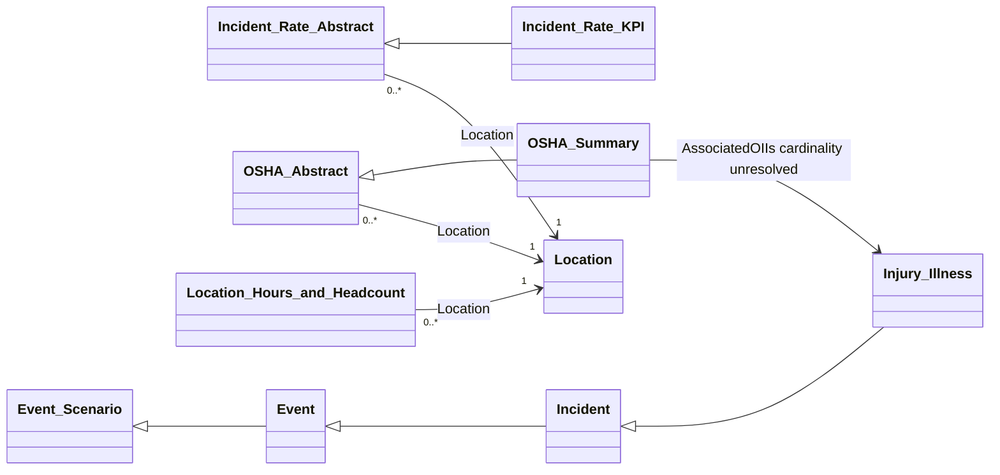
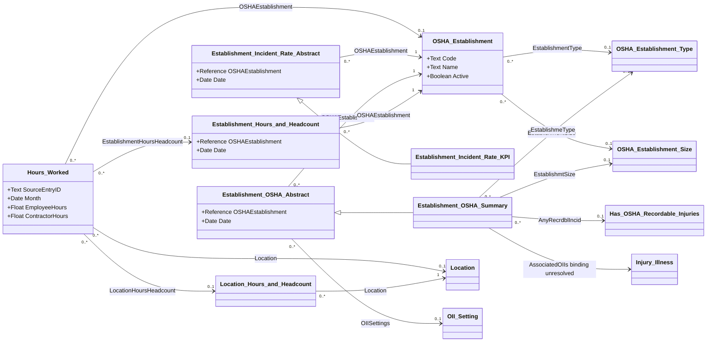

# Shared Hours Worked and OSHA Establishment analytics technical specification

Revision 2. Status: proposed target design for review. Date: November 12, 2026. No tenant configuration has been changed. This is the proposed authority for Hours Worked, OSHA Establishment, its five parallel analytics objects and the specifically modified Location Hours and Headcount contract. The package baseline is unchanged; [revision 1](history/v1/technical-specification.md) is retained as superseded target history.

Use one Hours Worked object as the entry point for monthly employee/contractor hours. Each entry supplies Location, OSHA Establishment, or both and links to its corresponding monthly Hours and Headcount summaries. The summaries hold calculated hours and separately maintained headcounts. Existing location-based incident analytics/reports continue; establishment analytics/OSHA outputs use the parallel family. All 89 exported analytics fields retain their establishment counterparts; the existing location summary retains its eight fields with the revised ownership below.

The extract does not include metric processors, complete incident relationships or report templates. Field coverage and proposed processing are specified, while runtime and report parity remain verification gates. Incident linkage remains a dependency only; no incident-side fields, defaults, handlers or workflow are designed.

## 1 Requirements and revision decisions

| Requirement | Current contract | Revision disposition |
|---|---|---|
| R1 | Retain original location analytics/report bindings; modify Location Hours and Headcount for shared-hour ownership, fixed summary identity and contribution navigation. | Refined; v1 unchanged direct-hour entry is superseded. |
| R2 | Preserve all 89 counterpart fields, metrics and reporting semantics; summary hours become calculated outputs. | Refined; separate direct-hour entry is superseded. |
| R3 | New establishment analytics/logs are independent of Location Structure. | Retained; Hours Worked is the deliberate dimension-neutral input bridge. |
| R4 | Define establishment master fields inferred from existing reporting metadata. | Retained. |
| R5 | Account for incident attribution without specifying the incident-side design. | Retained. |
| R6 | Preserve OSHA/Cal 300/300A, combined outputs, electronic export and case-level 301 navigation. | Retained; runtime binding unresolved. |
| R7 | Shared Hours Worked accepts Location only, OSHA Establishment only, or both; reject neither. | Added from the user-approved shared-input direction. |
| R8 | Link each entry to applicable monthly summaries; populate each dimension once; safely correct/delete/retry. | Added. |
| R9 | Keep employee/contractor hours distinct, headcounts independent and one authoritative hours writer through migration. | Added. |

Extracted means directly supported by metadata; Inferred means indirectly supported; Proposed means introduced by the target; Unresolved means insufficient evidence. All revision-2 fields, constraints and automation are Proposed unless identified as Extracted. New identifiers are assigned at implementation; exported TableName values do not establish a physical database model.

Establishments remain flat. Preserve Lo/Ru metric fields; matching establishment pairs use the same population and are equal. The original location family retains its verified hierarchy behavior. Never add Lo and Ru together or combine location and establishment totals. Both references on one hours row describe the same quantity under two dimensions. Neither reference defaults from the other; changing one never silently forces or clears the other.

Hours Worked is a source business record required by R7, not a duplicate audit/event object. One existing summary cannot represent all three modes without changing its scope contract. Reuse native references, uniqueness and audit. Do not add an allocation/junction object, mode catalogue, workflow, audit ledger or scheduler; the optional references express mode directly.

## 2 Package inspection and baseline

The supplied .ipack is UTF-8 JSON with a byte-order mark, not a ZIP archive. It was parsed directly without modifying the source. Package: [SummitEHSQ] Safety KPI Objects Extract, version 1.0.0.0, ID `1677184a-19e1-4e9a-8efd-2f1db8d65042`. Source owner: TerraGenTest; platform 6.6.29.0; exported 2026-11-12T17:13:03.4268393Z. SHA-256: `e9ee1a3f78189c356b522b04d0f08d7cf45b81ab994e27979cd1e52b3446889d`.

The graph contains 152 items, 388 relations, 126 included items, and 26 dependencies. It includes 12 Object items, 3 Lookup Object items, 91 fields (89 on the analytics family and 2 on Location), 7 simple types, 10 views, 10 view profiles, 6 validations, 7 links, 1 Action Handler, and 5 application records. Object ownership, type, inheritance and view bindings were resolved through GraphData.Relations, not inferred from names. Package graph IsMandatory describes export dependency, not business requiredness; field IsRequired supplies the latter.

[Package evidence](package-evidence.json) preserves exact exported field metadata, default-generator XML, validators, views, profiles, links, and resolved graph endpoints. The graphId in that file identifies the source item's $id, and recordId is the stable configuration identifier. [Target model](target-model.json) records every source-to-target field mapping and canonical contract row.

### 2.1 Baseline object inventory

Counts are directly declared fields present in this extract, not proof of a complete external object's schema. None in exported graph means no exported SuperType edge; it does not establish the full platform system inheritance chain. External dependency objects are not cloned.

| Display name | Internal name | Stable ID | Inheritance parent | Exported fields | Flags |
|---|---|---|---|---:|---|
| OSHA Abstract | `SafetyMetrics_OSHAAbstractObject` | `c6059869-bf10-47f0-b0a7-5d31536a49a4` | None in exported graph | 35 | Abstract; location-bound flag true |
| Incident Rate KPI | `SafetyMetrics_IncidentRateKPIObject` | `ec05b841-5259-4905-bbe1-57a302189d32` | SafetyMetrics_IncRateAbstractObject | 4 | Concrete; location-bound flag false |
| Incident Rate Abstract | `SafetyMetrics_IncRateAbstractObject` | `1c5170ba-c22c-4b43-9471-b3f4e32dd736` | None in exported graph | 25 | Abstract; location-bound flag true |
| Incident | `EHSIncidentMang_IncidentObject` | `fd73e13c-2359-43e8-b6ea-8b79743a5aff` | EventFwk_EventObject | 0 | Abstract; location-bound flag false |
| Event | `EventFwk_EventObject` | `3979d543-6df2-46a1-a26e-293cd7978bdc` | EventFwk_EventScenarioObject | 0 | Concrete; location-bound flag false |
| Location | `SysLocationEntity` | `f5d5209b-0a7d-4858-a302-678fcc065dd2` | None in exported graph | 2 | Concrete; location-bound flag false |
| OSHA Summary | `SafetyMetrics_OSHASummaryObject` | `420f7f71-a61f-45ab-a9b6-9b64c7a3a1e9` | SafetyMetrics_OSHAAbstractObject | 17 | Concrete; location-bound flag false |
| Injury/Illness | `EHSIncidentMang_OIIObject` | `bbc02abb-6a22-4d72-9e8c-cb7cb26a596a` | EHSIncidentMang_IncidentObject | 0 | Concrete; location-bound flag false |
| Location Hours and Headcount | `SafetyMetrics_HrsandHeadcountObject` | `0f0ecb2a-5f62-4faf-9609-b98873007c83` | None in exported graph | 8 | Concrete; location-bound flag true |
| OSHA Establishment Type | `EHSIncidentMang_EstablishmeTypeObject` | `bfd31eec-2b15-46e6-bf3e-1583e382745c` | None in exported graph | 0 | Concrete; location-bound flag false |
| Setting Abstract | `FragApplication_SettingAbsObject` | `e838a178-5e15-47f6-81fc-dbae30b9b603` | None in exported graph | 0 | Abstract; location-bound flag false |
| Event Scenario | `EventFwk_EventScenarioObject` | `c0d0d372-c03c-46cd-9f51-cdd28b620177` | None in exported graph | 0 | Concrete; location-bound flag true |
| OSHA Establishment Size | `EHSIncidentMang_EstablishmeSizeObject` | `bcb89cad-109b-47cf-a3b2-3bb8ac766f7a` | None in exported graph | 0 | Concrete; location-bound flag false |
| OII Setting | `EHSIncidentMang_OIISettingObject` | `bf46dd3b-cefa-48e8-865a-add097587ba4` | FragApplication_SettingAbsObject | 0 | Concrete; location-bound flag false |
| Has OSHA Recordable Injuries | `EHSIncidentMang_HasRecordaInjurObject` | `d61d4b82-b2f4-43d0-acc4-af4f6484cbd3` | None in exported graph | 0 | Concrete; location-bound flag false |

### 2.2 Baseline structure

Diagram identifiers replace spaces and punctuation in the display names. Location relationships are required single references (IsStartOfRelation=TRUE, target Type=SysLocationEntity). AssociatedOIIs has IsStartOfRelation=FALSE but the opposing property and relation metadata are not exported; do not assert a verified 1:M inverse or M:N mapping. The OSHA log grid traverses AssociatedOIIs.OSHARecord and filters InjuryIllnes.OSHARecordable=TRUE. Those incident fields and OSHARecord schema are view references, not exported field definitions.

### 2.3 Baseline findings affecting parity

1. All 91 field Calculation values are null. The readonly metrics are stored fields, commonly initialized to zero. No aggregation service or rate calculation is exported. Do not present a default of zero as proof of completed calculation.
2. Incident Rate KPI declares four target fields only. TargetDART is displayed as Target DAIR. Preserve that exact internal-name/display-label pairing; do not reinterpret it as a DART rate. Actual rate expressions, normalizer, denominator policy, rounding and reporting grain must be recovered from runtime/report configuration.
3. The sole exported Action Handler, Set Location Name Helper (graphId 247), belongs to Location Hours and Headcount. It sets LocNameHelper from Location.Name when AND(ISCHANGED(Location), NOT(Location.Deleted)); ActionType=3. The numeric event code is not decoded here. No equivalent population handler for the other readonly helper fields is exported.
4. Six validations enforce unique Location + Date and first-of-month/first-of-year dates on the three base/input objects. These are copied to new validators with OSHAEstablishment replacing Location.
5. Every print link hard-codes the source summary object ID 420f7f71-a61f-45ab-a9b6-9b64c7a3a1e9. Four call DownloadOSHAReport and two use MailMerge/MergeTemplate. Esub points to a dashboard whose definition is absent. Swapping objectId alone does not prove the native endpoint accepts the new object.
6. Configurable view profiles conflict with their view content. For example graphId 92 references DisplayField, Month, RepLocationId and numerous fields absent from the KPI object and its exported base. New views/profiles must be rebuilt from the canonical field contract rather than blindly copied. Other view paths, including OSHARecord, require external-schema validation.
7. The Combined Cal/OSHA 300 link sends oshaType=OSHA, the same as the non-combined link, despite its label. Verify actual source behavior before defining a corrected target parameter; do not silently copy or fix it.
8. Destination OII Settings, template IDs, dashboard and lookup values are not included as records. A source-GUID default cannot be assumed to resolve in another environment.

## 3 Proposed object model

Seven objects are new: OSHA Establishment, five establishment analytics objects and Hours Worked. One existing object, Location Hours and Headcount, is modified while retaining its object/field GUIDs and location binding. All other owned objects are not location-bound. The new abstract bases do not inherit the source location-bound bases. Enable native audit on mutable business data and references; no new workflows are added.

| Object | Internal name | Action | Stable ID | Inheritance parent | Kind and binding | Direct fields/grids |
|---|---|---|---|---|---|---:|
| OSHA Establishment | `TG_OSHAEstablishmentObject` | Add | New GUID at configuration | None | Concrete; not location-bound | 19 |
| Establishment Incident Rate Abstract | `TG_EstIncRateAbstractObject` | Add | New GUID at configuration | None | Abstract; not location-bound | 25 |
| Establishment Incident Rate KPI | `TG_EstIncidentRateKPIObject` | Add | New GUID at configuration | TG_EstIncRateAbstractObject | Concrete; not location-bound | 4 |
| Establishment OSHA Abstract | `TG_EstOSHAAbstractObject` | Add | New GUID at configuration | None | Abstract; not location-bound | 35 |
| Establishment OSHA Summary | `TG_EstOSHASummaryObject` | Add | New GUID at configuration | TG_EstOSHAAbstractObject | Concrete; not location-bound | 17 |
| Establishment Hours and Headcount | `TG_EstHrsHeadcountObject` | Add | New GUID at configuration | None | Concrete; not location-bound | 9 |
| Location Hours and Headcount | `SafetyMetrics_HrsandHeadcountObject` | Modify | 0f0ecb2a-5f62-4faf-9609-b98873007c83 | None | Concrete; location-bound | 9 |
| Hours Worked | `TG_HoursWorkedObject` | Add | New GUID at configuration | None | Concrete; not location-bound | 8 |

OII Setting, OSHA Establishment Type, OSHA Establishment Size, Has OSHA Recordable Injuries, Injury/Illness and Location are unchanged external dependencies. Each is identified separately in section 4.9. Incident-to-establishment linkage is deliberately omitted from the diagram pending the separate incident design. Target cardinalities are proposed constraints; external collection cardinality remains unresolved. Establishment master inverse grids are navigation over the three declaring references, never additional stored relationships. No inverse is enabled on shared catalogue references.

Hours Worked requires at least one dimension and, at completed save, a matching summary link for each populated dimension. The absent dimension has a NULL summary link. The source-side link owns each relationship; Hours Worked Entries on each summary is its readonly inverse, not a second stored relationship. No new Hours Worked inverse is added on either dimension master. Mermaid identifiers replace spaces/punctuation in display names.

## 4 Field level implementation contract

One row defines one directly declared field or designed inverse grid. Inherited fields are declared once on the base. Default zero does not prove calculation or input completeness. Field mappings preserve exact source names and stable identifiers. Cloned Text capacity is unresolved where metadata is null; verify tenant capacities before loading master snapshots. Float retains System.Double. Date is calendar-based with timezone capture disabled; imports must not shift month/year through UTC conversion. Master text limits must fit summary destinations. No published-version objects or publish-copy lifecycle are needed.

### 4.1 OSHA Establishment

**Inheritance parent:** None. Concrete object.

**Directly declared fields:** 19.

| Field | Type / relationship | Req | Default / calculation | Editability and visibility | Automation / lifecycle |
|---|---|---:|---|---|---|
| Code | Text, max 100 | Y | None; unique, non-localizable | Establishment administrator editable before first use | Stable integration key after first use; native audit |
| Name | Text, max 255; legal reporting label, non-localizable | Y | None | Establishment administrator editable | Display field; does not rewrite existing annual snapshots |
| Active? | Yes/No | Y | TRUE | Establishment administrator editable | FALSE prevents new ordinary selections and routine period generation; retains history and authorized historical corrections |
| Company Name | Text, max 255 | Conditional | None | Administrator editable; required for report generation | Copied to annual CompanyName at initial generation; later changes do not cascade |
| Street | Text, max 255 | Conditional | None | Administrator editable; required for report generation | Copied to annual LocationStreet at initial generation |
| City | Text, max 100 | Conditional | None | Administrator editable; required for report generation | Copied to annual LocationCity at initial generation |
| State | Text, max 100 | Conditional | None | Administrator editable; required for report generation | Copied to annual LocationState at initial generation |
| Postal Code | Text, max 30 | Conditional | None | Administrator editable; required for report generation | Copied to annual LocationPostal at initial generation |
| EIN Number | Text, max 30 | N | None | Administrator editable | Copied to annual EINNumber at initial generation; submission validation is output-specific |
| NAICS Code | Number / bigint, System.Int64 | N | None | Administrator editable | Copied to annual NAICSCode at initial generation; retain original numeric representation for parity |
| SIC Code | Number / bigint, System.Int64 | N | None | Administrator editable | Copied to annual SICCode at initial generation |
| Industry Description | Text, max 1000 | N | None | Administrator editable | Copied to annual InduDescription at initial generation |
| Establishment Type | M:1 to EHSIncidentMang_EstablishmeTypeObject, 0..1 target; inverse disabled | N | None | Administrator editable; preserve referenced values; available-value filter unresolved because catalogue fields are not exported | Reuses existing catalogue; copied to annual EstablishmeType; no new values seeded |
| Establishment Size | M:1 to EHSIncidentMang_EstablishmeSizeObject, 0..1 target; inverse disabled | N | None | Administrator editable; preserve referenced values; available-value filter unresolved because catalogue fields are not exported | Reuses existing catalogue; copied to annual EstablishmtSize; do not invent size thresholds |
| Establishment ID | Text, max 100 | N | None | Administrator editable | External reporting identifier; distinct from Code and native record GUID; copied to annual EstablishmentID |
| OSHA 300a ID | Text, max 100 | N | None | Administrator editable | External reporting identifier; copied to annual OSHA300aID; format and annual applicability require output validation |
| Hours and Headcounts | Inverse 1:M grid from Establishment Hours and Headcount.OSHA Establishment | N | None | Read only; authorized analytics users | Navigation over the declaring relationship; no duplicate storage |
| Incident Rate KPIs | Inverse 1:M grid from Establishment Incident Rate KPI.OSHA Establishment (inherited) | N | None | Read only; authorized analytics users | Navigation over the declaring relationship; no duplicate storage; concrete records only |
| OSHA Summaries | Inverse 1:M grid from Establishment OSHA Summary.OSHA Establishment (inherited) | N | None | Read only; authorized regulatory users | Navigation over the declaring relationship; no duplicate storage; concrete records only |

Field mapping:

| Field display name | Internal name | Source evidence |
|---|---|---|
| Code | `Code` | Proposed; new native GUID at implementation |
| Name | `Name` | Proposed; new native GUID at implementation |
| Active? | `Active` | Proposed; new native GUID at implementation |
| Company Name | `CompanyName` | Proposed; new native GUID at implementation |
| Street | `Street` | Proposed; new native GUID at implementation |
| City | `City` | Proposed; new native GUID at implementation |
| State | `State` | Proposed; new native GUID at implementation |
| Postal Code | `PostalCode` | Proposed; new native GUID at implementation |
| EIN Number | `EINNumber` | Proposed; new native GUID at implementation |
| NAICS Code | `NAICSCode` | Proposed; new native GUID at implementation |
| SIC Code | `SICCode` | Proposed; new native GUID at implementation |
| Industry Description | `IndustryDescription` | Proposed; new native GUID at implementation |
| Establishment Type | `EstablishmentType` | Proposed; new native GUID at implementation |
| Establishment Size | `EstablishmentSize` | Proposed; new native GUID at implementation |
| Establishment ID | `EstablishmentID` | Proposed; new native GUID at implementation |
| OSHA 300a ID | `OSHA300aID` | Proposed; new native GUID at implementation |
| Hours and Headcounts | `HoursHeadcounts` | Proposed; new native GUID at implementation |
| Incident Rate KPIs | `IncidentRateKPIs` | Proposed; new native GUID at implementation |
| OSHA Summaries | `OSHASummaries` | Proposed; new native GUID at implementation |

Initial values: No establishment records inferred or seeded; load the governed register.

### 4.2 Establishment Incident Rate Abstract

**Inheritance parent:** None. Abstract and non-instantiable.

**Directly declared fields:** 25.

| Field | Type / relationship | Req | Default / calculation | Editability and visibility | Automation / lifecycle |
|---|---|---:|---|---|---|
| Record No | AutoNumber, System.Int64 | Y | None in metadata; native AutoNumber population required | Read only; analytics users may view | Native AutoNumber; new target sequence, never reuse source identity |
| Date | Date; calendar date, timezone capture disabled | Y | None; A2 supplies month start or A3 supplies January 1 | Read only; analytics users may view | A2 sets first day of month; unique OSHAEstablishment + Date |
| OSHA Establishment | M:1 to OSHA Establishment; exactly 1 target per record; inverse Incident Rate KPIs | Y | None; mandatory generation/import scope | Read only on generated period forms; A2/A3 supplies scope; historical inactive references retained | A2/A3 supplies reference at creation; no ordinary user reassignment of generated periods |
| Number of Days Away - Rollup | Number / bigint, System.Int64 | N | 0 | Read only; analytics users may view | A2 writes stored aggregate; Lo/Ru pair uses the identical flat establishment scope; calculation source unresolved |
| Number of Recordable/Reportable - Rollup | Number / bigint, System.Int64 | N | 0 | Read only; analytics users may view | A2 writes stored aggregate; Lo/Ru pair uses the identical flat establishment scope; calculation source unresolved |
| Number of Fatalities - Establishment | Number / bigint, System.Int64 | N | 0 | Read only; analytics users may view | A2 writes stored aggregate; Lo/Ru pair uses the identical flat establishment scope; calculation source unresolved |
| Number of Incidents - Rollup | Number / bigint, System.Int64 | N | 0 | Read only; analytics users may view | A2 writes stored aggregate; Lo/Ru pair uses the identical flat establishment scope; calculation source unresolved |
| [Helper] Establishment Name | Text / nvarchar; length not constrained in export | N | None; populated from OSHA Establishment.Name | Read only; analytics users may view | A2 stamps at generation; preserves display for inactive establishments; explicit administrator correction only |
| Number of Lost Days - Rollup | Number / bigint, System.Int64 | N | 0 | Read only; analytics users may view | A2 writes stored aggregate; Lo/Ru pair uses the identical flat establishment scope; calculation source unresolved |
| Contractor Worked Hours - Establishment | Float, System.Double; precision/scale not constrained in export | N | 0 | Read only; analytics users may view | A2 reads Establishment Hours and Headcount.ContractrHrs for matching OSHAEstablishment + Date after A0 completes; Lo/Ru use identical flat scope |
| [Helper] Establishment ID | GUID | Y | None; native GUID of OSHA Establishment reference | Read only; hidden on ordinary form | A2/A3 stamps at creation; hidden helper, never uses SysLocationEntity GUID |
| Number of Incidents - Establishment | Number / bigint, System.Int64 | N | 0 | Read only; analytics users may view | A2 writes stored aggregate; Lo/Ru pair uses the identical flat establishment scope; calculation source unresolved |
| Number of Incidents with Days Away - Rollup | Number / bigint, System.Int64 | N | 0 | Read only; analytics users may view | A2 writes stored aggregate; Lo/Ru pair uses the identical flat establishment scope; calculation source unresolved |
| Number of Lost Days - Establishment | Number / bigint, System.Int64 | N | 0 | Read only; analytics users may view | A2 writes stored aggregate; Lo/Ru pair uses the identical flat establishment scope; calculation source unresolved |
| Number of Incidents with Days Away - Establishment | Number / bigint, System.Int64 | N | 0 | Read only; analytics users may view | A2 writes stored aggregate; Lo/Ru pair uses the identical flat establishment scope; calculation source unresolved |
| Contractor Worked Hours - Rollup | Float, System.Double; precision/scale not constrained in export | N | 0 | Read only; analytics users may view | A2 reads Establishment Hours and Headcount.ContractrHrs for matching OSHAEstablishment + Date after A0 completes; Lo/Ru use identical flat scope |
| Number of Incidents with Lost Time - Rollup | Number / bigint, System.Int64 | N | 0 | Read only; analytics users may view | A2 writes stored aggregate; Lo/Ru pair uses the identical flat establishment scope; calculation source unresolved |
| Employee Worked Hours - Rollup | Float, System.Double; precision/scale not constrained in export | N | 0 | Read only; analytics users may view | A2 reads Establishment Hours and Headcount.EmployeeHrs for matching OSHAEstablishment + Date after A0 completes; Lo/Ru use identical flat scope |
| Number of Incidents with Lost Time - Establishment | Number / bigint, System.Int64 | N | 0 | Read only; analytics users may view | A2 writes stored aggregate; Lo/Ru pair uses the identical flat establishment scope; calculation source unresolved |
| Number of Job Transfer and Restricted Days - Rollup | Number / bigint, System.Int64 | N | 0 | Read only; analytics users may view | A2 writes stored aggregate; Lo/Ru pair uses the identical flat establishment scope; calculation source unresolved |
| Number of Job Transfer and Restricted Days - Establishment | Number / bigint, System.Int64 | N | 0 | Read only; analytics users may view | A2 writes stored aggregate; Lo/Ru pair uses the identical flat establishment scope; calculation source unresolved |
| Number of Days Away - Establishment | Number / bigint, System.Int64 | N | 0 | Read only; analytics users may view | A2 writes stored aggregate; Lo/Ru pair uses the identical flat establishment scope; calculation source unresolved |
| Number of Recordable/Reportable - Establishment | Number / bigint, System.Int64 | N | 0 | Read only; analytics users may view | A2 writes stored aggregate; Lo/Ru pair uses the identical flat establishment scope; calculation source unresolved |
| Employee Worked Hours - Establishment | Float, System.Double; precision/scale not constrained in export | N | 0 | Read only; analytics users may view | A2 reads Establishment Hours and Headcount.EmployeeHrs for matching OSHAEstablishment + Date after A0 completes; Lo/Ru use identical flat scope |
| Number of Fatalities - Rollup | Number / bigint, System.Int64 | N | 0 | Read only; analytics users may view | A2 writes stored aggregate; Lo/Ru pair uses the identical flat establishment scope; calculation source unresolved |

Field mapping:

| Field display name | Internal name | Source evidence |
|---|---|---|
| Record No | `RecordNo` | `RecordNo`; graphId 50; GUID `043f6a0d-5d53-4f2c-9ce8-0afc63a0b0c2` |
| Date | `Date` | `Date`; graphId 56; GUID `ff23157a-1cf6-4979-97c2-ae2895d3201e` |
| OSHA Establishment | `OSHAEstablishment` | `Location`; graphId 58; GUID `47e4fcf0-502a-4567-8f26-4cadfc038c73` |
| Number of Days Away - Rollup | `RuNumDaysAway` | `RuNumDaysAway`; graphId 78; GUID `6a867f71-aa59-4a0f-9424-bec709d10655` |
| Number of Recordable/Reportable - Rollup | `RuCtRecordable` | `RuCtRecordable`; graphId 94; GUID `88037be2-4963-4b60-8f3a-deba17db7dba` |
| Number of Fatalities - Establishment | `LoNumFatalities` | `LoNumFatalities`; graphId 96; GUID `a83fede5-74ae-4a23-957b-ef7ff00203d5` |
| Number of Incidents - Rollup | `RuCtIncidents` | `RuCtIncidents`; graphId 133; GUID `b75e75e4-c641-447e-81d8-cc18704ac8cb` |
| [Helper] Establishment Name | `LocNameHelper` | `LocNameHelper`; graphId 159; GUID `81b5d8d6-5bff-49b5-a669-61ac051f1be0` |
| Number of Lost Days - Rollup | `RuNumLostDays` | `RuNumLostDays`; graphId 193; GUID `a2d7e328-40a0-420d-9b0c-38a6276247ff` |
| Contractor Worked Hours - Establishment | `LoCntrctWrkdHrs` | `LoCntrctWrkdHrs`; graphId 197; GUID `53ec5a18-4bf9-4c7c-8a33-451cf2417c62` |
| [Helper] Establishment ID | `LocationIdHelp` | `LocationIdHelp`; graphId 199; GUID `3ea4baa8-dcc1-4177-a4a6-ad1017b4d40b` |
| Number of Incidents - Establishment | `LoCtIncidents` | `LoCtIncidents`; graphId 212; GUID `736d7978-6935-4eb3-9098-6b7b7d391a84` |
| Number of Incidents with Days Away - Rollup | `RuNumIncDayAway` | `RuNumIncDayAway`; graphId 259; GUID `553bb1be-bd16-45ca-94e0-390d26d1019c` |
| Number of Lost Days - Establishment | `LoNumLostDays` | `LoNumLostDays`; graphId 267; GUID `4b7b009e-ede4-487b-92ca-beb73df52e64` |
| Number of Incidents with Days Away - Establishment | `LoNumIncDayAway` | `LoNumIncDayAway`; graphId 275; GUID `a8c7f1b8-9643-43c4-a36e-808c494aec70` |
| Contractor Worked Hours - Rollup | `RuCntrctWrkdHrs` | `RuCntrctWrkdHrs`; graphId 320; GUID `ba2eec4a-ce5d-4de9-885a-d6799508bab5` |
| Number of Incidents with Lost Time - Rollup | `RuNumIncLostTim` | `RuNumIncLostTim`; graphId 331; GUID `c6626d90-5f1b-4950-b266-e75e837caecb` |
| Employee Worked Hours - Rollup | `RuEmplWrkdHours` | `RuEmplWrkdHours`; graphId 333; GUID `1d59a6b3-d05a-4f5f-97cb-35527693d811` |
| Number of Incidents with Lost Time - Establishment | `LoNumIncLostTim` | `LoNumIncLostTim`; graphId 356; GUID `f258419d-0555-46da-9777-892a24dd1d84` |
| Number of Job Transfer and Restricted Days - Rollup | `RuNumTrnsfRstDy` | `RuNumTrnsfRstDy`; graphId 358; GUID `30bd6dfd-e613-46df-a5fb-789807f4dbdb` |
| Number of Job Transfer and Restricted Days - Establishment | `LoNumTrnsfRstDy` | `LoNumTrnsfRstDy`; graphId 360; GUID `0d60d4c4-7643-4256-bdcd-0ddb6e9ded31` |
| Number of Days Away - Establishment | `LoNumDaysAway` | `LoNumDaysAway`; graphId 364; GUID `b831e2f5-81da-4a28-8556-1b9939b1a379` |
| Number of Recordable/Reportable - Establishment | `LoCtRecordable` | `LoCtRecordable`; graphId 368; GUID `76c14f73-0411-4d97-aa06-c97215d6bc8d` |
| Employee Worked Hours - Establishment | `LoEmplWrkdHours` | `LoEmplWrkdHours`; graphId 370; GUID `b231cb4e-ed84-4433-9857-e5907347bec2` |
| Number of Fatalities - Rollup | `RuNumFatalities` | `RuNumFatalities`; graphId 372; GUID `22761319-34bf-40db-b0fe-dfbc62fec0f0` |

Initial values: None; direct records prohibited.

### 4.3 Establishment Incident Rate KPI

**Inheritance parent:** TG_EstIncRateAbstractObject. Concrete object.

**Directly declared fields:** 4. All fields on Establishment Incident Rate Abstract are inherited and not redeclared.

| Field | Type / relationship | Req | Default / calculation | Editability and visibility | Automation / lifecycle |
|---|---|---:|---|---|---|
| Target LTIR | Float, System.Double; precision/scale not constrained in export | N | None | Authorized analytics administrator editable | Manual target, preserved by A2; not an actual calculated rate |
| Target Severity Rate | Float, System.Double; precision/scale not constrained in export | N | None | Authorized analytics administrator editable | Manual target, preserved by A2; not an actual calculated rate |
| Target DAIR | Float, System.Double; precision/scale not constrained in export | N | None | Authorized analytics administrator editable | Manual target, preserved by A2; not an actual calculated rate |
| Target TRIR | Float, System.Double; precision/scale not constrained in export | N | None | Authorized analytics administrator editable | Manual target, preserved by A2; not an actual calculated rate |

Field mapping:

| Field display name | Internal name | Source evidence |
|---|---|---|
| Target LTIR | `TargetLTIR` | `TargetLTIR`; graphId 21; GUID `031ca632-f345-4473-b527-ecd11cfa358a` |
| Target Severity Rate | `TargetSeverRate` | `TargetSeverRate`; graphId 34; GUID `69e835da-1299-4987-9623-60ecdc24a5c3` |
| Target DAIR | `TargetDART` | `TargetDART`; graphId 38; GUID `3b534394-89c5-4df7-ba5d-47a458045aa4` |
| Target TRIR | `TargetTRIR` | `TargetTRIR`; graphId 42; GUID `6b07875f-d712-432e-a5f3-1e41cc5877ed` |

Initial values: No operational records seeded; use section 6 creation and maintenance rules.

### 4.4 Establishment OSHA Abstract

**Inheritance parent:** None. Abstract and non-instantiable.

**Directly declared fields:** 35.

| Field | Type / relationship | Req | Default / calculation | Editability and visibility | Automation / lifecycle |
|---|---|---:|---|---|---|
| Total number of job transfer or restriction days (L) - roll up | Number / bigint, System.Int64 | N | 0 | Read only; analytics users may view | A3 writes stored aggregate; Lo/Ru pair uses the identical flat establishment scope; calculation source unresolved |
| Total number of days away from work (K) - roll up | Number / bigint, System.Int64 | N | 0 | Read only; analytics users may view | A3 writes stored aggregate; Lo/Ru pair uses the identical flat establishment scope; calculation source unresolved |
| Injuries (M1) - roll up | Number / bigint, System.Int64 | N | 0 | Read only; analytics users may view | A3 writes stored aggregate; Lo/Ru pair uses the identical flat establishment scope; calculation source unresolved |
| Respiratory Conditions (M3) - establishment | Number / bigint, System.Int64 | N | 0 | Read only; analytics users may view | A3 writes stored aggregate; Lo/Ru pair uses the identical flat establishment scope; calculation source unresolved |
| OSHA Establishment | M:1 to OSHA Establishment; exactly 1 target per record; inverse OSHA Summaries | Y | None; mandatory generation/import scope | Read only on generated period forms; A2/A3 supplies scope; historical inactive references retained | A2/A3 supplies reference at creation; no ordinary user reassignment of generated periods |
| Other Recordable Cases (J) - roll up | Number / bigint, System.Int64 | N | 0 | Read only; analytics users may view | A3 writes stored aggregate; Lo/Ru pair uses the identical flat establishment scope; calculation source unresolved |
| All other illnesses (M6) - establishment | Number / bigint, System.Int64 | N | 0 | Read only; analytics users may view | A3 writes stored aggregate; Lo/Ru pair uses the identical flat establishment scope; calculation source unresolved |
| Other Recordable Cases (J) - establishment | Number / bigint, System.Int64 | N | 0 | Read only; analytics users may view | A3 writes stored aggregate; Lo/Ru pair uses the identical flat establishment scope; calculation source unresolved |
| Job Transfer or Restricted Days Cases (I) - roll up | Number / bigint, System.Int64 | N | 0 | Read only; analytics users may view | A3 writes stored aggregate; Lo/Ru pair uses the identical flat establishment scope; calculation source unresolved |
| Establishment Street | Text / nvarchar; length not constrained in export | N | At initial annual generation: OSHA Establishment.Street | Read only; analytics users may view | A3 copies stored snapshot at creation; later master edits do not cascade; authorized explicit metadata correction through A3 with native audit |
| Date | Date; calendar date, timezone capture disabled | Y | None; A2 supplies month start or A3 supplies January 1 | Read only; analytics users may view | A3 sets January 1; unique OSHAEstablishment + Date |
| Poisonings (M4) - establishment | Number / bigint, System.Int64 | N | 0 | Read only; analytics users may view | A3 writes stored aggregate; Lo/Ru pair uses the identical flat establishment scope; calculation source unresolved |
| Hearing loss (M5) - establishment | Number / bigint, System.Int64 | N | 0 | Read only; analytics users may view | A3 writes stored aggregate; Lo/Ru pair uses the identical flat establishment scope; calculation source unresolved |
| Skin Disorders (M2) - roll up | Number / bigint, System.Int64 | N | 0 | Read only; analytics users may view | A3 writes stored aggregate; Lo/Ru pair uses the identical flat establishment scope; calculation source unresolved |
| Respiratory Conditions (M3) - roll up | Number / bigint, System.Int64 | N | 0 | Read only; analytics users may view | A3 writes stored aggregate; Lo/Ru pair uses the identical flat establishment scope; calculation source unresolved |
| Death (G) - establishment | Number / bigint, System.Int64 | N | 0 | Read only; analytics users may view | A3 writes stored aggregate; Lo/Ru pair uses the identical flat establishment scope; calculation source unresolved |
| Job Transfer or Restricted Days Cases (I) - establishment | Number / bigint, System.Int64 | N | 0 | Read only; analytics users may view | A3 writes stored aggregate; Lo/Ru pair uses the identical flat establishment scope; calculation source unresolved |
| Injuries (M1) - establishment | Number / bigint, System.Int64 | N | 0 | Read only; analytics users may view | A3 writes stored aggregate; Lo/Ru pair uses the identical flat establishment scope; calculation source unresolved |
| Establishment City | Text / nvarchar; length not constrained in export | N | At initial annual generation: OSHA Establishment.City | Read only; analytics users may view | A3 copies stored snapshot at creation; later master edits do not cascade; authorized explicit metadata correction through A3 with native audit |
| Establishment Postal Code | Text / nvarchar; length not constrained in export | N | At initial annual generation: OSHA Establishment.Postal Code | Read only; analytics users may view | A3 copies stored snapshot at creation; later master edits do not cascade; authorized explicit metadata correction through A3 with native audit |
| Death (G) - roll up | Number / bigint, System.Int64 | N | 0 | Read only; analytics users may view | A3 writes stored aggregate; Lo/Ru pair uses the identical flat establishment scope; calculation source unresolved |
| Days Away From Work Cases (H) - roll up | Number / bigint, System.Int64 | N | 0 | Read only; analytics users may view | A3 writes stored aggregate; Lo/Ru pair uses the identical flat establishment scope; calculation source unresolved |
| Establishment State | Text / nvarchar; length not constrained in export | N | At initial annual generation: OSHA Establishment.State | Read only; analytics users may view | A3 copies stored snapshot at creation; later master edits do not cascade; authorized explicit metadata correction through A3 with native audit |
| Record No | AutoNumber, System.Int64 | Y | None in metadata; native AutoNumber population required | Read only; analytics users may view | Native AutoNumber; new target sequence, never reuse source identity |
| Days Away From Work Cases (H) - establishment | Number / bigint, System.Int64 | N | 0 | Read only; analytics users may view | A3 writes stored aggregate; Lo/Ru pair uses the identical flat establishment scope; calculation source unresolved |
| [Helper] Establishment ID | GUID | Y | None; native GUID of OSHA Establishment reference | Read only; hidden on ordinary form | A2/A3 stamps at creation; hidden helper, never uses SysLocationEntity GUID |
| Year | Number / bigint, System.Int64 | N | Calendar year of Date, declarative; executable expression unresolved | Read only; analytics users may view | A3 stores year during annual generation; read only |
| All other illnesses (M6) - roll up | Number / bigint, System.Int64 | N | 0 | Read only; analytics users may view | A3 writes stored aggregate; Lo/Ru pair uses the identical flat establishment scope; calculation source unresolved |
| Establishment Display Name | Text / nvarchar; length not constrained in export | N | At initial annual generation: OSHA Establishment.Name | Read only; analytics users may view | A3 copies stored snapshot at creation; later master edits do not cascade; authorized explicit metadata correction through A3 with native audit |
| OII Settings | M:1 to EHSIncidentMang_OIISettingObject; 0..1 target; inverse disabled | N | Export default points to b2102af3-2dbe-4bc2-9395-cd1202ae0192; resolve equivalent OII Setting in destination | Read only; hidden on ordinary summary form | A3 binds destination settings before report availability; never assume source GUID is portable |
| Total number of days away from work (K) - establishment | Number / bigint, System.Int64 | N | 0 | Read only; analytics users may view | A3 writes stored aggregate; Lo/Ru pair uses the identical flat establishment scope; calculation source unresolved |
| Hearing loss (M5) - roll up | Number / bigint, System.Int64 | N | 0 | Read only; analytics users may view | A3 writes stored aggregate; Lo/Ru pair uses the identical flat establishment scope; calculation source unresolved |
| Skin Disorders (M2) - establishment | Number / bigint, System.Int64 | N | 0 | Read only; analytics users may view | A3 writes stored aggregate; Lo/Ru pair uses the identical flat establishment scope; calculation source unresolved |
| Poisonings (M4) - roll up | Number / bigint, System.Int64 | N | 0 | Read only; analytics users may view | A3 writes stored aggregate; Lo/Ru pair uses the identical flat establishment scope; calculation source unresolved |
| Total number of job transfer or restriction days (L) - establishment | Number / bigint, System.Int64 | N | 0 | Read only; analytics users may view | A3 writes stored aggregate; Lo/Ru pair uses the identical flat establishment scope; calculation source unresolved |

Field mapping:

| Field display name | Internal name | Source evidence |
|---|---|---|
| Total number of job transfer or restriction days (L) - roll up | `RuNumRstOrJobTr` | `RuNumRstOrJobTr`; graphId 9; GUID `a5121aa8-ff73-4602-a75a-9a3554ecd256` |
| Total number of days away from work (K) - roll up | `RuNumDaysAway` | `RuNumDaysAway`; graphId 15; GUID `24eb3202-85fc-4b70-9833-957ab9a81749` |
| Injuries (M1) - roll up | `RuCtInjuries` | `RuCtInjuries`; graphId 131; GUID `e7939fe3-d879-4001-9d64-076e0af2a305` |
| Respiratory Conditions (M3) - establishment | `LoCtRespiratorC` | `LoCtRespiratorC`; graphId 135; GUID `5bca326a-4a16-411d-a2f2-23c4a4cd6bed` |
| OSHA Establishment | `OSHAEstablishment` | `Location`; graphId 137; GUID `f42c96ef-7f7e-40d3-bbbf-e49835d3676e` |
| Other Recordable Cases (J) - roll up | `RuCtOthrRecrdbl` | `RuCtOthrRecrdbl`; graphId 145; GUID `ce337920-028b-4d77-b139-0fc00d17c2eb` |
| All other illnesses (M6) - establishment | `LoCtAllOtherIln` | `LoCtAllOtherIln`; graphId 147; GUID `ff14c5af-f2b1-4ec7-a051-cd31d6ac9115` |
| Other Recordable Cases (J) - establishment | `LoCtOthrRecrdbl` | `LoCtOthrRecrdbl`; graphId 153; GUID `2a2c5443-282f-4812-8c61-b99fb90947c4` |
| Job Transfer or Restricted Days Cases (I) - roll up | `RuCtTrnfrOrRest` | `RuCtTrnfrOrRest`; graphId 155; GUID `b8f0c569-6ac0-4604-8c6d-1bb2e3aafa72` |
| Establishment Street | `LocationStreet` | `LocationStreet`; graphId 161; GUID `9c44cf39-500b-4edf-a0c2-4f84e72fe54c` |
| Date | `Date` | `Date`; graphId 165; GUID `c5a85721-a4f8-432a-b2a0-0b9d3624f1ef` |
| Poisonings (M4) - establishment | `LoCtPoisonings` | `LoCtPoisonings`; graphId 176; GUID `262eba6d-19ba-4a5a-88df-6c05429d0c8c` |
| Hearing loss (M5) - establishment | `LoCtHearingLoss` | `LoCtHearingLoss`; graphId 191; GUID `1b8905a2-21ff-454c-9797-b3fe4eb16935` |
| Skin Disorders (M2) - roll up | `RuCtSkinDisordr` | `RuCtSkinDisordr`; graphId 195; GUID `c9f65332-c642-40cf-a145-087ea8d1f5c9` |
| Respiratory Conditions (M3) - roll up | `RuCtRespiratorC` | `RuCtRespiratorC`; graphId 245; GUID `30df76e2-4500-4238-8b33-5cdf7d9fe715` |
| Death (G) - establishment | `LoCtFatalities` | `LoCtFatalities`; graphId 255; GUID `82889c5a-9b60-416e-9ece-8fed03c7347f` |
| Job Transfer or Restricted Days Cases (I) - establishment | `LoCtTrnfrOrRest` | `LoCtTrnfrOrRest`; graphId 261; GUID `e4fd521f-134f-4fbd-a0f5-36bd889f6f04` |
| Injuries (M1) - establishment | `LoCtInjuries` | `LoCtInjuries`; graphId 263; GUID `3a3a3464-8f8d-4c40-9b77-1d8065403771` |
| Establishment City | `LocationCity` | `LocationCity`; graphId 265; GUID `9bf7245e-afd1-41cd-a3b0-69fb5686420c` |
| Establishment Postal Code | `LocationPostal` | `LocationPostal`; graphId 273; GUID `c454ea65-dbc6-4b74-a769-560659e63488` |
| Death (G) - roll up | `RuCtFatalities` | `RuCtFatalities`; graphId 277; GUID `0ed2cf14-7c62-4262-a534-bc5d929cb673` |
| Days Away From Work Cases (H) - roll up | `RuCtDaysAway` | `RuCtDaysAway`; graphId 279; GUID `fe3e4d2f-9d3d-413d-ac0c-88394c569355` |
| Establishment State | `LocationState` | `LocationState`; graphId 281; GUID `878a8c8e-7187-4146-b56d-6c0a0bdc1780` |
| Record No | `RecordNo` | `RecordNo`; graphId 283; GUID `2fad4902-18fb-4b40-b2ac-8e9211f9934d` |
| Days Away From Work Cases (H) - establishment | `LoCtDaysAway` | `LoCtDaysAway`; graphId 285; GUID `7dc3d0d1-5438-4b07-a349-e1633ef73495` |
| [Helper] Establishment ID | `ReporLocationId` | `ReporLocationId`; graphId 287; GUID `5e355ca1-cc36-407f-8373-ecc4a606164f` |
| Year | `Year` | `Year`; graphId 289; GUID `1a8efdf8-b524-4b21-ab8c-6d6f4d2e7059` |
| All other illnesses (M6) - roll up | `RuCtAllOtherIln` | `RuCtAllOtherIln`; graphId 291; GUID `c1d0bf9f-99f3-42db-94d5-694fa3e5211d` |
| Establishment Display Name | `LocationName` | `LocationName`; graphId 293; GUID `29d14066-bcc0-462f-9799-c93c3c8b5c51` |
| OII Settings | `OIISettings` | `OIISettings`; graphId 297; GUID `3fad4677-eb32-4ec6-bd8d-ba01225d62d1` |
| Total number of days away from work (K) - establishment | `LoNumDaysAway` | `LoNumDaysAway`; graphId 300; GUID `b31a896c-3489-42c2-b1b2-fb7aff0fd6da` |
| Hearing loss (M5) - roll up | `RuCtHearingLoss` | `RuCtHearingLoss`; graphId 302; GUID `59abf339-8b77-4b3c-b276-8bee83c166f8` |
| Skin Disorders (M2) - establishment | `LoCtSkinDisordr` | `LoCtSkinDisordr`; graphId 304; GUID `bb25f32a-b45b-430c-88c5-ac2f815ebd68` |
| Poisonings (M4) - roll up | `RuCtPoisonings` | `RuCtPoisonings`; graphId 306; GUID `82e4d214-767c-442b-bb68-ae3b68e8f871` |
| Total number of job transfer or restriction days (L) - establishment | `LoNumRstOrJobTr` | `LoNumRstOrJobTr`; graphId 308; GUID `f5f0367a-e7ba-416e-a02e-b4b121df1650` |

Initial values: None; direct records prohibited.

### 4.5 Establishment OSHA Summary

**Inheritance parent:** TG_EstOSHAAbstractObject. Concrete object.

**Directly declared fields:** 17. All fields on Establishment OSHA Abstract are inherited and not redeclared.

| Field | Type / relationship | Req | Default / calculation | Editability and visibility | Automation / lifecycle |
|---|---|---:|---|---|---|
| Total hours worked by all employees this year Establishment | Float, System.Double; precision/scale not constrained in export | N | None | Read only; analytics users may view | A3 writes stored aggregate; Lo/Ru pair uses the identical flat establishment scope; calculation source unresolved |
| Company Name | Text / nvarchar; length not constrained in export | N | At initial annual generation: OSHA Establishment.Company Name | Authorized analytics administrator editable | A3 copies stored snapshot at creation; later master edits do not cascade; authorized annual override retained on metric refresh |
| Annual average number of employees Establishment | Float, System.Double; precision/scale not constrained in export | N | None | Read only; analytics users may view | A3 writes stored aggregate; Lo/Ru pair uses the identical flat establishment scope; calculation source unresolved |
| EIN Number | Text / nvarchar; length not constrained in export | N | At initial annual generation: OSHA Establishment.EIN Number | Authorized analytics administrator editable | A3 copies stored snapshot at creation; later master edits do not cascade; authorized annual override retained on metric refresh |
| Annual average number of employees Rollup | Float, System.Double; precision/scale not constrained in export | N | None | Read only; analytics users may view | A3 writes stored aggregate; Lo/Ru pair uses the identical flat establishment scope; calculation source unresolved |
| Total hours worked by all employees this year Rollup | Float, System.Double; precision/scale not constrained in export | N | None | Read only; analytics users may view | A2 or A3 writes this stored metric; source calculation missing, parity verification required |
| Change Reason | Text / nvarchar; length not constrained in export | N | None | Authorized analytics administrator editable | Regulatory administrator maintains explanation for reporting correction; native audit; never overwritten by refresh |
| Establishment Type | M:1 to EHSIncidentMang_EstablishmeTypeObject; 0..1 target; inverse disabled | N | At initial annual generation: OSHA Establishment.Establishment Type | Regulatory administrator editable; preserve selected inactive/legacy values; active-selection filter unresolved in external catalogue export | A3 copies stored snapshot at creation; later master edits do not cascade; authorized annual override retained on metric refresh |
| Establishment Name | Text / nvarchar; length not constrained in export | N | At initial annual generation: OSHA Establishment.Name | Authorized analytics administrator editable | A3 copies stored snapshot at creation; later master edits do not cascade; authorized annual override retained on metric refresh |
| Establishment Size | M:1 to EHSIncidentMang_EstablishmeSizeObject; 0..1 target; inverse disabled | N | At initial annual generation: OSHA Establishment.Establishment Size | Regulatory administrator editable; preserve selected inactive/legacy values; active-selection filter unresolved in external catalogue export | A3 copies stored snapshot at creation; later master edits do not cascade; authorized annual override retained on metric refresh |
| SIC Code | Number / bigint, System.Int64 | N | At initial annual generation: OSHA Establishment.SIC Code | Read only; analytics users may view | A3 copies stored snapshot at creation; later master edits do not cascade; authorized explicit metadata correction through A3 with native audit |
| Associated OIIs | Related Injury/Illness collection; 0..* results, storage cardinality/inverse unresolved in export | N | None | Read only in target; authorized regulatory users; recordable-only log grid | A3 resolves same-establishment/year membership through incident attribution dependency; binding cannot be configured until declaring relationship is verified |
| NAICS Code | Number / bigint, System.Int64 | N | At initial annual generation: OSHA Establishment.NAICS Code | Read only; analytics users may view | A3 copies stored snapshot at creation; later master edits do not cascade; authorized explicit metadata correction through A3 with native audit |
| Any Recordable Incidents | M:1 to EHSIncidentMang_HasRecordaInjurObject; 0..1 target; inverse disabled | N | None | Regulatory administrator editable; preserve selected inactive/legacy values; active-selection filter unresolved in external catalogue export | Annual submission value; preserve manual edit on refresh and validate against totals before output; source enumeration not exported |
| OSHA 300a ID | Text / nvarchar; length not constrained in export | N | At initial annual generation: OSHA Establishment.OSHA 300a ID | Authorized analytics administrator editable | A3 copies stored snapshot at creation; later master edits do not cascade; authorized annual override retained on metric refresh |
| Establishment ID | Text / nvarchar; length not constrained in export | N | At initial annual generation: OSHA Establishment.Establishment ID | Authorized analytics administrator editable | A3 copies stored snapshot at creation; later master edits do not cascade; authorized annual override retained on metric refresh |
| Industry Description | Text / nvarchar; length not constrained in export | N | At initial annual generation: OSHA Establishment.Industry Description | Authorized analytics administrator editable | A3 copies stored snapshot at creation; later master edits do not cascade; authorized annual override retained on metric refresh |

Field mapping:

| Field display name | Internal name | Source evidence |
|---|---|---|
| Total hours worked by all employees this year Establishment | `LoNumHrsWorked` | `LoNumHrsWorked`; graphId 70; GUID `7f73b62a-cf80-4df3-b0fe-cefe289bee81` |
| Company Name | `CompanyName` | `CompanyName`; graphId 86; GUID `9f13e607-352d-4116-a8d7-5923ebefb8c2` |
| Annual average number of employees Establishment | `LoAvgNumEmploye` | `LoAvgNumEmploye`; graphId 141; GUID `164ddcf5-d6b7-4681-a13e-2aa0a7c75c9a` |
| EIN Number | `EINNumber` | `EINNumber`; graphId 167; GUID `54df0e7d-0cba-4c3d-933d-3319dbbe9b22` |
| Annual average number of employees Rollup | `RuAvgNumEmploye` | `RuAvgNumEmploye`; graphId 216; GUID `aa761ce1-4f94-4498-8f17-c22f9e85b42b` |
| Total hours worked by all employees this year Rollup | `RUNumHrsWorked` | `RUNumHrsWorked`; graphId 218; GUID `a2f1fc86-b6b3-4734-8f73-e3f803ec86d9` |
| Change Reason | `ChangeReason` | `ChangeReason`; graphId 220; GUID `689f5ee1-759e-4db1-ad42-806fd74c0389` |
| Establishment Type | `EstablishmeType` | `EstablishmeType`; graphId 238; GUID `a8962428-408c-4f85-a90c-b5d65602e5f8` |
| Establishment Name | `EstablishmeName` | `EstablishmeName`; graphId 243; GUID `7f49a072-cee4-4999-8eeb-6abe1317f99b` |
| Establishment Size | `EstablishmtSize` | `EstablishmtSize`; graphId 324; GUID `a82aed57-7855-4f18-9ab1-fdf1c69b6bf1` |
| SIC Code | `SICCode` | `SICCode`; graphId 335; GUID `68a49357-d504-4af5-a22b-09bc278011d6` |
| Associated OIIs | `AssociatedOIIs` | `AssociatedOIIs`; graphId 339; GUID `d4d44121-35de-45c8-81b0-7762edcc4be6` |
| NAICS Code | `NAICSCode` | `NAICSCode`; graphId 343; GUID `47bb1cfb-ab61-4fa3-8143-2e34999f7042` |
| Any Recordable Incidents | `AnyRecrdblIncid` | `AnyRecrdblIncid`; graphId 345; GUID `134ce6e9-7a4b-4375-9809-61b900c1458c` |
| OSHA 300a ID | `OSHA300aID` | `OSHA300aID`; graphId 348; GUID `51f0ddfd-d3c4-4f3a-aafc-1b24503985e3` |
| Establishment ID | `EstablishmentID` | `EstablishmentID`; graphId 350; GUID `aafd4e82-84fd-49d0-b28d-007ab5da2b6a` |
| Industry Description | `InduDescription` | `InduDescription`; graphId 352; GUID `50892a20-7c08-457d-bc3b-d410e1e7036b` |

Initial values: No operational records seeded; use section 6 creation and maintenance rules.

### 4.6 Establishment Hours and Headcount

**Inheritance parent:** None. Concrete object.

**Directly declared fields:** 9.

| Field | Type / relationship | Req | Default / calculation | Editability and visibility | Automation / lifecycle |
|---|---|---:|---|---|---|
| Date | Date; calendar date, timezone capture disabled | Y | A0 copies Hours Worked.Month on generated creation; native MonthStartValueGenerator on headcount-only creation | Headcount editor selects at creation; read only after save | A1 validates DAY(Date)=1; unique OSHAEstablishment + Date; monthly-summary identity fixed after creation |
| Contractor Headcount | Float, System.Double; precision/scale not constrained in export | N | 0 | Authorized headcount editor editable; API/import uses the same validation; retain source numeric type and default | A1 preserves independent headcount maintenance; never sum from Hours Worked entries; A3 refreshes employment values after changes |
| Employees Hours | Float, System.Double; precision/scale not constrained in export | N | 0 at creation; A0 replaces with sum of Hours Worked.Employee Hours matching OSHAEstablishment and Month = Date | Read only to ordinary users/API/import clients; authorized processor writes only | A0 fully recomputes after source create/change/delete/rebuild; zero for empty set after successful refresh; no manual override |
| OSHA Establishment | M:1 to OSHA Establishment; exactly 1 target per record; inverse Hours and Headcounts | Y | None; A0 supplies scope, or headcount editor selects at summary creation | Required at creation; new selections Active?=TRUE; read only after save; inactive historical references retained | A1 validates unique monthly identity; correct contribution attribution on Hours Worked, not by reassigning this summary |
| [Helper] Establishment Name | Text / nvarchar; length not constrained in export | N | None; populated from OSHA Establishment.Name | Read only; analytics users may view | A1 stamps OSHA Establishment.Name at summary creation; preserve historical label on master rename/deactivation; explicit audited correction allowed |
| Employees Headcount | Float, System.Double; precision/scale not constrained in export | N | 0 | Authorized headcount editor editable; API/import uses the same validation; retain source numeric type and default | A1 preserves independent headcount maintenance; never sum from Hours Worked entries; A3 refreshes employment values after changes |
| Record No | AutoNumber, System.Int64 | N | Native auto-number sequence (source generator exported) | Read only; analytics users may view | Native AutoNumber; new target sequence, never reuse source identity |
| Contractor Hours | Float, System.Double; precision/scale not constrained in export | N | 0 at creation; A0 replaces with sum of Hours Worked.Contractor Hours matching OSHAEstablishment and Month = Date | Read only to ordinary users/API/import clients; authorized processor writes only | A0 fully recomputes after source create/change/delete/rebuild; zero for empty set after successful refresh; no manual override |
| Hours Worked Entries | Inverse 1:M grid from Hours Worked.Establishment Hours and Headcount | N | None | Read only; authorized hours/analytics users | Navigation over Hours Worked.EstablishmentHoursHeadcount; no duplicate relationship storage |

Field mapping:

| Field display name | Internal name | Source evidence |
|---|---|---|
| Date | `Date` | `Date`; graphId 82; GUID `80e3ba70-b105-4c23-829a-9433ce6965da` |
| Contractor Headcount | `ContractrHCount` | `ContractrHCount`; graphId 157; GUID `53042940-5f4b-47e0-908b-f58a2871e5e5` |
| Employees Hours | `EmployeeHrs` | `EmployeeHrs`; graphId 169; GUID `b198518e-dcbb-42ef-86c7-21a9410bb556` |
| OSHA Establishment | `OSHAEstablishment` | `Location`; graphId 185; GUID `a651c5f7-7c6c-4a4f-8b98-2e166cc3e2cb` |
| [Helper] Establishment Name | `LocNameHelper` | `LocNameHelper`; graphId 249; GUID `7d5c95fb-f74e-4ed3-82bc-719b34cb943a` |
| Employees Headcount | `EmployeeHCount` | `EmployeeHCount`; graphId 253; GUID `f635f6de-9084-4174-b0d6-99e40f60b943` |
| Record No | `RecordNo` | `RecordNo`; graphId 314; GUID `b5ba29e0-3e7d-48e2-b44b-b7f855d6bce8` |
| Contractor Hours | `ContractrHrs` | `ContractrHrs`; graphId 316; GUID `62554d93-ac70-4361-ae19-7adf524d591a` |
| Hours Worked Entries | `HoursWorkedEntries` | Proposed; new native GUID at implementation |

Initial values: No operational records seeded; use section 6 creation and maintenance rules.

### 4.7 Location Hours and Headcount

**Inheritance parent:** None. Concrete object.

**Directly declared fields:** 9.

| Field | Type / relationship | Req | Default / calculation | Editability and visibility | Automation / lifecycle |
|---|---|---:|---|---|---|
| Date | Date; calendar date; timezone capture disabled | Y | A0 copies Hours Worked.Month on generated creation; existing MonthStartValueGenerator on headcount-only creation | Headcount editor selects at creation; read only after save | A1 retains DAY(Date)=1 and unique Location + Date; fixed monthly-summary identity after creation |
| Contractor Headcount | Float, System.Double; precision/scale not constrained in export | N | 0 | Authorized headcount editor editable; retain existing numeric type/default, permissions and headcount imports | A1 preserves independent headcount maintenance; never sum from Hours Worked; A4 refreshes downstream employment values |
| Employees Hours | Float, System.Double; precision/scale not constrained in export | N | 0 at creation; A0 replaces with sum of Hours Worked.Employee Hours matching Location and Month = Date | Read only to users/API/import clients after governed cutover; authorized processor writes only | A0 fully recomputes direct/local source contributions; never fan out input to ancestors; zero for empty set after successful refresh |
| Location | M:1 to SysLocationEntity; exactly 1 target; preserve existing inverse configuration (not exported) | Y | None; A0 supplies scope, or headcount editor selects at creation | Required at creation; new selections Deleted=FALSE and existing location permissions; read only after save; historical references retained | A1 retains required scope and unique Location + Date; preserve system relationship and inverse; correct attribution through Hours Worked |
| Location Name Helper | Text / nvarchar; maximum length unresolved in export | N | Existing helper population from Location.Name | Read only; authorized analytics users | Retain source handler graphId 247 subject to creation-event verification; A1 initializes on processor-created summary; preserve archived-location label |
| Employees Headcount | Float, System.Double; precision/scale not constrained in export | N | 0 | Authorized headcount editor editable; retain existing numeric type/default, permissions and headcount imports | A1 preserves independent headcount maintenance; never sum from Hours Worked; A4 refreshes downstream employment values |
| Record No | AutoNumber, System.Int64 | N | Existing native AutoNumber sequence | Read only; authorized analytics users | Retain native AutoNumber; preserve existing record identities |
| Contractor Hours | Float, System.Double; precision/scale not constrained in export | N | 0 at creation; A0 replaces with sum of Hours Worked.Contractor Hours matching Location and Month = Date | Read only to users/API/import clients after governed cutover; authorized processor writes only | A0 fully recomputes direct/local source contributions; never fan out input to ancestors; zero for empty set after successful refresh |
| Hours Worked Entries | Inverse 1:M grid from Hours Worked.Location Hours and Headcount | N | None | Read only; retain location-scoped access; source access separately checked | Navigation over Hours Worked.LocationHoursHeadcount; no duplicate relationship storage |

Field mapping:

| Field display name | Internal name | Source evidence |
|---|---|---|
| Date | `Date` | `Date`; graphId 82; GUID `80e3ba70-b105-4c23-829a-9433ce6965da` |
| Contractor Headcount | `ContractrHCount` | `ContractrHCount`; graphId 157; GUID `53042940-5f4b-47e0-908b-f58a2871e5e5` |
| Employees Hours | `EmployeeHrs` | `EmployeeHrs`; graphId 169; GUID `b198518e-dcbb-42ef-86c7-21a9410bb556` |
| Location | `Location` | `Location`; graphId 185; GUID `a651c5f7-7c6c-4a4f-8b98-2e166cc3e2cb` |
| Location Name Helper | `LocNameHelper` | `LocNameHelper`; graphId 249; GUID `7d5c95fb-f74e-4ed3-82bc-719b34cb943a` |
| Employees Headcount | `EmployeeHCount` | `EmployeeHCount`; graphId 253; GUID `f635f6de-9084-4174-b0d6-99e40f60b943` |
| Record No | `RecordNo` | `RecordNo`; graphId 314; GUID `b5ba29e0-3e7d-48e2-b44b-b7f855d6bce8` |
| Contractor Hours | `ContractrHrs` | `ContractrHrs`; graphId 316; GUID `62554d93-ac70-4361-ae19-7adf524d591a` |
| Hours Worked Entries | `HoursWorkedEntries` | Proposed; new native GUID at implementation |

Initial values: Retain existing records, GUIDs and headcounts; reconcile hours through section 10 before A0 can replace legacy values.

### 4.8 Hours Worked

**Inheritance parent:** None. Concrete object.

**Directly declared fields:** 8.

| Field | Type / relationship | Req | Default / calculation | Editability and visibility | Automation / lifecycle |
|---|---|---:|---|---|---|
| Source Entry ID | Text, max 255; unique within Hours Worked; non-localizable | Y | Import: caller supplies namespaced stable key; manual create: A0 supplies manual: followed by native record GUID using supported creation mechanism | Required on import; read only after creation; configured record display value | A0 enforces unique create; updates reuse stable key; generation timing must be verified; no reinsertion on retry |
| Month | Date; calendar date; timezone capture disabled | Y | Native MonthStartValueGenerator at creation | Hours editor editable; visible in all modes; reject dates other than first day of month | A0 watches Month; correction refreshes/relinks original and corrected periods; scope [Month, next month start) |
| Location | M:1 to SysLocationEntity; 0..1 target; inverse disabled on this new dimension reference | Conditional | NULL | Visible/editable in all modes; required when OSHA Establishment is NULL; new selections Deleted=FALSE and existing location permissions; no login/home-location default | A0 enforces at least one dimension; clearing permitted only if OSHA Establishment remains populated; clear LocationHoursHeadcount and refresh original scope; retain existing archived references |
| OSHA Establishment | M:1 to OSHA Establishment; 0..1 target; inverse disabled on this dimension reference | Conditional | NULL | Visible/editable in all modes; required when Location is NULL; new selections Active?=TRUE; no default from Location; retain existing inactive references | A0 enforces at least one dimension; clearing permitted only if Location remains populated; clear EstablishmentHoursHeadcount and refresh original scope; Location changes never force/clear this reference |
| Employee Hours | Float, System.Double; unit hours; finite and >= 0; no further precision/scale constraint | Y | 0 | Hours editor editable; visible in all modes; deliberate zero permitted; NULL rejected | A0 watches EmployeeHours; contributes once per selected dimension; full recomputation on correction |
| Contractor Hours | Float, System.Double; unit hours; finite and >= 0; no further precision/scale constraint | Y | 0 | Hours editor editable; visible in all modes; deliberate zero permitted; NULL rejected | A0 watches ContractorHours; preserve contractor population separately; negative adjustments rejected, correct original source entry instead |
| Location Hours and Headcount | M:1 to Location Hours and Headcount; 0..1 target; inverse Hours Worked Entries | Conditional | NULL until A0 resolves applicable summary within successful save | Read only; visible/required at completed save when Location is populated; NULL and hidden when Location is NULL | A0 assigns unique summary with Location = this Location and Date = Month; relink/clear on dimension/Month correction; reject client-supplied links |
| Establishment Hours and Headcount | M:1 to Establishment Hours and Headcount; 0..1 target; inverse Hours Worked Entries | Conditional | NULL until A0 resolves applicable summary within successful save | Read only; visible/required at completed save when OSHA Establishment is populated; NULL and hidden when it is NULL | A0 assigns unique summary with OSHAEstablishment = this OSHAEstablishment and Date = Month; relink/clear on dimension/Month correction; reject client-supplied links |

Field mapping:

| Field display name | Internal name | Source evidence |
|---|---|---|
| Source Entry ID | `SourceEntryID` | Proposed; new native GUID at implementation |
| Month | `Month` | Proposed; new native GUID at implementation |
| Location | `Location` | Proposed; new native GUID at implementation |
| OSHA Establishment | `OSHAEstablishment` | Proposed; new native GUID at implementation |
| Employee Hours | `EmployeeHours` | Proposed; new native GUID at implementation |
| Contractor Hours | `ContractorHours` | Proposed; new native GUID at implementation |
| Location Hours and Headcount | `LocationHoursHeadcount` | Proposed; new native GUID at implementation |
| Establishment Hours and Headcount | `EstablishmentHoursHeadcount` | Proposed; new native GUID at implementation |

Initial values: No operational records seeded; use section 6 creation and maintenance rules.

### 4.9 External dependency contracts

These unchanged objects are referenced by the target, but their complete field definitions are outside the supplied extract. Each dependency has its own subsection. No additions or inherited field redeclarations are proposed here.

#### 4.9.1 OII Setting

**Inheritance parent:** Setting Abstract (exported SuperType edge). **Directly declared fields:** None exported; no changes proposed. Reuse the destination settings record. Its template properties are referenced by existing URLs but not defined in this package. Verify each property before report configuration.

#### 4.9.2 OSHA Establishment Type

**Inheritance parent:** None in exported graph. **Directly declared fields:** None exported; no changes proposed. Reuse existing values without reseeding or reparenting. Verify stable selection keys and any active-value property before applying a new-selection filter. Inverse disabled.

#### 4.9.3 OSHA Establishment Size

**Inheritance parent:** None in exported graph. **Directly declared fields:** None exported; no changes proposed. Reuse existing values and definitions; do not infer headcount thresholds. Inverse disabled.

#### 4.9.4 Has OSHA Recordable Injuries

**Inheritance parent:** None in exported graph. **Directly declared fields:** None exported; no changes proposed. Reuse existing submission values; the field is a relationship, not a new Boolean. Verify codes and consistency checks against annual totals. Inverse disabled.

#### 4.9.5 Injury/Illness

**Inheritance parent:** Incident (which inherits Event, which inherits Event Scenario). **Directly declared fields:** None exported; no changes proposed in this specification. AssociatedOIIs and downstream OSHARecord navigation require the separately verified incident attribution/report relationship. Its physical binding and inverse must not be guessed from the collection name.

#### 4.9.6 Location

**Inheritance parent:** None in exported graph. **Directly declared fields:** Name and Deleted are exported; retained metadata is in package-evidence.json. No field/inverse is added or modified on Location. Existing hierarchy/access rules and the current location-summary inverse remain authoritative. Hours Worked.Location has inverse disabled. This unchanged external dependency is not a new owned master.

## 5 Calculation and KPI parity

All logic in this section is declarative, not deployable Intelex syntax. The exported monthly validators DAY(Date)=1 and annual validator AND(MONTH(Date)=1, DAY(Date)=1) are the only calculation-like expressions reused verbatim. No aggregation function, service API or report endpoint extension is asserted as available.

### 5.1 Scope and metric families

Monthly scope is a single establishment and a calendar month [month start, next month start). Annual scope is a single establishment and calendar year [January 1, next January 1). Incident date basis, eligibility states, worker categories, incident-type inclusion and counting unit must match the verified source processor. A monthly incident count is not assumed to be a case count. Do not adopt reported-at location or organizational Home Location as fallback for missing establishment attribution.

Preserve all ten monthly Lo/Ru pairs: incident count (CtIncidents), recordable/reportable count (CtRecordable), days-away incident count (NumIncDayAway), lost-time incident count (NumIncLostTim), fatalities (NumFatalities), days away (NumDaysAway), lost days (NumLostDays), transfer/restricted days (NumTrnsfRstDy), employee worked hours (EmplWrkdHours) and contractor worked hours (CntrctWrkdHrs). Ru and Lo must match under the flat establishment scope. Lost-days and lost-time classification logic are not defined by field names and must be verified against source behavior.

Annual OSHA Abstract preserves twelve Lo/Ru pairs: G death, H days-away cases, I transfer/restricted cases, J other recordable cases, K days away, L transfer/restriction days, and M1 injuries, M2 skin disorders, M3 respiratory conditions, M4 poisonings, M5 hearing loss, M6 all other illnesses. Annual OSHA Summary preserves employee annual-average headcount and annual hours as both Lo/Ru pairs. The G–M mappings are extracted captions; classification precedence, day caps, case eligibility and contractor applicability remain governed by the existing processor, not newly inferred legal rules.

Hours Worked is the sole hours-input authority. EmployeeHours and ContractorHours populate EmployeeHrs and ContractrHrs on each applicable monthly summary. EmployeeHCount and ContractrHCount remain independent summary inputs, never summed from hours entries. A2/A3 consume establishment summaries, while A4 preserves the existing processors consuming location summaries. No processor adds raw Hours Worked values to already-populated summary hours. Sum eligible monthly summary hours for annual hours using the verified source inclusion policy. Annual average employee headcount must reproduce the original averaging policy, including missing months, partial years and rounding; do not sum headcounts or silently divide by the number of entered rows. Missing input is not automatically an entered zero.

### 5.2 Rate outputs and manual targets

The following source tooltips specify conceptual rate outputs. They are not exported calculated fields and this design does not add unrequested stored rate columns.

| Output | Extracted conceptual definition | Target field that stores the manual goal |
|---|---|---|
| TRIR | Recordable or reportable incidents / Hours × Normalizer | TargetTRIR |
| DAIR | Days-away incidents / Hours × Normalizer | TargetDART (caption Target DAIR) |
| LTIR | Days-away or restricted/transfer incidents / Hours × Normalizer | TargetLTIR |
| Severity Rate | Days-away and restricted/transfer days / Hours × Normalizer | TargetSeverRate |

The target reports/dashboard must calculate actual outputs from the corresponding new monthly totals and the same verified source denominator/normalizer. Whether Hours includes employee hours, contractor hours or both is unresolved. Zero/null denominator handling, aggregation across months, rounding, units and normalizer are unresolved. Do not assume a numeric normalizer or average monthly rates. Recompute a period rate from the appropriate aggregate numerator and denominator once source policy is verified. Retain goals as entered; recalculation never overwrites them.

### 5.3 Parity evidence needed

Obtain the source aggregation job/service configuration or code, KPI report/dashboard expressions, relevant incident schemas and classifications, settings records, and report templates. Compare the new processor with the source using an equivalent leaf-location population mapped to one establishment. Then test an establishment spanning incidents in multiple organizational locations to prove the new reference determines scope. A source hierarchy aggregate is not a like-for-like comparator for one flat establishment unless the included populations are demonstrably identical.

### 5.4 Shared hours allocation and summary rules

Each Hours Worked row is one non-overlapping contribution for one month. Multiple rows can contribute to the same summary; uniqueness is SourceEntryID, not scope/month. An integration splitting hours across combinations issues distinct allocation-line IDs and partitioned amounts. It does not repeat full hours on every line.

| Location | OSHA Establishment | Location summary link | Establishment summary link | Result |
|---|---|---|---|---|
| Present | NULL | Required; matching Location + Month | NULL | Location only |
| NULL | Present | NULL | Required; matching establishment + Month | Establishment only |
| Present | Present | Required | Required | Same hours once per independent dimension |
| NULL | NULL | None | None | Reject before commit |

| Target field | Declarative aggregation rule |
|---|---|
| Location Hours and Headcount.EmployeeHrs | Sum EmployeeHours once per committed source row with matching Location and Month = summary Date. |
| Location Hours and Headcount.ContractrHrs | Same location/month selection; sum ContractorHours once per source row. |
| Establishment Hours and Headcount.EmployeeHrs | Sum EmployeeHours once per committed source row with matching OSHAEstablishment and Month = summary Date. |
| Establishment Hours and Headcount.ContractrHrs | Same establishment/month selection; sum ContractorHours once per source row. |

These rules are not executable Intelex aggregate expressions. Link targets must match dimension/date selections exactly; reconciliation verifies both. Never aggregate the dimension-reference and summary-link paths as separate contributions. Employee/contractor populations remain separate downstream.

An entry for November with 1,200 employee hours, Location Operations West and Establishment Mojave contributes 1,200 to each matching summary. A raw-input enterprise total counts the entry once. Never add the independent dimensional reports into 2,400. Editing it to 1,250 replaces its contribution through full recomputation, rather than adding another 1,250. A location-only entry has no establishment effect and vice versa. Selecting both does not require a location-to-establishment mapping.

Dimension totals may legitimately differ where input coverage differs. A deliberate zero entry is permitted. With no contributing rows, a successfully refreshed sum is zero, but that does not prove complete hours submission. Missing-input/headcount completeness remains a reporting governance check. Stable keys prevent replay, not economic overlap submitted under different keys; reconcile overlap in source feeds.

## 6 Creation correction and refresh lifecycle

### 6.1 Mechanism ownership

These are Proposed Action Handler/processor responsibilities, not exported implementations. Verify executable flows, supported create/update/delete events, original-value access, cross-object transaction/locking and processor interfaces in the destination. No new workflow actions, custom run/audit ledger or scheduled Event Service is added. Reuse native audit, unique validation and execution evidence.

| Procedure | Intended mechanism and trigger | Watched fields and responsibility |
|---|---|---|
| A0 Shared hours synchronization | Hours Worked Create/Update/Delete Action Handlers invoke one supported processor; explicit authorized reconciliation uses the same processor. | At creation validate SourceEntryID; on update watch Month, Location, OSHAEstablishment, EmployeeHours, ContractorHours. Resolve summary links, ensure applicable summaries, and replace summary hours. Link-only processor writes do not retrigger A0. Delete captures original scopes before removal. |
| A1 Summary validation and headcount maintenance | Validation/Create/Update handlers on both monthly summary objects; retain/reconcile original helper handler graphId 247. | Validate required scope, first-of-month Date, fixed identity and uniqueness. Initialize helper name and native RecordNo. Watch EmployeeHCount/ContractrHCount for employment refresh. Processor hour changes never create source entries or invoke A0 recursively. |
| A2 Establishment monthly KPI refresh | After successful A0 for affected establishment/month; explicit rebuild; incident-correction dependency. | Recompute 20 monthly aggregates; four hour aggregates read matching establishment summary. Upsert by establishment + month-start Date; preserve four manual targets and initialize helpers. |
| A3 Establishment annual OSHA refresh | After A0 establishment changes, A1 establishment headcount changes, explicit refresh and incident notifications. | Recompute 24 base case/day values plus four employment aggregates for affected establishment/year. Upsert by establishment + January 1; preserve editable annual metadata and resolve AssociatedOIIs through the separate incident contract. |
| A4 Existing location processor integration | After A0 location-summary changes and A1 location headcount changes. | Invoke verified existing location KPI/annual processors for affected month/year and required hierarchy roll-ups. Actual hooks/service names are unresolved. Preserve source incident filters, classifications and output bindings. |

### 6.2 A0 ordered processing

1. Recheck editor/import authorization for the source and every selected dimension. Initialize a manual entry's SourceEntryID through the supported create-time default before required-value validation; imports supply their stable key. Validate SourceEntryID, first-of-month Month, finite nonnegative hours and at least one dimension. Reject client-written summary links. Neither dimension defaults from the other or from organizational login location.
2. Capture original dimensions, Month and summary links before update/delete. Build the union of original and corrected location/month and establishment/month scopes. Insert has corrected scopes only; delete has original scopes only. A key is immutable after creation. Same-key same-payload retry is a no-op; changed payload is accepted only as an authorized update, never a second create.
3. Lock the source and affected scopes in a deterministic order (object kind, scope GUID, month). Reuse or create exactly one applicable summary per scope/month under unique-index enforcement. Initialize newly generated scope, Date, native RecordNo, helper name, default headcounts and initial hours. Never reset existing headcounts or sequence values.
4. Persist the source change and assign the two summary links from exact dimension/date matches. Clear a link when its dimension is NULL. A successful save cannot retain a populated dimension with a missing or mismatched summary link. Changing either dimension leaves the other intact unless explicitly edited.
5. Recompute EmployeeHrs and ContractrHrs together from the resulting source population for every affected scope. Include current rows once; exclude removed/reassigned rows. Empty sets become zero. Preserve headcounts, summary GUIDs and other business values. Users/imports cannot move a summary by changing its identity; correct the source contribution instead.
6. Commit source, required summaries, links and hours as one logical atomic operation, or retain all prior values. Cross-object transaction and locking support is a build gate; independent saves that silently diverge are unacceptable. Concurrent unique-summary conflicts reread the existing record and retry. Native execution evidence identifies failures/scope/owner; the analytics administrator owns reconciliation. No custom run object is introduced.
7. After successful synchronization request/coalesce A2/A3 for every affected establishment month/year and A4 for every affected location scope, including original scopes across year changes. Downstream failure leaves source/summary sync consistent, surfaces a native error and prevents affected outputs being represented as current until refresh succeeds. The native completion/error gate is part of binding verification. Retrying fully recomputes current data; never increments stored totals or overwrites newer results with a stale concurrent read.

Monthly summaries are shared aggregates of many independent sources. Correct an entry by relinking under A0 and recalculating both scopes; preserve old summaries and headcounts even when the last entry is removed. Block summary deletion while referenced. Empty unreferenced-period cleanup requires governed review of headcount/report dependencies.

### 6.3 Headcount and master lifecycle

Authorized editors can create headcount-only summaries with a required dimension and month-start Date. A1 resolves uniqueness and initializes the summary; A0's scope-only rebuild branch recalculates hours from existing sources without creating or validating an artificial source row. There is no reverse synchronization from summaries to Hours Worked. After creation, summary dimension and Date are read only. An incorrect headcount-only identity requires governed correction/recreation; retain audit and prevent duplicate scope/month records.

Headcount changes never change source hours. Employee/contractor headcounts remain independent in each dimension; never infer them from source-row counts or organizational-location sums. Annual averaging/worker-population policy remains the original verified policy, unresolved in the extract. Distinguish default headcount zero from confirmed inputs during completeness checks.

New Location selections require Deleted=FALSE and existing location permissions; new establishment selections require Active?=TRUE. Preserve existing inactive/archived references on historical source entries, including hours/month-only corrections. Ordinary users cannot newly select a different inactive scope; an authorized administrator historical-correction path may do so. Deactivation blocks new ordinary allocations/period generation, while historical recalculation and output reproduction remain available. Master renames do not rewrite annual snapshots; hard deletion is restricted while referenced.

A3 initial-copy mapping is exhaustive: master Name → LocationName and EstablishmeName; Street → LocationStreet; City → LocationCity; State → LocationState; Postal Code → LocationPostal; Company Name → CompanyName; EIN Number → EINNumber; NAICS Code → NAICSCode; SIC Code → SICCode; Industry Description → InduDescription; Establishment Type → EstablishmeType; Establishment Size → EstablishmtSize; Establishment ID → EstablishmentID; OSHA 300a ID → OSHA300aID. Defaults are stored creation snapshots, not continuing calculated fields. OIISettings is resolved separately; Year derives from the annual Date; ReporLocationId stores the establishment native GUID.

Corrections to readonly annual metadata require an explicit authorized A3 metadata-correction operation with chosen corrected values and native audit; ordinary metric refresh never recopies current master data over historical snapshots. Manually editable summary values remain overridable as in the source. No new approval workflow or custom revision object is introduced.

### 6.4 Uniqueness and processor recursion

| Record/process | Key | Behavior |
|---|---|---|
| Hours Worked | SourceEntryID, namespaced by feed/manual origin and allocation line | Unique create; corrections address same record; no retry insert. |
| Location Hours and Headcount | Existing Location + Date, validator graphId 183 | Preserve existing GUID/headcount; reuse shared summary under concurrent generation. |
| Establishment Hours and Headcount | OSHAEstablishment + Date | One monthly summary, not one per source row. |
| Establishment Incident Rate KPI | OSHAEstablishment + Date | One concrete monthly result; preserve targets. |
| Establishment OSHA Summary | OSHAEstablishment + January 1 Date | One annual result; preserve reporting metadata. |
| A0/A2/A3/A4 work | Procedure + dimension kind + scope GUID + period | Serialize overlapping writes; recompute current data; no stale or additive overwrite. |

Processor writes to summary hours or source links must be excluded from initiating hooks. A1 observes headcount changes only for downstream employment refresh. Reconciliation can rebuild a month from source records and detect mismatched links/totals without adding audit/reconciliation objects.

## 7 OSHA logs and output bindings

The target must retain each source capability. New links use newly assigned summary object IDs and corresponding destination templates/report definitions. Existing location-family links retain their IDs/bindings; hours flow through the controlled summary cutover. The source endpoints below are extracted evidence, not proof that a cloned custom object is supported.

| Capability | Source graphId and binding | Required target work |
|---|---|---|
| OSHA 300 | 329; DownloadOSHAReport, OSHA300TempId / OSHA300EmptyId; oshaType=OSHA | Verify supported custom-object binding or implement a supported equivalent report reading the new summary and establishment-scoped case set. |
| Combined OSHA 300 | 214; same endpoint/template keys; oshaType=Combined | Preserve verified combined scope/meaning without including other establishments by organizational hierarchy. |
| Cal/OSHA 300 | 203; CALOSHA300TempId / CALOSHA300EmptyId; oshaType=OSHA | Verify Cal template and custom-object support. |
| Combined Cal/OSHA 300 | 337; same Cal template keys; oshaType=OSHA in extract | Resolve label/parameter discrepancy against runtime behavior before setting target parameters. |
| OSHA 300A | 354; MailMerge/MergeTemplate; OSHA300ATempId | Clone/adapt destination template object and field bindings, including annual snapshots and employment totals. |
| Cal/OSHA 300A | 205; MailMerge/MergeTemplate; CalOSHA300AFormId | Clone/adapt Cal template and verify all fields. |
| Electronic submission | 98; dashboard 6a9aa80a-174a-415e-b2c3-be5a41c08424 | Obtain dashboard/query/export schema; rebind to new objects, preserve identifiers and submission attributes, validate generated data. This link is not evidence of a direct submission API. |
| OSHA 301 navigation | Summary detail view 100 | Retain the verified source case-level OSHA301 template and OSHA object-ID lookup; do not substitute the summary ID for the case object. |

The source OSHA 301 navigation is in Configurable View 100, SafetyMetrics_OSHASummary_Detail. The detail traverses AssociatedOIIs.OSHARecord, filters InjuryIllnes.OSHARecordable=TRUE, uses NameHidden for employee display, and passes InjuryIllnes.OIISetting.OSHA301TempId and OSHAObjectID to case mail merge. Verify these external paths before reproducing them. Render the target grid as readonly, suppress duplicate case rows, preserve privacy masking, and ensure the row set is the same establishment/year population used for annual totals under the verified source eligibility rules.

Clone the five source detail/inventory view pairs to new names and bind them to the new family. Update every field caption, grid caption, scope filter and view-profile path that refers to location. Preserve all four target entries, all metric inputs/outputs and all log columns. Rebuild profiles from actual fields, omit stale references rather than manufacturing fields to satisfy an obsolete profile, and verify final views against the tenant. No establishment-family query may fall back to Location descendants; existing location-family roll-ups retain source behavior. Add a Hours Worked entry/detail inventory with readonly links, plus the two contribution grids. Summary forms disable hour editing while retaining headcount entry; server/API restrictions enforce the same rule.

If native DownloadOSHAReport is tied to the original CLR object type or hierarchy, treat it as unsupported for the new family until a supported extension/equivalent output is delivered. Repointing a URL is insufficient. This dependency is material to delivery and must be resolved before claiming OSHA log generation works.

## 8 Incident integration boundary and security

Incident design is excluded. No incident field names, inheritance changes, selection/defaulting rules, handler implementation, override process, or workflow actions are prescribed. The separate design must provide analytics with:

- A stable establishment attribution for every included incident/case, independent of organizational location; one governing attribution at the counting grain used by the original processor.
- Complete incident-type coverage matching the existing metrics, including incidents outside Injury/Illness where the source incident-rate processor includes them. The package contains no concrete incident-type catalogue beyond Injury/Illness.
- The source date, classification, worker population, day totals and reportability context required to reproduce existing filters and case eligibility.
- Correction/deletion notifications identifying original and corrected establishment/period contexts, and a governed treatment of unattributed historical incidents. Missing attribution is excluded and surfaced for reconciliation; never assign it by organizational location silently.
- A verified relationship/query contract for AssociatedOIIs and OSHARecord navigation, plus the same authorization and privacy masking as the source.

These are prerequisites and acceptance conditions, not the incident-side solution. Employee/asset establishment defaults, Boomi/EDIS mappings and operational resource selection remain governed elsewhere and are not designed here.

Removing location binding also removes any inherited location-based access behavior. An establishment reference is a reporting dimension and does not itself grant access. Reuse existing role/record security and the accepted Incident ADR-003 privacy boundary. Establishment administrators maintain master data; authorized hours editors maintain denominators; authorized analytics/regulatory users view only the aggregates and cases they are entitled to see. Define actual role mappings in the tenant. A processor may need a complete authorized population to calculate correct totals, but its execution identity must not grant viewers incident access. Summary totals, links, search, exports, navigation and direct URLs need explicit privacy review.

Hours Worked is not location-bound, because establishment-only records are valid. Apply explicit object/record security. An editor must be authorized for every populated dimension, including both on dual-scope entries; recheck on save/import. A summary grid/link does not grant access to its source entry or the other dimension. Preserve native location-summary security, authorize establishment summaries independently, and enable native audit on values, references, headcounts and processor writes. Restrict computed summary-hour fields and source links at server/API level. No workflow or approval object is added.

## 9 Change summary and repository impacts

| Change ID | Action | Element | Baseline or prior target | Current target | Requirement | Rationale / confidence |
|---|---|---|---|---|---|---|
| C1 | Add | OSHA Establishment | No independent master in extract | Flat governed master and reporting metadata | R3, R4 | Inferred from reporting needs; Proposed fields. |
| C2 | Add | Five establishment analytics objects | Original location family | Five counterparts preserving 89 fields | R2, R3 | Extracted coverage; runtime parity unresolved. |
| C3 | Add | Hours Worked | No shared input in extract/v1 | Eight fields with optional dimensions and two summary links | R7, R8 | Approved shared-input direction; detailed rules Proposed. |
| C4 | Modify | Location Hours and Headcount | Direct hours/headcount entry | Readonly calculated hours, independent headcounts, fixed identity and contribution inverse | R1, R8, R9 | Explicit exception to v1 unchanged-original behavior; retain IDs/binding. |
| C5 | Refine | Establishment Hours and Headcount | Direct summary entry in v1 | Same calculated-hour/independent-headcount split and contribution inverse | R2, R8, R9 | Direct-hour entry and prior A1 scope superseded. |
| C6 | Add / integrate | A0/A1/A2/A3/A4 | Separate input paths | One writer, safe correction, summary refresh and retained downstream consumers | R1, R2, R8 | Runtime transaction/processor binding requires verification. |
| C7 | Modify | Forms/imports/cutover | Two potential manual hour writers | Hours Worked entry and readonly summary hours | R9 | Prevent double entry and competing sources. |
| C8 | No structural change | Incident/employee/asset objects | Existing separate specifications | Dependency boundary only | R5 | Incident-side design remains excluded. |

The package evidence and original model remain the baseline; revision 2 is not a new baseline. The previous target/model/validation are archived under history/v1. R1/R2 are refined, and both separate direct-hour entry and v1's assumption of an unchanged location-hours interface are explicitly superseded. Other location analytics object definitions, incident filters, report object IDs and the organizational hierarchy remain intact.

Cross-specification search found the employee provisioning specification's Location-to-Location Hours and Headcount relationship. Its target/native inverse is retained, so that consumer row needs no structural rewrite and grants no new Boomi write permission. Any actual import/integration that writes EmployeeHrs/ContractrHrs must move to Hours Worked before cutover; no such writer is identified by this extract. The existing employee HomeLocationCode/establishment conflict, inspections defaults and Phase 2 incident binding remain separate consumer-design dependencies. No ADR status or employee/asset/incident schema has been changed.

Related evidence: [Platform ADR-009](<../../../phase 1/platform administration/ADRs/ADR-009-separate-reporting-locations-from-osha-establishments.md>), [reporting-location confirmation](<../../../phase 1/platform administration/raw artifacts/2026-11-10-reporting-location-establishment-confirmations.md>), [Incident ADR-001](<../ADRs/ADR-001-capture-establishment-and-operational-resource.md>), [accepted incident privacy](<../ADRs/ADR-003-limit-persistent-incident-visibility-and-use-workflow-access.md>), [employee provisioning consumer](<../../../phase 1/employee management/ADR-001-004-technical-specification-employee-provisioning.md>).

## 10 Transition and acceptance

### 10.1 Governed cutover

1. Retain package evidence and v1 history. Configure master, shared source and parallel family; retain original location-summary object/field GUIDs, native location binding, references and headcounts. Verify supported cross-object synchronization and downstream bindings before activation.
2. Inventory manual/API/import hour writers and source/report processors. Establish a cutover boundary; stop legacy hour writes and restrict summary-hour fields server-side for migrated periods. Do not activate A0 production overwrites before writer inventory/reconciliation. Headcount editing remains independent.
3. Prefer authoritative detailed source hours. Otherwise convert each direct/local location/month summary's hours into one location-only opening Hours Worked entry, SourceEntryID legacy-location:
. Copy Date to Month, Location and the two hour amounts. Preserve summary/headcount identities. Never seed hierarchy roll-up values. Resolve NULL, negative, invalid-date or duplicate legacy inputs explicitly; do not silently replace them with zero.
4. If v1 establishment summaries actually exist, reconcile economic overlap before converting their hours. Where the contribution and attribution are proven, enrich an existing opening entry with establishment or split into non-overlapping allocation lines. Do not additionally create an establishment-only copy of the same hours. If only independent totals are known, obtain an approved source allocation/reconciliation before claiming one canonical source population. Matching names or location placement do not establish attribution.
5. Load/opening entries using stable keys and rebuild all affected scopes, including scopes ending with no contributions. Compare each dimension's hours with approved legacy totals. Preserve headcounts outside Hours Worked. Repeated migration uses the same keys and adds no duplicates.
6. Refresh A2/A3/A4, validate denominators, permissions and output bindings, then enable the shared entry route as the sole hours writer. Disable legacy direct-hour mappings; retain original records/native audit. Resolve input completeness and failures before representing outputs as current. A rollback uses reconciliation/native audit to restore approved hours and disable the new writer; never operate both writers together.

No employee or incident establishment backfill is implemented by this migration; those remain separately designed.

### 10.2 Acceptance scenarios

| Check | Expected result |
|---|---|
| AT01 Location only | One correct location/month summary; establishment/link NULL; no establishment contribution. |
| AT02 Establishment only | One correct establishment/month summary; location/link NULL; no organizational fallback. |
| AT03 Both | One row links to both summaries; 1,200 hours appears once in each dimensional view and once in raw-source enterprise totals. |
| AT04 Neither | Reject before source/summary creation. |
| AT05 Multiple entries | Distinct non-overlapping IDs sum once into one shared summary, not separate summaries per row. |
| AT06 Duplicate/replay | Same-key create rejected/recognized as identical retry; authorized update replaces source; migration replay adds nothing. |
| AT07 Corrections | Edit hours, either dimension or month across years; clear one dimension; links/totals refresh for all original/corrected scopes without changing the other dimension implicitly. |
| AT08 Deletion | Recompute remaining values, then zero after last contribution; preserve summary IDs/headcounts. |
| AT09 Concurrency/rollback | Forced failure or simultaneous creates/updates cannot leave orphan links, duplicate summaries or only one dimension updated. |
| AT10 Recursion/API integrity | Processor writes do not create another source or trigger A0 recursively; reject direct summary-hour and source-link writes. |
| AT11 Numeric/date | Reject NULL/negative/non-finite hours and non-month-start dates; permit zero/fractional hours; retain worker-population separation. |
| AT12 Headcount | Hours rebuild preserves all headcounts; headcount changes refresh employment outputs without changing source hours. |
| AT13 Historical masters | Preserve archived/inactive references/snapshots; block new ordinary allocations; allow authorized historical correction/recalculation. |
| AT14 Location regression | Direct local hours enter once; existing processor rolls up without ancestor input duplication or changed incident/report binding. |
| AT15 Establishment parity | All 89 counterpart fields retained, Lo/Ru pairs equal, four actual rates/manual targets follow verified source policy. |
| AT16 Outputs | Verify populated/empty OSHA/Cal 300/300A, combined variants, 301 links and electronic export against source; custom-object support must pass. |
| AT17 Security | Every dimension checked on dual-scope save/import; navigation does not bypass source/incident privacy; no inferred access from establishment. |
| AT18 Cutover | Opening totals reconcile by dimension; no economic duplicate, hierarchy-input duplicate or competing legacy hour writer. |
| AT19 Downstream failure | Source/summary sync consistent; native error/completion gate prevents affected outputs represented as current; retry rebuilds current values. |
| AT20 Completeness | Missing input/headcount differs operationally from confirmed zero; annual averaging/eligibility/rounding follow verified source policy. |

## 11 Requirement traceability and validation status

| Requirement | Affected elements | Design response | Status |
|---|---|---|---|
| R1 | Original location summary/processors | Retain identities/binding; controlled hour-ownership change and regression contract | Satisfied |
| R2 | Five counterparts and metric contracts | All 89 fields mapped; source calculation parity unresolved | Partially satisfied |
| R3 | Establishment analytics/shared optional dimensions | No organizational fallback; flat establishment population | Satisfied |
| R4 | Establishment master | Sixteen data fields and three navigation grids | Satisfied |
| R5 | Incident dependency boundary | No incident-side design | Satisfied |
| R6 | Templates/links/dashboard | All capabilities accounted for; runtime/custom-object support unverified | Requires confirmation |
| R7 | Hours Worked | Three valid modes and rejection of neither | Satisfied |
| R8 | A0, links and inverses | Exact summary mapping, original/corrected scope refresh and retry safety | Satisfied |
| R9 | Summaries/imports/migration | One hour writer, separate headcounts and overlap reconciliation | Satisfied |

Satisfied means specified at design level, not deployed/runtime-tested. The target contains eight owned/modified object sections and 126 direct field/grid rows: 89 establishment counterparts, eight existing location-summary fields, 19 master fields/grids, eight Hours Worked fields and two new contribution inverses. Inherited fields are declared once on their new base. Package evidence remains unchanged. Structural checks are in [validation.json](validation.json).

Remaining build gates: supported source/summary transaction/locking and Delete-event original-scope access; manual source-key generation timing; current writer inventory; server/import authorization; existing location-processor integration and native completion/error gate; metric/rate definitions; AssociatedOIIs/incident schema; settings/templates/dashboard and custom-object report support; tenant text capacity and completeness policy. No new catalogue needs seed data or catalogue inheritance. Existing external catalogue metadata remains unresolved where not exported. No executable aggregation syntax, service API, custom ledger or queue is invented. This is a reviewable revised specification, not an implemented or runtime-validated solution.

