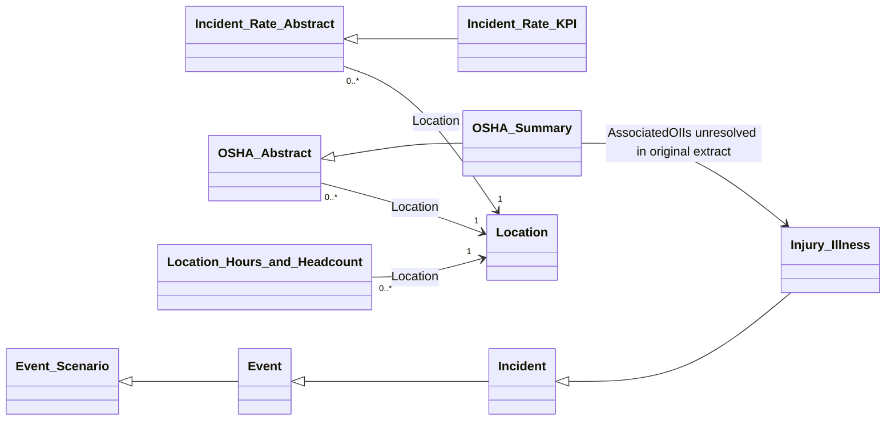

# Shared Hours Worked and OSHA Establishment analytics technical specification

Revision 5. Status: proposed target design for review. Date: November 12, 2026. No tenant configuration has been changed. This is the proposed authority for Hours Worked, OSHA Establishment, its five parallel analytics objects and the specifically modified Location Hours and Headcount contract. The original 1.0.0.0 baseline is preserved. Versions 1.0.1.0 and 1.0.2.0 are additional baseline evidence, never implemented targets. [Revision 4](history/v4/technical-specification.md), [revision 3](history/v3/technical-specification.md), [revision 2](history/v2/technical-specification.md) and [revision 1](history/v1/technical-specification.md) are superseded target history.

Use one Hours Worked object as the entry point for monthly employee/contractor hours. Each entry supplies Location, OSHA Establishment, or both and links to its corresponding monthly Hours and Headcount summaries. The summaries hold calculated hours and separately maintained headcounts. Existing location-based incident analytics/reports continue; establishment analytics/OSHA outputs use the parallel family. All 89 exported analytics fields retain their establishment counterparts; the existing location summary retains its eight fields with the revised ownership below.

Version 1.0.2.0 confirms complete dependency coverage for the existing event-service report chains and adds their reporting-folder navigation. All 25 report definitions are unchanged from 1.0.1.0, so the monthly measures, annual employee-hours/headcount arithmetic and lookup values remain as specified. Actual rate calculations, print templates and electronic-export definitions remain unresolved. The user has confirmed native GETRELATED summary linking and grid-SUM hour calculations; the previous custom shared-hours transaction mechanism is superseded. Incident attribution remains a separately owned dependency; existing incident fields are described as evidence only, with no incident-side changes designed.

## 1 Requirements and revision decisions

| Requirement | Current contract | Revision disposition |
|---|---|---|
| R1 | Retain original location analytics/report bindings; modify Location Hours and Headcount for shared-hour ownership, fixed summary identity and contribution navigation. | Refined; v1 unchanged direct-hour entry is superseded. |
| R2 | Preserve all 89 counterpart fields, metrics and reporting semantics; summary hours become calculated outputs. | Refined; separate direct-hour entry is superseded. |
| R3 | New establishment analytics/logs are independent of Location Structure. | Retained; Hours Worked is the deliberate dimension-neutral input bridge. |
| R4 | Define establishment master fields inferred from existing reporting metadata. | Retained. |
| R5 | Account for incident attribution without specifying the incident-side design. | Retained. |
| R6 | Preserve OSHA/Cal 300/300A, combined outputs, electronic export and case-level 301 navigation. | Refined in revision 3; source processing is identified, but regulatory-output binding remains unresolved. |
| R7 | Shared Hours Worked accepts Location only, OSHA Establishment only, or both; reject neither. | Added from the user-approved shared-input direction. |
| R8 | Link entries through GETRELATED and calculate each summary's employee/contractor hours with native SUM over its own related-entry grid. | Refined in revision 5; custom source/summary totals synchronization is superseded. |
| R9 | Hours Worked remains the authoritative hours input; native summary calculations maintain totals, with separate headcounts and controlled legacy cutover. | Refined in revision 5; there is no custom summary-hour writer. |

Extracted means directly supported by metadata; Inferred means indirectly supported; Proposed means introduced by the target; Unresolved means insufficient evidence. All target fields, constraints and automation remain Proposed unless identified as Extracted. Revisions 3–4 refine R2, R6 and R8 with new package evidence; it does not change the approved two-dimension hours design. New identifiers are assigned at implementation; exported TableName values do not establish a physical database model.

Establishments remain flat. Preserve Lo/Ru metric fields; matching establishment pairs use the same population and are equal. The original location family retains its verified hierarchy behavior. Never add Lo and Ru together or combine location and establishment totals. Both references on one hours row describe the same quantity under two dimensions. Neither reference defaults from the other; changing one never silently forces or clears the other.

Hours Worked is a source business record required by R7, not a duplicate audit/event object. One existing summary cannot represent all three modes without changing its scope contract. Reuse native references, uniqueness and audit. Do not add an allocation/junction object, mode catalogue, workflow, audit ledger or scheduler; the optional references express mode directly.

## 2 Package inspection and baseline

The supplied .ipack is UTF-8 JSON with a byte-order mark, not a ZIP archive. It was parsed directly without modifying the source. Package: [SummitEHSQ] Safety KPI Objects Extract, version 1.0.0.0, ID `1677184a-19e1-4e9a-8efd-2f1db8d65042`. Source owner: TerraGenTest; platform 6.6.29.0; exported 2026-11-12T17:13:03.4268393Z. SHA-256: `e9ee1a3f78189c356b522b04d0f08d7cf45b81ab994e27979cd1e52b3446889d`.

The graph contains 152 items, 388 relations, 126 included items, and 26 dependencies. It includes 12 Object items, 3 Lookup Object items, 91 fields (89 on the analytics family and 2 on Location), 7 simple types, 10 views, 10 view profiles, 6 validations, 7 links, 1 Action Handler, and 5 application records. Object ownership, type, inheritance and view bindings were resolved through GraphData.Relations, not inferred from names. Package graph IsMandatory describes export dependency, not business requiredness; field IsRequired supplies the latter.

[Package evidence](package-evidence.json) preserves exact exported field metadata, default-generator XML, validators, views, profiles, links, and resolved graph endpoints. The graphId in that file identifies the source item's $id, and recordId is the stable configuration identifier. [Target model](target-model.json) records every source-to-target field mapping and canonical contract row.

### 2.1 Baseline object inventory

Counts are directly declared fields present in this extract, not proof of a complete external object's schema. None in exported graph means no exported SuperType edge; it does not establish the full platform system inheritance chain. External dependency objects are not cloned.

| Display name | Internal name | Stable ID | Inheritance parent | Exported fields | Flags |
|---|---|---|---|---:|---|
| OSHA Abstract | `SafetyMetrics_OSHAAbstractObject` | `c6059869-bf10-47f0-b0a7-5d31536a49a4` | None in exported graph | 35 | Abstract; location-bound flag true |
| Incident Rate KPI | `SafetyMetrics_IncidentRateKPIObject` | `ec05b841-5259-4905-bbe1-57a302189d32` | SafetyMetrics_IncRateAbstractObject | 4 | Concrete; location-bound flag false |
| Incident Rate Abstract | `SafetyMetrics_IncRateAbstractObject` | `1c5170ba-c22c-4b43-9471-b3f4e32dd736` | None in exported graph | 25 | Abstract; location-bound flag true |
| Incident | `EHSIncidentMang_IncidentObject` | `fd73e13c-2359-43e8-b6ea-8b79743a5aff` | EventFwk_EventObject | 0 | Abstract; location-bound flag false |
| Event | `EventFwk_EventObject` | `3979d543-6df2-46a1-a26e-293cd7978bdc` | EventFwk_EventScenarioObject | 0 | Concrete; location-bound flag false |
| Location | `SysLocationEntity` | `f5d5209b-0a7d-4858-a302-678fcc065dd2` | None in exported graph | 2 | Concrete; location-bound flag false |
| OSHA Summary | `SafetyMetrics_OSHASummaryObject` | `420f7f71-a61f-45ab-a9b6-9b64c7a3a1e9` | SafetyMetrics_OSHAAbstractObject | 17 | Concrete; location-bound flag false |
| Injury/Illness | `EHSIncidentMang_OIIObject` | `bbc02abb-6a22-4d72-9e8c-cb7cb26a596a` | EHSIncidentMang_IncidentObject | 0 | Concrete; location-bound flag false |
| Location Hours and Headcount | `SafetyMetrics_HrsandHeadcountObject` | `0f0ecb2a-5f62-4faf-9609-b98873007c83` | None in exported graph | 8 | Concrete; location-bound flag true |
| OSHA Establishment Type | `EHSIncidentMang_EstablishmeTypeObject` | `bfd31eec-2b15-46e6-bf3e-1583e382745c` | None in exported graph | 0 | Concrete; location-bound flag false |
| Setting Abstract | `FragApplication_SettingAbsObject` | `e838a178-5e15-47f6-81fc-dbae30b9b603` | None in exported graph | 0 | Abstract; location-bound flag false |
| Event Scenario | `EventFwk_EventScenarioObject` | `c0d0d372-c03c-46cd-9f51-cdd28b620177` | None in exported graph | 0 | Concrete; location-bound flag true |
| OSHA Establishment Size | `EHSIncidentMang_EstablishmeSizeObject` | `bcb89cad-109b-47cf-a3b2-3bb8ac766f7a` | None in exported graph | 0 | Concrete; location-bound flag false |
| OII Setting | `EHSIncidentMang_OIISettingObject` | `bf46dd3b-cefa-48e8-865a-add097587ba4` | FragApplication_SettingAbsObject | 0 | Concrete; location-bound flag false |
| Has OSHA Recordable Injuries | `EHSIncidentMang_HasRecordaInjurObject` | `d61d4b82-b2f4-43d0-acc4-af4f6484cbd3` | None in exported graph | 0 | Concrete; location-bound flag false |

### 2.2 Baseline structure



Diagram identifiers replace spaces and punctuation in the display names. Location relationships are required single references (IsStartOfRelation=TRUE, target Type=SysLocationEntity). AssociatedOIIs has IsStartOfRelation=FALSE but the opposing property and relation metadata are not exported; do not assert a verified 1:M inverse or M:N mapping. The OSHA log grid traverses AssociatedOIIs.OSHARecord and filters InjuryIllnes.OSHARecordable=TRUE. Those incident fields and OSHARecord schema were view references in the original extract; section 2.5 records the additional definitions now supplied.

### 2.3 Original-extract findings and revision-3 dispositions

The inventory and diagram in 2.1–2.2 describe the original 1.0.0.0 extract. Its 91 exported field Calculation properties remain null; those findings do not describe all fields in the expanded extract. Read the dispositions below as current evidence.

| Earlier limitation | Current evidence and consequence |
|---|---|
| No aggregation configuration | Answered: 25 reports, eight import-settings records and three Event Handler flows now show the KPI/OSHA processing chains. Sections 5 and 6 specify their supported source behavior. They do not prove a supported cross-object transaction for Hours Worked. |
| Unknown monthly incident measures | Answered for the exported OII pipeline: count Injury/Illness rows by DateUserEntered month and apply the source day/flag rules in 5.1. No additional incident-type population is inferred. |
| Unknown annual employment calculation | Answered: employee hours only; sum monthly employee headcount divided by COUNT(monthly-summary Id), with zero when count is zero. No rounding expression is exported. |
| Lookup records absent | Answered for source values: all three lookup schemas and eight records are now exported. Reuse them under 4.9; no new catalogue or reparenting. |
| AssociatedOIIs and case path unverified | Partly answered: OII.OSHASummary and OII.OSHARecord are now present; the existing summary collection is exported with IsStartOfRelation=false. Pairing it with OSHASummary is inferred from direction, targets, import and view usage; the explicit inverse-pair identifier is not exported. The establishment-side declaring relationship remains separately owned. |
| Print settings/templates/dashboard absent | Still open: the 18 Template items are notification-template wrappers/records, not OSHA print forms. OII Setting exports FormType and EnableDT only; the OSHA template properties referenced in URLs are absent. |
| Helper-population event unknown | Same handler GUID 5d1ff7d0-0a65-455f-a19b-8ab03332b0d9, now graphId 2527; ActionType=3 is still not decoded. Its flow condition and assignment are confirmed; generated-summary initialization remains A1 responsibility. |
| Stale view profiles and Combined Cal/OSHA parameter discrepancy | Still open; more source evidence does not establish a corrected parameter or valid replacement profile. |

### 2.4 Expanded package evidence

The supplied version 1.0.1.0 is UTF-8 JSON with a BOM, not an archive. It has the same package ID as the original, exported from TerraGenTest on 2026-11-12T21:34:39.1305407Z, platform 6.6.29.0. SHA-256: `8730cf3b3ea68e6d1a8a00964f1809de525da9b7c6c26f9f1b9cc0934cb29ac4`. Parse its nested graphs and resolve global $id/$ref serialization references before counting or tracing configuration. The root has 693 item entries; recursive resolution yields 752 distinct package items across 24 graphs, including 58 object/lookup definitions, 278 fields, 25 reports, 75 mappings, 84 source fields, eight scheduled imports, three Event Handlers, two schedules and 20 Object Action Handlers. There are 2,697 graph relation occurrences; repeated edges across nested graphs are retained as export occurrences, not new logical relationships. All serialization IDs and reference endpoints resolve.

[Expanded package evidence](package-evidence-v1.0.1.0.json), [stable-identity comparison](package-comparison-v1.0.1.0.json) and [decoded report definitions](report-definitions-v1.0.1.0.json) preserve the new findings. Match configuration by Type plus RecordId (or package item Id for wrappers), not graphId or RecordId alone: graph IDs change between exports and security records share their protected object's RecordId. Added metadata is evidence expansion, not proof that the OOTB product changed. No original item is absent from this extract.

The original [package evidence](package-evidence.json) is unchanged. The target remains a logical Intelex object model with eight owned/modified objects and 126 field/grid definitions; the expanded package does not become a target deployment or authorize unrelated incident configuration. Existing source-to-target tables retain original graphIds; their stable field GUIDs bridge to the expanded evidence. The expanded analytics family additionally exposes the standard system Id on OSHA Summary. Every target record uses its native generated identity; do not add a duplicate custom Id field or count this newly exposed system property as a new business-field requirement.

### 2.5 Existing relationship evidence

`EHSIncidentMang_OIIObject.OSHASummary` (f4cb74c8-e197-4406-b533-87bb8a48e05e, new graphId 1141) is an optional reference to `SafetyMetrics_OSHASummaryObject`, IsStartOfRelation=true. `SafetyMetrics_OSHASummaryObject.AssociatedOIIs` (d4d44121-35de-45c8-81b0-7762edcc4be6, graphId 2702) targets OII with IsStartOfRelation=false. This supports an inferred inverse 1:M navigation pattern, not a new stored collection. `OII.OSHARecord` (6ac0955a-2c71-42db-8206-492001561438, graphId 1154) explicitly describes M:1 to `EHSIncidentMang_OSHAObject`, optional. Multiple OIIs per case record must not be ruled out by assuming 1:1.

The baseline can therefore be read as OII → optional location OSHA Summary; location OSHA Summary → Associated OIIs navigation; OII → optional OSHA case. The target's establishment collection must use its separately supplied declaring reference/query and preserve existing location links. No incident-side field name or change is prescribed here.

### 2.6 Current package 1.0.2.0 and report completeness

The current supplied package is UTF-8 JSON with a BOM, exported from TerraGenTest on 2026-11-12T21:46:55.8898568Z, platform 6.6.29.0; package ID is unchanged. SHA-256: `c7716f41d56fcaf1f80991aae602a17b08e8192190004a02d78560adde2724aa`. Recursive inspection resolves 757 distinct package items across 24 graphs, 698 root item entries and 2,726 relation occurrences, with no unresolved serialization references or graph endpoints. The extract retains 58 object/lookup definitions, 278 fields, 25 reports, eight import-settings records, eight scheduled imports and three Event Handlers.

Compared with 1.0.1.0, the five added items are Reporting navigation records: Applications, Health & Safety, Safety Metrics, OOB - Incident Rate Data Setup and OOB - OSHA Data Setup. Twenty report records now explicitly carry Visualizations=null. All 25 report Definition strings, all field definitions, all import mappings and all Event Handler flows are unchanged. The new metadata does not establish an actual-rate dashboard, OSHA print template, electronic-file report or additional business object.

The [current package evidence](package-evidence-v1.0.2.0.json), [version comparison](package-comparison-v1.0.2.0.json), [decoded definitions](report-definitions-v1.0.2.0.json) and [complete source lineage](report-lineage-v1.0.2.0.md) retain the evidence. All eight scheduled imports resolve through their settings and Source Report.DataDefinition to a real report. All 75 field-mapping source aliases resolve to actual report projections. The 27 report-to-report references resolve without a cycle, and their dependency closure reaches all 25 reports; no underlying report definition is missing within these exported event-service chains.

Sections 2.4–2.5 and their graphId citations identify version 1.0.1.0 evidence. Original field-copy mapping graphIds identify version 1.0.0.0 evidence. Stable record GUIDs, not graphIds, link the versions; the lineage inventory supplies current report graphIds. The original baseline and all prior evidence remain unchanged. The target still has eight owned/modified objects and 126 field/grid rows.

### 2.7 User-confirmed native hours design

On November 12, 2026 the user confirmed that an Hours Worked Create/Update Action Handler uses GETRELATED to connect each populated dimension to its monthly summary, creating a matching summary when none exists. Each summary calculates its own employee and contractor hours through its Hours Worked Entries grid. Native relationship/calculation behavior accounts for entry creation, hour changes, deletion and relinking. This supersedes the agent-proposed custom synchronization processor, manual summary-hour writes and source/two-summary transaction/lock requirements. These are user-confirmed platform/design facts, not new package-extracted implementations.

The user supplied the signature GETRELATED("TargetObject", "TargetField1", SourceValue1, "TargetFieldN", SourceValueN), with matched target/source data types and a relationship's corresponding identifier field as the target search key. Their example object/field names were explicitly illustrative. Section 6.2 uses the actual extracted location-object/Date names and the proposed establishment/source names; corresponding native ID-key spellings are marked for metadata confirmation rather than presented as exported fields.

## 3 Proposed object model

Seven objects are new: OSHA Establishment, five establishment analytics objects and Hours Worked. One existing object, Location Hours and Headcount, is modified while retaining its object/field GUIDs and location binding. All other owned objects are not location-bound. The new abstract bases do not inherit the source location-bound bases. Enable native audit on mutable business data and references; no new workflows are added.

| Object | Internal name | Action | Stable ID | Inheritance parent | Kind and binding | Direct fields/grids |
|---|---|---|---|---|---|---:|
| OSHA Establishment | `TG_OSHAEstablishmentObject` | Add | New GUID at configuration | None | Concrete; not location-bound | 19 |
| Establishment Incident Rate Abstract | `TG_EstIncRateAbstractObject` | Add | New GUID at configuration | None | Abstract; not location-bound | 25 |
| Establishment Incident Rate KPI | `TG_EstIncidentRateKPIObject` | Add | New GUID at configuration | TG_EstIncRateAbstractObject | Concrete; not location-bound | 4 |
| Establishment OSHA Abstract | `TG_EstOSHAAbstractObject` | Add | New GUID at configuration | None | Abstract; not location-bound | 35 |
| Establishment OSHA Summary | `TG_EstOSHASummaryObject` | Add | New GUID at configuration | TG_EstOSHAAbstractObject | Concrete; not location-bound | 17 |
| Establishment Hours and Headcount | `TG_EstHrsHeadcountObject` | Add | New GUID at configuration | None | Concrete; not location-bound | 9 |
| Location Hours and Headcount | `SafetyMetrics_HrsandHeadcountObject` | Modify | 0f0ecb2a-5f62-4faf-9609-b98873007c83 | None | Concrete; location-bound | 9 |
| Hours Worked | `TG_HoursWorkedObject` | Add | New GUID at configuration | None | Concrete; not location-bound | 8 |

```mermaid
classDiagram
direction LR
class OSHA_Establishment {
  +Text Code
  +Text Name
  +Boolean Active
}
class Establishment_Incident_Rate_Abstract {
  +Reference OSHAEstablishment
  +Date Date
}
class Establishment_Incident_Rate_KPI
class Establishment_OSHA_Abstract {
  +Reference OSHAEstablishment
  +Date Date
}
class Establishment_OSHA_Summary
class Establishment_Hours_and_Headcount {
  +Reference OSHAEstablishment
  +Date Date
  +Float EmployeeHrs calculated
  +Float ContractrHrs calculated
}
class Hours_Worked {
  +Text SourceEntryID
  +Date Month
  +Float EmployeeHours
  +Float ContractorHours
}
class Location
class Location_Hours_and_Headcount {
  +Float EmployeeHrs calculated
  +Float ContractrHrs calculated
}
class OII_Setting
class OSHA_Establishment_Type
class OSHA_Establishment_Size
class Has_OSHA_Recordable_Injuries
class Injury_Illness
Hours_Worked "0..*" --> "0..1" Location : Location
Hours_Worked "0..*" --> "0..1" OSHA_Establishment : OSHAEstablishment
Hours_Worked "0..*" --> "0..1" Location_Hours_and_Headcount : LocationHoursHeadcount
Hours_Worked "0..*" --> "0..1" Establishment_Hours_and_Headcount : EstablishmentHoursHeadcount
Location_Hours_and_Headcount "0..*" --> "1" Location : Location
Establishment_Incident_Rate_Abstract <|-- Establishment_Incident_Rate_KPI
Establishment_OSHA_Abstract <|-- Establishment_OSHA_Summary
Establishment_Incident_Rate_Abstract "0..*" --> "1" OSHA_Establishment : OSHAEstablishment
Establishment_OSHA_Abstract "0..*" --> "1" OSHA_Establishment : OSHAEstablishment
Establishment_Hours_and_Headcount "0..*" --> "1" OSHA_Establishment : OSHAEstablishment
Establishment_OSHA_Abstract "0..*" --> "0..1" OII_Setting : OIISettings
OSHA_Establishment "0..*" --> "0..1" OSHA_Establishment_Type : EstablishmentType
OSHA_Establishment "0..*" --> "0..1" OSHA_Establishment_Size : EstablishmentSize
Establishment_OSHA_Summary "0..*" --> "0..1" OSHA_Establishment_Type : EstablishmeType
Establishment_OSHA_Summary "0..*" --> "0..1" OSHA_Establishment_Size : EstablishmtSize
Establishment_OSHA_Summary "0..*" --> "0..1" Has_OSHA_Recordable_Injuries : AnyRecrdblIncid
Establishment_OSHA_Summary "1" --> "0..*" Injury_Illness : AssociatedOIIs proposed navigation, binding pending
class OSHA_Case
Injury_Illness "0..*" --> "0..1" OSHA_Case : existing OSHARecord M:1
```

OII Setting, OSHA Establishment Type, OSHA Establishment Size, Has OSHA Recordable Injuries, Injury/Illness and Location are unchanged external dependencies. Each is identified separately in section 4.9. Incident-to-establishment linkage is deliberately omitted from the diagram pending the separate incident design. Target cardinalities are proposed constraints; the establishment collection is proposed 1:M navigation, while its new declaring reference and inverse binding remain separately owned and unresolved. Establishment master inverse grids are navigation over the three declaring references, never additional stored relationships. No inverse is enabled on shared catalogue references.

Hours Worked requires at least one dimension and, at completed save, a matching summary link for each populated dimension. The absent dimension has a NULL summary link. The source-side link owns each relationship; Hours Worked Entries on each summary is its readonly inverse, not a second stored relationship. No new Hours Worked inverse is added on either dimension master. Mermaid identifiers replace spaces/punctuation in display names.

## 4 Field level implementation contract

One row defines one directly declared field or designed inverse grid. Inherited fields are declared once on the base. Default zero does not prove calculation or input completeness. Field mappings preserve exact source names and stable identifiers. Cloned Text capacity is unresolved where metadata is null; verify tenant capacities before loading master snapshots. Float retains System.Double. Date is calendar-based with timezone capture disabled; imports must not shift month/year through UTC conversion. Master text limits must fit summary destinations. No published-version objects or publish-copy lifecycle are needed.

### 4.1 OSHA Establishment

**Inheritance parent:** None. Concrete object.

**Directly declared fields:** 19.

| Field | Type / relationship | Req | Default / calculation | Editability and visibility | Automation / lifecycle |
|---|---|---:|---|---|---|
| Code | Text, max 100 | Y | None; unique, non-localizable | Establishment administrator editable before first use | Stable integration key after first use; native audit |
| Name | Text, max 255; legal reporting label, non-localizable | Y | None | Establishment administrator editable | Display field; does not rewrite existing annual snapshots |
| Active? | Yes/No | Y | TRUE | Establishment administrator editable | FALSE prevents new ordinary selections and routine period generation; retains history and authorized historical corrections |
| Company Name | Text, max 255 | Conditional | None | Administrator editable; required for report generation | Copied to annual CompanyName at initial generation; later changes do not cascade |
| Street | Text, max 255 | Conditional | None | Administrator editable; required for report generation | Copied to annual LocationStreet at initial generation |
| City | Text, max 100 | Conditional | None | Administrator editable; required for report generation | Copied to annual LocationCity at initial generation |
| State | Text, max 100 | Conditional | None | Administrator editable; required for report generation | Copied to annual LocationState at initial generation |
| Postal Code | Text, max 30 | Conditional | None | Administrator editable; required for report generation | Copied to annual LocationPostal at initial generation |
| EIN Number | Text, max 30 | N | None | Administrator editable | Copied to annual EINNumber at initial generation; submission validation is output-specific |
| NAICS Code | Number / bigint, System.Int64 | N | None | Administrator editable | Copied to annual NAICSCode at initial generation; retain original numeric representation for parity |
| SIC Code | Number / bigint, System.Int64 | N | None | Administrator editable | Copied to annual SICCode at initial generation |
| Industry Description | Text, max 1000 | N | None | Administrator editable | Copied to annual InduDescription at initial generation |
| Establishment Type | M:1 to EHSIncidentMang_EstablishmeTypeObject, 0..1 target; inverse disabled | N | None | Administrator editable; preserve referenced values; new selections use native Deleted=FALSE; retain existing references if a value is later deleted | Reuses existing catalogue; copied to annual EstablishmeType; no new values seeded |
| Establishment Size | M:1 to EHSIncidentMang_EstablishmeSizeObject, 0..1 target; inverse disabled | N | None | Administrator editable; preserve referenced values; new selections use native Deleted=FALSE; retain existing references if a value is later deleted | Reuses existing catalogue; copied to annual EstablishmtSize; do not invent size thresholds |
| Establishment ID | Text, max 100 | N | None | Administrator editable | External reporting identifier; distinct from Code and native record GUID; copied to annual EstablishmentID |
| OSHA 300a ID | Text, max 100 | N | None | Administrator editable | External reporting identifier; copied to annual OSHA300aID; format and annual applicability require output validation |
| Hours and Headcounts | Inverse 1:M grid from Establishment Hours and Headcount.OSHA Establishment | N | None | Read only; authorized analytics users | Navigation over the declaring relationship; no duplicate storage |
| Incident Rate KPIs | Inverse 1:M grid from Establishment Incident Rate KPI.OSHA Establishment (inherited) | N | None | Read only; authorized analytics users | Navigation over the declaring relationship; no duplicate storage; concrete records only |
| OSHA Summaries | Inverse 1:M grid from Establishment OSHA Summary.OSHA Establishment (inherited) | N | None | Read only; authorized regulatory users | Navigation over the declaring relationship; no duplicate storage; concrete records only |

Field mapping:

| Field display name | Internal name | Source evidence |
|---|---|---|
| Code | `Code` | Proposed; new native GUID at implementation |
| Name | `Name` | Proposed; new native GUID at implementation |
| Active? | `Active` | Proposed; new native GUID at implementation |
| Company Name | `CompanyName` | Proposed; new native GUID at implementation |
| Street | `Street` | Proposed; new native GUID at implementation |
| City | `City` | Proposed; new native GUID at implementation |
| State | `State` | Proposed; new native GUID at implementation |
| Postal Code | `PostalCode` | Proposed; new native GUID at implementation |
| EIN Number | `EINNumber` | Proposed; new native GUID at implementation |
| NAICS Code | `NAICSCode` | Proposed; new native GUID at implementation |
| SIC Code | `SICCode` | Proposed; new native GUID at implementation |
| Industry Description | `IndustryDescription` | Proposed; new native GUID at implementation |
| Establishment Type | `EstablishmentType` | Proposed; new native GUID at implementation |
| Establishment Size | `EstablishmentSize` | Proposed; new native GUID at implementation |
| Establishment ID | `EstablishmentID` | Proposed; new native GUID at implementation |
| OSHA 300a ID | `OSHA300aID` | Proposed; new native GUID at implementation |
| Hours and Headcounts | `HoursHeadcounts` | Proposed; new native GUID at implementation |
| Incident Rate KPIs | `IncidentRateKPIs` | Proposed; new native GUID at implementation |
| OSHA Summaries | `OSHASummaries` | Proposed; new native GUID at implementation |

Initial values: No establishment records inferred or seeded; load the governed register.

### 4.2 Establishment Incident Rate Abstract

**Inheritance parent:** None. Abstract and non-instantiable.

**Directly declared fields:** 25.

| Field | Type / relationship | Req | Default / calculation | Editability and visibility | Automation / lifecycle |
|---|---|---:|---|---|---|
| Record No | AutoNumber, System.Int64 | Y | None in metadata; native AutoNumber population required | Read only; analytics users may view | Native AutoNumber; new target sequence, never reuse source identity |
| Date | Date; calendar date, timezone capture disabled | Y | None; A2 supplies month start or A3 supplies January 1 | Read only; analytics users may view | A2 sets first day of month; unique OSHAEstablishment + Date |
| OSHA Establishment | M:1 to OSHA Establishment; exactly 1 target per record; inverse Incident Rate KPIs | Y | None; mandatory generation/import scope | Read only on generated period forms; A2/A3 supplies scope; historical inactive references retained | A2/A3 supplies reference at creation; no ordinary user reassignment of generated periods |
| Number of Days Away - Rollup | Number / bigint, System.Int64 | N | 0 | Read only; analytics users may view | A2: Sum NumDaysAway, treating empty report values as 0. Join by supplied establishment attribution and OII.MonthYearHelp derived from DateUserEntered. Lo/Ru equal for flat scope. Source: [SM-KPI] 02 - Location KPI Data (graphId 2737); report-context logic, not a field formula. Corrections/rebuilds use the complete affected month/year; the source 36-hour scope selector is not an incident-population filter (6.6). |
| Number of Recordable/Reportable - Rollup | Number / bigint, System.Int64 | N | 0 | Read only; analytics users may view | A2: Sum 1 for a nonempty OSHARecordable value other than the source report literal "0", otherwise 0; reproduce the source report Boolean conversion behavior. Join by supplied establishment attribution and OII.MonthYearHelp derived from DateUserEntered. Lo/Ru equal for flat scope. Source: [SM-KPI] 02 - Location KPI Data (graphId 2737); report-context logic, not a field formula. Corrections/rebuilds use the complete affected month/year; the source 36-hour scope selector is not an incident-population filter (6.6). |
| Number of Fatalities - Establishment | Number / bigint, System.Int64 | N | 0 | Read only; analytics users may view | A2: Sum 1 for nonempty DiedfromInj other than source report literal "0", otherwise 0. Join by supplied establishment attribution and OII.MonthYearHelp derived from DateUserEntered. Lo/Ru equal for flat scope. Source: [SM-KPI] 02 - Location KPI Data (graphId 2737); report-context logic, not a field formula. Corrections/rebuilds use the complete affected month/year; the source 36-hour scope selector is not an incident-population filter (6.6). |
| Number of Incidents - Rollup | Number / bigint, System.Int64 | N | 0 | Read only; analytics users may view | A2: Count Injury/Illness.Id rows in the establishment/month population; not generic Incident rows or distinct OSHA cases. Join by supplied establishment attribution and OII.MonthYearHelp derived from DateUserEntered. Lo/Ru equal for flat scope. Source: [SM-KPI] 02 - Location KPI Data (graphId 2737); report-context logic, not a field formula. Corrections/rebuilds use the complete affected month/year; the source 36-hour scope selector is not an incident-population filter (6.6). |
| [Helper] Establishment Name | Text / nvarchar; length not constrained in export | N | None; populated from OSHA Establishment.Name | Read only; analytics users may view | A2 stamps at generation; preserves display for inactive establishments; explicit administrator correction only |
| Number of Lost Days - Rollup | Number / bigint, System.Int64 | N | 0 | Read only; analytics users may view | A2: Sum NumDaysAway + NumJobTransfer + NumRestrictDay, treating empty report values as 0. Join by supplied establishment attribution and OII.MonthYearHelp derived from DateUserEntered. Lo/Ru equal for flat scope. Source: [SM-KPI] 02 - Location KPI Data (graphId 2737); report-context logic, not a field formula. Corrections/rebuilds use the complete affected month/year; the source 36-hour scope selector is not an incident-population filter (6.6). |
| Contractor Worked Hours - Establishment | Float, System.Double; precision/scale not constrained in export | N | 0 | Read only; analytics users may view | A2 reads Establishment Hours and Headcount.ContractrHrs for matching OSHAEstablishment + Date after the saved links and native summary sums are current; Lo/Ru use identical flat scope Corrections/rebuilds use the complete affected month/year; the source 36-hour scope selector is not an incident-population filter (6.6). |
| [Helper] Establishment ID | GUID | Y | None; native GUID of OSHA Establishment reference | Read only; hidden on ordinary form | A2/A3 stamps at creation; hidden helper, never uses SysLocationEntity GUID |
| Number of Incidents - Establishment | Number / bigint, System.Int64 | N | 0 | Read only; analytics users may view | A2: Count Injury/Illness.Id rows in the establishment/month population; not generic Incident rows or distinct OSHA cases. Join by supplied establishment attribution and OII.MonthYearHelp derived from DateUserEntered. Lo/Ru equal for flat scope. Source: [SM-KPI] 02 - Location KPI Data (graphId 2737); report-context logic, not a field formula. Corrections/rebuilds use the complete affected month/year; the source 36-hour scope selector is not an incident-population filter (6.6). |
| Number of Incidents with Days Away - Rollup | Number / bigint, System.Int64 | N | 0 | Read only; analytics users may view | A2: Sum 1 when NumDaysAway > 0, otherwise 0. Join by supplied establishment attribution and OII.MonthYearHelp derived from DateUserEntered. Lo/Ru equal for flat scope. Source: [SM-KPI] 02 - Location KPI Data (graphId 2737); report-context logic, not a field formula. Corrections/rebuilds use the complete affected month/year; the source 36-hour scope selector is not an incident-population filter (6.6). |
| Number of Lost Days - Establishment | Number / bigint, System.Int64 | N | 0 | Read only; analytics users may view | A2: Sum NumDaysAway + NumJobTransfer + NumRestrictDay, treating empty report values as 0. Join by supplied establishment attribution and OII.MonthYearHelp derived from DateUserEntered. Lo/Ru equal for flat scope. Source: [SM-KPI] 02 - Location KPI Data (graphId 2737); report-context logic, not a field formula. Corrections/rebuilds use the complete affected month/year; the source 36-hour scope selector is not an incident-population filter (6.6). |
| Number of Incidents with Days Away - Establishment | Number / bigint, System.Int64 | N | 0 | Read only; analytics users may view | A2: Sum 1 when NumDaysAway > 0, otherwise 0. Join by supplied establishment attribution and OII.MonthYearHelp derived from DateUserEntered. Lo/Ru equal for flat scope. Source: [SM-KPI] 02 - Location KPI Data (graphId 2737); report-context logic, not a field formula. Corrections/rebuilds use the complete affected month/year; the source 36-hour scope selector is not an incident-population filter (6.6). |
| Contractor Worked Hours - Rollup | Float, System.Double; precision/scale not constrained in export | N | 0 | Read only; analytics users may view | A2 reads Establishment Hours and Headcount.ContractrHrs for matching OSHAEstablishment + Date after the saved links and native summary sums are current; Lo/Ru use identical flat scope Corrections/rebuilds use the complete affected month/year; the source 36-hour scope selector is not an incident-population filter (6.6). |
| Number of Incidents with Lost Time - Rollup | Number / bigint, System.Int64 | N | 0 | Read only; analytics users may view | A2: Sum 1 when NumDaysAway + NumJobTransfer + NumRestrictDay > 0, otherwise 0. Join by supplied establishment attribution and OII.MonthYearHelp derived from DateUserEntered. Lo/Ru equal for flat scope. Source: [SM-KPI] 02 - Location KPI Data (graphId 2737); report-context logic, not a field formula. Corrections/rebuilds use the complete affected month/year; the source 36-hour scope selector is not an incident-population filter (6.6). |
| Employee Worked Hours - Rollup | Float, System.Double; precision/scale not constrained in export | N | 0 | Read only; analytics users may view | A2 reads Establishment Hours and Headcount.EmployeeHrs for matching OSHAEstablishment + Date after the saved links and native summary sums are current; Lo/Ru use identical flat scope Corrections/rebuilds use the complete affected month/year; the source 36-hour scope selector is not an incident-population filter (6.6). |
| Number of Incidents with Lost Time - Establishment | Number / bigint, System.Int64 | N | 0 | Read only; analytics users may view | A2: Sum 1 when NumDaysAway + NumJobTransfer + NumRestrictDay > 0, otherwise 0. Join by supplied establishment attribution and OII.MonthYearHelp derived from DateUserEntered. Lo/Ru equal for flat scope. Source: [SM-KPI] 02 - Location KPI Data (graphId 2737); report-context logic, not a field formula. Corrections/rebuilds use the complete affected month/year; the source 36-hour scope selector is not an incident-population filter (6.6). |
| Number of Job Transfer and Restricted Days - Rollup | Number / bigint, System.Int64 | N | 0 | Read only; analytics users may view | A2: Sum NumJobTransfer + NumRestrictDay, treating empty report values as 0. Join by supplied establishment attribution and OII.MonthYearHelp derived from DateUserEntered. Lo/Ru equal for flat scope. Source: [SM-KPI] 02 - Location KPI Data (graphId 2737); report-context logic, not a field formula. Corrections/rebuilds use the complete affected month/year; the source 36-hour scope selector is not an incident-population filter (6.6). |
| Number of Job Transfer and Restricted Days - Establishment | Number / bigint, System.Int64 | N | 0 | Read only; analytics users may view | A2: Sum NumJobTransfer + NumRestrictDay, treating empty report values as 0. Join by supplied establishment attribution and OII.MonthYearHelp derived from DateUserEntered. Lo/Ru equal for flat scope. Source: [SM-KPI] 02 - Location KPI Data (graphId 2737); report-context logic, not a field formula. Corrections/rebuilds use the complete affected month/year; the source 36-hour scope selector is not an incident-population filter (6.6). |
| Number of Days Away - Establishment | Number / bigint, System.Int64 | N | 0 | Read only; analytics users may view | A2: Sum NumDaysAway, treating empty report values as 0. Join by supplied establishment attribution and OII.MonthYearHelp derived from DateUserEntered. Lo/Ru equal for flat scope. Source: [SM-KPI] 02 - Location KPI Data (graphId 2737); report-context logic, not a field formula. Corrections/rebuilds use the complete affected month/year; the source 36-hour scope selector is not an incident-population filter (6.6). |
| Number of Recordable/Reportable - Establishment | Number / bigint, System.Int64 | N | 0 | Read only; analytics users may view | A2: Sum 1 for a nonempty OSHARecordable value other than the source report literal "0", otherwise 0; reproduce the source report Boolean conversion behavior. Join by supplied establishment attribution and OII.MonthYearHelp derived from DateUserEntered. Lo/Ru equal for flat scope. Source: [SM-KPI] 02 - Location KPI Data (graphId 2737); report-context logic, not a field formula. Corrections/rebuilds use the complete affected month/year; the source 36-hour scope selector is not an incident-population filter (6.6). |
| Employee Worked Hours - Establishment | Float, System.Double; precision/scale not constrained in export | N | 0 | Read only; analytics users may view | A2 reads Establishment Hours and Headcount.EmployeeHrs for matching OSHAEstablishment + Date after the saved links and native summary sums are current; Lo/Ru use identical flat scope Corrections/rebuilds use the complete affected month/year; the source 36-hour scope selector is not an incident-population filter (6.6). |
| Number of Fatalities - Rollup | Number / bigint, System.Int64 | N | 0 | Read only; analytics users may view | A2: Sum 1 for nonempty DiedfromInj other than source report literal "0", otherwise 0. Join by supplied establishment attribution and OII.MonthYearHelp derived from DateUserEntered. Lo/Ru equal for flat scope. Source: [SM-KPI] 02 - Location KPI Data (graphId 2737); report-context logic, not a field formula. Corrections/rebuilds use the complete affected month/year; the source 36-hour scope selector is not an incident-population filter (6.6). |

Field mapping:

| Field display name | Internal name | Source evidence |
|---|---|---|
| Record No | `RecordNo` | `RecordNo`; graphId 50; GUID `043f6a0d-5d53-4f2c-9ce8-0afc63a0b0c2` |
| Date | `Date` | `Date`; graphId 56; GUID `ff23157a-1cf6-4979-97c2-ae2895d3201e` |
| OSHA Establishment | `OSHAEstablishment` | `Location`; graphId 58; GUID `47e4fcf0-502a-4567-8f26-4cadfc038c73` |
| Number of Days Away - Rollup | `RuNumDaysAway` | `RuNumDaysAway`; graphId 78; GUID `6a867f71-aa59-4a0f-9424-bec709d10655` |
| Number of Recordable/Reportable - Rollup | `RuCtRecordable` | `RuCtRecordable`; graphId 94; GUID `88037be2-4963-4b60-8f3a-deba17db7dba` |
| Number of Fatalities - Establishment | `LoNumFatalities` | `LoNumFatalities`; graphId 96; GUID `a83fede5-74ae-4a23-957b-ef7ff00203d5` |
| Number of Incidents - Rollup | `RuCtIncidents` | `RuCtIncidents`; graphId 133; GUID `b75e75e4-c641-447e-81d8-cc18704ac8cb` |
| [Helper] Establishment Name | `LocNameHelper` | `LocNameHelper`; graphId 159; GUID `81b5d8d6-5bff-49b5-a669-61ac051f1be0` |
| Number of Lost Days - Rollup | `RuNumLostDays` | `RuNumLostDays`; graphId 193; GUID `a2d7e328-40a0-420d-9b0c-38a6276247ff` |
| Contractor Worked Hours - Establishment | `LoCntrctWrkdHrs` | `LoCntrctWrkdHrs`; graphId 197; GUID `53ec5a18-4bf9-4c7c-8a33-451cf2417c62` |
| [Helper] Establishment ID | `LocationIdHelp` | `LocationIdHelp`; graphId 199; GUID `3ea4baa8-dcc1-4177-a4a6-ad1017b4d40b` |
| Number of Incidents - Establishment | `LoCtIncidents` | `LoCtIncidents`; graphId 212; GUID `736d7978-6935-4eb3-9098-6b7b7d391a84` |
| Number of Incidents with Days Away - Rollup | `RuNumIncDayAway` | `RuNumIncDayAway`; graphId 259; GUID `553bb1be-bd16-45ca-94e0-390d26d1019c` |
| Number of Lost Days - Establishment | `LoNumLostDays` | `LoNumLostDays`; graphId 267; GUID `4b7b009e-ede4-487b-92ca-beb73df52e64` |
| Number of Incidents with Days Away - Establishment | `LoNumIncDayAway` | `LoNumIncDayAway`; graphId 275; GUID `a8c7f1b8-9643-43c4-a36e-808c494aec70` |
| Contractor Worked Hours - Rollup | `RuCntrctWrkdHrs` | `RuCntrctWrkdHrs`; graphId 320; GUID `ba2eec4a-ce5d-4de9-885a-d6799508bab5` |
| Number of Incidents with Lost Time - Rollup | `RuNumIncLostTim` | `RuNumIncLostTim`; graphId 331; GUID `c6626d90-5f1b-4950-b266-e75e837caecb` |
| Employee Worked Hours - Rollup | `RuEmplWrkdHours` | `RuEmplWrkdHours`; graphId 333; GUID `1d59a6b3-d05a-4f5f-97cb-35527693d811` |
| Number of Incidents with Lost Time - Establishment | `LoNumIncLostTim` | `LoNumIncLostTim`; graphId 356; GUID `f258419d-0555-46da-9777-892a24dd1d84` |
| Number of Job Transfer and Restricted Days - Rollup | `RuNumTrnsfRstDy` | `RuNumTrnsfRstDy`; graphId 358; GUID `30bd6dfd-e613-46df-a5fb-789807f4dbdb` |
| Number of Job Transfer and Restricted Days - Establishment | `LoNumTrnsfRstDy` | `LoNumTrnsfRstDy`; graphId 360; GUID `0d60d4c4-7643-4256-bdcd-0ddb6e9ded31` |
| Number of Days Away - Establishment | `LoNumDaysAway` | `LoNumDaysAway`; graphId 364; GUID `b831e2f5-81da-4a28-8556-1b9939b1a379` |
| Number of Recordable/Reportable - Establishment | `LoCtRecordable` | `LoCtRecordable`; graphId 368; GUID `76c14f73-0411-4d97-aa06-c97215d6bc8d` |
| Employee Worked Hours - Establishment | `LoEmplWrkdHours` | `LoEmplWrkdHours`; graphId 370; GUID `b231cb4e-ed84-4433-9857-e5907347bec2` |
| Number of Fatalities - Rollup | `RuNumFatalities` | `RuNumFatalities`; graphId 372; GUID `22761319-34bf-40db-b0fe-dfbc62fec0f0` |

Initial values: None; direct records prohibited.

### 4.3 Establishment Incident Rate KPI

**Inheritance parent:** TG_EstIncRateAbstractObject. Concrete object.

**Directly declared fields:** 4. All fields on Establishment Incident Rate Abstract are inherited and not redeclared.

| Field | Type / relationship | Req | Default / calculation | Editability and visibility | Automation / lifecycle |
|---|---|---:|---|---|---|
| Target LTIR | Float, System.Double; precision/scale not constrained in export | N | None | Authorized analytics administrator editable | Manual target, preserved by A2; not an actual calculated rate |
| Target Severity Rate | Float, System.Double; precision/scale not constrained in export | N | None | Authorized analytics administrator editable | Manual target, preserved by A2; not an actual calculated rate |
| Target DAIR | Float, System.Double; precision/scale not constrained in export | N | None | Authorized analytics administrator editable | Manual target, preserved by A2; not an actual calculated rate |
| Target TRIR | Float, System.Double; precision/scale not constrained in export | N | None | Authorized analytics administrator editable | Manual target, preserved by A2; not an actual calculated rate |

Field mapping:

| Field display name | Internal name | Source evidence |
|---|---|---|
| Target LTIR | `TargetLTIR` | `TargetLTIR`; graphId 21; GUID `031ca632-f345-4473-b527-ecd11cfa358a` |
| Target Severity Rate | `TargetSeverRate` | `TargetSeverRate`; graphId 34; GUID `69e835da-1299-4987-9623-60ecdc24a5c3` |
| Target DAIR | `TargetDART` | `TargetDART`; graphId 38; GUID `3b534394-89c5-4df7-ba5d-47a458045aa4` |
| Target TRIR | `TargetTRIR` | `TargetTRIR`; graphId 42; GUID `6b07875f-d712-432e-a5f3-1e41cc5877ed` |

Initial values: No operational records seeded; use section 6 creation and maintenance rules.

### 4.4 Establishment OSHA Abstract

**Inheritance parent:** None. Abstract and non-instantiable.

**Directly declared fields:** 35.

| Field | Type / relationship | Req | Default / calculation | Editability and visibility | Automation / lifecycle |
|---|---|---:|---|---|---|
| Total number of job transfer or restriction days (L) - roll up | Number / bigint, System.Int64 | N | 0 | Read only; analytics users may view | A3 sums NumJobTAndRest across OSHARecordable=TRUE Injury/Illness rows for the supplied establishment and OII.YearHelp year; empty report values become 0. Lo/Ru equal. Source: [SM-OSHA] 03 - Location Recordable Data (graphId 2652); preserve case helper values, do not recreate their unexported classification rules. Corrections/rebuilds use the complete affected month/year; the source 36-hour scope selector is not an incident-population filter (6.6). |
| Total number of days away from work (K) - roll up | Number / bigint, System.Int64 | N | 0 | Read only; analytics users may view | A3 sums NumDaysAwayOSHA across OSHARecordable=TRUE Injury/Illness rows for the supplied establishment and OII.YearHelp year; empty report values become 0. Lo/Ru equal. Source: [SM-OSHA] 03 - Location Recordable Data (graphId 2652); preserve case helper values, do not recreate their unexported classification rules. Corrections/rebuilds use the complete affected month/year; the source 36-hour scope selector is not an incident-population filter (6.6). |
| Injuries (M1) - roll up | Number / bigint, System.Int64 | N | 0 | Read only; analytics users may view | A3 sums OSHARecord.HlpPiiInjury across OSHARecordable=TRUE Injury/Illness rows for the supplied establishment and OII.YearHelp year; empty report values become 0. Lo/Ru equal. Source: [SM-OSHA] 03 - Location Recordable Data (graphId 2652); preserve case helper values, do not recreate their unexported classification rules. Corrections/rebuilds use the complete affected month/year; the source 36-hour scope selector is not an incident-population filter (6.6). |
| Respiratory Conditions (M3) - establishment | Number / bigint, System.Int64 | N | 0 | Read only; analytics users may view | A3 sums OSHARecord.HlpPiiRsprtryCd across OSHARecordable=TRUE Injury/Illness rows for the supplied establishment and OII.YearHelp year; empty report values become 0. Lo/Ru equal. Source: [SM-OSHA] 03 - Location Recordable Data (graphId 2652); preserve case helper values, do not recreate their unexported classification rules. Corrections/rebuilds use the complete affected month/year; the source 36-hour scope selector is not an incident-population filter (6.6). |
| OSHA Establishment | M:1 to OSHA Establishment; exactly 1 target per record; inverse OSHA Summaries | Y | None; mandatory generation/import scope | Read only on generated period forms; A2/A3 supplies scope; historical inactive references retained | A2/A3 supplies reference at creation; no ordinary user reassignment of generated periods |
| Other Recordable Cases (J) - roll up | Number / bigint, System.Int64 | N | 0 | Read only; analytics users may view | A3 sums OSHARecord.HlpOcOtherRec across OSHARecordable=TRUE Injury/Illness rows for the supplied establishment and OII.YearHelp year; empty report values become 0. Lo/Ru equal. Source: [SM-OSHA] 03 - Location Recordable Data (graphId 2652); preserve case helper values, do not recreate their unexported classification rules. Corrections/rebuilds use the complete affected month/year; the source 36-hour scope selector is not an incident-population filter (6.6). |
| All other illnesses (M6) - establishment | Number / bigint, System.Int64 | N | 0 | Read only; analytics users may view | A3 sums OSHARecord.HlpPiiAllOthrIl across OSHARecordable=TRUE Injury/Illness rows for the supplied establishment and OII.YearHelp year; empty report values become 0. Lo/Ru equal. Source: [SM-OSHA] 03 - Location Recordable Data (graphId 2652); preserve case helper values, do not recreate their unexported classification rules. Corrections/rebuilds use the complete affected month/year; the source 36-hour scope selector is not an incident-population filter (6.6). |
| Other Recordable Cases (J) - establishment | Number / bigint, System.Int64 | N | 0 | Read only; analytics users may view | A3 sums OSHARecord.HlpOcOtherRec across OSHARecordable=TRUE Injury/Illness rows for the supplied establishment and OII.YearHelp year; empty report values become 0. Lo/Ru equal. Source: [SM-OSHA] 03 - Location Recordable Data (graphId 2652); preserve case helper values, do not recreate their unexported classification rules. Corrections/rebuilds use the complete affected month/year; the source 36-hour scope selector is not an incident-population filter (6.6). |
| Job Transfer or Restricted Days Cases (I) - roll up | Number / bigint, System.Int64 | N | 0 | Read only; analytics users may view | A3 sums OSHARecord.HlpOcJobTrRest across OSHARecordable=TRUE Injury/Illness rows for the supplied establishment and OII.YearHelp year; empty report values become 0. Lo/Ru equal. Source: [SM-OSHA] 03 - Location Recordable Data (graphId 2652); preserve case helper values, do not recreate their unexported classification rules. Corrections/rebuilds use the complete affected month/year; the source 36-hour scope selector is not an incident-population filter (6.6). |
| Establishment Street | Text / nvarchar; length not constrained in export | N | At initial annual generation: OSHA Establishment.Street | Read only; analytics users may view | A3 copies stored snapshot at creation; later master edits do not cascade; authorized explicit metadata correction through A3 with native audit |
| Date | Date; calendar date, timezone capture disabled | Y | None; A2 supplies month start or A3 supplies January 1 | Read only; analytics users may view | A3 sets January 1; unique OSHAEstablishment + Date |
| Poisonings (M4) - establishment | Number / bigint, System.Int64 | N | 0 | Read only; analytics users may view | A3 sums OSHARecord.HlpPiiPoisoning across OSHARecordable=TRUE Injury/Illness rows for the supplied establishment and OII.YearHelp year; empty report values become 0. Lo/Ru equal. Source: [SM-OSHA] 03 - Location Recordable Data (graphId 2652); preserve case helper values, do not recreate their unexported classification rules. Corrections/rebuilds use the complete affected month/year; the source 36-hour scope selector is not an incident-population filter (6.6). |
| Hearing loss (M5) - establishment | Number / bigint, System.Int64 | N | 0 | Read only; analytics users may view | A3 sums OSHARecord.HlpPiiHringLoss across OSHARecordable=TRUE Injury/Illness rows for the supplied establishment and OII.YearHelp year; empty report values become 0. Lo/Ru equal. Source: [SM-OSHA] 03 - Location Recordable Data (graphId 2652); preserve case helper values, do not recreate their unexported classification rules. Corrections/rebuilds use the complete affected month/year; the source 36-hour scope selector is not an incident-population filter (6.6). |
| Skin Disorders (M2) - roll up | Number / bigint, System.Int64 | N | 0 | Read only; analytics users may view | A3 sums OSHARecord.HlpPiiSkinDsrdr across OSHARecordable=TRUE Injury/Illness rows for the supplied establishment and OII.YearHelp year; empty report values become 0. Lo/Ru equal. Source: [SM-OSHA] 03 - Location Recordable Data (graphId 2652); preserve case helper values, do not recreate their unexported classification rules. Corrections/rebuilds use the complete affected month/year; the source 36-hour scope selector is not an incident-population filter (6.6). |
| Respiratory Conditions (M3) - roll up | Number / bigint, System.Int64 | N | 0 | Read only; analytics users may view | A3 sums OSHARecord.HlpPiiRsprtryCd across OSHARecordable=TRUE Injury/Illness rows for the supplied establishment and OII.YearHelp year; empty report values become 0. Lo/Ru equal. Source: [SM-OSHA] 03 - Location Recordable Data (graphId 2652); preserve case helper values, do not recreate their unexported classification rules. Corrections/rebuilds use the complete affected month/year; the source 36-hour scope selector is not an incident-population filter (6.6). |
| Death (G) - establishment | Number / bigint, System.Int64 | N | 0 | Read only; analytics users may view | A3 sums OSHARecord.HlpOcFatality across OSHARecordable=TRUE Injury/Illness rows for the supplied establishment and OII.YearHelp year; empty report values become 0. Lo/Ru equal. Source: [SM-OSHA] 03 - Location Recordable Data (graphId 2652); preserve case helper values, do not recreate their unexported classification rules. Corrections/rebuilds use the complete affected month/year; the source 36-hour scope selector is not an incident-population filter (6.6). |
| Job Transfer or Restricted Days Cases (I) - establishment | Number / bigint, System.Int64 | N | 0 | Read only; analytics users may view | A3 sums OSHARecord.HlpOcJobTrRest across OSHARecordable=TRUE Injury/Illness rows for the supplied establishment and OII.YearHelp year; empty report values become 0. Lo/Ru equal. Source: [SM-OSHA] 03 - Location Recordable Data (graphId 2652); preserve case helper values, do not recreate their unexported classification rules. Corrections/rebuilds use the complete affected month/year; the source 36-hour scope selector is not an incident-population filter (6.6). |
| Injuries (M1) - establishment | Number / bigint, System.Int64 | N | 0 | Read only; analytics users may view | A3 sums OSHARecord.HlpPiiInjury across OSHARecordable=TRUE Injury/Illness rows for the supplied establishment and OII.YearHelp year; empty report values become 0. Lo/Ru equal. Source: [SM-OSHA] 03 - Location Recordable Data (graphId 2652); preserve case helper values, do not recreate their unexported classification rules. Corrections/rebuilds use the complete affected month/year; the source 36-hour scope selector is not an incident-population filter (6.6). |
| Establishment City | Text / nvarchar; length not constrained in export | N | At initial annual generation: OSHA Establishment.City | Read only; analytics users may view | A3 copies stored snapshot at creation; later master edits do not cascade; authorized explicit metadata correction through A3 with native audit |
| Establishment Postal Code | Text / nvarchar; length not constrained in export | N | At initial annual generation: OSHA Establishment.Postal Code | Read only; analytics users may view | A3 copies stored snapshot at creation; later master edits do not cascade; authorized explicit metadata correction through A3 with native audit |
| Death (G) - roll up | Number / bigint, System.Int64 | N | 0 | Read only; analytics users may view | A3 sums OSHARecord.HlpOcFatality across OSHARecordable=TRUE Injury/Illness rows for the supplied establishment and OII.YearHelp year; empty report values become 0. Lo/Ru equal. Source: [SM-OSHA] 03 - Location Recordable Data (graphId 2652); preserve case helper values, do not recreate their unexported classification rules. Corrections/rebuilds use the complete affected month/year; the source 36-hour scope selector is not an incident-population filter (6.6). |
| Days Away From Work Cases (H) - roll up | Number / bigint, System.Int64 | N | 0 | Read only; analytics users may view | A3 sums OSHARecord.HlpOcDaysAway across OSHARecordable=TRUE Injury/Illness rows for the supplied establishment and OII.YearHelp year; empty report values become 0. Lo/Ru equal. Source: [SM-OSHA] 03 - Location Recordable Data (graphId 2652); preserve case helper values, do not recreate their unexported classification rules. Corrections/rebuilds use the complete affected month/year; the source 36-hour scope selector is not an incident-population filter (6.6). |
| Establishment State | Text / nvarchar; length not constrained in export | N | At initial annual generation: OSHA Establishment.State | Read only; analytics users may view | A3 copies stored snapshot at creation; later master edits do not cascade; authorized explicit metadata correction through A3 with native audit |
| Record No | AutoNumber, System.Int64 | Y | None in metadata; native AutoNumber population required | Read only; analytics users may view | Native AutoNumber; new target sequence, never reuse source identity |
| Days Away From Work Cases (H) - establishment | Number / bigint, System.Int64 | N | 0 | Read only; analytics users may view | A3 sums OSHARecord.HlpOcDaysAway across OSHARecordable=TRUE Injury/Illness rows for the supplied establishment and OII.YearHelp year; empty report values become 0. Lo/Ru equal. Source: [SM-OSHA] 03 - Location Recordable Data (graphId 2652); preserve case helper values, do not recreate their unexported classification rules. Corrections/rebuilds use the complete affected month/year; the source 36-hour scope selector is not an incident-population filter (6.6). |
| [Helper] Establishment ID | GUID | Y | None; native GUID of OSHA Establishment reference | Read only; hidden on ordinary form | A2/A3 stamps at creation; hidden helper, never uses SysLocationEntity GUID |
| Year | Number / bigint, System.Int64 | N | Calendar year of Date; A3 stores the year, matching source initialization report YEAR(Start Date); not an exported calculated field | Read only; analytics users may view | A3 stores year during annual generation; read only |
| All other illnesses (M6) - roll up | Number / bigint, System.Int64 | N | 0 | Read only; analytics users may view | A3 sums OSHARecord.HlpPiiAllOthrIl across OSHARecordable=TRUE Injury/Illness rows for the supplied establishment and OII.YearHelp year; empty report values become 0. Lo/Ru equal. Source: [SM-OSHA] 03 - Location Recordable Data (graphId 2652); preserve case helper values, do not recreate their unexported classification rules. Corrections/rebuilds use the complete affected month/year; the source 36-hour scope selector is not an incident-population filter (6.6). |
| Establishment Display Name | Text / nvarchar; length not constrained in export | N | At initial annual generation: OSHA Establishment.Name | Read only; analytics users may view | A3 copies stored snapshot at creation; later master edits do not cascade; authorized explicit metadata correction through A3 with native audit |
| OII Settings | M:1 to EHSIncidentMang_OIISettingObject; 0..1 target; inverse disabled | N | Export default points to b2102af3-2dbe-4bc2-9395-cd1202ae0192; resolve equivalent OII Setting in destination | Read only; hidden on ordinary summary form | A3 binds destination settings before report availability; never assume source GUID is portable |
| Total number of days away from work (K) - establishment | Number / bigint, System.Int64 | N | 0 | Read only; analytics users may view | A3 sums NumDaysAwayOSHA across OSHARecordable=TRUE Injury/Illness rows for the supplied establishment and OII.YearHelp year; empty report values become 0. Lo/Ru equal. Source: [SM-OSHA] 03 - Location Recordable Data (graphId 2652); preserve case helper values, do not recreate their unexported classification rules. Corrections/rebuilds use the complete affected month/year; the source 36-hour scope selector is not an incident-population filter (6.6). |
| Hearing loss (M5) - roll up | Number / bigint, System.Int64 | N | 0 | Read only; analytics users may view | A3 sums OSHARecord.HlpPiiHringLoss across OSHARecordable=TRUE Injury/Illness rows for the supplied establishment and OII.YearHelp year; empty report values become 0. Lo/Ru equal. Source: [SM-OSHA] 03 - Location Recordable Data (graphId 2652); preserve case helper values, do not recreate their unexported classification rules. Corrections/rebuilds use the complete affected month/year; the source 36-hour scope selector is not an incident-population filter (6.6). |
| Skin Disorders (M2) - establishment | Number / bigint, System.Int64 | N | 0 | Read only; analytics users may view | A3 sums OSHARecord.HlpPiiSkinDsrdr across OSHARecordable=TRUE Injury/Illness rows for the supplied establishment and OII.YearHelp year; empty report values become 0. Lo/Ru equal. Source: [SM-OSHA] 03 - Location Recordable Data (graphId 2652); preserve case helper values, do not recreate their unexported classification rules. Corrections/rebuilds use the complete affected month/year; the source 36-hour scope selector is not an incident-population filter (6.6). |
| Poisonings (M4) - roll up | Number / bigint, System.Int64 | N | 0 | Read only; analytics users may view | A3 sums OSHARecord.HlpPiiPoisoning across OSHARecordable=TRUE Injury/Illness rows for the supplied establishment and OII.YearHelp year; empty report values become 0. Lo/Ru equal. Source: [SM-OSHA] 03 - Location Recordable Data (graphId 2652); preserve case helper values, do not recreate their unexported classification rules. Corrections/rebuilds use the complete affected month/year; the source 36-hour scope selector is not an incident-population filter (6.6). |
| Total number of job transfer or restriction days (L) - establishment | Number / bigint, System.Int64 | N | 0 | Read only; analytics users may view | A3 sums NumJobTAndRest across OSHARecordable=TRUE Injury/Illness rows for the supplied establishment and OII.YearHelp year; empty report values become 0. Lo/Ru equal. Source: [SM-OSHA] 03 - Location Recordable Data (graphId 2652); preserve case helper values, do not recreate their unexported classification rules. Corrections/rebuilds use the complete affected month/year; the source 36-hour scope selector is not an incident-population filter (6.6). |

Field mapping:

| Field display name | Internal name | Source evidence |
|---|---|---|
| Total number of job transfer or restriction days (L) - roll up | `RuNumRstOrJobTr` | `RuNumRstOrJobTr`; graphId 9; GUID `a5121aa8-ff73-4602-a75a-9a3554ecd256` |
| Total number of days away from work (K) - roll up | `RuNumDaysAway` | `RuNumDaysAway`; graphId 15; GUID `24eb3202-85fc-4b70-9833-957ab9a81749` |
| Injuries (M1) - roll up | `RuCtInjuries` | `RuCtInjuries`; graphId 131; GUID `e7939fe3-d879-4001-9d64-076e0af2a305` |
| Respiratory Conditions (M3) - establishment | `LoCtRespiratorC` | `LoCtRespiratorC`; graphId 135; GUID `5bca326a-4a16-411d-a2f2-23c4a4cd6bed` |
| OSHA Establishment | `OSHAEstablishment` | `Location`; graphId 137; GUID `f42c96ef-7f7e-40d3-bbbf-e49835d3676e` |
| Other Recordable Cases (J) - roll up | `RuCtOthrRecrdbl` | `RuCtOthrRecrdbl`; graphId 145; GUID `ce337920-028b-4d77-b139-0fc00d17c2eb` |
| All other illnesses (M6) - establishment | `LoCtAllOtherIln` | `LoCtAllOtherIln`; graphId 147; GUID `ff14c5af-f2b1-4ec7-a051-cd31d6ac9115` |
| Other Recordable Cases (J) - establishment | `LoCtOthrRecrdbl` | `LoCtOthrRecrdbl`; graphId 153; GUID `2a2c5443-282f-4812-8c61-b99fb90947c4` |
| Job Transfer or Restricted Days Cases (I) - roll up | `RuCtTrnfrOrRest` | `RuCtTrnfrOrRest`; graphId 155; GUID `b8f0c569-6ac0-4604-8c6d-1bb2e3aafa72` |
| Establishment Street | `LocationStreet` | `LocationStreet`; graphId 161; GUID `9c44cf39-500b-4edf-a0c2-4f84e72fe54c` |
| Date | `Date` | `Date`; graphId 165; GUID `c5a85721-a4f8-432a-b2a0-0b9d3624f1ef` |
| Poisonings (M4) - establishment | `LoCtPoisonings` | `LoCtPoisonings`; graphId 176; GUID `262eba6d-19ba-4a5a-88df-6c05429d0c8c` |
| Hearing loss (M5) - establishment | `LoCtHearingLoss` | `LoCtHearingLoss`; graphId 191; GUID `1b8905a2-21ff-454c-9797-b3fe4eb16935` |
| Skin Disorders (M2) - roll up | `RuCtSkinDisordr` | `RuCtSkinDisordr`; graphId 195; GUID `c9f65332-c642-40cf-a145-087ea8d1f5c9` |
| Respiratory Conditions (M3) - roll up | `RuCtRespiratorC` | `RuCtRespiratorC`; graphId 245; GUID `30df76e2-4500-4238-8b33-5cdf7d9fe715` |
| Death (G) - establishment | `LoCtFatalities` | `LoCtFatalities`; graphId 255; GUID `82889c5a-9b60-416e-9ece-8fed03c7347f` |
| Job Transfer or Restricted Days Cases (I) - establishment | `LoCtTrnfrOrRest` | `LoCtTrnfrOrRest`; graphId 261; GUID `e4fd521f-134f-4fbd-a0f5-36bd889f6f04` |
| Injuries (M1) - establishment | `LoCtInjuries` | `LoCtInjuries`; graphId 263; GUID `3a3a3464-8f8d-4c40-9b77-1d8065403771` |
| Establishment City | `LocationCity` | `LocationCity`; graphId 265; GUID `9bf7245e-afd1-41cd-a3b0-69fb5686420c` |
| Establishment Postal Code | `LocationPostal` | `LocationPostal`; graphId 273; GUID `c454ea65-dbc6-4b74-a769-560659e63488` |
| Death (G) - roll up | `RuCtFatalities` | `RuCtFatalities`; graphId 277; GUID `0ed2cf14-7c62-4262-a534-bc5d929cb673` |
| Days Away From Work Cases (H) - roll up | `RuCtDaysAway` | `RuCtDaysAway`; graphId 279; GUID `fe3e4d2f-9d3d-413d-ac0c-88394c569355` |
| Establishment State | `LocationState` | `LocationState`; graphId 281; GUID `878a8c8e-7187-4146-b56d-6c0a0bdc1780` |
| Record No | `RecordNo` | `RecordNo`; graphId 283; GUID `2fad4902-18fb-4b40-b2ac-8e9211f9934d` |
| Days Away From Work Cases (H) - establishment | `LoCtDaysAway` | `LoCtDaysAway`; graphId 285; GUID `7dc3d0d1-5438-4b07-a349-e1633ef73495` |
| [Helper] Establishment ID | `ReporLocationId` | `ReporLocationId`; graphId 287; GUID `5e355ca1-cc36-407f-8373-ecc4a606164f` |
| Year | `Year` | `Year`; graphId 289; GUID `1a8efdf8-b524-4b21-ab8c-6d6f4d2e7059` |
| All other illnesses (M6) - roll up | `RuCtAllOtherIln` | `RuCtAllOtherIln`; graphId 291; GUID `c1d0bf9f-99f3-42db-94d5-694fa3e5211d` |
| Establishment Display Name | `LocationName` | `LocationName`; graphId 293; GUID `29d14066-bcc0-462f-9799-c93c3c8b5c51` |
| OII Settings | `OIISettings` | `OIISettings`; graphId 297; GUID `3fad4677-eb32-4ec6-bd8d-ba01225d62d1` |
| Total number of days away from work (K) - establishment | `LoNumDaysAway` | `LoNumDaysAway`; graphId 300; GUID `b31a896c-3489-42c2-b1b2-fb7aff0fd6da` |
| Hearing loss (M5) - roll up | `RuCtHearingLoss` | `RuCtHearingLoss`; graphId 302; GUID `59abf339-8b77-4b3c-b276-8bee83c166f8` |
| Skin Disorders (M2) - establishment | `LoCtSkinDisordr` | `LoCtSkinDisordr`; graphId 304; GUID `bb25f32a-b45b-430c-88c5-ac2f815ebd68` |
| Poisonings (M4) - roll up | `RuCtPoisonings` | `RuCtPoisonings`; graphId 306; GUID `82e4d214-767c-442b-bb68-ae3b68e8f871` |
| Total number of job transfer or restriction days (L) - establishment | `LoNumRstOrJobTr` | `LoNumRstOrJobTr`; graphId 308; GUID `f5f0367a-e7ba-416e-a02e-b4b121df1650` |

Initial values: None; direct records prohibited.

### 4.5 Establishment OSHA Summary

**Inheritance parent:** TG_EstOSHAAbstractObject. Concrete object.

**Directly declared fields:** 17. All fields on Establishment OSHA Abstract are inherited and not redeclared.

| Field | Type / relationship | Req | Default / calculation | Editability and visibility | Automation / lifecycle |
|---|---|---:|---|---|---|
| Total hours worked by all employees this year Establishment | Float, System.Double; precision/scale not constrained in export | N | None | Read only; analytics users may view | A3 sums EmployeeHrs from matching establishment monthly summaries for the calendar year; excludes ContractrHrs. Zero when source sum is not positive. Lo/Ru equal. Source reports 2620 and 2622; no source-row hours counted again. Corrections/rebuilds use the complete affected month/year; the source 36-hour scope selector is not an incident-population filter (6.6). |
| Company Name | Text / nvarchar; length not constrained in export | N | At initial annual generation: OSHA Establishment.Company Name | Authorized analytics administrator editable | A3 copies stored snapshot at creation; later master edits do not cascade; authorized annual override retained on metric refresh |
| Annual average number of employees Establishment | Float, System.Double; precision/scale not constrained in export | N | None | Read only; analytics users may view | A3 divides SUM(EmployeeHCount) by COUNT(monthly-summary Id) for the matching establishment/year; 0 if count is 0. Every existing monthly summary contributes to count, including zero-headcount records; missing months have no record to count. No rounding expression exported. Lo/Ru equal. Source reports 2620 and 2622. Corrections/rebuilds use the complete affected month/year; the source 36-hour scope selector is not an incident-population filter (6.6). |
| EIN Number | Text / nvarchar; length not constrained in export | N | At initial annual generation: OSHA Establishment.EIN Number | Authorized analytics administrator editable | A3 copies stored snapshot at creation; later master edits do not cascade; authorized annual override retained on metric refresh |
| Annual average number of employees Rollup | Float, System.Double; precision/scale not constrained in export | N | None | Read only; analytics users may view | A3 divides SUM(EmployeeHCount) by COUNT(monthly-summary Id) for the matching establishment/year; 0 if count is 0. Every existing monthly summary contributes to count, including zero-headcount records; missing months have no record to count. No rounding expression exported. Lo/Ru equal. Source reports 2620 and 2622. Corrections/rebuilds use the complete affected month/year; the source 36-hour scope selector is not an incident-population filter (6.6). |
| Total hours worked by all employees this year Rollup | Float, System.Double; precision/scale not constrained in export | N | None | Read only; analytics users may view | A3 sums EmployeeHrs from matching establishment monthly summaries for the calendar year; excludes ContractrHrs. Zero when source sum is not positive. Lo/Ru equal. Source reports 2620 and 2622; no source-row hours counted again. Corrections/rebuilds use the complete affected month/year; the source 36-hour scope selector is not an incident-population filter (6.6). |
| Change Reason | Text / nvarchar; length not constrained in export | N | None | Authorized analytics administrator editable | Regulatory administrator maintains explanation for reporting correction; native audit; never overwritten by refresh |
| Establishment Type | M:1 to EHSIncidentMang_EstablishmeTypeObject; 0..1 target; inverse disabled | N | At initial annual generation: OSHA Establishment.Establishment Type | Regulatory administrator editable; preserve selected inactive/legacy values; new selections use native Deleted=FALSE; retain existing references if a value is later deleted | A3 copies stored snapshot at creation; later master edits do not cascade; authorized annual override retained on metric refresh |
| Establishment Name | Text / nvarchar; length not constrained in export | N | At initial annual generation: OSHA Establishment.Name | Authorized analytics administrator editable | A3 copies stored snapshot at creation; later master edits do not cascade; authorized annual override retained on metric refresh |
| Establishment Size | M:1 to EHSIncidentMang_EstablishmeSizeObject; 0..1 target; inverse disabled | N | At initial annual generation: OSHA Establishment.Establishment Size | Regulatory administrator editable; preserve selected inactive/legacy values; new selections use native Deleted=FALSE; retain existing references if a value is later deleted | A3 copies stored snapshot at creation; later master edits do not cascade; authorized annual override retained on metric refresh |
| SIC Code | Number / bigint, System.Int64 | N | At initial annual generation: OSHA Establishment.SIC Code | Read only; analytics users may view | A3 copies stored snapshot at creation; later master edits do not cascade; authorized explicit metadata correction through A3 with native audit |
| Associated OIIs | Related Injury/Illness collection, 0..* results; proposed inverse 1:M navigation over the separately owned establishment-summary reference; no duplicate stored relationship | N | None | Read only in target; authorized regulatory users; recordable-only log grid | A3 resolves establishment/year recordable OII membership using the separately supplied declaring reference/query. Source OII.OSHASummary and AssociatedOIIs direction are now known; do not repoint the existing location-summary reference. Incident attribution, exact new declaring field, case deduplication and inverse binding remain open under IN-06. |
| NAICS Code | Number / bigint, System.Int64 | N | At initial annual generation: OSHA Establishment.NAICS Code | Read only; analytics users may view | A3 copies stored snapshot at creation; later master edits do not cascade; authorized explicit metadata correction through A3 with native audit |
| Any Recordable Incidents | M:1 to EHSIncidentMang_HasRecordaInjurObject; 0..1 target; inverse disabled | N | None | Regulatory administrator editable; preserve selected inactive/legacy values; new selections use native Deleted=FALSE; retain existing references if a value is later deleted | Annual submission value; preserve manual edit on refresh and validate against totals before output; source lookup Value 1 = had injuries/illnesses, Value 2 = did not have injuries/illnesses; see 4.9.4 |
| OSHA 300a ID | Text / nvarchar; length not constrained in export | N | At initial annual generation: OSHA Establishment.OSHA 300a ID | Authorized analytics administrator editable | A3 copies stored snapshot at creation; later master edits do not cascade; authorized annual override retained on metric refresh |
| Establishment ID | Text / nvarchar; length not constrained in export | N | At initial annual generation: OSHA Establishment.Establishment ID | Authorized analytics administrator editable | A3 copies stored snapshot at creation; later master edits do not cascade; authorized annual override retained on metric refresh |
| Industry Description | Text / nvarchar; length not constrained in export | N | At initial annual generation: OSHA Establishment.Industry Description | Authorized analytics administrator editable | A3 copies stored snapshot at creation; later master edits do not cascade; authorized annual override retained on metric refresh |

Field mapping:

| Field display name | Internal name | Source evidence |
|---|---|---|
| Total hours worked by all employees this year Establishment | `LoNumHrsWorked` | `LoNumHrsWorked`; graphId 70; GUID `7f73b62a-cf80-4df3-b0fe-cefe289bee81` |
| Company Name | `CompanyName` | `CompanyName`; graphId 86; GUID `9f13e607-352d-4116-a8d7-5923ebefb8c2` |
| Annual average number of employees Establishment | `LoAvgNumEmploye` | `LoAvgNumEmploye`; graphId 141; GUID `164ddcf5-d6b7-4681-a13e-2aa0a7c75c9a` |
| EIN Number | `EINNumber` | `EINNumber`; graphId 167; GUID `54df0e7d-0cba-4c3d-933d-3319dbbe9b22` |
| Annual average number of employees Rollup | `RuAvgNumEmploye` | `RuAvgNumEmploye`; graphId 216; GUID `aa761ce1-4f94-4498-8f17-c22f9e85b42b` |
| Total hours worked by all employees this year Rollup | `RUNumHrsWorked` | `RUNumHrsWorked`; graphId 218; GUID `a2f1fc86-b6b3-4734-8f73-e3f803ec86d9` |
| Change Reason | `ChangeReason` | `ChangeReason`; graphId 220; GUID `689f5ee1-759e-4db1-ad42-806fd74c0389` |
| Establishment Type | `EstablishmeType` | `EstablishmeType`; graphId 238; GUID `a8962428-408c-4f85-a90c-b5d65602e5f8` |
| Establishment Name | `EstablishmeName` | `EstablishmeName`; graphId 243; GUID `7f49a072-cee4-4999-8eeb-6abe1317f99b` |
| Establishment Size | `EstablishmtSize` | `EstablishmtSize`; graphId 324; GUID `a82aed57-7855-4f18-9ab1-fdf1c69b6bf1` |
| SIC Code | `SICCode` | `SICCode`; graphId 335; GUID `68a49357-d504-4af5-a22b-09bc278011d6` |
| Associated OIIs | `AssociatedOIIs` | `AssociatedOIIs`; graphId 339; GUID `d4d44121-35de-45c8-81b0-7762edcc4be6` |
| NAICS Code | `NAICSCode` | `NAICSCode`; graphId 343; GUID `47bb1cfb-ab61-4fa3-8143-2e34999f7042` |
| Any Recordable Incidents | `AnyRecrdblIncid` | `AnyRecrdblIncid`; graphId 345; GUID `134ce6e9-7a4b-4375-9809-61b900c1458c` |
| OSHA 300a ID | `OSHA300aID` | `OSHA300aID`; graphId 348; GUID `51f0ddfd-d3c4-4f3a-aafc-1b24503985e3` |
| Establishment ID | `EstablishmentID` | `EstablishmentID`; graphId 350; GUID `aafd4e82-84fd-49d0-b28d-007ab5da2b6a` |
| Industry Description | `InduDescription` | `InduDescription`; graphId 352; GUID `50892a20-7c08-457d-bc3b-d410e1e7036b` |

Initial values: No operational records seeded; use section 6 creation and maintenance rules.

### 4.6 Establishment Hours and Headcount

**Inheritance parent:** None. Concrete object.

**Directly declared fields:** 9.

| Field | Type / relationship | Req | Default / calculation | Editability and visibility | Automation / lifecycle |
|---|---|---:|---|---|---|
| Date | Date; calendar date, timezone capture disabled | Y | GETRELATED matches Date to Hours Worked.Month on find/create; MonthStartValueGenerator remains the headcount-only creation default | Headcount editor selects at creation; read only after save | A1 validates DAY(Date)=1; unique OSHAEstablishment + Date; monthly-summary identity fixed after creation |
| Contractor Headcount | Float, System.Double; precision/scale not constrained in export | N | 0 | Authorized headcount editor editable; API/import uses the same validation; retain source numeric type and default | Independent headcount maintenance; never sum headcounts from Hours Worked. A3/A4 refresh employment outputs after headcount changes through the separately supplied IN-09 route. |
| Employees Hours | Float, System.Double; precision/scale not constrained in export | N | Native calculated-field expression: SUM(HoursWorkedEntries.EmployeeHours); no independent stored-input default | Read only to users/API/import clients; native calculated field, not an Action Handler-written total | Native SUM over this summary's HoursWorkedEntries inverse of Hours Worked.EstablishmentHoursHeadcount. Reflect related entry creation, hour edits, deletion and relinking; required empty-grid result 0. No custom totals writer, reconciliation processor or delete handler. |
| OSHA Establishment | M:1 to OSHA Establishment; exactly 1 target per record; inverse Hours and Headcounts | Y | GETRELATED matches OSHAEstablishment identifier to the selected Hours Worked.OSHAEstablishment.Id; headcount editor selects at manual summary creation | Required at creation; new selections Active?=TRUE; read only after save; inactive historical references retained | A1 validates unique monthly identity; correct contribution attribution on Hours Worked, not by reassigning this summary |
| [Helper] Establishment Name | Text / nvarchar; length not constrained in export | N | None; populated from OSHA Establishment.Name | Read only; analytics users may view | A1 stamps OSHA Establishment.Name at summary creation; preserve historical label on master rename/deactivation; explicit audited correction allowed |
| Employees Headcount | Float, System.Double; precision/scale not constrained in export | N | 0 | Authorized headcount editor editable; API/import uses the same validation; retain source numeric type and default | Independent headcount maintenance; never sum headcounts from Hours Worked. A3/A4 refresh employment outputs after headcount changes through the separately supplied IN-09 route. |
| Record No | AutoNumber, System.Int64 | N | Native auto-number sequence (source generator exported) | Read only; analytics users may view | Native AutoNumber; new target sequence, never reuse source identity |
| Contractor Hours | Float, System.Double; precision/scale not constrained in export | N | Native calculated-field expression: SUM(HoursWorkedEntries.ContractorHours); no independent stored-input default | Read only to users/API/import clients; native calculated field, not an Action Handler-written total | Native SUM over this summary's HoursWorkedEntries inverse of Hours Worked.EstablishmentHoursHeadcount. Reflect related entry creation, hour edits, deletion and relinking; required empty-grid result 0. No custom totals writer, reconciliation processor or delete handler. |
| Hours Worked Entries | Inverse 1:M grid from Hours Worked.Establishment Hours and Headcount | N | None | Read only; authorized hours/analytics users | Inverse navigation over Hours Worked.EstablishmentHoursHeadcount; native EmployeeHrs and ContractrHrs SUM calculations read this grid; no duplicate stored relationship |

Field mapping:

| Field display name | Internal name | Source evidence |
|---|---|---|
| Date | `Date` | `Date`; graphId 82; GUID `80e3ba70-b105-4c23-829a-9433ce6965da` |
| Contractor Headcount | `ContractrHCount` | `ContractrHCount`; graphId 157; GUID `53042940-5f4b-47e0-908b-f58a2871e5e5` |
| Employees Hours | `EmployeeHrs` | `EmployeeHrs`; graphId 169; GUID `b198518e-dcbb-42ef-86c7-21a9410bb556` |
| OSHA Establishment | `OSHAEstablishment` | `Location`; graphId 185; GUID `a651c5f7-7c6c-4a4f-8b98-2e166cc3e2cb` |
| [Helper] Establishment Name | `LocNameHelper` | `LocNameHelper`; graphId 249; GUID `7d5c95fb-f74e-4ed3-82bc-719b34cb943a` |
| Employees Headcount | `EmployeeHCount` | `EmployeeHCount`; graphId 253; GUID `f635f6de-9084-4174-b0d6-99e40f60b943` |
| Record No | `RecordNo` | `RecordNo`; graphId 314; GUID `b5ba29e0-3e7d-48e2-b44b-b7f855d6bce8` |
| Contractor Hours | `ContractrHrs` | `ContractrHrs`; graphId 316; GUID `62554d93-ac70-4361-ae19-7adf524d591a` |
| Hours Worked Entries | `HoursWorkedEntries` | Proposed; new native GUID at implementation |

Initial values: No operational records seeded; use section 6 creation and maintenance rules.

### 4.7 Location Hours and Headcount

**Inheritance parent:** None. Concrete object.

**Directly declared fields:** 9.

| Field | Type / relationship | Req | Default / calculation | Editability and visibility | Automation / lifecycle |
|---|---|---:|---|---|---|
| Date | Date; calendar date; timezone capture disabled | Y | GETRELATED matches Date to Hours Worked.Month on find/create; MonthStartValueGenerator remains the headcount-only creation default | Headcount editor selects at creation; read only after save | A1 retains DAY(Date)=1 and unique Location + Date; fixed monthly-summary identity after creation |
| Contractor Headcount | Float, System.Double; precision/scale not constrained in export | N | 0 | Authorized headcount editor editable; retain existing numeric type/default, permissions and headcount imports | Independent headcount maintenance; never sum headcounts from Hours Worked. A3/A4 refresh employment outputs after headcount changes through the separately supplied IN-09 route. |
| Employees Hours | Float, System.Double; precision/scale not constrained in export | N | Native calculated-field expression: SUM(HoursWorkedEntries.EmployeeHours); no independent stored-input default | Read only to users/API/import clients; native calculated field, not an Action Handler-written total | Native SUM over this summary's HoursWorkedEntries inverse of Hours Worked.LocationHoursHeadcount. Reflect related entry creation, hour edits, deletion and relinking; required empty-grid result 0. No custom totals writer, reconciliation processor or delete handler. |
| Location | M:1 to SysLocationEntity; exactly 1 target; preserve existing inverse configuration (not exported) | Y | GETRELATED matches Location identifier to the selected Hours Worked.Location.Id; headcount editor selects at manual summary creation | Required at creation; new selections Deleted=FALSE and existing location permissions; read only after save; historical references retained | A1 retains required scope and unique Location + Date; preserve system relationship and inverse; correct attribution through Hours Worked |
| Location Name Helper | Text / nvarchar; maximum length unresolved in export | N | Existing helper population from Location.Name | Read only; authorized analytics users | Retain Set Location Name Helper, stable GUID 5d1ff7d0-0a65-455f-a19b-8ab03332b0d9 (new graphId 2527; original graphId 247): if AND(ISCHANGED(Location), NOT(Location.Deleted)), set LocNameHelper=Location.Name. Numeric ActionType=3 event semantics remain unverified; A1 initializes processor-created summaries and preserves archived labels. |
| Employees Headcount | Float, System.Double; precision/scale not constrained in export | N | 0 | Authorized headcount editor editable; retain existing numeric type/default, permissions and headcount imports | Independent headcount maintenance; never sum headcounts from Hours Worked. A3/A4 refresh employment outputs after headcount changes through the separately supplied IN-09 route. |
| Record No | AutoNumber, System.Int64 | N | Existing native AutoNumber sequence | Read only; authorized analytics users | Retain native AutoNumber; preserve existing record identities |
| Contractor Hours | Float, System.Double; precision/scale not constrained in export | N | Native calculated-field expression: SUM(HoursWorkedEntries.ContractorHours); no independent stored-input default | Read only to users/API/import clients; native calculated field, not an Action Handler-written total | Native SUM over this summary's HoursWorkedEntries inverse of Hours Worked.LocationHoursHeadcount. Reflect related entry creation, hour edits, deletion and relinking; required empty-grid result 0. No custom totals writer, reconciliation processor or delete handler. |
| Hours Worked Entries | Inverse 1:M grid from Hours Worked.Location Hours and Headcount | N | None | Read only; retain location-scoped access; source access separately checked | Inverse navigation over Hours Worked.LocationHoursHeadcount; native EmployeeHrs and ContractrHrs SUM calculations read this grid; no duplicate stored relationship |

Field mapping:

| Field display name | Internal name | Source evidence |
|---|---|---|
| Date | `Date` | `Date`; graphId 82; GUID `80e3ba70-b105-4c23-829a-9433ce6965da` |
| Contractor Headcount | `ContractrHCount` | `ContractrHCount`; graphId 157; GUID `53042940-5f4b-47e0-908b-f58a2871e5e5` |
| Employees Hours | `EmployeeHrs` | `EmployeeHrs`; graphId 169; GUID `b198518e-dcbb-42ef-86c7-21a9410bb556` |
| Location | `Location` | `Location`; graphId 185; GUID `a651c5f7-7c6c-4a4f-8b98-2e166cc3e2cb` |
| Location Name Helper | `LocNameHelper` | `LocNameHelper`; graphId 249; GUID `7d5c95fb-f74e-4ed3-82bc-719b34cb943a` |
| Employees Headcount | `EmployeeHCount` | `EmployeeHCount`; graphId 253; GUID `f635f6de-9084-4174-b0d6-99e40f60b943` |
| Record No | `RecordNo` | `RecordNo`; graphId 314; GUID `b5ba29e0-3e7d-48e2-b44b-b7f855d6bce8` |
| Contractor Hours | `ContractrHrs` | `ContractrHrs`; graphId 316; GUID `62554d93-ac70-4361-ae19-7adf524d591a` |
| Hours Worked Entries | `HoursWorkedEntries` | Proposed; new native GUID at implementation |

Initial values: Retain existing records, GUIDs and headcounts; reconcile hours through section 10 before native calculations replace the legacy manually maintained values.

### 4.8 Hours Worked

**Inheritance parent:** None. Concrete object.

**Directly declared fields:** 8.

| Field | Type / relationship | Req | Default / calculation | Editability and visibility | Automation / lifecycle |
|---|---|---:|---|---|---|
| Source Entry ID | Text, max 255; unique within Hours Worked; non-localizable | Y | Imports supply a stable namespaced key; manual-entry default is manual: plus native record GUID, configured with source-field defaults under IN-02 | Required on import; read only after creation; configured record display value | Native unique constraint and immutable key; authorized updates reuse the key. No custom hours processor is needed for entry deduplication. |
| Month | Date; calendar date; timezone capture disabled | Y | Native MonthStartValueGenerator at creation | Hours editor editable; visible in all modes; reject dates other than first day of month | Link Hours Worked Summaries watches Month for relinking; require month-start Date and no timezone conversion. Native grid sums reflect changed membership. |
| Location | M:1 to SysLocationEntity; 0..1 target; inverse disabled on this new dimension reference | Conditional | NULL | Visible/editable in all modes; required when OSHA Establishment is NULL; new selections Deleted=FALSE and existing location permissions; no login/home-location default | Link Hours Worked Summaries checks for NULL before GETRELATED. Populate/reassign only this dimension's monthly-summary link; clear that link when this dimension becomes NULL. At least one dimension remains required; historical references are retained. |
| OSHA Establishment | M:1 to OSHA Establishment; 0..1 target; inverse disabled on this dimension reference | Conditional | NULL | Visible/editable in all modes; required when Location is NULL; new selections Active?=TRUE; no default from Location; retain existing inactive references | Link Hours Worked Summaries checks for NULL before GETRELATED. Populate/reassign only this dimension's monthly-summary link; clear that link when this dimension becomes NULL. At least one dimension remains required; historical references are retained. |
| Employee Hours | Float, System.Double; unit hours; finite and >= 0; no further precision/scale constraint | Y | 0 | Hours editor editable; visible in all modes; deliberate zero permitted; NULL rejected | Native calculated SUM fields on each related summary read EmployeeHours through HoursWorkedEntries. Hour-only edits update those calculations without rerunning GETRELATED; reject negative/nonfinite/NULL input and keep worker categories separate. |
| Contractor Hours | Float, System.Double; unit hours; finite and >= 0; no further precision/scale constraint | Y | 0 | Hours editor editable; visible in all modes; deliberate zero permitted; NULL rejected | Native calculated SUM fields on each related summary read ContractorHours through HoursWorkedEntries. Hour-only edits update those calculations without rerunning GETRELATED; reject negative/nonfinite/NULL input and keep worker categories separate. |
| Location Hours and Headcount | M:1 to Location Hours and Headcount; 0..1 target; inverse Hours Worked Entries | Conditional | NULL until Link Hours Worked Summaries assigns GETRELATED result for populated Location | Read only; visible/required at completed save when Location is populated; NULL and hidden when Location is NULL | Create/Update Action Handler assigns GETRELATED("SafetyMetrics_HrsandHeadcountObject", "Date", Month, "LocationId", Location.Id). Check Location for NULL first; if NULL clear this link. On Month/dimension correction replace the link. Native inverse membership drives both former/new summaries' SUM fields; clients cannot write the link. Native target ID-key name requires the mapping check in 6.2. |
| Establishment Hours and Headcount | M:1 to Establishment Hours and Headcount; 0..1 target; inverse Hours Worked Entries | Conditional | NULL until Link Hours Worked Summaries assigns GETRELATED result for populated OSHAEstablishment | Read only; visible/required at completed save when OSHA Establishment is populated; NULL and hidden when it is NULL | Create/Update Action Handler assigns GETRELATED("TG_EstHrsHeadcountObject", "Date", Month, "OSHAEstablishmentId", OSHAEstablishment.Id). Check OSHAEstablishment for NULL first; if NULL clear this link. On Month/dimension correction replace the link. Native inverse membership drives both former/new summaries' SUM fields; clients cannot write the link. Native target ID-key name requires the mapping check in 6.2. |

Field mapping:

| Field display name | Internal name | Source evidence |
|---|---|---|
| Source Entry ID | `SourceEntryID` | Proposed; new native GUID at implementation |
| Month | `Month` | Proposed; new native GUID at implementation |
| Location | `Location` | Proposed; new native GUID at implementation |
| OSHA Establishment | `OSHAEstablishment` | Proposed; new native GUID at implementation |
| Employee Hours | `EmployeeHours` | Proposed; new native GUID at implementation |
| Contractor Hours | `ContractorHours` | Proposed; new native GUID at implementation |
| Location Hours and Headcount | `LocationHoursHeadcount` | Proposed; new native GUID at implementation |
| Establishment Hours and Headcount | `EstablishmentHoursHeadcount` | Proposed; new native GUID at implementation |

Initial values: No operational records seeded; use section 6 creation and maintenance rules.

### 4.9 External dependency contracts

These objects remain externally owned. New package metadata answers only the source dependencies below; it does not authorize new incident-side configuration. Lookup definitions are reproduced as unchanged source contracts, outside the 126 owned target rows. No lookup is reseeded, reparented or given new Code/Active?/Sort fields.

#### 4.9.1 OII Setting

**Inheritance parent:** Setting Abstract. **Directly declared fields:** FormType (M:1 to EHSIncidentMang_CDNFormsOSHAObject) and EnableDT (Boolean, default FALSE) are exported. No changes proposed. OSHA300TempId, OSHA300EmptyId, CALOSHA300TempId, CALOSHA300EmptyId, OSHA300ATempId, CalOSHA300AFormId and OSHA301TempId remain URL/view references without corresponding exported field definitions or destination values. They remain IN-08, not confirmed report settings.

#### 4.9.2 OSHA Establishment Type

**Inheritance parent:** None in expanded exported graph. **Directly declared fields:** Caption, Index, Value. Stable object ID: `bfd31eec-2b15-46e6-bf3e-1583e382745c`. Reuse the existing numeric Value domain and Caption; native Deleted is FALSE for all exported records. Proposed consuming selectors use Deleted=FALSE for new selections, retain historical references and keep inverse disabled. Destination GUIDs must be resolved locally; no assumption that source GUIDs are portable.

| Field | Type / relationship | Req | Default / calculation | Editability and visibility | Automation / lifecycle |
|---|---|---:|---|---|---|
| Caption | Text / nvarchar; maximum length unresolved in export | N | None | Existing authorized lookup administrator editable | Reuse existing lookup metadata and values without a new population process |
| Index | Number / int | N | None | Read only in source metadata | Retain existing lookup index; population mechanism is not exported and remains unresolved; not used as the selection key |
| Value | Number / bigint | Y | None | Existing authorized lookup administrator editable | Reuse existing lookup metadata and values without a new population process |

Initial values:

These are Extracted existing records, not new seed instructions.

| Value | Caption | Deleted | Source record ID |
|---|---|---|---|
| 1 | Establishment is not a government entity | FALSE | `3e08b31e-eaa3-4f72-bd1d-d52c80d62c6b` |
| 2 | Establishment is a State Government entity | FALSE | `87ff251a-263c-469a-8673-86fdb1a3b880` |
| 3 | Establishment is a Local Government entity | FALSE | `8e9b1c69-cf12-485d-99a9-06e9a2129004` |

#### 4.9.3 OSHA Establishment Size

**Inheritance parent:** None in expanded exported graph. **Directly declared fields:** Index, Caption, Value. Stable object ID: `bcb89cad-109b-47cf-a3b2-3bb8ac766f7a`. Reuse the existing numeric Value domain and Caption; native Deleted is FALSE for all exported records. Proposed consuming selectors use Deleted=FALSE for new selections, retain historical references and keep inverse disabled. Destination GUIDs must be resolved locally; no assumption that source GUIDs are portable.

| Field | Type / relationship | Req | Default / calculation | Editability and visibility | Automation / lifecycle |
|---|---|---:|---|---|---|
| Index | Number / int | N | None | Read only in source metadata | Retain existing lookup index; population mechanism is not exported and remains unresolved; not used as the selection key |
| Caption | Text / nvarchar; maximum length unresolved in export | N | None | Existing authorized lookup administrator editable | Reuse existing lookup metadata and values without a new population process |
| Value | Number / bigint | Y | None | Existing authorized lookup administrator editable | Reuse existing lookup metadata and values without a new population process |

Initial values:

These are Extracted existing records, not new seed instructions.

| Value | Caption | Deleted | Source record ID |
|---|---|---|---|
| 1 | < 20 employees | FALSE | `9e04bd03-3832-46f0-a8cc-7aaf1996ca8f` |
| 2 | 20-249 employees | FALSE | `dfbbea7d-4778-4fd0-8c23-bab690ba3fc8` |
| 3 | 250+ employees | FALSE | `112663bf-46d3-4319-aff4-c9cf1165c535` |

#### 4.9.4 Has OSHA Recordable Injuries

**Inheritance parent:** None in expanded exported graph. **Directly declared fields:** Index, Caption, Value. Stable object ID: `d61d4b82-b2f4-43d0-acc4-af4f6484cbd3`. Reuse the existing numeric Value domain and Caption; native Deleted is FALSE for all exported records. Proposed consuming selectors use Deleted=FALSE for new selections, retain historical references and keep inverse disabled. Destination GUIDs must be resolved locally; no assumption that source GUIDs are portable.

| Field | Type / relationship | Req | Default / calculation | Editability and visibility | Automation / lifecycle |
|---|---|---:|---|---|---|
| Index | Number / int | N | None | Read only in source metadata | Retain existing lookup index; population mechanism is not exported and remains unresolved; not used as the selection key |
| Caption | Text / nvarchar; maximum length unresolved in export | N | None | Existing authorized lookup administrator editable | Reuse existing lookup metadata and values without a new population process |
| Value | Number / bigint | Y | None | Existing authorized lookup administrator editable | Reuse existing lookup metadata and values without a new population process |

Initial values:

These are Extracted existing records, not new seed instructions.

| Value | Caption | Deleted | Source record ID |
|---|---|---|---|
| 1 | Establishment had injuries or illnesses | FALSE | `4f0b8eaa-f2ee-45aa-8095-a509c6394334` |
| 2 | Establishment did not have injuries or illnesses | FALSE | `c53b967b-3265-422d-9604-a21ef8d38864` |

#### 4.9.5 Injury/Illness

**Inheritance parent:** Incident, which inherits Event, which inherits Event Scenario. **Directly declared fields:** expanded evidence includes OSHASummary, OSHARecord, MonthYearHelp, YearHelp, OSHARecordable and day totals; no changes are proposed here. Exact exported definitions remain in package-evidence-v1.0.1.0.json. MonthYearHelp is DATE(YEAR(DateUserEntered),MONTH(DateUserEntered),1); YearHelp is DATE(YEAR(DateUserEntered),1,1). Existing OSHARecord is optional M:1 to the OSHA case object. Preserve the location-summary reference and case navigation; provide establishment attribution and correction notifications through the separately owned incident design.

#### 4.9.6 Location

**Inheritance parent:** None in expanded exported graph. **Directly declared fields:** source definitions, including Name and Deleted, remain in package evidence; no changes are proposed. Existing location hierarchy/access rules and the location-summary inverse remain authoritative. Hours Worked.Location has inverse disabled. Location Tree Structure names such as ParentLocation are exact existing reference names, not inheritance declarations.

#### 4.9.7 OSHA case

**Inheritance parent:** EHSIncidentMang_AbstractIncRegObject. **Directly declared fields:** exported outcome/primary-injury helper fields consumed in 5.1 are read-only with null Calculation properties; their population mechanism is not supplied. No changes proposed. Stable case object ID 801870f1-883d-48a5-969f-8b35622d6c17. Read the existing helper values instead of inventing classification precedence. The source OII.OSHARecord relationship is M:1; preserve privacy and remove duplicate case output where the same case is reached through several OIIs.

## 5 Calculation and KPI parity

The source report expressions below are Extracted in their existing report contexts. Target rules are declarative adaptations using supplied establishment attribution. They are not deployable field formulas: report aliases, ISEMPTY behavior, Boolean string conversion and report SUM operations must not be copied into an unrelated XScript field context. Existing DAY(Date)=1 and AND(MONTH(Date)=1, DAY(Date)=1) validators remain unchanged.

### 5.1 Scope and metric families

The existing monthly processor joins Injury/Illness.Location.Id and MonthYearHelp to a location/month base; MonthYearHelp derives from DateUserEntered. It counts OII.Id rows, not generic incidents or distinct OSHA cases. Report 2737 has no additional workflow-status, worker-type or OSHA-recordable population filter. Recordability is a separate metric. New establishment monthly processing substitutes the separately supplied establishment attribution for Location; it preserves this counting grain and all other source rules. Other incident types are not added without a separately approved change to R2.

| Monthly target suffix (both Lo/Ru) | Source behavior from [SM-KPI] 02 - Location KPI Data, graphId 2737 |
|---|---|
| CtIncidents | Count Injury/Illness.Id rows in the establishment/month population; not generic Incident rows or distinct OSHA cases |
| CtRecordable | Sum 1 for a nonempty OSHARecordable value other than the source report literal "0", otherwise 0; reproduce the source report Boolean conversion behavior |
| NumIncDayAway | Sum 1 when NumDaysAway > 0, otherwise 0 |
| NumIncLostTim | Sum 1 when NumDaysAway + NumJobTransfer + NumRestrictDay > 0, otherwise 0 |
| NumFatalities | Sum 1 for nonempty DiedfromInj other than source report literal "0", otherwise 0 |
| NumDaysAway | Sum NumDaysAway, treating empty report values as 0 |
| NumLostDays | Sum NumDaysAway + NumJobTransfer + NumRestrictDay, treating empty report values as 0 |
| NumTrnsfRstDy | Sum NumJobTransfer + NumRestrictDay, treating empty report values as 0 |
| EmplWrkdHours | Read EmployeeHrs from the establishment/month summary after link assignment and native calculation. Source report 2612 converts empty values to 0. |
| CntrctWrkdHrs | Read ContractrHrs separately from the establishment/month summary after link assignment and native calculation. Source report 2612 converts empty values to 0. |

NumDaysAway, NumJobTransfer and NumRestrictDay are existing calculated OII totals over Days.DaysAway, Days.JobTransfer and Days.RestrictedDays. Although their metadata declares Text/nvarchar, the source report uses them numerically; confirm conversion behavior in the adapted report and do not silently retype externally owned incident fields. Monthly lost days includes all three totals, and lost-time count is positive combined days. It is not limited to OSHA-capped days.

Annual report 2652 joins OII.Location.Id and YearHelp to the location/year base and additionally requires OSHARecordable=TRUE. No additional worker/status filter is present. Establishment annual processing uses the same recordability and year rules with supplied establishment attribution. It sums these source values, treating empty report values as 0:

| Annual target suffix (both Lo/Ru) | Source field |
|---|---|
| CtFatalities | OII.OSHARecord.HlpOcFatality |
| CtDaysAway | OII.OSHARecord.HlpOcDaysAway |
| CtTrnfrOrRest | OII.OSHARecord.HlpOcJobTrRest |
| CtOthrRecrdbl | OII.OSHARecord.HlpOcOtherRec |
| NumDaysAway | OII.NumDaysAwayOSHA |
| NumRstOrJobTr | OII.NumJobTAndRest |
| CtInjuries | OII.OSHARecord.HlpPiiInjury |
| CtSkinDisordr | OII.OSHARecord.HlpPiiSkinDsrdr |
| CtRespiratorC | OII.OSHARecord.HlpPiiRsprtryCd |
| CtPoisonings | OII.OSHARecord.HlpPiiPoisoning |
| CtHearingLoss | OII.OSHARecord.HlpPiiHringLoss |
| CtAllOtherIln | OII.OSHARecord.HlpPiiAllOthrIl |

The exported OII field NumDaysAwayOSHA uses IF(DayAwayOSHAHelp>180,180,DayAwayOSHAHelp). NumJobTAndRest uses IF(SUM(NumDaysAwayOSHA,JobTAndRestHelp)>180,180-NumDaysAwayOSHA,JobTAndRestHelp). Thus the exported calculation gives days away priority within a combined 180-day maximum; this is configuration evidence, not a new legal interpretation. Preserve these calculated values. The outcome/injury helper population and precedence on the OSHA case are not exported and remain open; their captions alone do not establish how they are filled.

Source annual workforce reports 2620 and 2622 sum EmployeeHrs only, excluding contractor hours. Employee hours becomes 0 when the sum is not positive. Average employee headcount is SUM(EmployeeHCount)/COUNT(monthly-summary Id), or 0 if the count is 0. Count includes every present summary record, including default-zero records. It is not a count of nonempty submissions, months with positive headcount or a fixed 12. A year with 100 and 120 headcount on two summaries averages 110; adding a third zero-headcount summary changes it to 220/3. No rounding expression is exported. Source report 2282 sums location annual employee hours and annual average headcounts through Location Tree Structure. The establishment is flat, so its Lo/Ru values are equal and no organizational tree is used.

Hours Worked remains the sole new hour-input authority. Native grid-SUM fields calculate monthly summary hours; A2/A3 read those current calculated values once. Headcounts remain independent and must not come from Hours Worked row counts. The source treats missing report values as zero for calculation; this does not answer whether missing submissions should prevent an output. IN-07 retains that business completeness decision, especially because automatically generated zero summaries affect average headcount. Numeric parity requires equivalent monthly-summary coverage as well as equivalent field values. The approved target still creates summaries through hours entry or headcount entry; no new establishment monthly-generation schedule is added. Confirm the intended establishment month coverage before accepting annual averages against source records precreated by the location initializer.

### 5.2 Rate outputs and manual targets

| Output | Existing tooltip meaning only | Manual goal field |
|---|---|---|
| TRIR | Recordable/reportable count divided by hours, multiplied by normalizer | TargetTRIR |
| DAIR | Days-away count divided by hours, multiplied by normalizer | TargetDART (caption Target DAIR) |
| LTIR | Days-away or restricted/transfer count divided by hours, multiplied by normalizer | TargetLTIR |
| Severity Rate | Days-away and restricted/transfer days divided by hours, multiplied by normalizer | TargetSeverRate |

The 25 supplied reports are the data-preparation/import chain, not the four actual-rate dashboard calculations. Rate denominator population, normalizer, rounding, zero/null division, presentation and period aggregation remain IN-05/IN-11. Retain employee/contractor monthly hours separately. Do not assume annual employee-only hours proves the rate denominator, or adopt a normalizer from general OSHA knowledge. Do not average monthly rates. Preserve manual goals on refresh.

### 5.3 Parity evidence and source discrepancies

Use the decoded report definitions and source mappings as the source comparison for monthly totals, annual employment and G–M totals. Compare an equivalent leaf-location OII population mapped to one establishment, then an establishment spanning multiple organizational locations. Source hierarchy roll-ups are comparable only when populations match. Report helper/classification population, actual-rate reports and print/export outputs still require their missing evidence.

The source OII relationship report (2644) says it clears links and describes three selection cases. Its actual predicate repeats the same recordable-with-empty-OSHASummary condition twice and adds nonrecordable-with-populated-OSHASummary. It does not explicitly select a recordable OII whose populated summary belongs to the wrong location/year. Mapping 2445 targets .OSHASummary.Id with enabled DontReplaceWithNullRule, conflicting with the clearing description. Extracted settings are confirmed; successful clearing/reattribution is not. Do not reproduce these limitations in the establishment integration or claim they have been fixed. The separately owned incident design must satisfy original/corrected-scope refresh and null-clearing acceptance.

Source annual initialization (report 2147, import settings 2159) also rewrites location reporting headers on existing records. The approved establishment target intentionally snapshots master details at initial creation and allows an authorized correction; later metric refresh must not copy the source initialization's header overwrite. This difference remains explicit.

### 5.4 Shared hours allocation and summary rules

Each Hours Worked entry is a non-overlapping monthly contribution. Multiple entries may share a summary. SourceEntryID identifies an entry, not an establishment/month total. Source feeds must partition allocations rather than send the same full hours under different keys. The two dimensions are independent; neither defaults from the other.

| Location | OSHA Establishment | LocationHoursHeadcount | EstablishmentHoursHeadcount |
|---|---|---|---|
| Present | NULL | GETRELATED for Location.Id + Month | NULL |
| NULL | Present | NULL | GETRELATED for OSHAEstablishment.Id + Month |
| Present | Present | Matching location/month summary | Matching establishment/month summary |
| NULL | NULL | Reject invalid entry before either lookup | Reject invalid entry before either lookup |

Configure the same two native calculated-field expressions on both monthly summary objects:

| Summary field | Calculated expression | Relationship read |
|---|---|---|
| EmployeeHrs | `SUM(HoursWorkedEntries.EmployeeHours)` | That summary's own HoursWorkedEntries grid |
| ContractrHrs | `SUM(HoursWorkedEntries.ContractorHours)` | That summary's own HoursWorkedEntries grid |

These are proposed native calculated expressions using the extracted SUM(collection.field) pattern already present in OII calculations such as SUM(Days.DaysAway). They are not report aliases or custom total-writing code. The user confirmed this relationship/grid calculation model. The required result after the last contribution is removed is 0; demonstrate native empty-grid behavior when configuring the expressions, without inventing an unsupported null-wrapper function. Headcounts remain separate editable fields and are never calculated from the entry grid.

An entry with 1,200 employee hours and both dimensions appears once in each summary grid and contributes 1,200 to each independent reporting view. Editing it to 1,250 changes the native sums. Deleting it removes its contribution. Changing month or one dimension moves only the affected link; the old grid loses the contribution and the new grid gains it. Keep the former summary and its headcounts, including a zero-hours summary. A raw enterprise source-entry total counts the entry once. Never add independent dimensions or matching Lo/Ru values together. Calculated zero does not establish that all required hours/headcounts have been submitted.

## 6 Creation correction and refresh lifecycle

### 6.1 Mechanism ownership

| Responsibility | Mechanism | Ownership and trigger |
|---|---|---|
| A0 Link Hours Worked Summaries | Create/Update Action Handler on TG_HoursWorkedObject | On create and Month/Location/OSHAEstablishment changes, validate inputs, null-check each dimension, GETRELATED its matching monthly summary, and assign/clear that summary link. Does not write summary totals. |
| Native summary-hour calculation | Four native calculated fields | EmployeeHrs and ContractrHrs on each monthly summary SUM that summary's own HoursWorkedEntries grid; automatically reflect source create/edit/delete/relink. No custom Delete handler is needed for hours totals. |
| A1 Summary identity and headcounts | Existing/native requiredness, unique/date validators, initial defaults and authorized edits | Match scope plus month; keep saved identity fixed, initialize names/numbering/headcounts without resetting existing values, and retain independent headcount entry. |
| A2 Establishment monthly KPI refresh | Proposed report-fed monthly calculation | Read current calculated establishment summary hours and OII measures, write the twenty KPI outputs and preserve targets. Refresh invocation/status remains IN-09. |
| A3 Establishment annual OSHA refresh | Proposed annual report-fed calculation/correction | Read current summary hours, independent headcounts and recordable OII values; preserve initial snapshots and manual annual edits. |
| A4 Existing location analytics | Existing identified KPI/OSHA Event Handlers | Consume the location summary's calculated hours without rebuilding the source chains. Notification, old-scope recovery and completion/readiness remain IN-09. |

### 6.2 Exact GETRELATED structure and ordered relationship handling

The extracted location target is SafetyMetrics_HrsandHeadcountObject. Its calendar-period field is Date and its reference is Location. The proposed establishment target is TG_EstHrsHeadcountObject, with Date and OSHAEstablishment. The proposed source is TG_HoursWorkedObject with Month, Location and OSHAEstablishment. Keep these names; the user's HoursWorkedHeadCountObject/MonthDate/DateField examples do not rename them.

| Search pair | Target key | Source value | Type match and name evidence |
|---|---|---|---|
| Location period | Date | Month | Date ↔ Date, calendar dates with timezone capture disabled; extracted target/proposed source |
| Location identity | LocationId | Location.Id | GUID ↔ GUID; Location is extracted, corresponding native LocationId key spelling is inferred from the user-confirmed convention and must be checked in the target metadata |
| Establishment period | Date | Month | Date ↔ Date; both are proposed fields using the extracted Date type |
| Establishment identity | OSHAEstablishmentId | OSHAEstablishment.Id | GUID ↔ GUID; generated identifier-key spelling is proposed/inferred from the relationship name and must be confirmed after relationship creation |

Configure these target-key expressions after confirming the two corresponding native identifier names. If the platform exposes different identifier-key names, substitute only those keys; do not change their types, scope/month matching or add duplicate custom GUID fields.

LocationHoursHeadcount assignment when Location is not NULL:

`GETRELATED("SafetyMetrics_HrsandHeadcountObject", "Date", Month, "LocationId", Location.Id)`

EstablishmentHoursHeadcount assignment when OSHAEstablishment is not NULL:

`GETRELATED("TG_EstHrsHeadcountObject", "Date", Month, "OSHAEstablishmentId", OSHAEstablishment.Id)`

The variadic argument structure and find-or-create behavior are user-confirmed. Object/field naming classifications above remain explicit: these are target configuration expressions, not an assertion that the two native identifier keys were exported or that the proposed objects already exist.

1. Apply source/user access and required-field checks. Month must be populated and satisfy DAY(Month)=1; EmployeeHours and ContractorHours remain required, finite and nonnegative; at least one dimension is populated. Imports supply SourceEntryID; manual default/number settings remain a narrow IN-02 detail. Do not call GETRELATED for a blank dimension or invalid period.
2. On create, evaluate both dimension branches. On update, evaluate them when Month, Location or OSHAEstablishment changes. Hour-only changes need no relinking. Link-only handler assignments must not recursively rerun the handler.
3. If Location is populated, assign the first expression to LocationHoursHeadcount; otherwise set that link to NULL. If OSHAEstablishment is populated, assign the second expression to EstablishmentHoursHeadcount; otherwise set that link to NULL. GETRELATED reuses the match or creates the matching scope/Date summary. Do not pass the reference's display name or object value to a GUID target key.
4. A successful source save leaves each populated dimension linked to its matching summary and each absent dimension with a NULL link. A correction replaces the appropriate reference, so native inverse-grid membership and SUM calculations change on both former and new summaries. Do not write EmployeeHrs or ContractrHrs in this handler.
5. Native relationship removal on source deletion updates the grid calculations. There is no source Delete totals handler, manual recomputation, custom reconciliation process, manual original-value capture or custom cross-object lock/rollback subsystem for hours. Keep native scope/month uniqueness and ordinary platform validation/error behavior. Do not promise additional transaction semantics beyond the native handler/GETRELATED behavior.
6. Downstream KPI/annual refresh is separate. IN-09 must establish how native calculated-value changes, deletion and relinking notify or are selected by existing report-fed processes. Do not assume a calculated-field change fires a normal Update Action Handler or changes the summary DateModified. Any original-period recovery needed for downstream results belongs to that refresh contract, not the native hours calculation.

### 6.3 Headcount and master lifecycle

Authorized editors can create headcount-only summaries with a required dimension and month-start Date. A1 retains native uniqueness and initial defaults. The same native grid-SUM calculations provide their hours, with no artificial source entry or scope-rebuild processor. There is no reverse creation of Hours Worked records from summaries. After creation, summary dimension and Date are read only. An incorrect headcount-only identity requires governed correction/recreation; retain audit and prevent duplicate scope/month records.

Headcount changes never change source hours. Employee/contractor headcounts remain independent in each dimension; never infer them from source-row counts or organizational-location sums. Annual workforce behavior is now defined in 5.1: employee hours only and employee headcount divided by the count of existing monthly summaries. Distinguish default headcount zero from confirmed inputs during completeness checks.

New Location selections require Deleted=FALSE and existing location permissions; new establishment selections require Active?=TRUE. Preserve existing inactive/archived references on historical source entries, including hours/month-only corrections. Ordinary users cannot newly select a different inactive scope; an authorized administrator historical-correction path may do so. Deactivation blocks new ordinary allocations/period generation, while historical recalculation and output reproduction remain available. Master renames do not rewrite annual snapshots; hard deletion is restricted while referenced.

A3 initial-copy mapping is exhaustive: master Name → LocationName and EstablishmeName; Street → LocationStreet; City → LocationCity; State → LocationState; Postal Code → LocationPostal; Company Name → CompanyName; EIN Number → EINNumber; NAICS Code → NAICSCode; SIC Code → SICCode; Industry Description → InduDescription; Establishment Type → EstablishmeType; Establishment Size → EstablishmtSize; Establishment ID → EstablishmentID; OSHA 300a ID → OSHA300aID. Defaults are stored creation snapshots, not continuing calculated fields. OIISettings is resolved separately; Year derives from the annual Date; ReporLocationId stores the establishment native GUID.

Corrections to readonly annual metadata require an explicit authorized A3 metadata-correction operation with chosen corrected values and native audit; ordinary metric refresh never recopies current master data over historical snapshots. Manually editable summary values remain overridable as in the source. No new approval workflow or custom revision object is introduced.

### 6.4 Native identity and recursion

| Record or behavior | Identity / rule | Consequence |
|---|---|---|
| Hours Worked | Unique immutable SourceEntryID | Source replay updates the same entry or leaves an identical entry unchanged; no duplicate economic contribution. |
| Location Hours and Headcount | Location + month-start Date | Retain existing unique/date validators; GETRELATED targets this exact pair. |
| Establishment Hours and Headcount | OSHAEstablishment + month-start Date | Configure the same native uniqueness/date pattern for the new summary. |
| Monthly KPI | OSHAEstablishment + month-start Date | One downstream result; preserve manual targets. |
| Annual OSHA Summary | OSHAEstablishment + January 1 Date | One downstream annual result; preserve reporting snapshots and overrides. |
| Link Action Handler | Create or dimension/Month change only | Prevent recursive link-only saves; do not watch hour fields to perform manual total writes. |

Native SUM maintains source-hour totals. Downstream report-fed writes still require the supplied IN-09 invocation, overlap/error and readiness behavior; that is separate from the removed source/two-summary transaction subsystem.

### 6.5 Confirmed source processing and safe reuse

| Existing process | Extracted ordered imports and identifiers | Consequence for A0–A4 |
|---|---|---|
| [Safety Metrics] Incident Rate KPI Data Update | Event Handler ffc98d00-0752-44cf-978e-017c0cc7cc9c, graphId 872: initialization 1149cbde-fdb0-400b-a0aa-f1373864ee9f → location data a0d81d37-7b7a-4e94-9c49-68995608350a → roll-up f566a443-cc20-4122-88ea-95e3fc1780c4 | Reuse this identity/order for A4 location processing; establishment A2 substitutes establishment scope and writes equal Lo/Ru values. |
| [Safety Metrics] OSHA Summary Data Update | Event Handler d389a540-b9fd-41ac-ba86-a1cee1074707, graphId 2266: initialization b3512beb-c298-41cb-b4c9-0667af8dca41 → relate OIIs e878e419-caec-4cca-88fa-12bc5d9179b2 → location data 2b22ad45-9bb6-4274-8129-815fc87fff60 → roll-up ff25e60b-57f1-4775-8278-817f1f0f5b62 | A4 preserves source location processing. A3 adapts metric calculations while retaining protected establishment snapshots and the separate incident boundary. |
| [Safety Metrics] Generate Location Hours and Headcount Records | Event Handler f6fb7c3d-c144-4fd2-a017-7a2995afa57e, graphId 2751 → scheduled import dd67ef10-c087-4ecb-96b6-4652aed641ad → import settings d7fba97e-2449-4ac6-9efc-ebe5384b439d → report 1d608ee4-57d7-41c8-bed7-1cffe15d80a3 | Known initializer, not an external hours feed: insert-only, Location.Id + Date mapping key; writes only those two fields. Missing summaries are generated for the past 24 months through next month according to its report. Do not redirect it into fabricated source hours. Its generation can change headcount averaging. |

The KPI and OSHA schedules both export RRULE:FREQ=DAILY; their next occurrences at export are 2026-11-13T06:00:00Z and 2026-11-13T07:00:00Z. These are export-time schedule values, not proof of destination timezone/DST behavior or immediate refresh after edits. No schedule edge is exported for the hours/headcount initializer. Do not add a schedule or trigger as though its cadence were known.

All eight import-settings records have IsTransactional=false and EnableCompletionNotification=false. Existing Event Handler ordering proves a configured sequence, not a shared transaction or a supported synchronous completion API. Import PrimaryKey mappings are match keys, not proof of database uniqueness/locking. Revision 5 no longer uses imports to maintain monthly summary hours: GETRELATED links and native grid SUM replace that custom mechanism. IN-09 still covers supported invocation, historic-period recovery and result freshness/error signaling for downstream A2/A3/A4.

Source reports use reporting-period and last-modified filters. Revision 3 incorrectly described a serialized dateTimeSpan enum value of 5 as a five-year window; that interpretation is superseded. The descriptions refer to a two-year base-report range and a 24-month hours initializer, while the definitions serialize enum/count pairs. Preserve those definitions without treating an enum as a literal count or limiting an authorized historical rebuild to a descriptive window. A0 correction of an older scope still requires a verified supported refresh route. Source scheduled flows may run independently; protect target output from concurrent or incomplete recalculation.

### 6.6 Complete report bindings, scope selection and target use

The following source import bindings are Extracted. Use stable IDs to locate them; no new execution API or custom formula is inferred. The [lineage inventory](report-lineage-v1.0.2.0.md) gives every supporting report and exact destination mapping.

| Scheduled import | Source report | Stable report ID | Reports in dependency closure |
|---|---|---|---:|
| [SM-KPI] 01 - Initialization | [SM-KPI] 01 - Initialization | `c1c3c27c-ca0c-4cee-9431-4031be32dedf` | 2 |
| [SM-KPI] 04 - Rollup Data Import | [SM-KPI] 04 - Rollup Data Import (2/2) | `512fd2ab-40e6-470d-9282-75fffc7b5513` | 10 |
| [SM-KPI] 04 - Location Data Import | [SM-KPI] 04 - Location Data Import | `80a10d42-4032-4f8e-a222-41509b97a0d9` | 5 |
| [Safety Metrics] Generate Employee Hours and Heacount | [SM-HH] Initialize Head Count and Hours Worked Records | `1d608ee4-57d7-41c8-bed7-1cffe15d80a3` | 1 |
| [SM-OSHA] 05 - Rollup Data Import | [SM-OSHA] 05 - Rollup Data Import (2/2) | `b8862b4b-e8b2-47f8-a1a1-27db988c96ad` | 11 |
| [SM-OSHA] 05 - Location Data Import | [SM-OSHA] 05 - Location Data Import | `17e9824e-34e5-4e45-b62d-d4d97bb57ff6` | 6 |
| [SM-OSHA] 02 - Relate OII's | [SM-OSHA] 02 - Relate OII's | `eecbcf27-bcfa-4065-a1c0-e0ed27ab7fb2` | 1 |
| [SM-OSHA] 01 - Initialization | [SM-OSHA] 01 - Initialization | `f5623fa3-07b1-41a1-bbde-648f2824571c` | 2 |

The reporting navigation is Applications → Health & Safety → Safety Metrics, with OOB - Incident Rate Data Setup and OOB - OSHA Data Setup beneath it. These folders organize existing preparation reports; they are neither additional data-model objects nor proof of the actual-rate dashboard requested in IN-11. Preserve existing location report bindings. If establishment preparation reports are created, place them in an explicitly identified separate group under the existing Safety Metrics navigation; folder identity must not control incident scope, access or inheritance.

The KPI Last Modified Base report (f76200b2-6cc1-4696-9ade-7aef7d45eac6) and OSHA equivalent (b6b3f72b-1222-4671-add1-eabfdd2c307a) inspect both OII.DateModified and Location Hours and Headcount.DateModified. Their descriptions identify a 36-hour lookback. The predicate is ((A OR B) AND C) OR ((D OR E) AND F): each Deleted=TRUE/FALSE pair admits either deletion flag, and its DateModified condition selects recent changes. These are affected-scope selectors, not a 36-hour incident counting population. Once selected, the corresponding metric report aggregates the appropriate complete month/year under section 5.

The KPI selector joins the current OII.Location.Id and MonthYearHelp or current summary Location.Id and Date. The annual selector joins the current OII.Location.Id and YearHelp or the summary's year. No original location/period values, full missed-run recovery, hard-delete history or original establishment attribution are supplied by these reports. A changed record appearing under its corrected scope does not prove its former scope will also be recalculated.

For downstream A2/A3/A4, retain full original/corrected-period recovery under IN-09; native monthly summary SUM fields already reflect relationship changes. Do not copy the 36-hour selection into A2/A3 as an incident filter or rely on it as the sole correction/rebuild mechanism. An explicit downstream analytics rebuild must cover the complete affected period, including a former scope now having no contributions. It is not a custom summary-hours reconciliation process. A4 must use a supported route that covers those original and historical location scopes; its API, completion/error signal and output-freshness gate remain IN-09.

For establishment processing, use the source report calculations and mappings as a reference while replacing location/tree scope with the supplied establishment attribution, reading establishment summaries and preserving equal Lo/Ru values. Do not reuse location-tree joins, overwrite protected annual snapshots through copied initialization or modify incident relationships within this specification. Underlying-report completeness is now confirmed; target report construction and runtime support remain Proposed/Unresolved respectively.

## 7 OSHA logs and output bindings

The target must retain each source capability. New links use newly assigned summary object IDs and corresponding destination templates/report definitions. Existing location-family links retain their IDs/bindings; hours flow through the controlled summary cutover. The source endpoints below are extracted evidence, not proof that a cloned custom object is supported.

| Capability | Source graphId and binding | Required target work |
|---|---|---|
| OSHA 300 | 329; DownloadOSHAReport, OSHA300TempId / OSHA300EmptyId; oshaType=OSHA | Verify supported custom-object binding or implement a supported equivalent report reading the new summary and establishment-scoped case set. |
| Combined OSHA 300 | 214; same endpoint/template keys; oshaType=Combined | Preserve verified combined scope/meaning without including other establishments by organizational hierarchy. |
| Cal/OSHA 300 | 203; CALOSHA300TempId / CALOSHA300EmptyId; oshaType=OSHA | Verify Cal template and custom-object support. |
| Combined Cal/OSHA 300 | 337; same Cal template keys; oshaType=OSHA in extract | Resolve label/parameter discrepancy against runtime behavior before setting target parameters. |
| OSHA 300A | 354; MailMerge/MergeTemplate; OSHA300ATempId | Clone/adapt destination template object and field bindings, including annual snapshots and employment totals. |
| Cal/OSHA 300A | 205; MailMerge/MergeTemplate; CalOSHA300AFormId | Clone/adapt Cal template and verify all fields. |
| Electronic submission | 98; dashboard 6a9aa80a-174a-415e-b2c3-be5a41c08424 | Obtain dashboard/query/export schema; rebind to new objects, preserve identifiers and submission attributes, validate generated data. This link is not evidence of a direct submission API. |
| OSHA 301 navigation | Summary detail view 100 | Retain the verified source case-level OSHA301 template and OSHA object-ID lookup; do not substitute the summary ID for the case object. |

The source OSHA 301 navigation remains documented from Configurable View 100 in the original extract, SafetyMetrics_OSHASummary_Detail. Expanded evidence confirms OII.OSHARecord targets case object 801870f1-883d-48a5-969f-8b35622d6c17; the OSHA301TempId setting/template and destination support remain absent. The detail traverses AssociatedOIIs.OSHARecord, filters InjuryIllnes.OSHARecordable=TRUE, uses NameHidden for employee display, and passes InjuryIllnes.OIISetting.OSHA301TempId and OSHAObjectID to case mail merge. Verify unresolved template/settings paths and destination privacy before reproducing them. Render the target grid as readonly, suppress duplicate case rows, preserve privacy masking, and ensure the row set is the same establishment/year population used for annual totals under the verified source eligibility rules.

Clone the five source detail/inventory view pairs to new names and bind them to the new family. Update every field caption, grid caption, scope filter and view-profile path that refers to location. Preserve all four target entries, all metric inputs/outputs and all log columns. Rebuild profiles from actual fields, omit stale references rather than manufacturing fields to satisfy an obsolete profile, and verify final views against the tenant. No establishment-family query may fall back to Location descendants; existing location-family roll-ups retain source behavior. Add a Hours Worked entry/detail inventory with readonly links, plus the two contribution grids. Summary forms disable hour editing while retaining headcount entry; server/API restrictions enforce the same rule.

If native DownloadOSHAReport is tied to the original CLR object type or hierarchy, treat it as unsupported for the new family until a supported extension/equivalent output is delivered. Repointing a URL is insufficient. This dependency is material to delivery and must be resolved before claiming OSHA log generation works.

## 8 Incident integration boundary and security

Incident design is excluded. No incident field names, inheritance changes, selection/defaulting rules, handler implementation, override process, or workflow actions are prescribed. The separate design must provide analytics with:

- A stable establishment attribution for every included incident/case, independent of organizational location; one governing attribution at the counting grain used by the original processor.
- The existing exported KPI pipeline consumes Injury/Illness rows. Supply establishment attribution at that grain. Any expansion to other incident types needs an explicit separately approved rule; it is not part of source parity.
- The source date, classification, worker population, day totals and reportability context required to reproduce existing filters and case eligibility.
- Correction/deletion notifications identifying original and corrected establishment/period contexts, and a governed treatment of unattributed historical incidents. Missing attribution is excluded and surfaced for reconciliation; never assign it by organizational location silently.
- The establishment collection declaring relationship/query, while preserving the now-evidenced existing OII.OSHASummary and OII.OSHARecord paths. Supply inverse binding, safe clearing/reattribution and privacy; the existing M:1 case relationship does not guarantee one OII per case.

These are prerequisites and acceptance conditions, not the incident-side solution. Employee/asset establishment defaults, Boomi/EDIS mappings and operational resource selection remain governed elsewhere and are not designed here.

Removing location binding also removes any inherited location-based access behavior. An establishment reference is a reporting dimension and does not itself grant access. Reuse existing role/record security and the accepted Incident ADR-003 privacy boundary. Establishment administrators maintain master data; authorized hours editors maintain denominators; authorized analytics/regulatory users view only the aggregates and cases they are entitled to see. Define actual role mappings in the tenant. A processor may need a complete authorized population to calculate correct totals, but its execution identity must not grant viewers incident access. Summary totals, links, search, exports, navigation and direct URLs need explicit privacy review.

Hours Worked is not location-bound, because establishment-only records are valid. Apply explicit object/record security. An editor must be authorized for every populated dimension, including both on dual-scope entries; recheck on save/import. A summary grid/link does not grant access to its source entry or the other dimension. Preserve native location-summary security, authorize establishment summaries independently, and enable native audit on values, references, headcounts and processor writes. Restrict computed summary-hour fields and source links at server/API level. No workflow or approval object is added.

## 9 Change summary and repository impacts

| Change ID | Action | Element | Baseline or prior target | Current target | Requirement | Rationale / confidence |
|---|---|---|---|---|---|---|
| C1 | Add | OSHA Establishment | No independent master in extract | Flat governed master and reporting metadata | R3, R4 | Inferred from reporting needs; Proposed fields. |
| C2 | Add | Five establishment analytics objects | Original location family | Five counterparts preserving 89 fields | R2, R3 | Extracted coverage; runtime parity unresolved. |
| C3 | Add | Hours Worked | No shared input in extract/v1 | Eight fields with optional dimensions and two summary links | R7, R8 | Approved shared-input direction; detailed rules Proposed. |
| C4 | Modify | Location Hours and Headcount | Direct hours/headcount entry | Readonly calculated hours, independent headcounts, fixed identity and contribution inverse | R1, R8, R9 | Explicit exception to v1 unchanged-original behavior; retain IDs/binding. |
| C5 | Refine | Establishment Hours and Headcount | Direct summary entry in v1 | Same calculated-hour/independent-headcount split and contribution inverse | R2, R8, R9 | Direct-hour entry and prior A1 scope superseded. |
| C6 | Refine | Hours relationships, native calculations and downstream consumers | Earlier custom source/summary processor proposal | GETRELATED link handler, four native grid-SUM fields, separate KPI/OSHA refresh | R1, R2, R8 | User-confirmed native design supersedes the custom hours processor; downstream IN-09 remains. |
| C7 | Modify | Forms/imports/cutover | Two potential manual hour writers | Hours Worked entry and readonly summary hours | R9 | Prevent double entry and competing sources. |
| C8 | No structural change | Incident/employee/asset objects | Existing separate specifications | Dependency boundary only | R5 | Incident-side design remains excluded. |
| C9 | Refine | Package evidence and calculation contracts | Revision-2 missing processor/lookup/workforce rules | Revision-3 source rules, process identities and input-resolution register | R2, R6, R8 | Extracted source behavior; explicit remaining gaps and source discrepancies. |
| C10 | Refine | Source report lineage and refresh-selection contract | Revision-3 source reports identified, dependency closure not reconciled | All 25 reports and 75 mappings traced; full-period refresh rule retained | R2, R8 | Extracted dependencies; runtime call and original-scope recovery remain open. |

The package evidence and original model remain the baseline; revision 5 is not a new baseline. The previous target/model/validation are archived under history/v1, history/v2, history/v3 and history/v4. Revision 3 supersedes the broad absence claims for monthly measures, annual workforce arithmetic, existing processor identities and source lookup values; all remaining gaps are listed in section 12. Revision 4 confirms the complete report/import dependency closure, narrows refresh-selection questions and supersedes the earlier five-year-window interpretation. R1/R2 are refined, and both separate direct-hour entry and v1's assumption of an unchanged location-hours interface are explicitly superseded. Other location analytics object definitions, incident filters, report object IDs and the organizational hierarchy remain intact.

Cross-specification search found the employee provisioning specification's Location-to-Location Hours and Headcount relationship. Its target/native inverse is retained, so that consumer row needs no structural rewrite and grants no new Boomi write permission. Any actual import/integration that writes EmployeeHrs/ContractrHrs must move to Hours Worked before cutover; the expanded extract identifies only the insert-only monthly-summary initializer, not an external feed writing hour values. Inventory external writers separately. The existing employee HomeLocationCode/establishment conflict, inspections defaults and Phase 2 incident binding remain separate consumer-design dependencies. No ADR status or employee/asset/incident schema has been changed.

Related evidence: [Platform ADR-009](<../../../phase 1/platform administration/ADRs/ADR-009-separate-reporting-locations-from-osha-establishments.md>), [reporting-location confirmation](<../../../phase 1/platform administration/raw artifacts/2026-11-10-reporting-location-establishment-confirmations.md>), [Incident ADR-001](<../ADRs/ADR-001-capture-establishment-and-operational-resource.md>), [accepted incident privacy](<../ADRs/ADR-003-limit-persistent-incident-visibility-and-use-workflow-access.md>), [employee provisioning consumer](<../../../phase 1/employee management/ADR-001-004-technical-specification-employee-provisioning.md>).

## 10 Transition and acceptance

### 10.1 Governed cutover

1. Preserve original package evidence and all target history. Configure the master, source relationships, matching summary identities and native grid calculations. Retain existing location-summary GUIDs, binding, headcounts, numbering and case/report infrastructure.
2. Separately inventory and stop legacy direct-hour writers at the agreed cutover boundary. Capture existing direct/local summary hours before enabling calculated-field expressions: those old manually maintained values are not calculated source contributions.
3. Where detailed source data is unavailable, the separately owned migration may create one location-only opening Hours Worked entry per approved direct/local location/month, using a stable legacy key. Do not seed hierarchy totals. Reconcile any establishment overlap and partition amounts before adding establishment attribution.
4. Link opening/current entries through the same null-checked GETRELATED handler. Enable native summary calculations after the approved source contributions exist, compare their results with agreed starting totals, and retain summary identities/headcounts. No migration or backfill is implemented by this configuration plan.
5. Enable the supplied downstream KPI/OSHA refresh and output-readiness path. Restrict direct summary-hour editing/imports, preserve headcount routes and native audit. No custom summary-hours writer or rebuild procedure remains active alongside native calculations.

### 10.2 Acceptance scenarios

| Check | Expected result |
|---|---|
| AT01 Location only | Populate only the matching location/month summary link; establishment link stays NULL. |
| AT02 Establishment only | Populate only the matching establishment/month summary link; no organizational fallback. |
| AT03 Both | Reuse/create both matching summaries; 1,200 source hours appears once in each independent grid sum and once in source-entry totals. |
| AT04 Neither/invalid period | Reject before either GETRELATED branch; no blank-dimension lookup. |
| AT05 Reuse and missing target | Existing matching key returns its summary; a missing scope/month is created with the correct reference and Date, without duplicate key records. |
| AT06 Type matching | Date target receives Month Date; native reference-ID keys receive GUID .Id values, never display text. Confirm actual native key names. |
| AT07 Corrections | Changing one dimension or Month replaces only the appropriate links; old/new native sums reflect moved membership. |
| AT08 Deletion | Native inverse removal decreases sums; removing the final entry yields 0 while retaining summary/headcounts; no Delete totals handler. |
| AT09 Hour-only edit | Changing 1,200 to 1,250 updates both relevant native SUM fields without relinking or manually writing totals. |
| AT10 Recursion/API integrity | Link-only saves do not recurse; direct user/import edits to calculated totals or system-managed summary links are rejected. |
| AT11 Numeric/date | Reject negative, nonfinite or NULL hours and non-month-start dates; permit zero/fractional hours. |
| AT12 Headcounts | Native hour changes never replace independent employee/contractor headcounts. |
| AT13 Historical masters | Retain authorized historical references and snapshots; new selections follow existing active/deleted access rules. |
| AT14 Location regression | Existing location KPI/OSHA consumers read the calculated summary fields; no ancestor source-hour duplication. |
| AT15 Analytics parity | Retain all 89 counterparts, source OII/day rules, flat Lo/Ru equality and four manual goals; actual-rate policy remains supplied. |
| AT16 Outputs | Regulatory templates/custom-object binding remain required; preserve case privacy and case-level 301 IDs. |
| AT17 User access | Both populated dimensions require their authorized access; grid navigation does not grant case/source access. |
| AT18 Cutover | Opening source contributions reconcile before calculations replace legacy direct-entry hours; no double counting. |
| AT19 Downstream readiness | Demonstrate how calculated-hour changes, deletion/relinking and headcounts lead to current KPI/annual results; do not assume calculated changes fire Update or alter DateModified. IN-09 remains. |
| AT20 Annual headcount | Preserve SUM(EmployeeHCount)/COUNT(existing monthly-summary Id), including zero records and supplied month-coverage/completeness policy. |
| AT21 Source monthly parity | Count OII rows by DateUserEntered month with source raw-day/flag rules; a recent-change selector is not the counted population. |
| AT22 Annual workforce | Employee-only hours; headcounts 100 and 120 average 110 across two records, and 220/3 when a third zero-headcount record exists. |
| AT23 Case correction | Separate incident design supplies safe case membership changes, original/corrected periods and recordability clearing. |
| AT24 Annual snapshots | Ordinary metric refresh retains fifteen initial copies and permitted annual corrections. |
| AT25 Source report closure | Retain all eight import roots, 27 report references and 75 mapped outputs; do not recreate source chains. |
| AT26 Historic analytics | Downstream recovery covers full original/corrected scopes even outside the 36-hour selector. |

## 11 Requirement traceability and validation status

| Requirement | Affected elements | Design response | Status |
|---|---|---|---|
| R1 | Original location summary/processors | Retain identities/binding; controlled hour-ownership change and regression contract | Satisfied |
| R2 | Five counterparts and metric contracts | All 89 fields mapped; monthly measures and annual workforce rules now specified; case helper population and actual rates remain open | Partially satisfied |
| R3 | Establishment analytics/shared optional dimensions | No organizational fallback; flat establishment population | Satisfied |
| R4 | Establishment master | Sixteen data fields and three navigation grids | Satisfied |
| R5 | Incident dependency boundary | No incident-side design | Satisfied |
| R6 | Templates/links/dashboard | All capabilities accounted for; runtime/custom-object support unverified | Requires confirmation |
| R7 | Hours Worked | Three valid modes and rejection of neither | Satisfied |
| R8 | GETRELATED link handler, inverses and native calculated fields | Confirmed native find/create/link and grid-SUM lifecycle; identifier-key spelling remains a narrow mapping check | Satisfied |
| R9 | Summaries/imports/migration | One hour writer, separate headcounts and overlap reconciliation | Satisfied |

Satisfied means specified at design level, not deployed/runtime-tested. The target contains eight owned/modified object sections and 126 direct field/grid rows: 89 establishment counterparts, eight existing location-summary fields, 19 master fields/grids, eight Hours Worked fields and two new contribution inverses. Inherited fields are declared once on their new base. Package evidence remains unchanged. Structural checks are in [validation.json](validation.json).

Remaining inputs concern native field/default/identifier-key settings, user access, downstream calculated-change notification and analytics invocation/status under IN-09, actual-rate displays, separate incident attribution, case-helper population, regulatory templates/export format and completeness policy. IN-01 is resolved by the user-confirmed GETRELATED/grid-SUM model; there is no custom source/summary transaction, manual summary-total writer or Delete totals handler to validate. Proposed formulas and type/name classifications are explicit; no tenant implementation is claimed.


## 12 External inputs and constraints after package review

IN-01 is resolved on the user-confirmed native relationship/calculation design and supplied GETRELATED structure. The example names were not requirements: extracted/proposed names and corresponding native ID-key checks are recorded in 6.2. The implementation plan is now aligned with this revision-5 specification; its own author-review and validation artifacts apply to its assignments, not live tenant behavior. Other source answers and remaining inputs retain their IDs.

| Input | Status | What is answered | Remaining setting or decision |
|---|---|---|---|
| IN-01 — How Intelex will save and recalculate hours safely | Answered by user-confirmed native design | Hours Worked Create/Update linking uses null-checked GETRELATED; matching summaries are found or created. Summary EmployeeHrs/ContractrHrs are native SUM calculations over their own Hours Worked Entries grids. The user supplied the variadic field/value syntax, reference-ID target convention and matched-type rule. | No custom coordinated summary-write, Delete totals handler or transaction/locking subsystem is required. Confirm actual native ID-key spellings and remaining field defaults under IN-02; downstream refresh remains IN-09. |
| IN-02 — Field sizes, defaults and record-number settings | Open | The copied analytics Text capacities remain null/unexported. Native AutoNumber type is retained; no additional sequence or create-only-edit configuration is supplied. | Provide copied text capacities, native numbering/manual SourceEntryID defaults, summary-create defaults and creation-only field settings. Confirm the actual exposed identifier keys for Location and the proposed OSHAEstablishment reference before using the named GETRELATED expressions. Their required GUID types and Date/Month matching are already defined. |
| IN-03 — Existing OSHA classification choices | Answered for source configuration | Three existing lookup schemas and all eight source values/GUIDs are supplied in 4.9. Native Deleted is FALSE on every record; no Active? or Code field is exported. | Use existing Value/Caption domains and proposed Deleted=FALSE new-selection filters; resolve equivalent records in the destination without assuming portable GUIDs. |
| IN-04 — Who can see and change information | Partly answered | Six security exports use InheritPermissions=true and empty Permissions. This confirms inheritance, not the effective user/group permissions or access for a flat establishment. | Supply approved user groups, dimension scopes, historical-edit rights, privacy rules and supported enforcement. Supply the native configuration for the used-record code/deletion guards as part of these user-access restrictions. |
| IN-05 — Rules for monthly incident measures and rates | Partly answered | Monthly OII grain, DateUserEntered-derived month, all eight incident measures and separate employee/contractor summary hours are confirmed in 5.1. No worker/status filter is present in the supplied measure report. All supporting measure reports are present and unchanged in 1.0.2.0. The 36-hour checks choose which reporting periods to update; they do not limit the incidents counted within those periods. | Supply actual-rate denominator population, scale/normalizer, rounding, period aggregation and zero/null division behavior. |
| IN-06 — How incidents are assigned to establishments | Partly answered | Source OII.OSHASummary, AssociatedOIIs direction and optional M:1 OSHARecord path are now known. Source linking has the null-clearing/predicate discrepancy in 5.3. | The separate incident design still supplies establishment attribution, declaring relationship/query, correction/deletion contexts, inverse binding, clearing and privacy. No incident-side design is added here. |
| IN-07 — Rules for annual OSHA totals and workforce figures | Partly answered | Recordable OII/year join, G–M source values, exported 180-day calculations, employee-only annual hours and monthly-record-count headcount averaging are confirmed. | Supply OSHA helper population/precedence, intended monthly-summary coverage, the business rule for missing/zero submissions and partial-year completeness, and any output rounding not in these reports. |
| IN-08 — OSHA reporting settings and form templates | Open | The exported Template records are email notifications. OII Setting exposes FormType and EnableDT; print-template properties/values and regulatory forms are absent. Existing link evidence and Combined Cal/OSHA discrepancy remain. | Supply destination print settings/templates and verified native custom-object support or approved supported equivalent output. |
| IN-09 — How existing reports are refreshed | Partly answered | All 25 reports used by the three existing update processes and eight imports are accounted for. Their 75 report-to-import connections read columns that exist. The update checks look for recent changes to both injury/illness records and monthly summaries, using a stated 36-hour lookback. They use each record's current assignment and do not show how earlier assignments or missed runs are corrected. | Provide supported downstream refresh after native calculated hours change, source deletion/relinking and headcount changes. Confirm whether calculation changes trigger Update or change DateModified, or supply the supported selection/notification route. Retain full old/new-period recovery, immediate/historical invocation and success/failure/readiness behavior. Another copy of the 25 source reports is not needed. |
| IN-10 — Existing sources of imported hours | Partly answered | One known insert-only initializer creates Location+Date summaries; it has no EmployeeHrs/ContractrHrs mappings. It is not an external hour feed. All 75 source mappings have now been traced; the known initializer still supplies only Location.Id and Date, not hour values. | Inventory any actual payroll/manual/API/import writers and stable entry/allocation IDs; no absence of external feeds is inferred. |
| IN-11 — Current incident-rate report design | Open | The existing preparation-report folders and all 25 underlying event-service reports are now verified: Applications → Health & Safety → Safety Metrics → OOB - Incident Rate Data Setup / OOB - OSHA Data Setup. Their definitions are unchanged, and twenty now explicitly have Visualizations=null. This is not the four actual-rate dashboard or its target-comparison design. | Supply that dashboard/report, calculations, display groups and access rules. |
| IN-12 — OSHA electronic-file requirements | Open | All 25 reports are accounted for within the exported event-service dependency closure; none is the dashboard/export definition referenced by the electronic-submission link. No submission-file schema or direct-submission API is supplied. | Supply the exact export definition, applicable submission-file version/columns/format and supported generation route; no direct submission API is established. |

Revision-5 supersession: the earlier Synchronize Hours Worked custom processor, manual summary-hour writes, source/two-summary atomic rollback/locks, Delete totals handler and custom hours rebuild are withdrawn. Native GETRELATED linking and SUM replace them. Native scope/month uniqueness, source-key deduplication, user access, headcounts and the separate downstream freshness contract remain. [Revision 4](history/v4/technical-specification.md) preserves the previous design.
