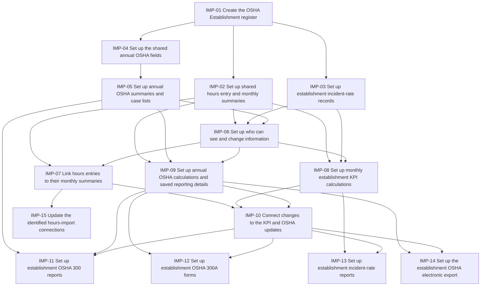

# Shared Hours Worked and OSHA Establishment configuration implementation plan

Draft configuration plan, revision 8. Date: 2026-11-20. Based on [technical specification revision 7](technical-specification.md), [target fields](target-model.json) and [package 1.0.2.0](package-evidence-v1.0.2.0.json). No configuration has been performed in Intelex. [The previous plan](history/implementation-v7/implementation-plan.md) is retained as history.

## Scope and planning basis

Audit Trail is excluded from every task. Set IsAuditEnabled=FALSE on all seven new Objects, including abstract Objects and concrete children, and retain FALSE on the existing Location Hours and Headcount Object. Authorized corrections and saved reporting details must work without Audit Trail.

New Objects and screens are identified by business name. Assign their actual system names during configuration; no proposed prefix or internal Object identifier is prescribed. Verified OOTB system names remain as configuration locators. GETRELATED instructions targeting a new Object describe its matching rules until its actual system name is assigned.

Configure the shared Hours Worked entry, GETRELATED monthly-summary links, native grid-SUM summary hours, establishment analytics and outputs, and the retained changes to location summaries under technical specification revision 5. Incident/employee/asset design, migration, tenant verification, formal testing and release remain separately owned.

The assignments keep related fields and screens together and separate the more complex calculations that need those records first. The existing Safety Metrics application, location hierarchy, period checks, native numbering, classification lists and case-access rules are reused. The tables retain the configured Object and field names so the build team can find the settings. A read-only related-record list uses an existing link rather than storing another relationship.

The package now supplies the existing lookup choices, monthly OII counting rules, annual employee workforce calculations and all 25 reports used by the existing update processes. The tasks include those settings directly. The user has confirmed GETRELATED find/create linking and native summary grid-SUM calculations. Remaining inputs concern downstream analytics notification and invocation, actual-rate displays, regulatory outputs and business/access decisions. All report expressions described here belong to their report context; declarative behavior is not presented as executable field syntax.

The shared entry may hold Location, OSHA Establishment or both. Its hours count once in each chosen reporting view. Never add the location and establishment totals together, or add the retained Lo and Ru establishment values together. Employee and contractor hours remain separate; headcounts are maintained on the monthly summaries. Intelex manages its native processing access, so this plan requests no background-processing account or permissions.

The existing task IDs, roles and configuration dependencies are retained. IMP-07 uses native relationship expressions and remains assigned to a Senior Associate Consultant, reviewed by a Senior Consultant. IMP-08 and IMP-09 now also need the user-access settings produced by IMP-06. These are configuration dependencies, not a schedule. The original E-prefixed evidence names refer to package 1.0.0.0; stable GUIDs identify the added 1.0.2.0 report/process evidence because graph IDs change between exports. Source configuration does not prove live destination capability.

## Task summary

| Task Number | Task Category | Task Name | Objective and Detailed Scope | Recommended Implementer |
|---|---|---|---|---|
| IMP-01 | Establishment Records and screens | Create the OSHA Establishment register | **Objective:** Give the company a separate list of OSHA establishments for hours entry and regulatory reporting.  **Detailed scope:** Create the establishment register, its sixteen information fields, unique establishment codes and administration screens in Safety Metrics. Connect its Type and Size selectors to the existing numeric choices and exclude Deleted=TRUE choices from new selection. Later tasks add related-Record lists and protect codes already in use. | Associate Consultant |
| IMP-02 | Hours entry and monthly summaries | Set up shared hours entry and monthly summaries | **Objective:** Let users enter hours once and maintain headcounts separately on the monthly summaries.  **Detailed scope:** Create Hours Worked and Establishment Hours and Headcount, their screens, native summary-hour calculations and related-entry grids. Change the existing location summary hours from direct inputs to calculated grid sums, retain editable headcounts and saved summary identity. IMP-07 configures the source relationships that feed those calculations. | Consultant |
| IMP-03 | KPI Records and screens | Set up establishment incident-rate records | **Objective:** Store monthly incident measures for each establishment and let authorized users enter their rate targets.  **Detailed scope:** Create the Establishment Incident Rate Abstract and its concrete KPI Object, including twenty saved measures, establishment and month details, supporting fields and four editable targets. Add the screens and related KPI list on the establishment. Later tasks fill the measures and display the actual rates. | Senior Associate Consultant |
| IMP-04 | Annual OSHA Records and screens | Set up the shared annual OSHA fields | **Objective:** Provide the annual case counts, day totals and saved establishment details needed for OSHA reporting.  **Detailed scope:** Create the shared annual OSHA definition with thirty-five fields, its January 1 and duplicate-Record checks, and its screens. Include the saved report header and link to the correct OSHA settings. IMP-09 fills the annual totals and copies the reporting details when a summary is created. | Senior Associate Consultant |
| IMP-05 | Annual summaries and case lists | Set up annual OSHA summaries and case lists | **Objective:** Give users an annual establishment summary with workforce figures, reporting details and access to the correct OSHA cases.  **Detailed scope:** Create the annual summary Object with seventeen additional fields, the shared annual fields, its screens and the related-summary list on the establishment. Add a read-only case list and OSHA 301 print link once the separate incident design supplies the required case links. Other report print links have their own tasks. | Consultant |
| IMP-06 | User access | Set up who can see and change information | **Objective:** Give users the access they need without allowing a location or establishment selection to expose other information.  **Detailed scope:** Set user-group, Record and field access for all eight new or changed Objects. Check location and establishment access separately. Protect calculated hours, summary links, establishment codes already in use and restricted corrections. Apply the rules to screens, links and imports while retaining the existing incident-security rules. | Senior Consultant |
| IMP-07 | Hours relationships | Link hours entries to their monthly summaries | **Objective:** Connect each hours entry to the correct location summary, establishment summary or both, so native grid sums include its hours.  **Detailed scope:** Add the Link Hours Worked Summaries Create/Update Action Handler on Hours Worked. Validate the period and at least one dimension, null-check each dimension and use type-matched GETRELATED searches to find or create each matching monthly summary. Replace or clear links when reporting choices change. Native summary fields maintain totals; this task adds no totals processor, Delete totals handler or custom transaction/locking subsystem. | Senior Associate Consultant |
| IMP-08 | Monthly KPI calculations | Set up monthly establishment KPI calculations | **Objective:** Fill each establishment's monthly incident measures and hours without changing its manually entered targets.  **Detailed scope:** Add Refresh Establishment Monthly Metrics to create or update one establishment/month KPI and replace twenty saved measures. Count Injury/Illness rows using the incident date, apply the source day and flag rules below, and read employee/contractor hours only from the matching establishment summary. Preserve targets. The separate incident design still supplies establishment assignment; downstream execution/status remains IN-09. | Senior Consultant |
| IMP-09 | Annual OSHA calculations | Set up annual OSHA calculations and saved reporting details | **Objective:** Produce one complete annual establishment summary with the right case totals, workforce figures and saved reporting details.  **Detailed scope:** Add Refresh Establishment Annual OSHA to fill twenty-four case/day fields and four workforce fields using the confirmed source rules. Copy establishment details once when creating a summary, maintain the separately supplied case list, and add authorized header correction and shared output checks. Preserve editable annual details. OSHA helper population, reporting completeness, destination settings and downstream execution/status remain the stated missing inputs. | Senior Consultant |
| IMP-10 | Automatic report updates | Connect changes to the KPI and OSHA updates | **Objective:** Recalculate the right location and establishment results after hours, headcounts or incidents change.  **Detailed scope:** Connect successful hours and headcount changes to the new establishment calculations and the two identified existing location update chains. Recalculate complete original and corrected periods, including historic or emptied scopes. Retain source report/import order and existing schedules; add protected immediate-refresh requests and result-readiness checks only through the supported supplied methods. Receive incident notices without changing incident Records. | Senior Consultant |
| IMP-11 | OSHA 300 reports | Set up establishment OSHA 300 reports | **Objective:** Print OSHA and Cal/OSHA case logs for the selected establishment and year.  **Detailed scope:** Add four print options on the new annual summary: OSHA 300, Combined OSHA 300, Cal/OSHA 300 and Combined Cal/OSHA 300. Use the supported reporting method and templates, the correct cases, protected employee names and reports with or without cases. Call the shared reporting-information check before printing. Existing location report links remain in use. | Senior Consultant |
| IMP-12 | OSHA 300A forms | Set up establishment OSHA 300A forms | **Objective:** Print OSHA and Cal/OSHA annual summary forms using the saved annual details and workforce totals.  **Detailed scope:** Add the two annual-form print options to the establishment summary and connect the supplied templates to its saved header, case/day totals and workforce figures. Apply the shared required-information check and preserve historical reporting details. Existing location form links remain unchanged. | Consultant |
| IMP-13 | Incident-rate reports | Set up establishment incident-rate reports | **Objective:** Show each establishment's four actual incident rates beside its manually entered targets.  **Detailed scope:** Create the Establishment Incident Rates report/dashboard by adapting the existing OOTB rate calculations and presentation once supplied. Use establishment monthly KPI measures, establishment and period selection, target comparisons, and checks that results are complete and current. Keep actual rates in the report without adding stored-rate fields or combining location and establishment totals. | Consultant |
| IMP-14 | Electronic OSHA export | Set up the establishment OSHA electronic export | **Objective:** Produce the required electronic OSHA file using each establishment's annual information and reporting identifiers.  **Detailed scope:** Create the proposed Establishment OSHA Electronic Export report using the supplied current export and file requirements. Connect the annual fields to the required file columns, check required values and formatting, and add a link from the summary. This task generates a file; it does not send it directly to the regulator. | Consultant |
| IMP-15 | Hours-import connections | Update the identified hours-import connections | **Objective:** Send imported hours through Hours Worked so imports no longer compete with calculated summary totals.  **Detailed scope:** Change only the existing imports or connections identified in the supplied information. Send their hours, reporting selections and stable entry references to Hours Worked through the automatic save process. Keep headcount imports separate. Finding connections, loading past data and switching the production system are outside this task. | Consultant |

## External inputs and constraints

IN-04 remains deferred at the user’s request. Its company-wide establishment-access recommendation is not an approved build instruction. IN-05 and IN-11 request the existing OOTB actual-rate formulas and report design so IMP-13 can reproduce them for establishments.

The following requests contain only information still needed. Each affected task narrows the request and states which work can proceed. Supplying missing information is outside these configuration assignments.

- **IN-04 — Who can see and change information:** The access decision is deferred. Provide the approved existing groups, which locations and establishments each group may access, and who may correct historical information. The technical team must supply the native controls for those rules and for preventing changes to used establishment Codes or deletion of used establishments. IMP-06 cannot complete until these are supplied. The company-wide establishment-access recommendation has not been adopted.

- **IN-05 — Rules for monthly incident measures and rates:** Provide the existing OOTB report or dashboard formulas that calculate the four actual incident rates, including the hours included, scaling number, rounding, handling of zero or missing hours, and calculation across several months. IMP-13 will reproduce that behavior for establishments. The monthly counts and hours calculations are already known; no new rate policy is requested.

- **IN-06 — How incidents are assigned to establishments:** The separate incident design must supply the establishment assignment used to select Injury/Illness Records, the relationship or query for annual case lists, and notices identifying previous and corrected establishments and periods. It must explain how old case links are cleared while retaining privacy. The case-list, monthly and annual selection, and incident-change connections in IMP-05/08/09/10 remain partly waiting. No incident-side configuration is assigned here.

- **IN-07 — Rules for annual OSHA totals and workforce figures:** Provide the missing rules that fill the existing OSHA case classification values and decide which classification takes priority. Also confirm which monthly summaries should exist, how missing submissions differ from confirmed zero values, whether incomplete or partial years can be reported, and any required output rounding. IMP-09 can use the known annual sums and headcount calculation, but its completeness checks still need these decisions.

- **IN-08 — OSHA reporting settings and form templates:** Provide the OSHA settings Records and regulatory form templates for the intended environment. The technical team must supply the supported way to print or fill those forms from the new establishment summary Objects, including reports with no cases and the Combined Cal/OSHA behavior. These inputs hold up the settings and case-print connections in IMP-04/05, additional output checks in IMP-09/14, and form/report completion in IMP-11/12. The exported templates are email notifications, not the regulatory forms.

- **IN-09 — How existing reports are refreshed:** The technical team must supply the supported way to refresh KPI and annual results after calculated hours, headcounts, assignments or source Records change. It must cover both previous and corrected periods, older corrections and missed runs, and indicate when an update succeeds or fails. In particular, confirm whether a native SUM change runs an Update Action Handler or changes DateModified; otherwise supply the supported notification or selection method. IMP-08/09/10 cannot complete their execution and result-readiness connections without it. All 25 underlying reports are already supplied.

- **IN-10 — Existing sources of imported hours:** Provide the names and current mappings of any actual payroll, API or import connections that supply hours, together with their source fields, stable entry references and supported update route. IMP-15 cannot start until a real connection and its required change are identified. The known monthly-summary initializer supplies only Location and Date, with no hours, so it will not be redirected into Hours Worked.

- **IN-11 — Current incident-rate report design:** Provide the existing OOTB actual-rate report or dashboard, including its grouping, period selectors, target comparisons, formatting and access settings. IMP-13 will adapt that display to establishments using the source formulas requested under IN-05. The supplied data-setup folders and event-service reports prepare counts and hours; they do not include the final rate display.

- **IN-12 — OSHA electronic-file requirements:** Provide the existing electronic-export report and the required file version, column order, formatting, permitted values and generation method. Include how the existing classification choices map to file values. IMP-14 cannot complete the export without these settings. The supplied package identifies a dashboard link, but contains neither its export definition nor a direct-submission service.

IN-01 is resolved by the user-confirmed GETRELATED/grid-SUM model and supplied matched-type signature. The lookup rows use actual extracted/proposed object and Date/Month names; the corresponding native ID-key names are set during IMP-07 configuration. There is no custom hours totals processor or source/two-summary transaction requirement. Downstream refresh after native calculations remains IN-09.

IN-02 is answered. Copied fields keep their analogous OOTB characteristics, including unset text lengths. RecordNo uses AutoNumber. SourceEntryID starts blank (NULL), with a value required before the first save. Monthly summary dimension and Date remain editable only at creation. IMP-07 sets the corresponding relationship-ID names during configuration.

IN-03 — Existing OSHA classification choices is answered for the source configuration. The Type and Size values are included in IMP-01, the recordable-injury values in IMP-05, and their use in file consistency checks in IMP-14. Reuse locally installed records; source GUIDs are not assumed portable. No catalogue fields or replacement choices are added.

The data-migration team and client administrators supply establishment records and agreed starting hours, allocations and checked totals. The release team controls the production switch after reconciliation. Entering or moving that data, checking live-system capabilities, formal testing, training and release are separate responsibilities. This plan prepares configuration and demonstrates each assigned change; it does not carry out those workstreams.

## Detailed configuration tasks

### IMP-01 — Create the OSHA Establishment register

**Task ID:** IMP-01

**Title:** Create the OSHA Establishment register

**Category:** Establishment Records and screens

**Objective:** Give the company a separate list of OSHA establishments for hours entry and regulatory reporting.

**Detailed scope:** Create the establishment register, its sixteen information fields, unique establishment codes and administration screens in Safety Metrics. Connect its Type and Size selectors to the existing numeric choices and exclude Deleted=TRUE choices from new selection. Later tasks add related-Record lists and protect codes already in use.

**Deliverable:** An establishment register with the specified fields, unique codes and administration screens.

**Work needed first:** None

**What is waiting:** Ready: the source Type and Size choices and Deleted filter are now known. No external information is missing for this register setup.

**Recommended implementer role:** Associate Consultant

**Recommended reviewer/approver role:** Senior Consultant (product build manager; a different person from the implementer)

**Why this role is recommended:** The work uses standard field settings, a simple unique-code check and two administration screens. The more complex access rules have their own assignment.

Fields and features to set up:

| Field or feature | What to set up |
|---|---|
| OSHA Establishment.Code | Add Code (Code) on OSHA Establishment. Text, up to 100 characters. Require a value before a successful save finishes. Leave blank for entry. Require a unique value and do not translate it. Administrators can enter or change it before the establishment is used. The user-access task adds the protection needed once linked Records exist. |
| OSHA Establishment.Name | Add Name (Name) on OSHA Establishment. Text, up to 255 characters; use the legal reporting name and do not translate it. Require a value before a successful save finishes. No default value. Establishment administrators may edit it. |
| OSHA Establishment.Active? | Add Active? (Active) on OSHA Establishment. A Yes/No field. Require a value before a successful save finishes. Start new Records at TRUE (Yes). Establishment administrators may edit it. |
| OSHA Establishment.Company Name | Add Company Name (CompanyName) on OSHA Establishment. Text, up to 255 characters. Require it only under the conditions below. No default value. Administrators may edit it. It is required before generating a report, not before saving an incomplete master Record. |
| OSHA Establishment.Street | Add Street (Street) on OSHA Establishment. Text, up to 255 characters. Require it only under the conditions below. No default value. Administrators may edit it. It is required before generating a report, not before saving an incomplete master Record. |
| OSHA Establishment.City | Add City (City) on OSHA Establishment. Text, up to 100 characters. Require it only under the conditions below. No default value. Administrators may edit it. It is required before generating a report, not before saving an incomplete master Record. |
| OSHA Establishment.State | Add State (State) on OSHA Establishment. Text, up to 100 characters. Require it only under the conditions below. No default value. Administrators may edit it. It is required before generating a report, not before saving an incomplete master Record. |
| OSHA Establishment.Postal Code | Add Postal Code (PostalCode) on OSHA Establishment. Text, up to 30 characters. Require it only under the conditions below. No default value. Administrators may edit it. It is required before generating a report, not before saving an incomplete master Record. |
| OSHA Establishment.EIN Number | Add EIN Number (EINNumber) on OSHA Establishment. Text, up to 30 characters. The field is optional. No default value. Administrators may edit it. |
| OSHA Establishment.NAICS Code | Add NAICS Code (NAICSCode) on OSHA Establishment. A whole-number field (bigint/System.Int64). The field is optional. No default value. Administrators may edit it. |
| OSHA Establishment.SIC Code | Add SIC Code (SICCode) on OSHA Establishment. A whole-number field (bigint/System.Int64). The field is optional. No default value. Administrators may edit it. |
| OSHA Establishment.Industry Description | Add Industry Description (IndustryDescription) on OSHA Establishment. Text, up to 1000 characters. The field is optional. No default value. Administrators may edit it. |
| OSHA Establishment.Establishment Type | Add Establishment Type (EstablishmentType) on OSHA Establishment. Select one OSHA Establishment Type (EHSIncidentMang_EstablishmeTypeObject) (M:1). The link can hold zero or one Record; the required-field rule below determines when it may be blank. Leave the reverse list disabled on the selected Record (inverse relationship off). The field is optional. No default value. Administrators may select a value. Keep past selections if a choice later becomes inactive. For new selections require Deleted=FALSE; keep existing references if a choice is later deleted. |
| OSHA Establishment.Establishment Size | Add Establishment Size (EstablishmentSize) on OSHA Establishment. Select one OSHA Establishment Size (EHSIncidentMang_EstablishmeSizeObject) (M:1). The link can hold zero or one Record; the required-field rule below determines when it may be blank. Leave the reverse list disabled on the selected Record (inverse relationship off). The field is optional. No default value. Administrators may select a value. Keep past selections if a choice later becomes inactive. For new selections require Deleted=FALSE; keep existing references if a choice is later deleted. |
| OSHA Establishment.Establishment ID | Add Establishment ID (EstablishmentID) on OSHA Establishment. Text, up to 100 characters. The field is optional. No default value. Administrators may edit it. |
| OSHA Establishment.OSHA 300a ID | Add OSHA 300a ID (OSHA300aID) on OSHA Establishment. Text, up to 100 characters. The field is optional. No default value. Administrators may edit it. |

Build instructions:

1. Create OSHA Establishment in Safety Metrics (E36). It must stand on its own, without a Location Structure connection, an inheritance base Object or a workflow. Set IsAbstract=FALSE and IsLocationBound=FALSE, and set IsAuditEnabled=FALSE. Create OSHA Establishment detail screen and OSHA Establishment inventory screen; use Name as the Record's displayed label.

2. Require a unique Code of up to 100 characters and do not translate it. Start Active? at TRUE and use Name as the reporting name without translation. Connect EstablishmentType to the existing EHSIncidentMang_EstablishmeTypeObject and EstablishmentSize to EHSIncidentMang_EstablishmeSizeObject. Limit new selections to Deleted=FALSE, retain existing references if a choice is later deleted, and leave both inverse relationships disabled. Reuse the existing lookup Value fields; do not add Code, Active? or new choice Records.

3. Place the fields below on the administration screen. Company Name, Street, City, State and Postal Code can remain blank while an establishment is being maintained. The report tasks will require this information before producing a report.

4. Configure Establishment Type to use existing Value 1, "Establishment is not a government entity"; 2, "Establishment is a State Government entity"; and 3, "Establishment is a Local Government entity". Configure Establishment Size to use existing Value 1, "< 20 employees"; 2, "20-249 employees"; and 3, "250+ employees". Use the locally installed Records for those values rather than hard-coding source Record GUIDs. Do not automatically assign a size from headcount.

**How to check the result:**

- An administrator can create an establishment without selecting a Location Structure Record or starting a workflow.

- A duplicate Code is rejected, Active? starts as TRUE and Name appears as the Record label.

- An administrator can save the establishment before all reporting-address details are available.

- Type and Size show the existing Value/Caption choices, exclude Deleted=TRUE choices for new selection and retain historical selections without creating another lookup.

- Audit Trail is disabled (IsAuditEnabled=FALSE) on OSHA Establishment.

**Information needed for this task:** None

**Specification references:** Technical specification revision 7 sections 1, 3, 4.1, 6.3; R3, R4. Package module Safety Metrics (E36), object GUID 86db71b3-d191-44f6-8ae1-2867c7a5c36f. Current source and remaining inputs: technical specification revision 7 section 12, package-evidence-v1.0.2.0.json.

**Assumptions and open questions:** Audit Trail is excluded; do not enable it for any functionality in this task.

### IMP-02 — Set up shared hours entry and monthly summaries

**Task ID:** IMP-02

**Title:** Set up shared hours entry and monthly summaries

**Category:** Hours entry and monthly summaries

**Objective:** Let users enter hours once and maintain headcounts separately on the monthly summaries.

**Detailed scope:** Create Hours Worked and Establishment Hours and Headcount, their screens, native summary-hour calculations and related-entry grids. Change the existing location summary hours from direct inputs to calculated grid sums, retain editable headcounts and saved summary identity. IMP-07 configures the source relationships that feed those calculations.

**Deliverable:** Shared hours and monthly-summary fields/screens, four native SUM calculations, related-entry grids and retained summary-identity checks.

**Work needed first:** IMP-01

**What is waiting:** Ready: no external field-setting information is missing. Complete IMP-01 first. IMP-07 will set the corresponding native relationship-ID names while configuring the handler.

**Recommended implementer role:** Consultant

**Recommended reviewer/approver role:** Senior Consultant (product build manager; a different person from the implementer)

**Why this role is recommended:** This assignment connects one entry screen to two kinds of monthly summary. A Consultant can keep their field settings, selection rules and screen behavior consistent.

What the earlier tasks provide: IMP-01 provides An establishment register with the specified fields, unique codes and administration screens.

Fields and features to set up:

| Field or feature | What to set up |
|---|---|
| Hours Worked.Source Entry ID | Add Source Entry ID (SourceEntryID) on Hours Worked. Text, max 255; unique within Hours Worked; non-localizable. Required. Default: NULL; no automatic value. Editing: User or import supplies before first save; read only after creation; configured Record display value. Native unique constraint and immutable key; authorized updates reuse the key. No custom hours processor is needed for entry deduplication. |
| Hours Worked.Month | Add Month (Month) on Hours Worked. A calendar date (Date), with time-zone capture turned off. Require a value before a successful save finishes. Start with the first day of the current month, using MonthStartValueGenerator. Hours editors may edit it and always see it. Reject dates other than the first day of the month. |
| Hours Worked.Location | Add Location (Location) on Hours Worked. Select one Location (SysLocationEntity) (M:1). The link can hold zero or one Record; the required-field rule below determines when it may be blank. Leave the reverse list disabled on the selected Record (inverse relationship off). Require it only under the conditions below. Start blank (NULL). Always show it and allow editing. Require it when OSHA Establishment is blank (NULL). New selections require Deleted=FALSE and the user's existing location access. Do not default it from the login or home location. |
| Hours Worked.OSHA Establishment | Add OSHA Establishment (OSHAEstablishment) on Hours Worked. Select one OSHA Establishment (M:1). The link can hold zero or one Record; the required-field rule below determines when it may be blank. Leave the reverse list disabled on the selected Record (inverse relationship off). Require it only under the conditions below. Start blank (NULL). Always show it and allow editing. Require it when Location is blank (NULL). New selections require Active?=TRUE. Do not fill it from Location, and retain existing assignments to inactive establishments. |
| Hours Worked.Employee Hours | Add Employee Hours (EmployeeHours) on Hours Worked. Hours as a number allowing decimals (Float/System.Double). Require a valid finite value of 0 or greater; no additional fixed precision or decimal-place limit is specified. Require a value before a successful save finishes. Start at 0. Hours editors may edit it and always see it. Allow an intentional zero, but reject a blank value (NULL). |
| Hours Worked.Contractor Hours | Add Contractor Hours (ContractorHours) on Hours Worked. Hours as a number allowing decimals (Float/System.Double). Require a valid finite value of 0 or greater; no additional fixed precision or decimal-place limit is specified. Require a value before a successful save finishes. Start at 0. Hours editors may edit it and always see it. Allow an intentional zero, but reject a blank value (NULL). |
| Hours Worked.Location Hours and Headcount | Add Location Hours and Headcount (LocationHoursHeadcount) on Hours Worked as an optional-at-initial-entry M:1 link to Location Hours and Headcount, with inverse Hours Worked Entries. Require/show it read only when its corresponding dimension is populated at successful save; otherwise keep NULL and hide it. Link Hours Worked Summaries (IMP-07) null-checks that dimension and assigns/clears this link through GETRELATED. Native grid sums handle total changes; clients do not supply this relationship. |
| Hours Worked.Establishment Hours and Headcount | Add Establishment Hours and Headcount (EstablishmentHoursHeadcount) on Hours Worked as an optional-at-initial-entry M:1 link to Establishment Hours and Headcount, with inverse Hours Worked Entries. Require/show it read only when its corresponding dimension is populated at successful save; otherwise keep NULL and hide it. Link Hours Worked Summaries (IMP-07) null-checks that dimension and assigns/clears this link through GETRELATED. Native grid sums handle total changes; clients do not supply this relationship. |
| Establishment Hours and Headcount.Date | Add Date (Date) on Establishment Hours and Headcount. A calendar date (Date), with time-zone capture turned off. Require a value before a successful save finishes. When creating the summary automatically, copy Hours Worked.Month. For headcount-only entry, use MonthStartValueGenerator to start at the first day of the current month. A headcount editor selects it when creating the summary. Make it read only after the first save. On GETRELATED creation, the search keys supply the selected establishment GUID and source Month as this summary's Date; retain the native default for manual headcount-only creation. |
| Establishment Hours and Headcount.Contractor Headcount | Add Contractor Headcount (ContractrHCount) on Establishment Hours and Headcount. A number allowing decimals (Float/System.Double); the package sets no fixed precision or number of decimal places. The field is optional. Start at 0. Authorized headcount editors may edit it. Apply the same checks through the API and imports, with the source numeric type and default. |
| Establishment Hours and Headcount.Employees Hours | Add Employees Hours (EmployeeHrs) on Establishment Hours and Headcount. Keep Float/System.Double, optional field requiredness and no extra precision/scale constraint. Configure the native calculated expression SUM(HoursWorkedEntries.EmployeeHours) over this summary's own HoursWorkedEntries grid. The result is read only to users/API/imports and updates with related entry creation, hours edits, deletion and relinking. Require an empty-grid result of 0. No Action Handler writes or independent stored-input default. |
| Establishment Hours and Headcount.OSHA Establishment | Add OSHA Establishment (OSHAEstablishment) on Establishment Hours and Headcount. Select one OSHA Establishment (M:1). Each Record requires one selection. Show linked Records through its Hours and Headcounts list, using this same link. Require a value before a successful save finishes. No default. The hours-update process supplies the establishment, or an authorized headcount editor selects it when first creating the summary. Require a selection when creating the summary, with Active?=TRUE for new ordinary selections. Make it read only after saving and retain historical inactive assignments. On GETRELATED creation, the search keys supply the selected establishment GUID and source Month as this summary's Date; retain the native default for manual headcount-only creation. |
| Establishment Hours and Headcount.[Helper] Establishment Name | Add [Helper] Establishment Name (LocNameHelper) on Establishment Hours and Headcount. Text (nvarchar). Keep the source length settings unset: MaxLength=NULL and MinLength=NULL. Leave Precision=NULL and Scale=NULL. Do not translate the field (IsLocalizable=FALSE and IsLiveTranslatable=FALSE). Set SpellCheck=FALSE. The field is optional. When Initialize Establishment Monthly Summary creates the summary, copy OSHAEstablishment.Name into this field. Analytics users can view it but cannot edit it. Keep the saved name after establishment renaming or deactivation; allow an explicit administrator correction without Audit Trail. Retain the analogous OOTB field settings; source field GUID 7d5c95fb-f74e-4ed3-82bc-719b34cb943a. |
| Establishment Hours and Headcount.Employees Headcount | Add Employees Headcount (EmployeeHCount) on Establishment Hours and Headcount. A number allowing decimals (Float/System.Double); the package sets no fixed precision or number of decimal places. The field is optional. Start at 0. Authorized headcount editors may edit it. Apply the same checks through the API and imports, with the source numeric type and default. |
| Establishment Hours and Headcount.Record No | Add Record No (RecordNo) on Establishment Hours and Headcount. AutoNumber, System.Int64. Optional. Default: Copy the source AutoNumber generator settings (StartValue=1, IncrementStep=1); allocate a new target sequence. Editing: Read only; analytics users may view. Native AutoNumber; new target sequence, never reuse source identity. Keep the analogous OOTB field characteristics; source field GUID b5ba29e0-3e7d-48e2-b44b-b7f855d6bce8. |
| Establishment Hours and Headcount.Contractor Hours | Add Contractor Hours (ContractrHrs) on Establishment Hours and Headcount. Keep Float/System.Double, optional field requiredness and no extra precision/scale constraint. Configure the native calculated expression SUM(HoursWorkedEntries.ContractorHours) over this summary's own HoursWorkedEntries grid. The result is read only to users/API/imports and updates with related entry creation, hours edits, deletion and relinking. Require an empty-grid result of 0. No Action Handler writes or independent stored-input default. |
| Establishment Hours and Headcount.Hours Worked Entries | Add Hours Worked Entries (HoursWorkedEntries) on Establishment Hours and Headcount. A read-only list of Records linked through Hours Worked.Establishment Hours and Headcount. Use that existing link; do not store a second relationship. The field is optional. No default value. Authorized hours and analytics users may view the list but cannot edit links through it. |
| Location Hours and Headcount.Hours Worked Entries | Add Hours Worked Entries (HoursWorkedEntries) on Location Hours and Headcount (SafetyMetrics_HrsandHeadcountObject). A read-only list of Records linked through Hours Worked.Location Hours and Headcount. Use that existing link; do not store a second relationship. The field is optional. No default value. Show the list as read only under the existing location-access rules. Separately check access to each underlying hours entry. |
| OSHA Establishment.Hours and Headcounts | Add Hours and Headcounts (HoursHeadcounts) on OSHA Establishment. A read-only list of Records linked through Establishment Hours and Headcount.OSHA Establishment. Use that existing link; do not store a second relationship. The field is optional. No default value. Authorized analytics users may view the list but cannot edit links through it. |

Changes to the existing setup:

| Existing field or screen | What needs to change |
|---|---|
| EmployeeHrs (E169) on SafetyMetrics_HrsandHeadcountObject (E84) | After the separately managed legacy-hours cutover and opening-entry reconciliation, change Employees Hours (EmployeeHrs) from IsReadOnly=FALSE and Calculation=NULL to a read-only native calculated field with SUM(HoursWorkedEntries.EmployeeHours). Keep its field GUID and Float/System.Double type. Show it as read only on SafetyMetrics_HrsandHeadcount_Detail (E209); users, APIs and imports cannot enter its value. Native calculation replaces direct hours entry. |
| ContractrHrs (E316) on SafetyMetrics_HrsandHeadcountObject (E84) | After the separately managed legacy-hours cutover and opening-entry reconciliation, change Contractor Hours (ContractrHrs) from IsReadOnly=FALSE and Calculation=NULL to a read-only native calculated field with SUM(HoursWorkedEntries.ContractorHours). Keep its field GUID and Float/System.Double type. Show it as read only on SafetyMetrics_HrsandHeadcount_Detail (E209); users, APIs and imports cannot enter its value. Native calculation replaces direct hours entry. |
| Date (E82) on SafetyMetrics_HrsandHeadcount_Detail (E209) | The package declares Date with IsReadOnly=FALSE and a normal Date control. Allow its first-of-month selection when creating a summary, then make it read only after the first save. Keep its required setting and MonthStartValueGenerator default. Protect Monthly Summary Identity prevents later Date changes through other save routes. |
| Location (E185) on SafetyMetrics_HrsandHeadcount_Detail (E209) | The package declares Location with IsReadOnly=FALSE and DisplayAs=String on the detail control; this does not prove the live editor behavior. Allow the required selection when creating a summary, then make it read only after the first save. Keep the existing location relationship and permissions. Protect Monthly Summary Identity prevents later Location changes through other save routes. |

Build instructions:

1. Create Hours Worked and Establishment Hours and Headcount in Safety Metrics (E36). Both allow their own Records, use no inheritance base Object, have no workflow and are not tied to Location Structure. Set IsAuditEnabled=FALSE. Create Hours Worked detail screen, Hours Worked inventory screen, Establishment Hours and Headcount detail screen and Establishment Hours and Headcount inventory screen. Retain IsAuditEnabled=FALSE on the existing Location Hours and Headcount Object.

2. Use Source Entry ID (SourceEntryID) as the Hours Worked Record label and require it to be unique. Require Month to be the first day of a month, using DAY(Month)=1. Always show both Location and OSHA Establishment. Location is required when OSHA Establishment is blank; OSHA Establishment is required when Location is blank. Show the corresponding summary link when a selection is present. That link must be filled by the automatic update before the save finishes, rather than required before the update can run. Selecting or changing one reporting choice must not fill in or clear the other.

3. Show Employee Hours and Contractor Hours as separate required editable Float/System.Double fields, default 0, allowing zero and fractional hours and rejecting NULL, negative or nonfinite values. Configure EmployeeHrs on both monthly summaries as SUM(HoursWorkedEntries.EmployeeHours) and ContractrHrs as SUM(HoursWorkedEntries.ContractorHours). Each uses its own HoursWorkedEntries grid. Show these four calculated fields as read only, including API/import routes. Do not add a total-writing Action Handler or Delete handler; native grid calculations reflect entry create/edit/delete/relink. Headcounts remain independent editable inputs.

4. On the new establishment summary, allow only one Record for each OSHAEstablishment and Date, and require DAY(Date)=1. Add the proposed Protect Monthly Summary Identity check to both summary types: once saved, their location or establishment and Date cannot change, and a summary used by Hours Worked cannot be deleted. The existing location checks Unique Location-Date (E183) and Date on first of month (E80) already cover duplicate periods and first-of-month dates; use them without creating replacements.

5. Add the proposed Initialize Establishment Monthly Summary create Action Handler. When the summary is first created, copy OSHAEstablishment.Name into LocNameHelper and use Intelex automatic numbering for RecordNo. Later establishment name changes or deactivation must not replace the saved name. New headcounts start at zero; an update must never reset an existing headcount. This handler does not calculate hours or refresh reports. Use the existing Set Location Name Helper flow as evidence of the name-copy rule, not as proof of a create-event binding. The source handler has stable ID 5d1ff7d0-0a65-455f-a19b-8ab03332b0d9 and copies Location.Name only when AND(ISCHANGED(Location), NOT(Location.Deleted)). The new establishment handler must initialize LocNameHelper through the supplied supported create route; the location handler remains unchanged.

6. Allow authorized headcount-only monthly-summary creation with the required location or establishment and first-of-month Date; keep those saved selections fixed afterward. Initialize numbering, saved names and headcount defaults using native settings. Add each read-only Hours Worked Entries list as the inverse of the corresponding source summary link. Those same grids feed the native SUM calculations, without a second relationship or explicit hours-rebuild operation.

**How to check the result:**

- The entry screen supports Location only, OSHA Establishment only, or both. Once IMP-07 is in place, saving with neither is rejected.

- Each summary's Hours Worked Entries list shows the entries linked to that summary without a second stored relationship.

- Users can edit headcounts but cannot edit calculated summary hours or move a saved summary to another reporting place or month.

- The existing location-summary Records, field identifiers and two period checks remain in use.

- Creating, editing, deleting or moving a linked source entry changes its summary-grid sums automatically; deleting the final contribution yields 0 without deleting the summary or changing headcounts.

- Audit Trail is disabled (IsAuditEnabled=FALSE) on Hours Worked, Establishment Hours and Headcount, Location Hours and Headcount.

**Information needed for this task:** None

**Specification references:** Technical specification revision 7 sections 4.6–4.8, 5.4, 6.1–6.4; R1, R7–R9. Location Hours and Headcount source fields and views are in package-evidence.json. Current source and remaining inputs: technical specification revision 7 section 12, package-evidence-v1.0.2.0.json.

**Assumptions and open questions:** Audit Trail is excluded; do not enable it for any functionality in this task.

### IMP-03 — Set up establishment incident-rate records

**Task ID:** IMP-03

**Title:** Set up establishment incident-rate records

**Category:** KPI Records and screens

**Objective:** Store monthly incident measures for each establishment and let authorized users enter their rate targets.

**Detailed scope:** Create the Establishment Incident Rate Abstract and its concrete KPI Object, including twenty saved measures, establishment and month details, supporting fields and four editable targets. Add the screens and related KPI list on the establishment. Later tasks fill the measures and display the actual rates.

**Deliverable:** The twenty-nine monthly/KPI fields, period checks, four screens and the establishment's related KPI list.

**Work needed first:** IMP-01

**What is waiting:** Ready: no external field-setting information is missing. Complete IMP-01 first; native numbering and copied field characteristics are already defined.

**Recommended implementer role:** Senior Associate Consultant

**Recommended reviewer/approver role:** Senior Consultant (product build manager; a different person from the implementer)

**Why this role is recommended:** The source provides a defined set of fields and straightforward monthly checks. A Senior Associate Consultant can configure the shared definition and screens without taking on the calculation design.

What the earlier tasks provide: IMP-01 provides An establishment register with the specified fields, unique codes and administration screens.

Fields and features to set up:

| Field or feature | What to set up |
|---|---|
| Establishment Incident Rate Abstract.Record No | Add Record No (RecordNo) on Establishment Incident Rate Abstract. AutoNumber, System.Int64. Required. Default: DefaultValue=NULL as in source; native AutoNumber field supplies the Record number. Editing: Read only; analytics users may view. Native AutoNumber; new target sequence, never reuse source identity. Keep the analogous OOTB field characteristics; source field GUID 043f6a0d-5d53-4f2c-9ce8-0afc63a0b0c2. |
| Establishment Incident Rate Abstract.Date | Add Date (Date) on Establishment Incident Rate Abstract. A calendar date (Date), with time-zone capture turned off. Require a value before a successful save finishes. No user-entered default. Refresh Establishment Monthly Metrics supplies the first day of the requested month. Analytics users may view it but cannot edit it. |
| Establishment Incident Rate Abstract.OSHA Establishment | Add OSHA Establishment (OSHAEstablishment) on Establishment Incident Rate Abstract. Select one OSHA Establishment (M:1). Each Record requires one selection. Show linked Records through its Incident Rate KPIs list, using this same link. Require a value before a successful save finishes. No default. Creating the Record automatically or importing it must supply the establishment. Show it as read only on automatically created Records. Refresh Establishment Monthly Metrics supplies it; keep historical inactive assignments. |
| Establishment Incident Rate Abstract.Number of Days Away - Rollup | Add Number of Days Away - Rollup (RuNumDaysAway) on Establishment Incident Rate Abstract. A whole-number field (bigint/System.Int64). The field is optional. Start at 0. Analytics users may view it but cannot edit it. Refresh Establishment Monthly Metrics (IMP-08) owns the later stored-value assignment. This task creates the field/control, not a continuously calculated field. |
| Establishment Incident Rate Abstract.Number of Recordable/Reportable - Rollup | Add Number of Recordable/Reportable - Rollup (RuCtRecordable) on Establishment Incident Rate Abstract. A whole-number field (bigint/System.Int64). The field is optional. Start at 0. Analytics users may view it but cannot edit it. Refresh Establishment Monthly Metrics (IMP-08) owns the later stored-value assignment. This task creates the field/control, not a continuously calculated field. |
| Establishment Incident Rate Abstract.Number of Fatalities - Establishment | Add Number of Fatalities - Establishment (LoNumFatalities) on Establishment Incident Rate Abstract. A whole-number field (bigint/System.Int64). The field is optional. Start at 0. Analytics users may view it but cannot edit it. Refresh Establishment Monthly Metrics (IMP-08) owns the later stored-value assignment. This task creates the field/control, not a continuously calculated field. |
| Establishment Incident Rate Abstract.Number of Incidents - Rollup | Add Number of Incidents - Rollup (RuCtIncidents) on Establishment Incident Rate Abstract. A whole-number field (bigint/System.Int64). The field is optional. Start at 0. Analytics users may view it but cannot edit it. Refresh Establishment Monthly Metrics (IMP-08) owns the later stored-value assignment. This task creates the field/control, not a continuously calculated field. |
| Establishment Incident Rate Abstract.[Helper] Establishment Name | Add [Helper] Establishment Name (LocNameHelper) on Establishment Incident Rate Abstract. Text (nvarchar). Keep the source length settings unset: MaxLength=NULL and MinLength=NULL. Leave Precision=NULL and Scale=NULL. Do not translate the field (IsLocalizable=FALSE and IsLiveTranslatable=FALSE). Set SpellCheck=FALSE. The field is optional. When Refresh Establishment Monthly Metrics (IMP-08) creates the KPI Record, copy OSHAEstablishment.Name into this field. Analytics users can view it but cannot edit it. Keep the saved name after establishment renaming or deactivation; allow an explicit administrator correction without Audit Trail. Retain the analogous OOTB field settings; source field GUID 81b5d8d6-5bff-49b5-a669-61ac051f1be0. |
| Establishment Incident Rate Abstract.Number of Lost Days - Rollup | Add Number of Lost Days - Rollup (RuNumLostDays) on Establishment Incident Rate Abstract. A whole-number field (bigint/System.Int64). The field is optional. Start at 0. Analytics users may view it but cannot edit it. Refresh Establishment Monthly Metrics (IMP-08) owns the later stored-value assignment. This task creates the field/control, not a continuously calculated field. |
| Establishment Incident Rate Abstract.Contractor Worked Hours - Establishment | Add Contractor Worked Hours - Establishment (LoCntrctWrkdHrs) on Establishment Incident Rate Abstract. A number allowing decimals (Float/System.Double); the package sets no fixed precision or number of decimal places. The field is optional. Start at 0. Analytics users may view it but cannot edit it. Refresh Establishment Monthly Metrics (IMP-08) owns the later stored-value assignment. This task creates the field/control, not a continuously calculated field. |
| Establishment Incident Rate Abstract.[Helper] Establishment ID | Add [Helper] Establishment ID (LocationIdHelp) on Establishment Incident Rate Abstract. A unique Record identifier (GUID). Require a value before a successful save finishes. Save the selected establishment Record identifier (GUID), filled by Refresh Establishment Monthly Metrics. Users cannot edit it; hide it on ordinary screens. Refresh Establishment Monthly Metrics (IMP-08) owns the later stored-value assignment. This task creates the field/control, not a continuously calculated field. |
| Establishment Incident Rate Abstract.Number of Incidents - Establishment | Add Number of Incidents - Establishment (LoCtIncidents) on Establishment Incident Rate Abstract. A whole-number field (bigint/System.Int64). The field is optional. Start at 0. Analytics users may view it but cannot edit it. Refresh Establishment Monthly Metrics (IMP-08) owns the later stored-value assignment. This task creates the field/control, not a continuously calculated field. |
| Establishment Incident Rate Abstract.Number of Incidents with Days Away - Rollup | Add Number of Incidents with Days Away - Rollup (RuNumIncDayAway) on Establishment Incident Rate Abstract. A whole-number field (bigint/System.Int64). The field is optional. Start at 0. Analytics users may view it but cannot edit it. Refresh Establishment Monthly Metrics (IMP-08) owns the later stored-value assignment. This task creates the field/control, not a continuously calculated field. |
| Establishment Incident Rate Abstract.Number of Lost Days - Establishment | Add Number of Lost Days - Establishment (LoNumLostDays) on Establishment Incident Rate Abstract. A whole-number field (bigint/System.Int64). The field is optional. Start at 0. Analytics users may view it but cannot edit it. Refresh Establishment Monthly Metrics (IMP-08) owns the later stored-value assignment. This task creates the field/control, not a continuously calculated field. |
| Establishment Incident Rate Abstract.Number of Incidents with Days Away - Establishment | Add Number of Incidents with Days Away - Establishment (LoNumIncDayAway) on Establishment Incident Rate Abstract. A whole-number field (bigint/System.Int64). The field is optional. Start at 0. Analytics users may view it but cannot edit it. Refresh Establishment Monthly Metrics (IMP-08) owns the later stored-value assignment. This task creates the field/control, not a continuously calculated field. |
| Establishment Incident Rate Abstract.Contractor Worked Hours - Rollup | Add Contractor Worked Hours - Rollup (RuCntrctWrkdHrs) on Establishment Incident Rate Abstract. A number allowing decimals (Float/System.Double); the package sets no fixed precision or number of decimal places. The field is optional. Start at 0. Analytics users may view it but cannot edit it. Refresh Establishment Monthly Metrics (IMP-08) owns the later stored-value assignment. This task creates the field/control, not a continuously calculated field. |
| Establishment Incident Rate Abstract.Number of Incidents with Lost Time - Rollup | Add Number of Incidents with Lost Time - Rollup (RuNumIncLostTim) on Establishment Incident Rate Abstract. A whole-number field (bigint/System.Int64). The field is optional. Start at 0. Analytics users may view it but cannot edit it. Refresh Establishment Monthly Metrics (IMP-08) owns the later stored-value assignment. This task creates the field/control, not a continuously calculated field. |
| Establishment Incident Rate Abstract.Employee Worked Hours - Rollup | Add Employee Worked Hours - Rollup (RuEmplWrkdHours) on Establishment Incident Rate Abstract. A number allowing decimals (Float/System.Double); the package sets no fixed precision or number of decimal places. The field is optional. Start at 0. Analytics users may view it but cannot edit it. Refresh Establishment Monthly Metrics (IMP-08) owns the later stored-value assignment. This task creates the field/control, not a continuously calculated field. |
| Establishment Incident Rate Abstract.Number of Incidents with Lost Time - Establishment | Add Number of Incidents with Lost Time - Establishment (LoNumIncLostTim) on Establishment Incident Rate Abstract. A whole-number field (bigint/System.Int64). The field is optional. Start at 0. Analytics users may view it but cannot edit it. Refresh Establishment Monthly Metrics (IMP-08) owns the later stored-value assignment. This task creates the field/control, not a continuously calculated field. |
| Establishment Incident Rate Abstract.Number of Job Transfer and Restricted Days - Rollup | Add Number of Job Transfer and Restricted Days - Rollup (RuNumTrnsfRstDy) on Establishment Incident Rate Abstract. A whole-number field (bigint/System.Int64). The field is optional. Start at 0. Analytics users may view it but cannot edit it. Refresh Establishment Monthly Metrics (IMP-08) owns the later stored-value assignment. This task creates the field/control, not a continuously calculated field. |
| Establishment Incident Rate Abstract.Number of Job Transfer and Restricted Days - Establishment | Add Number of Job Transfer and Restricted Days - Establishment (LoNumTrnsfRstDy) on Establishment Incident Rate Abstract. A whole-number field (bigint/System.Int64). The field is optional. Start at 0. Analytics users may view it but cannot edit it. Refresh Establishment Monthly Metrics (IMP-08) owns the later stored-value assignment. This task creates the field/control, not a continuously calculated field. |
| Establishment Incident Rate Abstract.Number of Days Away - Establishment | Add Number of Days Away - Establishment (LoNumDaysAway) on Establishment Incident Rate Abstract. A whole-number field (bigint/System.Int64). The field is optional. Start at 0. Analytics users may view it but cannot edit it. Refresh Establishment Monthly Metrics (IMP-08) owns the later stored-value assignment. This task creates the field/control, not a continuously calculated field. |
| Establishment Incident Rate Abstract.Number of Recordable/Reportable - Establishment | Add Number of Recordable/Reportable - Establishment (LoCtRecordable) on Establishment Incident Rate Abstract. A whole-number field (bigint/System.Int64). The field is optional. Start at 0. Analytics users may view it but cannot edit it. Refresh Establishment Monthly Metrics (IMP-08) owns the later stored-value assignment. This task creates the field/control, not a continuously calculated field. |
| Establishment Incident Rate Abstract.Employee Worked Hours - Establishment | Add Employee Worked Hours - Establishment (LoEmplWrkdHours) on Establishment Incident Rate Abstract. A number allowing decimals (Float/System.Double); the package sets no fixed precision or number of decimal places. The field is optional. Start at 0. Analytics users may view it but cannot edit it. Refresh Establishment Monthly Metrics (IMP-08) owns the later stored-value assignment. This task creates the field/control, not a continuously calculated field. |
| Establishment Incident Rate Abstract.Number of Fatalities - Rollup | Add Number of Fatalities - Rollup (RuNumFatalities) on Establishment Incident Rate Abstract. A whole-number field (bigint/System.Int64). The field is optional. Start at 0. Analytics users may view it but cannot edit it. Refresh Establishment Monthly Metrics (IMP-08) owns the later stored-value assignment. This task creates the field/control, not a continuously calculated field. |
| Establishment Incident Rate KPI.Target LTIR | Add Target LTIR (TargetLTIR) on Establishment Incident Rate KPI. A number allowing decimals (Float/System.Double); the package sets no fixed precision or number of decimal places. The field is optional. No default value. Authorized analytics administrators may edit it. |
| Establishment Incident Rate KPI.Target Severity Rate | Add Target Severity Rate (TargetSeverRate) on Establishment Incident Rate KPI. A number allowing decimals (Float/System.Double); the package sets no fixed precision or number of decimal places. The field is optional. No default value. Authorized analytics administrators may edit it. |
| Establishment Incident Rate KPI.Target DAIR | Add Target DAIR (TargetDART) on Establishment Incident Rate KPI. A number allowing decimals (Float/System.Double); the package sets no fixed precision or number of decimal places. The field is optional. No default value. Authorized analytics administrators may edit it. |
| Establishment Incident Rate KPI.Target TRIR | Add Target TRIR (TargetTRIR) on Establishment Incident Rate KPI. A number allowing decimals (Float/System.Double); the package sets no fixed precision or number of decimal places. The field is optional. No default value. Authorized analytics administrators may edit it. |
| OSHA Establishment.Incident Rate KPIs | Add Incident Rate KPIs (IncidentRateKPIs) on OSHA Establishment. A read-only list of Records linked through Establishment Incident Rate KPI.OSHA Establishment (inherited). Use that existing link; do not store a second relationship. The field is optional. No default value. Authorized analytics users may view the list but cannot edit links through it. |

Build instructions:

1. Create Establishment Incident Rate Abstract as an abstract Object that cannot hold Records. Create Establishment Incident Rate KPI as its direct concrete child. Put both in Safety Metrics (E36), set IsLocationBound=FALSE, set IsAuditEnabled=FALSE and add no workflow. Define the shared fields once on the abstract Object and the four target fields only on the KPI Object.

2. Allow one Record per OSHAEstablishment and Date, and require DAY(Date)=1. Monthly generation supplies the establishment and month; users cannot reassign generated Records. Use RecordNo as an automatically numbered Record label with a new number sequence.

3. Create Establishment Incident Rate Abstract detail and inventory screens and Establishment Incident Rate KPI detail and inventory screens. Show RecordNo, OSHA Establishment and Date, then sections for editable targets, incident counts, lost days and employee/contractor hours. Show all saved measures as read only. Keep the field name TargetDART with the label Target DAIR. Hide LocationIdHelp on ordinary screens; it stores the establishment's unique Record identifier.

4. Build the new screens' field lists from the fields that actually exist on these two Objects. Leave out the source screen's obsolete DisplayField, Month, RepLocationId and missing OSHA-category fields. Add Incident Rate KPIs to the establishment screen using the KPI Object's existing OSHAEstablishment link; do not store a second link.

**How to check the result:**

- Records can be created on the KPI Object, but not directly on its abstract definition; shared fields appear only once.

- The four targets can be edited by authorized users and all twenty saved measures are read only.

- A duplicate establishment/month or a date other than the first of the month is rejected.

- Every new screen field exists, and TargetDART is displayed as Target DAIR.

- Audit Trail is disabled (IsAuditEnabled=FALSE) on Establishment Incident Rate Abstract, Establishment Incident Rate KPI.

**Information needed for this task:** None

**Specification references:** Technical specification revision 7 sections 4.2–4.3, 5.1–5.2, 7; R2, R3. Source incident-rate objects, fields and view definitions in package-evidence.json. Current source and remaining inputs: technical specification revision 7 section 12, package-evidence-v1.0.2.0.json.

**Assumptions and open questions:** Audit Trail is excluded; do not enable it for any functionality in this task.

### IMP-04 — Set up the shared annual OSHA fields

**Task ID:** IMP-04

**Title:** Set up the shared annual OSHA fields

**Category:** Annual OSHA Records and screens

**Objective:** Provide the annual case counts, day totals and saved establishment details needed for OSHA reporting.

**Detailed scope:** Create the shared annual OSHA definition with thirty-five fields, its January 1 and duplicate-Record checks, and its screens. Include the saved report header and link to the correct OSHA settings. IMP-09 fills the annual totals and copies the reporting details when a summary is created.

**Deliverable:** Thirty-five annual fields, annual-period checks and two screens for the shared OSHA definition.

**Work needed first:** IMP-01

**What is waiting:** Partly waiting: create the known annual numeric fields, date checks and screens; the destination settings default waits for IN-08.

**Recommended implementer role:** Senior Associate Consultant

**Recommended reviewer/approver role:** Senior Consultant (product build manager; a different person from the implementer)

**Why this role is recommended:** The field list and January 1 checks are defined. A Senior Associate Consultant can create the shared annual fields and screens; the separate annual-calculation task owns source-value population and the remaining case-helper decisions.

What the earlier tasks provide: IMP-01 provides An establishment register with the specified fields, unique codes and administration screens.

Fields and features to set up:

| Field or feature | What to set up |
|---|---|
| Establishment OSHA Abstract.Total number of job transfer or restriction days (L) - roll up | Add Total number of job transfer or restriction days (L) - roll up (RuNumRstOrJobTr) on Establishment OSHA Abstract. A whole-number field (bigint/System.Int64). The field is optional. Start at 0. Analytics users may view it but cannot edit it. Refresh Establishment Annual OSHA (IMP-09) owns the later stored total. This task creates the field/control, without a continuously calculated field expression. |
| Establishment OSHA Abstract.Total number of days away from work (K) - roll up | Add Total number of days away from work (K) - roll up (RuNumDaysAway) on Establishment OSHA Abstract. A whole-number field (bigint/System.Int64). The field is optional. Start at 0. Analytics users may view it but cannot edit it. Refresh Establishment Annual OSHA (IMP-09) owns the later stored total. This task creates the field/control, without a continuously calculated field expression. |
| Establishment OSHA Abstract.Injuries (M1) - roll up | Add Injuries (M1) - roll up (RuCtInjuries) on Establishment OSHA Abstract. A whole-number field (bigint/System.Int64). The field is optional. Start at 0. Analytics users may view it but cannot edit it. Refresh Establishment Annual OSHA (IMP-09) owns the later stored total. This task creates the field/control, without a continuously calculated field expression. |
| Establishment OSHA Abstract.Respiratory Conditions (M3) - establishment | Add Respiratory Conditions (M3) - establishment (LoCtRespiratorC) on Establishment OSHA Abstract. A whole-number field (bigint/System.Int64). The field is optional. Start at 0. Analytics users may view it but cannot edit it. Refresh Establishment Annual OSHA (IMP-09) owns the later stored total. This task creates the field/control, without a continuously calculated field expression. |
| Establishment OSHA Abstract.OSHA Establishment | Add OSHA Establishment (OSHAEstablishment) on Establishment OSHA Abstract. Select one OSHA Establishment (M:1). Each Record requires one selection. Show linked Records through its OSHA Summaries list, using this same link. Require a value before a successful save finishes. No default. Creating the Record automatically or importing it must supply the establishment. Show it as read only on automatically created Records. Refresh Establishment Annual OSHA supplies it; keep historical inactive assignments. |
| Establishment OSHA Abstract.Other Recordable Cases (J) - roll up | Add Other Recordable Cases (J) - roll up (RuCtOthrRecrdbl) on Establishment OSHA Abstract. A whole-number field (bigint/System.Int64). The field is optional. Start at 0. Analytics users may view it but cannot edit it. Refresh Establishment Annual OSHA (IMP-09) owns the later stored total. This task creates the field/control, without a continuously calculated field expression. |
| Establishment OSHA Abstract.All other illnesses (M6) - establishment | Add All other illnesses (M6) - establishment (LoCtAllOtherIln) on Establishment OSHA Abstract. A whole-number field (bigint/System.Int64). The field is optional. Start at 0. Analytics users may view it but cannot edit it. Refresh Establishment Annual OSHA (IMP-09) owns the later stored total. This task creates the field/control, without a continuously calculated field expression. |
| Establishment OSHA Abstract.Other Recordable Cases (J) - establishment | Add Other Recordable Cases (J) - establishment (LoCtOthrRecrdbl) on Establishment OSHA Abstract. A whole-number field (bigint/System.Int64). The field is optional. Start at 0. Analytics users may view it but cannot edit it. Refresh Establishment Annual OSHA (IMP-09) owns the later stored total. This task creates the field/control, without a continuously calculated field expression. |
| Establishment OSHA Abstract.Job Transfer or Restricted Days Cases (I) - roll up | Add Job Transfer or Restricted Days Cases (I) - roll up (RuCtTrnfrOrRest) on Establishment OSHA Abstract. A whole-number field (bigint/System.Int64). The field is optional. Start at 0. Analytics users may view it but cannot edit it. Refresh Establishment Annual OSHA (IMP-09) owns the later stored total. This task creates the field/control, without a continuously calculated field expression. |
| Establishment OSHA Abstract.Establishment Street | Add Establishment Street (LocationStreet) on Establishment OSHA Abstract. Text (nvarchar). Keep the source length settings unset: MaxLength=NULL and MinLength=NULL. Leave Precision=NULL and Scale=NULL. Do not translate the field (IsLocalizable=FALSE and IsLiveTranslatable=FALSE). Set SpellCheck=TRUE. The field is optional. When Refresh Establishment Annual OSHA (IMP-09) first creates the annual Record, copy OSHA Establishment.Street into this field. Later master changes must not replace the saved value. Analytics users can view it but cannot edit it. Explicit corrections use Correct Annual OSHA Header without Audit Trail. Retain the analogous OOTB field settings; source field GUID 9c44cf39-500b-4edf-a0c2-4f84e72fe54c. |
| Establishment OSHA Abstract.Date | Add Date (Date) on Establishment OSHA Abstract. A calendar date (Date), with time-zone capture turned off. Require a value before a successful save finishes. No user-entered default. Refresh Establishment Annual OSHA supplies January 1 of the requested year. Analytics users may view it but cannot edit it. |
| Establishment OSHA Abstract.Poisonings (M4) - establishment | Add Poisonings (M4) - establishment (LoCtPoisonings) on Establishment OSHA Abstract. A whole-number field (bigint/System.Int64). The field is optional. Start at 0. Analytics users may view it but cannot edit it. Refresh Establishment Annual OSHA (IMP-09) owns the later stored total. This task creates the field/control, without a continuously calculated field expression. |
| Establishment OSHA Abstract.Hearing loss (M5) - establishment | Add Hearing loss (M5) - establishment (LoCtHearingLoss) on Establishment OSHA Abstract. A whole-number field (bigint/System.Int64). The field is optional. Start at 0. Analytics users may view it but cannot edit it. Refresh Establishment Annual OSHA (IMP-09) owns the later stored total. This task creates the field/control, without a continuously calculated field expression. |
| Establishment OSHA Abstract.Skin Disorders (M2) - roll up | Add Skin Disorders (M2) - roll up (RuCtSkinDisordr) on Establishment OSHA Abstract. A whole-number field (bigint/System.Int64). The field is optional. Start at 0. Analytics users may view it but cannot edit it. Refresh Establishment Annual OSHA (IMP-09) owns the later stored total. This task creates the field/control, without a continuously calculated field expression. |
| Establishment OSHA Abstract.Respiratory Conditions (M3) - roll up | Add Respiratory Conditions (M3) - roll up (RuCtRespiratorC) on Establishment OSHA Abstract. A whole-number field (bigint/System.Int64). The field is optional. Start at 0. Analytics users may view it but cannot edit it. Refresh Establishment Annual OSHA (IMP-09) owns the later stored total. This task creates the field/control, without a continuously calculated field expression. |
| Establishment OSHA Abstract.Death (G) - establishment | Add Death (G) - establishment (LoCtFatalities) on Establishment OSHA Abstract. A whole-number field (bigint/System.Int64). The field is optional. Start at 0. Analytics users may view it but cannot edit it. Refresh Establishment Annual OSHA (IMP-09) owns the later stored total. This task creates the field/control, without a continuously calculated field expression. |
| Establishment OSHA Abstract.Job Transfer or Restricted Days Cases (I) - establishment | Add Job Transfer or Restricted Days Cases (I) - establishment (LoCtTrnfrOrRest) on Establishment OSHA Abstract. A whole-number field (bigint/System.Int64). The field is optional. Start at 0. Analytics users may view it but cannot edit it. Refresh Establishment Annual OSHA (IMP-09) owns the later stored total. This task creates the field/control, without a continuously calculated field expression. |
| Establishment OSHA Abstract.Injuries (M1) - establishment | Add Injuries (M1) - establishment (LoCtInjuries) on Establishment OSHA Abstract. A whole-number field (bigint/System.Int64). The field is optional. Start at 0. Analytics users may view it but cannot edit it. Refresh Establishment Annual OSHA (IMP-09) owns the later stored total. This task creates the field/control, without a continuously calculated field expression. |
| Establishment OSHA Abstract.Establishment City | Add Establishment City (LocationCity) on Establishment OSHA Abstract. Text (nvarchar). Keep the source length settings unset: MaxLength=NULL and MinLength=NULL. Leave Precision=NULL and Scale=NULL. Do not translate the field (IsLocalizable=FALSE and IsLiveTranslatable=FALSE). Set SpellCheck=TRUE. The field is optional. When Refresh Establishment Annual OSHA (IMP-09) first creates the annual Record, copy OSHA Establishment.City into this field. Later master changes must not replace the saved value. Analytics users can view it but cannot edit it. Explicit corrections use Correct Annual OSHA Header without Audit Trail. Retain the analogous OOTB field settings; source field GUID 9bf7245e-afd1-41cd-a3b0-69fb5686420c. |
| Establishment OSHA Abstract.Establishment Postal Code | Add Establishment Postal Code (LocationPostal) on Establishment OSHA Abstract. Text (nvarchar). Keep the source length settings unset: MaxLength=NULL and MinLength=NULL. Leave Precision=NULL and Scale=NULL. Do not translate the field (IsLocalizable=FALSE and IsLiveTranslatable=FALSE). Set SpellCheck=TRUE. The field is optional. When Refresh Establishment Annual OSHA (IMP-09) first creates the annual Record, copy OSHA Establishment.Postal Code into this field. Later master changes must not replace the saved value. Analytics users can view it but cannot edit it. Explicit corrections use Correct Annual OSHA Header without Audit Trail. Retain the analogous OOTB field settings; source field GUID c454ea65-dbc6-4b74-a769-560659e63488. |
| Establishment OSHA Abstract.Death (G) - roll up | Add Death (G) - roll up (RuCtFatalities) on Establishment OSHA Abstract. A whole-number field (bigint/System.Int64). The field is optional. Start at 0. Analytics users may view it but cannot edit it. Refresh Establishment Annual OSHA (IMP-09) owns the later stored total. This task creates the field/control, without a continuously calculated field expression. |
| Establishment OSHA Abstract.Days Away From Work Cases (H) - roll up | Add Days Away From Work Cases (H) - roll up (RuCtDaysAway) on Establishment OSHA Abstract. A whole-number field (bigint/System.Int64). The field is optional. Start at 0. Analytics users may view it but cannot edit it. Refresh Establishment Annual OSHA (IMP-09) owns the later stored total. This task creates the field/control, without a continuously calculated field expression. |
| Establishment OSHA Abstract.Establishment State | Add Establishment State (LocationState) on Establishment OSHA Abstract. Text (nvarchar). Keep the source length settings unset: MaxLength=NULL and MinLength=NULL. Leave Precision=NULL and Scale=NULL. Do not translate the field (IsLocalizable=FALSE and IsLiveTranslatable=FALSE). Set SpellCheck=TRUE. The field is optional. When Refresh Establishment Annual OSHA (IMP-09) first creates the annual Record, copy OSHA Establishment.State into this field. Later master changes must not replace the saved value. Analytics users can view it but cannot edit it. Explicit corrections use Correct Annual OSHA Header without Audit Trail. Retain the analogous OOTB field settings; source field GUID 878a8c8e-7187-4146-b56d-6c0a0bdc1780. |
| Establishment OSHA Abstract.Record No | Add Record No (RecordNo) on Establishment OSHA Abstract. AutoNumber, System.Int64. Required. Default: DefaultValue=NULL as in source; native AutoNumber field supplies the Record number. Editing: Read only; analytics users may view. Native AutoNumber; new target sequence, never reuse source identity. Keep the analogous OOTB field characteristics; source field GUID 2fad4902-18fb-4b40-b2ac-8e9211f9934d. |
| Establishment OSHA Abstract.Days Away From Work Cases (H) - establishment | Add Days Away From Work Cases (H) - establishment (LoCtDaysAway) on Establishment OSHA Abstract. A whole-number field (bigint/System.Int64). The field is optional. Start at 0. Analytics users may view it but cannot edit it. Refresh Establishment Annual OSHA (IMP-09) owns the later stored total. This task creates the field/control, without a continuously calculated field expression. |
| Establishment OSHA Abstract.[Helper] Establishment ID | Add [Helper] Establishment ID (ReporLocationId) on Establishment OSHA Abstract. A unique Record identifier (GUID). Require a value before a successful save finishes. Save the selected establishment Record identifier (GUID), filled by Refresh Establishment Annual OSHA. Users cannot edit it; hide it on ordinary screens. Refresh Establishment Annual OSHA (IMP-09) initializes this identifier from the selected establishment when the annual Record is created. |
| Establishment OSHA Abstract.Year | Add Year (Year) on Establishment OSHA Abstract. A whole-number field (bigint/System.Int64). The field is optional. Refresh Establishment Annual OSHA saves the calendar year from Date. Do not add a continuously recalculated expression. Analytics users may view it but cannot edit it. |
| Establishment OSHA Abstract.All other illnesses (M6) - roll up | Add All other illnesses (M6) - roll up (RuCtAllOtherIln) on Establishment OSHA Abstract. A whole-number field (bigint/System.Int64). The field is optional. Start at 0. Analytics users may view it but cannot edit it. Refresh Establishment Annual OSHA (IMP-09) owns the later stored total. This task creates the field/control, without a continuously calculated field expression. |
| Establishment OSHA Abstract.Establishment Display Name | Add Establishment Display Name (LocationName) on Establishment OSHA Abstract. Text (nvarchar). Keep the source length settings unset: MaxLength=NULL and MinLength=NULL. Leave Precision=NULL and Scale=NULL. Do not translate the field (IsLocalizable=FALSE and IsLiveTranslatable=FALSE). Set SpellCheck=FALSE. The field is optional. When Refresh Establishment Annual OSHA (IMP-09) first creates the annual Record, copy OSHA Establishment.Name into this field. Later master changes must not replace the saved value. Analytics users can view it but cannot edit it. Explicit corrections use Correct Annual OSHA Header without Audit Trail. Retain the analogous OOTB field settings; source field GUID 29d14066-bcc0-462f-9799-c93c3c8b5c51. |
| Establishment OSHA Abstract.OII Settings | Add OII Settings (OIISettings) on Establishment OSHA Abstract. Select one OII Setting (EHSIncidentMang_OIISettingObject) (M:1). The link can hold zero or one Record; the required-field rule below determines when it may be blank. Leave the reverse list disabled on the selected Record (inverse relationship off). The field is optional. Use the supplied OSHA settings Record for the intended environment. This default is waiting for that information; do not copy the source environment Record identifier. Users cannot edit it; hide it on ordinary summary screens. |
| Establishment OSHA Abstract.Total number of days away from work (K) - establishment | Add Total number of days away from work (K) - establishment (LoNumDaysAway) on Establishment OSHA Abstract. A whole-number field (bigint/System.Int64). The field is optional. Start at 0. Analytics users may view it but cannot edit it. Refresh Establishment Annual OSHA (IMP-09) owns the later stored total. This task creates the field/control, without a continuously calculated field expression. |
| Establishment OSHA Abstract.Hearing loss (M5) - roll up | Add Hearing loss (M5) - roll up (RuCtHearingLoss) on Establishment OSHA Abstract. A whole-number field (bigint/System.Int64). The field is optional. Start at 0. Analytics users may view it but cannot edit it. Refresh Establishment Annual OSHA (IMP-09) owns the later stored total. This task creates the field/control, without a continuously calculated field expression. |
| Establishment OSHA Abstract.Skin Disorders (M2) - establishment | Add Skin Disorders (M2) - establishment (LoCtSkinDisordr) on Establishment OSHA Abstract. A whole-number field (bigint/System.Int64). The field is optional. Start at 0. Analytics users may view it but cannot edit it. Refresh Establishment Annual OSHA (IMP-09) owns the later stored total. This task creates the field/control, without a continuously calculated field expression. |
| Establishment OSHA Abstract.Poisonings (M4) - roll up | Add Poisonings (M4) - roll up (RuCtPoisonings) on Establishment OSHA Abstract. A whole-number field (bigint/System.Int64). The field is optional. Start at 0. Analytics users may view it but cannot edit it. Refresh Establishment Annual OSHA (IMP-09) owns the later stored total. This task creates the field/control, without a continuously calculated field expression. |
| Establishment OSHA Abstract.Total number of job transfer or restriction days (L) - establishment | Add Total number of job transfer or restriction days (L) - establishment (LoNumRstOrJobTr) on Establishment OSHA Abstract. A whole-number field (bigint/System.Int64). The field is optional. Start at 0. Analytics users may view it but cannot edit it. Refresh Establishment Annual OSHA (IMP-09) owns the later stored total. This task creates the field/control, without a continuously calculated field expression. |

Build instructions:

1. Create Establishment OSHA Abstract in Safety Metrics (E36) as an independent abstract Object that cannot hold Records. Set IsAbstract=TRUE and IsLocationBound=FALSE, set IsAuditEnabled=FALSE and add no workflow.

2. Allow one Record per OSHAEstablishment and Date. Require January 1 using AND(MONTH(Date)=1, DAY(Date)=1). Annual generation supplies the required establishment and date, shown read only. Use a new automatic number sequence for RecordNo and the Record label. ReporLocationId must hold the establishment's unique Record identifier, not a Location Structure identifier.

3. Create Establishment OSHA Abstract detail screen and Establishment OSHA Abstract inventory screen. Show the case counts, day totals, year, annual date, establishment and saved header fields as read only. Hide OIISettings on ordinary summary screens. Leave related-Record lists off on settings and classification Records. Include only fields that exist on the shared definition.

4. Add LocationName, LocationStreet, LocationCity, LocationState and LocationPostal as saved copies for the annual report header. Later master changes must not continuously rewrite them. Year is also a saved value filled by annual processing. This new definition must not inherit the original location-based OSHA Object or contain a Location reference.

**How to check the result:**

- The twenty-four annual count/day fields exist once on the independent establishment definition.

- Dates other than January 1 and duplicate establishment/year Records are rejected.

- The annual Record keeps its own header values, and ReporLocationId holds the establishment identifier.

- The settings link uses the supplied Record for the intended environment, or remains waiting for that information. It does not silently reuse the source environment's reference.

- Audit Trail is disabled (IsAuditEnabled=FALSE) on Establishment OSHA Abstract.

**Information needed for this task:** IN-08: Identify the OSHA reporting-settings Record to use in the intended environment. It is needed to connect the new annual summaries to the correct reporting settings. The Record reference in the source package must not be assumed to work there.

**Specification references:** Technical specification revision 7 sections 4.4, 5.1, 6.3; R2–R4. Source OSHA Abstract fields and validations in package-evidence.json. Current source and remaining inputs: technical specification revision 7 section 12, package-evidence-v1.0.2.0.json.

**Assumptions and open questions:** Audit Trail is excluded; do not enable it for any functionality in this task.

### IMP-05 — Set up annual OSHA summaries and case lists

**Task ID:** IMP-05

**Title:** Set up annual OSHA summaries and case lists

**Category:** Annual summaries and case lists

**Objective:** Give users an annual establishment summary with workforce figures, reporting details and access to the correct OSHA cases.

**Detailed scope:** Create the annual summary Object with seventeen additional fields, the shared annual fields, its screens and the related-summary list on the establishment. Add a read-only case list and OSHA 301 print link once the separate incident design supplies the required case links. Other report print links have their own tasks.

**Deliverable:** Annual establishment summaries, seventeen additional fields, summary screens, the establishment's related-summary list and the OSHA case list.

**Work needed first:** IMP-04

**What is waiting:** Partly waiting: create the known summary fields, lookup selectors and screens; the case list and case-print connection wait for IN-06/IN-08.

**Recommended implementer role:** Consultant

**Recommended reviewer/approver role:** Senior Consultant (product build manager; a different person from the implementer)

**Why this role is recommended:** A Consultant is needed to connect the shared annual fields to case information and case printing while preserving confidential employee details.

What the earlier tasks provide: IMP-04 provides Thirty-five annual fields, annual-period checks and two screens for the shared OSHA definition.

Fields and features to set up:

| Field or feature | What to set up |
|---|---|
| Establishment OSHA Summary.Total hours worked by all employees this year Establishment | Add Total hours worked by all employees this year Establishment (LoNumHrsWorked) on Establishment OSHA Summary. A number allowing decimals (Float/System.Double); the package sets no fixed precision or number of decimal places. The field is optional. No default value. Analytics users may view it but cannot edit it. Refresh Establishment Annual OSHA (IMP-09) assigns this stored workforce value using its explicit employee-hours/headcount rule; no continuous field formula is added. |
| Establishment OSHA Summary.Company Name | Add Company Name (CompanyName) on Establishment OSHA Summary. Text (nvarchar). Keep the source length settings unset: MaxLength=NULL and MinLength=NULL. Leave Precision=NULL and Scale=NULL. Do not translate the field (IsLocalizable=FALSE and IsLiveTranslatable=FALSE). Set SpellCheck=TRUE. The field is optional. When Refresh Establishment Annual OSHA (IMP-09) first creates the annual Record, copy OSHA Establishment.Company Name into this field. Later master changes must not replace the saved value. Authorized analytics administrators can edit the annual value; metric refresh must retain their corrections. Retain the analogous OOTB field settings; source field GUID 9f13e607-352d-4116-a8d7-5923ebefb8c2. |
| Establishment OSHA Summary.Annual average number of employees Establishment | Add Annual average number of employees Establishment (LoAvgNumEmploye) on Establishment OSHA Summary. A number allowing decimals (Float/System.Double); the package sets no fixed precision or number of decimal places. The field is optional. No default value. Analytics users may view it but cannot edit it. Refresh Establishment Annual OSHA (IMP-09) assigns this stored workforce value using its explicit employee-hours/headcount rule; no continuous field formula is added. |
| Establishment OSHA Summary.EIN Number | Add EIN Number (EINNumber) on Establishment OSHA Summary. Text (nvarchar). Keep the source length settings unset: MaxLength=NULL and MinLength=NULL. Leave Precision=NULL and Scale=NULL. Do not translate the field (IsLocalizable=FALSE and IsLiveTranslatable=FALSE). Set SpellCheck=TRUE. The field is optional. When Refresh Establishment Annual OSHA (IMP-09) first creates the annual Record, copy OSHA Establishment.EIN Number into this field. Later master changes must not replace the saved value. Authorized analytics administrators can edit the annual value; metric refresh must retain their corrections. Retain the analogous OOTB field settings; source field GUID 54df0e7d-0cba-4c3d-933d-3319dbbe9b22. |
| Establishment OSHA Summary.Annual average number of employees Rollup | Add Annual average number of employees Rollup (RuAvgNumEmploye) on Establishment OSHA Summary. A number allowing decimals (Float/System.Double); the package sets no fixed precision or number of decimal places. The field is optional. No default value. Analytics users may view it but cannot edit it. Refresh Establishment Annual OSHA (IMP-09) assigns this stored workforce value using its explicit employee-hours/headcount rule; no continuous field formula is added. |
| Establishment OSHA Summary.Total hours worked by all employees this year Rollup | Add Total hours worked by all employees this year Rollup (RUNumHrsWorked) on Establishment OSHA Summary. A number allowing decimals (Float/System.Double); the package sets no fixed precision or number of decimal places. The field is optional. No default value. Analytics users may view it but cannot edit it. Refresh Establishment Annual OSHA (IMP-09) assigns this stored workforce value using its explicit employee-hours/headcount rule; no continuous field formula is added. |
| Establishment OSHA Summary.Change Reason | Add Change Reason (ChangeReason) on Establishment OSHA Summary. Text (nvarchar). Keep the source length settings unset: MaxLength=NULL and MinLength=NULL. Leave Precision=NULL and Scale=NULL. Do not translate the field (IsLocalizable=FALSE and IsLiveTranslatable=FALSE). Set SpellCheck=TRUE. The field is optional. Leave the default unset. Authorized analytics/regulatory administrators maintain the reporting-correction explanation. Never replace this value during a calculation refresh. Retain the analogous OOTB field settings; source field GUID 689f5ee1-759e-4db1-ad42-806fd74c0389. |
| Establishment OSHA Summary.Establishment Type | Add Establishment Type (EstablishmeType) on Establishment OSHA Summary. Select one OSHA Establishment Type (EHSIncidentMang_EstablishmeTypeObject) (M:1). The link can hold zero or one Record; the required-field rule below determines when it may be blank. Leave the reverse list disabled on the selected Record (inverse relationship off). The field is optional. When the annual Record is first created, copy and save OSHA Establishment.Establishment Type. Later master changes must not automatically replace this saved value. Regulatory administrators may edit it. Keep existing inactive or older selections. For new choices require Deleted=FALSE; retain historical references if a choice is later deleted. Use the existing numeric Value domain, without adding Code or Active? fields. Refresh Establishment Annual OSHA (IMP-09) performs the initial copy from OSHAEstablishment.EstablishmentType. Ordinary metric refresh retains the saved copy and any permitted annual correction. |
| Establishment OSHA Summary.Establishment Name | Add Establishment Name (EstablishmeName) on Establishment OSHA Summary. Text (nvarchar). Keep the source length settings unset: MaxLength=NULL and MinLength=NULL. Leave Precision=NULL and Scale=NULL. Do not translate the field (IsLocalizable=FALSE and IsLiveTranslatable=FALSE). Set SpellCheck=TRUE. The field is optional. When Refresh Establishment Annual OSHA (IMP-09) first creates the annual Record, copy OSHA Establishment.Name into this field. Later master changes must not replace the saved value. Authorized analytics administrators can edit the annual value; metric refresh must retain their corrections. Retain the analogous OOTB field settings; source field GUID 7f49a072-cee4-4999-8eeb-6abe1317f99b. |
| Establishment OSHA Summary.Establishment Size | Add Establishment Size (EstablishmtSize) on Establishment OSHA Summary. Select one OSHA Establishment Size (EHSIncidentMang_EstablishmeSizeObject) (M:1). The link can hold zero or one Record; the required-field rule below determines when it may be blank. Leave the reverse list disabled on the selected Record (inverse relationship off). The field is optional. When the annual Record is first created, copy and save OSHA Establishment.Establishment Size. Later master changes must not automatically replace this saved value. Regulatory administrators may edit it. Keep existing inactive or older selections. For new choices require Deleted=FALSE; retain historical references if a choice is later deleted. Use the existing numeric Value domain, without adding Code or Active? fields. Refresh Establishment Annual OSHA (IMP-09) performs the initial copy from OSHAEstablishment.EstablishmentSize. Ordinary metric refresh retains the saved copy and any permitted annual correction. |
| Establishment OSHA Summary.SIC Code | Add SIC Code (SICCode) on Establishment OSHA Summary. A whole-number field (bigint/System.Int64). The field is optional. When the annual Record is first created, copy and save OSHA Establishment.SIC Code. Later master changes must not automatically replace this saved value. Analytics users may view it but cannot edit it. Refresh Establishment Annual OSHA (IMP-09) performs the initial copy from OSHAEstablishment.SICCode. Ordinary metric refresh retains the saved copy and any permitted annual correction. |
| Establishment OSHA Summary.Associated OIIs | Add Associated OIIs (AssociatedOIIs) on Establishment OSHA Summary as a read-only list of zero or more Injury/Illness Records. It is optional, has no default and uses proposed inverse 1:M navigation over the separately owned establishment-summary reference, without storing a duplicate relationship. The exact new declaring field/query and inverse binding remain waiting under IN-06. The annual calculation task supplies membership; this task creates the list and case controls, preserving source-case access and one displayed row per OSHA case. |
| Establishment OSHA Summary.NAICS Code | Add NAICS Code (NAICSCode) on Establishment OSHA Summary. A whole-number field (bigint/System.Int64). The field is optional. When the annual Record is first created, copy and save OSHA Establishment.NAICS Code. Later master changes must not automatically replace this saved value. Analytics users may view it but cannot edit it. Refresh Establishment Annual OSHA (IMP-09) performs the initial copy from OSHAEstablishment.NAICSCode. Ordinary metric refresh retains the saved copy and any permitted annual correction. |
| Establishment OSHA Summary.Any Recordable Incidents | Add Any Recordable Incidents (AnyRecrdblIncid) on Establishment OSHA Summary. Select one Has OSHA Recordable Injuries (EHSIncidentMang_HasRecordaInjurObject) (M:1). The link can hold zero or one Record; the required-field rule below determines when it may be blank. Leave the reverse list disabled on the selected Record (inverse relationship off). The field is optional. No default value. Regulatory administrators may edit it. Keep existing inactive or older selections. For new choices require Deleted=FALSE; retain historical references if a choice is later deleted. Use the existing numeric Value domain, without adding Code or Active? fields. |
| Establishment OSHA Summary.OSHA 300a ID | Add OSHA 300a ID (OSHA300aID) on Establishment OSHA Summary. Text (nvarchar). Keep the source length settings unset: MaxLength=NULL and MinLength=NULL. Leave Precision=NULL and Scale=NULL. Do not translate the field (IsLocalizable=FALSE and IsLiveTranslatable=FALSE). Set SpellCheck=TRUE. The field is optional. When Refresh Establishment Annual OSHA (IMP-09) first creates the annual Record, copy OSHA Establishment.OSHA 300a ID into this field. Later master changes must not replace the saved value. Authorized analytics administrators can edit the annual value; metric refresh must retain their corrections. Retain the analogous OOTB field settings; source field GUID 51f0ddfd-d3c4-4f3a-aafc-1b24503985e3. |
| Establishment OSHA Summary.Establishment ID | Add Establishment ID (EstablishmentID) on Establishment OSHA Summary. Text (nvarchar). Keep the source length settings unset: MaxLength=NULL and MinLength=NULL. Leave Precision=NULL and Scale=NULL. Do not translate the field (IsLocalizable=FALSE and IsLiveTranslatable=FALSE). Set SpellCheck=TRUE. The field is optional. When Refresh Establishment Annual OSHA (IMP-09) first creates the annual Record, copy OSHA Establishment.Establishment ID into this field. Later master changes must not replace the saved value. Authorized analytics administrators can edit the annual value; metric refresh must retain their corrections. Retain the analogous OOTB field settings; source field GUID aafd4e82-84fd-49d0-b28d-007ab5da2b6a. |
| Establishment OSHA Summary.Industry Description | Add Industry Description (InduDescription) on Establishment OSHA Summary. Text (nvarchar). Keep the source length settings unset: MaxLength=NULL and MinLength=NULL. Leave Precision=NULL and Scale=NULL. Do not translate the field (IsLocalizable=FALSE and IsLiveTranslatable=FALSE). Set SpellCheck=TRUE. The field is optional. When Refresh Establishment Annual OSHA (IMP-09) first creates the annual Record, copy OSHA Establishment.Industry Description into this field. Later master changes must not replace the saved value. Authorized analytics administrators can edit the annual value; metric refresh must retain their corrections. Retain the analogous OOTB field settings; source field GUID 50892a20-7c08-457d-bc3b-d410e1e7036b. |
| OSHA Establishment.OSHA Summaries | Add OSHA Summaries (OSHASummaries) on OSHA Establishment. A read-only list of Records linked through Establishment OSHA Summary.OSHA Establishment (inherited). Use that existing link; do not store a second relationship. The field is optional. No default value. Authorized regulatory users may view the list but cannot edit links through it. |

Build instructions:

1. Create Establishment OSHA Summary directly from Establishment OSHA Abstract in Safety Metrics (E36). Set IsAuditEnabled=FALSE, leave it independent of Location Structure and add no workflow. Add only its seventeen additional fields; use the shared fields without redefining them.

2. Create Establishment OSHA Summary detail screen and Establishment OSHA Summary inventory screen with establishment/year details and sections for G–J cases, K/L days, M1–M6 injury/illness types and employment figures. Allow authorized edits to CompanyName, EINNumber, EstablishmeName, InduDescription, EstablishmeType, EstablishmtSize, AnyRecrdblIncid, OSHA300aID, EstablishmentID and ChangeReason. Other saved header/code corrections use the authorized annual-correction process. Hide OIISettings.

3. Add AssociatedOIIs as a read-only list of zero or more injury/illness Records through the separately supplied establishment-summary reference or query; do not create an incident field in this task or repoint the existing OII.OSHASummary location link. Configure the list to show each eligible OSHA case once through AssociatedOIIs.OSHARecord and InjuryIllnes.OSHARecordable=TRUE. Show CaseNo, InjuryIllnes.NameHidden, InjuryIllnes.DateUserEntered, InjuryOutcome, InjuryIllnes.NumDaysAwayOSHA, InjuryIllnes.NumJobTAndRest and PrInjuryIllness. Existing OII.OSHARecord is optional M:1 to EHSIncidentMang_OSHAObject (801870f1-883d-48a5-969f-8b35622d6c17); several OIIs may reach the same case. Keep confidential-name and case-access rules and suppress duplicate case output.

4. Add the OSHA 301 print control using InjuryIllnes.OIISetting.OSHA301TempId and OSHAObjectID with the case's Record ID. Do not use the annual summary's ID for the case form. Complete the link only after the case/template details are supplied. Add OSHA Summaries to the establishment screen using the summary's OSHAEstablishment link, without storing another relationship.

5. Connect annual EstablishmeType and EstablishmtSize to the existing Type and Size Value/Caption domains, with Deleted=FALSE for new choices and inverse relationships disabled. Type Value 1 is "Establishment is not a government entity", 2 is "Establishment is a State Government entity", and 3 is "Establishment is a Local Government entity". Size Value 1 is "< 20 employees", 2 is "20-249 employees", and 3 is "250+ employees". Connect AnyRecrdblIncid to existing EHSIncidentMang_HasRecordaInjurObject: Value 1 means "Establishment had injuries or illnesses" and Value 2 means "Establishment did not have injuries or illnesses". Apply the same Deleted=FALSE and historical-reference rules; do not convert this relationship to a Yes/No field or seed replacement choices.

**How to check the result:**

- The annual summary has its seventeen additional fields and uses each shared field once. Establishment Display Name and Establishment Name remain distinct.

- The case list shows only the eligible cases for that establishment and year, with confidential names protected and editing disabled.

- The OSHA 301 link prints the selected case, rather than the annual summary Record.

- Recalculating the measures does not lock or reset reporting details that users are allowed to edit.

- Audit Trail is disabled (IsAuditEnabled=FALSE) on Establishment OSHA Summary.

**Information needed for this task:** IN-06: Provide the exact establishment-summary declaring reference or query and its inverse binding. The source OII.OSHASummary and optional M:1 OSHARecord links are known; only the new establishment list selection and safe case navigation remain waiting. IN-08: Provide the destination OSHA301TempId setting, case form and supported case-print connection. The case-Object identity is known; its print template and output-specific requirements are not.

**Specification references:** Technical specification revision 7 sections 2.5, 4.5, 4.9, 7–8 and 12; R2, R5, R6. SafetyMetrics_OSHASummary_Detail (E100) supplies original grid paths. Expanded OII.OSHASummary and OSHARecord definitions are in package-evidence-v1.0.2.0.json; the new establishment declaring link is externally owned. Current source and remaining inputs: technical specification revision 7 section 12, package-evidence-v1.0.2.0.json.

**Assumptions and open questions:** Audit Trail is excluded; do not enable it for any functionality in this task.

### IMP-06 — Set up who can see and change information

**Task ID:** IMP-06

**Title:** Set up who can see and change information

**Category:** User access

**Objective:** Give users the access they need without allowing a location or establishment selection to expose other information.

**Detailed scope:** Set user-group, Record and field access for all eight new or changed Objects. Check location and establishment access separately. Protect calculated hours, summary links, establishment codes already in use and restricted corrections. Apply the rules to screens, links and imports while retaining the existing incident-security rules.

**Deliverable:** User access settings, protected fields and establishment codes, and the access check used when an hours entry contains either or both reporting choices.

**Work needed first:** IMP-02, IMP-03, IMP-05

**What is waiting:** Waiting: the user has deferred IN-04. The group assignments, establishment access and historical-correction rules, and native enforcement settings must be supplied before these access controls can be completed. The suggested company-wide establishment access has not been approved.

**Recommended implementer role:** Senior Consultant

**Recommended reviewer/approver role:** Senior Consultant (product build manager; a different person from the implementer)

**Why this role is recommended:** A Senior Consultant is needed because an entry may involve two independent access rules and must not expose confidential incident or employee information.

What the earlier tasks provide: IMP-02 provides Shared hours and monthly-summary fields/screens, four native SUM calculations, related-entry grids and retained summary-identity checks. IMP-03 provides The twenty-nine monthly/KPI fields, period checks, four screens and the establishment's related KPI list. IMP-05 provides Annual establishment summaries, seventeen additional fields, summary screens, the establishment's related-summary list and the OSHA case list.

Build instructions:

1. Connect the supplied user groups to their responsibilities: establishment administrators maintain establishments; hours editors add/change/delete permitted Hours Worked Records; headcount editors maintain summary headcounts; analytics administrators set KPI targets; regulatory administrators maintain annual reporting details and authorized corrections; reporting users see only permitted results. Prevent ordinary users, APIs and imports from writing summary EmployeeHrs/ContractrHrs or source LocationHoursHeadcount/EstablishmentHoursHeadcount directly.

2. Set the access check so Location-only entry requires access to that location, establishment-only entry requires access to that establishment, and an entry containing both requires both permissions. Recheck access when selections change. Opening a related Record must not grant access to the other reporting choice. Make this check available to the hours-update process; do not create a new security hierarchy.

3. Prevent users from changing SourceEntryID after creation. Restrict new assignments to inactive locations or establishments to the approved historical-correction role. Existing inactive assignments remain usable for authorized hours/month corrections and historical reporting. Only the authorized annual-header correction process may change its protected header fields.

4. Apply the same user-access rules through screens, direct Record URLs, search, exports and related-Record lists. Keep the original location summary's Location Structure access rules. Use the supplied independent rules for establishments and Hours Worked, while retaining existing case permissions and confidential-name handling.

5. Add the proposed Protect Establishment Code check and make Code read only once the establishment is used by Hours Worked.OSHAEstablishment, Establishment Hours and Headcount.OSHAEstablishment, Establishment Incident Rate KPI.OSHAEstablishment or Establishment OSHA Summary.OSHAEstablishment. Reject later code changes before saving, but allow Name to be updated. Prevent deletion of an establishment already in use and never delete its linked Records automatically. Setting Active? to FALSE must retain historical links.

**How to check the result:**

- A user who has access to only one of the two selected reporting places cannot save an entry assigned to both.

- Users and imports cannot directly change calculated summary hours or summary links, while authorized headcount and target changes still work.

- A list, link or export does not expose source entries or cases the user cannot otherwise view.

- Existing inactive assignments remain accessible as permitted without allowing everyone to make new inactive assignments.

- An establishment already in use cannot have its Code changed or be deleted. Its Name can still change, and deactivation retains its history.

**Information needed for this task:** IN-04: The security decision is deferred. Supply approved groups, location/establishment access, historical-correction rights and the supported controls for protecting used establishment Codes and preventing deletion. Keep calculated hours and automatic summary links protected. The proposed company-wide establishment access is not approved.

**Specification references:** Technical specification revision 7 sections 4, 6.2–6.3, 8; R1, R3, R8, R9. Accepted incident privacy controls are retained; no incident-side configuration is assigned. Source security exports inherit permissions and have no explicit permission rows; effective groups and flat-establishment access remain IN-04. Current source and remaining inputs: technical specification revision 7 section 12, package-evidence-v1.0.2.0.json.

**Assumptions and open questions:** Retain the specification’s access requirements pending the IN-04 decision. Do not implement the later company-wide establishment-access recommendation as an approved policy. Audit Trail is excluded; do not enable it for any functionality in this task.

### IMP-07 — Link hours entries to their monthly summaries

**Task ID:** IMP-07

**Title:** Link hours entries to their monthly summaries

**Category:** Hours relationships

**Objective:** Connect each hours entry to the correct location summary, establishment summary or both, so native grid sums include its hours.

**Detailed scope:** Add the Link Hours Worked Summaries Create/Update Action Handler on Hours Worked. Validate the period and at least one dimension, null-check each dimension and use type-matched GETRELATED searches to find or create each matching monthly summary. Replace or clear links when reporting choices change. Native summary fields maintain totals; this task adds no totals processor, Delete totals handler or custom transaction/locking subsystem.

**Deliverable:** A null-checked Create/Update relationship handler with two typed GETRELATED assignments and correct clear/relink behavior.

**Work needed first:** IMP-02, IMP-06

**What is waiting:** Ready: no external field-setting information is missing. Complete the summary structure in IMP-02 and the approved access controls in IMP-06 first. Set the actual corresponding relationship-ID names during this handler configuration.

**Recommended implementer role:** Senior Associate Consultant

**Recommended reviewer/approver role:** Senior Consultant (product build manager; a different person from the implementer)

**Why this role is recommended:** The task uses native GETRELATED expressions, conditional Action Handler branches and existing validation patterns. A Senior Associate Consultant can configure those links; a Senior Consultant reviews the date/GUID matching and correction behavior.

What the earlier tasks provide: IMP-02 provides Shared hours and monthly-summary fields/screens, four native SUM calculations, related-entry grids and retained summary-identity checks. IMP-06 provides User access settings, protected fields and establishment codes, and the access check used when an hours entry contains either or both reporting choices.

Fields and features to set up:

| Field or feature | What to set up |
|---|---|
| Location summary assignment | When Location is not NULL, set LocationHoursHeadcount to GETRELATED("SafetyMetrics_HrsandHeadcountObject", "Date", Month, "LocationId", Location.Id). Date and Month are calendar Date values; LocationId and Location.Id must both be GUID values. SafetyMetrics_HrsandHeadcountObject, Date and Location are extracted names. LocationId is the expected corresponding native ID-key spelling, not an exported field definition; set that key during this configuration task and substitute its actual spelling if different. If Location is NULL, set LocationHoursHeadcount to NULL without evaluating GETRELATED. |
| Establishment summary assignment | When OSHAEstablishment is not NULL, set EstablishmentHoursHeadcount to the GETRELATED result for the Establishment Hours and Headcount Object using its assigned system name, matching Date to Month and the establishment relationship-ID key to OSHAEstablishment.Id. Establishment Hours and Headcount, Date and OSHAEstablishment are the proposed specification names. Date/Month match as Dates; OSHAEstablishmentId/OSHAEstablishment.Id match as GUIDs. Set the generated native identifier-key spelling during this configuration task, without adding a duplicate GUID field. If OSHAEstablishment is NULL, set EstablishmentHoursHeadcount to NULL without evaluating GETRELATED. |

Build instructions:

1. Add the proposed Link Hours Worked Summaries Create/Update Action Handler to Hours Worked. On create run both conditional branches; on update rerun them when Month, Location or OSHAEstablishment changes. EmployeeHours/ContractorHours-only changes use native summary calculations without relinking. Handler link-only writes must not recurse.

2. Before either GETRELATED call, apply the configured access checks, require Month and DAY(Month)=1, and reject both dimensions being NULL. Retain required finite nonnegative employee/contractor hours and the native unique immutable SourceEntryID. SourceEntryID defaults to NULL and must be supplied before first save; this handler does not become an hours-entry creation service.

3. Configure the two assignment rows exactly after confirming actual target ID-key spellings. GETRELATED takes the target Object followed by target-field/source-value pairs; it returns a matching Record or creates the matching summary. Use the actual Date/Month names from this plan, not the user's illustrative MonthDate/DateField example. Never pass a relationship display name or Object value where the target key is a GUID.

4. When Month or a dimension changes, replace the corresponding summary link. When a dimension is cleared, clear only its summary link; retain the other independent choice. The former inverse grid loses the entry and the new inverse grid gains it, so their native SUM fields change automatically. Keep former summaries, headcounts and native identities.

5. Use the native source delete and relationship-removal behavior for hour totals. Add no Delete totals handler, manual summary-hour write, custom hours reconciliation process or cross-Object rollback/lock requirement. Downstream KPI/OSHA refresh after native calculated changes, deletion or relinking is handled separately by IMP-10 under IN-09.

**How to check the result:**

- Location-only and establishment-only entries evaluate just the applicable lookup; the other link stays NULL. With both dimensions, both links match the selected GUID and calendar month.

- A missing matching summary is created with the correct Date and reference key; another entry for the same pair reuses that summary under the native uniqueness rule.

- A month/dimension correction changes only the appropriate links. The old grid loses its contribution, the new grid gains it and headcounts remain unchanged.

- An hour-only edit from 1,200 to 1,250 changes native summary sums without a custom totals write; deleting the final entry yields zero and retains the summary.

- Invalid month or neither dimension is rejected before lookup. The configured target identifier keys and source .Id values have matching GUID types; example names are not copied as metadata.

**Information needed for this task:** None

**Specification references:** Technical specification revision 7 sections 2.7, 4.6–4.8, 5.4 and 6.1–6.4; user-confirmed GETRELATED signature and matching-type rule. Location target object and Date/Location fields are extracted; establishment/source objects and relationships are proposed. Native corresponding ID-key spellings are labeled inferred and require confirmation, not guessed as exported fields.

**Assumptions and open questions:** Audit Trail is excluded; do not enable it for any functionality in this task.

### IMP-08 — Set up monthly establishment KPI calculations

**Task ID:** IMP-08

**Title:** Set up monthly establishment KPI calculations

**Category:** Monthly KPI calculations

**Objective:** Fill each establishment's monthly incident measures and hours without changing its manually entered targets.

**Detailed scope:** Add Refresh Establishment Monthly Metrics to create or update one establishment/month KPI and replace twenty saved measures. Count Injury/Illness rows using the incident date, apply the source day and flag rules below, and read employee/contractor hours only from the matching establishment summary. Preserve targets. The separate incident design still supplies establishment assignment; downstream execution/status remains IN-09.

**Deliverable:** A monthly establishment recalculation that produces one complete KPI result and can be safely run again.

**Work needed first:** IMP-02, IMP-03, IMP-06

**What is waiting:** Partly waiting: configure the known monthly report measures and four summary-hour mappings; the establishment selection and supported downstream update/status connection wait for IN-06/IN-09.

**Recommended implementer role:** Senior Consultant

**Recommended reviewer/approver role:** Senior Consultant (product build manager; a different person from the implementer)

**Why this role is recommended:** A Senior Consultant is needed to apply the incident-counting rules correctly and prevent incomplete or conflicting calculations from replacing a complete monthly result.

What the earlier tasks provide: IMP-02 provides Shared hours and monthly-summary fields/screens, four native SUM calculations, related-entry grids and retained summary-identity checks. IMP-03 provides The twenty-nine monthly/KPI fields, period checks, four screens and the establishment's related KPI list. IMP-06 provides User access settings, protected fields and establishment codes, and the access check used when an hours entry contains either or both reporting choices.

Fields and features to set up:

| Field or feature | What to set up |
|---|---|
| Number of Days Away - Rollup (RuNumDaysAway) | Configure Refresh Establishment Monthly Metrics to replace RuNumDaysAway on Establishment Incident Rate KPI (inherited from Establishment Incident Rate Abstract). Sum NumDaysAway across matching OIIs, replacing empty report values with 0. Use the same flat establishment/month for matching Lo and Ru outputs; never add those two views together. Use the downstream execution/status method supplied under IN-09. Monthly summary hours are native calculations, not manual output writes. |
| Number of Recordable/Reportable - Rollup (RuCtRecordable) | Configure Refresh Establishment Monthly Metrics to replace RuCtRecordable on Establishment Incident Rate KPI (inherited from Establishment Incident Rate Abstract). For each matching OII, return 0 when OSHARecordable is empty or equals the source report string "0", otherwise 1; sum those flags. Preserve the source report conversion behavior. Use the same flat establishment/month for matching Lo and Ru outputs; never add those two views together. Use the downstream execution/status method supplied under IN-09. Monthly summary hours are native calculations, not manual output writes. |
| Number of Fatalities - Establishment (LoNumFatalities) | Configure Refresh Establishment Monthly Metrics to replace LoNumFatalities on Establishment Incident Rate KPI (inherited from Establishment Incident Rate Abstract). For each matching OII, return 0 when DiedfromInj is empty or equals the source report string "0", otherwise 1; sum those flags. Use the same flat establishment/month for matching Lo and Ru outputs; never add those two views together. Use the downstream execution/status method supplied under IN-09. Monthly summary hours are native calculations, not manual output writes. |
| Number of Incidents - Rollup (RuCtIncidents) | Configure Refresh Establishment Monthly Metrics to replace RuCtIncidents on Establishment Incident Rate KPI (inherited from Establishment Incident Rate Abstract). Count matching Injury/Illness.Id rows. Do not count distinct OSHA cases or every generic Incident subtype. Use the same flat establishment/month for matching Lo and Ru outputs; never add those two views together. Use the downstream execution/status method supplied under IN-09. Monthly summary hours are native calculations, not manual output writes. |
| Number of Lost Days - Rollup (RuNumLostDays) | Configure Refresh Establishment Monthly Metrics to replace RuNumLostDays on Establishment Incident Rate KPI (inherited from Establishment Incident Rate Abstract). For each matching OII, add NumDaysAway, NumJobTransfer and NumRestrictDay with empty values treated as 0; sum the combined totals. These are the monthly raw day totals, not annual OSHA-capped days. Use the same flat establishment/month for matching Lo and Ru outputs; never add those two views together. Use the downstream execution/status method supplied under IN-09. Monthly summary hours are native calculations, not manual output writes. |
| Contractor Worked Hours - Establishment (LoCntrctWrkdHrs) | Configure Refresh Establishment Monthly Metrics to replace LoCntrctWrkdHrs on Establishment Incident Rate KPI (inherited from Establishment Incident Rate Abstract). Read Establishment Hours and Headcount.ContractrHrs for the same OSHAEstablishment and Date; an empty report value becomes 0. Do not add source-entry hours or employee hours. Use the same flat establishment/month for matching Lo and Ru outputs; never add those two views together. Use the downstream execution/status method supplied under IN-09. Monthly summary hours are native calculations, not manual output writes. |
| Number of Incidents - Establishment (LoCtIncidents) | Configure Refresh Establishment Monthly Metrics to replace LoCtIncidents on Establishment Incident Rate KPI (inherited from Establishment Incident Rate Abstract). Count matching Injury/Illness.Id rows. Do not count distinct OSHA cases or every generic Incident subtype. Use the same flat establishment/month for matching Lo and Ru outputs; never add those two views together. Use the downstream execution/status method supplied under IN-09. Monthly summary hours are native calculations, not manual output writes. |
| Number of Incidents with Days Away - Rollup (RuNumIncDayAway) | Configure Refresh Establishment Monthly Metrics to replace RuNumIncDayAway on Establishment Incident Rate KPI (inherited from Establishment Incident Rate Abstract). For each matching OII, return 1 when NumDaysAway is greater than 0, otherwise 0; sum those flags. Use the same flat establishment/month for matching Lo and Ru outputs; never add those two views together. Use the downstream execution/status method supplied under IN-09. Monthly summary hours are native calculations, not manual output writes. |
| Number of Lost Days - Establishment (LoNumLostDays) | Configure Refresh Establishment Monthly Metrics to replace LoNumLostDays on Establishment Incident Rate KPI (inherited from Establishment Incident Rate Abstract). For each matching OII, add NumDaysAway, NumJobTransfer and NumRestrictDay with empty values treated as 0; sum the combined totals. These are the monthly raw day totals, not annual OSHA-capped days. Use the same flat establishment/month for matching Lo and Ru outputs; never add those two views together. Use the downstream execution/status method supplied under IN-09. Monthly summary hours are native calculations, not manual output writes. |
| Number of Incidents with Days Away - Establishment (LoNumIncDayAway) | Configure Refresh Establishment Monthly Metrics to replace LoNumIncDayAway on Establishment Incident Rate KPI (inherited from Establishment Incident Rate Abstract). For each matching OII, return 1 when NumDaysAway is greater than 0, otherwise 0; sum those flags. Use the same flat establishment/month for matching Lo and Ru outputs; never add those two views together. Use the downstream execution/status method supplied under IN-09. Monthly summary hours are native calculations, not manual output writes. |
| Contractor Worked Hours - Rollup (RuCntrctWrkdHrs) | Configure Refresh Establishment Monthly Metrics to replace RuCntrctWrkdHrs on Establishment Incident Rate KPI (inherited from Establishment Incident Rate Abstract). Read Establishment Hours and Headcount.ContractrHrs for the same OSHAEstablishment and Date; an empty report value becomes 0. Do not add source-entry hours or employee hours. Use the same flat establishment/month for matching Lo and Ru outputs; never add those two views together. Use the downstream execution/status method supplied under IN-09. Monthly summary hours are native calculations, not manual output writes. |
| Number of Incidents with Lost Time - Rollup (RuNumIncLostTim) | Configure Refresh Establishment Monthly Metrics to replace RuNumIncLostTim on Establishment Incident Rate KPI (inherited from Establishment Incident Rate Abstract). For each matching OII, add NumDaysAway, NumJobTransfer and NumRestrictDay after replacing empty values with 0. Return 1 when that combined total is greater than 0, otherwise 0; sum those flags. Use the same flat establishment/month for matching Lo and Ru outputs; never add those two views together. Use the downstream execution/status method supplied under IN-09. Monthly summary hours are native calculations, not manual output writes. |
| Employee Worked Hours - Rollup (RuEmplWrkdHours) | Configure Refresh Establishment Monthly Metrics to replace RuEmplWrkdHours on Establishment Incident Rate KPI (inherited from Establishment Incident Rate Abstract). Read Establishment Hours and Headcount.EmployeeHrs for the same OSHAEstablishment and Date; an empty report value becomes 0. Do not add source-entry hours or contractor hours. Use the same flat establishment/month for matching Lo and Ru outputs; never add those two views together. Use the downstream execution/status method supplied under IN-09. Monthly summary hours are native calculations, not manual output writes. |
| Number of Incidents with Lost Time - Establishment (LoNumIncLostTim) | Configure Refresh Establishment Monthly Metrics to replace LoNumIncLostTim on Establishment Incident Rate KPI (inherited from Establishment Incident Rate Abstract). For each matching OII, add NumDaysAway, NumJobTransfer and NumRestrictDay after replacing empty values with 0. Return 1 when that combined total is greater than 0, otherwise 0; sum those flags. Use the same flat establishment/month for matching Lo and Ru outputs; never add those two views together. Use the downstream execution/status method supplied under IN-09. Monthly summary hours are native calculations, not manual output writes. |
| Number of Job Transfer and Restricted Days - Rollup (RuNumTrnsfRstDy) | Configure Refresh Establishment Monthly Metrics to replace RuNumTrnsfRstDy on Establishment Incident Rate KPI (inherited from Establishment Incident Rate Abstract). Sum NumJobTransfer plus NumRestrictDay across matching OIIs, replacing empty report values with 0. Use the same flat establishment/month for matching Lo and Ru outputs; never add those two views together. Use the downstream execution/status method supplied under IN-09. Monthly summary hours are native calculations, not manual output writes. |
| Number of Job Transfer and Restricted Days - Establishment (LoNumTrnsfRstDy) | Configure Refresh Establishment Monthly Metrics to replace LoNumTrnsfRstDy on Establishment Incident Rate KPI (inherited from Establishment Incident Rate Abstract). Sum NumJobTransfer plus NumRestrictDay across matching OIIs, replacing empty report values with 0. Use the same flat establishment/month for matching Lo and Ru outputs; never add those two views together. Use the downstream execution/status method supplied under IN-09. Monthly summary hours are native calculations, not manual output writes. |
| Number of Days Away - Establishment (LoNumDaysAway) | Configure Refresh Establishment Monthly Metrics to replace LoNumDaysAway on Establishment Incident Rate KPI (inherited from Establishment Incident Rate Abstract). Sum NumDaysAway across matching OIIs, replacing empty report values with 0. Use the same flat establishment/month for matching Lo and Ru outputs; never add those two views together. Use the downstream execution/status method supplied under IN-09. Monthly summary hours are native calculations, not manual output writes. |
| Number of Recordable/Reportable - Establishment (LoCtRecordable) | Configure Refresh Establishment Monthly Metrics to replace LoCtRecordable on Establishment Incident Rate KPI (inherited from Establishment Incident Rate Abstract). For each matching OII, return 0 when OSHARecordable is empty or equals the source report string "0", otherwise 1; sum those flags. Preserve the source report conversion behavior. Use the same flat establishment/month for matching Lo and Ru outputs; never add those two views together. Use the downstream execution/status method supplied under IN-09. Monthly summary hours are native calculations, not manual output writes. |
| Employee Worked Hours - Establishment (LoEmplWrkdHours) | Configure Refresh Establishment Monthly Metrics to replace LoEmplWrkdHours on Establishment Incident Rate KPI (inherited from Establishment Incident Rate Abstract). Read Establishment Hours and Headcount.EmployeeHrs for the same OSHAEstablishment and Date; an empty report value becomes 0. Do not add source-entry hours or contractor hours. Use the same flat establishment/month for matching Lo and Ru outputs; never add those two views together. Use the downstream execution/status method supplied under IN-09. Monthly summary hours are native calculations, not manual output writes. |
| Number of Fatalities - Rollup (RuNumFatalities) | Configure Refresh Establishment Monthly Metrics to replace RuNumFatalities on Establishment Incident Rate KPI (inherited from Establishment Incident Rate Abstract). For each matching OII, return 0 when DiedfromInj is empty or equals the source report string "0", otherwise 1; sum those flags. Use the same flat establishment/month for matching Lo and Ru outputs; never add those two views together. Use the downstream execution/status method supplied under IN-09. Monthly summary hours are native calculations, not manual output writes. |

Build instructions:

1. Add the proposed Refresh Establishment Monthly Metrics process, taking an establishment identifier and a first-of-month Date. Reject other dates. Prevent conflicting updates to that month and create or update one Establishment Incident Rate KPI using OSHAEstablishment + Date. On creation, fill the required establishment/date/RecordNo, set LocationIdHelp to the establishment's unique Record identifier and copy its Name into LocNameHelper. Ordinary recalculation retains the saved name and identifier.

2. Read LoEmplWrkdHours/RuEmplWrkdHours from the matching establishment summary's calculated EmployeeHrs and LoCntrctWrkdHrs/RuCntrctWrkdHrs from calculated ContractrHrs. Those native fields SUM their own HoursWorkedEntries grid. Read each once; do not add raw entries or write summary totals. Empty report values map to 0 without proving complete hours submission.

3. Build the monthly incident selection from Injury/Illness Records, not the generic Incident Object or distinct OSHA cases. Use MonthYearHelp, calculated in the source as DATE(YEAR(DateUserEntered),MONTH(DateUserEntered),1), for the requested calendar month. Substitute the separately supplied establishment assignment for source Location.Id. Add no worker-type, workflow-status or recordability population filter: the source measure report has none. Recordability is calculated separately. Do not add other incident types without a separate approved design change.

4. Save all twenty measures together or keep the previous complete set if the calculation fails. Running the process again must recalculate from current data rather than add to old totals. Preserve TargetTRIR, TargetDART, TargetLTIR and TargetSeverRate. Send the result and any error to the installed report-readiness check.

5. Configure the individual output rules below using the existing report expressions as the source pattern; these are report-context calculations, not executable field formulas. NumDaysAway, NumJobTransfer and NumRestrictDay are existing OII totals over Days.DaysAway, Days.JobTransfer and Days.RestrictedDays. Their source metadata is Text/nvarchar, so preserve the source report's numeric conversion and empty-value behavior without changing incident field types. Recalculate the full requested month; the source 36-hour check only chooses which periods need an update and must not limit incidents counted.

**How to check the result:**

- The four hours measures equal the matching monthly summary, with matching Lo/Ru values and no extra raw-hours contribution.

- Sixteen incident measures count OII rows by DateUserEntered month with the stated flag/day rules. A row with only transfer/restricted days counts as a lost-time incident; a nonrecordable OII still counts in the overall OII total.

- Running the process again creates no duplicate KPI and leaves all four targets unchanged.

- A failed calculation retains the previous complete measures and shows which month and establishment failed.

- Rebuilding a historic month counts its entire eligible OII population, including rows unchanged for more than 36 hours, and resets measures to zero when that population is empty.

**Information needed for this task:** IN-06: Provide the exact establishment assignment/query and previous/corrected establishment-period information for OIIs. The monthly counting grain, date, eight measure rules and four hours outputs are known; the establishment filter remains waiting. IN-09: Provide the downstream calculation execution/status and refresh-notification method, including changes to native calculated summary hours. This concerns KPI/annual output processing, not the removed source/two-summary totals transaction.

**Specification references:** Technical specification revision 7 sections 4.2–4.3, 5.1, 6.6 and 12; R2, R3, R8. Source report [SM-KPI] 02 - Location KPI Data, stable ID 7d7e7854-b87e-45a5-a3ed-9d3d679d1b61; monthly hours report 25105669-b87c-4561-b948-88428c2a2ef0. All supporting reports resolve in report-lineage-v1.0.2.0.json. Current source and remaining inputs: technical specification revision 7 section 12, package-evidence-v1.0.2.0.json.

**Assumptions and open questions:** Audit Trail is excluded; do not enable it for any functionality in this task.

### IMP-09 — Set up annual OSHA calculations and saved reporting details

**Task ID:** IMP-09

**Title:** Set up annual OSHA calculations and saved reporting details

**Category:** Annual OSHA calculations

**Objective:** Produce one complete annual establishment summary with the right case totals, workforce figures and saved reporting details.

**Detailed scope:** Add Refresh Establishment Annual OSHA to fill twenty-four case/day fields and four workforce fields using the confirmed source rules. Copy establishment details once when creating a summary, maintain the separately supplied case list, and add authorized header correction and shared output checks. Preserve editable annual details. OSHA helper population, reporting completeness, destination settings and downstream execution/status remain the stated missing inputs.

**Deliverable:** Annual recalculation, authorized header correction and shared reporting-information checks, with the complete copy rules and preserved annual history.

**Work needed first:** IMP-02, IMP-05, IMP-06

**What is waiting:** Partly waiting: configure the known initial copies, annual measure mappings, employee-hours/headcount arithmetic and five common output checks; final case/helper/completeness, settings and downstream execution/status connections wait for the listed inputs.

**Recommended implementer role:** Senior Consultant

**Recommended reviewer/approver role:** Senior Consultant (product build manager; a different person from the implementer)

**Why this role is recommended:** A Senior Consultant is needed because classification rules, workforce averaging and saved annual reporting details must work together without changing historical meaning.

What the earlier tasks provide: IMP-02 provides Shared hours and monthly-summary fields/screens, four native SUM calculations, related-entry grids and retained summary-identity checks. IMP-05 provides Annual establishment summaries, seventeen additional fields, summary screens, the establishment's related-summary list and the OSHA case list. IMP-06 provides User access settings, protected fields and establishment codes, and the access check used when an hours entry contains either or both reporting choices.

Fields and features to set up:

| Field or feature | What to set up |
|---|---|
| Total number of job transfer or restriction days (L) - roll up (RuNumRstOrJobTr) | Configure Refresh Establishment Annual OSHA to replace RuNumRstOrJobTr on Establishment OSHA Summary, inherited from Establishment OSHA Abstract, with the sum of OII.NumJobTAndRest for OSHARecordable=TRUE OIIs in the selected establishment/year. Empty source report values become 0. Read existing case flags and calculated capped-day values; do not recreate their missing classification logic. Matching Lo/Ru outputs use identical flat scope. |
| Total number of days away from work (K) - roll up (RuNumDaysAway) | Configure Refresh Establishment Annual OSHA to replace RuNumDaysAway on Establishment OSHA Summary, inherited from Establishment OSHA Abstract, with the sum of OII.NumDaysAwayOSHA for OSHARecordable=TRUE OIIs in the selected establishment/year. Empty source report values become 0. Read existing case flags and calculated capped-day values; do not recreate their missing classification logic. Matching Lo/Ru outputs use identical flat scope. |
| Injuries (M1) - roll up (RuCtInjuries) | Configure Refresh Establishment Annual OSHA to replace RuCtInjuries on Establishment OSHA Summary, inherited from Establishment OSHA Abstract, with the sum of OII.OSHARecord.HlpPiiInjury for OSHARecordable=TRUE OIIs in the selected establishment/year. Empty source report values become 0. Read existing case flags and calculated capped-day values; do not recreate their missing classification logic. Matching Lo/Ru outputs use identical flat scope. |
| Respiratory Conditions (M3) - establishment (LoCtRespiratorC) | Configure Refresh Establishment Annual OSHA to replace LoCtRespiratorC on Establishment OSHA Summary, inherited from Establishment OSHA Abstract, with the sum of OII.OSHARecord.HlpPiiRsprtryCd for OSHARecordable=TRUE OIIs in the selected establishment/year. Empty source report values become 0. Read existing case flags and calculated capped-day values; do not recreate their missing classification logic. Matching Lo/Ru outputs use identical flat scope. |
| Other Recordable Cases (J) - roll up (RuCtOthrRecrdbl) | Configure Refresh Establishment Annual OSHA to replace RuCtOthrRecrdbl on Establishment OSHA Summary, inherited from Establishment OSHA Abstract, with the sum of OII.OSHARecord.HlpOcOtherRec for OSHARecordable=TRUE OIIs in the selected establishment/year. Empty source report values become 0. Read existing case flags and calculated capped-day values; do not recreate their missing classification logic. Matching Lo/Ru outputs use identical flat scope. |
| All other illnesses (M6) - establishment (LoCtAllOtherIln) | Configure Refresh Establishment Annual OSHA to replace LoCtAllOtherIln on Establishment OSHA Summary, inherited from Establishment OSHA Abstract, with the sum of OII.OSHARecord.HlpPiiAllOthrIl for OSHARecordable=TRUE OIIs in the selected establishment/year. Empty source report values become 0. Read existing case flags and calculated capped-day values; do not recreate their missing classification logic. Matching Lo/Ru outputs use identical flat scope. |
| Other Recordable Cases (J) - establishment (LoCtOthrRecrdbl) | Configure Refresh Establishment Annual OSHA to replace LoCtOthrRecrdbl on Establishment OSHA Summary, inherited from Establishment OSHA Abstract, with the sum of OII.OSHARecord.HlpOcOtherRec for OSHARecordable=TRUE OIIs in the selected establishment/year. Empty source report values become 0. Read existing case flags and calculated capped-day values; do not recreate their missing classification logic. Matching Lo/Ru outputs use identical flat scope. |
| Job Transfer or Restricted Days Cases (I) - roll up (RuCtTrnfrOrRest) | Configure Refresh Establishment Annual OSHA to replace RuCtTrnfrOrRest on Establishment OSHA Summary, inherited from Establishment OSHA Abstract, with the sum of OII.OSHARecord.HlpOcJobTrRest for OSHARecordable=TRUE OIIs in the selected establishment/year. Empty source report values become 0. Read existing case flags and calculated capped-day values; do not recreate their missing classification logic. Matching Lo/Ru outputs use identical flat scope. |
| Poisonings (M4) - establishment (LoCtPoisonings) | Configure Refresh Establishment Annual OSHA to replace LoCtPoisonings on Establishment OSHA Summary, inherited from Establishment OSHA Abstract, with the sum of OII.OSHARecord.HlpPiiPoisoning for OSHARecordable=TRUE OIIs in the selected establishment/year. Empty source report values become 0. Read existing case flags and calculated capped-day values; do not recreate their missing classification logic. Matching Lo/Ru outputs use identical flat scope. |
| Hearing loss (M5) - establishment (LoCtHearingLoss) | Configure Refresh Establishment Annual OSHA to replace LoCtHearingLoss on Establishment OSHA Summary, inherited from Establishment OSHA Abstract, with the sum of OII.OSHARecord.HlpPiiHringLoss for OSHARecordable=TRUE OIIs in the selected establishment/year. Empty source report values become 0. Read existing case flags and calculated capped-day values; do not recreate their missing classification logic. Matching Lo/Ru outputs use identical flat scope. |
| Skin Disorders (M2) - roll up (RuCtSkinDisordr) | Configure Refresh Establishment Annual OSHA to replace RuCtSkinDisordr on Establishment OSHA Summary, inherited from Establishment OSHA Abstract, with the sum of OII.OSHARecord.HlpPiiSkinDsrdr for OSHARecordable=TRUE OIIs in the selected establishment/year. Empty source report values become 0. Read existing case flags and calculated capped-day values; do not recreate their missing classification logic. Matching Lo/Ru outputs use identical flat scope. |
| Respiratory Conditions (M3) - roll up (RuCtRespiratorC) | Configure Refresh Establishment Annual OSHA to replace RuCtRespiratorC on Establishment OSHA Summary, inherited from Establishment OSHA Abstract, with the sum of OII.OSHARecord.HlpPiiRsprtryCd for OSHARecordable=TRUE OIIs in the selected establishment/year. Empty source report values become 0. Read existing case flags and calculated capped-day values; do not recreate their missing classification logic. Matching Lo/Ru outputs use identical flat scope. |
| Death (G) - establishment (LoCtFatalities) | Configure Refresh Establishment Annual OSHA to replace LoCtFatalities on Establishment OSHA Summary, inherited from Establishment OSHA Abstract, with the sum of OII.OSHARecord.HlpOcFatality for OSHARecordable=TRUE OIIs in the selected establishment/year. Empty source report values become 0. Read existing case flags and calculated capped-day values; do not recreate their missing classification logic. Matching Lo/Ru outputs use identical flat scope. |
| Job Transfer or Restricted Days Cases (I) - establishment (LoCtTrnfrOrRest) | Configure Refresh Establishment Annual OSHA to replace LoCtTrnfrOrRest on Establishment OSHA Summary, inherited from Establishment OSHA Abstract, with the sum of OII.OSHARecord.HlpOcJobTrRest for OSHARecordable=TRUE OIIs in the selected establishment/year. Empty source report values become 0. Read existing case flags and calculated capped-day values; do not recreate their missing classification logic. Matching Lo/Ru outputs use identical flat scope. |
| Injuries (M1) - establishment (LoCtInjuries) | Configure Refresh Establishment Annual OSHA to replace LoCtInjuries on Establishment OSHA Summary, inherited from Establishment OSHA Abstract, with the sum of OII.OSHARecord.HlpPiiInjury for OSHARecordable=TRUE OIIs in the selected establishment/year. Empty source report values become 0. Read existing case flags and calculated capped-day values; do not recreate their missing classification logic. Matching Lo/Ru outputs use identical flat scope. |
| Death (G) - roll up (RuCtFatalities) | Configure Refresh Establishment Annual OSHA to replace RuCtFatalities on Establishment OSHA Summary, inherited from Establishment OSHA Abstract, with the sum of OII.OSHARecord.HlpOcFatality for OSHARecordable=TRUE OIIs in the selected establishment/year. Empty source report values become 0. Read existing case flags and calculated capped-day values; do not recreate their missing classification logic. Matching Lo/Ru outputs use identical flat scope. |
| Days Away From Work Cases (H) - roll up (RuCtDaysAway) | Configure Refresh Establishment Annual OSHA to replace RuCtDaysAway on Establishment OSHA Summary, inherited from Establishment OSHA Abstract, with the sum of OII.OSHARecord.HlpOcDaysAway for OSHARecordable=TRUE OIIs in the selected establishment/year. Empty source report values become 0. Read existing case flags and calculated capped-day values; do not recreate their missing classification logic. Matching Lo/Ru outputs use identical flat scope. |
| Days Away From Work Cases (H) - establishment (LoCtDaysAway) | Configure Refresh Establishment Annual OSHA to replace LoCtDaysAway on Establishment OSHA Summary, inherited from Establishment OSHA Abstract, with the sum of OII.OSHARecord.HlpOcDaysAway for OSHARecordable=TRUE OIIs in the selected establishment/year. Empty source report values become 0. Read existing case flags and calculated capped-day values; do not recreate their missing classification logic. Matching Lo/Ru outputs use identical flat scope. |
| All other illnesses (M6) - roll up (RuCtAllOtherIln) | Configure Refresh Establishment Annual OSHA to replace RuCtAllOtherIln on Establishment OSHA Summary, inherited from Establishment OSHA Abstract, with the sum of OII.OSHARecord.HlpPiiAllOthrIl for OSHARecordable=TRUE OIIs in the selected establishment/year. Empty source report values become 0. Read existing case flags and calculated capped-day values; do not recreate their missing classification logic. Matching Lo/Ru outputs use identical flat scope. |
| Total number of days away from work (K) - establishment (LoNumDaysAway) | Configure Refresh Establishment Annual OSHA to replace LoNumDaysAway on Establishment OSHA Summary, inherited from Establishment OSHA Abstract, with the sum of OII.NumDaysAwayOSHA for OSHARecordable=TRUE OIIs in the selected establishment/year. Empty source report values become 0. Read existing case flags and calculated capped-day values; do not recreate their missing classification logic. Matching Lo/Ru outputs use identical flat scope. |
| Hearing loss (M5) - roll up (RuCtHearingLoss) | Configure Refresh Establishment Annual OSHA to replace RuCtHearingLoss on Establishment OSHA Summary, inherited from Establishment OSHA Abstract, with the sum of OII.OSHARecord.HlpPiiHringLoss for OSHARecordable=TRUE OIIs in the selected establishment/year. Empty source report values become 0. Read existing case flags and calculated capped-day values; do not recreate their missing classification logic. Matching Lo/Ru outputs use identical flat scope. |
| Skin Disorders (M2) - establishment (LoCtSkinDisordr) | Configure Refresh Establishment Annual OSHA to replace LoCtSkinDisordr on Establishment OSHA Summary, inherited from Establishment OSHA Abstract, with the sum of OII.OSHARecord.HlpPiiSkinDsrdr for OSHARecordable=TRUE OIIs in the selected establishment/year. Empty source report values become 0. Read existing case flags and calculated capped-day values; do not recreate their missing classification logic. Matching Lo/Ru outputs use identical flat scope. |
| Poisonings (M4) - roll up (RuCtPoisonings) | Configure Refresh Establishment Annual OSHA to replace RuCtPoisonings on Establishment OSHA Summary, inherited from Establishment OSHA Abstract, with the sum of OII.OSHARecord.HlpPiiPoisoning for OSHARecordable=TRUE OIIs in the selected establishment/year. Empty source report values become 0. Read existing case flags and calculated capped-day values; do not recreate their missing classification logic. Matching Lo/Ru outputs use identical flat scope. |
| Total number of job transfer or restriction days (L) - establishment (LoNumRstOrJobTr) | Configure Refresh Establishment Annual OSHA to replace LoNumRstOrJobTr on Establishment OSHA Summary, inherited from Establishment OSHA Abstract, with the sum of OII.NumJobTAndRest for OSHARecordable=TRUE OIIs in the selected establishment/year. Empty source report values become 0. Read existing case flags and calculated capped-day values; do not recreate their missing classification logic. Matching Lo/Ru outputs use identical flat scope. |
| Total hours worked by all employees this year Establishment (LoNumHrsWorked) | Configure Refresh Establishment Annual OSHA to replace LoNumHrsWorked on Establishment OSHA Summary. Sum EmployeeHrs on matching establishment monthly summaries for the year; return 0 when that sum is not positive. Exclude ContractrHrs and do not add raw Hours Worked amounts. Both Lo/Ru outputs must match. |
| Total hours worked by all employees this year Rollup (RUNumHrsWorked) | Configure Refresh Establishment Annual OSHA to replace RUNumHrsWorked on Establishment OSHA Summary. Sum EmployeeHrs on matching establishment monthly summaries for the year; return 0 when that sum is not positive. Exclude ContractrHrs and do not add raw Hours Worked amounts. Both Lo/Ru outputs must match. |
| Annual average number of employees Establishment (LoAvgNumEmploye) | Configure Refresh Establishment Annual OSHA to replace LoAvgNumEmploye on Establishment OSHA Summary. Divide SUM(EmployeeHCount) by COUNT(monthly-summary Id) for matching establishment/year; return 0 when count is 0. Count existing zero-headcount Records, not only months with entered positive values. Do not introduce rounding absent a supplied output rule. Both Lo/Ru outputs must match. |
| Annual average number of employees Rollup (RuAvgNumEmploye) | Configure Refresh Establishment Annual OSHA to replace RuAvgNumEmploye on Establishment OSHA Summary. Divide SUM(EmployeeHCount) by COUNT(monthly-summary Id) for matching establishment/year; return 0 when count is 0. Count existing zero-headcount Records, not only months with entered positive values. Do not introduce rounding absent a supplied output rule. Both Lo/Ru outputs must match. |
| Initial LocationName | Configure the initial annual-generation assignment Establishment OSHA Summary.LocationName = OSHA Establishment.Name from the selected OSHAEstablishment. Copy once on annual creation; ordinary metric refresh must not replace the saved value. Keep allowed direct annual edits and the separately configured authorized header-correction route. |
| Initial EstablishmeName | Configure the initial annual-generation assignment Establishment OSHA Summary.EstablishmeName = OSHA Establishment.Name from the selected OSHAEstablishment. Copy once on annual creation; ordinary metric refresh must not replace the saved value. Keep allowed direct annual edits and the separately configured authorized header-correction route. |
| Initial LocationStreet | Configure the initial annual-generation assignment Establishment OSHA Summary.LocationStreet = OSHA Establishment.Street from the selected OSHAEstablishment. Copy once on annual creation; ordinary metric refresh must not replace the saved value. Keep allowed direct annual edits and the separately configured authorized header-correction route. |
| Initial LocationCity | Configure the initial annual-generation assignment Establishment OSHA Summary.LocationCity = OSHA Establishment.City from the selected OSHAEstablishment. Copy once on annual creation; ordinary metric refresh must not replace the saved value. Keep allowed direct annual edits and the separately configured authorized header-correction route. |
| Initial LocationState | Configure the initial annual-generation assignment Establishment OSHA Summary.LocationState = OSHA Establishment.State from the selected OSHAEstablishment. Copy once on annual creation; ordinary metric refresh must not replace the saved value. Keep allowed direct annual edits and the separately configured authorized header-correction route. |
| Initial LocationPostal | Configure the initial annual-generation assignment Establishment OSHA Summary.LocationPostal = OSHA Establishment.PostalCode from the selected OSHAEstablishment. Copy once on annual creation; ordinary metric refresh must not replace the saved value. Keep allowed direct annual edits and the separately configured authorized header-correction route. |
| Initial CompanyName | Configure the initial annual-generation assignment Establishment OSHA Summary.CompanyName = OSHA Establishment.CompanyName from the selected OSHAEstablishment. Copy once on annual creation; ordinary metric refresh must not replace the saved value. Keep allowed direct annual edits and the separately configured authorized header-correction route. |
| Initial EINNumber | Configure the initial annual-generation assignment Establishment OSHA Summary.EINNumber = OSHA Establishment.EINNumber from the selected OSHAEstablishment. Copy once on annual creation; ordinary metric refresh must not replace the saved value. Keep allowed direct annual edits and the separately configured authorized header-correction route. |
| Initial NAICSCode | Configure the initial annual-generation assignment Establishment OSHA Summary.NAICSCode = OSHA Establishment.NAICSCode from the selected OSHAEstablishment. Copy once on annual creation; ordinary metric refresh must not replace the saved value. Keep allowed direct annual edits and the separately configured authorized header-correction route. |
| Initial SICCode | Configure the initial annual-generation assignment Establishment OSHA Summary.SICCode = OSHA Establishment.SICCode from the selected OSHAEstablishment. Copy once on annual creation; ordinary metric refresh must not replace the saved value. Keep allowed direct annual edits and the separately configured authorized header-correction route. |
| Initial InduDescription | Configure the initial annual-generation assignment Establishment OSHA Summary.InduDescription = OSHA Establishment.IndustryDescription from the selected OSHAEstablishment. Copy once on annual creation; ordinary metric refresh must not replace the saved value. Keep allowed direct annual edits and the separately configured authorized header-correction route. |
| Initial EstablishmeType | Configure the initial annual-generation assignment Establishment OSHA Summary.EstablishmeType = OSHA Establishment.EstablishmentType from the selected OSHAEstablishment. Copy once on annual creation; ordinary metric refresh must not replace the saved value. Keep allowed direct annual edits and the separately configured authorized header-correction route. |
| Initial EstablishmtSize | Configure the initial annual-generation assignment Establishment OSHA Summary.EstablishmtSize = OSHA Establishment.EstablishmentSize from the selected OSHAEstablishment. Copy once on annual creation; ordinary metric refresh must not replace the saved value. Keep allowed direct annual edits and the separately configured authorized header-correction route. |
| Initial EstablishmentID | Configure the initial annual-generation assignment Establishment OSHA Summary.EstablishmentID = OSHA Establishment.EstablishmentID from the selected OSHAEstablishment. Copy once on annual creation; ordinary metric refresh must not replace the saved value. Keep allowed direct annual edits and the separately configured authorized header-correction route. |
| Initial OSHA300aID | Configure the initial annual-generation assignment Establishment OSHA Summary.OSHA300aID = OSHA Establishment.OSHA300aID from the selected OSHAEstablishment. Copy once on annual creation; ordinary metric refresh must not replace the saved value. Keep allowed direct annual edits and the separately configured authorized header-correction route. |

Build instructions:

1. Add the proposed Refresh Establishment Annual OSHA process, taking an establishment identifier and year. Set Date to January 1, prevent conflicting updates and create or update one Establishment OSHA Summary using OSHAEstablishment + Date. On creation, set the automatic RecordNo, ReporLocationId to the establishment identifier, Year from Date and OIISettings to the supplied settings Record for the intended environment.

2. When first creating the annual Record, copy master Name to LocationName and EstablishmeName; Street to LocationStreet; City to LocationCity; State to LocationState; PostalCode to LocationPostal; CompanyName to CompanyName; EINNumber to EINNumber; NAICSCode to NAICSCode; SICCode to SICCode; IndustryDescription to InduDescription; EstablishmentType to EstablishmeType; EstablishmentSize to EstablishmtSize; EstablishmentID to EstablishmentID; and OSHA300aID to OSHA300aID. Save these values on the annual Record; do not make them continuously follow later master changes.

3. Select Injury/Illness Records assigned through the separately supplied establishment reference for the calendar year. Use YearHelp, calculated in the source as DATE(YEAR(DateUserEntered),1,1), and require OSHARecordable=TRUE. Add no additional worker-type or workflow-status filter. Configure the individual G–M output rules below; both Lo/Ru outputs use the same establishment population. Read the existing OSHA case helper values rather than inventing outcome or injury-classification precedence.

4. For the same establishment and calendar year, calculate annual employee hours and average employee headcount using the individual rules below. Count every existing monthly-summary Id, including a Record with zero/default headcount; a missing month has no Record to count. Do not use Hours Worked row counts or contractor hours. Fill AssociatedOIIs through the supplied establishment relationship/query, preserve the original location-summary link, and show each OSHA case only once. Intended month coverage and reporting completeness remain a supplied business decision.

5. Save the totals and case-list changes as a complete result, or retain the previous complete result on failure. Do not overwrite permitted changes to CompanyName, EINNumber, EstablishmeName, InduDescription, EstablishmeType, EstablishmtSize, AnyRecrdblIncid, OSHA300aID, EstablishmentID or ChangeReason. Master name changes and deactivation must not replace saved annual header details.

6. Add the proposed Correct Annual OSHA Header process for the approved regulatory-administrator group. Allow explicit corrections to LocationName, LocationStreet, LocationCity, LocationState, LocationPostal, SICCode and NAICSCode on the selected annual Record. Ordinary recalculation must not run this correction process.

7. Add the proposed Validate Annual OSHA Output check before a print, merge or export request. Require CompanyName, LocationStreet, LocationCity, LocationState and LocationPostal on the selected annual Record, and return clear messages naming any missing fields without changing data. Allow each output to supply its additional required fields. Do not make these fields mandatory during master maintenance. The electronic-export task adds its own file-format and recordable-case consistency checks.

8. Use the existing calculated NumDaysAwayOSHA and NumJobTAndRest values for annual K/L totals. The exported rules cap days away at 180 and reduce transfer/restricted days so combined days do not exceed 180, with days away taking priority. Do not reproduce the unexported population of DayAwayOSHAHelp, JobTAndRestHelp or the OSHA outcome/injury flags here; consume the source values and keep their remaining population/precedence input explicit.

9. Configure full-year recalculation for original and corrected establishment scopes, including a former scope with no cases. Do not restrict annual incident aggregation to the 36-hour recent-change selector. Keep creation-only header copying separate from metric refresh: the existing location initialization import rewrites header data on existing Records, and copying that overwrite into the establishment process would replace protected history. No establishment monthly-generation schedule is added.

**How to check the result:**

- Creating an annual summary fills all fifteen copied target fields and its date, year, establishment identifier and reporting settings once.

- Changing the current establishment or recalculating totals does not overwrite saved annual details or permitted user changes.

- All twenty-four case/day fields use the stated recordable-OII sums and existing source helper/capped-day values. Annual hours exclude contractor hours. Headcounts 100 and 120 on two existing summaries average 110; adding a third zero-headcount summary changes the result to 220/3, without invented rounding.

- Authorized header correction leaves master data unchanged and does not allow ordinary users to edit protected fields.

- An annual rebuild includes cases unchanged for more than 36 hours and retains all fifteen initial header copies and permitted manual overrides. Month-generation coverage is explicit before comparing averages with source location results.

**Information needed for this task:** IN-06: Provide the establishment-assignment/query, annual-summary declaring link and safe membership clearing/correction notices. Recordable eligibility, DateUserEntered year and existing M:1 OSHA case navigation are known. IN-07: Provide the remaining OSHA helper population/precedence, intended monthly-summary coverage, missing-versus-zero reporting policy and any output rounding. Employee-only annual hours, capped-day source fields and count-based headcount arithmetic are now known. IN-08: Provide the destination OIISettings Record, output-specific required information and regulatory-template settings. The shared five company-name/address requirements can be configured independently. IN-09: Provide the downstream calculation execution/status and refresh-notification method, including changes to native calculated summary hours. This concerns KPI/annual output processing, not the removed source/two-summary totals transaction.

**Specification references:** Technical specification revision 7 sections 4.4–4.5, 5.1–5.3, 6.3, 6.6 and 12; R2–R6. Annual source metric report c2735e8e-73ea-421b-99ea-bdc6fd07ef1d; employee-hours/headcount reports 1dfd076d-51c8-4254-8607-77f8ecf93906 and df4a8ed4-400d-44a9-a77c-7442cad754d4. Report expressions are context-specific, not executable field formulas. Current source and remaining inputs: technical specification revision 7 section 12, package-evidence-v1.0.2.0.json.

**Assumptions and open questions:** Audit Trail is excluded; do not enable it for any functionality in this task.

### IMP-10 — Connect changes to the KPI and OSHA updates

**Task ID:** IMP-10

**Title:** Connect changes to the KPI and OSHA updates

**Category:** Automatic report updates

**Objective:** Recalculate the right location and establishment results after hours, headcounts or incidents change.

**Detailed scope:** Connect successful hours and headcount changes to the new establishment calculations and the two identified existing location update chains. Recalculate complete original and corrected periods, including historic or emptied scopes. Retain source report/import order and existing schedules; add protected immediate-refresh requests and result-readiness checks only through the supported supplied methods. Receive incident notices without changing incident Records.

**Deliverable:** The proposed Dispatch Hours Analytics Refresh process, headcount-change actions and report-readiness checks.

**Work needed first:** IMP-07, IMP-08, IMP-09

**What is waiting:** Waiting to complete the refresh connections: IN-09 must supply supported immediate/historical calls and status handling, and IN-06 must supply the incident correction notice. Process names and report definitions are no longer missing.

**Recommended implementer role:** Senior Consultant

**Recommended reviewer/approver role:** Senior Consultant (product build manager; a different person from the implementer)

**Why this role is recommended:** A Senior Consultant is needed to connect existing and new automatic calculations in the right order and handle failures without presenting old results as current.

What the earlier tasks provide: IMP-07 provides A null-checked Create/Update relationship handler with two typed GETRELATED assignments and correct clear/relink behavior. IMP-08 provides A monthly establishment recalculation that produces one complete KPI result and can be safely run again. IMP-09 provides Annual recalculation, authorized header correction and shared reporting-information checks, with the complete copy rules and preserved annual history.

Build instructions:

1. Add the proposed Dispatch Hours Analytics Refresh process to receive previous and new reporting places/months after the source save and native calculated-hour changes are reflected. Request Refresh Establishment Monthly Metrics once per affected establishment/month and Refresh Establishment Annual OSHA once per affected establishment/year. Connect location requests to [Safety Metrics] Incident Rate KPI Data Update (ffc98d00-0752-44cf-978e-017c0cc7cc9c) and [Safety Metrics] OSHA Summary Data Update (d389a540-b9fd-41ac-ba86-a1cee1074707) through the supplied supported immediate/scoped call. Include required existing organizational roll-ups without creating source hours for higher locations.

2. Add Update actions on both monthly summaries for changes to EmployeeHCount or ContractrHCount only. Establishment headcount changes request the annual establishment workforce update; location changes request the supplied location workforce update. Changes only to calculated hours, saved names or links must not restart the source hours update. A headcount-only summary uses the same native grid-SUM fields; do not add a custom hours rebuild.

3. Connect to the supplied incident-change notice and use both the previous and corrected establishment and reporting period to request recalculation. Include changes crossing months or years and authorized corrections for inactive reporting places. This task receives notices; it does not add incident fields, defaults or workflow actions.

4. Combine repeated requests for the same process, kind of reporting place, Record identifier and period. Prevent competing result updates and calculate from the latest successfully saved data. Use Intelex's supplied success/failure information to stop affected KPI or report screens from appearing current while a required update is unfinished or has failed. A report-calculation failure must not undo already consistent hours entries and summaries. A retry recalculates current results instead of adding to old totals.

5. Bind the new location-refresh requests to the existing KPI sequence: [SM-KPI] 01 - Initialization (scheduled-import ID 1149cbde-fdb0-400b-a0aa-f1373864ee9f), then [SM-KPI] 04 - Location Data Import (a0d81d37-7b7a-4e94-9c49-68995608350a), then [SM-KPI] 04 - Rollup Data Import (f566a443-cc20-4122-88ea-95e3fc1780c4). Bind annual location requests to [SM-OSHA] 01 - Initialization (b3512beb-c298-41cb-b4c9-0667af8dca41), [SM-OSHA] 02 - Relate OII's (e878e419-caec-4cca-88fa-12bc5d9179b2), [SM-OSHA] 05 - Location Data Import (2b22ad45-9bb6-4274-8129-815fc87fff60), then [SM-OSHA] 05 - Rollup Data Import (ff25e60b-57f1-4775-8278-817f1f0f5b62). These are existing chains used by new requests, not new imports to recreate; the supported calling method remains waiting.

6. Configure the new correction/rebuild route to process the complete union of previous and corrected scopes, even when the former scope now has no contributing Records or is outside the ordinary recent-change window. The existing KPI/OSHA Last Modified Base reports inspect current OII.DateModified and monthly-summary DateModified with a stated 36-hour lookback; they do not retain former assignments. Do not use that window to limit the cases counted, or assume it repairs missed runs and permanently deleted Records. Use the supplied old-scope recovery and historical-period method; keep date-window/time-zone interpretation explicit.

7. Use the supported IN-09 notification/selection method for native calculated-hour changes, deletion and relinking. Do not assume a SUM dependency change runs a summary Update handler or changes DateModified. Preserve original/corrected period recovery for downstream analytics without rebuilding monthly summary hours.

**How to check the result:**

- Moving an hours entry across years updates both affected annual establishment summaries and all relevant monthly and location results.

- A headcount change updates workforce figures without changing the hours entries or repeatedly starting the source update.

- A failed report update leaves hours consistent and visibly prevents the result from appearing current; retry replaces the result.

- The task adds no scheduler, separate queue/history Object or incident-Record workflow.

- A correction to an older month or another year refreshes both old and new complete scopes despite the recent-change filter; no report is presented as current before its required calculation succeeds. Existing daily schedules are not duplicated or treated as a synchronous completion signal.

**Information needed for this task:** IN-09: Provide supported downstream refresh after native calculated hours change, source deletion/relinking and headcount changes. Confirm whether calculation changes trigger Update or change DateModified, or supply the supported selection/notification route. Retain full old/new-period recovery, immediate/historical invocation and success/failure/readiness behavior. Another copy of the 25 source reports is not needed. IN-06: The separately owned incident design must send previous and corrected establishment and reporting period, including safe recordable-to-nonrecordable clearing. The existing OII-link import has repeated selection conditions and an enabled DontReplaceWithNull rule, so its description is not proof that old membership is cleared.

**Specification references:** Technical specification revision 7 sections 5.3, 6.5–6.6, 7–8 and 12; R1, R2, R5, R8, R9. report-lineage-v1.0.2.0.json resolves three existing Event Handlers, eight scheduled imports, 27 report references and all 75 mapping aliases; runtime invocation and freshness gates remain unverified. Current source and remaining inputs: technical specification revision 7 section 12, package-evidence-v1.0.2.0.json.

**Assumptions and open questions:** Audit Trail is excluded; do not enable it for any functionality in this task.

### IMP-11 — Set up establishment OSHA 300 reports

**Task ID:** IMP-11

**Title:** Set up establishment OSHA 300 reports

**Category:** OSHA 300 reports

**Objective:** Print OSHA and Cal/OSHA case logs for the selected establishment and year.

**Detailed scope:** Add four print options on the new annual summary: OSHA 300, Combined OSHA 300, Cal/OSHA 300 and Combined Cal/OSHA 300. Use the supported reporting method and templates, the correct cases, protected employee names and reports with or without cases. Call the shared reporting-information check before printing. Existing location report links remain in use.

**Deliverable:** Four establishment case-log print options connected to the supplied supported reporting method and templates.

**Work needed first:** IMP-05, IMP-09, IMP-10

**What is waiting:** Waiting to complete all four print options: the required regulatory templates, combined-output decision and supported custom-summary report connection remain IN-08.

**Recommended implementer role:** Senior Consultant

**Recommended reviewer/approver role:** Senior Consultant (product build manager; a different person from the implementer)

**Why this role is recommended:** A Senior Consultant is needed to connect reporting tools to the new summary type and handle combined-report behavior correctly.

What the earlier tasks provide: IMP-05 provides Annual establishment summaries, seventeen additional fields, summary screens, the establishment's related-summary list and the OSHA case list. IMP-09 provides Annual recalculation, authorized header correction and shared reporting-information checks, with the complete copy rules and preserved annual history. IMP-10 provides The proposed Dispatch Hours Analytics Refresh process, headcount-change actions and report-readiness checks.

Fields and features to set up:

| Field or feature | What to set up |
|---|---|
| Print OSHA 300 Form | Add this link on Establishment OSHA Summary using the supported reporting method, the new summary Object's identifier and the selected summary Record. Use OSHA300TempId for the case template and OSHA300EmptyId for no cases; use oshaType=OSHA if supported by the supplied method. The source Print OSHA 300 Form (E329) contains the original summary identifier, which must not be copied into the new link. |
| Print Combined OSHA 300 Form | Add the combined print option using OSHA300TempId/OSHA300EmptyId and the supplied combined-report rules. The source Print Combined OSHA 300 Form (E214) uses oshaType=Combined. Include only the approved establishment/year cases, without adding organizational descendants. |
| Print Cal/OSHA 300 Form | Add the Cal print option using CALOSHA300TempId/CALOSHA300EmptyId and the supplied reporting method. The source Print Cal/OSHA 300 Form (E203) uses oshaType=OSHA. Use the same selected establishment/year and protect confidential names. |
| Print Combined Cal/OSHA 300 Form | Add this option only with the supplied confirmed combined-report behavior. The source Print Combined Cal/OSHA 300 Form (E337) sends oshaType=OSHA even though its name says Combined. Do not assume a corrected parameter or promise combined behavior without that decision. |

Build instructions:

1. Connect each print option to the selected new annual header and the eligible cases used for its totals. Before preparing the report, run Validate Annual OSHA Output with any additional fields required by that output. This existing shared check owns the company-name/address requirements; master maintenance remains possible before those details are complete.

2. Connect both case and no-case templates, confidential-name handling and the installed report-readiness check before download. The original location report links and their identifiers are unchanged.

**How to check the result:**

- All four new options use the new summary and supplied supported report method, rather than the original hard-coded Object reference.

- Reports with and without cases use the selected establishment/year and protect confidential employee names.

- Printing is stopped when required details are missing or a necessary calculation has not completed successfully.

- The Combined Cal/OSHA report follows the supplied decision rather than an assumed change to the source setting.

**Information needed for this task:** IN-08: Provide the supported reporting method and the templates for OSHA 300 and Cal/OSHA 300 reports, both with cases and with no cases. Clarify the Combined Cal/OSHA behavior. The four print links cannot be completed until the team has a supported method that works with the new establishment summaries.

**Specification references:** Technical specification revision 7 section 7; R6. Four source print links are extracted; their templates and native custom-object compatibility are absent. Current source and remaining inputs: technical specification revision 7 section 12, package-evidence-v1.0.2.0.json.

**Assumptions and open questions:** Audit Trail is excluded; do not enable it for any functionality in this task.

### IMP-12 — Set up establishment OSHA 300A forms

**Task ID:** IMP-12

**Title:** Set up establishment OSHA 300A forms

**Category:** OSHA 300A forms

**Objective:** Print OSHA and Cal/OSHA annual summary forms using the saved annual details and workforce totals.

**Detailed scope:** Add the two annual-form print options to the establishment summary and connect the supplied templates to its saved header, case/day totals and workforce figures. Apply the shared required-information check and preserve historical reporting details. Existing location form links remain unchanged.

**Deliverable:** Two establishment 300A form templates and print options with the required pre-print checks.

**Work needed first:** IMP-09, IMP-10

**What is waiting:** Waiting to complete both annual-form outputs: the templates, destination references and supported custom-summary merge method remain IN-08.

**Recommended implementer role:** Consultant

**Recommended reviewer/approver role:** Senior Consultant (product build manager; a different person from the implementer)

**Why this role is recommended:** A Consultant is needed to connect the annual fields to the right form entries and ensure the selected summary and year are used.

What the earlier tasks provide: IMP-09 provides Annual recalculation, authorized header correction and shared reporting-information checks, with the complete copy rules and preserved annual history. IMP-10 provides The proposed Dispatch Hours Analytics Refresh process, headcount-change actions and report-readiness checks.

Fields and features to set up:

| Field or feature | What to set up |
|---|---|
| Print OSHA 300 A Form | Add the new summary's form link using OIISettings.OSHA300ATempId from the intended environment, the new Establishment OSHA Summary identifier and the selected Record. The source Print OSHA 300 A Form (E354) contains the original summary identifier; use the new one only on the new link. |
| Print Cal/OSHA 300 A Form | Add the Cal form link using OIISettings.CalOSHA300AFormId, the new summary identifier and the selected Record. Retain the source Print Cal/OSHA 300 A Form (E205) on the original location family. |

Build instructions:

1. Fill the form header from saved LocationName, LocationStreet, LocationCity, LocationState, LocationPostal, EstablishmeName, CompanyName, EINNumber, SICCode, NAICSCode and InduDescription. Use Year and one complete set of measures: RuCtFatalities (G), RuCtDaysAway (H), RuCtTrnfrOrRest (I), RuCtOthrRecrdbl (J), RuNumDaysAway (K), RuNumRstOrJobTr (L), RuCtInjuries (M1), RuCtSkinDisordr (M2), RuCtRespiratorC (M3), RuCtPoisonings (M4), RuCtHearingLoss (M5) and RuCtAllOtherIln (M6). Use RuAvgNumEmploye and RUNumHrsWorked for workforce figures. Do not add the matching Lo values. The supplied template identifies where these values belong on the form.

2. Before preparing either form, run Validate Annual OSHA Output with the template's additional required fields and apply the report-readiness check. Do not create another copy of the shared company-name/address checks. Later changes to the establishment master must not replace the saved annual header.

**How to check the result:**

- Each new print option uses the selected annual summary and the supplied template for the intended environment.

- Workforce and G–M values appear once, without adding matching Lo and Ru totals together.

- Updating current establishment details does not silently change the saved annual information used on the form.

**Information needed for this task:** IN-08: Provide the OSHA 300A and Cal/OSHA 300A templates and their system references, the supported way to fill them from the new establishment summary, and the information each form requires. These details are needed to complete both annual-form outputs.

**Specification references:** Technical specification revision 7 sections 4.4–4.5, 6.3, 7; R4, R6. Current source and remaining inputs: technical specification revision 7 section 12, package-evidence-v1.0.2.0.json.

**Assumptions and open questions:** Audit Trail is excluded; do not enable it for any functionality in this task.

### IMP-13 — Set up establishment incident-rate reports

**Task ID:** IMP-13

**Title:** Set up establishment incident-rate reports

**Category:** Incident-rate reports

**Objective:** Show each establishment's four actual incident rates beside its manually entered targets.

**Detailed scope:** Create the Establishment Incident Rates report/dashboard by adapting the existing OOTB rate calculations and presentation once supplied. Use establishment monthly KPI measures, establishment and period selection, target comparisons, and checks that results are complete and current. Keep actual rates in the report without adding stored-rate fields or combining location and establishment totals.

**Deliverable:** An establishment rate report showing the four actual rates, their targets and the selected reporting period.

**Work needed first:** IMP-08, IMP-10

**What is waiting:** Waiting: IN-05 and IN-11 must supply the existing OOTB actual-rate formulas and report/dashboard configuration. Reproduce those rules for establishments; do not invent replacement rate policy. The monthly counts and hours mappings are already known.

**Recommended implementer role:** Consultant

**Recommended reviewer/approver role:** Senior Consultant (product build manager; a different person from the implementer)

**Why this role is recommended:** A Consultant is needed to apply the correct hours, rounding and multi-month calculations and connect them to the report display.

What the earlier tasks provide: IMP-08 provides A monthly establishment recalculation that produces one complete KPI result and can be safely run again. IMP-10 provides The proposed Dispatch Hours Analytics Refresh process, headcount-change actions and report-readiness checks.

Fields and features to set up:

| Field or feature | What to set up |
|---|---|
| TRIR and target | Calculate actual TRIR from RuCtRecordable divided by the hours total from the supplied OOTB rate formula, multiplied by the scaling number from that OOTB formula. Compare it with TargetTRIR. Use only supplied existing OOTB calculation settings for the hours, scaling number, rounding and missing/zero values. |
| DAIR and target | Calculate actual DAIR from RuNumIncDayAway using the existing OOTB hours and scaling rules once supplied. Compare it with TargetDART, displayed as Target DAIR. Do not change the target label to DART. |
| LTIR and target | Calculate actual LTIR from RuNumIncLostTim, which now counts OIIs whose combined NumDaysAway + NumJobTransfer + NumRestrictDay is greater than 0. Apply the existing OOTB rate-hours, scaling, rounding and missing/zero rules once supplied and compare with TargetLTIR. Use the incident flag count, not the combined day total. |
| Severity and target | Calculate Severity Rate using RuNumDaysAway plus RuNumTrnsfRstDy under the existing OOTB day-count, hours and scaling rules once supplied. Compare it with TargetSeverRate. |

Build instructions:

1. Connect the report to Establishment Incident Rate KPI and allow selection of establishment and calendar month or period. For several months, use the applicable total counts/days and hours under the supplied existing OOTB calculation; do not average monthly rates. Keep employee and contractor hours distinct and never add matching Lo/Ru values.

2. Apply the installed user-access and report-readiness rules. A default zero or missing-input period must not appear as a completed actual rate. Keep the actual-rate calculations in the report rather than adding fields to the Object.

**How to check the result:**

- Users see four actual rates and the matching targets for the selected establishment and period.

- Zero or missing hours, rounding and several-month results follow the supplied rules, with no assumed scaling number.

- Selecting a longer period does not average monthly rates or add raw hours to summary hours.

**Information needed for this task:** IN-05: Provide the existing OOTB actual-rate formulas, including which hours they use, scaling, rounding, zero/missing-hour behavior and multi-month calculation. Reuse those settings for establishments; monthly incident-count and day rules are already supplied. IN-11: Provide the existing OOTB actual-rate report/dashboard, including grouping, target comparison, period selection, formatting and access settings. Adapt those settings to establishment scope. The 25 preparation reports do not include that final display.

**Specification references:** Technical specification revision 7 section 5.2; R2, R3. SafetyMetrics_IncidentRateKPI_Detail (E23) tooltips provide conceptual definitions only. Current source and remaining inputs: technical specification revision 7 section 12, package-evidence-v1.0.2.0.json.

**Assumptions and open questions:** Audit Trail is excluded; do not enable it for any functionality in this task.

### IMP-14 — Set up the establishment OSHA electronic export

**Task ID:** IMP-14

**Title:** Set up the establishment OSHA electronic export

**Category:** Electronic OSHA export

**Objective:** Produce the required electronic OSHA file using each establishment's annual information and reporting identifiers.

**Detailed scope:** Create the proposed Establishment OSHA Electronic Export report using the supplied current export and file requirements. Connect the annual fields to the required file columns, check required values and formatting, and add a link from the summary. This task generates a file; it does not send it directly to the regulator.

**Deliverable:** An establishment electronic-export report, its file-column setup and a summary navigation link.

**Work needed first:** IMP-09, IMP-10

**What is waiting:** Waiting to complete the electronic file: its report, file layout and supported generation route remain IN-12; destination output settings remain IN-08.

**Recommended implementer role:** Consultant

**Recommended reviewer/approver role:** Senior Consultant (product build manager; a different person from the implementer)

**Why this role is recommended:** A Consultant is needed to connect annual reporting information to the required file layout and classification codes.

What the earlier tasks provide: IMP-09 provides Annual recalculation, authorized header correction and shared reporting-information checks, with the complete copy rules and preserved annual history. IMP-10 provides The proposed Dispatch Hours Analytics Refresh process, headcount-change actions and report-readiness checks.

Build instructions:

1. Add a link on Establishment OSHA Summary to the proposed Establishment OSHA Electronic Export report. The source OSHA Esub (E98) links to dashboard 6a9aa80a-174a-415e-b2c3-be5a41c08424; the report details must be supplied separately. This link does not establish a direct submission service. Leave the original link unchanged.

2. Connect the export to Establishment OSHA Summary by establishment and year. Configure its supplied file-column mappings from EstablishmentID, OSHA300aID, EINNumber, CompanyName, EstablishmeName, LocationName, LocationStreet, LocationCity, LocationState, LocationPostal, SICCode, NAICSCode, InduDescription, EstablishmeType, EstablishmtSize, AnyRecrdblIncid and Year. Use RuCtFatalities (G), RuCtDaysAway (H), RuCtTrnfrOrRest (I), RuCtOthrRecrdbl (J), RuNumDaysAway (K), RuNumRstOrJobTr (L), RuCtInjuries (M1), RuCtSkinDisordr (M2), RuCtRespiratorC (M3), RuCtPoisonings (M4), RuCtHearingLoss (M5), RuCtAllOtherIln (M6), RuAvgNumEmploye and RUNumHrsWorked once. Destination columns, formatting and permitted file values remain the supplied IN-12 settings; never substitute translated captions or assume source lookup values are submission-file codes.

3. Before export, run Validate Annual OSHA Output with the file's additional required fields. Add the supplied file-format checks. Require AnyRecrdblIncid.Value=1 when any RuCtFatalities, RuCtDaysAway, RuCtTrnfrOrRest or RuCtOthrRecrdbl total is positive, and Value=2 when all four are zero; reject a mismatch without silently changing the selected value. These are existing lookup values, not proof of the file's permitted submission codes: use the file mapping supplied under IN-12. Apply the report-readiness check, keep each establishment/year separate and do not add matching Lo/Ru totals, transmission credentials or a submission schedule.

**How to check the result:**

- The new link selects the new establishment summaries and does not change the original report link.

- The file has the supplied columns, order, values and formatting, including the correct classification codes and reporting identifiers.

- Export is stopped for inconsistent recordability, missing required information or an unfinished calculation.

**Information needed for this task:** IN-12: Provide the electronic report, file version, ordered columns, formatting and the mapping from the now-known lookup Value domains to permitted submission-file values. These details are still needed to build the export. IN-08: Provide destination reporting settings and the extra information required before output. The shared company-name/address checks remain owned by the annual process.

**Specification references:** Technical specification revision 7 sections 4.5, 7; R6. OSHA Esub (E98) is exported navigation; dashboard/query/schema are absent. Current source and remaining inputs: technical specification revision 7 section 12, package-evidence-v1.0.2.0.json.

**Assumptions and open questions:** Audit Trail is excluded; do not enable it for any functionality in this task.

### IMP-15 — Update the identified hours-import connections

**Task ID:** IMP-15

**Title:** Update the identified hours-import connections

**Category:** Hours-import connections

**Objective:** Send imported hours through Hours Worked so imports no longer compete with calculated summary totals.

**Detailed scope:** Change only the existing imports or connections identified in the supplied information. Send their hours, reporting selections and stable entry references to Hours Worked through the automatic save process. Keep headcount imports separate. Finding connections, loading past data and switching the production system are outside this task.

**Deliverable:** The identified import mappings changed to shared hours entry, with safe correction/retry behavior and old direct-hour mappings disabled.

**Work needed first:** IMP-07

**What is waiting:** Waiting before connection changes can start: IN-10 must identify an actual feed of hours and its required target mappings. The known summary initializer is not such a feed.

**Recommended implementer role:** Consultant

**Recommended reviewer/approver role:** Senior Consultant (product build manager; a different person from the implementer)

**Why this role is recommended:** A Consultant is needed to change the field mappings and correction rules without duplicating imported hours or redesigning the shared save process.

What the earlier tasks provide: IMP-07 provides A null-checked Create/Update relationship handler with two typed GETRELATED assignments and correct clear/relink behavior.

Build instructions:

1. For each supplied named hours import or connection, change its target from summary EmployeeHrs/ContractrHrs to Hours Worked.EmployeeHours/ContractorHours through the normal Hours Worked save and its Link Hours Worked Summaries handler. Set Month from the source period using its first calendar day. Fill Location only when supplied by the source, and OSHAEstablishment only when supplied. Do not derive one selection from the other or send the calculated summary-link fields. Exclude the known [Safety Metrics] Generate Location Hours and Headcount Records initializer from this redirection. Its Event Handler ID is f6fb7c3d-c144-4fd2-a017-7a2995afa57e; scheduled import dd67ef10-c087-4ecb-96b6-4652aed641ad supplies Location.Id + Date only, with no hour-value mapping. Do not invent source contributions from those generated summaries or duplicate a schedule; no schedule binding for this initializer is exported.

2. Use the supplied stable feed/allocation-line reference as SourceEntryID. Sending it again must update the same entry or leave an identical entry unchanged, rather than add another Record. A correction replaces the original contribution. Split amounts only using an approved allocation that does not overlap; never repeat full hours under several references. Reject missing reporting selections, invalid dates and missing, negative or invalid numeric hours before completing the import.

3. Disable the identified old direct-hour mappings as part of the same connection change. Keep any separately supplied headcount mappings pointed at their existing summary fields. Use the installed user-access rules for the connection. Do not invent unidentified interfaces or set up Intelex background-processing permissions. Moving historical data, supplying connection credentials and the production switch remain separate responsibilities.

**How to check the result:**

- Each supplied hours connection writes through Hours Worked and no longer directly changes calculated summary-hour fields.

- Sending the same source reference again creates no extra contribution, and an authorized correction updates its existing entry.

- Headcounts are not imported into Hours Worked, and establishment assignments are not inferred from organizational location.

**Information needed for this task:** IN-10: Supply the actual external hours-feed names, current mappings, source fields, stable feed/allocation-line references and supported Hours Worked update route. The package identifies only a key-only monthly-summary initializer, not a feed of hour amounts. This task cannot start until a real connection and its required change are supplied.

**Specification references:** Technical specification revision 7 sections 8–10; R9. Original summary IsDataImportEnabled=FALSE; actual writer existence/names are not established by the package. Current source and remaining inputs: technical specification revision 7 section 12, package-evidence-v1.0.2.0.json.

**Assumptions and open questions:** Audit Trail is excluded; do not enable it for any functionality in this task.

## Work that depends on earlier tasks

An arrow means the later task consumes configuration from the earlier task. External inputs, reviewers, staffing, data migration and the production switch are not task nodes. The graph gives no duration or critical path.

## Who covers each part of the build

All 126 field/grid definitions retain one disposition: 118 additions, four changes and four reused declarations. RecordNo, LocNameHelper, EmployeeHCount and ContractrHCount on the existing location summary are reused. Adding a headcount-change connection does not recreate those fields. The structured plan also gives each process, population rule, copy and output change one owner; field creation and later automatic population are distinct responsibilities.

| Part of the build | Responsible task | What happens |
|---|---|---|
| Establishment register, sixteen fields, known Type/Size choices and administration views | IMP-01 | Create the register and its selectors; reuse the existing lookup records. |
| Hours entry, monthly summaries, contribution lists and four location field/control changes | IMP-02 | Create records and screens; IMP-07 maintains the source links; the summary fields calculate their own grid sums. |
| Monthly KPI base/child, twenty-nine fields and related KPI list | IMP-03 | Create the fields and screens; IMP-08 fills the twenty measures. |
| Annual OSHA base and thirty-five fields | IMP-04 | Create the annual fields and screens; IMP-09 fills totals and initial copies. |
| Annual summary child, seventeen fields, case list, known choices and 301 control | IMP-05 | Create fields and navigation; the establishment case binding is separately supplied. |
| User access, protected fields, used-code and deletion guards | IMP-06 | Apply approved groups and scope rules without granting access through a reporting selection. |
| GETRELATED summary links and clear/relink branches | IMP-07 | Find/create matching scope/month summaries and link each populated dimension; native SUM maintains totals. |
| Twenty monthly stored measures | IMP-08 | Count OII rows and apply confirmed day/flag/hour rules; retain manual targets. |
| Twenty-eight annual measures, fifteen initial copies, correction and output checks | IMP-09 | Use confirmed employee-hours/headcount arithmetic, case values and protected annual history. |
| Refresh requests, headcount hooks and result-readiness connections | IMP-10 | Connect identified source chains and new establishment processes using supplied supported calls. |
| Four OSHA/Cal case-log options | IMP-11 | Add establishment outputs when regulatory templates and custom-object support are supplied. |
| Two OSHA/Cal annual form outputs | IMP-12 | Add the supported templates and selected-summary print connections. |
| Four actual rates and target comparisons | IMP-13 | Build the actual-rate display once its rules and working report are supplied. |
| Electronic-file report and consistency checks | IMP-14 | Use known lookup values for internal checks; use the supplied file-specific codes/layout for export. |
| Actual identified external hour-feed mappings | IMP-15 | Change only supplied feeds; exclude the key-only summary initializer. |
| Twenty-five existing reports, three existing Event Handlers, schedules and lookup records | Already available | Reuse source behavior or evidence; add no duplicate source processing or choice records. |
| Incident attribution, declaring establishment case link and correction notices | Managed separately | Consume the supplied contract; create no incident-side fields, handlers or workflow here. |
| Employee/asset changes, data entry/migration, live verification, formal testing and production release | Managed separately | Outside these configuration assignments. |

No task IDs are retired. The annual base fields, concrete summary/case controls, substantial calculation processes and distinct report outputs remain separate complete assignments; dependent tasks consume their named outputs. The previous custom hours processor, Delete totals handler, source/two-summary transaction/locks and explicit hours rebuild are superseded by native GETRELATED and grid SUM. Known lookup, measure and report-chain settings remain explicit. All remaining inputs are retained where they are consumed. Structural validation and the recorded full-task review apply to these exact files; neither establishes live implementation or regulatory-output acceptance.
