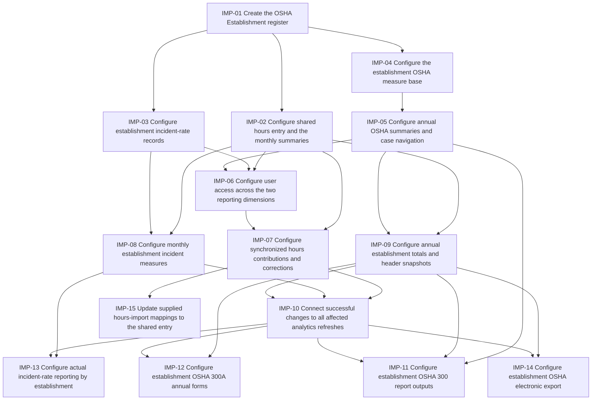

# Shared Hours Worked and OSHA Establishment configuration implementation plan

Draft configuration build plan. Date: November 12, 2026. Basis: [technical specification revision 2](technical-specification.md), [target field model](target-model.json) and the supplied [package evidence](package-evidence.json), SHA-256 e9ee1a3f78189c356b522b04d0f08d7cf45b81ab994e27979cd1e52b3446889d. Package evidence describes the export, not a verified live tenant. The proposal creates seven objects and modifies the original location summary; no tenant changes have been made.

## Scope and planning basis

The tasks configure the establishment master, shared hours entry, monthly summaries, establishment analytics, user permissions, source synchronization, refresh integration, views and outputs. The existing Safety Metrics application is reused; placing the new objects there is a proposed container choice consistent with the source analytics module. No new application, workflow or catalogue records are required. No operational records are seeded by these assignments.

Migration/backfill, establishment population, allocation reconciliation, tenant verification, formal testing, deployment/cutover, training, estimates and documentation workstreams are outside the task plan. Specification cutover prerequisites are external release constraints. Configuration acceptance checks demonstrate each assigned difference; they are not a formal test workstream. Incident-side fields/defaults/workflows and employee/asset schema changes remain excluded.

The field tasks own metadata and forms; the processor tasks own persisted population. Their separation reflects substantial specialist automation and the need for earlier object outputs, rather than a split of routine fields from their controls. Shared synchronization remains one atomic assignment because both dimensions must succeed or fail together. Existing unique/date validators, native processing context/permissions, sequences, location hierarchy and original incident security are reuse context, not reconstruction tasks. No system identity or platform-processing permissions are assigned.

The plan has fifteen configuration assignments. Blocked status is narrow: field setup can proceed where values are explicit, while missing binding/capacity/policy items block only the affected instructions. A blocked task still specifies exactly what its eventual configuration must do; it does not assign discovery to its implementer.

## Task summary

| Task Number | Task Category | Task Name | Objective and Detailed Scope | Recommended Implementer |
|---|---|---|---|---|
| IMP-01 | Objects and administration forms | Create the OSHA Establishment register | **Objective:** Provide the independent establishment master used by hours entry and regulatory reporting.  **Detailed scope:** Create the non-location-bound OSHA Establishment object, its sixteen business fields, unique code, audit and administration views in the existing Safety Metrics application. Configure the master field defaults and catalogue selectors; downstream navigation grids and the later reference-dependent code guard are owned by their consuming tasks. | Associate Consultant |
| IMP-02 | Objects, forms and validation | Configure shared hours entry and the monthly summaries | **Objective:** Provide one entry form for hours and separate monthly summaries that retain independent headcounts.  **Detailed scope:** Create Hours Worked and Establishment Hours and Headcount with their entry/detail/inventory views, conditional selectors, summary links, contribution grids and ordinary unique/date validation. Change the original location summary hour editability, protect saved summary identity, initialize the new summary label and add native audit to that original object. Atomic hour synchronization is owned by its specialist task. | Consultant |
| IMP-03 | Analytics objects and forms | Configure establishment incident-rate records | **Objective:** Provide the monthly establishment incident measures and editable performance targets.  **Detailed scope:** Create the independent incident-rate abstract base and concrete KPI object, all twenty stored measures, period/establishment identity, helper fields and four manual targets. Add their two detail/inventory view pairs and establishment navigation; population and actual-rate report expressions remain owned by their consuming tasks. | Senior Associate Consultant |
| IMP-04 | Regulatory objects and forms | Configure the establishment OSHA measure base | **Objective:** Provide the annual establishment counts, day totals, reporting identity and stored header fields.  **Detailed scope:** Create the independent annual OSHA abstract base with its thirty-five mapped fields, year-start/uniqueness validation and base detail/inventory views. Define stored header fields and the destination settings reference; annual snapshots and totals are populated by the annual processing task. | Senior Associate Consultant |
| IMP-05 | Regulatory records and forms | Configure annual OSHA summaries and case navigation | **Objective:** Provide annual establishment employment information, editable reporting metadata and privacy-aware case navigation.  **Detailed scope:** Create the concrete OSHA summary with seventeen direct declarations, inherited annual measures, its detail/inventory views and master summary grid. Add the readonly case log and case-level 301 navigation only against the supplied incident relationship contract; report download links belong to the output tasks. | Consultant |
| IMP-06 | Application-user and record permissions | Configure user access across the two reporting dimensions | **Objective:** Allow authorized maintenance and reporting without turning either reporting dimension into an access shortcut.  **Detailed scope:** Configure application-user field/object/record rules for the eight new or modified objects, with permissions evaluated independently for location and establishment. Apply server/API restrictions to calculated summary hours, source links, referenced establishment codes, correction access and navigation. Reuse native processing permissions; this task does not create a system identity or alter incident security. | Senior Consultant |
| IMP-07 | Cross-object automation | Configure synchronized hours contributions and corrections | **Objective:** Keep shared hours entries, both monthly totals and their links consistent through creation, correction and deletion.  **Detailed scope:** Add the proposed Synchronize Hours Worked processor and its source Create/Update/Delete hooks, including source validation, summary creation/reuse, link updates and complete replacement of affected totals. Keep one atomic operation for the source and both dimensions, deterministic concurrency controls, repeat-safe updates and explicit scope-only rebuild; downstream processor wiring is a separate task. | Senior Consultant |
| IMP-08 | Analytics automation | Configure monthly establishment incident measures | **Objective:** Populate establishment monthly incident counts, day measures and hours while preserving manual rate goals.  **Detailed scope:** Add a proposed Refresh Establishment Monthly Metrics operation that creates or updates one monthly KPI, initializes its identity/helpers and replaces all twenty stored aggregates. Read hours only from the matching establishment summary and derive incident measures only through supplied source eligibility/attribution rules; do not add actual-rate fields or modify goals. | Senior Consultant |
| IMP-09 | Regulatory analytics automation | Configure annual establishment totals and header snapshots | **Objective:** Populate one annual establishment summary with reproducible case totals, employment values and retained reporting metadata.  **Detailed scope:** Add the proposed Refresh Establishment Annual OSHA operation, creation-only master-to-summary copy, stored annual identity, twenty-four base measures, four employment totals and same-scope case membership. Add explicit authorized header correction and shared annual-output metadata validation while preserving manual annual values during routine refresh. | Senior Consultant |
| IMP-10 | Processor integration | Connect successful changes to all affected analytics refreshes | **Objective:** Refresh both reporting families after hours or headcount changes and prevent stale results being presented as current.  **Detailed scope:** Add the refresh dispatcher consuming successful shared synchronization and summary headcount changes. Bind new establishment operations and the supplied original location processors, cover original/corrected months and years, and attach the native completion/error gate without adding a scheduler, ledger or incident-side handler. | Senior Consultant |
| IMP-11 | Regulatory reports | Configure establishment OSHA 300 report outputs | **Objective:** Generate OSHA and Cal/OSHA case logs from the new establishment summary and its scoped cases.  **Detailed scope:** Add the four new summary print links and supported report/template bindings for OSHA 300, Combined OSHA 300, Cal/OSHA 300 and Combined Cal/OSHA 300. Use establishment/year case membership, privacy masking, empty-case behavior and output-completeness checks; retain the original location print links. | Senior Consultant |
| IMP-12 | Regulatory report templates | Configure establishment OSHA 300A annual forms | **Objective:** Generate OSHA and Cal/OSHA annual summary forms using retained annual headers and employment values.  **Detailed scope:** Add the two new 300A mail-merge/template bindings on the establishment summary. Map the annual stored fields, measure pairs and metadata requirements to supplied destination templates while preserving historical snapshots and original location output links. | Consultant |
| IMP-13 | KPI reports and dashboards | Configure actual incident-rate reporting by establishment | **Objective:** Display actual establishment incident rates beside the four manual targets using the original verified rate policy.  **Detailed scope:** Create the proposed Establishment Incident Rates report/dashboard using the new monthly KPI measures and supplied actual-rate definitions. Show target comparisons, establishment/month filtering, completeness and refresh gating without storing unrequested actual-rate fields or combining reporting dimensions. | Consultant |
| IMP-14 | Regulatory export configuration | Configure establishment OSHA electronic export | **Objective:** Produce the supported electronic OSHA export using annual establishment data and identifiers.  **Detailed scope:** Create a proposed Establishment OSHA Electronic Export view/report based on the supplied original dashboard definition and submission schema. Rebind queries/columns to the new annual summary, enforce required values and formatting, and add new summary navigation; do not add direct regulatory submission automation. | Consultant |
| IMP-15 | Existing integration mappings | Update supplied hours-import mappings to the shared entry | **Objective:** Route identified external hours writers through shared input so they no longer compete with summary calculations.  **Detailed scope:** Modify only the concrete import/interface mappings supplied for existing hour writers, redirecting source hours and references to Hours Worked and its synchronized save operation. Use stable allocation-line keys and separate headcount mappings; do not discover integrations, load historical data or enable a production cutover. | Consultant |

## External inputs and constraints

The team needs the information and decisions below to complete the relevant parts of the build. Providing this information is outside the configuration tasks in this plan. Work that has enough information can continue; each task explains which parts are waiting.

- **IN-01 — How Intelex will save and recalculate hours safely:** The Intelex technical team needs to provide the supported way to update an hours entry and all related summaries together, so either every change succeeds or none is saved. This must cover adding, changing and deleting entries; retaining the original establishment, location and month when an entry changes; preventing simultaneous updates from producing conflicting totals; assigning a unique reference to a manually entered record before it is checked; protecting a saved summary's location and month; and allowing an authorized recalculation. The package does not show how to configure these features.

- **IN-02 — Field sizes and record-number settings:** The team needs the maximum text lengths allowed in the copied summary fields, the settings for automatic record numbering, and the supported way to allow a field to be edited when a record is first created but protect it afterward. Lengths are already specified for the new establishment register, but the package does not give the limits for all copied names, addresses and supporting fields.

- **IN-03 — Existing OSHA classification choices:** Provide the current choices and their reference codes for OSHA Establishment Type, OSHA Establishment Size and Has OSHA Recordable Injuries. The team also needs to know how choices that are no longer available for new records are identified. The package does not include these lists. New choices, employee-size thresholds or submission codes must not be assumed.

- **IN-04 — Who can see and change information:** Provide the approved user groups and access rules for maintaining establishments, entering hours, changing headcounts, setting KPI targets, correcting OSHA information and viewing reports. Specify which locations and establishments each group can access, who can correct historical records for inactive locations or establishments, and what people may see through links and exports. An entry assigned to both a location and an establishment must require access to both. The technical team also needs the supported way to apply these rules; the establishment list will not become a new security hierarchy.

- **IN-05 — Rules for monthly incident measures and rates:** Provide the current rules for which incidents are included, which incident date is used, whether incidents or individual injury cases are counted, which workers are included, and how lost-time incidents and days are counted. For incident rates, specify whether employee hours, contractor hours or both are used, the number used to scale each rate, rounding, how several months are combined, and how missing or zero hours are handled. The package does not contain these calculation rules.

- **IN-06 — How incidents are assigned to establishments:** The separately owned incident design must explain how every relevant incident type is assigned to an OSHA establishment and how this solution will be told when that assignment or reporting period changes. Both the previous and corrected assignments must be available so the right totals can be recalculated. The technical team also needs the existing links between annual summaries, injury/illness records and OSHA case details, including how many records each link can contain and how confidential employee information stays protected. Designing or changing the incident records remains outside this plan.

- **IN-07 — Rules for annual OSHA totals and workforce figures:** Provide the existing rules for which cases enter the annual OSHA totals, how a case is classified when more than one outcome applies, and any limits on the days counted. Specify which employee hours enter the annual total and how average headcount is calculated, including partial years, missing months and rounding. The team also needs the rule for deciding when missing hours or headcounts prevent reporting, and how a deliberately entered zero is treated differently from missing information.

- **IN-08 — OSHA reporting settings and form templates:** Provide the OSHA reporting settings and form templates used in the intended Intelex environment, including their system references, required information and case-level OSHA 301 links. The technical team must establish whether the standard OSHA and Cal/OSHA reporting tools can use the new establishment summaries; if they cannot, an approved supported reporting method is needed. Clarify how the combined forms should behave, particularly the Combined Cal/OSHA form, whose exported setting currently matches the non-combined form. Settings references from the source environment must not be assumed to work in another environment.

- **IN-09 — How existing reports are refreshed:** The technical team needs the names and calling details of the existing processes that recalculate location KPIs and annual OSHA figures after hours or headcounts change. It also needs to know how Intelex signals that a recalculation succeeded or failed, and how reports can be prevented from appearing current while an update is unfinished or has failed. These process details are not included in the package.

- **IN-10 — Existing sources of imported hours:** Provide the names and settings of any imports or connections that currently send hours into Intelex: which source fields they read, which Intelex fields they update, and how each source entry or allocation line is uniquely identified. Specify how those connections will create or correct entries in Hours Worked and which old direct-summary mappings will be retired. The package shows built-in importing turned off for the original summary, but does not identify any other hours feeds. No existing connection is assumed.

- **IN-11 — Current incident-rate report design:** Provide the current report or dashboard setup that displays the four actual incident rates and compares them with their targets. The team needs its calculations, display settings, reporting groups and access rules, plus the supported way to reproduce them for establishments. The package includes descriptions of the rates, but not the working report or its calculations.

- **IN-12 — OSHA electronic-file requirements:** Provide the current OSHA electronic-export report behind the OSHA Esub link and the submission-file requirements it must meet. This includes the applicable version, required columns and order, source information for each column, permitted values, formatting and the supported way to generate the file in the intended environment. The package includes a link to the report, not the report itself or a confirmed direct-submission service.

The data-migration team and client administrators provide the establishment list and agreed starting hours, including how hours are allocated and confirmation that the totals have been checked. The release team decides when to stop the old hours-entry process and switch to the new one, after those checks are complete. This plan prepares the new connections and editing restrictions; moving data, checking what the live system supports and making the production switch are separate responsibilities. Intelex manages access for its own background processing, so no additional processing account or permission setup is requested.

## Detailed configuration tasks

### IMP-01 — Create the OSHA Establishment register

**Task ID:** IMP-01

**Title:** Create the OSHA Establishment register

**Category:** Objects and administration forms

**Objective:** Provide the independent establishment master used by hours entry and regulatory reporting.

**Detailed scope:** Create the non-location-bound OSHA Establishment object, its sixteen business fields, unique code, audit and administration views in the existing Safety Metrics application. Configure the master field defaults and catalogue selectors; downstream navigation grids and the later reference-dependent code guard are owned by their consuming tasks.

**Deliverable:** OSHA Establishment business fields, unique-code validation and administration detail/inventory views.

**Strict technical prerequisites:** None

**Blocked status:** Parts of this task can proceed; the following information is still needed. IN-03: Provide the existing Establishment Type and Size choices, their reference codes and the rule for excluding choices that are no longer available. Only those selection rules are waiting; the register and its other fields can be created. Existing choices will be reused.

**Recommended implementer role:** Associate Consultant

**Recommended reviewer/approver role:** Senior Consultant (product build manager; a different person from the implementer)

**Role rationale:** Typed fields, ordinary defaults, a unique code and two administration views form a bounded established configuration assignment; nuanced reference-dependent security is assigned separately.

Required configuration:

| Element | Required configuration |
|---|---|
| OSHA Establishment.Code | Add Code (Code) on OSHA Establishment (TG_OSHAEstablishmentObject). Type/relationship: Text, max 100. Required: Y. Default/population setting: None; unique, non-localizable. Field/control behavior: Administrator editable at creation and while unused; the later reference-dependent code guard is configured with the complete record-security outcome. |
| OSHA Establishment.Name | Add Name (Name) on OSHA Establishment (TG_OSHAEstablishmentObject). Type/relationship: Text, max 255; legal reporting label, non-localizable. Required: Y. Default/population setting: None. Field/control behavior: Establishment administrator editable. |
| OSHA Establishment.Active? | Add Active? (Active) on OSHA Establishment (TG_OSHAEstablishmentObject). Type/relationship: Yes/No. Required: Y. Default/population setting: TRUE. Field/control behavior: Establishment administrator editable. |
| OSHA Establishment.Company Name | Add Company Name (CompanyName) on OSHA Establishment (TG_OSHAEstablishmentObject). Type/relationship: Text, max 255. Required: Conditional. Default/population setting: None. Field/control behavior: Administrator editable; required for report generation. |
| OSHA Establishment.Street | Add Street (Street) on OSHA Establishment (TG_OSHAEstablishmentObject). Type/relationship: Text, max 255. Required: Conditional. Default/population setting: None. Field/control behavior: Administrator editable; required for report generation. |
| OSHA Establishment.City | Add City (City) on OSHA Establishment (TG_OSHAEstablishmentObject). Type/relationship: Text, max 100. Required: Conditional. Default/population setting: None. Field/control behavior: Administrator editable; required for report generation. |
| OSHA Establishment.State | Add State (State) on OSHA Establishment (TG_OSHAEstablishmentObject). Type/relationship: Text, max 100. Required: Conditional. Default/population setting: None. Field/control behavior: Administrator editable; required for report generation. |
| OSHA Establishment.Postal Code | Add Postal Code (PostalCode) on OSHA Establishment (TG_OSHAEstablishmentObject). Type/relationship: Text, max 30. Required: Conditional. Default/population setting: None. Field/control behavior: Administrator editable; required for report generation. |
| OSHA Establishment.EIN Number | Add EIN Number (EINNumber) on OSHA Establishment (TG_OSHAEstablishmentObject). Type/relationship: Text, max 30. Required: N. Default/population setting: None. Field/control behavior: Administrator editable. |
| OSHA Establishment.NAICS Code | Add NAICS Code (NAICSCode) on OSHA Establishment (TG_OSHAEstablishmentObject). Type/relationship: Number / bigint, System.Int64. Required: N. Default/population setting: None. Field/control behavior: Administrator editable. |
| OSHA Establishment.SIC Code | Add SIC Code (SICCode) on OSHA Establishment (TG_OSHAEstablishmentObject). Type/relationship: Number / bigint, System.Int64. Required: N. Default/population setting: None. Field/control behavior: Administrator editable. |
| OSHA Establishment.Industry Description | Add Industry Description (IndustryDescription) on OSHA Establishment (TG_OSHAEstablishmentObject). Type/relationship: Text, max 1000. Required: N. Default/population setting: None. Field/control behavior: Administrator editable. |
| OSHA Establishment.Establishment Type | Add Establishment Type (EstablishmentType) on OSHA Establishment (TG_OSHAEstablishmentObject). Type/relationship: M:1 to EHSIncidentMang_EstablishmeTypeObject, 0..1 target; inverse disabled. Required: N. Default/population setting: None. Field/control behavior: Administrator editable; preserve referenced values; available-value filter unresolved because catalogue fields are not exported. |
| OSHA Establishment.Establishment Size | Add Establishment Size (EstablishmentSize) on OSHA Establishment (TG_OSHAEstablishmentObject). Type/relationship: M:1 to EHSIncidentMang_EstablishmeSizeObject, 0..1 target; inverse disabled. Required: N. Default/population setting: None. Field/control behavior: Administrator editable; preserve referenced values; available-value filter unresolved because catalogue fields are not exported. |
| OSHA Establishment.Establishment ID | Add Establishment ID (EstablishmentID) on OSHA Establishment (TG_OSHAEstablishmentObject). Type/relationship: Text, max 100. Required: N. Default/population setting: None. Field/control behavior: Administrator editable. |
| OSHA Establishment.OSHA 300a ID | Add OSHA 300a ID (OSHA300aID) on OSHA Establishment (TG_OSHAEstablishmentObject). Type/relationship: Text, max 100. Required: N. Default/population setting: None. Field/control behavior: Administrator editable. |

Configuration instructions:

1. Create TG_OSHAEstablishmentObject in Safety Metrics (E36), display name OSHA Establishment; IsAbstract=FALSE, IsLocationBound=FALSE, no inheritance parent, native audit enabled and no workflow. Create TG_OSHAEstablishment_Detail and TG_OSHAEstablishment_Inventory; Name is the object display field.

2. Add a unique constraint on Code, length 100, non-localizable. Configure Active? default TRUE and Name as a non-localizable legal reporting label. Configure the supplied Type/Size catalogue selector filters with inverse disabled and preserve references to values later made inactive.

3. Place Name, Code, Active?, Company Name, address, EIN, industry metadata, establishment type/size and external reporting IDs on the administration form. Company Name, Street, City, State and Postal Code remain visible/editable and may be blank during maintenance; report-generation completeness is enforced by the reporting tasks, not unconditional master requiredness.

**Acceptance criteria:**

- The register permits establishment administration without a Location reference or workflow.

- Duplicate Code is rejected, Active? defaults TRUE and Name supplies the display value.

- Master form address fields remain editable without unconditional reporting completeness requirements.

**Information needed for this task:** IN-03: Provide the existing Establishment Type and Size choices, their reference codes and the rule for excluding choices that are no longer available. Only those selection rules are waiting; the register and its other fields can be created. Existing choices will be reused.

**Specification references:** Technical specification revision 2 sections 1, 3, 4.1, 6.3; R3, R4. Package module Safety Metrics (E36), object GUID 86db71b3-d191-44f6-8ae1-2867c7a5c36f.

**Assumptions and open questions:** None

### IMP-02 — Configure shared hours entry and the monthly summaries

**Task ID:** IMP-02

**Title:** Configure shared hours entry and the monthly summaries

**Category:** Objects, forms and validation

**Objective:** Provide one entry form for hours and separate monthly summaries that retain independent headcounts.

**Detailed scope:** Create Hours Worked and Establishment Hours and Headcount with their entry/detail/inventory views, conditional selectors, summary links, contribution grids and ordinary unique/date validation. Change the original location summary hour editability, protect saved summary identity, initialize the new summary label and add native audit to that original object. Atomic hour synchronization is owned by its specialist task.

**Deliverable:** Eight shared-input fields, nine establishment-summary fields/grids, one location-summary contribution grid, establishment summary navigation, updated location controls and summary validation.

**Strict technical prerequisites:** IMP-01

**Blocked status:** Parts of this task can proceed; the following information is still needed. IN-01: The technical team must provide the supported way to prevent a saved summary's location, establishment or month from being changed, and to fill in the establishment name when a new summary is created. Those checks and the name-copying step are waiting. IMP-07 handles unique entry references and coordinated updates to hours totals. IN-02: Provide the allowed length of the summary's saved establishment name and the supported setting for fields that are editable only when first created. The known number, date and relationship fields can be configured while these details are supplied. Work needed first: IMP-01 (Create the OSHA Establishment register).

**Recommended implementer role:** Consultant

**Recommended reviewer/approver role:** Senior Consultant (product build manager; a different person from the implementer)

**Role rationale:** The complete entry outcome spans two summary types and conditional source links; separating fields from forms would create unnecessary handoffs.

Predecessor outputs consumed: IMP-01 provides OSHA Establishment business fields, unique-code validation and administration detail/inventory views.

Required configuration:

| Element | Required configuration |
|---|---|
| Hours Worked.Source Entry ID | Add Source Entry ID (SourceEntryID) on Hours Worked (TG_HoursWorkedObject). Type/relationship: Text, max 255; unique within Hours Worked; non-localizable. Required: Y. Default/population setting: Import: caller supplies namespaced stable key; manual create: A0 supplies manual: followed by native record GUID using supported creation mechanism. Field/control behavior: Required on import; read only after creation; configured record display value. |
| Hours Worked.Month | Add Month (Month) on Hours Worked (TG_HoursWorkedObject). Type/relationship: Date; calendar date; timezone capture disabled. Required: Y. Default/population setting: Native MonthStartValueGenerator at creation. Field/control behavior: Hours editor editable; visible in all modes; reject dates other than first day of month. |
| Hours Worked.Location | Add Location (Location) on Hours Worked (TG_HoursWorkedObject). Type/relationship: M:1 to SysLocationEntity; 0..1 target; inverse disabled on this new dimension reference. Required: Conditional. Default/population setting: NULL. Field/control behavior: Visible/editable in all modes; required when OSHA Establishment is NULL; new selections Deleted=FALSE and existing location permissions; no login/home-location default. |
| Hours Worked.OSHA Establishment | Add OSHA Establishment (OSHAEstablishment) on Hours Worked (TG_HoursWorkedObject). Type/relationship: M:1 to OSHA Establishment; 0..1 target; inverse disabled on this dimension reference. Required: Conditional. Default/population setting: NULL. Field/control behavior: Visible/editable in all modes; required when Location is NULL; new selections Active?=TRUE; no default from Location; retain existing inactive references. |
| Hours Worked.Employee Hours | Add Employee Hours (EmployeeHours) on Hours Worked (TG_HoursWorkedObject). Type/relationship: Float, System.Double; unit hours; finite and >= 0; no further precision/scale constraint. Required: Y. Default/population setting: 0. Field/control behavior: Hours editor editable; visible in all modes; deliberate zero permitted; NULL rejected. |
| Hours Worked.Contractor Hours | Add Contractor Hours (ContractorHours) on Hours Worked (TG_HoursWorkedObject). Type/relationship: Float, System.Double; unit hours; finite and >= 0; no further precision/scale constraint. Required: Y. Default/population setting: 0. Field/control behavior: Hours editor editable; visible in all modes; deliberate zero permitted; NULL rejected. |
| Hours Worked.Location Hours and Headcount | Add Location Hours and Headcount (LocationHoursHeadcount) on Hours Worked (TG_HoursWorkedObject). Type/relationship: M:1 to Location Hours and Headcount; 0..1 target; inverse Hours Worked Entries. Required: Conditional. Default/population setting: NULL until A0 resolves applicable summary within successful save. Field/control behavior: Read only; visible/required at completed save when Location is populated; NULL and hidden when Location is NULL. |
| Hours Worked.Establishment Hours and Headcount | Add Establishment Hours and Headcount (EstablishmentHoursHeadcount) on Hours Worked (TG_HoursWorkedObject). Type/relationship: M:1 to Establishment Hours and Headcount; 0..1 target; inverse Hours Worked Entries. Required: Conditional. Default/population setting: NULL until A0 resolves applicable summary within successful save. Field/control behavior: Read only; visible/required at completed save when OSHA Establishment is populated; NULL and hidden when it is NULL. |
| Establishment Hours and Headcount.Date | Add Date (Date) on Establishment Hours and Headcount (TG_EstHrsHeadcountObject). Type/relationship: Date; calendar date, timezone capture disabled. Required: Y. Default/population setting: A0 copies Hours Worked.Month on generated creation; native MonthStartValueGenerator on headcount-only creation. Field/control behavior: Headcount editor selects at creation; read only after save. |
| Establishment Hours and Headcount.Contractor Headcount | Add Contractor Headcount (ContractrHCount) on Establishment Hours and Headcount (TG_EstHrsHeadcountObject). Type/relationship: Float, System.Double; precision/scale not constrained in export. Required: N. Default/population setting: 0. Field/control behavior: Authorized headcount editor editable; API/import uses the same validation; retain source numeric type and default. |
| Establishment Hours and Headcount.Employees Hours | Add Employees Hours (EmployeeHrs) on Establishment Hours and Headcount (TG_EstHrsHeadcountObject). Type/relationship: Float, System.Double; precision/scale not constrained in export. Required: N. Default/population setting: 0 at creation; A0 replaces with sum of Hours Worked.Employee Hours matching OSHAEstablishment and Month = Date. Field/control behavior: Read only to ordinary users/API/import clients; authorized processor writes only. |
| Establishment Hours and Headcount.OSHA Establishment | Add OSHA Establishment (OSHAEstablishment) on Establishment Hours and Headcount (TG_EstHrsHeadcountObject). Type/relationship: M:1 to OSHA Establishment; exactly 1 target per record; inverse Hours and Headcounts. Required: Y. Default/population setting: None; A0 supplies scope, or headcount editor selects at summary creation. Field/control behavior: Required at creation; new selections Active?=TRUE; read only after save; inactive historical references retained. |
| Establishment Hours and Headcount.[Helper] Establishment Name | Add [Helper] Establishment Name (LocNameHelper) on Establishment Hours and Headcount (TG_EstHrsHeadcountObject). Type/relationship: Text / nvarchar; length not constrained in export. Required: N. Default/population setting: None; populated from OSHA Establishment.Name. Field/control behavior: Read only; analytics users may view. |
| Establishment Hours and Headcount.Employees Headcount | Add Employees Headcount (EmployeeHCount) on Establishment Hours and Headcount (TG_EstHrsHeadcountObject). Type/relationship: Float, System.Double; precision/scale not constrained in export. Required: N. Default/population setting: 0. Field/control behavior: Authorized headcount editor editable; API/import uses the same validation; retain source numeric type and default. |
| Establishment Hours and Headcount.Record No | Add Record No (RecordNo) on Establishment Hours and Headcount (TG_EstHrsHeadcountObject). Type/relationship: AutoNumber, System.Int64. Required: N. Default/population setting: Native auto-number sequence (source generator exported). Field/control behavior: Read only; analytics users may view. |
| Establishment Hours and Headcount.Contractor Hours | Add Contractor Hours (ContractrHrs) on Establishment Hours and Headcount (TG_EstHrsHeadcountObject). Type/relationship: Float, System.Double; precision/scale not constrained in export. Required: N. Default/population setting: 0 at creation; A0 replaces with sum of Hours Worked.Contractor Hours matching OSHAEstablishment and Month = Date. Field/control behavior: Read only to ordinary users/API/import clients; authorized processor writes only. |
| Establishment Hours and Headcount.Hours Worked Entries | Add Hours Worked Entries (HoursWorkedEntries) on Establishment Hours and Headcount (TG_EstHrsHeadcountObject). Type/relationship: Inverse 1:M grid from Hours Worked.Establishment Hours and Headcount. Required: N. Default/population setting: None. Field/control behavior: Read only; authorized hours/analytics users. |
| Location Hours and Headcount.Hours Worked Entries | Add Hours Worked Entries (HoursWorkedEntries) on Location Hours and Headcount (SafetyMetrics_HrsandHeadcountObject). Type/relationship: Inverse 1:M grid from Hours Worked.Location Hours and Headcount. Required: N. Default/population setting: None. Field/control behavior: Read only; retain location-scoped access; source access separately checked. |
| OSHA Establishment.Hours and Headcounts | Add Hours and Headcounts (HoursHeadcounts) on OSHA Establishment (TG_OSHAEstablishmentObject). Type/relationship: Inverse 1:M grid from Establishment Hours and Headcount.OSHA Establishment. Required: N. Default/population setting: None. Field/control behavior: Read only; authorized analytics users. |

Verified existing changes:

| Existing element | Required difference from extracted behavior |
|---|---|
| SafetyMetrics_HrsandHeadcountObject (E84) | Change IsAuditEnabled from FALSE to TRUE on the existing Location Hours and Headcount object; retain its existing location/security binding and object GUID. |
| EmployeeHrs (E169) and ContractrHrs (E316) | Change IsReadOnly from FALSE to TRUE for EmployeeHrs and ContractrHrs on the original summary, after the external reconciled cutover release. Configure readonly controls for those two fields on SafetyMetrics_HrsandHeadcount_Detail (E209); server/API write restrictions belong to the user-security task. |
| Date (E82) and Location (E185) on SafetyMetrics_HrsandHeadcount_Detail (E209) | The source Date and Location fields have IsReadOnly=FALSE; the view includes a plain Date control and a Location control with DisplayAs=String, neither with an explicit readonly condition. Add creation-only editability controls and show both readonly after save; do not claim the effective source Location editor behavior was runtime-verified. Existing requiredness and initial Date default remain unchanged. Protect Monthly Summary Identity enforces the saved-record restriction server-side. |

Configuration instructions:

1. Create TG_HoursWorkedObject and TG_EstHrsHeadcountObject as concrete, non-location-bound objects without inheritance or workflow in Safety Metrics (E36); enable native audit. Create TG_HoursWorked_Detail, TG_HoursWorked_Inventory, TG_EstHrsHeadcount_Detail and TG_EstHrsHeadcount_Inventory with the field labels/internal names below.

2. Configure SourceEntryID as the Hours Worked display field and a unique key. Add first-of-month validation on Month using DAY(Month)=1, adapted from the exported Date validation pattern. On the entry form show both dimension selectors at all times: require Location only when OSHAEstablishment is NULL and require OSHAEstablishment only when Location is NULL. Show each readonly summary link only when its dimension is populated; conditional link requiredness applies at successful save after synchronization, not before the processor can populate it. Do not clear/default one dimension when the other changes.

3. On the Hours Worked form display editable EmployeeHours and ContractorHours, both required, default 0 and finite/nonnegative; allow explicit zero and fractional hours. Readonly summary links are not input selectors. Server validation and clearing/relinking are owned by the synchronization task, rather than duplicated in form automation.

4. Add the new establishment summary unique constraint on OSHAEstablishment + Date and DAY(Date)=1 validation. Add a proposed Protect Monthly Summary Identity server validator on both summaries that rejects Location/OSHAEstablishment or Date changes after creation and blocks deletion while Hours Worked references exist. Reuse Unique Location-Date (E183) and Date on first of month (E80) on the original location summary; do not recreate them.

5. Add a proposed Initialize Establishment Monthly Summary create Action Handler: set LocNameHelper from OSHAEstablishment.Name at creation, retain that value on later master rename/deactivation, and use native AutoNumber for RecordNo. This handler does not calculate hours or dispatch refreshes. Native defaults initialize new headcounts to zero without resetting an existing record.

6. Configure headcount-only summary creation with required dimension and month-start Date; saved dimension/date controls become readonly. Keep the two headcounts as separate editable summary values; the source contains no headcount fields. Link both summaries to Hours Worked through the two source-owned summary references and expose their readonly Hours Worked Entries inverse grids.

**Acceptance criteria:**

- Location-only, establishment-only and dual-dimension entry controls are available; neither-dimension input cannot pass completed save once synchronization is installed.

- The two summary grids navigate through the source summary-link fields without a second relationship.

- The original hour fields are readonly while both headcounts remain editable; saved summary scope/date cannot be changed.

- Existing location summary validation IDs and object/field GUIDs remain in place.

**Information needed for this task:** IN-01: The technical team must provide the supported way to prevent a saved summary's location, establishment or month from being changed, and to fill in the establishment name when a new summary is created. Those checks and the name-copying step are waiting. IMP-07 handles unique entry references and coordinated updates to hours totals. IN-02: Provide the allowed length of the summary's saved establishment name and the supported setting for fields that are editable only when first created. The known number, date and relationship fields can be configured while these details are supplied.

**Specification references:** Technical specification revision 2 sections 4.6–4.8, 5.4, 6.1–6.4; R1, R7–R9. Location Hours and Headcount source fields and views are in package-evidence.json.

**Assumptions and open questions:** None

### IMP-03 — Configure establishment incident-rate records

**Task ID:** IMP-03

**Title:** Configure establishment incident-rate records

**Category:** Analytics objects and forms

**Objective:** Provide the monthly establishment incident measures and editable performance targets.

**Detailed scope:** Create the independent incident-rate abstract base and concrete KPI object, all twenty stored measures, period/establishment identity, helper fields and four manual targets. Add their two detail/inventory view pairs and establishment navigation; population and actual-rate report expressions remain owned by their consuming tasks.

**Deliverable:** Twenty-nine mapped monthly/KPI fields, monthly unique/date validation, two view pairs and master KPI navigation.

**Strict technical prerequisites:** IMP-01

**Blocked status:** Parts of this task can proceed; the following information is still needed. IN-02: Provide the allowed length of the saved establishment name and the automatic record-number settings for the new KPI records. Only these settings are waiting; the remaining KPI fields and record setup can be completed. Work needed first: IMP-01 (Create the OSHA Establishment register).

**Recommended implementer role:** Senior Associate Consultant

**Recommended reviewer/approver role:** Senior Consultant (product build manager; a different person from the implementer)

**Role rationale:** This is a bounded inherited field/form build with a known source mapping and simple period validators; no complex population algorithm is assigned here.

Predecessor outputs consumed: IMP-01 provides OSHA Establishment business fields, unique-code validation and administration detail/inventory views.

Required configuration:

| Element | Required configuration |
|---|---|
| Establishment Incident Rate Abstract.Record No | Add Record No (RecordNo) on Establishment Incident Rate Abstract (TG_EstIncRateAbstractObject). Type/relationship: AutoNumber, System.Int64. Required: Y. Default/population setting: None in metadata; native AutoNumber population required. Field/control behavior: Read only; analytics users may view. |
| Establishment Incident Rate Abstract.Date | Add Date (Date) on Establishment Incident Rate Abstract (TG_EstIncRateAbstractObject). Type/relationship: Date; calendar date, timezone capture disabled. Required: Y. Default/population setting: None; Refresh Establishment Monthly Metrics supplies the first day of the requested month. Field/control behavior: Read only; analytics users may view. |
| Establishment Incident Rate Abstract.OSHA Establishment | Add OSHA Establishment (OSHAEstablishment) on Establishment Incident Rate Abstract (TG_EstIncRateAbstractObject). Type/relationship: M:1 to OSHA Establishment; exactly 1 target per record; inverse Incident Rate KPIs. Required: Y. Default/population setting: None; mandatory generation/import scope. Field/control behavior: Read only on generated forms; supplied by Refresh Establishment Monthly Metrics; historical inactive references retained. |
| Establishment Incident Rate Abstract.Number of Days Away - Rollup | Add Number of Days Away - Rollup (RuNumDaysAway) on Establishment Incident Rate Abstract (TG_EstIncRateAbstractObject). Type/relationship: Number / bigint, System.Int64. Required: N. Default/population setting: 0. Field/control behavior: Read only; analytics users may view. |
| Establishment Incident Rate Abstract.Number of Recordable/Reportable - Rollup | Add Number of Recordable/Reportable - Rollup (RuCtRecordable) on Establishment Incident Rate Abstract (TG_EstIncRateAbstractObject). Type/relationship: Number / bigint, System.Int64. Required: N. Default/population setting: 0. Field/control behavior: Read only; analytics users may view. |
| Establishment Incident Rate Abstract.Number of Fatalities - Establishment | Add Number of Fatalities - Establishment (LoNumFatalities) on Establishment Incident Rate Abstract (TG_EstIncRateAbstractObject). Type/relationship: Number / bigint, System.Int64. Required: N. Default/population setting: 0. Field/control behavior: Read only; analytics users may view. |
| Establishment Incident Rate Abstract.Number of Incidents - Rollup | Add Number of Incidents - Rollup (RuCtIncidents) on Establishment Incident Rate Abstract (TG_EstIncRateAbstractObject). Type/relationship: Number / bigint, System.Int64. Required: N. Default/population setting: 0. Field/control behavior: Read only; analytics users may view. |
| Establishment Incident Rate Abstract.[Helper] Establishment Name | Add [Helper] Establishment Name (LocNameHelper) on Establishment Incident Rate Abstract (TG_EstIncRateAbstractObject). Type/relationship: Text / nvarchar; length not constrained in export. Required: N. Default/population setting: None; populated from OSHA Establishment.Name. Field/control behavior: Read only; analytics users may view. |
| Establishment Incident Rate Abstract.Number of Lost Days - Rollup | Add Number of Lost Days - Rollup (RuNumLostDays) on Establishment Incident Rate Abstract (TG_EstIncRateAbstractObject). Type/relationship: Number / bigint, System.Int64. Required: N. Default/population setting: 0. Field/control behavior: Read only; analytics users may view. |
| Establishment Incident Rate Abstract.Contractor Worked Hours - Establishment | Add Contractor Worked Hours - Establishment (LoCntrctWrkdHrs) on Establishment Incident Rate Abstract (TG_EstIncRateAbstractObject). Type/relationship: Float, System.Double; precision/scale not constrained in export. Required: N. Default/population setting: 0. Field/control behavior: Read only; analytics users may view. |
| Establishment Incident Rate Abstract.[Helper] Establishment ID | Add [Helper] Establishment ID (LocationIdHelp) on Establishment Incident Rate Abstract (TG_EstIncRateAbstractObject). Type/relationship: GUID. Required: Y. Default/population setting: None; native GUID of OSHA Establishment reference. Field/control behavior: Read only; hidden on ordinary form. |
| Establishment Incident Rate Abstract.Number of Incidents - Establishment | Add Number of Incidents - Establishment (LoCtIncidents) on Establishment Incident Rate Abstract (TG_EstIncRateAbstractObject). Type/relationship: Number / bigint, System.Int64. Required: N. Default/population setting: 0. Field/control behavior: Read only; analytics users may view. |
| Establishment Incident Rate Abstract.Number of Incidents with Days Away - Rollup | Add Number of Incidents with Days Away - Rollup (RuNumIncDayAway) on Establishment Incident Rate Abstract (TG_EstIncRateAbstractObject). Type/relationship: Number / bigint, System.Int64. Required: N. Default/population setting: 0. Field/control behavior: Read only; analytics users may view. |
| Establishment Incident Rate Abstract.Number of Lost Days - Establishment | Add Number of Lost Days - Establishment (LoNumLostDays) on Establishment Incident Rate Abstract (TG_EstIncRateAbstractObject). Type/relationship: Number / bigint, System.Int64. Required: N. Default/population setting: 0. Field/control behavior: Read only; analytics users may view. |
| Establishment Incident Rate Abstract.Number of Incidents with Days Away - Establishment | Add Number of Incidents with Days Away - Establishment (LoNumIncDayAway) on Establishment Incident Rate Abstract (TG_EstIncRateAbstractObject). Type/relationship: Number / bigint, System.Int64. Required: N. Default/population setting: 0. Field/control behavior: Read only; analytics users may view. |
| Establishment Incident Rate Abstract.Contractor Worked Hours - Rollup | Add Contractor Worked Hours - Rollup (RuCntrctWrkdHrs) on Establishment Incident Rate Abstract (TG_EstIncRateAbstractObject). Type/relationship: Float, System.Double; precision/scale not constrained in export. Required: N. Default/population setting: 0. Field/control behavior: Read only; analytics users may view. |
| Establishment Incident Rate Abstract.Number of Incidents with Lost Time - Rollup | Add Number of Incidents with Lost Time - Rollup (RuNumIncLostTim) on Establishment Incident Rate Abstract (TG_EstIncRateAbstractObject). Type/relationship: Number / bigint, System.Int64. Required: N. Default/population setting: 0. Field/control behavior: Read only; analytics users may view. |
| Establishment Incident Rate Abstract.Employee Worked Hours - Rollup | Add Employee Worked Hours - Rollup (RuEmplWrkdHours) on Establishment Incident Rate Abstract (TG_EstIncRateAbstractObject). Type/relationship: Float, System.Double; precision/scale not constrained in export. Required: N. Default/population setting: 0. Field/control behavior: Read only; analytics users may view. |
| Establishment Incident Rate Abstract.Number of Incidents with Lost Time - Establishment | Add Number of Incidents with Lost Time - Establishment (LoNumIncLostTim) on Establishment Incident Rate Abstract (TG_EstIncRateAbstractObject). Type/relationship: Number / bigint, System.Int64. Required: N. Default/population setting: 0. Field/control behavior: Read only; analytics users may view. |
| Establishment Incident Rate Abstract.Number of Job Transfer and Restricted Days - Rollup | Add Number of Job Transfer and Restricted Days - Rollup (RuNumTrnsfRstDy) on Establishment Incident Rate Abstract (TG_EstIncRateAbstractObject). Type/relationship: Number / bigint, System.Int64. Required: N. Default/population setting: 0. Field/control behavior: Read only; analytics users may view. |
| Establishment Incident Rate Abstract.Number of Job Transfer and Restricted Days - Establishment | Add Number of Job Transfer and Restricted Days - Establishment (LoNumTrnsfRstDy) on Establishment Incident Rate Abstract (TG_EstIncRateAbstractObject). Type/relationship: Number / bigint, System.Int64. Required: N. Default/population setting: 0. Field/control behavior: Read only; analytics users may view. |
| Establishment Incident Rate Abstract.Number of Days Away - Establishment | Add Number of Days Away - Establishment (LoNumDaysAway) on Establishment Incident Rate Abstract (TG_EstIncRateAbstractObject). Type/relationship: Number / bigint, System.Int64. Required: N. Default/population setting: 0. Field/control behavior: Read only; analytics users may view. |
| Establishment Incident Rate Abstract.Number of Recordable/Reportable - Establishment | Add Number of Recordable/Reportable - Establishment (LoCtRecordable) on Establishment Incident Rate Abstract (TG_EstIncRateAbstractObject). Type/relationship: Number / bigint, System.Int64. Required: N. Default/population setting: 0. Field/control behavior: Read only; analytics users may view. |
| Establishment Incident Rate Abstract.Employee Worked Hours - Establishment | Add Employee Worked Hours - Establishment (LoEmplWrkdHours) on Establishment Incident Rate Abstract (TG_EstIncRateAbstractObject). Type/relationship: Float, System.Double; precision/scale not constrained in export. Required: N. Default/population setting: 0. Field/control behavior: Read only; analytics users may view. |
| Establishment Incident Rate Abstract.Number of Fatalities - Rollup | Add Number of Fatalities - Rollup (RuNumFatalities) on Establishment Incident Rate Abstract (TG_EstIncRateAbstractObject). Type/relationship: Number / bigint, System.Int64. Required: N. Default/population setting: 0. Field/control behavior: Read only; analytics users may view. |
| Establishment Incident Rate KPI.Target LTIR | Add Target LTIR (TargetLTIR) on Establishment Incident Rate KPI (TG_EstIncidentRateKPIObject). Type/relationship: Float, System.Double; precision/scale not constrained in export. Required: N. Default/population setting: None. Field/control behavior: Authorized analytics administrator editable. |
| Establishment Incident Rate KPI.Target Severity Rate | Add Target Severity Rate (TargetSeverRate) on Establishment Incident Rate KPI (TG_EstIncidentRateKPIObject). Type/relationship: Float, System.Double; precision/scale not constrained in export. Required: N. Default/population setting: None. Field/control behavior: Authorized analytics administrator editable. |
| Establishment Incident Rate KPI.Target DAIR | Add Target DAIR (TargetDART) on Establishment Incident Rate KPI (TG_EstIncidentRateKPIObject). Type/relationship: Float, System.Double; precision/scale not constrained in export. Required: N. Default/population setting: None. Field/control behavior: Authorized analytics administrator editable. |
| Establishment Incident Rate KPI.Target TRIR | Add Target TRIR (TargetTRIR) on Establishment Incident Rate KPI (TG_EstIncidentRateKPIObject). Type/relationship: Float, System.Double; precision/scale not constrained in export. Required: N. Default/population setting: None. Field/control behavior: Authorized analytics administrator editable. |
| OSHA Establishment.Incident Rate KPIs | Add Incident Rate KPIs (IncidentRateKPIs) on OSHA Establishment (TG_OSHAEstablishmentObject). Type/relationship: Inverse 1:M grid from Establishment Incident Rate KPI.OSHA Establishment (inherited). Required: N. Default/population setting: None. Field/control behavior: Read only; authorized analytics users. |

Configuration instructions:

1. Create TG_EstIncRateAbstractObject (Establishment Incident Rate Abstract) as abstract/non-instantiable with no inheritance parent, and TG_EstIncidentRateKPIObject (Establishment Incident Rate KPI) as its direct concrete child, in Safety Metrics (E36). Both are not location-bound, have native audit and have no workflow. Declare base fields only on the abstract object and targets only on the child.

2. Configure unique OSHAEstablishment + Date and DAY(Date)=1 validators on the new base. Required Date and OSHAEstablishment are supplied by monthly generation; no user reassignment is allowed on generated forms. Configure RecordNo as native AutoNumber/display field with a new sequence, not a copied source record identity.

3. Create TG_EstIncRateAbstract_Detail/Inventory and TG_EstIncidentRateKPI_Detail/Inventory; show RecordNo, OSHA Establishment and Date, panels for four editable targets, incident counts, lost days and employee/contractor hours. Show the stored measures readonly. Keep TargetDART caption Target DAIR; do not relabel it as DART. Hide LocationIdHelp on ordinary forms and retain its establishment-GUID meaning.

4. Build new view profiles from the actual declared/inherited fields. Exclude stale DisplayField, Month, RepLocationId and absent OSHA-category properties found in the source KPI profile; do not add fictitious fields. Add the master Incident Rate KPIs grid as navigation over the concrete child inherited OSHAEstablishment reference.

**Acceptance criteria:**

- The abstract object cannot hold records and the child inherits each base field once.

- The child has four editable manual targets; all twenty measures are readonly stored fields.

- The new monthly unique/date validators reject duplicate establishment/month and non-month-start dates.

- All new profile paths resolve to declared/inherited fields; the KPI label remains Target DAIR for TargetDART.

**Information needed for this task:** IN-02: Provide the allowed length of the saved establishment name and the automatic record-number settings for the new KPI records. Only these settings are waiting; the remaining KPI fields and record setup can be completed.

**Specification references:** Technical specification revision 2 sections 4.2–4.3, 5.1–5.2, 7; R2, R3. Source incident-rate objects, fields and view definitions in package-evidence.json.

**Assumptions and open questions:** None

### IMP-04 — Configure the establishment OSHA measure base

**Task ID:** IMP-04

**Title:** Configure the establishment OSHA measure base

**Category:** Regulatory objects and forms

**Objective:** Provide the annual establishment counts, day totals, reporting identity and stored header fields.

**Detailed scope:** Create the independent annual OSHA abstract base with its thirty-five mapped fields, year-start/uniqueness validation and base detail/inventory views. Define stored header fields and the destination settings reference; annual snapshots and totals are populated by the annual processing task.

**Deliverable:** Thirty-five base declarations, year-start/unique validation and the new OSHA base view pair.

**Strict technical prerequisites:** IMP-01

**Blocked status:** Parts of this task can proceed; the following information is still needed. IN-02: Provide the allowed text lengths for the annual summary's saved establishment name and address, plus its automatic record-number settings. Only these settings are waiting; the known case-count and day-total fields can be created. IN-08: Identify the OSHA reporting-settings record to use in the intended environment. It is needed to connect the new annual summaries to the correct reporting settings. The record reference in the source package must not be assumed to work there. Work needed first: IMP-01 (Create the OSHA Establishment register).

**Recommended implementer role:** Senior Associate Consultant

**Recommended reviewer/approver role:** Senior Consultant (product build manager; a different person from the implementer)

**Role rationale:** The inherited base is a sizeable but bounded field/view outcome; retaining simple validation with its fields avoids fragmentation.

Predecessor outputs consumed: IMP-01 provides OSHA Establishment business fields, unique-code validation and administration detail/inventory views.

Required configuration:

| Element | Required configuration |
|---|---|
| Establishment OSHA Abstract.Total number of job transfer or restriction days (L) - roll up | Add Total number of job transfer or restriction days (L) - roll up (RuNumRstOrJobTr) on Establishment OSHA Abstract (TG_EstOSHAAbstractObject). Type/relationship: Number / bigint, System.Int64. Required: N. Default/population setting: 0. Field/control behavior: Read only; analytics users may view. |
| Establishment OSHA Abstract.Total number of days away from work (K) - roll up | Add Total number of days away from work (K) - roll up (RuNumDaysAway) on Establishment OSHA Abstract (TG_EstOSHAAbstractObject). Type/relationship: Number / bigint, System.Int64. Required: N. Default/population setting: 0. Field/control behavior: Read only; analytics users may view. |
| Establishment OSHA Abstract.Injuries (M1) - roll up | Add Injuries (M1) - roll up (RuCtInjuries) on Establishment OSHA Abstract (TG_EstOSHAAbstractObject). Type/relationship: Number / bigint, System.Int64. Required: N. Default/population setting: 0. Field/control behavior: Read only; analytics users may view. |
| Establishment OSHA Abstract.Respiratory Conditions (M3) - establishment | Add Respiratory Conditions (M3) - establishment (LoCtRespiratorC) on Establishment OSHA Abstract (TG_EstOSHAAbstractObject). Type/relationship: Number / bigint, System.Int64. Required: N. Default/population setting: 0. Field/control behavior: Read only; analytics users may view. |
| Establishment OSHA Abstract.OSHA Establishment | Add OSHA Establishment (OSHAEstablishment) on Establishment OSHA Abstract (TG_EstOSHAAbstractObject). Type/relationship: M:1 to OSHA Establishment; exactly 1 target per record; inverse OSHA Summaries. Required: Y. Default/population setting: None; mandatory generation/import scope. Field/control behavior: Read only on generated forms; supplied by Refresh Establishment Annual OSHA; historical inactive references retained. |
| Establishment OSHA Abstract.Other Recordable Cases (J) - roll up | Add Other Recordable Cases (J) - roll up (RuCtOthrRecrdbl) on Establishment OSHA Abstract (TG_EstOSHAAbstractObject). Type/relationship: Number / bigint, System.Int64. Required: N. Default/population setting: 0. Field/control behavior: Read only; analytics users may view. |
| Establishment OSHA Abstract.All other illnesses (M6) - establishment | Add All other illnesses (M6) - establishment (LoCtAllOtherIln) on Establishment OSHA Abstract (TG_EstOSHAAbstractObject). Type/relationship: Number / bigint, System.Int64. Required: N. Default/population setting: 0. Field/control behavior: Read only; analytics users may view. |
| Establishment OSHA Abstract.Other Recordable Cases (J) - establishment | Add Other Recordable Cases (J) - establishment (LoCtOthrRecrdbl) on Establishment OSHA Abstract (TG_EstOSHAAbstractObject). Type/relationship: Number / bigint, System.Int64. Required: N. Default/population setting: 0. Field/control behavior: Read only; analytics users may view. |
| Establishment OSHA Abstract.Job Transfer or Restricted Days Cases (I) - roll up | Add Job Transfer or Restricted Days Cases (I) - roll up (RuCtTrnfrOrRest) on Establishment OSHA Abstract (TG_EstOSHAAbstractObject). Type/relationship: Number / bigint, System.Int64. Required: N. Default/population setting: 0. Field/control behavior: Read only; analytics users may view. |
| Establishment OSHA Abstract.Establishment Street | Add Establishment Street (LocationStreet) on Establishment OSHA Abstract (TG_EstOSHAAbstractObject). Type/relationship: Text / nvarchar; length not constrained in export. Required: N. Default/population setting: At initial annual generation: OSHA Establishment.Street. Field/control behavior: Read only; analytics users may view. |
| Establishment OSHA Abstract.Date | Add Date (Date) on Establishment OSHA Abstract (TG_EstOSHAAbstractObject). Type/relationship: Date; calendar date, timezone capture disabled. Required: Y. Default/population setting: None; Refresh Establishment Annual OSHA supplies January 1 of the requested year. Field/control behavior: Read only; analytics users may view. |
| Establishment OSHA Abstract.Poisonings (M4) - establishment | Add Poisonings (M4) - establishment (LoCtPoisonings) on Establishment OSHA Abstract (TG_EstOSHAAbstractObject). Type/relationship: Number / bigint, System.Int64. Required: N. Default/population setting: 0. Field/control behavior: Read only; analytics users may view. |
| Establishment OSHA Abstract.Hearing loss (M5) - establishment | Add Hearing loss (M5) - establishment (LoCtHearingLoss) on Establishment OSHA Abstract (TG_EstOSHAAbstractObject). Type/relationship: Number / bigint, System.Int64. Required: N. Default/population setting: 0. Field/control behavior: Read only; analytics users may view. |
| Establishment OSHA Abstract.Skin Disorders (M2) - roll up | Add Skin Disorders (M2) - roll up (RuCtSkinDisordr) on Establishment OSHA Abstract (TG_EstOSHAAbstractObject). Type/relationship: Number / bigint, System.Int64. Required: N. Default/population setting: 0. Field/control behavior: Read only; analytics users may view. |
| Establishment OSHA Abstract.Respiratory Conditions (M3) - roll up | Add Respiratory Conditions (M3) - roll up (RuCtRespiratorC) on Establishment OSHA Abstract (TG_EstOSHAAbstractObject). Type/relationship: Number / bigint, System.Int64. Required: N. Default/population setting: 0. Field/control behavior: Read only; analytics users may view. |
| Establishment OSHA Abstract.Death (G) - establishment | Add Death (G) - establishment (LoCtFatalities) on Establishment OSHA Abstract (TG_EstOSHAAbstractObject). Type/relationship: Number / bigint, System.Int64. Required: N. Default/population setting: 0. Field/control behavior: Read only; analytics users may view. |
| Establishment OSHA Abstract.Job Transfer or Restricted Days Cases (I) - establishment | Add Job Transfer or Restricted Days Cases (I) - establishment (LoCtTrnfrOrRest) on Establishment OSHA Abstract (TG_EstOSHAAbstractObject). Type/relationship: Number / bigint, System.Int64. Required: N. Default/population setting: 0. Field/control behavior: Read only; analytics users may view. |
| Establishment OSHA Abstract.Injuries (M1) - establishment | Add Injuries (M1) - establishment (LoCtInjuries) on Establishment OSHA Abstract (TG_EstOSHAAbstractObject). Type/relationship: Number / bigint, System.Int64. Required: N. Default/population setting: 0. Field/control behavior: Read only; analytics users may view. |
| Establishment OSHA Abstract.Establishment City | Add Establishment City (LocationCity) on Establishment OSHA Abstract (TG_EstOSHAAbstractObject). Type/relationship: Text / nvarchar; length not constrained in export. Required: N. Default/population setting: At initial annual generation: OSHA Establishment.City. Field/control behavior: Read only; analytics users may view. |
| Establishment OSHA Abstract.Establishment Postal Code | Add Establishment Postal Code (LocationPostal) on Establishment OSHA Abstract (TG_EstOSHAAbstractObject). Type/relationship: Text / nvarchar; length not constrained in export. Required: N. Default/population setting: At initial annual generation: OSHA Establishment.Postal Code. Field/control behavior: Read only; analytics users may view. |
| Establishment OSHA Abstract.Death (G) - roll up | Add Death (G) - roll up (RuCtFatalities) on Establishment OSHA Abstract (TG_EstOSHAAbstractObject). Type/relationship: Number / bigint, System.Int64. Required: N. Default/population setting: 0. Field/control behavior: Read only; analytics users may view. |
| Establishment OSHA Abstract.Days Away From Work Cases (H) - roll up | Add Days Away From Work Cases (H) - roll up (RuCtDaysAway) on Establishment OSHA Abstract (TG_EstOSHAAbstractObject). Type/relationship: Number / bigint, System.Int64. Required: N. Default/population setting: 0. Field/control behavior: Read only; analytics users may view. |
| Establishment OSHA Abstract.Establishment State | Add Establishment State (LocationState) on Establishment OSHA Abstract (TG_EstOSHAAbstractObject). Type/relationship: Text / nvarchar; length not constrained in export. Required: N. Default/population setting: At initial annual generation: OSHA Establishment.State. Field/control behavior: Read only; analytics users may view. |
| Establishment OSHA Abstract.Record No | Add Record No (RecordNo) on Establishment OSHA Abstract (TG_EstOSHAAbstractObject). Type/relationship: AutoNumber, System.Int64. Required: Y. Default/population setting: None in metadata; native AutoNumber population required. Field/control behavior: Read only; analytics users may view. |
| Establishment OSHA Abstract.Days Away From Work Cases (H) - establishment | Add Days Away From Work Cases (H) - establishment (LoCtDaysAway) on Establishment OSHA Abstract (TG_EstOSHAAbstractObject). Type/relationship: Number / bigint, System.Int64. Required: N. Default/population setting: 0. Field/control behavior: Read only; analytics users may view. |
| Establishment OSHA Abstract.[Helper] Establishment ID | Add [Helper] Establishment ID (ReporLocationId) on Establishment OSHA Abstract (TG_EstOSHAAbstractObject). Type/relationship: GUID. Required: Y. Default/population setting: None; native GUID of OSHA Establishment reference. Field/control behavior: Read only; hidden on ordinary form. |
| Establishment OSHA Abstract.Year | Add Year (Year) on Establishment OSHA Abstract (TG_EstOSHAAbstractObject). Type/relationship: Number / bigint, System.Int64. Required: N. Default/population setting: None; Refresh Establishment Annual OSHA stores the calendar year derived from Date; no continuing calculated expression is assigned. Field/control behavior: Read only; analytics users may view. |
| Establishment OSHA Abstract.All other illnesses (M6) - roll up | Add All other illnesses (M6) - roll up (RuCtAllOtherIln) on Establishment OSHA Abstract (TG_EstOSHAAbstractObject). Type/relationship: Number / bigint, System.Int64. Required: N. Default/population setting: 0. Field/control behavior: Read only; analytics users may view. |
| Establishment OSHA Abstract.Establishment Display Name | Add Establishment Display Name (LocationName) on Establishment OSHA Abstract (TG_EstOSHAAbstractObject). Type/relationship: Text / nvarchar; length not constrained in export. Required: N. Default/population setting: At initial annual generation: OSHA Establishment.Name. Field/control behavior: Read only; analytics users may view. |
| Establishment OSHA Abstract.OII Settings | Add OII Settings (OIISettings) on Establishment OSHA Abstract (TG_EstOSHAAbstractObject). Type/relationship: M:1 to EHSIncidentMang_OIISettingObject; 0..1 target; inverse disabled. Required: N. Default/population setting: No portable record GUID available; defer destination default binding to the supplied OII Setting input, never hard-code the source record GUID. Field/control behavior: Read only; hidden on ordinary summary form. |
| Establishment OSHA Abstract.Total number of days away from work (K) - establishment | Add Total number of days away from work (K) - establishment (LoNumDaysAway) on Establishment OSHA Abstract (TG_EstOSHAAbstractObject). Type/relationship: Number / bigint, System.Int64. Required: N. Default/population setting: 0. Field/control behavior: Read only; analytics users may view. |
| Establishment OSHA Abstract.Hearing loss (M5) - roll up | Add Hearing loss (M5) - roll up (RuCtHearingLoss) on Establishment OSHA Abstract (TG_EstOSHAAbstractObject). Type/relationship: Number / bigint, System.Int64. Required: N. Default/population setting: 0. Field/control behavior: Read only; analytics users may view. |
| Establishment OSHA Abstract.Skin Disorders (M2) - establishment | Add Skin Disorders (M2) - establishment (LoCtSkinDisordr) on Establishment OSHA Abstract (TG_EstOSHAAbstractObject). Type/relationship: Number / bigint, System.Int64. Required: N. Default/population setting: 0. Field/control behavior: Read only; analytics users may view. |
| Establishment OSHA Abstract.Poisonings (M4) - roll up | Add Poisonings (M4) - roll up (RuCtPoisonings) on Establishment OSHA Abstract (TG_EstOSHAAbstractObject). Type/relationship: Number / bigint, System.Int64. Required: N. Default/population setting: 0. Field/control behavior: Read only; analytics users may view. |
| Establishment OSHA Abstract.Total number of job transfer or restriction days (L) - establishment | Add Total number of job transfer or restriction days (L) - establishment (LoNumRstOrJobTr) on Establishment OSHA Abstract (TG_EstOSHAAbstractObject). Type/relationship: Number / bigint, System.Int64. Required: N. Default/population setting: 0. Field/control behavior: Read only; analytics users may view. |

Configuration instructions:

1. Create TG_EstOSHAAbstractObject (Establishment OSHA Abstract) as abstract/non-instantiable with no inheritance parent in Safety Metrics (E36); set IsLocationBound=FALSE, enable native audit and add no workflow.

2. Configure unique OSHAEstablishment + Date and AND(MONTH(Date)=1, DAY(Date)=1) validation. Date/OSHAEstablishment are readonly on generated forms and mandatory in annual generation. Use native AutoNumber for RecordNo/display identity and a new sequence; the required ReporLocationId helper stores the establishment GUID, not a system Location GUID.

3. Create TG_EstOSHAAbstract_Detail and TG_EstOSHAAbstract_Inventory with readonly G–M count/day fields, year, annual date, establishment reference and header snapshots. Keep OIISettings hidden on ordinary summary forms; catalogue/settings inverses are disabled. Build profiles only from actual base fields.

4. Create LocationName, LocationStreet, LocationCity, LocationState and LocationPostal as stored header text counterparts, not continuing master formulas. Configure Year as a stored number populated by annual processing. Do not add a Location reference or make the new base inherit the original OSHA base.

**Acceptance criteria:**

- All twenty-four Lo/Ru annual count/day declarations exist once on the new non-location-bound base.

- The base rejects non-January-1 dates and duplicate establishment/year records.

- Header values are stored fields and the required GUID helper refers to establishment identity.

- OIISettings has a destination-supplied default or remains explicitly blocked; the source settings GUID is not silently reused.

**Information needed for this task:** IN-02: Provide the allowed text lengths for the annual summary's saved establishment name and address, plus its automatic record-number settings. Only these settings are waiting; the known case-count and day-total fields can be created. IN-08: Identify the OSHA reporting-settings record to use in the intended environment. It is needed to connect the new annual summaries to the correct reporting settings. The record reference in the source package must not be assumed to work there.

**Specification references:** Technical specification revision 2 sections 4.4, 5.1, 6.3; R2–R4. Source OSHA Abstract fields and validations in package-evidence.json.

**Assumptions and open questions:** None

### IMP-05 — Configure annual OSHA summaries and case navigation

**Task ID:** IMP-05

**Title:** Configure annual OSHA summaries and case navigation

**Category:** Regulatory records and forms

**Objective:** Provide annual establishment employment information, editable reporting metadata and privacy-aware case navigation.

**Detailed scope:** Create the concrete OSHA summary with seventeen direct declarations, inherited annual measures, its detail/inventory views and master summary grid. Add the readonly case log and case-level 301 navigation only against the supplied incident relationship contract; report download links belong to the output tasks.

**Deliverable:** Concrete annual summary, seventeen direct fields, new summary view pair, master navigation and scoped case log controls.

**Strict technical prerequisites:** IMP-04

**Blocked status:** Parts of this task can proceed; the following information is still needed. IN-02: Provide the allowed text lengths for company name, EIN, establishment name, industry description, change reason and reporting IDs. Only those length settings are waiting. IN-03: Provide the existing Establishment Type, Establishment Size and Has OSHA Recordable Injuries choices, their reference codes and the rule for excluding choices no longer available. The plan does not authorize new choices. IN-06: Explain how the annual summary is linked to injury/illness and OSHA case records, including how many records each link can contain and which case information is available. The case list and its links are waiting for this information; the known individual fields can be created. IN-08: Provide the OSHA 301 template and its links to the correct case records, together with the information that must be present before reporting. Only the case-level print link and related reporting checks are waiting. Work needed first: IMP-04 (Configure the establishment OSHA measure base).

**Recommended implementer role:** Consultant

**Recommended reviewer/approver role:** Senior Consultant (product build manager; a different person from the implementer)

**Role rationale:** The summary combines inherited fields, external case-grid paths and case-template navigation whose failure could misattribute regulatory output.

Predecessor outputs consumed: IMP-04 provides Thirty-five base declarations, year-start/unique validation and the new OSHA base view pair.

Required configuration:

| Element | Required configuration |
|---|---|
| Establishment OSHA Summary.Total hours worked by all employees this year Establishment | Add Total hours worked by all employees this year Establishment (LoNumHrsWorked) on Establishment OSHA Summary (TG_EstOSHASummaryObject). Type/relationship: Float, System.Double; precision/scale not constrained in export. Required: N. Default/population setting: None. Field/control behavior: Read only; analytics users may view. |
| Establishment OSHA Summary.Company Name | Add Company Name (CompanyName) on Establishment OSHA Summary (TG_EstOSHASummaryObject). Type/relationship: Text / nvarchar; length not constrained in export. Required: N. Default/population setting: At initial annual generation: OSHA Establishment.Company Name. Field/control behavior: Authorized analytics administrator editable. |
| Establishment OSHA Summary.Annual average number of employees Establishment | Add Annual average number of employees Establishment (LoAvgNumEmploye) on Establishment OSHA Summary (TG_EstOSHASummaryObject). Type/relationship: Float, System.Double; precision/scale not constrained in export. Required: N. Default/population setting: None. Field/control behavior: Read only; analytics users may view. |
| Establishment OSHA Summary.EIN Number | Add EIN Number (EINNumber) on Establishment OSHA Summary (TG_EstOSHASummaryObject). Type/relationship: Text / nvarchar; length not constrained in export. Required: N. Default/population setting: At initial annual generation: OSHA Establishment.EIN Number. Field/control behavior: Authorized analytics administrator editable. |
| Establishment OSHA Summary.Annual average number of employees Rollup | Add Annual average number of employees Rollup (RuAvgNumEmploye) on Establishment OSHA Summary (TG_EstOSHASummaryObject). Type/relationship: Float, System.Double; precision/scale not constrained in export. Required: N. Default/population setting: None. Field/control behavior: Read only; analytics users may view. |
| Establishment OSHA Summary.Total hours worked by all employees this year Rollup | Add Total hours worked by all employees this year Rollup (RUNumHrsWorked) on Establishment OSHA Summary (TG_EstOSHASummaryObject). Type/relationship: Float, System.Double; precision/scale not constrained in export. Required: N. Default/population setting: None. Field/control behavior: Read only; analytics users may view. |
| Establishment OSHA Summary.Change Reason | Add Change Reason (ChangeReason) on Establishment OSHA Summary (TG_EstOSHASummaryObject). Type/relationship: Text / nvarchar; length not constrained in export. Required: N. Default/population setting: None. Field/control behavior: Authorized analytics administrator editable. |
| Establishment OSHA Summary.Establishment Type | Add Establishment Type (EstablishmeType) on Establishment OSHA Summary (TG_EstOSHASummaryObject). Type/relationship: M:1 to EHSIncidentMang_EstablishmeTypeObject; 0..1 target; inverse disabled. Required: N. Default/population setting: At initial annual generation: OSHA Establishment.Establishment Type. Field/control behavior: Regulatory administrator editable; preserve selected inactive/legacy values; active-selection filter unresolved in external catalogue export. |
| Establishment OSHA Summary.Establishment Name | Add Establishment Name (EstablishmeName) on Establishment OSHA Summary (TG_EstOSHASummaryObject). Type/relationship: Text / nvarchar; length not constrained in export. Required: N. Default/population setting: At initial annual generation: OSHA Establishment.Name. Field/control behavior: Authorized analytics administrator editable. |
| Establishment OSHA Summary.Establishment Size | Add Establishment Size (EstablishmtSize) on Establishment OSHA Summary (TG_EstOSHASummaryObject). Type/relationship: M:1 to EHSIncidentMang_EstablishmeSizeObject; 0..1 target; inverse disabled. Required: N. Default/population setting: At initial annual generation: OSHA Establishment.Establishment Size. Field/control behavior: Regulatory administrator editable; preserve selected inactive/legacy values; active-selection filter unresolved in external catalogue export. |
| Establishment OSHA Summary.SIC Code | Add SIC Code (SICCode) on Establishment OSHA Summary (TG_EstOSHASummaryObject). Type/relationship: Number / bigint, System.Int64. Required: N. Default/population setting: At initial annual generation: OSHA Establishment.SIC Code. Field/control behavior: Read only; analytics users may view. |
| Establishment OSHA Summary.Associated OIIs | Add Associated OIIs (AssociatedOIIs) on Establishment OSHA Summary (TG_EstOSHASummaryObject). Type/relationship: Related Injury/Illness collection; 0..* results, storage cardinality/inverse unresolved in export. Required: N. Default/population setting: None. Field/control behavior: Read only in target; authorized regulatory users; recordable-only log grid. |
| Establishment OSHA Summary.NAICS Code | Add NAICS Code (NAICSCode) on Establishment OSHA Summary (TG_EstOSHASummaryObject). Type/relationship: Number / bigint, System.Int64. Required: N. Default/population setting: At initial annual generation: OSHA Establishment.NAICS Code. Field/control behavior: Read only; analytics users may view. |
| Establishment OSHA Summary.Any Recordable Incidents | Add Any Recordable Incidents (AnyRecrdblIncid) on Establishment OSHA Summary (TG_EstOSHASummaryObject). Type/relationship: M:1 to EHSIncidentMang_HasRecordaInjurObject; 0..1 target; inverse disabled. Required: N. Default/population setting: None. Field/control behavior: Regulatory administrator editable; preserve selected inactive/legacy values; active-selection filter unresolved in external catalogue export. |
| Establishment OSHA Summary.OSHA 300a ID | Add OSHA 300a ID (OSHA300aID) on Establishment OSHA Summary (TG_EstOSHASummaryObject). Type/relationship: Text / nvarchar; length not constrained in export. Required: N. Default/population setting: At initial annual generation: OSHA Establishment.OSHA 300a ID. Field/control behavior: Authorized analytics administrator editable. |
| Establishment OSHA Summary.Establishment ID | Add Establishment ID (EstablishmentID) on Establishment OSHA Summary (TG_EstOSHASummaryObject). Type/relationship: Text / nvarchar; length not constrained in export. Required: N. Default/population setting: At initial annual generation: OSHA Establishment.Establishment ID. Field/control behavior: Authorized analytics administrator editable. |
| Establishment OSHA Summary.Industry Description | Add Industry Description (InduDescription) on Establishment OSHA Summary (TG_EstOSHASummaryObject). Type/relationship: Text / nvarchar; length not constrained in export. Required: N. Default/population setting: At initial annual generation: OSHA Establishment.Industry Description. Field/control behavior: Authorized analytics administrator editable. |
| OSHA Establishment.OSHA Summaries | Add OSHA Summaries (OSHASummaries) on OSHA Establishment (TG_OSHAEstablishmentObject). Type/relationship: Inverse 1:M grid from Establishment OSHA Summary.OSHA Establishment (inherited). Required: N. Default/population setting: None. Field/control behavior: Read only; authorized regulatory users. |

Configuration instructions:

1. Create TG_EstOSHASummaryObject (Establishment OSHA Summary) as the direct concrete child of TG_EstOSHAAbstractObject in Safety Metrics (E36); native audit enabled, no location binding/workflow. Declare only its seventeen fields; do not repeat inherited base fields.

2. Create TG_EstOSHASummary_Detail and TG_EstOSHASummary_Inventory with establishment/year/header metadata, G–J cases, K/L days, M1–M6 types and annual employment panels. Allow authorized edits of CompanyName, EINNumber, EstablishmeName, InduDescription, EstablishmeType, EstablishmtSize, AnyRecrdblIncid, OSHA300aID, EstablishmentID and ChangeReason; readonly codes/header values use the annual correction operation. Keep OIISettings hidden.

3. Add AssociatedOIIs using only the supplied declaring relationship/cardinality; do not guess an inverse or create an incident-side field. Configure readonly log navigation through AssociatedOIIs.OSHARecord with InjuryIllnes.OSHARecordable=TRUE. Columns are CaseNo, InjuryIllnes.NameHidden, InjuryIllnes.DateUserEntered, InjuryOutcome, InjuryIllnes.NumDaysAwayOSHA, InjuryIllnes.NumJobTAndRest and PrInjuryIllness. Suppress duplicate case rows and preserve name masking and incident permissions.

4. Configure the case 301 control to use InjuryIllnes.OIISetting.OSHA301TempId and OSHAObjectID with the case record ID, not the summary ID. Bind the destination case-template route only after the supplied path/template contract is complete. Add the establishment master OSHA Summaries inverse grid over the concrete summary inherited OSHAEstablishment reference.

**Acceptance criteria:**

- The concrete summary inherits the base once and has seventeen direct fields, including distinct Establishment Display Name and Establishment Name.

- The log contains only supplied same-establishment/year eligible case records, displays masked names and has no edit column.

- The 301 link addresses the case object and case record rather than the annual summary.

- Ordinary metric refresh does not make reporting metadata controls readonly or reset permitted annual edits.

**Information needed for this task:** IN-02: Provide the allowed text lengths for company name, EIN, establishment name, industry description, change reason and reporting IDs. Only those length settings are waiting. IN-03: Provide the existing Establishment Type, Establishment Size and Has OSHA Recordable Injuries choices, their reference codes and the rule for excluding choices no longer available. The plan does not authorize new choices. IN-06: Explain how the annual summary is linked to injury/illness and OSHA case records, including how many records each link can contain and which case information is available. The case list and its links are waiting for this information; the known individual fields can be created. IN-08: Provide the OSHA 301 template and its links to the correct case records, together with the information that must be present before reporting. Only the case-level print link and related reporting checks are waiting.

**Specification references:** Technical specification revision 2 sections 4.5, 4.9, 7–8; R2, R5, R6. SafetyMetrics_OSHASummary_Detail (E100) supplies the extracted case-grid paths; their target field definitions are not exported.

**Assumptions and open questions:** None

### IMP-06 — Configure user access across the two reporting dimensions

**Task ID:** IMP-06

**Title:** Configure user access across the two reporting dimensions

**Category:** Application-user and record permissions

**Objective:** Allow authorized maintenance and reporting without turning either reporting dimension into an access shortcut.

**Detailed scope:** Configure application-user field/object/record rules for the eight new or modified objects, with permissions evaluated independently for location and establishment. Apply server/API restrictions to calculated summary hours, source links, referenced establishment codes, correction access and navigation. Reuse native processing permissions; this task does not create a system identity or alter incident security.

**Deliverable:** User-role and record-scope permission configuration with field-write restrictions, referenced-code guard and a supported dual-dimension access predicate.

**Strict technical prerequisites:** IMP-02, IMP-03, IMP-05

**Blocked status:** Parts of this task can proceed; the following information is still needed. IN-04: Provide the actual user groups and the locations, establishments, fields and reports each group may see or change, including historical corrections. These access settings cannot be completed from business-role labels alone. IN-01: The technical team must provide the supported way to check whether an establishment is already in use. This is needed to prevent its code from being changed, or the establishment from being deleted, once other records use it. The required record links will already exist from the earlier tasks. Work needed first: IMP-02 (Configure shared hours entry and the monthly summaries); IMP-03 (Configure establishment incident-rate records); IMP-05 (Configure annual OSHA summaries and case navigation).

**Recommended implementer role:** Senior Consultant

**Recommended reviewer/approver role:** Senior Consultant (product build manager; a different person from the implementer)

**Role rationale:** Non-location-bound input, dual-scope authorization and incident privacy require nuanced cross-object security judgment.

Predecessor outputs consumed: IMP-02 provides Eight shared-input fields, nine establishment-summary fields/grids, one location-summary contribution grid, establishment summary navigation, updated location controls and summary validation. IMP-03 provides Twenty-nine mapped monthly/KPI fields, monthly unique/date validation, two view pairs and master KPI navigation. IMP-05 provides Concrete annual summary, seventeen direct fields, new summary view pair, master navigation and scoped case log controls.

Configuration instructions:

1. Bind supplied establishment-administrator roles to master maintenance; hours-editor roles to Hours Worked create/update/delete within every selected dimension; headcount-editor roles to the two summary headcounts; analytics-administrator roles to KPI targets; regulatory-administrator roles to annual metadata/correction; and reporting roles to only authorized result records. Disable direct ordinary/API/import writes to summary EmployeeHrs/ContractrHrs and source LocationHoursHeadcount/EstablishmentHoursHeadcount.

2. Configure the supported user-access predicate so location-only entry requires location entitlement, establishment-only requires establishment entitlement, and dual-scope entry requires both. Changing references rechecks all resulting scopes; a related summary or source link grants no new rights to the other dimension. Expose the resulting user-access check to the shared synchronization handler without introducing a security hierarchy.

3. Configure saved-source SourceEntryID immutability and restrict new inactive-scope assignments to the supplied administrator historical-correction entitlement. Existing inactive references remain valid for authorized hours/month correction and historical output. Limit readonly annual-header correction to the explicit regulatory operation; do not enable general edits to those fields.

4. Apply the same application-user record restrictions to forms, direct URLs, searches, exports and relationship navigation. The original location summary retains its native location binding, while establishment and source objects use the supplied independent record rules. Existing incident/case permissions and masked-name presentation remain separate and authoritative.

5. Add a proposed Protect Establishment Code server validation and corresponding readonly Code control condition once the record is referenced by Hours Worked.OSHAEstablishment, Establishment Hours and Headcount.OSHAEstablishment, Establishment Incident Rate KPI.OSHAEstablishment or Establishment OSHA Summary.OSHAEstablishment. Reject later Code changes before save while Name remains editable. Block hard deletion of a referenced establishment and prohibit cascade deletion of its sources/results; retain historical references when Active? becomes FALSE.

**Acceptance criteria:**

- An editor entitled to only one of two selected dimensions cannot save a dual-scope entry.

- Ordinary/API/import users cannot modify calculated summary hours or source summary links; authorized headcount and target edits remain possible.

- Opening a summary grid or exported result does not grant access to hidden source/case records.

- Historical inactive references remain readable without enabling unrestricted new inactive-scope assignment.

- A referenced establishment Code cannot change or be hard-deleted, while its Name remains editable and deactivation preserves references.

**Information needed for this task:** IN-04: Provide the actual user groups and the locations, establishments, fields and reports each group may see or change, including historical corrections. These access settings cannot be completed from business-role labels alone. IN-01: The technical team must provide the supported way to check whether an establishment is already in use. This is needed to prevent its code from being changed, or the establishment from being deleted, once other records use it. The required record links will already exist from the earlier tasks.

**Specification references:** Technical specification revision 2 sections 4, 6.2–6.3, 8; R1, R3, R8, R9. Accepted incident privacy controls are retained; no incident-side configuration is assigned.

**Assumptions and open questions:** None

### IMP-07 — Configure synchronized hours contributions and corrections

**Task ID:** IMP-07

**Title:** Configure synchronized hours contributions and corrections

**Category:** Cross-object automation

**Objective:** Keep shared hours entries, both monthly totals and their links consistent through creation, correction and deletion.

**Detailed scope:** Add the proposed Synchronize Hours Worked processor and its source Create/Update/Delete hooks, including source validation, summary creation/reuse, link updates and complete replacement of affected totals. Keep one atomic operation for the source and both dimensions, deterministic concurrency controls, repeat-safe updates and explicit scope-only rebuild; downstream processor wiring is a separate task.

**Deliverable:** Proposed Synchronize Hours Worked processor, source hooks and authorized scope-rebuild operation with defined failure behavior.

**Strict technical prerequisites:** IMP-02, IMP-06

**Blocked status:** Parts of this task can proceed; the following information is still needed. IN-01: The technical team must provide the supported way to run the hours update when an entry is added, changed or deleted; retain its previous assignments before deletion; assign a unique manual-entry reference; save the entry and summaries together; avoid conflicting simultaneous updates; and allow an authorized recalculation. The behavior is defined, but the automated update cannot be built until these system details are supplied. Work needed first: IMP-02 (Configure shared hours entry and the monthly summaries); IMP-06 (Configure user access across the two reporting dimensions).

**Recommended implementer role:** Senior Consultant

**Recommended reviewer/approver role:** Principal Consultant (technical approver; a different person from the implementer)

**Role rationale:** Concurrency, original-scope corrections and atomic writes across two independent dimensions form one indivisible high-consequence outcome; splitting the transaction across assignments would obscure its failure boundary.

Predecessor outputs consumed: IMP-02 provides Eight shared-input fields, nine establishment-summary fields/grids, one location-summary contribution grid, establishment summary navigation, updated location controls and summary validation. IMP-06 provides User-role and record-scope permission configuration with field-write restrictions, referenced-code guard and a supported dual-dimension access predicate.

Configuration instructions:

1. Add a proposed processor named Synchronize Hours Worked and Create/Update/Delete Action Handlers on TG_HoursWorkedObject. Before required validation, populate a missing manual SourceEntryID as manual: plus the source native GUID through the supplied create-time mechanism; imports must supply a namespaced key. Consume the configured unique SourceEntryID constraint and add retry handling so identical replay adds nothing and a changed payload is accepted only as an authorized update to that record.

2. Before committing any source change, invoke the installed user-access and saved-source-key restrictions for every selected dimension; require Month on its first day, finite nonnegative EmployeeHours/ContractorHours and at least one of Location or OSHAEstablishment. Reject client-supplied summary links through the installed field-write restrictions. Watch Month, Location, OSHAEstablishment, EmployeeHours and ContractorHours on updates; link-only processor writes do not restart this operation.

3. Capture old dimensions, month and summary links before update/delete. Build the union of old and corrected location/month and establishment/month scopes. Lock the source and affected scopes in deterministic object-kind, scope-GUID, month order. Reuse the unique existing monthly summary or create it with dimension, Date=Month, native RecordNo, helper label and default headcounts; never reset existing headcounts. A unique-create conflict rereads the existing summary and safely retries.

4. Assign LocationHoursHeadcount only to the summary with Location equal to the source Location and Date equal to Month. Assign EstablishmentHoursHeadcount only to the summary with OSHAEstablishment equal to the source reference and Date equal to Month. A populated dimension requires its link at completed save. Clearing one dimension clears only its link and recalculates its old scope; the other dimension is never forced or cleared implicitly.

5. For every affected location/month, replace EmployeeHrs with the sum of EmployeeHours and ContractrHrs with the sum of ContractorHours from committed resulting source rows matching Location and Month. For every affected establishment/month use the matching OSHAEstablishment and Month. Include each source row once per applicable dimension, use zero for an empty set and never create ancestor-location input contributions. Do not add prior summary totals or modify headcounts, record GUIDs or metadata.

6. Commit the source, new summaries, links and both worker-hour totals as one logical atomic operation; on failure retain the complete prior state and report scope/error through native execution evidence. Serialize overlapping writes and prevent stale concurrent reads overwriting newer totals. Keep old summaries when their final contribution disappears. Add an authorized scope-only rebuild branch that recalculates existing source rows without manufacturing a source record or requiring an artificial SourceEntryID.

7. Return successful synchronization with all affected old/new dimensions, months and years for the refresh dispatcher. Link/summary writes do not recursively generate source entries. This processor does not call unresolved location/report services directly, create a custom run ledger or assign native processing permissions.

**Acceptance criteria:**

- A dual-scope source contributes 1,200 hours to each matching summary while remaining one raw-source entry; changing to 1,250 replaces rather than adds its contribution.

- Changing month or either dimension refreshes old/new scopes and updates or clears only the applicable links.

- Deleting the last contribution sets affected summary hours to zero and leaves headcounts/summary identities intact.

- A forced failure or concurrent duplicate-summary creation cannot leave only one dimension updated, an orphan link or a second summary for one scope/month.

**Information needed for this task:** IN-01: The technical team must provide the supported way to run the hours update when an entry is added, changed or deleted; retain its previous assignments before deletion; assign a unique manual-entry reference; save the entry and summaries together; avoid conflicting simultaneous updates; and allow an authorized recalculation. The behavior is defined, but the automated update cannot be built until these system details are supplied.

**Specification references:** Technical specification revision 2 sections 4.8, 5.4, 6.1–6.4; R7–R9. A0 is a design responsibility label; Synchronize Hours Worked and its handlers are proposed additions, not exported existing operations.

**Assumptions and open questions:** None

### IMP-08 — Configure monthly establishment incident measures

**Task ID:** IMP-08

**Title:** Configure monthly establishment incident measures

**Category:** Analytics automation

**Objective:** Populate establishment monthly incident counts, day measures and hours while preserving manual rate goals.

**Detailed scope:** Add a proposed Refresh Establishment Monthly Metrics operation that creates or updates one monthly KPI, initializes its identity/helpers and replaces all twenty stored aggregates. Read hours only from the matching establishment summary and derive incident measures only through supplied source eligibility/attribution rules; do not add actual-rate fields or modify goals.

**Deliverable:** Proposed monthly refresh operation producing a complete establishment/month KPI result and repeat-safe refresh outcome.

**Strict technical prerequisites:** IMP-02, IMP-03

**Blocked status:** Parts of this task can proceed; the following information is still needed. IN-05: Provide the monthly rules for included incidents, reporting dates, worker groups, incident-versus-case counts and lost-time/day totals. These rules are needed for sixteen incident measures. The source of the four hours measures is already defined. IN-06: Provide the way to select incidents for an establishment and the information sent when an incident's previous establishment or reporting period is corrected. The task must not assume an incident field or default assignment. IN-01: The technical team must provide the supported way to run the monthly recalculation and save a complete set of results without conflicting updates. The earlier tasks already provide the fields; this information is needed to make them update automatically. Work needed first: IMP-02 (Configure shared hours entry and the monthly summaries); IMP-03 (Configure establishment incident-rate records).

**Recommended implementer role:** Senior Consultant

**Recommended reviewer/approver role:** Senior Consultant (product build manager; a different person from the implementer)

**Role rationale:** Incident classification parity, worker hours and safe concurrent refresh are substantial cross-object automation responsibilities.

Predecessor outputs consumed: IMP-02 provides Eight shared-input fields, nine establishment-summary fields/grids, one location-summary contribution grid, establishment summary navigation, updated location controls and summary validation. IMP-03 provides Twenty-nine mapped monthly/KPI fields, monthly unique/date validation, two view pairs and master KPI navigation.

Configuration instructions:

1. Add a proposed operation named Refresh Establishment Monthly Metrics accepting an establishment GUID and first-of-month Date. Reject other dates, serialize the establishment/month scope and create or update exactly one TG_EstIncidentRateKPIObject by OSHAEstablishment + Date. At creation set required establishment/date/RecordNo, LocationIdHelp to the establishment native GUID and LocNameHelper to its Name; retain historical helper values on ordinary refresh.

2. Set LoEmplWrkdHours and RuEmplWrkdHours from TG_EstHrsHeadcountObject.EmployeeHrs for the same establishment + Date; set LoCntrctWrkdHrs and RuCntrctWrkdHrs from ContractrHrs. Do not add raw Hours Worked amounts or organizational-location totals. A missing monthly input is handled through the supplied completeness policy rather than silently treated as confirmed zero.

3. Using the supplied incident eligibility and establishment query, replace both Lo/Ru values for CtIncidents, CtRecordable, NumIncDayAway, NumIncLostTim, NumFatalities, NumDaysAway, NumLostDays and NumTrnsfRstDy. Monthly date scope is inclusive month start and exclusive next month start. Each Lo/Ru pair uses the identical flat establishment population. Do not infer a case count from an incident count or treat names as classification rules.

4. Persist all twenty aggregates as one complete result or retain the prior complete values on failure. Repeated calls fully recompute current data, not increment totals. Preserve TargetTRIR, TargetDART, TargetLTIR and TargetSeverRate; report success/failure and affected scope to the configured native completion gate.

**Acceptance criteria:**

- The four hours aggregates exactly reflect the matching monthly summary, with equal Lo/Ru pairs and no raw-input addition.

- Each of the sixteen incident-derived values follows the supplied eligibility/counting rules in the requested establishment/month.

- Retry creates no second KPI and does not overwrite any of the four manual targets.

- Failed refresh leaves the previous complete aggregate set and a native scoped failure outcome.

**Information needed for this task:** IN-05: Provide the monthly rules for included incidents, reporting dates, worker groups, incident-versus-case counts and lost-time/day totals. These rules are needed for sixteen incident measures. The source of the four hours measures is already defined. IN-06: Provide the way to select incidents for an establishment and the information sent when an incident's previous establishment or reporting period is corrected. The task must not assume an incident field or default assignment. IN-01: The technical team must provide the supported way to run the monthly recalculation and save a complete set of results without conflicting updates. The earlier tasks already provide the fields; this information is needed to make them update automatically.

**Specification references:** Technical specification revision 2 sections 4.2–4.3, 5, 6; R2, R3. All source metric Calculation values are null; only the stored-field contract is extracted.

**Assumptions and open questions:** None

### IMP-09 — Configure annual establishment totals and header snapshots

**Task ID:** IMP-09

**Title:** Configure annual establishment totals and header snapshots

**Category:** Regulatory analytics automation

**Objective:** Populate one annual establishment summary with reproducible case totals, employment values and retained reporting metadata.

**Detailed scope:** Add the proposed Refresh Establishment Annual OSHA operation, creation-only master-to-summary copy, stored annual identity, twenty-four base measures, four employment totals and same-scope case membership. Add explicit authorized header correction and shared annual-output metadata validation while preserving manual annual values during routine refresh.

**Deliverable:** Proposed annual refresh, header-correction and shared metadata-validation operations with complete snapshot mapping, stable annual identity and retained overrides.

**Strict technical prerequisites:** IMP-02, IMP-05

**Blocked status:** Parts of this task can proceed; the following information is still needed. IN-06: Provide the links between the annual summary and its cases, and the rule for selecting cases assigned to the same establishment. This is needed to populate the annual case list and totals; changing the incident records is outside this task. IN-07: Provide the annual case classifications, day-count limits, included employee hours and average-headcount calculation, including missing months and partial years. The annual calculations and checks for missing information are waiting for these rules. IN-08: Identify the OSHA reporting-settings record to use in the intended environment and any additional information each output requires. These details are needed when creating annual records and adding output-specific checks to the five shared company-name and address checks. IN-01: The technical team must provide the supported way to run an annual recalculation or an authorized header correction and save a complete result without conflicting updates. No particular workflow button or system method is assumed. Work needed first: IMP-02 (Configure shared hours entry and the monthly summaries); IMP-05 (Configure annual OSHA summaries and case navigation).

**Recommended implementer role:** Senior Consultant

**Recommended reviewer/approver role:** Senior Consultant (product build manager; a different person from the implementer)

**Role rationale:** Regulatory classification, annual-average policy, snapshots and correction behavior span multiple objects and carry material reporting consequences.

Predecessor outputs consumed: IMP-02 provides Eight shared-input fields, nine establishment-summary fields/grids, one location-summary contribution grid, establishment summary navigation, updated location controls and summary validation. IMP-05 provides Concrete annual summary, seventeen direct fields, new summary view pair, master navigation and scoped case log controls.

Configuration instructions:

1. Add a proposed operation named Refresh Establishment Annual OSHA accepting establishment GUID and year; set Date to January 1, serialize scope and create or update exactly one TG_EstOSHASummaryObject by OSHAEstablishment + Date. At creation set native RecordNo, ReporLocationId to establishment native GUID, Year to the calendar year of Date and OIISettings to the supplied destination record.

2. At initial creation copy master Name to LocationName and EstablishmeName; Street to LocationStreet; City to LocationCity; State to LocationState; PostalCode to LocationPostal; CompanyName to CompanyName; EINNumber to EINNumber; NAICSCode to NAICSCode; SICCode to SICCode; IndustryDescription to InduDescription; EstablishmentType to EstablishmeType; EstablishmentSize to EstablishmtSize; EstablishmentID to EstablishmentID; OSHA300aID to OSHA300aID. Store values once, not continuing master formulas.

3. For the inclusive January 1 to exclusive next January 1 incident scope, apply supplied eligibility/precedence/day-cap rules and replace Lo/Ru pairs CtFatalities, CtDaysAway, CtTrnfrOrRest, CtOthrRecrdbl, NumDaysAway, NumRstOrJobTr, CtInjuries, CtSkinDisordr, CtRespiratorC, CtPoisonings, CtHearingLoss and CtAllOtherIln. Both sides use the identical flat establishment population; do not use location descendants.

4. Set LoNumHrsWorked and RUNumHrsWorked from eligible same-establishment monthly summary EmployeeHrs under the supplied annual inclusion rule. Set LoAvgNumEmploye and RuAvgNumEmploye from the supplied monthly EmployeeHCount averaging rule, including partial/missing periods and rounding; never sum headcounts or divide automatically by entered rows. Populate AssociatedOIIs through the supplied collection binding and same annual population, not a guessed stored relationship.

5. Persist all aggregate and case-membership changes coherently or retain the prior complete result. Preserve user-edited CompanyName, EINNumber, EstablishmeName, InduDescription, EstablishmeType, EstablishmtSize, AnyRecrdblIncid, OSHA300aID, EstablishmentID and ChangeReason during routine refresh. Master renames/deactivation do not recopy stored headers.

6. Add a proposed Correct Annual OSHA Header operation for the supplied regulatory-administrator entitlement. Allow explicit corrected LocationName, LocationStreet, LocationCity, LocationState, LocationPostal, SICCode and NAICSCode values on the selected annual record, with native audit of before/after values and actor. Routine refresh must not invoke it.

7. Add a proposed Validate Annual OSHA Output operation that checks the selected annual snapshot CompanyName, LocationStreet, LocationCity, LocationState and LocationPostal for missing values before a print/merge/export request. Return field-specific validation errors without changing any record. Consume supplied output-specific required-field parameters when the output task binds them; do not make these master fields unconditionally mandatory. Electronic recordability/schema consistency checks are owned by the electronic-export configuration.

**Acceptance criteria:**

- Creating an annual summary populates all fifteen master-to-summary target assignments plus date/year/GUID/settings once.

- A master rename or ordinary refresh preserves historical header values and permitted annual overrides.

- All twenty-four case/day and four employment values use supplied source policies and equal Lo/Ru establishment scope.

- Explicit authorized header correction is audited and does not change master data or broaden ordinary field editability.

**Information needed for this task:** IN-06: Provide the links between the annual summary and its cases, and the rule for selecting cases assigned to the same establishment. This is needed to populate the annual case list and totals; changing the incident records is outside this task. IN-07: Provide the annual case classifications, day-count limits, included employee hours and average-headcount calculation, including missing months and partial years. The annual calculations and checks for missing information are waiting for these rules. IN-08: Identify the OSHA reporting-settings record to use in the intended environment and any additional information each output requires. These details are needed when creating annual records and adding output-specific checks to the five shared company-name and address checks. IN-01: The technical team must provide the supported way to run an annual recalculation or an authorized header correction and save a complete result without conflicting updates. No particular workflow button or system method is assumed.

**Specification references:** Technical specification revision 2 sections 4.4–4.5, 5, 6.3; R2–R6. A3 is a design label; the two named operations are proposed additions.

**Assumptions and open questions:** None

### IMP-10 — Connect successful changes to all affected analytics refreshes

**Task ID:** IMP-10

**Title:** Connect successful changes to all affected analytics refreshes

**Category:** Processor integration

**Objective:** Refresh both reporting families after hours or headcount changes and prevent stale results being presented as current.

**Detailed scope:** Add the refresh dispatcher consuming successful shared synchronization and summary headcount changes. Bind new establishment operations and the supplied original location processors, cover original/corrected months and years, and attach the native completion/error gate without adding a scheduler, ledger or incident-side handler.

**Deliverable:** Proposed Dispatch Hours Analytics Refresh integration and summary-headcount callbacks with coalesced scope refresh and native failure gating.

**Strict technical prerequisites:** IMP-07, IMP-08, IMP-09

**Blocked status:** Parts of this task can proceed; the following information is still needed. IN-09: Provide the existing location-recalculation process names, how to call them, and how Intelex indicates success or failure. Connecting the existing location calculations and preventing unfinished results from appearing current are waiting for these details. IN-06: The separately owned incident solution must send both the previous and corrected establishment and reporting period when an incident changes. This task will receive that information and request recalculation; it will not add automation to the incident records. Work needed first: IMP-07 (Configure synchronized hours contributions and corrections); IMP-08 (Configure monthly establishment incident measures); IMP-09 (Configure annual establishment totals and header snapshots).

**Recommended implementer role:** Senior Consultant

**Recommended reviewer/approver role:** Senior Consultant (product build manager; a different person from the implementer)

**Role rationale:** Existing-product integration, after-commit ordering and stale-output failure handling require high-consequence native behavior judgment.

Predecessor outputs consumed: IMP-07 provides Proposed Synchronize Hours Worked processor, source hooks and authorized scope-rebuild operation with defined failure behavior. IMP-08 provides Proposed monthly refresh operation producing a complete establishment/month KPI result and repeat-safe refresh outcome. IMP-09 provides Proposed annual refresh, header-correction and shared metadata-validation operations with complete snapshot mapping, stable annual identity and retained overrides.

Configuration instructions:

1. Add a proposed Dispatch Hours Analytics Refresh integration that consumes the successful committed affected-scope union from Synchronize Hours Worked. Call Refresh Establishment Monthly Metrics for each distinct affected establishment/month and Refresh Establishment Annual OSHA for each affected establishment/year. Call the supplied existing location KPI/annual operations for distinct affected location/month/year and required hierarchy roll-ups; do not fan source input rows to ancestors.

2. Add Update callbacks on both monthly summaries watching EmployeeHCount and ContractrHCount only. Establishment headcount changes request annual establishment employment refresh; location headcount changes request the supplied location employment refresh. Hours-only processor writes and helper/link metadata writes do not reenter source synchronization. New headcount-only summary creation invokes the scope-only hours rebuild before its dependent refreshes.

3. Subscribe to the supplied incident-change notification endpoint and consume original/corrected establishment/period values to request both affected results. Do not create incident reference fields, defaults or workflow operations. Include changes crossing month/year boundaries and authorized historical inactive scopes.

4. Coalesce work by operation, dimension kind, scope GUID and period; serialize overlapping result writes and recompute from the latest completed source population. Bind native success/failure evidence and the supplied completion gate so affected KPI/report views cannot claim current output while a necessary refresh is pending or failed. Downstream failure does not roll back already-committed consistent source/summary hours; a retry recomputes complete current results.

**Acceptance criteria:**

- Changing an hours entry across two years refreshes both original/new establishment years and all affected monthly/location outputs.

- A headcount-only edit refreshes employment values without altering source hours or triggering source recursion.

- Failed downstream refresh leaves consistent hours and an observable native failure gate; retry replaces rather than adds results.

- No scheduled service, custom queue/ledger or incident-side workflow has been added by this integration.

**Information needed for this task:** IN-09: Provide the existing location-recalculation process names, how to call them, and how Intelex indicates success or failure. Connecting the existing location calculations and preventing unfinished results from appearing current are waiting for these details. IN-06: The separately owned incident solution must send both the previous and corrected establishment and reporting period when an incident changes. This task will receive that information and request recalculation; it will not add automation to the incident records.

**Specification references:** Technical specification revision 2 sections 6, 7–8; R1, R2, R5, R8, R9.

**Assumptions and open questions:** None

### IMP-11 — Configure establishment OSHA 300 report outputs

**Task ID:** IMP-11

**Title:** Configure establishment OSHA 300 report outputs

**Category:** Regulatory reports

**Objective:** Generate OSHA and Cal/OSHA case logs from the new establishment summary and its scoped cases.

**Detailed scope:** Add the four new summary print links and supported report/template bindings for OSHA 300, Combined OSHA 300, Cal/OSHA 300 and Combined Cal/OSHA 300. Use establishment/year case membership, privacy masking, empty-case behavior and output-completeness checks; retain the original location print links.

**Deliverable:** Four new establishment log output bindings and their supplied supported templates/report adapter.

**Strict technical prerequisites:** IMP-05, IMP-09, IMP-10

**Blocked status:** Parts of this task can proceed; the following information is still needed. IN-08: Provide the supported reporting method and the templates for OSHA 300 and Cal/OSHA 300 reports, both with cases and with no cases. Clarify the Combined Cal/OSHA behavior. The four print links cannot be completed until the team has a supported method that works with the new establishment summaries. Work needed first: IMP-05 (Configure annual OSHA summaries and case navigation); IMP-09 (Configure annual establishment totals and header snapshots); IMP-10 (Connect successful changes to all affected analytics refreshes).

**Recommended implementer role:** Senior Consultant

**Recommended reviewer/approver role:** Senior Consultant (product build manager; a different person from the implementer)

**Role rationale:** Custom-summary endpoint support and combined-case behavior require specialist report integration rather than URL-only cloning.

Predecessor outputs consumed: IMP-05 provides Concrete annual summary, seventeen direct fields, new summary view pair, master navigation and scoped case log controls. IMP-09 provides Proposed annual refresh, header-correction and shared metadata-validation operations with complete snapshot mapping, stable annual identity and retained overrides. IMP-10 provides Proposed Dispatch Hours Analytics Refresh integration and summary-headcount callbacks with coalesced scope refresh and native failure gating.

Required configuration:

| Element | Required configuration |
|---|---|
| Print OSHA 300 Form | Add a new link on TG_EstOSHASummaryObject using the supplied custom-summary report binding, target summary object ID and selected summary record ID; map OSHA300TempId and OSHA300EmptyId, oshaType=OSHA when the supplied native binding supports that parameter. Source Print OSHA 300 Form (E329) hard-codes the original summary ID; do not reuse it. |
| Print Combined OSHA 300 Form | Add a new combined link with OSHA300TempId/OSHA300EmptyId and the supplied combined-report behavior; the source Print Combined OSHA 300 Form (E214) uses oshaType=Combined. Include only the approved establishment/year population, never organizational descendants. |
| Print Cal/OSHA 300 Form | Add a new Cal link using CALOSHA300TempId/CALOSHA300EmptyId and the supplied Cal report binding; the source Print Cal/OSHA 300 Form (E203) uses oshaType=OSHA. Preserve the same selected establishment/year and case masking. |
| Print Combined Cal/OSHA 300 Form | Add a new combined-Cal link using the supplied confirmed combined behavior. The source Print Combined Cal/OSHA 300 Form (E337) also sends oshaType=OSHA despite its combined label; do not invent a corrected parameter or silently assert combined behavior. Bind the supplied decision explicitly. |

Configuration instructions:

1. Bind each output to the selected new summary/header and the same eligible case set as annual totals. Invoke Validate Annual OSHA Output with the supplied output-specific mandatory-field parameters before rendering; that installed operation owns the shared CompanyName/address checks. Master editing itself remains possible without complete reporting address data.

2. Configure populated and empty-case templates, masked employee-name handling and the supplied native refresh-completion gate before download. Existing location-family links and object IDs are reuse context, not edits.

**Acceptance criteria:**

- All four new links address the new summary identity and supplied supported binding, not the original hard-coded object ID.

- Selected establishment/year cases and privacy masking are consistent across populated/empty log outputs.

- Missing required report metadata or incomplete refresh prevents a current-report download.

- Combined Cal output follows the supplied confirmed behavior rather than an assumed parameter correction.

**Information needed for this task:** IN-08: Provide the supported reporting method and the templates for OSHA 300 and Cal/OSHA 300 reports, both with cases and with no cases. Clarify the Combined Cal/OSHA behavior. The four print links cannot be completed until the team has a supported method that works with the new establishment summaries.

**Specification references:** Technical specification revision 2 section 7; R6. Four source print links are extracted; their templates and native custom-object compatibility are absent.

**Assumptions and open questions:** None

### IMP-12 — Configure establishment OSHA 300A annual forms

**Task ID:** IMP-12

**Title:** Configure establishment OSHA 300A annual forms

**Category:** Regulatory report templates

**Objective:** Generate OSHA and Cal/OSHA annual summary forms using retained annual headers and employment values.

**Detailed scope:** Add the two new 300A mail-merge/template bindings on the establishment summary. Map the annual stored fields, measure pairs and metadata requirements to supplied destination templates while preserving historical snapshots and original location output links.

**Deliverable:** Two establishment 300A form templates/bindings and output validation.

**Strict technical prerequisites:** IMP-09, IMP-10

**Blocked status:** Parts of this task can proceed; the following information is still needed. IN-08: Provide the OSHA 300A and Cal/OSHA 300A templates and their system references, the supported way to fill them from the new establishment summary, and the information each form requires. These details are needed to complete both annual-form outputs. Work needed first: IMP-09 (Configure annual establishment totals and header snapshots); IMP-10 (Connect successful changes to all affected analytics refreshes).

**Recommended implementer role:** Consultant

**Recommended reviewer/approver role:** Senior Consultant (product build manager; a different person from the implementer)

**Role rationale:** The template mappings are bounded but regulatory output identity and annual aggregate selection require consultant-level cross-object judgment.

Predecessor outputs consumed: IMP-09 provides Proposed annual refresh, header-correction and shared metadata-validation operations with complete snapshot mapping, stable annual identity and retained overrides. IMP-10 provides Proposed Dispatch Hours Analytics Refresh integration and summary-headcount callbacks with coalesced scope refresh and native failure gating.

Required configuration:

| Element | Required configuration |
|---|---|
| Print OSHA 300 A Form | Add a target-summary mail-merge link using destination OIISettings.OSHA300ATempId, the newly configured TG_EstOSHASummaryObject identity and selected record ID. Source Print OSHA 300 A Form (E354) uses the original hard-coded summary ID; replace it only on the new link. |
| Print Cal/OSHA 300 A Form | Add a target-summary mail-merge link using destination OIISettings.CalOSHA300AFormId, the new summary identity and selected record ID. Source Print Cal/OSHA 300 A Form (E205) is retained on the original family. |

Configuration instructions:

1. Map the template header to stored LocationName, LocationStreet, LocationCity, LocationState, LocationPostal, EstablishmeName, CompanyName, EINNumber, SICCode, NAICSCode and InduDescription. Map Year and one complete annual measure family: RuCtFatalities (G), RuCtDaysAway (H), RuCtTrnfrOrRest (I), RuCtOthrRecrdbl (J), RuNumDaysAway (K), RuNumRstOrJobTr (L), RuCtInjuries (M1), RuCtSkinDisordr (M2), RuCtRespiratorC (M3), RuCtPoisonings (M4), RuCtHearingLoss (M5) and RuCtAllOtherIln (M6). Map employment values from RuAvgNumEmploye and RUNumHrsWorked; never add their equal Lo counterparts. The supplied template determines destination merge-property names, not an extra source population.

2. Invoke the installed Validate Annual OSHA Output operation with supplied template-specific required-field parameters before merge; do not duplicate the shared CompanyName/address checks. Bind the native completion gate. Later master edits do not overwrite the annual snapshot header.

**Acceptance criteria:**

- Both new links merge the selected target summary and supplied destination template.

- Annual employment values and G–M fields map once per selected scope without Lo/Ru doubling.

- Changing current master metadata does not silently change a previously stored annual header in its form output.

**Information needed for this task:** IN-08: Provide the OSHA 300A and Cal/OSHA 300A templates and their system references, the supported way to fill them from the new establishment summary, and the information each form requires. These details are needed to complete both annual-form outputs.

**Specification references:** Technical specification revision 2 sections 4.4–4.5, 6.3, 7; R4, R6.

**Assumptions and open questions:** None

### IMP-13 — Configure actual incident-rate reporting by establishment

**Task ID:** IMP-13

**Title:** Configure actual incident-rate reporting by establishment

**Category:** KPI reports and dashboards

**Objective:** Display actual establishment incident rates beside the four manual targets using the original verified rate policy.

**Detailed scope:** Create the proposed Establishment Incident Rates report/dashboard using the new monthly KPI measures and supplied actual-rate definitions. Show target comparisons, establishment/month filtering, completeness and refresh gating without storing unrequested actual-rate fields or combining reporting dimensions.

**Deliverable:** Establishment rate report/dashboard with four actual-rate outputs and target comparisons.

**Strict technical prerequisites:** IMP-08, IMP-10

**Blocked status:** Parts of this task can proceed; the following information is still needed. IN-05: Specify whether each rate uses employee hours, contractor hours or both; the number used to scale the rate; rounding; treatment of zero or missing hours; and how several months are combined. The actual-rate calculations are waiting for these rules. IN-11: Provide the working incident-rate report or dashboard and the supported way to reproduce its display and target comparisons. The package contains rate descriptions only, so it cannot supply the complete report setup. Work needed first: IMP-08 (Configure monthly establishment incident measures); IMP-10 (Connect successful changes to all affected analytics refreshes).

**Recommended implementer role:** Consultant

**Recommended reviewer/approver role:** Senior Consultant (product build manager; a different person from the implementer)

**Role rationale:** Period-level rate aggregation, worker denominator selection and null handling require report/formula judgment beyond routine field configuration.

Predecessor outputs consumed: IMP-08 provides Proposed monthly refresh operation producing a complete establishment/month KPI result and repeat-safe refresh outcome. IMP-10 provides Proposed Dispatch Hours Analytics Refresh integration and summary-headcount callbacks with coalesced scope refresh and native failure gating.

Required configuration:

| Element | Required configuration |
|---|---|
| TRIR and target | Add actual TRIR using RuCtRecordable as the recordable/reportable incident numerator, supplied Hours denominator and Normalizer; compare to TargetTRIR. Use a verified executable report expression only after the denominator/normalizer/null/rounding inputs are supplied. |
| DAIR and target | Add actual DAIR using RuNumIncDayAway as the days-away incident numerator with the supplied denominator/normalizer; compare to TargetDART displayed as Target DAIR, not a DART target. |
| LTIR and target | Add actual LTIR using RuNumIncLostTim after its supplied days-away or transfer/restricted incident-counting classification is bound, with supplied denominator/normalizer; compare to TargetLTIR. Do not substitute day totals for incident count. |
| Severity and target | Add actual Severity Rate using RuNumDaysAway plus RuNumTrnsfRstDy under the supplied days-away/transfer/restriction day policy, denominator and normalizer; compare to TargetSeverRate. |

Configuration instructions:

1. Bind report records to TG_EstIncidentRateKPIObject with establishment and calendar-month/period filters. Recompute a multi-month rate from eligible aggregate numerator and denominator under supplied policy, rather than averaging monthly rates. Keep employee/contractor hour inputs distinct and never add equal Lo/Ru pairs.

2. Apply configured user record visibility and native refresh-completion gating. Do not label a default zero or missing-input period as a completed actual rate. No actual-rate scalar field is added to the object model.

**Acceptance criteria:**

- Four actual rates and their matching manual goals are displayed for the selected establishment/period.

- Zero/null hours, rounding and multi-month results follow supplied executable definitions, without invented normalizers.

- Changing the report period does not average monthly rates or add raw hours to summary totals.

**Information needed for this task:** IN-05: Specify whether each rate uses employee hours, contractor hours or both; the number used to scale the rate; rounding; treatment of zero or missing hours; and how several months are combined. The actual-rate calculations are waiting for these rules. IN-11: Provide the working incident-rate report or dashboard and the supported way to reproduce its display and target comparisons. The package contains rate descriptions only, so it cannot supply the complete report setup.

**Specification references:** Technical specification revision 2 section 5.2; R2, R3. SafetyMetrics_IncidentRateKPI_Detail (E23) tooltips provide conceptual definitions only.

**Assumptions and open questions:** None

### IMP-14 — Configure establishment OSHA electronic export

**Task ID:** IMP-14

**Title:** Configure establishment OSHA electronic export

**Category:** Regulatory export configuration

**Objective:** Produce the supported electronic OSHA export using annual establishment data and identifiers.

**Detailed scope:** Create a proposed Establishment OSHA Electronic Export view/report based on the supplied original dashboard definition and submission schema. Rebind queries/columns to the new annual summary, enforce required values and formatting, and add new summary navigation; do not add direct regulatory submission automation.

**Deliverable:** New establishment electronic-export report/query and summary navigation link.

**Strict technical prerequisites:** IMP-09, IMP-10

**Blocked status:** Parts of this task can proceed; the following information is still needed. IN-12: Provide the electronic-export report, its required file version, columns and formats, and the supported way to generate it. The export's data selection and file layout are waiting for these details. IN-03: Provide the reference codes for the recordable-injury, establishment-type and establishment-size choices. The export must use the codes required by the submission file, rather than translated display labels. IN-08: Provide the reporting settings to use in the intended environment and the information that must be present before export. These are needed to complete the pre-export checks; source-environment record references will not be assumed to work. Work needed first: IMP-09 (Configure annual establishment totals and header snapshots); IMP-10 (Connect successful changes to all affected analytics refreshes).

**Recommended implementer role:** Consultant

**Recommended reviewer/approver role:** Senior Consultant (product build manager; a different person from the implementer)

**Role rationale:** Submission-field semantics, annual populations and supported export formatting require cross-object report judgment.

Predecessor outputs consumed: IMP-09 provides Proposed annual refresh, header-correction and shared metadata-validation operations with complete snapshot mapping, stable annual identity and retained overrides. IMP-10 provides Proposed Dispatch Hours Analytics Refresh integration and summary-headcount callbacks with coalesced scope refresh and native failure gating.

Configuration instructions:

1. Add a new navigation link to the proposed Establishment OSHA Electronic Export view/report on TG_EstOSHASummaryObject. The source OSHA Esub (E98) points to dashboard 6a9aa80a-174a-415e-b2c3-be5a41c08424; its definition is an external input, not evidence of a working submission API. Leave the original link unchanged.

2. Bind the new export to TG_EstOSHASummaryObject establishment/year data and supplied column layout. Map EstablishmentID, OSHA300aID, EINNumber, CompanyName, EstablishmeName, stored address, SICCode, NAICSCode, InduDescription, EstablishmeType, EstablishmtSize, AnyRecrdblIncid, Year, annual G–M values and employment totals to supplied schema fields and exact formatting. Use stable value keys where required, not localizable captions.

3. Invoke the installed Validate Annual OSHA Output operation with supplied schema-specific required-field parameters, then add export-format checks and AnyRecrdblIncid consistency with annual totals using supplied lookup keys. Bind the native completed-refresh gate before export. One establishment/year is exported under its own identifiers; do not include organizational descendants or add Lo/Ru pairs. No transmission credentials, scheduled submission or submit endpoint is created.

**Acceptance criteria:**

- The new link selects target establishment summaries and leaves the original navigation intact.

- Export column names/order/values match the supplied schema, including stable keys and reporting identifiers.

- Inconsistent recordability, missing required values or incomplete refresh prevents a current export.

**Information needed for this task:** IN-12: Provide the electronic-export report, its required file version, columns and formats, and the supported way to generate it. The export's data selection and file layout are waiting for these details. IN-03: Provide the reference codes for the recordable-injury, establishment-type and establishment-size choices. The export must use the codes required by the submission file, rather than translated display labels. IN-08: Provide the reporting settings to use in the intended environment and the information that must be present before export. These are needed to complete the pre-export checks; source-environment record references will not be assumed to work.

**Specification references:** Technical specification revision 2 sections 4.5, 7; R6. OSHA Esub (E98) is exported navigation; dashboard/query/schema are absent.

**Assumptions and open questions:** None

### IMP-15 — Update supplied hours-import mappings to the shared entry

**Task ID:** IMP-15

**Title:** Update supplied hours-import mappings to the shared entry

**Category:** Existing integration mappings

**Objective:** Route identified external hours writers through shared input so they no longer compete with summary calculations.

**Detailed scope:** Modify only the concrete import/interface mappings supplied for existing hour writers, redirecting source hours and references to Hours Worked and its synchronized save operation. Use stable allocation-line keys and separate headcount mappings; do not discover integrations, load historical data or enable a production cutover.

**Deliverable:** Rebound named hours-import mappings with update/retry semantics and retired direct-summary hour targets.

**Strict technical prerequisites:** IMP-07

**Blocked status:** Waiting for information before this task can start. IN-10: Provide the names and current settings of the actual hours imports or connections, the fields they read and update, and the supported way to send entries into Hours Worked. This task cannot start until those connections and required changes are identified; the package does not establish that any such connection exists. Work needed first: IMP-07 (Configure synchronized hours contributions and corrections).

**Recommended implementer role:** Consultant

**Recommended reviewer/approver role:** Senior Consultant (product build manager; a different person from the implementer)

**Role rationale:** External interface changes require mapping and retry semantics but do not independently redesign the atomic source processor.

Predecessor outputs consumed: IMP-07 provides Proposed Synchronize Hours Worked processor, source hooks and authorized scope-rebuild operation with defined failure behavior.

Configuration instructions:

1. On each supplied named hours-writer mapping, change the target from direct summary EmployeeHrs/ContractrHrs writes to TG_HoursWorkedObject.EmployeeHours/ContractorHours through Synchronize Hours Worked. Map source period to Month on the first calendar day, source location to Location only where explicitly supplied, and source establishment to OSHAEstablishment only where explicitly supplied. Do not infer one dimension from the other or transmit processor-owned summary links.

2. Map the supplied stable feed/allocation-line identity to SourceEntryID. Configure replay as same-key no-op/update, not a new source row; source corrections replace the original contribution. Split amounts only from an approved non-overlapping allocation, never repeat full amounts under several keys. Reject missing dimensions, invalid dates and NULL/negative/non-finite hours before completion.

3. Remove/disable the identified direct-hour target mappings in the same interface change, leaving independently supplied headcount mappings on their existing summary targets. Configure caller authorization through the application-user rules already installed; do not assign native processing permissions or invent unidentified interfaces. Data conversion, credential provisioning and production cutover remain external.

**Acceptance criteria:**

- Each supplied named writer targets shared hours and no longer directly writes calculated summary-hour fields.

- Replaying a source identity does not create another contribution; authorized correction updates its existing source entry.

- Headcounts are not mapped into Hours Worked and dimension attribution is not inferred from organizational placement.

**Information needed for this task:** IN-10: Provide the names and current settings of the actual hours imports or connections, the fields they read and update, and the supported way to send entries into Hours Worked. This task cannot start until those connections and required changes are identified; the package does not establish that any such connection exists.

**Specification references:** Technical specification revision 2 sections 8–10; R9. Original summary IsDataImportEnabled=FALSE; actual writer existence/names are not established by the package.

**Assumptions and open questions:** None

## Strict technical dependencies

An arrow means the successor consumes configuration produced by the predecessor. External inputs, reviewers, staffing preferences, migration and activation are not graph nodes. No critical-path claim or duration is made.

## Coverage reuse and exclusions

The machine-readable plan assigns one configuration owner to every added/modified field and classifies unchanged existing declarations as reuse. All 126 target declarations are covered: 122 field/grid additions or changes and four retained existing summary fields. The retained declarations are RecordNo, LocNameHelper, EmployeeHCount and ContractrHCount on the original location summary; their separate downstream callbacks are actual new integration work, not field-property changes.

| Component | Configuration owner | Disposition |
|---|---|---|
| Establishment sixteen data fields/register views | IMP-01 | Add |
| Source eight fields, new monthly summary, three monthly contribution/navigation grids and four existing summary field/control changes | IMP-02 | Add/Modify; source synchronization belongs to IMP-07 |
| Monthly base/KPI twenty-nine fields, four views and master KPI grid | IMP-03 | Add; stored metrics belong to IMP-08 |
| Annual base thirty-five fields and two views | IMP-04 | Add; stored snapshots/totals belong to IMP-09 |
| Annual concrete seventeen fields, views, case/301 navigation and master summary grid | IMP-05 | Add; collection binding blocked on supplied incident contract |
| Application-user/record/field restrictions | IMP-06 | Add/Modify; no native processing setup |
| Shared synchronization and correction/delete/rebuild | IMP-07 | Add proposed operation; source/summary transaction is indivisible |
| Establishment monthly aggregates | IMP-08 | Add proposed operation; source rule inputs outstanding |
| Annual snapshots/aggregates and explicit header correction | IMP-09 | Add proposed operations; annual policy inputs outstanding |
| Successful-change/headcount/incident-notification dispatcher and legacy refresh adapters | IMP-10 | Add integration; existing processor identities are supplied inputs |
| Four case-log print outputs | IMP-11 | Add target links/templates; original links reused |
| Two annual summary forms | IMP-12 | Add target links/templates |
| Actual-rate dashboard | IMP-13 | Add report expressions; manual targets reused, no extra stored rates |
| Electronic export | IMP-14 | Add supplied-layout report/query and link, no direct submission |
| Named existing hours writers | IMP-15 | Modify only supplied concrete mappings; currently fully blocked |
| Existing validators/sequences/catalogue records/location master and inverse | Reuse | No rebuild/reseed or invented current changes |
| Incident/employee/asset configuration | External ownership | Dependency contract only; no implementation tasks |
| Master population, migration, reconciliation, verification, formal testing and deployment | External ownership | Excluded workstreams; no task IDs or graph nodes |

No tasks were retired or consolidated: this is the first implementation-plan issue. The source specification remains revision 2; this plan interprets its Build labels against actual exported metadata and does not promote it to an implemented baseline. The semantic/content gate and structural checks are separate artifacts. A passing gate establishes recorded review/coverage consistency, not independent semantic certification or tenant/runtime verification.

